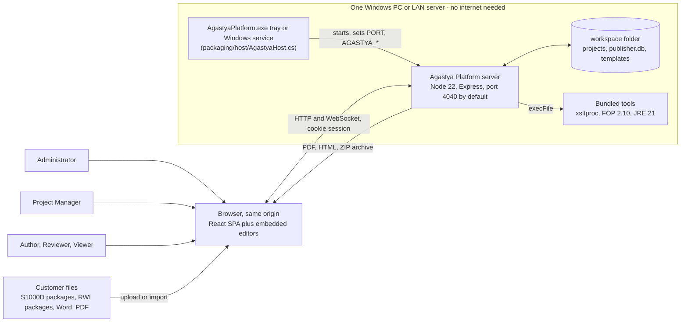
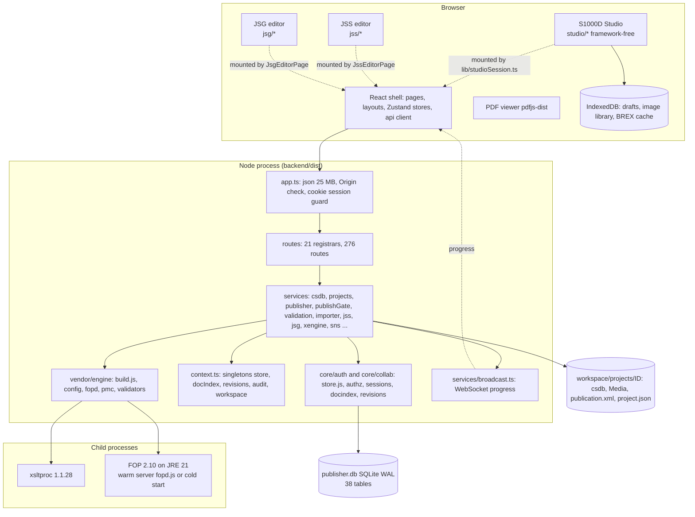
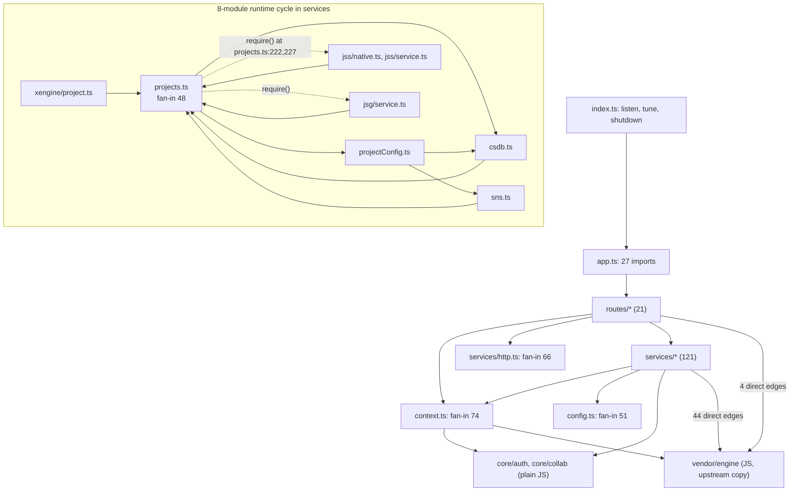
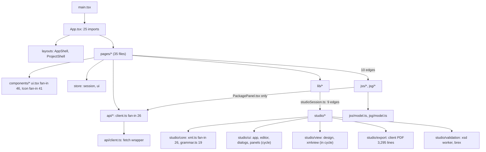
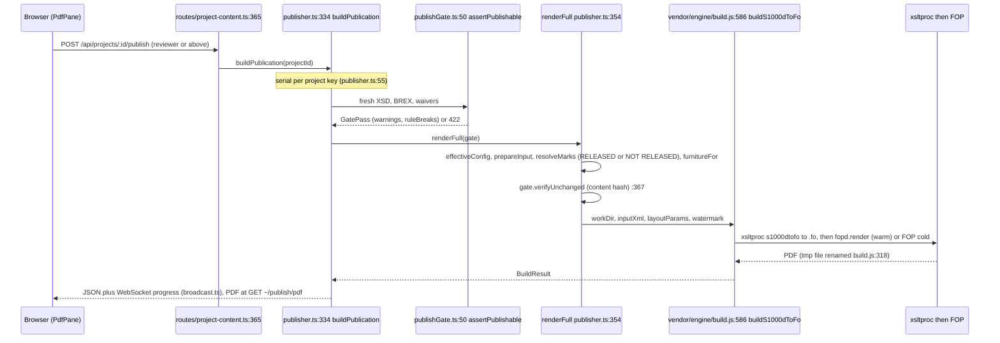
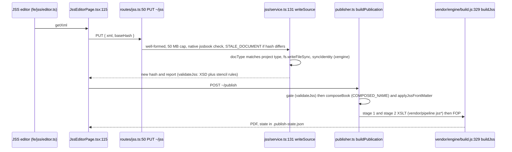
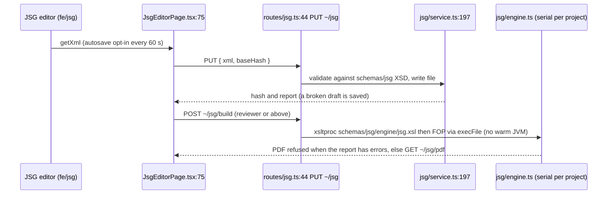

# 01 - Codebase understanding (agent J, the mapper)

Scope and method. This report maps the whole repository `Agastya-platform-v2` (audit only; no repository file other than files under `docs/audit/` was created or changed). Breadth facts were produced by read-only scripts kept in the scratch folder (`scratchpad\J\*.mjs`), each of which is lexical (regular expressions plus a comment/string-masking brace matcher); every table below says which script made it and how it can be wrong. Where something was run, it says so. Evidence labels used throughout: **VERIFIED** (I ran something and saw the result), **OBSERVED** (read in code or output, not run), **SUSPECTED**, **RECOMMENDATION**, **NOT VERIFIED**. Existing prose documents (`README.md`, `memory.md`, `docs/*.md`) were treated as leads, not truth; where a claim from them is repeated, it was re-checked in code and the file:line is given, or it is marked "per docs".

What was actually run by me (all read-only or against a scratch workspace; no server on 4040/4041; no port opened at all):

| Run | Result | Label |
|---|---|---|
| `dump-routes.js` loads `backend/dist/app` with `AGASTYA_WORKSPACE_DIR` pointing at a scratch folder and dumps the Express router (no listen) | 282 router rows, 276 unique method+path pairs, 0 unguarded `/api` routes; the static scan of `backend/src` matches it exactly | VERIFIED (reflects `backend/dist`, which matched `src` on this date) |
| `node --test test/rbac.test.js` | 7 of 7 pass | VERIFIED |
| `node --test test/zipio.test.js` | 5 of 5 pass | VERIFIED |
| `xsltproc.exe --version` and `java.exe -version` of the bundled tools | libxml 2.9.3 (20903), libxslt 1.1.28, libexslt 0.8.17; Temurin OpenJDK 21.0.13.1 | VERIFIED |
| `pmc.parsePm('<jssbook>...')` (pure function) | throws "Not a publication module: no `<pm>` root element" | VERIFIED |
| `runtime/node.exe --version` of the staged release and a listing of its `argon2` prebuild | v22.23.2; `argon2/prebuilds/win32-x64` present | VERIFIED |
| Import graph, dead-export, duplicate-function, size, table and file-duplicate scripts | numbers in section 8 | VERIFIED as script output; interpretation OBSERVED |

## Contents

1. Repository structure; 2. Technology stack; 3. Third-party inventory; 4. Build, run, test and environment
5. Feature inventory (126 rows: 5.1 platform and access, 5.2 S1000D, 5.3 publishing and release, 5.4 JSS, JSG and cross-engine, 5.5 packaging and quality, 5.6 finer-grained capabilities)
6. Module relationships (seven diagrams); 7. Execution-flow traces (nine workflows)
8. Mapper analyses (routes, import graph, layering, dead code, duplication, size)
9. Findings ARC-001 to ARC-024; 10. Strengths; 11. Unknowns and limitations; 12. Leads for other agents
Appendix A. Route inventory (276 routes); Appendix B. Database tables (38 tables)

## Coverage of this report (what agent J personally read)

| Area / path | Status | Verification done | Limits |
|---|---|---|---|
| `backend/src/app.ts, config.ts, context.ts, index.ts` | Inspected | read in full; middleware order, wiring, start/stop | - |
| `backend/src/core/auth` (store.js, authz.js, sessions.js, crypto.js, routes.js login/logout/me, masterPassword.js) | Partially inspected | key functions read; `store.js` DDL parsed by script | 966-line `registerAuthRoutes` read only around login; other admin routes mapped by script |
| `backend/src/routes/*` (21 files) | Partially inspected | inventory by script for all 276 routes; handlers read for DM CRUD, release, publish, validate, import, backup, jss, workspace | other handlers not read line by line |
| `backend/src/services/*` (121 files) | Partially inspected | first comment line of every file read; csdb, projects, publisher, publishGate, backup, release, pm, jss/service writeSource, jsg engine read | importer, sns, jssdm, xengine, lifecycle, applicability internals not read |
| `backend/vendor/engine`, `vendor/pipeline` | Partially inspected | `build.js`, `fopd.js` read; function inventory by script | XSLT stylesheets not read |
| `backend/vendor/tools` (FOP, JRE, libxslt, fonts) | Inspected (binaries) | versions obtained by running them | licences not reviewed here |
| `frontend/src` shell (App, main, pages list, stores, api client, EditorRoute, studioSession) | Partially inspected | route table, page headers, save and draft paths read | most page bodies not read |
| `frontend/src/studio`, `jss`, `jsg` | Partially inspected | import graph, drafts, save, sizes by script; `app.ts` drafts read | editing model, grammar, PDF export not read |
| `frontend/e2e`, `backend/test` | Partially inspected | test names listed, counts, route-reference matching | no e2e run (shared machine, brief) |
| `packaging`, `scripts` | Partially inspected | host header, ini template, installer section headers, npm scripts, `package-windows.mjs` dependency staging | installer not built or run |
| `docs/*.md`, `README.md`, `memory.md` | Partially inspected | headers and stale claims spot-checked | not read in full |
| `workspace/`, `release/`, `SAMPLE PROJECTS/`, `manual format/` | Not inspected by design | `workspace\` is the owner's real data (brief forbids reading it); customer folders not quoted | `release/` staged copy only listed |

## 1. Repository structure

The repository is one Git repository (`git ls-files`: 6,093 tracked files; `.git` is 86 MB) with an npm "orchestrator" `package.json` at the root and two independent npm projects (`backend`, `frontend`) with their own lockfiles. Counts below come from `loc.mjs` (raw line counts; node_modules, dist, `.git`, `workspace`, `release`, customer folders and `backend/vendor/tools*` skipped).

| Path | What it is | Files / lines | Notes |
|---|---|---|---|
| `package.json`, `README.md`, `memory.md`, `.gitignore`, `.gitattributes` | root orchestration and prose | 5 files, 845 lines | root scripts only call `npm --prefix`; no workspaces; no `engines` at root |
| `backend/` | Express 4 + TypeScript API, SQLite index, vendored publishing engine | 1,019 files, 1.09 M lines (dominated by 936 K lines of XSD in `schemas/`) | `package.json` requires Node >= 22.5 (`node:sqlite`) |
| `backend/src/` | the product's server code | 160 files, 28.5 K lines | `core` 13 files / 3.7 K, `routes` 21 / 2.6 K, `services` 121 / 21.8 K, plus `app.ts config.ts context.ts index.ts` |
| `backend/src/core/auth`, `core/collab` | plain-JS identity, sessions, authorization, SQLite store and document index/revisions copied from an older "JSS Publisher" | 13 files | the only JS (not TS) in `src`; `store.js` 1,571 lines holds 36 tables |
| `backend/src/routes` | Express route registrars, one function per file | 21 files | 276 routes in total (section 8.1, Appendix A) |
| `backend/src/services` | business logic, one file per concern; subfolders `importer/ jsg/ jss/ jssdm/ sns/ xengine/` | 121 files, 21.8 K lines | `projects.ts`, `csdb.ts`, `publisher.ts`, `projectConfig.ts` are the hubs |
| `backend/vendor/engine` | vendored publishing engine (build, config, paths, FOP server `fopd.js`, watermark, frontmatter, validators) | 32 files, 6.7 K lines | upstream copy; comments say "do not edit"; `comments.js`, `lemminx.js`, `license.js` are never imported |
| `backend/vendor/pipeline` | XSLT pipelines `s1000dtofo`, `s1000dtojss`, `jsstofo`, `jss` | 64 files, 21.2 K lines | NOT READ in this report |
| `backend/vendor/tools` | Apache FOP 2.10 (107 MB), Temurin JRE 21 (47 MB), libxslt 1.1.28 win32-x86 (12 MB), fonts (8 MB); `tools-linux` has fonts/fop/libxslt | 4,356 tracked files, 58 MB | binaries are tracked in Git |
| `backend/schemas` | S1000D XSDs for issues 3.0, 4.1, 4.2, 5.0, 6.0, 7.0 plus JSG/JSS XSDs and `PROVENANCE.md` | 256 files, 40 MB | |
| `backend/brex`, `reference`, `assets`, `templates`, `samples` | default BREX data modules, reference lists, logos, project templates, JSG sample projects (23 MB) | 6 / 3 / 3 / 9 / 333 files | |
| `backend/test` | 83 `*.test.js` files (539 `test(` calls, `node --test`) plus 50 fixture files | 136 files, 21.6 K lines | |
| `backend/scripts` | `doctor`, `reset-admin`, sample builders, perf probes | 13 files | `npm run doctor`, `reset-admin` are operator tools |
| `frontend/` | React 18 + Vite 5 SPA, with three framework-free embedded editors | 658 files | |
| `frontend/src/{pages,components,layouts,api,store,lib,styles}` | the React shell (35 + 21 + 2 + 12 + 5 + 16 + 2 files) | about 11.6 K lines | Zustand stores `session`, `ui`; routing in `App.tsx` |
| `frontend/src/studio` | S1000D Studio: framework-free editor (core model, grammar, ops, view, validation, export to PDF with pdfmake) | 107 files, 20.6 K lines | embedded through `lib/studioSession.ts`; 4 files over 1,200 lines |
| `frontend/src/jss`, `frontend/src/jsg` | JSS and JSG document editors | 15 files / 3.6 K lines, 10 / 2.3 K | independent of the Studio and of each other (0 import edges, section 8.4) |
| `frontend/public` | static copies served by the SPA: XSD schemas (170 files, 37 MB), compiled grammars (131 files, 16 MB), BREX, samples, xmllint wasm | 316 files, 55 MB | 160 files are byte-identical to `backend/schemas` (ARC-010) |
| `frontend/e2e` | Playwright: 12 specs, 100 `test(` calls, fixtures | 104 files | runs against `node e2e/serve.mjs` on port 4050 |
| `packaging` | Inno Setup script, C# tray/service host (`AgastyaHost.cs`, 886 lines), `agastya.ini.template`, third-party notices, icons | 13 files | |
| `scripts` | `start.mjs`, `package-windows.mjs`, `verify-*.mjs`, signing and VM acceptance PowerShell | 13 files, 1.9 K lines | |
| `docs` | operator and design documents (22 `.md`) plus `audit/` (this audit) | 24 files | several are dated work logs, not specifications |
| `release/` | staged and built installer output | git-ignored | `Agastya-Platform-2.0.0-win-x64/` exists on disk |
| `workspace/` | the owner's real runtime data and database | git-ignored | NOT READ (brief) |
| `SAMPLE PROJECTS/`, `manual format/` | customer reference material | git-ignored | NOT READ / not quoted |

### How the pieces fit (summary)

* **Content is files; the database is an index and a governance ledger.** A project is a folder `workspace/projects/<id>/` holding `csdb/` (data modules), `Media/`, `publication.xml`, `project.json`, built PDFs and sidecar files. SQLite (`publisher.db`, `node:sqlite` `DatabaseSync`, WAL) holds users, sessions, memberships, releases, review comments, configuration catalogues, SNS, the document index and the revision blobs (`backend/src/context.ts:68`, `core/auth/store.js`).
* **Three document formats share one project model.** S1000D (data modules plus a publication module), JSS (`<jssbook>` in one `publication.xml`), JSG (`<jsgdoc>` in one file). `services/formats.ts` and `services/xengine/*` decide and convert between them.
* **One publish path.** `POST /api/projects/:id/publish` runs the publish gate, then the vendored engine (`xsltproc` then FOP), for S1000D and JSS; JSG has its own engine (`services/jsg/engine.ts`).
* **The SPA embeds three editors.** The S1000D Studio, the JSS editor and the JSG editor are plain TypeScript apps mounted into React pages; the React shell owns routing, roles and the server calls.

## 2. Technology stack

| Layer | Technology | Where | Notes (label) |
|---|---|---|---|
| Runtime | Node.js >= 22.5 (the installer ships Node 22 per `docs/PACKAGING.md`) | `backend/package.json` engines | `node:sqlite` is experimental; Node prints `ExperimentalWarning: SQLite is an experimental feature` (VERIFIED while loading it) |
| Server | Express 4.22.3, `multer` 2.5.0 (uploads to disk), `ws` 8.23.0 (build progress) | `backend/src/app.ts` | CommonJS output of `tsc` into `backend/dist` |
| Language | TypeScript 5.9.3 (backend `src`, frontend), plain JS for `core/auth`, `core/collab`, `vendor/engine`, tests | | 272 `any` in 63 backend files, 54 in frontend; 46 `require(` in `.ts` files (OBSERVED) |
| Database | SQLite via `node:sqlite` `DatabaseSync`, WAL, no ORM, additive migrations (`MIGRATIONS` in `store.js`) | `core/auth/store.js` | 38 tables (36 in `store.js`, 2 in `vendor/engine/db.js`) |
| Auth | scrypt (always) or Argon2id (optional native `argon2` 0.41.1), opaque 256-bit session tokens stored as SHA-256, HttpOnly SameSite=Lax cookie, 7-day absolute TTL | `core/auth/crypto.js, sessions.js` | optional dependency; details in section 3 |
| XML | `@xmldom/xmldom` 0.9.12, `xpath` 0.0.34 (BREX XPath 1.0), `xmllint-wasm` 5.3.0 (XSD validation in process, backend and browser) | services | |
| Publishing | libxslt `xsltproc` 1.1.28 (libxml 2.9.3), Apache FOP 2.10, Temurin JRE 21.0.13.1, warm FOP JVM (`fopd.js`), fonts DejaVu, Liberation, Arial/Arial Narrow (Arial not redistributable, git-ignored) | `backend/vendor` | all called with `execFile`, no shell |
| Images | `jpeg-js` 0.4.4 and a hand-written PNG encoder | `vendor/engine/imageOptim.js`, `importer/png.ts` | |
| Frontend framework | React 18.3.1, React Router 6.30.6, Zustand 4.5.7, Tailwind 3.4.19, Vite 5.4.21, Lucide icons | `frontend/src` | no component library; shared primitives in `components/ui.tsx` |
| Editor stack | CodeMirror 6 (XML source view), pdfmake 0.3.13 (client-side PDF in the Studio), pdfjs-dist 4.10.38 (PDF viewer), xmllint-wasm in a Worker | `frontend/src/studio`, `components/pdf` | |
| Tests | `node --test` (backend), Vitest 2.1.9 (frontend unit), Playwright 1.65.1 (e2e, system Chrome) | | no ESLint or Prettier configuration anywhere (ARC-014) |
| Packaging | Inno Setup 6, C# 5 host compiled with the .NET Framework 4 `csc.exe`, Windows service option, portable ZIP | `packaging/`, `scripts/package-windows.mjs` | Windows-first; `tools-linux` exists for fonts, FOP and libxslt only |
| Operations | `agastya.ini` (port, bind, data dir, secure cookies, log size), service name, tray application | `packaging/agastya.ini.template` | |

## 3. Third-party inventory, binaries and optional modules

Produced by `deps.mjs` from `package.json` and `package-lock.json` (both lockfileVersion 3) plus `node_modules/<pkg>/package.json` for licence strings; licences are what each package declares (no legal review).

| Package | Range | Locked | Purpose | Licence | Used in |
|---|---|---|---|---|---|
| express | ^4.19.2 | 4.22.3 | HTTP server (31 transitive deps) | MIT | 24 files |
| multer | ^2.0.2 | 2.5.0 | multipart uploads | MIT | 4 files |
| ws | ^8.18.3 | 8.23.0 | progress WebSocket | MIT | `services/broadcast.ts` |
| @xmldom/xmldom | ^0.9.10 | 0.9.12 | DOM for BREX, applicability, SNS, JSS | MIT | 16 files |
| xpath | ^0.0.34 | 0.0.34 | BREX XPath 1.0 | MIT | `services/brex.ts` |
| xmllint-wasm | ^5.1.0 (backend), ^5.3.0 (frontend) | 5.3.0 both | XSD validation (backend `validateSchema.js`; frontend copies the browser build into `public/vendor/xmllint`) | MIT | 5 backend files |
| jpeg-js | ^0.4.4 | 0.4.4 | JPEG decode for image optimisation | BSD-3-Clause | `vendor/engine/imageOptim.js` |
| argon2 (optional) | ^0.41.1 | 0.41.1 | Argon2id hashing; has an install script | MIT | `core/auth/crypto.js` |
| react, react-dom | ^18.3.1 | 18.3.1 | UI | MIT | |
| react-router-dom | ^6.28.0 | 6.30.6 | routing | MIT | 23 files |
| zustand | ^4.5.4 | 4.5.7 | `store/session.ts`, `store/ui.ts`, `lib/studioSession.ts` | MIT | 6 files |
| lucide | ^1.69.0 | 1.73.0 | icons | ISC | `components/Icon.tsx` |
| pdfmake | ^0.3.13 | 0.3.13 | Studio client-side PDF | MIT | `studio/export/fonts.ts` |
| pdfjs-dist | ^4.10.38 | 4.10.38 | PDF viewing (and PDF TOC recovery in the importer) | Apache-2.0 | `components/pdf/PdfJsViewer.tsx` |
| @codemirror/* (8 packages) and @lezer/highlight | see `package.json` | 6.x | XML source editor | MIT | `studio/view/xmlview.ts` |
| codemirror | ^6.0.2 | 6.0.2 | meta-package | MIT | **no import found** (ARC-011) |
| dev: typescript 5.9.3, ts-node-dev 2.0.0, @types/*, vite 5.4.21, @vitejs/plugin-react 4.7.0, tailwindcss 3.4.19, postcss 8.5.33, autoprefixer 10.6.2, vitest 2.1.9, jsdom 25.0.1, @playwright/test 1.65.1 | | | build and test only | MIT / Apache-2.0 | |

Lockfile totals (VERIFIED by script): backend 158 locked packages, production closure 83, 5 optional, 2 with install scripts (`argon2`, `fsevents`); frontend 331 locked, production closure 68, 62 optional, 2 with install scripts (`esbuild`, `fsevents`). Declared production licences: backend MIT 77, ISC 2, BSD-3-Clause 2, 2 undeclared; frontend MIT 63, Apache-2.0 2, ISC 1, BlueOak-1.0.0 1, 1 undeclared. The two "undeclared" per side are lockfile entries with no `license` field (not investigated; NOT VERIFIED which).

Bundled binaries (all under `backend/vendor/tools`, tracked in Git; VERIFIED where marked):

| Binary | Version | How known | Note |
|---|---|---|---|
| Apache FOP | 2.10 (`fop-2.10.jar`, `fop-core-2.10.jar`) | file names, `tools/fop-2.10/README` | a stray `fop/output.pdf` sits in the FOP folder (OBSERVED) |
| Temurin JRE | 21.0.13.1+2 LTS, modules java.base, java.datatransfer, java.xml, java.prefs, java.desktop, java.logging | VERIFIED (`java -version`, `release` file) | stripped runtime |
| libxslt / xsltproc | libxslt 1.1.28 (folder name `libxslt-1.1.28-win32-x86`), libxml 2.9.3, libexslt 0.8.17, 32-bit x86 build | VERIFIED (`xsltproc --version`) | old components, see ARC-009 |
| Fonts | DejaVu Sans (4), Liberation Sans (4), Arial and Arial Narrow (8 files; git-ignored, licence-gated) | directory listing, `fonts/README.md` | Arial is not redistributable; builds can use `--no-arial` (per `.gitignore` comment) |
| xmllint wasm (browser build) | from `xmllint-wasm` 5.3.0, 779 KB | `frontend/public/vendor/xmllint` | copied by `frontend/scripts/build-grammar.mjs:372-376` |
| Node runtime in the staged release | v22.23.2, 64-bit | VERIFIED (`release/Agastya-Platform-2.0.0-win-x64/runtime/node.exe --version`; `version.json` builtAt 2026-11-22) | `vendor/engine/db.js:9` still says "Node 24" (ARC-015); the installer itself was not built or run by me |

Optional native module `argon2` (OBSERVED `core/auth/crypto.js`): it is loaded in a try block; when absent `hashPassword` returns an scrypt hash (`$scrypt$...`), `verifyPassword` accepts `$scrypt$` always, and returns **false for any `$argon2` hash when the binding is missing** (`crypto.js:46-53`), so a database whose users were created with Argon2 locks everyone out if it is later opened without the module. `usingArgon2()` is exported and never called (dead export). `scripts/package-windows.mjs:143-146` stages `npm ls --omit=dev --all`, which includes optional dependencies when installed; the staged release does carry the Windows prebuild (`release/.../app/backend/node_modules/argon2/prebuilds/win32-x64/argon2.glibc.node`, VERIFIED by listing; agents F and I report it loads with the bundled `node.exe`), so the packaged product is not exposed; see ARC-019.

## 4. Build, run, test commands and environment variables

Root `package.json` scripts (OBSERVED, all three `package.json` files read):

| Command | What it does |
|---|---|
| `npm run install:all` | `npm install` in backend and frontend |
| `npm run build` | `tsc` for the backend into `backend/dist`, then `tsc --noEmit && vite build` for the frontend |
| `npm start` | `node scripts/start.mjs` (production-style start) |
| `npm run dev:backend` / `dev:frontend` | `ts-node-dev --respawn --transpile-only src/index.ts` / `vite` (dev proxy origin `http://localhost:5174`) |
| `npm run doctor`, `npm run reset-admin` | operator tools in `backend/scripts` |
| `npm test` | build, then backend tests, frontend tests, e2e |
| `npm run test:backend` | `node --test test/*.test.js` (83 files) |
| `npm run test:frontend` | `vitest run` excluding the heavy `studio/__tests__/verify/*` set (29 test files, about 219 `it/test` calls) |
| `npm run test:e2e` | Playwright, 12 specs, 100 tests, port 4050, `node e2e/serve.mjs`, system Chrome (`E2E_CHANNEL=msedge` for Edge); `VERIFY_E2E=1` adds the `zz-verify-*` specs |
| `npm run verify` | the 21-type x 4-issue verification suite and report (about 5 minutes per `playwright.config.ts` comment) |
| `npm run package:win` (`-- --build`, `--no-installer`, `--no-arial`) | stages `release/Agastya-Platform-<ver>-win-x64/`, builds Setup.exe (Inno Setup 6) and portable ZIP, writes `SHA256SUMS.txt` |
| `npm run verify:package` | `scripts/verify-package-offline.mjs` (offline proof) |

Environment variables read by the server (`config.ts` and a few others; grep of `process.env` in `backend/src`, VERIFIED complete for `src`):

| Variable | Default | Where | Purpose |
|---|---|---|---|
| `PORT` | 4040 | `config.ts:15` | listen port |
| `AGASTYA_HOST` | loopback | `config.ts:20` | bind address (set from `agastya.ini` `Bind=`) |
| `AGASTYA_WORKSPACE_DIR` | `<repo>/workspace` | `config.ts:32` | data folder (projects, `publisher.db`, templates) |
| `AGASTYA_CLIENT_DIST` | `<repo>/frontend/dist` | `config.ts:35` | static client |
| `AGASTYA_SECURE_COOKIES` | off | `config.ts:37` | `Secure` cookie attribute behind HTTPS |
| `AGASTYA_MAX_UPLOAD_BYTES` | 2 GB per file | `services/uploads.ts:13` | upload size cap; JSON bodies are capped separately at 25 MB (`app.ts:45`) |
| `AGASTYA_DEV_ORIGINS` | `http://localhost:5174` | `app.ts:54` | extra allowed browser Origins in development |
| `AGASTYA_SHUTDOWN_ON_STDIN_CLOSE` | off | `index.ts:61` | the tray host sets it so the server exits when its parent dies |
| `AGASTYA_PDFJS_DIR`, `AGASTYA_RECOVER_CHILD` | unset | `importer/recover/pdfjs.ts:22`, recover scripts | PDF structure recovery assist |
| `AGASTYA_DEBUG` | off | `backend/scripts/recover-structure.js:73` only | stack trace in an operator script |
| `JSS_JAVA`, `JSS_GS` | unset | `vendor/engine/paths.js:145,161` | alternative Java / Ghostscript path; the engine looks for `tools/ghostscript/gswin32c.exe` (`paths.js:158`), which is not in the tree (OBSERVED), so Ghostscript is optional and absent |

The Windows host (`packaging/host/AgastyaHost.cs:381-386`) sets `PORT`, `AGASTYA_HOST`, `AGASTYA_WORKSPACE_DIR`, `AGASTYA_CLIENT_DIST`, `AGASTYA_SHUTDOWN_ON_STDIN_CLOSE` and optionally `AGASTYA_SECURE_COOKIES` from `agastya.ini` (`[server] Port Bind`, `[storage] DataDir`, `[security] SecureCookies`, `[app] OpenBrowser`, `[logging] MaxFileMB KeepFiles`, `[service] Name`). The host also reads `AGASTYA_HOME` for portable use (`AgastyaHost.cs:761`). There is no `.env` loader and no `.env.example` in the repository (OBSERVED; `.gitignore` references `.env.example` only as an exception).

## 5. Feature inventory

How to read it. One row per user-visible capability or platform mechanism, grouped by area (5.1 Platform, identity and access; 5.2 S1000D authoring, governance and import; 5.3 Publishing, review and release; 5.4 JSS, JSG and cross-engine; 5.5 Packaging, operations and quality). Paths are shortened: `be/` = `backend/src/`, `fe/` = `frontend/src/`, `vendor/` = `backend/vendor/`, `~` = `/api/projects/:id`, `@` = `/api/admin`. Status classes use the brief's exact names, abbreviated: **F** Fully implemented and verified; **I** Implemented but needs improvement; **P** Partially implemented; **FO** Frontend only; **BO** Backend only; **U** Present but unreliable; **E** Present but inefficient; **M** Missing; **R** Requires further investigation. Every status carries an evidence label: **[V]** = something I ran supports it (named in the Tests cell); **[O]** = class assigned from reading code, route inventory and test names only. No row is a statement that the tests pass: agent G owns the test run of record. "Tests" lists test files that reference the feature (script match on paths plus file names); "no literal test" means no backend test or e2e spec contains the route path literal (UI-driven e2e steps do not show up in that match, so it is an upper bound on the gap). Cells are terse by design; the detail is in sections 6 to 8.

### 5.1 Platform, identity and access

| # | Feature | Purpose | Frontend | Backend | APIs | DB | Depends on | Status | Validation | Errors | Tests | Limits | Improve |
|---|---|---|---|---|---|---|---|---|---|---|---|---|---|
| A1 | First-run administrator setup | create the first admin when no user exists | fe/pages/AuthScreens.tsx | be/core/auth/routes.js, bootstrap.js | GET,POST /api/auth/setup | users | A2 | F [O] | policy.js | 409 once set up | api.test (setup refused twice), e2e platform | none seen | - |
| A2 | Sign-in and session | username+password, opaque cookie session | AuthScreens.tsx, store/session.ts | core/auth/routes.js:184, sessions.js, crypto.js, rateLimit.js | POST /api/auth/login, /logout, GET /me | users, sessions, audit_log | A1, crypto | F [V rbac] | rate limit per username+IP; dummy hash for unknown user | generic failure text, audit rows | api.test, rbac.test (7/7 pass) | 7-day absolute TTL (`sessions.js:11`); single active session per account: a new login displaces every other live session (`sessions.js:72-90`, audited `auth.session.displaced`); the limiter is in memory and resets on restart (OBSERVED) | idle timeout |
| A3 | Session list and revoke | admin ends sessions | Administrator.tsx | core/auth/routes.js | GET @/sessions, POST @/sessions/:id/revoke | sessions | A2 | I [O] | admin only | 404 | no literal test | - | add test |
| A4 | Forced password change and onboarding | temporary password, choose own password | AuthScreens.tsx | core/auth/routes.js, policy.js | POST /api/auth/change-password, /onboarding | users | A2 | I [O] | 8-128 chars, common-password denylist | JSON error | e2e platform (Author chooses a password); change-password no literal test | policy only length+denylist | test the route |
| A5 | Password reset requests | user asks, admin approves | AuthScreens.tsx, Administrator.tsx | core/auth/routes.js | POST /api/auth/forgot, GET/POST @/resets/* | password_reset_requests | A6 | I [O] | admin decision | - | no literal test | - | add tests |
| A6 | User administration | create, edit, disable, enable, reset password, bulk CSV import | Administrator.tsx, Settings.tsx | core/auth/routes.js:651-720, routes/team.ts | POST /api/team/users, @/users/* | users | A7 | P [O] | username suggestion, CSV pre-validation (`validateCsvUsers`) | per-row report | rbac.test (who can create which accounts, VERIFIED pass); CSV import has no FE caller (BO) and no test | CSV import backend-only | wire or remove |
| A7 | Role model (admin, project_manager, author; project roles viewer, reviewer, editor, manager, owner) | least privilege | lib/roles.ts | core/auth/authz.js:19-221 | all | users, project_members | - | F [V rbac] | rank compare; non-members get 404 | 403/404 | rbac.test 7/7 | `cap` labels on 154 project routes are not enforced (ARC-004) | enforce or delete |
| A8 | Project membership and sharing | give view/edit/manager access | ProjectSettingsPage.tsx (team) | core/auth/routes.js, routes/team.ts | ~/members, ~/invitations, ~/assign | project_members, project_invitations | A7 | F [V rbac] | PM limits | 403 | rbac.test (share, PM assigns), e2e roles | members GET and invitation DELETE have no literal test | - |
| A9 | Invitations | accept or decline access | Overview.tsx | core/auth/routes.js | GET /api/invitations, POST accept/decline | project_invitations | A8 | I [O] | owner check | - | accept tested in e2e; decline no literal test | - | - |
| A10 | Admin project ownership tools (adopt ownerless, reassign owner, make ownerless, add member) | repair orphaned projects | none | core/auth/routes.js:858-963 | @/projects/* (6 routes) | projects, project_members | A7 | BO [O] | admin | - | no literal test | no UI | decide keep or remove |
| A11 | Folders, folder grants, access requests | group projects, share a folder | Workspace.tsx | services/projects.ts, core/auth/routes.js | /api/folders/*, /api/workspace | folder_owners, folder_grants, folder_access_requests | A7 | P [O] | owner/manager rules | 404 | folder PATCH/DELETE/access routes: no literal test | the `change_requests` flow is not reachable (its store methods are never called; 18 of 108 store methods are unused) | confirm which flows are live |
| A12 | Audit log and CSV export | who did what | Administrator.tsx | context.ts `audit()`, core/auth/store.js, services/platform.ts | GET @/audit, GET @/maintenance/audit.csv | audit_log | A7 | I [O] | admin | - | phase17-security (non-admins refused); no literal positive test for GET @/audit | CSV export is the newest 5,000 events only (`platform.ts:83-89`) and cells are not neutralised against spreadsheet formulas (SUSPECTED) | page + filter |
| A13 | Notifications inbox | tell people what changed | pages/Notifications.tsx, bell in AppShell | services/notifications.ts, routes/team.ts | GET /api/notifications, unread-count, POST read | notifications | A8, C7 | F [O] | per-user | - | notifications.test, e2e platform | - | - |
| A14 | Activity and oversight dashboards | PM/admin see work in flight | pages/Activity.tsx, Overview.tsx, components/Oversight.tsx | services/activity.ts, oversight.ts | GET /api/activity, ~/activity, /api/oversight | audit_log, project_members, releases | A7 | I [V rbac] | role-scoped | - | rbac.test activity (pass); /api/oversight no literal test | derived from audit log; reads on each request | cache if large |
| A15 | Platform settings and maintenance | reindex, check schemas, clear previews, rebuild PDFs, app settings, asset policy | Administrator.tsx, Settings.tsx | routes/admin.ts, services/platform.ts | @/maintenance/*, @/app-settings, @/asset-policy | config_items | A7 | I [O] | admin | JSON | rebuild-pdfs, asset-policy, GET app-settings: no literal test (asset-policy and app-settings GET have no FE caller) | long jobs run inside the request | job status |
| A16 | Administrator reference data | dropdown catalogues (languages, countries, security, enterprises, ...) | Administrator.tsx | services/adminConfig.ts | @/config/*, /api/reference | config_items | A7 | F [O] | field specs per collection | 400 | e2e platform (every V1 section; DM form uses them) | schema in code (`FieldSpec`) | - |
| A17 | Platform backup (ZIP) | download project files and user list | pages/BackupPage.tsx | routes/team.ts:132, services/backup.ts, zip.ts | GET /api/backup | none (reads files and some tables) | A7 | I [O] | role-scoped project list | - | e2e platform (Author can back up); no backend test | whole ZIP held in memory; no database, releases, revisions, config; no restore (ARC-005) | stream; add DB copy |
| A18 | Workspace, projects list, overview | find and open projects | Workspace.tsx, Projects.tsx, Overview.tsx, components/project.tsx | routes/workspace.ts | GET /api/workspace, /projects, /overview, ~/summary | projects, project_members | A7 | F [O] | membership filter | 404 | api.test, e2e platform | - | - |
| A19 | Create project (wizard, formats, document types) | new S1000D, JSS or JSG project | components/project.tsx wizard | routes/workspace.ts:89, services/projects.ts:172, formats.ts, profiles.ts | POST /api/projects, GET /api/formats, /document-types | projects, project_members, project_config | A18, D1 | F [O] | name, format, type, S1000D config checked | 400 | api.test, project-formats.test, e2e s1000d-config, jss-editor | `createProject` is 103 lines and requires `jss/service` and `jsg/service` lazily (cycle) | split |
| A20 | Sample projects | try-me S1000D and JSG projects | components/SampleButton.tsx | services/sample.ts, jsg/sample.ts | POST /api/projects/sample, /sample-jsg | projects | A19 | F [O] | - | - | api.test (sample), e2e platform, jsg-editor | JSG sample is 23 MB in `backend/samples` | - |
| A21 | Copy project | duplicate | components/project.tsx | routes/workspace.ts, projects.ts createProject(fromId) | POST ~/copy | projects | A19 | R [O] | - | - | no literal test | - | test |
| A22 | Delete project | remove after name confirmation | project card | projects.ts:322, renderer.ts (release file handles) | DELETE ~ | projects, project_members | A18 | F [O] | exact name required | 400 | api.test, project-delete-after-build | Windows file-lock handling added (renderer.ts) | - |
| A23 | Project settings | name, folder, pipeline, publishing, brand, watermark, team | pages/project/ProjectSettingsPage.tsx, reused/PublishSettings.tsx (599 lines) | routes/project-content.ts, services/projects.ts | GET/PUT ~/settings, PATCH ~ | projects, project.json | A18 | I [O] | merge into project.json | 400 | e2e platform (project settings) | `updateProjectJson` rewrites JSON in place (not atomic), also called from a reviewer-level route (`project-content.ts:368`) | atomic write; recheck route role |
| A24 | Responsive and themed shell | light/dark, narrow screens | layouts/*, store/ui.ts, ThemeToggle | - | - | - | - | I [O] | - | - | e2e zz-responsive-layout | owned by agents E1/E2 | - |
| A25 | Build progress over WebSocket | live publish messages | lib/progress.ts, PdfPane.tsx | services/broadcast.ts, `ws` | WS (same origin) | none | C1 | R [O] | membership check per message | - | no test file named for it | NOT VERIFIED here | add test |
| A26 | Health check | liveness for tests and host | - | app.ts:65 | GET /api/health | - | - | F [O] | - | - | no literal test; used as Playwright `webServer.url` | public route | - |
| A27 | Cross-origin write refusal | defence in depth beside SameSite=Lax | - | app.ts:54-70 | all writes | - | - | I [O] | compares `Origin` host with `Host` or dev origin | 403 JSON | not located in tests (NOT VERIFIED) | requests without `Origin` pass by design | test |
| A28 | Streaming uploads | large ZIP and file uploads to disk | components, ImportPackageDialog | services/uploads.ts, routes/packages.ts | POST ~/packages/import, ~/import/*, /api/projects/import | none | - | F [O] | 2 GB per file default, stale upload sweep at start (`index.ts`) | 413 | uploads-config.test, zip-perf script | JSON bodies 25 MB | - |
| A29 | XML safety guard | refuse hostile XML (entities, DOCTYPE bombs), unsafe paths | - | core/auth/xmlGuard.js (170 lines), services/wellFormed.ts | internal | none | - | I [O] | entity count cap, `safeRelPath` | 400 `MALFORMED_XML` | api.test ('writes refuse hostile and damaged XML'), phase17-security.test (path traversal in file-name parameters) | `safeRelPath` and `MAX_ENTITY_DECLS` exported but only used inside the file | - |
| A30 | Database snapshot before migration | safety copy when upgrading a populated DB | - | services/dbSnapshot.ts, context.ts | none | all | - | F [O] | consistent copy | logs | db-snapshot.test | taken only before a migration, not periodically | schedule |

### 5.2 S1000D authoring, governance and import

Reachability note (VERIFIED by `apiuse.mjs`, a lexical scan): of about 230 client wrappers in `fe/api/*.ts`, about 43 are never called from any page, component or lib file. 25 of the 31 wrappers in `fe/api/csdb.ts` are uncalled because the project "Files (CSDB)" page was removed (`fe/App.tsx:79` redirects `/csdb` to the editor). Features that now have a backend and tests but no page are marked **BO** below.

| # | Feature | Purpose | Frontend | Backend | APIs | DB | Depends on | Status | Validation | Errors | Tests | Limits | Improve |
|---|---|---|---|---|---|---|---|---|---|---|---|---|---|
| B1 | Data module list, read, create, save, delete | the CSDB of a project | components in `pages/project/editor/EditorSide.tsx`, `lib/studioSession.ts:275-300` | `routes/project-content.ts:60-130`, `services/csdb.ts` (`writeDm` :190, `createDm` :212) | GET/PUT/POST/DELETE ~/dms[/:file] | documents, revisions, blobs | A7 | F [O] | XSD + well-formed + uniqueness (`validateContent` :150, `assertUnique`), new modules must fit project config | 409 `EDIT_CONFLICT`, `ALREADY_EXISTS`, 403 `DOCUMENT_LOCKED` | api.test (create, read, save, conflict, history), e2e platform | `writeFileSync` in place (not atomic); `baseHash` is optional so a client that omits it overwrites silently (`csdb.ts:199`) | atomic write; require hash |
| B2 | Optimistic concurrency | refuse stale saves | studioSession.ts (EDIT_CONFLICT message) | `csdb.ts:199-203` | PUT ~/dms/:file | - | B1 | I [O] | sha256 compare | 409 | api.test | check and write are synchronous, so safe inside one process (no `await` between them); not safe across processes | - |
| B3 | Module lock and unlock | owner locks a DM | `pages/project/ExplorePage.tsx:165` (owner only) | `csdb.ts lockedFor`, `routes/project-content.ts` | POST ~/dms/:file/lock, /unlock | documents | B1 | I [O] | owner only | 403 `DOCUMENT_LOCKED` | no literal test | a lock is checked in `writeDm` only (`csdb.ts:194`), not in delete or import (NOT VERIFIED) | test |
| B4 | Revision history | every save is a revision (blob by hash) | `contentApi.revision` (not called) | `core/collab/revisions.js`, `csdb.ts cut` :181 | GET ~/dms/:file/history[/:rev] | revisions, blobs, documents | B1 | P [O] | - | failure to record is swallowed (`csdb.ts:187` logs `console.error` only) | api.test (history) | no history UI; JSS and JSG documents are never cut (ARC-001) | surface in UI; do not swallow |
| B5 | S1000D Studio (embedded) | structured WYSIWYG DM editor in the project page | `pages/project/EditorPage.tsx`, `lib/studioSession.ts`, `studio/*` (107 files, 20.6 K lines) | none (saves through B1) | B1 routes | - | B1 | I [O] | grammar from XSD (`studio/core/grammar.ts`), live XSD in a Worker (`studio/validation/xsd.ts`) | toasts, EDIT_CONFLICT message | `studio/__tests__/*`, e2e zz-verify-21, platform | Open, Save As, Export PDF and Samples commands are hidden when embedded (`studio/ui/app.ts:253`) | - |
| B6 | Studio draft autosave and recovery | keep unsaved work across crashes | `studio/ui/editor.ts:47` (2.5 s debounce), `studio/ui/app.ts:988-1010` | none (browser IndexedDB) | none | - | B5 | U [O] | - | - | none found | drafts are written but `restoreDrafts` runs only when not embedded (`app.ts:144`), so the product never offers them back (ARC-002) | restore in host mode |
| B7 | XML source view | edit raw XML with highlighting | `studio/view/xmlview.ts` (CodeMirror 6) | - | - | - | B5 | F [O] | live parse | inline markers | studio verify tests | - | - |
| B8 | Client-side validation (XSD wasm, BREX) | instant feedback | `studio/validation/xsd.ts`, `brex.ts` | `services/brex.ts` duplicate (ARC-008) | none | - | B5 | I [O] | XSD per issue, BREX XPath 1.0 subset | marks in editor | `brex-parity.test.ts`, `brex-xpath.test.ts` | two implementations kept equal by a parity test | share one module |
| B9 | Quick preview (server PDF of one module) | check a module's PDF | `pages/project/editor/PdfPane.tsx`, `PreviewWindow.tsx` | `publisher.ts:438` (gate with `{file}` scope), `routes/project-content.ts:396` | POST ~/publish/preview/:file, GET ~/publish/pdf | none | C3 | F [O] | gate: fresh XSD + BREX | 422 refusal with findings (`PublishRefusal.tsx`) | api.test (server-side PDF), e2e publish-gate | warm FOP or cold JVM | - |
| B10 | Project validation page | run all checks, list findings, jump to editor | `pages/project/ValidationPage.tsx` | `services/validation.ts:153` (`runValidation`), `findings.ts` | POST/GET ~/validation, PUT ~/validation/issue | writes `.validation.json` (:245) | B1, B13 | F [O] | schema, BREX, DM refs, graphics, publication | report cached on disk | api.test (validation), e2e platform | `GET ~/findings` (the normalised list) has no FE caller | - |
| B11 | BREX engine | business rules per S1000D 4.10 | `components/MissingBrex.tsx` | `services/brex.ts` (631 lines), `projectBrex.ts` | GET ~/brex/missing, POST ~/brex/create | none | B10 | I [O] | structure and value rules, XPath 1.0 | findings | brex.test, brex-gate.test; missing/create no literal test | "a BREX rule this engine cannot run" is passed with a note (`publisher.ts:345`) | list unsupported rules |
| B12 | Publish gate | PDF or release needs a fresh schema validation | `PublishRefusal.tsx`, `lib/waivers.ts` | `services/publishGate.ts:50` (`assertPublishable`) | all publish and release routes | none | B10 | F [O] | content hash verified again before render (`gate.verifyUnchanged`, `publisher.ts:367`) | 422 with findings | publish-gate.test, html-gate.test, e2e publish-gate | - | - |
| B13 | Publish waivers | let a draft build despite a missing BREX, with reason | `pages/project/PublishWaivers.tsx` | `services/publishWaivers.ts` (atomic temp+rename :37), `routes/waivers.ts` | GET/POST/DELETE ~/publish-waivers | per-project JSON file, written temp+rename | B12 | F [O] | reason length, editor+ | 403 for viewer/reviewer | publish-waivers.test, e2e publish-waivers (9 tests) | never covers a release (by design) | - |
| B14 | Publication module (PM) and Explore | chapters and placement of DMs | `pages/project/PublicationPage.tsx` (287), `ExplorePage.tsx` | `services/pm.ts` (`writePm` :134 keeps `.bak`), `vendor/engine/pmc.js` | GET/PUT ~/pmc, GET ~/explore, GET ~/pmc/export, POST ~/pmc/import | none | B1 | F [O] | counts read-back check (`pm.ts:140`) | 400 `EMPTY_PM` | api.test (publication), pm-multi-ref tests, e2e platform (3 publication tests) | `.bak` single copy | - |
| B15 | Project S1000D configuration | issue, model code, codes, DM types, SNS | `pages/project/S1000dConfig.tsx` (326), wizard in `components/project.tsx` | `services/projectConfig.ts` (486), `routes/s1000d.ts` (36 routes) | GET/PUT ~/s1000d, ~/s1000d/codes, ~/s1000d/dm-types | project_config, project_codes, project_dm_types, project_sns | A19 | F [O] | catalogue-checked (`POST /api/s1000d/validate-config`) | 400 | s1000d-reference.test, s1000d-migration.test, e2e s1000d-config (5 tests) | 70 raw `.prepare` calls in services bypass the store (section 8.4) | route through the store |
| B16 | S1000D catalogue and SNS presets (admin) | information codes, learn codes, ILC, SNS presets | `pages/AdminS1000d.tsx` | `services/s1000dRef.ts`, `bootReference.ts` | GET /api/s1000d/catalogue, @/s1000d/* | ref_sources, ref_codes, ref_code_ranges, ref_dmtype_codes, sns_presets, sns_preset_nodes, catalogue_impacts | A7 | I [O] | provenance per issue | 400 | s1000d-reference.test, e2e s1000d-config; preset export/import no literal test | seeded at boot | - |
| B17 | SNS (project) | standard numbering of the publication | S1000dConfig.tsx | `services/sns.ts`, `sns/*` (8 files), `routes/s1000d.ts` | GET/POST/PATCH/DELETE ~/sns, POST ~/sns/import, ~/sns/preset | project_sns | B15 | I [O] | model validation | 400 | sns.test, sns-http, sns-polish, sns-separation, e2e s1000d-config | two SNS systems coexist (project SNS and "System 2" rows) | merge or retire |
| B18 | SNS rows ("System 2") and Administrator SNS defaults | derive a PM from codes, learn from BREX | none (screens removed per owner decision) | `routes/sns.ts` (16 routes), `sns/service.ts` | ~/sns-rows/*, /api/sns/defaults/* | config_items | B17 | BO [O] | - | 400 | sns-http.test; all 16 routes have no FE caller | maintained but unreachable from the UI | keep as API or remove |
| B19 | Model identification code change | change MIC of a project that has DMs (preview then apply) | `pages/project/S1000dConfig.tsx:53-54` | `services/modelCode.ts` | POST ~/model-code | documents | B15 | I [O] | plan shown before apply | - | no literal test | rewrites every DM (`modelCode.ts`) | test it |
| B20 | Applicability and configured publishing | ACT/CCT/PCT, filtered builds | `api/s1000d.ts` wrappers only; UI removed (e2e s1000d-config line 155 asserts "no applicability tools") | `services/applicability.ts`, `applicEval.ts`, `routes/s1000d.ts` (3 + 4 routes), `publisher.ts renderFull(workDir)` | GET/PUT ~/applicability, POST ~/publish/configured[/plan], GET ~/publish/configurations | none | B15 | BO [O] | model problems listed | - | applicability.test, applic-publish.test, applic-external.test; configured routes no literal test | 7 wrappers unused | decide |
| B21 | Lifecycle (issue, working revision, change marks, obsolete, supersede, reinstate) | S1000D issue management | `api/csdb.ts` wrappers (uncalled) | `services/lifecycle.ts`, `routes/lifecycle.ts` (9 routes) | ~/dms/:file/{issue,working-revision,obsolete,supersede,reinstate,change-marks,lifecycle}, ~/lifecycle/events | lifecycle_events | B1 | BO [O] | chain checks | 409 | lifecycle.test, lifecycle-reinstate.test; reinstate route no literal test | CSDB page removed | restore UI or retire |
| B22 | CSDB objects (DML, DDN, COM, UPF, SMC, IMF) | non-DM S1000D objects, HTML and PDF render | one wrapper pair used by Studio (`saveObject`, `readObject`) | `services/csdbObjects.ts`, `objectTemplates.ts`, `objectRender.ts`, `routes/packages.ts` | ~/objects[/*], ~/dml/generate | none | B1 | P [O] | per-object schema | - | csdb-objects.test, object-docs.test, scorm-validation.test | create/list UI uncalled | - |
| B23 | Delivery packages and project package import | exchange sets | uncalled wrappers | `services/packages.ts` (21 imports), `routes/packages.ts` | ~/packages/{project,delivery,import,import-reports}, ~/publish/html | none | B1 | BO [O] | ZIP limits, entity checks | 413, 400 | packages.test, package-settings.test, zipio.test (V 5/5) | import-report routes no FE caller | - |
| B24 | Static HTML publication | HTML/ZIP of the book | wrapper uncalled | `services/htmlPublish.ts` | POST/GET ~/publish/html, GET ~/publish/html/:name[.zip] | none | B12 | BO [O] | gate applies | 422 | html-publish.test, html-gate.test | `GET ~/publish/html/:name/*` no literal test | - |
| B25 | Graphics (ICN and symbols) | per-project and cross-project graphics | `pages/project/GraphicsPage.tsx`, `pages/Graphics.tsx`, `components/GraphicsView.tsx` | `services/graphics.ts`, `assets.ts`, `mediaFormats.ts`, `routes/graphics.ts` | /api/graphics, ~/graphics, ~/media, ~/assets | config_items (asset policy) | B1 | F [O] | format allow-list, active content refused unless policy allows (`phase17-security` asset policy) | 400 | phase17-security.test, e2e platform (graphics) | SVG scripts refused | - |
| B26 | CIR (common information repository) | shared DM pool, copy or link into projects | `pages/Cir.tsx`, `components/CirPicker.tsx` | `services/cir.ts`, `routes/cir.ts` | /api/cir[/*], ~/cir-links[/*] | cir_modules, cir_links | B1 | I [O] | linked copies not edited in project (`cir.assertNotLinked`) | 409 | cir-links.test, e2e platform (2 CIR tests) | CIR is a hidden project (`store.getCirProjectRow`) | - |
| B27 | Extension profiles | allow foreign-namespace content with a profile XSD | `fe/api/csdb.ts` used by Administrator | `services/extensions.ts`, `routes/extensions.ts` | @/extensions, ~/extensions | ext_profiles, project_ext | B15 | I [O] | XSD size cap | 400 | extensions.test, `studio/__tests__/extensions.test.ts` | - | - |
| B28 | Package importer (scan, repair, apply) | bring in Xignal, Vektra or any S1000D set; flavour detection; enterprise check; repairs (BREX remap, ICN placeholder, PM titles, table cols) | `pages/project/editor/ImportPackageDialog.tsx`, `ImportReportView.tsx`, `ImportResultView.tsx` | `services/importer/*` (20 files), `routes/importer.ts` | POST ~/import/{scan,apply,assign}, GET ~/import/{report,unassigned} | documents, revisions | B1 | I [O] | per-rule repairs, change log | refusals keep selection | importer-scan, importer-repairs, importer-structure, importer-http, import.test, golden-xignal, import-enterprise-refusal, e2e project-import-package (9 tests) | cycle importer/package <-> pmComplete <-> repairs/pmc (type import) | - |
| B29 | Assisted assembly of imported modules | place unplaced modules into chapters | `ImportAssignPanel.tsx` | `importer/assign.ts` | POST ~/import/assign | none | B28 | F [O] | pure over the tree | - | importer-structure.test, e2e import | - | - |
| B30 | PDF structure recovery (assist) | recover chapter structure from a customer PDF | none | `importer/recover/pdfToc.ts`, `pdfjs.ts`, `backend/scripts/recover-structure.js` | none | none | B28 | P [O] | - | - | golden-xignal.test (uses `findPdfjsDir`) | header calls it "A TEST / ASSIST feature" | keep out of product |
| B31 | DM-type verification matrix (21 types x issues) | prove every type edits, validates and saves | studio verify tests | `scripts/verify-*.mjs`, `docs/DM_TYPE_VERIFICATION.md` | - | - | B5 | R [O] | - | - | e2e zz-verify-21 (4 issues), zz-verify-wizard; excluded from default runs | heavy (about 5 minutes) | - |

### 5.3 Publishing, review and release

| # | Feature | Purpose | Frontend | Backend | APIs | DB | Depends on | Status | Validation | Errors | Tests | Limits | Improve |
|---|---|---|---|---|---|---|---|---|---|---|---|---|---|
| C1 | Publish PDF (S1000D and JSS projects) | build the publication | `pages/project/editor/PdfPane.tsx`, `PublicationPage.tsx` | `routes/project-content.ts:365`, `services/publisher.ts:334 buildPublication`, `:354 renderFull`, `vendor/engine/build.js:586 buildS1000dToFo`, `:329 buildJss` | POST ~/publish, GET ~/publish/download, ~/publish/pdf | none (last-build state in `.publish-state.json`, `publisher.ts:325`) | B12 | F [O] | publish gate first | progress over WebSocket, 422 refusal | api.test (server-side PDF), pdf-reference, pdf-multi-ipd, pdf-long-doctype, pdf21, e2e platform | builds are serialised per project (`serial(projectId:full)` :335); `GET ~/publish/status` has no FE caller | - |
| C2 | Warm FOP server | avoid JVM start per build | - | `vendor/engine/fopd.js`, used by `build.js:511`, `objectRender.ts`, `renderer.ts` | internal | none | C1 | R [O] | - | falls back to cold FOP (`fopd.isAvailable`) | fop-fonts.test, pdf21.test (crash investigation doc) | one JVM; FOP font abort pitfalls documented in memory (NOT re-checked) | agent H |
| C3 | Publish gate | PDF and release need a fresh validation | `components/PublishRefusal.tsx` | `services/publishGate.ts:50` | internal | none | B10 | F [O] | schema, BREX, waivers | 422 | publish-gate.test, html-gate.test, e2e publish-gate | - | - |
| C4 | PDF furniture, covers, side text, logos | reference-publication look | `PublishSettings.tsx` (421-line component) | `services/sideText.ts`, `vendor/engine/config.js` (`stage2Params` 377 lines), `brand.js`, `watermark.js` | PUT ~/settings, GET /api/brand-packs | none | C1 | I [O] | numeric clamps (`clampChapterTitleSize`) | - | pdf-furniture.test, xignal-cover.test, brand.test, publisher-logo.test, jss-cover-*.test | brand-pack routes have no FE (screen removed); `stage2Params` is a 377-line function | split by section |
| C5 | Release request, approve, reject, withdraw | author asks, PM or admin decides | `pages/project/ReleasePage.tsx` | `routes/project-content.ts:277-330` (`canApprove` :277), `services/release.ts` (`requestRelease` :131, `decideRelease` :155), `store.approveRelease` | GET/POST ~/release, POST ~/release/:relId/{approve,reject,changes}, DELETE ~/release/:relId | releases | B12 | F [O] | author cannot approve own request; gate re-run on request (`:288`) | 403 `APPROVER_ONLY` | api.test (release and watermark), rbac.test (releases, pass), e2e platform (release; roles) | approval is tied to a content fingerprint (`release.ts:36 publicationFingerprint`); a stale approval makes later builds NOT RELEASED (`publisher.ts:304`) | - |
| C6 | Release stamp and watermark | PDFs say RELEASED or NOT RELEASED for which content | PublishSettings.tsx | `release.ts releaseStateOf :96`, `publisher.ts resolveMarks` | GET/PUT ~/watermark | releases | C5 | F [O] | fingerprint match | - | api.test | GET ~/watermark no literal test | - |
| C7 | Manual review (comments, send back, resubmit) | PM reviews, comments on exact paragraphs | `components/ReviewReader.tsx`, ReleasePage.tsx | `services/review.ts`, `routes/project-content.ts` | POST ~/review/comments, ~/review/comments/:cid/resolve | review_comments | C5 | I [O] | roles reviewer+ | - | e2e platform (review: submit, comment, send back, resubmit, approve) | no backend `review` test file | add API test |
| C8 | Approvals queue (PM and admin) | one inbox of requests | `Overview.tsx`, `Activity.tsx` | `routes/team.ts` GET /api/approvals | GET /api/approvals | releases | C5 | F [O] | role scope | - | e2e platform | a second, unused queue exists: `@/approvals` (3 routes, no FE caller, no test) beside `/api/approvals` | remove duplicates |
| C9 | Configured (filtered) publication | applicability-filtered builds | wrappers uncalled | `publisher.ts` (`workDir`), `applicEval.ts` | POST ~/publish/configured | none | B20 | BO [O] | - | - | applic-publish.test | see B20 | - |
| C10 | Pop-out preview windows | Quick preview and Generate in own windows | `pages/PreviewWindow.tsx`, `lib/previewBus.ts` | - | uses C1 | - | C1 | I [O] | - | - | e2e platform (window test) | - | - |
| C11 | Rebuild all PDFs (maintenance) | after a stylesheet update | Administrator.tsx | `routes/admin.ts`, `services/platform.ts` | POST @/maintenance/rebuild-pdfs | none | C1 | R [O] | admin | - | no literal test | runs inside one request | job queue |

### 5.4 JSS, JSG and cross-engine

| # | Feature | Purpose | Frontend | Backend | APIs | DB | Depends on | Status | Validation | Errors | Tests | Limits | Improve |
|---|---|---|---|---|---|---|---|---|---|---|---|---|---|
| D1 | JSS document types (Land and Naval) | choose a stencil-based type | `components/project.tsx` wizard | `services/jss/registry.ts`, `registry-naval.ts` | GET /api/jss/types, /types/:type | none | A19 | F [O] | per-type structure | - | e2e jss-editor ("catalogue offers the 18 types, all ready"), jss-naval.test | `registry` and `registry-naval` import each other (type-only cycle) | - |
| D2 | JSS editor | author a `<jssbook>` with locked stencil chapters | `pages/project/JssEditorPage.tsx`, `fe/jss/editor.ts` (1,134 lines), `ops.ts`, `xml.ts` | none | uses D3 | none | D3 | I [O] | schema and stencil rules marked on the sheet | toasts, "Saved as a draft: N errors" | `jss/*.test.ts`, e2e jss-editor (12 tests) | no autosave, no draft recovery, only a `beforeunload` warning (`JssEditorPage.tsx:161`) (ARC-001) | add |
| D3 | JSS source save and validation | the document is one XML file | JssEditorPage.tsx:115 | `services/jss/service.ts:131 writeSource`, `validateJss`, `routes/jss.ts:50` | GET/PUT ~/jss, POST ~/jss/validate | none | A7 | I [O] | well-formed, 50 MB cap, native JSS check, docType match, XSD + stencil | 400/409 `STALE_DOCUMENT` | jss-authoring.test, e2e jss-editor ("a second author's save is not overwritten") | in-place overwrite, optional `baseHash` (:139), no revision (ARC-001); `POST ~/jss/validate` no literal test | atomic write + revision |
| D4 | JSS ancillary pages | title pages, notices, foreword, record of changes, lists | `AncillaryPage.tsx`, `AncillaryRoute.tsx` | `services/jss/ancillary.ts`, `routes/jss.ts:81-103` | GET/PUT ~/ancillary[/:page], POST /reset | none | D3 | I [O] | page registry | - | e2e jss-editor (ancillary); 5 routes no literal test | - | - |
| D5 | JSS PDF build | two-stage XSLT to FO to PDF with L&T reference layout | PdfPane.tsx | `publisher.ts:173,244`, `vendor/engine/build.js:329`, `vendor/pipeline/jss*` | POST ~/publish | none | C1 | I [O] | gate | - | jss-reference-layout, jss-cover-foot, jss-cover-isolation, jss-stencil-corrections, jss-xignal-look, jss-naval, jss-change-notice tests | exceptions to vendored stylesheets are documented in `docs/JSS_VENDOR_EXCEPTIONS.md` (NOT read) | - |
| D6 | JSS import and export (RWI packages) | exchange with the older tool | `fe/jss/PackagePanel.tsx` | `services/jss/rwi/*` (8 files), `routes/jss-rwi.ts` | POST ~/jss/import-project, GET ~/jss/{import-report,export-check,export} | none | D3 | I [O] | schema check of source package (`rwi/validate.ts`) | report | jss-rwi, jss-rwi-verify, xengine-legacy-import tests | 5 `rwi` helpers duplicate other model code (ARC-007) | - |
| D7 | Front-matter data modules (Xignal convention) | convert between DMs and front-matter settings | none (BO) | `services/jssdm/*` (7 files, `fromDms.ts` has a 483-line function), `routes/jssdm.ts` | POST ~/jssdm/{import-frontmatter,generate}, GET ~/jssdm/status | none | B1 | BO [O] | reserved info codes | - | jssdm.test, jssdm-http.test | 3 routes no FE caller | - |
| D8 | Document identity (DMC, PMC, ICN) of JSS and JSG projects | S1000D metadata kept in the backend | `components/DocCodes.tsx` | `services/xengine/identity.ts`, `outline.ts`, `project.ts`, `routes/identity.ts` | GET/PUT ~/identity[/visibility] | none (JSON in project) | D3 | I [O] | reconcile | - | xengine-identity.test; PUT routes no literal test | - | - |
| D9 | Cross-engine conversion | S1000D, JSS, JSG to a new project of another format | `DocCodes.tsx` (Convert) | `services/xengine/convert.ts` (19 imports), `jsg-model.ts`, `routes/xengine.ts` | POST ~/convert, GET /api/xengine/formats | creates project | A19 | I [O] | per-format model | - | xengine-convert.test, xengine-content-types.test | canonical XML model written twice more (ARC-007) | - |
| D10 | Project archive (Export / Import) | one ZIP of a whole project, any format, restore as new project | Export buttons (settings, JSS/JSG toolbars, S1000D packages), import in New project | `services/projectArchive.ts`, `zipio.ts`, `routes/xengine.ts`, `routes/packages.ts` | GET ~/export, POST /api/projects/import[/detect], POST /api/xengine/import | creates project | A19 | F [V zipio] | ZIP Slip, bombs, CRC (zipio.test 5/5 pass) | 400 | project-archive.test, zipio.test | the only restore path; platform backup (A17) has none | - |
| D11 | JSG types (UHB, ISPL) | Joint Services Guide documents | wizard | `services/jsg/registry.ts`, `schemas/jsg` | GET /api/jsg/types (no FE caller) | none | A19 | I [O] | - | - | jsg-engine.test; e2e jsg-editor ("both types ready") | no reference PDF exists (`docs/JSG_ENGINE.md`: nothing claims fidelity) | - |
| D12 | JSG editors | User Handbook editor and Illustrated Spare Parts editor with stencil-style page preview | `pages/project/JsgEditorPage.tsx`, `fe/jsg/editor.ts` (665), `ispl-editor.ts`, `ispl-preview.ts` | none | uses D13 | none | D13 | I [O] | schema; a broken draft saves but PDF is refused | toasts | `jsg/*.test.ts`, e2e jsg-editor (11 tests) | opt-in 60 s autosave that saves to the server (`JsgEditorPage.tsx:128-135`); 25 `innerHTML` assignments in `fe/jsg` (escaping of document text not checked, NOT VERIFIED; lead for agent S) | - |
| D13 | JSG save, validate, build | the handbook is one XML file | JsgEditorPage.tsx:75 | `services/jsg/service.ts:197`, `engine.ts` (own xsltproc + FOP, no warm server), `routes/jsg.ts` | GET/PUT ~/jsg, POST ~/jsg/{validate,build}, GET ~/jsg/pdf | none | A7 | I [O] | XSD (`schemas/jsg`) | 400, PDF refused for invalid | jsg-engine.test, e2e jsg-editor | in-place overwrite, no revision (ARC-001); engine is separate from the S1000D/JSS engine (third pipeline) | - |
| D14 | JSG Word import | load a .docx written in the JSG styles | JsgEditorPage.tsx:~137 | `services/jsg/docx.ts` (308-line `importDocx`), `docx-ispl.ts` | POST ~/jsg/import-docx | none | D13 | I [O] | style mapping | - | jsg-word.test, jsg-ispl.test; route no literal test | hand-written DOCX reader on `ZipFileReader` | - |
| D15 | JSG ancillary pages and sample | front matter pages, a filled sample | `JsgAncillaryPage.tsx` (406), `SampleButton.tsx` | `services/jsg/sample.ts` | POST /api/projects/sample-jsg | none | D13 | I [O] | - | - | e2e jsg-editor (sample and ancillary) | sample is 23 MB in `backend/samples/jsg-uhb` | trim |

### 5.5 Packaging, operations and quality infrastructure

| # | Feature | Purpose | Frontend | Backend | APIs | DB | Depends on | Status | Validation | Errors | Tests | Limits | Improve |
|---|---|---|---|---|---|---|---|---|---|---|---|---|---|
| E1 | Windows installer (Inno Setup) | per-machine or per-user install, optional service and firewall rule | - | `packaging/installer/agastya.iss` (438 lines; `PrivilegesRequired=admin`, overridable; x64) | - | - | E3 | R [O] | `verify-installer.mjs` | - | scripts only; not run by J | NOT VERIFIED (installer not built) | agent F |
| E2 | Portable ZIP | unzip and run | - | `scripts/package-windows.mjs` | - | - | E3 | R [O] | `verify-package-offline.mjs` | - | scripts only | NOT VERIFIED | agent F |
| E3 | Staging | production deps, compiled backend, client, engine, JRE, FOP, fonts, host, licences | - | `scripts/package-windows.mjs:143-146` (`npm ls --omit=dev --all`), notices builder | - | - | build | R [O] | fails when build is stale | - | - | `release/` folder holds a staged 2.0.0 | agent F |
| E4 | Tray and Windows service host | start the server, open the browser, run as service | - | `packaging/host/AgastyaHost.cs` (886 lines, C# 5, .NET Framework 4 csc) | - | - | E3 | R [O] | `--doctor`, `--status` commands | log rotation by size | none automated except VM acceptance script | NOT VERIFIED | agent F |
| E5 | Code signing and VM acceptance | sign binaries, install in a clean VM | - | `scripts/signing/*.ps1`, `scripts/vm-acceptance/*.ps1`, `docs/SIGNING.md` | - | - | E1 | R [O] | `Test-Signature.ps1` | - | - | build is unsigned unless `AGASTYA_SIGN_CMD` set (`package-windows.mjs:285-288`) | agent F |
| E6 | Operator tools | `doctor`, `reset-admin`, `start.mjs` | - | `backend/scripts/doctor.js`, `reset-admin.js`, `scripts/start.mjs` | - | users | - | R [O] | - | - | none | - | - |
| E7 | Router guard test | every route is behind a guard or marked public | - | `backend/test/routes-guarded.test.js`, markers in `core/auth/authz.js:158,174`, `publicRoute` | - | - | - | F [V live router] | reads the live router | - | routes-guarded.test, phase17-security (anonymous 401 on every route) | my `dump-routes.js` found 0 unguarded `/api` routes of 282 rows | - |
| E8 | Reference-publication comparison tooling | compare output with customer samples | - | `backend/scripts/sample-compare.js`, `golden-xignal.js` | - | - | - | R [O] | - | - | golden-xignal.test (skips when sample folder absent) | customer material not in Git | - |
| E9 | End-to-end suite | UI journeys | - | `frontend/e2e/*.spec.ts` (12 specs, 100 tests), `e2e/serve.mjs` | - | - | - | R [O] | - | - | - | not run by J (shared machine) | agent G |

### 5.6 Finer-grained capabilities (inside the areas above)

These rows isolate mechanisms that are separate files or separate tests, so that a later agent can attach findings to them. Same column meanings and status labels as 5.1.

| # | Feature | Purpose | Frontend | Backend | APIs | DB | Depends on | Status | Validation | Errors | Tests | Limits | Improve |
|---|---|---|---|---|---|---|---|---|---|---|---|---|---|
| F1 | Studio command registry and ribbon | one place for every command, menu, shortcut | `studio/ui/commands.ts` (256), `app.ts` (1,299), `dialogs.ts` command palette | - | - | - | B5 | F [O] | - | - | studio verify tests | `app.ts`, `editor.ts`, `dialogs.ts` each exceed 1,290 lines | split |
| F2 | Studio structure tree and attribute inspector | outline, attributes, elements palette | `studio/ui/panels.ts` (813) | - | - | - | B5 | F [O] | grammar-driven | - | `studio/__tests__/verify/controls.test.ts`, `editor-controls.test.ts` | - | - |
| F3 | Design (WYSIWYG) and Tags views | edit through contenteditable bound to the XML model | `studio/view/design.ts` (795), `render.ts` (548), `labels.ts` | - | - | - | B5 | I [O] | every edit is an operation on the model (`studio/core/ops.ts`, 1,296 lines) | - | `verify/editor.test.ts` | `design.ts` is in the only frontend import cycle (8 modules, section 8.3) | - |
| F4 | Find and replace over the XML model | search across inline elements | `studio/ui/find.ts`, `findbar.ts` | - | - | - | B5 | F [O] | regex built by `buildRegex` | - | verify tests (not located by name) | - | - |
| F5 | Clipboard paste from Word and HTML | convert pasted fragments to S1000D | `studio/ui/clipboard.ts` (483; `htmlToFragment` is 189 lines) | - | - | - | B5 | R [O] | - | - | not located | 4 exports used only inside the file | - |
| F6 | Image library | linked ICN images kept in the browser | `studio/ui/storage.ts` (IndexedDB), `lib/studioSession.ts` | `~/media` | GET/POST ~/media[/:name] | none | B5, B25 | I [O] | media-format allow-list on server | toast when storage unavailable (`app.ts:135`) | e2e platform | browser-local library plus server media coexist | - |
| F7 | Entity and DOCTYPE handling on save | declare ICN entities, notations | `studio/core/xml.ts` (638), `ids.ts` | `vendor/engine/fixEntities.js`, `fixIds.js`, `doubled.js` | - | - | B1 | I [O] | rewrite helpers | - | fixture tests (`repeated-dm-ids`, `pdf-long-doctype`) | the engine's fix scripts are vendor code | - |
| F8 | Client-side publication PDF (pdfmake) | PDF in the browser from DMs, in a Worker | `studio/export/*` (19 files, 3,295 lines), `fonts.ts`, `pdfmake-patch.ts` (patches the pdfmake bundle) | - | - | - | B5 | U [O] | - | - | `verify/*` and e2e use server PDF | unreachable in the embedded product: `file.exportPdf` is hidden (`app.ts:253`), the PDF tab is replaced (`app.ts:286`), `studioSession.quickPreview` has no caller (ARC-012) | remove or gate |
| F9 | PDF viewer | draw the server PDF in the page | `components/pdf/PdfJsViewer.tsx` (546; `PdfJsViewer` function 289 lines), `pdf.worker.min` (1.3 MB) | - | GET ~/publish/pdf | - | C1 | I [O] | - | error panel | e2e (dark mode viewer toolbar) | worker file ships as a separate 1.3 MB asset | - |
| F10 | Editor shell layout | left panel, right panel, resizable list, pop-outs | `pages/project/EditorPage.tsx`, `editor/EditorSide.tsx`, `PdfPane.tsx` | - | - | - | B1 | F [O] | width remembered in localStorage | - | e2e platform (4 layout tests incl. resize and hide) | 44 `localStorage`/`sessionStorage` uses in the frontend | one settings service |
| F11 | Role-aware navigation | menus per role | `layouts/AppShell.tsx`, `ProjectShell.tsx`, `lib/roles.ts` | - | - | - | A7 | F [O] | `canMonitor(user)`, `user.role === 'admin'` in `App.tsx:61-66` | redirect to /overview | e2e platform (admin has no Workspace, author has dashboard) | UI gating only; the server decides | - |
| F12 | Session bootstrap | on load ask who am I | `main.tsx`, `store/session.ts`, `api/client.ts` | `GET /api/auth/me` | - | sessions | A2 | F [O] | cookie only | 401 handler in `api/client.ts` | e2e platform | - | - |
| F13 | Large-list handling | pages, "show all", sorting for 700+ graphics or findings | `components/lists.tsx`, `GraphicsView.tsx`, `ImportReportView.tsx` | - | - | - | - | F [O] | - | - | e2e project-import-package (700-graphic package) | - | - |
| F14 | Validation CSV | export findings | `ValidationPage.tsx:30 toCsv` | - | - | - | B10 | I [O] | - | - | none | the only other duplicate CSV writer is `platform.ts auditCsv` | share |
| F15 | Reference data lists | languages, countries, security classes, issues, enterprises | `api/index.ts referenceApi` | `routes/admin.ts GET /api/reference`, `adminConfig.ts` | GET /api/reference | config_items | A16 | F [O] | per-collection spec | - | e2e platform (dropdowns) | - | - |
| F16 | Enterprise check on import | refuse modules from unregistered enterprises, say what an admin can do | `ImportReportView.tsx`, `zz-import-refusal` | `services/enterprises.ts` | in B28 | config_items | B28 | F [O] | registry check | 422 refusal text | import-enterprise-refusal.test, e2e zz-import-refusal | - | - |
| F17 | House templates and seeding | new projects start from house-style templates | wizard | `context.ts seedTemplates`, `backend/templates` (9 files), `vendor/engine/workspace.js` | - | none | A19 | I [O] | - | - | api.test (project creation) | legacy `workspace.js` (293 lines) has 6 exports used only in its own file | prune |
| F18 | Image optimisation for PDFs | smaller PDFs | - | `vendor/engine/imageOptim.js` (322), `imageDims.js`, `images.js`, `jpeg-js` | - | none | C1 | R [O] | cache folder | - | `perf` scripts | PNG encoder duplicated in `importer/png.ts` (ARC-007) | - |
| F19 | Font configuration | embed Arial or Liberation, find missing fonts | - | `vendor/engine/fontconf.js`, `fop.xconf`, `fonts/README.md` | - | none | C1 | I [O] | `missingFonts` | build refused or warned | fop-fonts.test | Arial is licence-gated and git-ignored: a clean checkout cannot reproduce the exact fonts (OBSERVED `.gitignore`) | document in release checklist |
| F20 | Concurrent catalog update | atomic rename of the engine catalog | - | `vendor/engine/catalog.js:102` (temp+rename) | - | file | C1 | F [O] | - | - | catalog-race.test, catalog-race-concurrent.test | - | - |
| F21 | Deep and long workspace paths | Windows MAX_PATH | - | `vendor/engine/paths.js` (`WIN`) | - | - | all | I [O] | - | - | deep-workspace.test | per `memory.md` pitfalls (NOT re-checked) | - |
| F22 | Legacy licence module | time-limited licensing from the older engine | - | `vendor/engine/license.js` (183 lines, no importer) | - | - | - | R [O] | - | - | none | dead code: present, never imported (consistent with "no licensing" in docs) | delete if vendor policy allows |
| F23 | JSS merge cells, order rules, document-code badge | editor-level behaviours of the JSS and JSG editors | `fe/jss/ops.ts`, `codes-badge`, `order-merge` | - | - | - | D2 | F [O] | - | explanation shown when content order is wrong | `jss/editor-merge.test`, `order-merge.test`, `codes-badge.test`, e2e jss-editor (merge and order) | - | - |
| F24 | Naval and Land JSS reference layouts | per-domain layout parameters | wizard | `jss/registry-naval.ts`, `vendor/engine/config.js stage2Params` | - | none | D5 | I [O] | - | - | jss-naval.test, jss-reference-layout.test | 5 vendor params (per memory, NOT re-checked) | - |
| F25 | Older-tool (RWI) package import with canonical model | map foreign package into the canonical JSS model | `PackagePanel.tsx`, import wizard | `jss/rwi/map.ts` (580), `canonical.ts`, `source.ts` | in D6 | none | D6 | I [O] | `declareUsedPictures` for check only | report | xengine-legacy-import.test, xengine-import-wizard.test | - | - |
| F26 | Unified import wizard | one dialog detects format and imports | `components/importSource.ts`, `lib/importPackage.ts` | `routes/xengine.ts POST /api/xengine/import` | POST /api/xengine/import | creates project | D9 | I [O] | detect then confirm | - | `importSource.test.ts`, `importPackage.test.ts`, xengine-import-wizard.test | - | - |
| F27 | Cover date block and first-page foot (JSS) | reference-layout furniture | - | `vendor/engine/config.js`, `jss/service.ts layoutParamsFor` | - | none | D5 | I [O] | - | - | jss-cover-foot.test, jss-cover-isolation.test | per memory a date-bug note existed (NOT re-checked) | - |
| F28 | Object rendering to HTML and PDF | view a COM/UPF/DML/IMF/SMC | uncalled | `services/objectRender.ts` | GET ~/objects/:file/html, POST ~/objects/:file/pdf | none | B22 | BO [O] | - | - | object-docs.test; `POST ~/objects/:file/pdf` no literal test | no UI caller | - |
| F29 | Lifecycle events log | audit of issue changes | uncalled | `lifecycle.ts`, `routes/lifecycle.ts:16` | GET ~/lifecycle/events | lifecycle_events | B21 | BO [O] | - | - | lifecycle.test | no FE caller | - |
| F30 | Upload stale sweep and server tuning | clean abandoned uploads, set timeouts | - | `index.ts tuneServer, sweepStaleUploads`, `uploads.ts` | - | - | A28 | F [O] | - | - | uploads-config.test | - | - |

## 6. Module relationships

All diagrams are drawn from code I read (labels on the arrows name the file); edge counts come from `graph.mjs` (regular-expression import scanner, `import type` edges counted separately) and `layers.mjs`. They are simplifications: only edges that matter for understanding are drawn.

### 6.1 System context

### 6.2 Container view

### 6.3 Backend module dependency (src)

Edge counts: 861 internal edges among 187 files (backend `src` and `vendor/engine`); routes never import routes (0), services never import routes (0), core never imports services (0), vendor never imports src (0) (all VERIFIED by `layers.mjs`). 58 service files import `context.ts` (fan-in 74). Services reach into `vendor/engine` directly with 44 edges, routes with 4 (`routes/brand.ts:16`, `project-content.ts:40, 220, 237`).

### 6.4 Frontend module dependency (src)

661 internal edges among 183 files. Zero edges between `jss` and `jsg`, from `jss` or `jsg` to `studio`, from `studio` to the React shell, and from `pages` or `components` to the Studio internals (all VERIFIED by `layers.mjs`). The shell reaches the Studio only through `lib/studioSession.ts` (9 edges). One import cycle exists, inside `studio/ui` and `studio/view` (8 modules).

### 6.5 S1000D to PDF flow

### 6.6 JSS to PDF flow

### 6.7 JSG flow

## 7. Execution-flow traces

Each trace was followed by reading the code named; the steps are what the code does (OBSERVED), not what I saw happen at runtime, except where a step says VERIFIED. Line numbers refer to the working tree on 2026-11-26.

### 7.1 Login and session

1. `index.ts:21` `ensureBootstrapAdmin` runs at start (creates nothing if a user exists; first-run setup is `POST /api/auth/setup`).
2. Browser load: `frontend/src/main.tsx` renders `App.tsx`, which asks `GET /api/auth/me` (`core/auth/routes.js:262`, `requireAuth` with `allowPendingOnboarding`) through `api/client.ts`; a 401 anywhere triggers `setUnauthorizedHandler` once (`api/client.ts:12-15`).
3. `POST /api/auth/login` (`routes.js:184`, `publicRoute`): the per-username-and-IP sliding-window limiter `limiter.attempt` (`:191`, `rateLimit.js:29`) returns 429 with `Retry-After`; unknown user runs `dummyVerify` (`routes.js:200-203`, `crypto.js:63`) so timing matches; wrong password and disabled user write `auth.login.failed` audit rows (`:201, :223, :227`).
4. Success: `limiter.clear` (`:231`), `sessionsSvc.issue` (`sessions.js:77`): a 256-bit random token (`crypto.js newToken`) is generated, only its SHA-256 is stored by `store.insertSessionDisplacing`, which removes every other live session of that account; `Set-Cookie` HttpOnly SameSite=Lax, `Secure` when `req.secure` or `AGASTYA_SECURE_COOKIES` (`sessions.js:68-70`); audit `auth.login` and, if sessions were displaced, `auth.session.displaced`.
5. Every later request: `requireAuth` (`authz.js:150`) calls `resolveAuth(req)` (cookie to session to user in one query, `sessions.js:92`), then `gateCheck` (forced password change and onboarding gates), then the project guard `requireProject(minRole, {cap})` (`authz.js:202`, evaluates membership role against `ROLE_RANK`; non-members get 404).
6. Cross-origin writes: `app.ts:54-70` rejects an `Origin` whose host differs from `Host` (and is not a dev origin) with 403.
7. Logout `routes.js:254` revokes the session; absolute TTL is 7 days (`sessions.js:11`).

Observations: single active session per account (a second browser logs the first out); `cap` strings passed to `requireProject` are not evaluated except one equality (`authz.js:131`, ARC-004); no idle timeout.

### 7.2 Create a project

1. UI: wizard in `components/project.tsx` (format, type, S1000D configuration) calls `workspaceApi` then `POST /api/projects` (`routes/workspace.ts:89`, `requireAuth`).
2. `services/projects.ts:172 createProject(user, input)`: administrators are refused (`:173`, `ADMIN_NO_PROJECTS`); name required and unique (`:175-177`, `workspace.nameTaken`); folder length; `resolveFormat` (`formats.ts`) decides S1000D, JSS or JSG; a copy resolves the source project (`:197`).
3. `workspace.createProject` (called at `:207`; vendor `workspace.js:184`, which the service function wraps) creates the folder; JSS and JSG projects get their first document by lazy `require('./jss/service')` / `('./jsg/service')` `createInitialDocument` (`:222-227`); S1000D projects get an empty publication module (`EMPTY_PM`, `:230`) or one built from the document type's chapters.
4. `csdb/` and `Media/` are created (`:240`); the SQLite project row and ownership are written: `store.setProjectRequestedBy`, `setProjectFolder`, `upsertMember(id, user.id, 'owner')` (`:244-246`).
5. S1000D configuration: `PC.copyConfig` for a copy or `PC` default from the wizard (`:253`); any failure runs a best-effort rollback (`workspace.deleteProject`, `registryDb.deleteProject`, `store.clearProjectGovernance`, `PC.deleteProjectConfig`, `:267-268`) and rethrows.
6. `docIndex.syncProject` registers files in `documents` (`:270`), `audit('project.created')` (`:271`), returns a `ProjectCard` (`:273`).

Observations: three stores are updated in sequence (folder, `projects`/`files` tables in `vendor/engine/db.js`, governance tables in `store.js`) without a transaction across them; the rollback is best effort (`catch { /* best effort */ }`). `api.test.js` and `project-formats.test.js` cover creation.

### 7.3 Open, edit and save a data module (S1000D) and a JSS section

S1000D data module:

1. Explorer lists `GET ~/dms` (`routes/project-content.ts:66`); opening calls `GET ~/dms/:file` (`:72`) which returns `{xml, hash, modified}` from `csdb.readDm` (`csdb.ts:130`). The Studio (`lib/studioSession.ts`) opens the text in a `DocumentEditor` and stores `{file, hash}` in `refs`.
2. Edits are operations on an in-browser XML model (`studio/core/ops.ts`); live XSD and BREX run in a Worker (`studio/validation`).
3. Save: `studioSession.ts:275-300` `contentApi.saveDm(id, file, text, ref.hash)` for an existing module or `createDm` for a new one (`:287-291`, file name must match `DM_FILE`).
4. Server `PUT ~/dms/:file` (`project-content.ts:74`, `view('editor','dm.write')`): `cir.assertNotLinked`, then `csdb.writeDm` (`csdb.ts:190`): resolve path (`resolveDmFile` blocks traversal), `lockedFor` (`:194`), `validateContent` (`:195`: well-formedness guard, hostile XML refusal, XSD schema per issue), `assertUnique` (`:196`, same code+issue+language), hash compare (`:199-203`, 409 `EDIT_CONFLICT` only when `baseHash` was sent), `fs.writeFileSync(abs, xml)` (`:206`), `cut(...)` which records a revision blob (`:181-187`, errors only logged).
5. Response `{hash, modified, changed}`; the editor stores the new hash and `refreshProjectData` reloads lists; audit `dm.saved` (`:78`).

JSS section:

1. `JssEditorPage.tsx` loads the whole `<jssbook>` with `GET ~/jss` (`routes/jss.ts`), keeps `hashRef`.
2. Save `JssEditorPage.tsx:115` `jssApi.save(id, ed.getXml(), hashRef.current)` goes to `PUT ~/jss` (`routes/jss.ts:50`), then `writeSource` (`services/jss/service.ts:131`): non-empty, 50 MB cap, well-formed (`MALFORMED_XML`), `assertNativeJssXml`, hash conflict `STALE_DOCUMENT` only if `baseHash` present (`:139`), docType must match the project's type (`:142-143`), `fs.writeFileSync(abs, xml)` (`:144`), `syncIdentity` (document codes) and `validateJss` for the report (`:146`). A document with errors is saved as a draft and the PDF refused later (e2e title "a draft that breaks the schema is saved...").

Observations: both writes are in place (`writeFileSync` directly onto the only copy); the JSS and JSG paths create no revision and no `.bak` (ARC-001).

### 7.4 Autosave and recovery

| Editor | Autosave | Where the draft goes | Recovery |
|---|---|---|---|
| S1000D Studio (embedded) | `DocumentEditor.autosave = debounce(saveDraft, 2500)` (`studio/ui/editor.ts:47`); `beforeunload` saves drafts and prompts (`app.ts:427-432`) | browser IndexedDB store `drafts` (`studio/ui/storage.ts`, `app.ts:988-996`) | `restoreDrafts` (`app.ts:998`) is called only `if (!this.host)` (`app.ts:144`), so embedded in the platform it never runs (ARC-002). The author's recovery is "Save" to the server. |
| JSS editor | none; `beforeunload` warning only (`JssEditorPage.tsx:161`) | none | in-session undo only |
| JSG editor | opt-in toggle `agastya.jsg.autosave` in localStorage, saves to the server a minute after the last change (`JsgEditorPage.tsx:128-135`); a failed save is not retried | the project file on the server | the saved file; no revision |
| Server | `PublicationPage` has a `beforeunload` guard (`PublicationPage.tsx:73`); no server-side draft area | - | revisions exist only for S1000D data modules and importer writes (`csdb.ts:186`, `importer/apply.ts:149-150`) |

### 7.5 Validate

1. Live, in the browser: `studio/ui/validator.ts` runs well-formedness, then XSD in a Worker (`studio/validation/xsd.ts`, xmllint wasm in `frontend/public/vendor/xmllint`), then BREX (`studio/validation/brex.ts`).
2. Project-wide: `ValidationPage.tsx` calls `POST ~/validation` (`project-content.ts:264`, `view('reviewer','validate.run')`) which runs `services/validation.ts:153 runValidation`: schema per module, BREX (`brex.ts` plus the project's BREX), publication and DM reference checks, graphics; it normalises to one issue list (`findings.ts`), writes `.validation.json` beside the project (`:245`), and returns it; `GET ~/validation` (`:243`) returns the last run; `PUT ~/validation/issue` records a human decision on a finding.
3. Gate: `publishGate.assertPublishable` (`publishGate.ts:50`) re-validates freshly before a PDF or release; a recorded waiver may cover a missing BREX for a draft build but never for a release.

### 7.6 Publish a PDF (S1000D and JSS)

See diagrams 6.5 and 6.6. In order: `POST ~/publish` (`project-content.ts:365`, reviewer or above) calls `publisher.buildPublication` (`publisher.ts:334`) inside `serial(projectId:full)`; log lines are broadcast over WebSocket (`broadcast`, `:336`); `assertPublishable(..., {waivable: !releaseStateOf(projectId).released})` (`:341`); `renderFull` (`:354`) reads config (`effectiveConfig`), decides the engine (`useDirect` for `pipeline === 's1000dtofo'` on S1000D content, else the JSS-book route, `:360-363`), applies default artwork for JSS books, computes the release label and watermark (`resolveMarks`), prepares the input (`prepareInput`), calls `gate.verifyUnchanged()` (`:367`) and hands everything to `vendor/engine/build.js` (`buildS1000dToFo` :586 or `buildJss` :329), which runs `xsltproc` then FOP (warm `fopd.render` at `build.js:511-513` when available, else cold), writes the PDF through a temp file and rename (`build.js:318`), and the result and state go to `.publish-state.json`. `GET ~/publish/pdf` (`:403`) serves it to the viewer.

JSS differences: `isJssAuthored(projectId)` (`publisher.ts:173, 244`) composes the book from the project's `<jssbook>` (`composeBook`) and injects the settings-driven front matter (`applyJssFrontMatter`).

### 7.7 Import a package

1. `ImportPackageDialog.tsx` uploads files or a ZIP to `POST ~/import/scan` (`routes/importer.ts:113`, `view('editor','dm.write')`); multer streams to disk (`services/uploads.ts`), `guardZip` converts `ZipError` to HTTP 400/413.
2. `services/importer/scanner.ts:118 scanPackage` and `repair.ts:57 repairPackage` classify the package (flavour: Xignal, Vektra, older JSS tool, generic S1000D), run the repair rules (`brex-remap`, `icn-placeholder`, `pmc-titles`, `pmc-dmref-identity`, `table-cols`, `pmc-reconstruct`) on COPIES and return a report; nothing is written.
3. `POST ~/import/apply` (`importer.ts:124`) repeats the scan with the chosen options and calls `applyImport` (`importer/apply.ts:71`): writes modules and media into `csdb/`, registers them (`docIndex.syncProject`, `:143`), cuts a `before-import` and an `import` revision per changed module (`:149-150`), saves import state beside `publication.xml` (`state.ts`, atomic rename `:62`), and returns the change log.
4. Modules that no publication claimed go to a pool; `POST ~/import/assign` (`routes/importer.ts`, `importer/assign.ts`) places them into chapters.
5. JSS projects refuse these S1000D writers with 409 (`routes/jss-guard.ts:13-27`, six listed routes); JSS packages use `POST ~/jss/import-project` (`routes/jss-rwi.ts`).

### 7.8 Export and backup

* Project archive (all formats): `GET /api/projects/:id/export` (`routes/xengine.ts:39`, viewer): builds a ZIP in a temp file first (`uploadTmp()`), streams with `ZipStreamWriter` (ZIP64-capable), then sends it; `projectArchive.ts:70 exportProjectArchive` includes review comments; `POST /api/projects/import` restores it as a NEW project (`projectArchive.ts:136 restoreProjectArchive`). VERIFIED indirectly: `zipio.test.js` 5/5 pass (round trip, ZIP Slip, bombs, CRC).
* Platform backup: `GET /api/backup` (`routes/team.ts:132`, any signed-in user): `services/backup.ts:30 writeBackup` reads every file of the person's projects with `readFileSync`, adds each to a small `ZipWriter` (no ZIP64, `services/zip.ts`), collects chunks into an array and sends `Buffer.concat` (`team.ts:137-140`). Administrators additionally get the CIR, `users.json`, `members.json`, the last 5,000 audit rows and a manifest. No database file, releases, review comments, revisions, SNS or configuration (ARC-005).
* Database safety copy: `services/dbSnapshot.ts` only before the first migration on a populated DB.

### 7.9 Review to release

1. Author edits; reviewers or managers comment: `POST ~/review/comments` (`project-content.ts:339`, `view('reviewer','review.comment')`), anchored to a paragraph or step (`ReviewReader.tsx`, `review.ts addComment`).
2. Request: `POST ~/release` (`project-content.ts:287`, editor or above): `assertNotCir`, `assertPublishable(projectId,'publication')` (a release is built from content valid right now), `publisher.syncFrontMatter`, `release.requestRelease` (`release.ts:131`, writes a `releases` row bound to the content fingerprint, `publicationFingerprint` :36), audit `release.requested` or `review.resubmitted`, `notify(approversOf(projectId))`.
3. Decide: `POST ~/release/:relId/approve|reject` (`:322`, `decide` at `:307`, `view('manager','release.decide')`): `canApprove` (`:277`) allows an administrator or a Project Manager holding manager/owner role in THIS project; `release.decideRelease` (`release.ts:155`) calls `store.approveRelease/rejectRelease` (409 if already decided); `POST ~/release/:relId/changes` sends the manual back (`:327`), after which a resubmit counts as a new round (`review.reviewState`).
4. Effect: later builds call `releaseStateOf` (`release.ts:96`) and stamp the PDF RELEASED or NOT RELEASED; if the content fingerprint no longer matches the approved one the build says "approved for different content - this build is NOT RELEASED" (`publisher.ts:304`).
5. Parallel admin queues: `GET /api/approvals` (`routes/team.ts`) feeds the UI; `@/approvals` and `@/releases` in `core/auth/routes.js` are older equivalents (the former has no FE caller).

## 8. Mapper analyses (script results)

Every number in this section is script output (VERIFIED as output); the reading of it is OBSERVED. Each subsection states the method and its false-positive risk. The scripts live in `scratchpad\J\` and take the repository path as an argument, so any agent can re-run them.

### 8.1 Backend routes: where they live, what guards them, what tests them

Method: `routes.mjs` plus `dump-routes.js` (section Appendix A). 276 routes in 22 registrars:

| Registrar | Routes | Registrar | Routes | Registrar | Routes |
|---|---|---|---|---|---|
| `core/auth/routes.js` | 43 | `routes/project-content.ts` | 40 | `routes/s1000d.ts` | 36 |
| `routes/packages.ts` | 23 | `routes/workspace.ts` | 19 | `routes/admin.ts` | 17 |
| `routes/sns.ts` | 16 | `routes/team.ts` | 12 | `routes/jss.ts` | 11 |
| `routes/lifecycle.ts` | 9 | `routes/cir.ts`, `routes/jsg.ts` | 8 each | `routes/extensions.ts`, `routes/importer.ts` | 5 each |
| `routes/graphics.ts`, `jss-rwi.ts`, `xengine.ts` | 4 each | `routes/identity.ts`, `jssdm.ts`, `waivers.ts` | 3 each | `routes/brand.ts` | 2 |
| `app.ts` (`/api/health`) | 1 | | | | |

Guards (VERIFIED, router dump): every `/api` route is behind `requireAuth`, `requireAdmin`, `requireRoles`, `requireProject` or is an explicit `publicRoute(reason)`; the 5 public routes are `GET /api/health`, `GET` and `POST /api/auth/setup`, `POST /api/auth/login`, `POST /api/auth/forgot`. 46 routes use bare `requireAuth` and must authorise inside the handler (list in section 12 as a lead for agent S).

Test references (script match, see Appendix A limits): 74 of 276 routes have no backend or e2e test referencing their path shape, strong or weak. By registrar: `core/auth/routes.js` 31 (user administration, resets, approvals, sessions, ownerless-project tools), `routes/s1000d.ts` 11, `routes/project-content.ts` 8, `routes/jss.ts` 6, `routes/workspace.ts` 5, `routes/sns.ts` 3, `routes/admin.ts` 2, `routes/identity.ts` 2, `routes/jsg.ts` 2, and 1 each in `app.ts`, `routes/lifecycle.ts`, `routes/packages.ts`, `routes/team.ts`; 29 of the 74 are `/api/admin` routes (80 routes have no strong backend-test match before weak and e2e matching is added). A counter-weight: `phase17-security.test.js` iterates "anonymous: 401 on every route" and "non-administrators cannot use the administrator routes", so the negative path of most routes is covered even where no positive test names them (NOT re-run).

Frontend callers (`fe-api.mjs`, `apiuse.mjs`): 54 of 276 routes have no literal `/api` reference anywhere in `frontend/src` (at least 3 of them, `publish/pdf`, `jsg/pdf` and `findings`, are false positives where the client builds the URL by appending a suffix, so about 51 are really unreferenced): all 16 `sns.ts` routes (11 `sns-rows` and 5 `sns/defaults`), 6 admin project-ownership routes, 3 `admin/approvals`, 2 user CSV import, 3 `jssdm`, `brand-packs` x2, `lifecycle/events`, `import/report`, `findings`, `packages/import-reports` x2, `publish/html/*` x2, `objects POST`, `objects/:file/pdf`, `watermark GET`, `publish/status`, `publish/pdf`, `applicability/validate`, `jsg/types`, `jsg/schema`, `jsg/pdf`, `jss/schema`, `jss/types/:type`, `asset-policy` x2, `app-settings GET`, `health`). 43 of about 230 wrappers in `frontend/src/api/*.ts` are not called from any page, component or lib file (25 of 31 in `csdb.ts`, 7 of 35 in `s1000d.ts`, 3 in `workspaceApi`, 3 in `contentApi`, 1 each in `jssApi`, `packageApi`, `pmcApi`, `publishApi`, `configApi`). Frontend endpoint literals per file: `api/index.ts` 122, `s1000d.ts` 34, `csdb.ts` 32, `jss.ts` 11, `xengine.ts` 6, `jsg.ts` 5, `importer.ts` 5, `pmc.ts` 2, `waivers.ts` 2. False-positive risk: a URL built from variables, or a wrapper handed around as a value, is not seen.

### 8.2 Frontend routes (React Router, `App.tsx`)

| Route | Page | Who | Main API groups used |
|---|---|---|---|
| `/overview`, `/workspace`, `/projects` | Overview, Workspace, Projects | everyone signed in | workspace, team |
| `/activity` | Activity | admin and Project Manager (`canMonitor`, `App.tsx:61`) | oversight, activity |
| `/notifications`, `/graphics`, `/cir`, `/backup` | Notifications, GraphicsPage, CirPage, BackupPage | signed in | notify, graphics, cir, `/api/backup` |
| `/administrator/*` | AdministratorPage (+ AdminS1000d) | admin (`App.tsx:66`) | admin, config, s1000d |
| `/settings/*` | Settings | signed in (admin sees more) | settings, auth |
| `/preview/:id/:mode` | PreviewWindow (pop-out) | signed in | publish |
| `/projects/:id/editor` | EditorRoute: Studio page, JSS editor or JSG editor by project format | members | content, jss, jsg, importer |
| `/projects/:id/explore`, `publication`, `validation`, `graphics`, `ancillary`, `release` | ExplorePage, PublicationPage, ValidationPage, ProjectGraphicsPage, AncillaryRoute, ReleasePage | members | content, pmc, s1000d |
| `/projects/:id/settings/*` | ProjectSettingsPage (+ S1000dConfig) | members (editing by role) | settings, s1000d |
| `/projects/:id/csdb` | redirect to editor (the Files page was removed) | - | - |
| `*` | redirect to `/overview` | - | - |

### 8.3 Import graph, cycles, hot spots

Method: `graph.mjs`, a regular-expression import scanner (static `import`, `import type`, `require('./x')`, dynamic `import()`), resolved to files; Tarjan strongly connected components on the runtime and on the all-edges graph. False-positive risk: a dynamic `require(variable)` is invisible; type-only edges are shown separately.

| Graph | Files | Edges | Cycles (all) | Runtime-only cycles |
|---|---|---|---|---|
| backend (`src`, `vendor/engine`) | 187 | 861 | 3 | 1 |
| frontend (`src`) | 183 | 661 | 1 | 0 |

Backend cycles: (a) 2-cycle `jss/registry.ts` <-> `jss/registry-naval.ts` (the back edge is `import type`); (b) 3-cycle `importer/package.ts` <-> `pmComplete.ts` <-> `repairs/pmc.ts` (back edge is a type import); (c) the 8-module runtime cycle `csdb.ts`, `projectConfig.ts`, `projects.ts`, `sns.ts`, `jss/native.ts`, `jss/service.ts`, `jsg/service.ts`, `xengine/project.ts`. It is only closed at run time by two lazy `require()` calls in `createProject` (`projects.ts:222, 227`); 46 `require(` calls remain in `.ts` files (6 each in `projects.ts` and `context.ts`). Frontend: one 8-module cycle in the Studio (`studio/ui/app.ts`, `commands.ts`, `dialogs.ts`, `editor.ts`, `findbar.ts`, `panels.ts`, `view/design.ts`, `view/xmlview.ts`).

Backend fan-in (importers): `context.ts` 74, `services/http.ts` 66, `config.ts` 51, `services/projects.ts` 48, `csdb.ts` 24, `importer/types.ts` 19, `projectConfig.ts` 19, `importer/identity.ts` 13, `pm.ts` 13, `core/auth/crypto.js` 11. Backend fan-out (imports): `app.ts` 27, `routes/project-content.ts` 24, `services/publisher.ts` 24, `services/packages.ts` 21, `xengine/convert.ts` 19, `routes/packages.ts` 18, `importer/apply.ts` 17, `validation.ts` 17, `routes/importer.ts` 16, `sns/service.ts` 16. Frontend fan-in: `components/ui.tsx` 46, `Icon.tsx` 41, `store/ui.ts` 33, `api/client.ts` 26, `studio/core/xml.ts` 26, `studio/core/grammar.ts` 19, `layouts/ProjectShell.tsx` 17. Frontend fan-out: `App.tsx` 25, `studio/ui/app.ts` 17, `studio/ui/panels.ts` 17, `JsgEditorPage.tsx` 14, `studio/export/pdf-content.ts` 14, `studio/ui/editor.ts` 14. Files nobody imports: `backend/src/index.ts` (entry), `importer/index.ts` (barrel, used by tests only), `vendor/engine/comments.js`, `lemminx.js`, `license.js`; frontend `main.tsx` (entry) and `api/publish.ts`.

### 8.4 Layering probes (`layers.mjs`)

| Rule | Result |
|---|---|
| services import routes | 0 edges |
| core imports services, routes or context | 0 edges |
| vendor imports `src` | 0 edges |
| routes import routes | 0 edges |
| routes call vendor directly | 4 edges (`routes/brand.ts:16`; `routes/project-content.ts:40, 220, 237`) |
| services call vendor directly | 44 edges (accepted: `publisher.ts` -> `build.js, config.js, fopd.js, paths.js, watermark.js` +5) |
| services import `context.ts` (singleton wiring) | 58 files; makes unit-testing a service require the whole context |
| `services/http.ts` imports express types and touches `req`/`res` | 1 file (4 lines): a service-layer file that is really route glue |
| routes use `fs` directly | 39 lines (listing truncated at 25 in the script output) (`importer.ts`, `packages.ts`, `project-content.ts`, `jsg.ts`, `jss.ts`, `admin.ts`, `graphics.ts`) |
| routes use SQL or `store.*` directly | 28 lines (first 25 listed: `team.ts` 12, `project-content.ts` 8, `workspace.ts` 3, `admin.ts` 1, `extensions.ts` 1) |
| services use raw `.prepare` SQL instead of the store | 70 lines (`projectConfig.ts` 15+, `s1000dRef.ts`, `activity.ts`, `bootReference.ts`, `dbSnapshot.ts`, ...) |
| `process.env` reads in `src` | 8, all in `config.ts`, `app.ts`, `index.ts`, `importer/recover/pdfjs.ts` (fine) |
| frontend: pages to Studio internals | 0; `lib` to Studio 9 edges (all in `studioSession.ts`, `publicationSettings.ts` type) |
| frontend: `jss` to `jsg` or Studio and back | 0 edges either way |
| frontend: direct `fetch` outside `api/client.ts` | 10 sites (`DocCodes.tsx:143`, `studioSession.ts:268`, `JsgEditorPage.tsx:173`, Studio `grammar.ts:465`, `app.ts:138, 779, 782, 866`, `validator.ts:105`, `xsd.ts:34`) plus one `XMLHttpRequest` for upload progress (`api/importer.ts:130`) |
| frontend: `localStorage` / `sessionStorage` | 44 uses across Studio, JSS, JSG, pages |
| frontend: `window.confirm/alert/prompt` | 19 uses (JSG editors, `PublicationPage.tsx:122,144`, Studio dialogs) |
| frontend: `dangerouslySetInnerHTML` / `innerHTML =` | 0 / 28 (25 in `fe/jsg`, 1 each in `PdfJsViewer`, Studio, a page) |

Reading: the macro layering is clean (no upward imports in either tree, three editors isolated from each other). The soft spots are the services-to-context coupling, direct SQL in 70 service lines, and the `projects.ts` hub.

### 8.5 Dead-code candidates

Method: `dead.mjs`: every `export` in `backend/src`, `backend/vendor/engine` and `frontend/src` (2,499 exports in 338 files) is searched for in every other source file (identifier match on the masked text); test files and scripts are counted separately; `package.json` dependencies are matched against `import`/`require` strings. False positives: identifiers imported through a namespace (`import * as x`) and then used as `x.name` are found only when the exact identifier text appears; dynamic property access is invisible; exports used only for their type may be counted as unused.

| Class | Count | Examples |
|---|---|---|
| Exported, never mentioned in any other file and not used in its own file | 34 | `usingArgon2` (`core/auth/crypto.js`), `resolveBrex`, `bundledDefaultIssues` (`brex.ts`), `issueRank`, `readyJssTypes`, `snsForAuthoring`, `publishApi` (`frontend/src/api/publish.ts`), `canManageRole`, `canChooseBrandPack`, `canEditSns`, `canEditSnsDefaults` (`lib/roles.ts`), `buildPdfDocDefinition`, `buildCombinedPdfDocDefinition` (`studio/export/pdf.ts`), `serializeRaw`, `formatXmlText`, `resolvePath` (`studio/core/xml.ts`) |
| Mentioned only by tests or scripts | 56 | `evaluateXPath`, `lintBrex`, `renderDm`, `placeCells`, `PACKAGE_MAX_FILES` (acceptable: exported for tests) |
| Exported but used only inside the defining file | 473 | over-exposed surface, not a defect (types, constants) |
| Files with no importer | 4 | `vendor/engine/comments.js` (96 lines), `lemminx.js` (188), `license.js` (183), `frontend/src/api/publish.ts` (10); `importer/index.ts` is imported by tests only |
| `AuthStore` methods never called | 18 of 108 | see Appendix B |
| npm dependencies with no import | `codemirror` (frontend, meta-package; the eight `@codemirror/*` packages are used) | `typescript`, `postcss`, `autoprefixer`, `vite`, `ts-node-dev` are toolchain and used by config files (script false positives) |
| Tables never written by current code | `doc_state`, `doc_comments`, `change_requests`, `folder_access_requests` | Appendix B |
| Stale prose | README, architecture document | section 9 (ARC-015) |

### 8.6 Duplicated implementations

Method: `dup.mjs`: (A) functions of 4+ lines with equal whitespace-normalised, string-masked bodies in different files; (B) same-name functions in different areas; (C) helper clusters by name pattern. False-positive risk: B and C are name based (same name does not mean same behaviour; sizes and `file:line` are shown so a human can compare); A over-reports slightly because string contents are masked.

| Cluster | Where (file:line) | Reading |
|---|---|---|
| Exact duplicate bodies (A), 8 groups | `xsdRegex.ts` `translate` (`backend/src/services/xsdRegex.ts:12`) = `frontend/src/studio/core/xsdRegex.ts:12`; `xsdRegex` (`:41` both); `valueMatches` `brex.ts:300` = `studio/validation/brex.ts:126`; `attrs` x3 (`csdb.ts:52`, `csdbObjects.ts:32`, `sns/dms.ts:33`); `startDrag` (`JsgEditorPage.tsx:182`, `JssEditorPage.tsx:164`); `dominant` (`jssdm/service.ts:163`, `sns/service.ts:169`); `done` (`jsg/service.ts:212`, `jss/service.ts:188`); `manifest` (two verify scripts) | the BREX and XSD-regex evaluator exists in two trees; the rest is small |
| Canonical JSS/JSG document model serialised in four places | `inlineXml`, `listXml`, `blockXml`, `rowsXml`, `partsXml`, `inlineOf`, `blockOf`, `sectionXml`, `serializeJss`, `parseJss`, `listOf`, `rowsOf`, `collectIds`: `backend/src/services/jss/rwi/canonical.ts` (lines 48-196), `backend/src/services/xengine/jsg-model.ts` (26-205), `frontend/src/jss/xml.ts` (26-254), `frontend/src/jsg/xml.ts` (51-264) | same vocabulary re-implemented per tree and per engine; converters (`xengine/convert.ts`) rely on the copies agreeing |
| XML escape and attribute helpers | `escapeText`/`escapeAttr` in `importer/xmlScan.ts:123-126`, `vendor/engine/pmc.js:34-38`, `studio/core/xml.ts:344-348` (identical 3-line bodies); `esc` in `frontmatter.js:19`, `frontmatterInject.js:19`; `xmlEscape` in `build.js:118`, `imageDims.js:91`; `escapeXml` `watermark.js:36`; `escapeHtml` `studio/ui/dom.ts:130` | 13 functions in 10 files |
| XML parse helpers | `parseXml` in `jss/rwi/source.ts:85`, `jssdm/dom.ts:13`, `vendor/engine/pmc.js:55` (37 lines), `studio/core/xml.ts:220`; `parseAttrs` in `importer/xmlScan.ts:74`, `pmc.js:42`, `resolveDmRefs.js:48`; `miniXml.ts` (offset-keeping reader) | at least five XML readers of different strictness |
| ZIP | `services/zip.ts` (40 lines, writer, no ZIP64, used by `backup.ts` only), `services/zipio.ts` (242 lines, reader and streaming writer with ZIP64, 9 importers), `importer/zipRead.ts` (89 lines, reader without ZIP64), `routes/importer.ts:107 guardZip` | three ZIP code paths with different limits |
| PNG | `importer/png.ts:82-100` (`chunk`, `encodePng`) and `vendor/engine/imageOptim.js:91-138` | two encoders |
| Per-key serial queue | `services/publisher.ts:55`, `services/jsg/engine.ts:25` (`serial`, same shape) | JSS/S1000D and JSG build queues are separate maps |
| CSV writers | `platform.ts:83 auditCsv`, `ValidationPage.tsx:30 toCsv`, `core/auth/routes.js:24 parseCsv` | |
| `createProject` | `services/projects.ts:172` (103 lines) wraps `vendor/engine/workspace.js:184` (66 lines) | wrapper, not a duplicate |
| Model/ID helpers | `newId` in `core/auth/crypto.js:79` and `frontend/src/jss/model.ts:151` (different purpose); `sha256hex` in `crypto.js:75` and `core/collab/revisions.js:14`; `uniqueId` x3 | minor |
| Same-name different-area functions (B) | 99 names; most are small (`move`, `up`, `locate`); the meaningful ones are the model helpers above and `readHead` (`csdb.ts:97`, `resolveDmRefs.js:60`), `readPm` (`jssdm/fromDms.ts:616`, `pm.ts:65`), `parseDmc` (`projectBrex.ts:41`, `studio/core/s1000d.ts:134`) | |

Byte-identical data files (`filedup.mjs`, SHA-256): 75 groups, 12.2 MB redundant. `frontend/public/schemas` and `backend/schemas` share 160 files (10.5 MB); `backend/brex` and `frontend/public/brex` share 8 files (1.3 MB); logos in `backend/assets` (2 files, 0.3 MB); `xml.xsd` copies across issues; `emblem.png` in `schemas/jsg` and `vendor/pipeline/jss/artwork`; the same sample DMs in `backend/samples`, `backend/test/fixtures` and `frontend/e2e/fixtures`.

### 8.7 Size hot spots (`sizes.mjs`, raw physical lines, source files only)

Largest files: `core/auth/store.js` 1,571 lines (70 KB; 36 tables, 108 methods, migrations), `studio/ui/dialogs.ts` 1,302, `studio/ui/editor.ts` 1,300, `studio/ui/app.ts` 1,299, `studio/core/ops.ts` 1,296, `jss/editor.ts` 1,134 (84 KB), `studio/export/pdf-content.ts` 1,065, `core/auth/routes.js` 1,014, `studio/ui/panels.ts` 813, `studio/view/design.ts` 795, `vendor/engine/build.js` 713, `jsg/editor.ts` 665, `studio/core/xml.ts` 637, `jssdm/fromDms.ts` 633, `brex.ts` 631, `PublishSettings.tsx` 599. Longest functions: `registerAuthRoutes` 966 lines (`core/auth/routes.js:47`), `frontMatterFromDms` 483 (`jssdm/fromDms.ts:103`), `PublishSettings` 421 (`reused/PublishSettings.tsx:179`), `registerProjectContentRoutes` 400 (`routes/project-content.ts:59`), `stage2Params` 377 (`vendor/engine/config.js:105`), `importDocx` 308, `PdfJsViewer` 289, `registerS1000dRoutes` 267, `patches` 259 (`pdfmake-patch.ts:47`), `createAuthz` 219 (`authz.js:22`), `buildJss` 217 (`build.js:329`), `importIsplDocx` 203. Densest lines (average line length over 100): `frontend/src/api/s1000d.ts` 117, `backend/scripts/sample-compare.js` 115, `scripts/verify-report.mjs` 111, `AdminS1000d.tsx` 105, `htmlPublish.ts` 103. Method limit: line counts include comments (some files are 40 percent comment: the project writes long explanatory headers), so they overstate logic size.

Type-safety and hygiene counters (`grep`): `: any` / `as any` 272 occurrences in 63 backend files and 54 in the frontend; `@ts-ignore` / `@ts-nocheck` / `@ts-expect-error` 0; `TODO|FIXME|XXX|HACK` 2 in source; 446 synchronous `fs` calls in `backend/src` (54 in `routes/`), 0 `execSync` / `spawnSync`; no ESLint or Prettier config or dependency (though `eslint-disable` comments exist in frontend code).

## 9. Findings (prefix ARC)

24 findings: P0 0, P1 2, P2 9, P3 13.

| ID | Sev | Label | Effort | Title |
|---|---|---|---|---|
| ARC-001 | P1 | OBSERVED | M | A JSS or JSG book is one file, overwritten in place, with no revision history, no backup copy and (JSS) no draft recovery |
| ARC-002 | P2 | OBSERVED | S | S1000D Studio drafts are saved to the browser but never offered back in the embedded product |
| ARC-003 | P3 | OBSERVED | S | The pre-migration database snapshot is hard-coded to one migration |
| ARC-004 | P2 | OBSERVED | S | Route capability labels (`cap`) are decoration: authorisation is by role rank only |
| ARC-005 | P1 | OBSERVED | M | The application's "Backup" is an in-memory file export without the database, has no restore, and the operations guide presents it as an alternative to backing up the data folder |
| ARC-006 | P2 | OBSERVED | M | `services/projects.ts` is a hub inside an 8-module runtime cycle that is closed by lazy `require()` calls |
| ARC-007 | P2 | OBSERVED | M | The JSS/JSG document vocabulary is implemented four times and the xml helper functions about a dozen times |
| ARC-008 | P3 | OBSERVED | S | The BREX evaluator and the XSD-regex translator exist in both the backend and the Studio |
| ARC-009 | P2 | SUSPECTED | S | The bundled XML/XSLT libraries are old and 32-bit |
| ARC-010 | P3 | OBSERVED | S | Two copies of the S1000D schemas and BREX ship, and the compiled Studio grammars are generated by a script no npm command runs |
| ARC-011 | P3 | OBSERVED | S | Dead-code candidates |
| ARC-012 | P3 | OBSERVED | S | The browser-side publication PDF generator (3,295 lines, pdfmake) cannot be reached from the embedded product |
| ARC-013 | P2 | OBSERVED | S | About 51 routes and 43 client wrappers are unreachable from the UI after the recent screen removals |
| ARC-014 | P3 | OBSERVED | S | No linter or formatter; 326 `any`; lazy requires bypass the type checker |
| ARC-015 | P3 | VERIFIED | S | Two documents tell new readers that JSG does not exist and that most JSS types are not ready |
| ARC-016 | P2 | OBSERVED | M | 74 of 276 routes have no test or e2e reference; the gaps cluster in user administration |
| ARC-017 | P3 | OBSERVED | M | God functions and files |
| ARC-018 | P3 | OBSERVED | S | The JSS guard is a deny-list of six S1000D writer routes |
| ARC-019 | P3 | OBSERVED | S | A database holding Argon2 hashes locks every user out if the optional module is missing |
| ARC-020 | P3 | SUSPECTED | S | The audit CSV export does not neutralise spreadsheet formulas |
| ARC-021 | P3 | OBSERVED | S | Duplicate hashed chunks in `frontend/dist` |
| ARC-022 | P2 | OBSERVED | M | "What kind of project is this" is decided four different ways, and `publisher.ts` reads `project.input.*` directly instead of the helpers |
| ARC-023 | P3 | OBSERVED | S | The backend test suite reads fixtures that live in the frontend tree |
| ARC-024 | P2 | SUSPECTED | S | Converting or exporting an S1000D project through the cross-engine tool packs only `.xml` files from `csdb/`, but ICN artwork lives in `csdb/` by the project's own convention |

Severity: P1 = can lose or corrupt customer work, or contradicts what the operator is told; P2 = significant structural or reliability weakness; P3 = hygiene or small risk. Effort: S = days or less, M = about a week, L = more. Findings that belong to another agent's domain are flagged as leads in section 12 instead of being argued here.

### ARC-001 · P1 · OBSERVED · M · A JSS or JSG book is one file, overwritten in place, with no revision history, no backup copy and (JSS) no draft recovery

**Category:** Data safety and recovery.
**Problem:** The whole JSS or JSG document (a complete book) lives in one `publication.xml`. A save replaces it with `fs.writeFileSync` directly onto the only copy, and nothing keeps the previous version. S1000D data modules are protected by revisions; JSS and JSG documents are not.
**Evidence:** `backend/src/services/jss/service.ts:144` and `backend/src/services/jsg/service.ts:197` call `fs.writeFileSync(abs, xml, 'utf8')`. `revisions.cut` is called from exactly two places, `services/csdb.ts:186` and `services/importer/apply.ts:149-150` (grep of `backend/src`); `routes/jss.ts` and `routes/jsg.ts` have no history route (route inventory, Appendix A). The JSS editor has no autosave and no draft store, only a `beforeunload` warning (`frontend/src/pages/project/JssEditorPage.tsx:161`); the JSG editor autosaves to the server only if the author switches it on, 60 seconds after the last change (`JsgEditorPage.tsx:128-135`), and that save overwrites in place again. The optimistic-concurrency check runs only when the client sends `baseHash` (`jss/service.ts:139`), and `writeFileSync` is not atomic (a crash or antivirus lock mid-write can truncate the file). Across the backend `writeFileSync` appears 54 times in `src` against 5 `renameSync` sites, four of which are the temp-file-then-rename write pattern (`importer/state.ts:62`, `jssdm/sidecar.ts:37`, `publishWaivers.ts:37`, `sns/store.ts:100`; the fifth, `routes/packages.ts:73`, moves an upload) (grep counts, VERIFIED).
**Current implementation:** Editors keep an in-session undo stack; the server keeps the latest saved text, the project archive/backup are manual, and `docIndex` already registers `publication.xml` as a document (`core/collab/docindex.js:23-29`), so the machinery for revisions exists but is not used for these formats.
**Recommendation:** (1) One `writeFileAtomic(path, text)` helper (write to a sibling temp file, flush, rename) used by every authored-content writer; the four existing rename sites show the pattern. (2) For JSS and JSG saves, call `revisions.cut` after the write exactly as `csdb.cut` does, and expose a read-only history list with restore. (3) Make `baseHash` mandatory on `PUT ~/jss`, `PUT ~/jsg` and `PUT ~/dms/:file` (a missing hash returns 428 or 400). (4) Give the JSS editor the same draft safety net as the JSG one (default on).
**Expected outcome:** A crash, a power cut or a mistaken save never destroys the only copy of a book; any previous saved state can be restored; two authors cannot silently overwrite each other.
**Dependencies:** none technical; (3) needs the three editors to send their hash (they already do, `JssEditorPage.tsx:115`, `JsgEditorPage.tsx:75`, `studioSession.ts:283`).
**Risks:** revision blobs grow storage for large books (a book is one large file per save: use the existing content-hash dedupe in `blobs`); mandatory `baseHash` breaks any script or test that omits it.
**Acceptance criteria:** (a) Killing the server process during a save of a 5 MB JSS document leaves either the old or the new complete file (test with an injected failure between write and rename). (b) After 3 saves of a JSS document, the history list shows 3 revisions and restoring revision 1 returns its exact bytes. (c) A `PUT ~/jss` without `baseHash` is refused. (d) The JSS editor reopens after a browser crash with the unsaved text offered.
**Test cases:** backend: atomic-write unit test with a failing rename; history route test for jss and jsg; stale-hash test; frontend: JSS draft restore test; e2e: edit, close the tab without saving, reopen.

### ARC-002 · P2 · OBSERVED · S · S1000D Studio drafts are saved to the browser but never offered back in the embedded product

**Problem:** The Studio writes a draft of every dirty document to IndexedDB every 2.5 seconds and on page unload, but the restore step does not run when the Studio is embedded in the platform, so the safety net never pays out.
**Evidence:** `frontend/src/studio/ui/editor.ts:47` (debounced `saveDraft`), `studio/ui/app.ts:427-432` (unload) and `:988-996` (write); `app.ts:144` `if (!this.host) await this.restoreDrafts();`; `restoreDrafts` is private (`app.ts:998`) and no file under `lib/` or `pages/` mentions drafts (grep).
**Recommendation:** Run `restoreDrafts` in host mode too, scoped to the open project and file (draft id must carry project and file name), and delete a draft after a successful server save.
**Acceptance:** Open a data module, type, close the tab without saving, reopen the module: a restore prompt offers the typed text; after a successful save no draft remains.

### ARC-003 · P3 · OBSERVED · S · The pre-migration database snapshot is hard-coded to one migration

**Problem:** A safety copy of `publisher.db` is taken only before migration `016-s1000d-reference`; migrations 017, 018, 019 and later run without one, and a snapshot failure only logs and the migration proceeds.
**Evidence:** `backend/src/context.ts:74` `snapshotBeforeMigration(sqlite, workspaceDir, '016-s1000d-reference', ...)`; `services/dbSnapshot.ts:25-43`; 19 migrations in `core/auth/store.js` (names `001`..`019`). Mitigation seen: `docs/OPERATIONS.md:97` says the installer copies the database before every upgrade (installer script `[Code]` section not read: NOT VERIFIED).
**Recommendation:** Snapshot before any pending migration on a populated database (not by name), and refuse to migrate if the snapshot fails.
**Acceptance:** With a pending migration and a read-only backups folder the server refuses to migrate and says why; with a writable folder a `publisher-before-<name>.db` appears for each pending migration.

### ARC-004 · P2 · OBSERVED · S · Route capability labels (`cap`) are decoration: authorisation is by role rank only

**Problem:** Nearly every project route is declared with a capability string (`dm.write`, `release.decide`, `publish.build`, ...), which suggests fine-grained permissions, but the value is never evaluated except for one equality.
**Evidence:** `core/auth/authz.js:69` (`cap = 'project.access'` default), `:131` is the only comparison (`if (isOwner && cap === 'project.read') return { ok: true, role, row }`); 154 project routes carry a `cap` and are decided by `minRole` alone (Appendix A guard column: `proj('viewer')` 67, `proj('editor')` 47, `proj('manager')` 26, `proj('reviewer')` 10, `proj('owner')` 4).
**Recommendation:** Either enforce a role-to-capability table in `evaluate()` (and test it) or remove the argument so no reader assumes a policy that is not there; the capability list in `docs` and the audit log can still use the names.
**Acceptance:** A table-driven test asserts, for every distinct `cap`, which roles pass; changing the table changes the result; or the parameter no longer exists.

### ARC-005 · P1 · OBSERVED · M · The application's "Backup" is an in-memory file export without the database, has no restore, and the operations guide presents it as an alternative to backing up the data folder

**Category:** Data safety, documentation accuracy.
**Problem:** `GET /api/backup` builds a ZIP of project folders, the admin also gets `users.json`, `members.json` and the last 5,000 audit rows, but not `publisher.db` (releases and approvals, review comments, revisions and blobs, SNS, configuration catalogues, folder grants) and there is no restore route for it. `docs/OPERATIONS.md` section 7 says "Back it up with your normal tool while the server is stopped, or use the application's own Backup page. To restore: stop the server, put the folder back." A reader will believe the Backup page can restore the whole product. The ZIP is also assembled entirely in memory.
**Evidence:** `backend/src/routes/team.ts:132-141` (`const chunks: Buffer[] = []`, `res.end(Buffer.concat(chunks))`), `backend/src/services/backup.ts:28-70` (reads every file with `readFileSync`, adds `users.json`, `members.json`, `audit-log.json`, `manifest.json`; no database copy), `backend/src/services/zip.ts` (header comment says entries are "written as they are added, so a large workspace is never held in memory", which the route defeats), `docs/OPERATIONS.md:93-98`. The only restore path found is the per-project archive (`POST /api/projects/import`, `projectArchive.ts:136`).
**Current implementation:** Two export mechanisms exist: the streaming project archive (ZIP64, restores as a new project, includes review comments) and this platform backup.
**Recommendation:** (1) State plainly in the UI and in `OPERATIONS.md` what the Backup page contains and that it is not a restore point. (2) Either add a consistent database copy (`VACUUM INTO` as `dbSnapshot.ts` already does) and a restore procedure, or point the button at the per-project archive. (3) Stream the ZIP through `ZipStreamWriter` (`services/zipio.ts`) to a temp file as the project export does (`routes/xengine.ts:39-46`).
**Expected outcome:** An operator can rebuild users, memberships, releases and history from one documented backup, and a 20 GB workspace does not exhaust server memory.
**Dependencies:** agent F (operations) owns the documented procedure.
**Risks:** a database copy contains password hashes and session token hashes: the file must be protected like the data folder.
**Acceptance criteria:** (a) Backup of a workspace with 2 GB of media uses bounded memory (watch RSS). (b) Restoring the backup into an empty data folder reproduces users, memberships, releases and revisions. (c) `OPERATIONS.md` and the UI text describe the same contents.
**Test cases:** backend: backup contains `publisher.db` snapshot and opens; restore round trip; memory-bound test with a large synthetic project; docs check.

### ARC-006 · P2 · OBSERVED · M · `services/projects.ts` is a hub inside an 8-module runtime cycle that is closed by lazy `require()` calls

**Problem:** `projects.ts` (fan-in 48) and seven neighbours import each other, and `createProject` pulls in the JSS and JSG services with `require()` inside the function body to avoid load-order failures. The cycle, 46 `require(` calls in TypeScript files, and 58 service files importing the `context.ts` singleton make modules hard to test in isolation and easy to break by reordering imports.
**Evidence:** `scratchpad\J\graph.md` cycle of 8 (`csdb.ts`, `projectConfig.ts`, `projects.ts`, `sns.ts`, `jss/native.ts`, `jss/service.ts`, `jsg/service.ts`, `xengine/project.ts`); `services/projects.ts:222, 227` lazy requires; `context.ts` 6 `require(`; layering probe in section 8.4.
**Recommendation:** Extract the project-record functions (`readProjectJson`, `projectDirFor`, `updateProjectJson`, format predicates) into a leaf module with no service imports; let `createProject` call format creators through a small registry instead of `require`.
**Acceptance:** The import-graph script reports no runtime cycle among services and no `require(` of a sibling service remains in `projects.ts`.

### ARC-007 · P2 · OBSERVED · M · The JSS/JSG document vocabulary is implemented four times and the xml helper functions about a dozen times

**Problem:** Reading and writing the JSS and JSG XML (inline runs, lists, tables, blocks, sections, ids) is duplicated between `backend/src/services/jss/rwi/canonical.ts`, `backend/src/services/xengine/jsg-model.ts`, `frontend/src/jss/xml.ts` and `frontend/src/jsg/xml.ts`; the conversion tools (`xengine/convert.ts`) depend on the copies agreeing. XML escaping, attribute parsing, and ZIP and PNG codecs also exist in 3 to 5 variants each (section 8.6).
**Evidence:** `dup.mjs` section B: `inlineXml` (`canonical.ts:48`, `jsg-model.ts:132`, `jsg/xml.ts:190`, `jss/xml.ts:201`), `blockXml` (`canonical.ts:72`, `jsg-model.ts:159`, `jsg/xml.ts:228`, `jss/xml.ts:227`), `parseJss` (`canonical.ts:180`, `jss/xml.ts:171`), `serializeJss` (`canonical.ts:100`, `jss/xml.ts:254`); `escapeText` and `escapeAttr` byte-identical in `importer/xmlScan.ts:123`, `vendor/engine/pmc.js:34`, `studio/core/xml.ts:344`; three ZIP implementations (`zip.ts`, `zipio.ts`, `importer/zipRead.ts`); two PNG encoders (`importer/png.ts:90`, `vendor/engine/imageOptim.js:128`).
**Recommendation:** A shared, framework-free `document-model` module consumed by both backend and frontend (a TypeScript source folder referenced by both `tsconfig` files) for the JSS/JSG canonical model; in the backend, one escape/parse helper module and one ZIP implementation (`zipio.ts` already covers read, write, ZIP64 and limits). Vendor copies stay as they are (upstream code).
**Acceptance:** One definition each of `blockXml`/`inlineXml`/`parseJss`/`serializeJss`; the round-trip tests (`xengine-convert.test.js`, `jss/jss.test.ts`, `jsg/jsg.test.ts`) pass unchanged.

### ARC-008 · P3 · OBSERVED · S · The BREX evaluator and the XSD-regex translator exist in both the backend and the Studio

**Problem:** `valueMatches`, `translate` and `xsdRegex` are byte-identical in two trees, and `parseBrex`, `checkBrex`, `splitNum`, `contextApplies`, `isXPath2` are twins. A parity test keeps them equal, but each fix must be made twice.
**Evidence:** `dup.mjs` section A: `backend/src/services/brex.ts:300` = `frontend/src/studio/validation/brex.ts:126`; `backend/src/services/xsdRegex.ts:12, 41` = `frontend/src/studio/core/xsdRegex.ts:12, 41`; parity tests `frontend/src/studio/__tests__/verify/brex-parity.test.ts`, `brex-xpath.test.ts`.
**Recommendation:** Share the pure BREX and regex modules through the same shared source folder as ARC-007; keep the parity test as a regression guard.
**Acceptance:** One copy of `xsdRegex.ts`; parity tests still pass.

### ARC-009 · P2 · SUSPECTED · S · The bundled XML/XSLT libraries are old and 32-bit

**Problem:** `xsltproc` is libxslt 1.1.28 over libxml 2.9.3 (a 32-bit x86 build), versions from about 2012 to 2015 (release years from memory: NOT VERIFIED). It parses author-supplied and imported XML. Newer libxml2 and libxslt releases fixed many memory-safety defects; I did not map CVEs, so exposure is not demonstrated.
**Evidence:** VERIFIED: `xsltproc.exe --version` prints "Using libxml 20903, libxslt 10128 and libexslt 817"; folder name `backend/vendor/tools/libxslt-1.1.28-win32-x86`. Inputs reach it after the Node-side guards (`core/auth/xmlGuard.js`, `services/wellFormed.ts`, `xmllint-wasm` validation), which reduces but does not remove the exposure.
**Recommendation:** Treat as a supply-chain item for agent F and S: record versions in the third-party notices, decide whether a 64-bit current build can replace it (stylesheets use only XSLT 1.0), and keep the guards in front of it.
**Acceptance:** The third-party notice lists libxml2 and libxslt versions; a documented decision exists on upgrading.

### ARC-010 · P3 · OBSERVED · S · Two copies of the S1000D schemas and BREX ship, and the compiled Studio grammars are generated by a script no npm command runs

**Problem:** `frontend/public/schemas` (37 MB, 170 files) and `backend/schemas` (40 MB) share 160 byte-identical files (10.5 MB redundant), `backend/brex` and `frontend/public/brex` share 8 files; `frontend/public/grammar` (131 files, 16 MB) is built from the XSDs by `frontend/scripts/build-grammar.mjs`, which no `package.json` script, test or doc step calls (grep), so a schema change can leave the grammar stale without any check.
**Evidence:** `filedup.mjs` (75 duplicate groups, 12.2 MB); `grep -rn build-grammar` finds only comments and docs; both trees are tracked in Git (`git ls-files frontend/public`: schemas 170, grammar 131, brex 7).
**Recommendation:** Serve one copy (the backend already serves schema files? NOT VERIFIED) or generate the frontend copy at build time; add `build-grammar` to `npm run build` or a check that fails when grammar and XSDs disagree.
**Acceptance:** One copy of each XSD in the shipped product (or a documented reason); a CI-style check compares grammar to XSD hash.

### ARC-011 · P3 · OBSERVED · S · Dead-code candidates

**Problem:** 34 exports are referenced nowhere, four files have no importer, and one dependency is never imported; they enlarge the surface to read and maintain.
**Evidence:** `dead.mjs` (method and false-positive caveats in section 8.5): `frontend/src/api/publish.ts` (10 lines, `publishApi`), `backend/vendor/engine/license.js` (183 lines, time-limited licensing), `comments.js` (96), `lemminx.js` (188), `lib/roles.ts` `canManageRole canChooseBrandPack canEditSns canEditSnsDefaults` (the SNS and brand-pack screens were removed), `studio/export/pdf.ts buildPdfDocDefinition`, `usingArgon2`; agents I and F independently report `license.js` and `lemminx.js` as unused (same result as my scan); `codemirror` in `frontend/package.json` has no `import ... from 'codemirror'` (grep; the `@codemirror/*` packages are used).
**Recommendation:** Delete after confirming with the owner (some are in vendor code deliberately kept verbatim); drop `codemirror` from `package.json` (no `npm uninstall` run by me).
**Acceptance:** `dead.mjs` reports zero for these items; `npm run build` and tests unchanged.

### ARC-012 · P3 · OBSERVED · S · The browser-side publication PDF generator (3,295 lines, pdfmake) cannot be reached from the embedded product

**Problem:** `studio/export/*` plus `pdfmake` and a Roboto font bundle are built into the client (about 3.7 MB of lazy chunks, each present twice in `frontend/dist`), yet in the embedded Studio the commands that call it are hidden and the PDF tab is replaced, and the one session method that would call it has no caller.
**Evidence:** `studio/ui/app.ts:253` (`file.exportPdf` hidden when `this.host`), `:286` (`if (this.host && t === 'pdf') t = 'attributes'`), `lib/studioSession.ts:326-329 quickPreview` with no caller in `pages/`, `components/` or `lib/` (grep); `frontend/dist/assets` has `pdfmake-CIABZyyV.js` and `pdfmake-CJMTA-YC.js` (1,821 KB each) and two `Roboto-*.js` (835 KB each).
**Recommendation:** Confirm with the owner that the standalone Studio is no longer a product; then remove the module from the platform build or load it only in a standalone entry. Also find out why Vite emits two copies of the same chunk (agent H).
**Acceptance:** `frontend/dist` contains no pdfmake chunk, or a test proves the export is reachable.

### ARC-013 · P2 · OBSERVED · S · About 51 routes and 43 client wrappers are unreachable from the UI after the recent screen removals

**Problem:** Backend features were kept while their screens were removed (project Files/CSDB page, SNS "System 2" and brand-pack screens, applicability UI). The result is routes, tests and documentation for features nobody can use, and a larger attack surface to guard.
**Evidence:** `fe-api.mjs`: 54 of 276 routes have no literal frontend reference (about 51 after removing three string-concatenation false positives); `apiuse.mjs`: 43 of about 230 wrappers uncalled, 25 of 31 in `api/csdb.ts`; `frontend/src/App.tsx:79` redirects `/csdb` ("the Files (CSDB) page was removed"); affected capabilities: lifecycle (9 routes), CSDB objects, DML/DDN, delivery packages, HTML publication, SNS rows and defaults (16), brand packs (2), front-matter data modules (3), applicability and configured publishing (7 client wrappers), admin approvals/projects/CSV import (11).
**Recommendation:** The owner decides per area: restore a screen, keep as an API with documentation, or delete route, tests and wrappers. Until then list them in the README as "API only".
**Acceptance:** Every route in Appendix A has a caller, a documented API-only status, or is removed.

### ARC-014 · P3 · OBSERVED · S · No linter or formatter; 326 `any`; lazy requires bypass the type checker

**Problem:** There is no ESLint or Prettier configuration or dependency in the repository, yet frontend files carry `eslint-disable` comments for a rule that is not run; 272 `: any`/`as any` in 63 backend files and 54 in the frontend; 46 `require(` calls in `.ts` files escape type checking and the import graph.
**Evidence:** `ls -a` of the root, `backend` and `frontend` (no `.eslintrc*`, `eslint.config.*`, `.prettierrc*`, `.editorconfig`); `package.json` devDependencies; grep counts (section 8.7); e.g. `JsgEditorPage.tsx:125` `eslint-disable-next-line react-hooks/exhaustive-deps`.
**Recommendation:** Add a minimal lint step (TypeScript-ESLint with `no-explicit-any` as a warning that ratchets down, `react-hooks/exhaustive-deps`) only where it catches real defects; do not reformat the repository.
**Acceptance:** `npm run lint` exists, runs in CI or the verify script, and the `any` count in `src` stops growing.

### ARC-015 · P3 · VERIFIED · S · Two documents tell new readers that JSG does not exist and that most JSS types are not ready

**Problem:** `README.md` and `docs/PROJECT_ARCHITECTURE_AND_TECH_STACK.md` say JSG is not built, while the code has a JSG engine, 8 routes, editors and tests; the architecture document also says 12 of 15 JSS types are not ready and Naval types are all `ready:false`.
**Evidence:** `README.md:204` "JSG is not built (on hold)"; `docs/PROJECT_ARCHITECTURE_AND_TECH_STACK.md:11, 19, 292` ("Not implemented", "nothing beyond the stencil folder; server refuses creation", "12 of 15 document types not ready"); code: `backend/src/routes/jsg.ts` (8 routes), `services/jsg/engine.ts`, `frontend/src/pages/project/JsgEditorPage.tsx`, e2e `jsg-editor.spec.ts` (11 tests) and `jss-editor.spec.ts:43` ("the catalogue offers the 18 types of the JSS catalogue, all ready").
A code comment is stale in the same way: `backend/vendor/engine/db.js:9` says "built into Node 24" while `backend/package.json` requires Node >= 22.5 and the packaged runtime is Node 22 (runtime version per agent F, not re-checked).
**Recommendation:** Date-stamp or retire the stale statements; keep one current "state of the product" page; `docs/*` dated work logs should say they are history.
**Acceptance:** A grep for "not built" and "Not implemented" in README and docs finds no statement contradicted by code.

### ARC-016 · P2 · OBSERVED · M · 74 of 276 routes have no test or e2e reference; the gaps cluster in user administration

**Problem:** User and session administration (disable, enable, edit, reset, CSV import, resets and approvals queue, session revoke, audit read), identity, ancillary pages, model-code and configured publishing have no test that names the route. Negative paths are partly covered by `phase17-security.test.js`.
**Evidence:** Appendix A (columns "Backend tests" and "e2e"); by registrar: `core/auth/routes.js` 31, `routes/s1000d.ts` 11, `routes/project-content.ts` 8, `routes/jss.ts` 6, `routes/workspace.ts` 5; 29 of the 74 are `/api/admin` routes. Limit: literal-path matching, UI-driven e2e not visible.
**Recommendation:** Generate one table-driven API test that, for every route in the live router, exercises the allowed and the forbidden role at least once, starting with the 74.
**Acceptance:** The script of Appendix A reports zero routes without a reference.

### ARC-017 · P3 · OBSERVED · M · God functions and files

**Problem:** A few units are too large to review: `registerAuthRoutes` is 966 lines in one function (43 routes), `registerProjectContentRoutes` 400 lines (40 routes), `frontMatterFromDms` 483 lines, `PublishSettings` 421 lines, `stage2Params` 377 lines, `store.js` 1,571 lines with 36 tables and 108 methods; four Studio files exceed 1,290 lines.
**Evidence:** `sizes.mjs` (section 8.7) with `file:line`.
**Recommendation:** Split by route group (auth, admin users, invitations, approvals, sessions) and keep behaviour; do not rewrite.
**Acceptance:** No function over 300 lines in `backend/src` outside vendor; tests unchanged.

### ARC-018 · P3 · OBSERVED · S · The JSS guard is a deny-list of six S1000D writer routes

**Problem:** `routes/jss-guard.ts` stops six named S1000D routes from replacing a JSS project's `publication.xml`; any new route that writes the publication module must be added by hand or it fails open.
**Evidence:** `routes/jss-guard.ts:13-15` (`import/apply`, `import/assign`, `pmc` PUT, `pmc/import`, `packages/import`, `dms-import`). A related path I probed is safe by accident: `placeNewDm` on a JSS project calls `pmc.parsePm`, which throws "Not a publication module: no `<pm>` root element" (VERIFIED by running `parsePm` on a `<jssbook>`), and the surrounding `try/catch` returns false (`services/pm.ts:80-91`). Other writers (`sns-rows/derive`, `jssdm/*`) were not tested against a JSS project (NOT VERIFIED).
**Recommendation:** Make `writePm` and `importer/apply` assert the format themselves, so the guard becomes defence in depth.
**Acceptance:** A table-driven test calls every route that can write `publication.xml` on a JSS project and expects 409 and an unchanged file.

### ARC-019 · P3 · OBSERVED · S · A database holding Argon2 hashes locks every user out if the optional module is missing

**Problem:** `argon2` is an optional dependency. New passwords use scrypt when it is absent but a stored `$argon2...` hash cannot be verified without it, so moving a database to a build without the native module (for example a source checkout installed without optional dependencies) denies all affected users silently. The packaged product is not exposed (see Evidence), so this is hygiene.
**Evidence:** `core/auth/crypto.js:46-53` (`if (stored.startsWith('$argon2')) { if (!argon2) return false; ...}`); `backend/package.json` `optionalDependencies`; `core/auth/crypto.js` `usingArgon2()` is exported and never called (dead export), so nothing reports which hash family is in use. The staged release contains the Windows prebuild: `release/Agastya-Platform-2.0.0-win-x64/app/backend/node_modules/argon2/prebuilds/win32-x64/argon2.glibc.node` (VERIFIED by listing); agents F and I report that it loads with the bundled `node.exe` (not re-run by me). `scripts/package-windows.mjs:143-146` stages production dependencies with `npm ls --omit=dev`.
**Recommendation:** Log the hash family at start-up and refuse to start (or warn loudly) when users with Argon2 hashes exist and the module is absent; consider rehash-on-login to the available family.
**Acceptance:** Starting the server without `argon2` against a database with an Argon2 hash prints a clear message naming the cause.

### ARC-020 · P3 · SUSPECTED · S · The audit CSV export does not neutralise spreadsheet formulas

**Problem:** `auditCsv` quotes cells but does not prefix values starting with `=`, `+`, `-` or `@`; user-controlled text (usernames, project names, details) opened in a spreadsheet could execute a formula.
**Evidence:** `backend/src/services/platform.ts:83-89` (`esc` only doubles quotes); the CSV is served by `GET /api/admin/maintenance/audit.csv`. Exploitability not tested.
**Recommendation:** Prefix a single quote (or tab) on cells that begin with a formula character; same for `ValidationPage.tsx:30 toCsv`.
**Acceptance:** A username `=1+1` appears as text in the exported file.

### ARC-021 · P3 · OBSERVED · S · Duplicate hashed chunks in `frontend/dist`

**Problem:** The production client contains two copies of the same 1.8 MB pdfmake chunk and the same 835 KB Roboto bundle (4 asset names with two hashed copies, 2.7 MB redundant), and the whole `dist` is 65 MB, of which `public/` copies are about 55 MB.
**Evidence:** `ls -S frontend/dist/assets` (23 files); script count of asset names with more than one hash (4 of 19 names, 2,691 KB).
**Recommendation:** Lead for agent H: inspect why two entries bundle the same dependency; combined with ARC-010 and ARC-012 the client can lose most of this weight.
**Acceptance:** One hashed copy per library in `dist/assets`.

### ARC-022 · P2 · OBSERVED · M · "What kind of project is this" is decided four different ways, and `publisher.ts` reads `project.input.*` directly instead of the helpers

**Problem:** The code needs to know whether a project is S1000D, JSS (authored or imported) or JSG. Each service asks in its own way, so a project can be treated as S1000D by one service and as JSS by another, and every new feature has to pick one of the four. Separately, 11 lines of `publisher.ts` read `project.input?.pm`, `csdbDir` and `mediaDir` raw with their own defaults although helpers exist.
**Evidence:** (1) project.json `format`, falling back to `type === 'JSS' || templateRef === 'uhb'`: `services/projects.ts:59-63 isS1000dProject`; (2) project.json `authoring === 'jss-xml'`: `services/jss/service.ts:42 isJssAuthored`; (3) project.json `format === 'jsg'`: `services/jsg/service.ts:37 isJsgProject`; combined again in `services/xengine/convert.ts:80 formatOfProject`; (4) sniffing the publication module for `<jssbook`: `services/publisher.ts:190, 360, 513` and `services/htmlPublish.ts:193`. `publishGate.ts:52` tests (2) and `:88` tests (1). Agent C shows in PUB-026 that they disagree for imported jssbook projects (not re-tested by me). Raw reads: `publisher.ts:186, 193, 239, 260, 358, 392 (two), 442, 467, 509, 514, 515` against the helpers `projects.ts:57, 61, 62` (`csdbRel`, `mediaRel`, `pmRel`) that `graphics.ts` and `xengine/convert.ts` already use.
**Recommendation:** One `projectKind(projectId): 's1000d' | 'jss' | 'jss-imported' | 'jsg'` function in the leaf module proposed in ARC-006, with the mapping written once and tests for every legacy project.json shape; replace the four predicates and the three sniffing sites; use the three path helpers in `publisher.ts`.
**Acceptance:** A table-driven test over every project.json shape (new, legacy, imported) gives one answer from every caller; `grep "project.input" publisher.ts` is empty.

### ARC-023 · P3 · OBSERVED · S · The backend test suite reads fixtures that live in the frontend tree

**Problem:** 27 backend test files read `frontend/e2e/fixtures/dm21/**` and 5 read `frontend/public/samples/**` through the shared helper, so trimming or moving frontend fixtures silently breaks backend tests, and the backend cannot be tested from a backend-only checkout.
**Evidence:** `backend/test/helpers.js:11` (`SAMPLES = path.resolve(__dirname, '..', '..', 'frontend', 'public', 'samples')`); `grep -l dm21 backend/test/*.js` gives 27 files; 5 files refer to `SAMPLES` or `public/samples` (grep counts). `backend/test/fixtures` already holds 50 files of its own.
**Recommendation:** Move the shared data modules to one neutral `fixtures/` folder (or into `backend/test/fixtures`) that both suites import, and keep the e2e copy generated or referenced from there.
**Acceptance:** `grep -rn "frontend" backend/test` finds no fixture path; both suites pass.

### ARC-024 · P2 · SUSPECTED · S · Converting or exporting an S1000D project through the cross-engine tool packs only `.xml` files from `csdb/`, but ICN artwork lives in `csdb/` by the project's own convention

**Problem:** `zipOfS1000dProject` walks `csdb/` with a filter that accepts `.xml` only, and `Media/` without a filter. The graphics service documents that ICN pictures are stored in `csdb/` with names starting `ICN-`, because S1000D resolves the entity beside the data modules. A project that keeps its pictures there would produce a package without them, so a JSS or JSG made by conversion would have missing pictures. I did not run a conversion with such a project: the effect is SUSPECTED, the code is OBSERVED.
**Evidence:** `backend/src/services/xengine/convert.ts:94` (`await walk(csdb, 'csdb', /\.xml$/i); await walk(media, 'Media');`); `backend/src/services/graphics.ts:2-6, 28` (`ICN_RE = /^ICN-/i`, "ICN files live in csdb/"); no `xengine-*.test.js` creates a non-XML file under `csdb/` (grep for `ICN-` in those tests finds only `graphic infoEntityIdent` text inside DM bodies).
**Recommendation:** Include every file in `csdb/` whose name matches `ICN_RE` (or all non-XML files) in the package, and add a conversion test whose fixture keeps a picture under `csdb/`.
**Acceptance:** Converting a project with `csdb/ICN-X-001.png` yields a target that references and contains that picture.

## 10. Strengths

Each item is something I checked and would keep; the label says how.

- **Layering is clean in the directions that matter (VERIFIED by `layers.mjs`).** No service imports a route, no `core` file imports a service, `vendor` never imports `src`, no route imports a route; in the browser the three editors (Studio, JSS, JSG) share no import edges with each other and the Studio does not import the React shell (section 8.4).
- **Every API route is guarded (VERIFIED, live router dump).** 276 unique method and path pairs, 0 unguarded `/api` routes; the 5 public routes are declared with `publicRoute(reason)`. Project routes fail closed and answer 404 for non-members so existence is not disclosed (`core/auth/authz.js`, OBSERVED). `test/rbac.test.js` passes 7 of 7 (VERIFIED run).
- **The publish gate re-checks content after rendering (OBSERVED).** `publishGate.assertPublishable` validates fresh (XSD, BREX, waivers) and `gate.verifyUnchanged` compares a content hash again before the PDF is accepted (`publisher.ts:367`); builds are serial per project (`publisher.ts:55`); PDFs are written to a temporary name and renamed (`vendor/engine/build.js:318`).
- **Safe-write patterns exist and are used where state is small (OBSERVED).** Temp file then rename in `importer/state.ts:62`, `jssdm/sidecar.ts:37`, `publishWaivers.ts:37`, `sns/store.ts:100` and the catalog (`vendor/engine/catalog.js:102`, with two race tests). These are the model for ARC-001.
- **Archive handling is hardened and tested (VERIFIED run).** `services/zipio.ts` enforces entry, size and path limits and handles ZIP64; `test/zipio.test.js` passes 5 of 5. Imports also pass a zip guard in the route (`routes/importer.ts:107`).
- **No shell and no HTML injection sink by construction (VERIFIED by grep).** 0 `execSync`/`spawnSync`, 0 `dangerouslySetInnerHTML`; child processes are started with `execFile` and argument arrays; the 28 `innerHTML` assignments are concentrated in the JSG editors (25 of 28; see lead S1 in section 12).
- **Genuinely offline (OBSERVED).** No HTTP client library or outbound `fetch`/`http.request` call in `backend/src`; every tool the product needs is bundled (FOP, JRE, xsltproc, xmllint-wasm); schemas and BREX ship in the repository; Node runtime v22.23.2 is shipped in the staged release (VERIFIED `--version`).
- **Ordered, recorded schema migrations (OBSERVED).** 19 numbered migrations in `core/auth/store.js`, mostly additive; three rebuild a table by copy, drop and rename (`store.js:483, 495, 510`); a pre-migration snapshot hook exists (limited, ARC-003); WAL mode.
- **Broad automated tests (VERIFIED counts, not re-run in full).** 83 backend test files with 539 `test(` calls, 29 frontend unit files with about 219, 12 Playwright specs with 100 tests; a test (`routes-guarded.test.js`) walks the live router so a new unguarded route fails the suite; parity tests tie the backend and Studio BREX evaluators together.
- **Honest documentation of decisions.** `docs/OPERATIONS.md`, `docs/PACKAGING.md`, `backend/schemas/PROVENANCE.md` and the long file headers explain why code is shaped as it is; most stale statements are in older planning documents (ARC-015), not in operator guides.

## 11. Unknowns and limitations

What this report does not establish, and why.

| Item | Why not established | Who can close it |
|---|---|---|
| Installer behaviour: `[Code]` section, pre-upgrade database copy, service install, upgrade and uninstall | `packaging/installer` read only at section headers; installer not built or run (brief forbids building into `release/`) | F |
| Playwright and the full backend and frontend unit suites | only 2 backend test files run (`rbac`, `zipio`); the machine is shared by about 12 agents | G |
| XSLT stylesheets under `backend/vendor/pipeline` (about 21,000 lines) and `schemas/jsg/engine` | not read; flows 6.5 to 6.7 describe the call chain, not the layout rules | C |
| Whether the 74 untested routes (section 8.1) behave correctly | matching is lexical; I ran no request against them | G, S |
| Runtime performance, memory and PDF timings | no measurements taken by me (brief assigns H) | H |
| Exploitability of the lead items (audit CSV, `innerHTML`, libxslt age, in-handler authorisation of 46 `requireAuth` routes) | no test performed; findings are SUSPECTED or leads | S |
| Licences of the lockfile entries with no `license` field (2 backend, 1 frontend, per section 3) | not investigated which packages | I, F |
| Behaviour of the tray host and Windows service wrapper (`packaging/host/AgastyaHost.cs`) | read header only; no Windows service was installed | F |
| Content of customer reference material, samples, `workspace/` | not read by design (brief) | - |
| `backend/vendor/tools-linux` | not inspected; whether a Linux build is supported is undocumented to me | F |
| Four tables with no writer (`doc_state`, `doc_comments`, `change_requests`, `folder_access_requests`) | static search only; reserved for planned features or removed code is not stated anywhere I read | A |
| Dynamic behaviour hidden from the scripts | `require(variable)`, URLs built at run time, wrappers passed as values, Express routers mounted conditionally | all |

Method limits that apply to every count in this report: the import and dead-code scanners are lexical (comments and string bodies masked, no TypeScript type resolution); duplicate-function detection compares normalised bodies and names, so a same-name pair is not proof of the same behaviour; route-to-test and route-to-frontend matching uses literal path shapes; line counts include comments; file counts are for tracked files (6,093) and exclude `node_modules`, `dist`, `release` and git-ignored folders.

## 12. Cross-cutting leads for other agents

| Lead | For | Where |
|---|---|---|
| S1: 25 `innerHTML` assignments in the JSG editors build markup from document text; check each escapes author-controlled strings | S | `frontend/src/jsg/editor.ts:83,100,469,516,643`; `ispl-editor.ts:61,75,134,144,201,259,286,299`; `ispl-preview.ts:111-190`; `shared.ts:215,221` |
| S2: 46 routes use bare `requireAuth()` and must authorise inside the handler; confirm each does (Appendix A guard column lists them) | S | `routes/cir.ts:26` (create), `:34` (delete), `:41` (copy); `routes/xengine.ts:51` (import); `routes/workspace.ts:60,65` (folders); `routes/importer.ts` (project import) |
| S3: audit CSV formula injection and 5,000-row cap | S | `services/platform.ts:83` (ARC-020) |
| S4: single active session per account, 7-day absolute TTL, no idle timeout | S | `core/auth/sessions.js:74` |
| S5: Argon2 hash unverifiable when the module is missing | S, F | `core/auth/crypto.js:46-53` (ARC-019) |
| S6: libxml 2.9.3 and libxslt 1.1.28 parse customer XML | S, F | `backend/vendor/tools/libxslt-1.1.28-win32-x86` (ARC-009) |
| F1: installer `[Code]` section and pre-upgrade database copy not read; platform backup does not contain the database | F | `packaging/installer`, `docs/OPERATIONS.md:93-98`, `services/backup.ts` (ARC-005) |
| F2: unsigned build unless `AGASTYA_SIGN_CMD` is set | F | `scripts/signing` |
| H1: duplicate hashed chunks, 65 MB `dist`, two pdfmake copies | H | `frontend/dist/assets` (ARC-021, ARC-012) |
| H2: 446 synchronous `fs` calls in `backend/src` (54 in routes), the platform backup built in memory, `rebuild-pdfs` inside one request | H | `routes/team.ts:132-141`, `services/backup.ts:28-70` |
| G1: list of untested routes and the 74-route table | G | Appendix A "Backend tests" and "e2e" columns (ARC-016) |
| G2: 27 backend tests depend on frontend fixtures | G | `backend/test/helpers.js:11` (ARC-023) |
| A1: JSS and JSG documents bypass revisions; one file per book | A, C | `services/jss/service.ts:144`, `services/jsg/service.ts:197` (ARC-001) |
| A2: snapshot hard-coded to migration 016; 18 unused `AuthStore` methods; four tables without a writer | A | `context.ts:74`; Appendix B (ARC-003) |
| B1: cross-engine package drops non-XML files in `csdb/` | B, C | `services/xengine/convert.ts:94` (ARC-024) |
| C1: four project-kind predicates and raw `input.*` reads in the publisher | C | `services/projects.ts:59`, `jss/service.ts:42`, `jsg/service.ts:37`, `publisher.ts:190,360,513` (ARC-022; agent C PUB-026) |
| D1: pages mount the three editors; unsaved-work protection differs by editor (JSS has none beyond `beforeunload`) | D, E1 | `pages/project/JssEditorPage.tsx:161`, `JsgEditorPage.tsx:128-135` (ARC-001) |
| E1: 19 `window.confirm/alert/prompt` calls and 44 browser-storage uses | E1, E2 | `PublicationPage.tsx:122,144`; section 8.4 |

## Appendix A. Backend route inventory (276 routes)

Produced by `routes.mjs` (static scan of `app.METHOD(` calls in `backend/src`, with the guard text between the call and the handler, the `const base`/`anc` prefix resolved, and test references matched by path shape) and cross-checked by `dump-routes.js` (loads `backend/dist/app` against a scratch workspace and reads `app._router`): the two lists agree on all 276 method+path pairs, and the router dump shows 0 unguarded `/api` routes (every route carries a guard or an explicit `publicRoute` marker) (VERIFIED). Path shortening: `~` = `/api/projects/:id`, `@/` = `/api/admin/`; all other paths are shown without the `/api` prefix. Guard shortening: `proj('role')` = `requireProject(role)`, `auth` = `requireAuth`, `admin` = `requireAdmin`. Backend tests: number of `backend/test` files whose request literals match the path shape and method (login and setup match nearly every file because test helpers use them); `weak N` = only the path suffix appears as a literal (helper-built URLs); `-` = no test file contains the path. e2e: number of Playwright spec files (not tests); `weak` = suffix only. FE caller: the first frontend source file with a matching `/api/` literal. LIMITS: a literal match shows a request is made, not that the response is asserted; UI-driven e2e steps and URLs composed from variables are not seen, so `-` is an upper bound on the true gap (74 of 276 routes have neither a strong nor a weak test reference nor an e2e reference).

Guard distribution (VERIFIED from the router dump): `proj('viewer')` 67, `admin` 61, `proj('editor')` 47, `auth` only 46 (plus 4 `auth` variants), `proj('manager')` 26, `proj('reviewer')` 10, `requireRoles('admin','project_manager')` 6, `proj('owner')` 4, `publicRoute` 5 (`GET /health`, `GET` and `POST /auth/setup`, `POST /auth/login`, `POST /auth/forgot`).

| # | Method | Path | Guard | Handler | Backend tests | e2e | FE caller |
|---|---|---|---|---|---|---|---|
| 1 | GET | `/health` | publicRoute | app.ts:65 | - | - | - |
| 2 | GET | `/auth/setup` | publicRoute | core/auth/routes.js:96 | 2: api, fixtures/migration-child.js | 8 | api/index.ts |
| 3 | POST | `/auth/setup` | publicRoute | core/auth/routes.js:100 | 63: api, applic-external | 8 | api/index.ts |
| 4 | POST | `/auth/login` | publicRoute | core/auth/routes.js:184 | 63: api, applic-external | 8 | api/index.ts |
| 5 | POST | `/auth/logout` | requireAuth({ allowPendingOnboarding: true, allowForcedChange: true }) | core/auth/routes.js:254 | 1: fixtures/migration-child.js | - | api/index.ts |
| 6 | GET | `/auth/me` | requireAuth({ allowPendingOnboarding: true, allowForcedChange: true }) | core/auth/routes.js:262 | 1: rbac | - | api/index.ts |
| 7 | POST | `/auth/change-password` | requireAuth({ allowForcedChange: true }) | core/auth/routes.js:299 | - | - | api/index.ts |
| 8 | POST | `/auth/onboarding` | requireAuth({ allowPendingOnboarding: true }) | core/auth/routes.js:343 | 63: api, applic-external | 8 | api/index.ts |
| 9 | POST | `/auth/forgot` | publicRoute | core/auth/routes.js:384 | - | - | api/index.ts |
| 10 | GET | `/users/search` | requireAuth | core/auth/routes.js:419 | - | - | api/index.ts |
| 11 | GET | `/invitations` | requireAuth | core/auth/routes.js:426 | 1: api | - | api/index.ts |
| 12 | POST | `/invitations/:id/accept` | requireAuth | core/auth/routes.js:434 | 1: api | - | api/index.ts |
| 13 | POST | `/invitations/:id/decline` | requireAuth | core/auth/routes.js:441 | - | - | api/index.ts |
| 14 | GET | `~/members` | proj('viewer') | core/auth/routes.js:452 | - | - | api/index.ts |
| 15 | POST | `~/invitations` | proj('manager') | core/auth/routes.js:467 | 1: api | - | api/index.ts |
| 16 | DELETE | `~/invitations/:invId` | proj('manager') | core/auth/routes.js:487 | - | - | api/index.ts |
| 17 | PATCH | `~/members/:userId` | proj('manager') | core/auth/routes.js:498 | 3: api, notifications | - | api/index.ts |
| 18 | DELETE | `~/members/:userId` | proj('manager') | core/auth/routes.js:514 | 2: notifications, rbac | - | api/index.ts |
| 19 | GET | `@/users` | admin | core/auth/routes.js:550 | - | - | api/index.ts |
| 20 | POST | `@/users` | admin | core/auth/routes.js:560 | 2: api, rbac | - | api/index.ts |
| 21 | POST | `@/users/:id/disable` | admin | core/auth/routes.js:586 | - | - | api/index.ts |
| 22 | POST | `@/users/:id/enable` | admin | core/auth/routes.js:601 | - | - | api/index.ts |
| 23 | PATCH | `@/users/:id` | admin | core/auth/routes.js:609 | - | - | api/index.ts |
| 24 | POST | `@/users/:id/reset` | admin | core/auth/routes.js:635 | - | - | api/index.ts |
| 25 | POST | `@/users/import/preview` | admin | core/auth/routes.js:690 | - | - | - |
| 26 | POST | `@/users/import/commit` | admin | core/auth/routes.js:701 | - | - | - |
| 27 | GET | `@/resets` | admin | core/auth/routes.js:735 | - | - | api/index.ts |
| 28 | POST | `@/resets/:id/approve` | admin | core/auth/routes.js:744 | - | - | api/index.ts |
| 29 | POST | `@/resets/:id/reject` | admin | core/auth/routes.js:764 | - | - | api/index.ts |
| 30 | GET | `@/releases` | admin | core/auth/routes.js:784 | - | - | api/index.ts |
| 31 | POST | `@/releases/:id/approve` | admin | core/auth/routes.js:797 | - | - | api/index.ts |
| 32 | POST | `@/releases/:id/reject` | admin | core/auth/routes.js:808 | - | - | api/index.ts |
| 33 | GET | `@/approvals` | admin | core/auth/routes.js:823 | - | - | - |
| 34 | POST | `@/approvals/:id/approve` | admin | core/auth/routes.js:834 | - | - | - |
| 35 | POST | `@/approvals/:id/reject` | admin | core/auth/routes.js:844 | - | - | - |
| 36 | GET | `@/projects/ownerless` | admin | core/auth/routes.js:858 | - | - | - |
| 37 | POST | `@/projects/:id/adopt` | admin | core/auth/routes.js:868 | - | - | - |
| 38 | GET | `@/projects` | admin | core/auth/routes.js:887 | - | - | - |
| 39 | POST | `@/projects/:id/reassign-owner` | admin | core/auth/routes.js:907 | - | - | - |
| 40 | POST | `@/projects/:id/make-ownerless` | admin | core/auth/routes.js:938 | - | - | - |
| 41 | POST | `@/projects/:id/members` | admin | core/auth/routes.js:963 | - | - | - |
| 42 | GET | `@/sessions` | admin | core/auth/routes.js:984 | - | - | api/index.ts |
| 43 | POST | `@/sessions/:id/revoke` | admin | core/auth/routes.js:994 | - | - | api/index.ts |
| 44 | GET | `@/audit` | admin | core/auth/routes.js:1001 | - | - | api/index.ts |
| 45 | GET | `@/asset-policy` | admin | routes/admin.ts:35 | 1: phase17-security | - | - |
| 46 | PUT | `@/asset-policy` | admin | routes/admin.ts:36 | 1: phase17-security | - | - |
| 47 | GET | `@/config` | admin | routes/admin.ts:39 | 1: phase13 | - | api/index.ts |
| 48 | GET | `@/config/:collection` | admin | routes/admin.ts:42 | 2: phase13, s1000d-reference | 1 | api/index.ts |
| 49 | POST | `@/config/:collection` | admin | routes/admin.ts:46 | 4: import-enterprise-refusal, import | 2 | api/index.ts |
| 50 | PUT | `@/config/:collection/:id` | admin | routes/admin.ts:51 | 1: phase13 | - | api/index.ts |
| 51 | DELETE | `@/config/:collection/:id` | admin | routes/admin.ts:56 | 1: phase13 | 2 | api/index.ts |
| 52 | GET | `@/roles` | admin | routes/admin.ts:63 | 1: phase13 | - | api/index.ts |
| 53 | GET | `/reference` | requireAuth | routes/admin.ts:83 | 1: phase13 | - | api/index.ts |
| 54 | GET | `/app-settings` | requireAuth | routes/admin.ts:92 | 1: phase13 | - | api/index.ts |
| 55 | GET | `@/app-settings` | admin | routes/admin.ts:93 | - | - | api/index.ts |
| 56 | PUT | `@/app-settings` | admin | routes/admin.ts:94 | 1: phase13 | - | api/index.ts |
| 57 | POST | `@/maintenance/reindex` | admin | routes/admin.ts:101 | 1: phase13 | - | api/index.ts |
| 58 | POST | `@/maintenance/check-schemas` | admin | routes/admin.ts:106 | 1: phase13 | - | api/index.ts |
| 59 | POST | `@/maintenance/clear-previews` | admin | routes/admin.ts:111 | 1: phase13 | - | api/index.ts |
| 60 | POST | `@/maintenance/rebuild-pdfs` | admin | routes/admin.ts:117 | - | - | api/index.ts |
| 61 | GET | `@/maintenance/audit.csv` | admin | routes/admin.ts:131 | 2: phase13, s1000d-reference | - | api/index.ts |
| 62 | GET | `/brand-packs` | requireAuth | routes/brand.ts:23 | 1: brand-packs-route | - | - |
| 63 | GET | `/brand-packs/:id/logo` | requireAuth | routes/brand.ts:27 | 1: brand-packs-route | - | - |
| 64 | GET | `/cir` | requireAuth | routes/cir.ts:22 | 2: phase13, s1000d-reference | - | api/index.ts |
| 65 | GET | `/cir/:id` | requireAuth | routes/cir.ts:24 | 1: phase13 | - | api/index.ts |
| 66 | POST | `/cir` | requireAuth | routes/cir.ts:26 | 2: cir-links, phase13 | - | api/index.ts |
| 67 | DELETE | `/cir/:id` | requireAuth | routes/cir.ts:34 | 1: phase13 | - | api/index.ts |
| 68 | POST | `/cir/:id/copy` | requireAuth | routes/cir.ts:41 | 3: cir-links, phase13 | - | api/index.ts |
| 69 | GET | `~/cir-links` | proj('viewer') | routes/cir.ts:53 | 1: phase17-security | - | - |
| 70 | POST | `~/cir-links/:file/update` | proj('manager') | routes/cir.ts:54 | 1: phase17-security | - | - |
| 71 | DELETE | `~/cir-links/:file` | proj('manager') | routes/cir.ts:58 | 1: phase17-security | - | - |
| 72 | GET | `@/extensions` | admin | routes/extensions.ts:10 | 1: phase17-security | - | api/csdb.ts |
| 73 | POST | `@/extensions` | admin | routes/extensions.ts:13 | 2: extensions, phase17-security | - | api/csdb.ts |
| 74 | DELETE | `@/extensions/:id` | admin | routes/extensions.ts:17 | 2: extensions, phase17-security | - | api/csdb.ts |
| 75 | GET | `~/extensions` | proj('viewer') | routes/extensions.ts:20 | 1: phase17-security | - | - |
| 76 | PUT | `~/extensions/:profileId` | proj('manager') | routes/extensions.ts:23 | 1: phase17-security | - | - |
| 77 | GET | `/graphics` | requireAuth | routes/graphics.ts:29 | 1: phase13 | - | api/index.ts |
| 78 | GET | `~/graphics` | proj('viewer') | routes/graphics.ts:34 | 1: phase13 | weak | - |
| 79 | POST | `~/graphics` | proj('editor') | routes/graphics.ts:36 | 1: phase13 | weak | - |
| 80 | DELETE | `~/graphics/:name` | proj('editor') | routes/graphics.ts:59 | 1: phase13 | - | - |
| 81 | GET | `~/identity` | proj('viewer') | routes/identity.ts:20 | 2: xengine-identity, xengine-legacy-import | - | api/xengine.ts |
| 82 | PUT | `~/identity` | proj('editor') | routes/identity.ts:25 | - | - | api/xengine.ts |
| 83 | PUT | `~/identity/visibility` | proj('editor') | routes/identity.ts:32 | - | - | api/xengine.ts |
| 84 | POST | `~/import/scan` | proj('editor') | routes/importer.ts:113 | 2: golden-xignal, importer-http | 1 | - |
| 85 | POST | `~/import/apply` | proj('editor') | routes/importer.ts:124 | 2: golden-xignal, importer-http | - | - |
| 86 | GET | `~/import/report` | proj('viewer') | routes/importer.ts:149 | 1: importer-http | - | - |
| 87 | GET | `~/import/unassigned` | proj('viewer') | routes/importer.ts:179 | weak 1 | 1 | - |
| 88 | POST | `~/import/assign` | proj('editor') | routes/importer.ts:203 | weak 1 | - | - |
| 89 | GET | `/jsg/types` | requireAuth | routes/jsg.ts:28 | 1: jsg-engine | - | - |
| 90 | GET | `/jsg/schema` | requireAuth | routes/jsg.ts:31 | - | - | - |
| 91 | GET | `~/jsg` | proj('viewer') | routes/jsg.ts:37 | 6: jsg-engine, jsg-ispl | 1 | api/jsg.ts |
| 92 | PUT | `~/jsg` | proj('editor') | routes/jsg.ts:44 | 2: jsg-engine, jsg-ispl | 1 | api/jsg.ts |
| 93 | POST | `~/jsg/validate` | proj('viewer') | routes/jsg.ts:53 | 2: jsg-engine, jsg-ispl | - | - |
| 94 | POST | `~/jsg/build` | proj('reviewer') | routes/jsg.ts:59 | 2: jsg-engine, jsg-ispl | 1 | - |
| 95 | GET | `~/jsg/pdf` | proj('viewer') | routes/jsg.ts:66 | 2: jsg-engine, jsg-ispl | 1 | - |
| 96 | POST | `~/jsg/import-docx` | proj('editor') | routes/jsg.ts:78 | - | - | - |
| 97 | POST | `~/jss/import-project` | proj('editor') | routes/jss-rwi.ts:25 | 1: jss-rwi | - | - |
| 98 | GET | `~/jss/import-report` | proj('viewer') | routes/jss-rwi.ts:40 | 1: jss-rwi | - | - |
| 99 | GET | `~/jss/export-check` | proj('viewer') | routes/jss-rwi.ts:47 | 1: jss-rwi | - | - |
| 100 | GET | `~/jss/export` | proj('viewer') | routes/jss-rwi.ts:53 | 1: jss-rwi | - | - |
| 101 | GET | `/jss/types` | requireAuth | routes/jss.ts:28 | 2: jss-authoring, jss-naval | - | api/jss.ts |
| 102 | GET | `/jss/schema` | requireAuth | routes/jss.ts:31 | 1: jss-naval | - | - |
| 103 | GET | `~/jss` | proj('viewer') | routes/jss.ts:37 | 4: jss-authoring, project-archive | - | api/jss.ts |
| 104 | PUT | `~/jss` | proj('editor') | routes/jss.ts:50 | weak 1 | - | api/jss.ts |
| 105 | POST | `~/jss/validate` | proj('viewer') | routes/jss.ts:59 | - | - | - |
| 106 | GET | `/jss/types/:type` | requireAuth | routes/jss.ts:66 | 2: jss-authoring, jss-naval | - | - |
| 107 | GET | `~/ancillary` | proj('viewer') | routes/jss.ts:77 | - | - | api/jss.ts |
| 108 | PUT | `~/ancillary` | proj('editor') | routes/jss.ts:81 | - | - | api/jss.ts |
| 109 | GET | `~/ancillary/:page` | proj('viewer') | routes/jss.ts:93 | - | - | - |
| 110 | PUT | `~/ancillary/:page` | proj('editor') | routes/jss.ts:97 | - | - | - |
| 111 | POST | `~/ancillary/:page/reset` | proj('editor') | routes/jss.ts:103 | - | - | - |
| 112 | POST | `~/jssdm/import-frontmatter` | proj('editor') | routes/jssdm.ts:64 | 1: jssdm-http | - | - |
| 113 | POST | `~/jssdm/generate` | proj('editor') | routes/jssdm.ts:78 | 1: jssdm-http | - | - |
| 114 | GET | `~/jssdm/status` | proj('viewer') | routes/jssdm.ts:95 | 1: jssdm-http | - | - |
| 115 | GET | `~/dms/:file/lifecycle` | proj('viewer') | routes/lifecycle.ts:15 | 1: phase17-security | - | - |
| 116 | GET | `~/lifecycle/events` | proj('viewer') | routes/lifecycle.ts:16 | 1: phase17-security | - | - |
| 117 | POST | `~/dms/:file/working-revision` | proj('editor') | routes/lifecycle.ts:17 | 1: phase17-security | - | - |
| 118 | GET | `~/dms/:file/change-suggestions` | proj('viewer') | routes/lifecycle.ts:22 | 1: phase17-security | - | - |
| 119 | POST | `~/dms/:file/change-marks` | proj('editor') | routes/lifecycle.ts:23 | 1: phase17-security | - | - |
| 120 | POST | `~/dms/:file/issue` | proj('manager') | routes/lifecycle.ts:29 | 1: phase17-security | - | - |
| 121 | POST | `~/dms/:file/obsolete` | proj('manager') | routes/lifecycle.ts:32 | 1: phase17-security | - | - |
| 122 | POST | `~/dms/:file/reinstate` | proj('manager') | routes/lifecycle.ts:35 | - | - | - |
| 123 | POST | `~/dms/:file/supersede` | proj('manager') | routes/lifecycle.ts:38 | 1: phase17-security | - | - |
| 124 | POST | `/projects/import/detect` | requireAuth | routes/packages.ts:67 | 5: import-enterprise-refusal, package-settings | - | api/index.ts |
| 125 | POST | `/projects/import` | requireAuth | routes/packages.ts:80 | 4: import-enterprise-refusal, package-settings | - | api/index.ts |
| 126 | GET | `~/objects` | proj('viewer') | routes/packages.ts:117 | 1: phase17-security | - | - |
| 127 | GET | `~/objects/:file` | proj('viewer') | routes/packages.ts:118 | 1: phase17-security | - | - |
| 128 | POST | `~/objects` | proj('editor') | routes/packages.ts:119 | 1: phase17-security | - | - |
| 129 | PUT | `~/objects/:file` | proj('editor') | routes/packages.ts:123 | 1: phase17-security | - | - |
| 130 | DELETE | `~/objects/:file` | proj('editor') | routes/packages.ts:127 | 1: phase17-security | - | - |
| 131 | POST | `~/dml/generate` | proj('editor') | routes/packages.ts:129 | 1: phase17-security | - | - |
| 132 | GET | `~/assets` | proj('viewer') | routes/packages.ts:136 | 1: phase17-security | - | - |
| 133 | GET | `~/packages/project` | proj('viewer') | routes/packages.ts:139 | 1: phase17-security | 1 | - |
| 134 | POST | `~/packages/delivery` | proj('viewer') | routes/packages.ts:145 | 1: phase17-security | - | - |
| 135 | POST | `~/packages/import` | proj('editor') | routes/packages.ts:154 | 3: package-settings, packages | - | - |
| 136 | GET | `~/packages/import-reports` | proj('viewer') | routes/packages.ts:163 | 2: packages, phase17-security | - | - |
| 137 | GET | `~/packages/import-reports/:id` | proj('viewer') | routes/packages.ts:167 | 1: phase17-security | - | - |
| 138 | POST | `~/publish/html` | proj('reviewer') | routes/packages.ts:174 | 1: phase17-security | - | - |
| 139 | GET | `~/publish/html` | proj('viewer') | routes/packages.ts:181 | 1: phase17-security | - | - |
| 140 | GET | `~/publish/html/:name.zip` | proj('viewer') | routes/packages.ts:185 | 1: phase17-security | - | - |
| 141 | GET | `~/publish/html/:name/*` | proj('viewer') | routes/packages.ts:191 | - | - | - |
| 142 | GET | `~/findings` | proj('viewer') | routes/packages.ts:200 | 1: phase17-security | - | - |
| 143 | GET | `/s1000d/coverage` | requireAuth | routes/packages.ts:201 | 2: packages, phase17-security | - | api/csdb.ts |
| 144 | POST | `~/objects/new` | proj('editor') | routes/packages.ts:204 | 1: phase17-security | - | - |
| 145 | GET | `~/objects/:file/html` | proj('viewer') | routes/packages.ts:210 | 1: phase17-security | - | - |
| 146 | POST | `~/objects/:file/pdf` | proj('reviewer') | routes/packages.ts:214 | 1: phase17-security | - | - |
| 147 | GET | `~/dms` | proj('viewer') | routes/project-content.ts:66 | 15: api, applicability | 6 | - |
| 148 | GET | `~/dms/:file` | proj('viewer') | routes/project-content.ts:72 | 9: api, brex-gate | 5 | - |
| 149 | PUT | `~/dms/:file` | proj('editor') | routes/project-content.ts:74 | 8: api, brex-gate | 1 | - |
| 150 | POST | `~/dms` | proj('editor') | routes/project-content.ts:82 | 19: api, applicability | 2 | - |
| 151 | DELETE | `~/dms/:file` | proj('editor') | routes/project-content.ts:90 | 1: phase13 | - | - |
| 152 | GET | `~/dms/:file/history` | proj('viewer') | routes/project-content.ts:98 | 1: api | - | - |
| 153 | GET | `~/dms/:file/history/:rev` | proj('viewer') | routes/project-content.ts:99 | - | - | - |
| 154 | POST | `~/dms/:file/lock` | proj('owner') | routes/project-content.ts:104 | - | - | - |
| 155 | POST | `~/dms/:file/unlock` | proj('owner') | routes/project-content.ts:113 | - | - | - |
| 156 | POST | `~/dms-import` | proj('editor') | routes/project-content.ts:123 | 4: import, pdf-reference | - | - |
| 157 | GET | `~/media` | proj('viewer') | routes/project-content.ts:179 | 1: api | 1 | - |
| 158 | GET | `~/media/:name` | proj('viewer') | routes/project-content.ts:180 | weak 1 | - | - |
| 159 | POST | `~/media` | proj('editor') | routes/project-content.ts:185 | 5: brex-gate, dmtypes | 1 | - |
| 160 | GET | `~/explore` | proj('viewer') | routes/project-content.ts:200 | 2: api, golden-xignal | - | - |
| 161 | GET | `~/pmc` | proj('viewer') | routes/project-content.ts:202 | 8: api, brex-gate | 2 | - |
| 162 | PUT | `~/pmc` | proj('editor') | routes/project-content.ts:207 | 6: api, brex-gate | 1 | - |
| 163 | POST | `~/pmc/import` | proj('editor') | routes/project-content.ts:214 | 3: jssdm-http, pdf-reference | - | api/pmc.ts |
| 164 | GET | `~/pmc/export` | proj('viewer') | routes/project-content.ts:231 | 2: pm-multi-ref, sns-http | - | api/pmc.ts |
| 165 | GET | `~/validation` | proj('viewer') | routes/project-content.ts:243 | 3: api, phase13 | - | - |
| 166 | GET | `~/brex/missing` | proj('viewer') | routes/project-content.ts:249 | - | - | - |
| 167 | POST | `~/brex/create` | proj('editor') | routes/project-content.ts:250 | - | - | - |
| 168 | PUT | `~/validation/issue` | proj('editor') | routes/project-content.ts:255 | 2: phase13, s1000d-reference | - | - |
| 169 | POST | `~/validation` | proj('reviewer') | routes/project-content.ts:264 | 6: api, applicability | 3 | - |
| 170 | GET | `~/release` | proj('viewer') | routes/project-content.ts:279 | 6: api, notifications | weak | - |
| 171 | POST | `~/release` | proj('editor') | routes/project-content.ts:287 | 6: api, brex-gate | weak | - |
| 172 | DELETE | `~/release/:relId` | proj('editor') | routes/project-content.ts:300 | - | - | - |
| 173 | POST | `~/release/:relId/approve` | proj('manager') | routes/project-content.ts:322 | 4: api, phase13 | - | - |
| 174 | POST | `~/release/:relId/reject` | proj('manager') | routes/project-content.ts:323 | 1: notifications | - | - |
| 175 | POST | `~/release/:relId/changes` | proj('manager') | routes/project-content.ts:326 | 1: phase13 | - | - |
| 176 | POST | `~/review/comments` | proj('reviewer') | routes/project-content.ts:339 | 1: phase13 | - | - |
| 177 | POST | `~/review/comments/:cid/resolve` | proj('reviewer') | routes/project-content.ts:348 | 1: phase13 | - | - |
| 178 | GET | `~/watermark` | proj('viewer') | routes/project-content.ts:353 | - | - | - |
| 179 | PUT | `~/watermark` | proj('editor') | routes/project-content.ts:356 | 1: api | - | - |
| 180 | GET | `~/publish/status` | proj('viewer') | routes/project-content.ts:363 | - | - | - |
| 181 | POST | `~/publish` | proj('reviewer') | routes/project-content.ts:365 | 11: api, brex-gate | 1 | - |
| 182 | GET | `~/publish/download` | proj('reviewer') | routes/project-content.ts:383 | 1: phase13 | 1 | - |
| 183 | POST | `~/publish/preview/:file` | proj('reviewer') | routes/project-content.ts:396 | 5: api, brex-gate | - | - |
| 184 | GET | `~/publish/pdf` | proj('viewer') | routes/project-content.ts:403 | 8: api, dmtypes | 1 | - |
| 185 | GET | `~/settings` | proj('viewer') | routes/project-content.ts:413 | 4: api, golden-xignal | weak | - |
| 186 | PUT | `~/settings` | proj('editor') | routes/project-content.ts:427 | 3: golden-xignal, jssdm-http | weak | - |
| 187 | GET | `/s1000d/catalogue` | requireAuth | routes/s1000d.ts:43 | 1: s1000d-reference | - | api/s1000d.ts |
| 188 | GET | `/s1000d/presets` | requireAuth | routes/s1000d.ts:52 | 4: fixtures/migration-child.js, package-settings | - | api/s1000d.ts |
| 189 | GET | `/s1000d/presets/:id` | requireAuth | routes/s1000d.ts:53 | 1: s1000d-reference | - | api/s1000d.ts |
| 190 | POST | `/s1000d/validate-config` | requireAuth | routes/s1000d.ts:56 | - | - | api/s1000d.ts |
| 191 | GET | `@/s1000d/overview` | admin | routes/s1000d.ts:74 | 2: fixtures/migration-child.js, s1000d-reference | - | api/s1000d.ts |
| 192 | POST | `@/s1000d/codes/impact` | admin | routes/s1000d.ts:85 | 1: s1000d-reference | - | api/s1000d.ts |
| 193 | POST | `@/s1000d/codes` | admin | routes/s1000d.ts:89 | 1: s1000d-reference | - | api/s1000d.ts |
| 194 | PUT | `@/s1000d/codes` | admin | routes/s1000d.ts:100 | 1: s1000d-reference | - | api/s1000d.ts |
| 195 | DELETE | `@/s1000d/codes` | admin | routes/s1000d.ts:109 | 1: s1000d-reference | - | api/s1000d.ts |
| 196 | POST | `@/s1000d/presets` | admin | routes/s1000d.ts:120 | 2: s1000d-reference, sns-separation | - | api/s1000d.ts |
| 197 | PUT | `@/s1000d/presets/:id/model` | admin | routes/s1000d.ts:125 | 1: s1000d-reference | - | api/s1000d.ts |
| 198 | POST | `@/s1000d/presets/:id/duplicate` | admin | routes/s1000d.ts:130 | 1: s1000d-reference | - | api/s1000d.ts |
| 199 | DELETE | `@/s1000d/presets/:id` | admin | routes/s1000d.ts:135 | 1: s1000d-reference | - | api/s1000d.ts |
| 200 | PUT | `@/s1000d/presets/:id/nodes` | admin | routes/s1000d.ts:140 | 1: s1000d-reference | - | api/s1000d.ts |
| 201 | DELETE | `@/s1000d/presets/:id/nodes` | admin | routes/s1000d.ts:145 | 1: s1000d-reference | - | api/s1000d.ts |
| 202 | GET | `@/s1000d/presets/:id/export` | admin | routes/s1000d.ts:150 | - | - | api/s1000d.ts |
| 203 | POST | `@/s1000d/presets/:id/import` | admin | routes/s1000d.ts:161 | - | - | api/s1000d.ts |
| 204 | GET | `~/s1000d` | proj('viewer') | routes/s1000d.ts:174 | 5: fixtures/migration-child.js, package-settings | 1 | api/s1000d.ts |
| 205 | PUT | `~/s1000d` | proj('manager') | routes/s1000d.ts:177 | 2: fixtures/migration-child.js, s1000d-reference | 1 | api/s1000d.ts |
| 206 | POST | `~/model-code` | proj('manager') | routes/s1000d.ts:186 | - | - | api/s1000d.ts |
| 207 | PUT | `~/s1000d/codes` | proj('manager') | routes/s1000d.ts:191 | 1: s1000d-reference | - | api/s1000d.ts |
| 208 | PUT | `~/s1000d/dm-types` | proj('manager') | routes/s1000d.ts:199 | - | - | api/s1000d.ts |
| 209 | GET | `~/sns` | proj('viewer') | routes/s1000d.ts:207 | 2: package-settings, s1000d-reference | - | api/s1000d.ts |
| 210 | POST | `~/sns` | proj('manager') | routes/s1000d.ts:210 | 1: s1000d-reference | - | api/s1000d.ts |
| 211 | PATCH | `~/sns` | proj('manager') | routes/s1000d.ts:215 | 1: s1000d-reference | - | api/s1000d.ts |
| 212 | DELETE | `~/sns` | proj('manager') | routes/s1000d.ts:220 | 1: s1000d-reference | - | api/s1000d.ts |
| 213 | POST | `~/sns/preset` | proj('manager') | routes/s1000d.ts:225 | - | - | api/s1000d.ts |
| 214 | GET | `~/sns/export` | proj('viewer') | routes/s1000d.ts:232 | - | - | api/s1000d.ts |
| 215 | POST | `~/sns/import` | proj('manager') | routes/s1000d.ts:236 | 1: s1000d-reference | - | api/s1000d.ts |
| 216 | GET | `~/applicability` | proj('viewer') | routes/s1000d.ts:244 | 1: applicability | - | api/s1000d.ts |
| 217 | PUT | `~/applicability` | proj('manager') | routes/s1000d.ts:249 | 2: applic-external, applicability | - | api/s1000d.ts |
| 218 | GET | `~/applicability/validate` | proj('viewer') | routes/s1000d.ts:257 | 1: applicability | - | - |
| 219 | GET | `~/publish/configurations` | proj('viewer') | routes/s1000d.ts:261 | - | - | api/s1000d.ts |
| 220 | POST | `~/publish/configured/plan` | proj('viewer') | routes/s1000d.ts:283 | - | - | api/s1000d.ts |
| 221 | POST | `~/publish/configured` | proj('reviewer') | routes/s1000d.ts:290 | - | - | api/s1000d.ts |
| 222 | GET | `~/publish/configured/:name` | proj('viewer') | routes/s1000d.ts:295 | - | - | api/s1000d.ts |
| 223 | GET | `~/sns-rows` | proj('viewer') | routes/sns.ts:35 | 3: package-settings, sns-http | - | - |
| 224 | POST | `~/sns-rows` | proj('editor') | routes/sns.ts:40 | 2: sns-http, sns-polish | - | - |
| 225 | GET | `~/sns-rows/ordering` | proj('viewer') | routes/sns.ts:47 | 1: package-settings | - | - |
| 226 | PUT | `~/sns-rows/ordering` | proj('editor') | routes/sns.ts:49 | - | - | - |
| 227 | GET | `~/sns-rows/title` | proj('viewer') | routes/sns.ts:57 | 1: sns-http | - | - |
| 228 | POST | `~/sns-rows/derive` | proj('editor') | routes/sns.ts:67 | 1: sns-http | - | - |
| 229 | POST | `~/sns-rows/import-brex` | proj('editor') | routes/sns.ts:95 | - | - | - |
| 230 | POST | `~/sns-rows/import-defaults` | proj('editor') | routes/sns.ts:106 | 1: sns-http | - | - |
| 231 | POST | `~/sns-rows/learn` | proj('editor') | routes/sns.ts:117 | 1: sns-http | - | - |
| 232 | PUT | `~/sns-rows/:rowId` | proj('editor') | routes/sns.ts:132 | - | - | - |
| 233 | DELETE | `~/sns-rows/:rowId` | proj('editor') | routes/sns.ts:138 | 1: sns-http | - | - |
| 234 | GET | `/sns/defaults` | requireAuth | routes/sns.ts:145 | 3: sns-http, sns-polish | - | - |
| 235 | POST | `/sns/defaults/merge-legacy` | admin | routes/sns.ts:152 | 1: sns-polish | - | - |
| 236 | POST | `/sns/defaults` | admin | routes/sns.ts:160 | 2: sns-http, sns-separation | - | - |
| 237 | PUT | `/sns/defaults/:rowId` | admin | routes/sns.ts:166 | 1: sns-http | - | - |
| 238 | DELETE | `/sns/defaults/:rowId` | admin | routes/sns.ts:172 | 1: sns-http | - | - |
| 239 | POST | `/team/users` | requireRoles('admin', 'project_manager') | routes/team.ts:41 | 63: api, applic-external | 8 | api/index.ts |
| 240 | GET | `/team/username-suggestion` | requireRoles('admin', 'project_manager') | routes/team.ts:65 | 1: notifications | - | api/index.ts |
| 241 | GET | `/team/users` | requireRoles('admin', 'project_manager') | routes/team.ts:71 | 2: fixtures/migration-child.js, rbac | 1 | api/index.ts |
| 242 | POST | `~/assign` | proj('manager') | routes/team.ts:85 | 7: jsg-ispl, jssdm-http | 2 | api/index.ts |
| 243 | GET | `/activity` | requireRoles('admin', 'project_manager') | routes/team.ts:104 | 1: rbac | - | api/index.ts |
| 244 | GET | `~/activity` | proj('manager') | routes/team.ts:109 | 1: rbac | weak | api/index.ts |
| 245 | GET | `/approvals` | requireRoles('admin', 'project_manager') | routes/team.ts:115 | 1: rbac | - | api/index.ts |
| 246 | GET | `/oversight` | requireRoles('admin', 'project_manager') | routes/team.ts:120 | - | - | api/index.ts |
| 247 | GET | `/notifications` | requireAuth | routes/team.ts:123 | 3: cir-links, notifications | - | api/index.ts |
| 248 | GET | `/notifications/unread-count` | requireAuth | routes/team.ts:124 | 1: phase13 | - | api/index.ts |
| 249 | POST | `/notifications/read` | requireAuth | routes/team.ts:125 | 1: notifications | - | api/index.ts |
| 250 | GET | `/backup` | requireAuth | routes/team.ts:132 | 2: notifications, phase13 | - | api/index.ts |
| 251 | GET | `~/publish-waivers` | proj('viewer') | routes/waivers.ts:18 | weak 2 | weak | api/waivers.ts |
| 252 | POST | `~/publish-waivers` | proj('editor') | routes/waivers.ts:23 | 1: golden-xignal | weak | api/waivers.ts |
| 253 | DELETE | `~/publish-waivers/:wid` | proj('editor') | routes/waivers.ts:29 | weak 1 | weak | - |
| 254 | GET | `/overview` | requireAuth | routes/workspace.ts:32 | 2: api, rbac | - | api/index.ts |
| 255 | GET | `/workspace` | requireAuth | routes/workspace.ts:58 | 1: api | - | api/index.ts |
| 256 | POST | `/folders` | requireAuth | routes/workspace.ts:60 | 1: api | - | api/index.ts |
| 257 | PATCH | `/folders/:key` | requireAuth | routes/workspace.ts:65 | - | - | api/index.ts |
| 258 | DELETE | `/folders/:key` | requireAuth | routes/workspace.ts:70 | - | - | api/index.ts |
| 259 | GET | `/folders/:key/access` | requireAuth | routes/workspace.ts:74 | - | - | api/index.ts |
| 260 | PUT | `/folders/:key/access` | requireAuth | routes/workspace.ts:75 | - | - | api/index.ts |
| 261 | GET | `/document-types` | requireAuth | routes/workspace.ts:82 | 2: api, jss-xignal-look | - | api/index.ts |
| 262 | GET | `/formats` | requireAuth | routes/workspace.ts:85 | 4: jsg-engine, jss-authoring | 2 | api/index.ts |
| 263 | GET | `/projects` | requireAuth | routes/workspace.ts:87 | 11: api, fixtures/migration-child.js | - | api/index.ts |
| 264 | POST | `/projects` | requireAuth | routes/workspace.ts:89 | 62: api, applic-external | 10 | api/index.ts |
| 265 | POST | `/projects/sample` | requireAuth | routes/workspace.ts:96 | 4: api, jss-cover-isolation | 2 | api/index.ts |
| 266 | POST | `/projects/sample-jsg` | requireAuth | routes/workspace.ts:101 | 1: jsg-word | - | api/index.ts |
| 267 | GET | `~` | proj('viewer') | routes/workspace.ts:105 | 38: applic-external, applic-publish | 3 | api/csdb.ts |
| 268 | POST | `~/open` | proj('viewer') | routes/workspace.ts:111 | - | - | api/index.ts |
| 269 | PATCH | `~` | proj('owner') | routes/workspace.ts:117 | 40: api, applic-external | 3 | api/csdb.ts |
| 270 | DELETE | `~` | proj('owner') | routes/workspace.ts:122 | 42: api, applic-external | 3 | api/csdb.ts |
| 271 | POST | `~/copy` | proj('viewer') | routes/workspace.ts:131 | 2: phase13, s1000d-reference | - | api/index.ts |
| 272 | GET | `~/summary` | proj('viewer') | routes/workspace.ts:138 | 1: phase13 | - | api/index.ts |
| 273 | GET | `/xengine/formats` | requireAuth | routes/xengine.ts:26 | 1: xengine-convert | - | api/xengine.ts |
| 274 | POST | `~/convert` | proj('viewer') | routes/xengine.ts:30 | 1: xengine-convert | - | api/xengine.ts |
| 275 | GET | `~/export` | proj('viewer') | routes/xengine.ts:39 | 1: project-archive | - | components/DocCodes.tsx |
| 276 | POST | `/xengine/import` | requireAuth | routes/xengine.ts:51 | 2: project-archive, xengine-import-wizard | - | api/xengine.ts |

## Appendix B. Database tables and who touches them (38 tables)

Produced by `tables.mjs`: `CREATE TABLE` statements are parsed out of `backend/src/core/auth/store.js` (36 tables, `MIGRATIONS` array, additive `ALTER` migrations not listed here) and `backend/vendor/engine/db.js` (2 tables). "SQL-direct" = a `.prepare('...table...')` or SQL string in that file mentions the table; "via store" = the file calls an `AuthStore` method whose body mentions the table. LIMITS: lexical; a method that touches two tables is counted for both; dynamic SQL is not seen. Tables that can never receive new rows from current code (OBSERVED by grep for callers of the store methods that write them): `doc_state` and `doc_comments` (no code outside `store.js` mentions them), `change_requests` (`createChangeRequest`, `decideChangeRequest` never called) and `folder_access_requests` (`createFolderRequest`, `decideFolderRequest` never called). 18 of the 108 `AuthStore` methods are never called outside `store.js`: listReleasesForDocument, getInvitation, listProjectComments, setCommentResolved, deleteComment, grantFolderAccess, listFolderAccessFor, createChangeRequest, findPendingChange, listPendingChanges, listChangesFor, markChangesSeen, listPendingChangeTargets, markChangeFailed, decideChangeRequest, createFolderRequest, decideFolderRequest, cirGet. These are leftovers of the older JSS Publisher store (per `docs/PROJECT_ARCHITECTURE_AND_TECH_STACK.md` "tables exist, unused", re-checked here).

| table | defined | columns | SQL-direct touchers | via store.* touchers |
|---|---|---|---|---|
| notifications | core/auth/store.js:18 | id, user_id, kind, title, body, project_id, actor_id, created_at, read_at | - | 3: core/auth/routes.js, routes/team.ts, services/notifications.ts |
| review_comments | core/auth/store.js:48 | id, project_id, release_id, user_id, kind, body, dm_file, created_at, resolved_at, resolved_by, anchor* | - | 1: services/review.ts |
| config_items | core/auth/store.js:62 | collection, id, data, created_at, updated_at | - | 5: services/adminConfig.ts, services/assets.ts, services/bootReference.ts, services/platform.ts, services/sns/store.ts |
| cir_modules | core/auth/store.js:71 | id, file, title, info_name, dmc, info_code, kind, note, added_by, added_at | - | 1: services/cir.ts |
| users | core/auth/store.js:88 | id, username, full_name, role, password_hash, must_change_password, onboarding_pending, username_locked, disabled_at, active_project_id, created_by, created_at, updated_at | - | 16: core/auth/bootstrap.js, core/auth/routes.js, core/auth/sessions.js, core/collab/docindex.js, core/collab/revisions.js, routes/team.ts, ... |
| sessions | core/auth/store.js:103 | id, user_id, token_hash, created_at, expires_at, last_seen_at, revoked_at, revoke_reason, ip, user_agent | - | 4: core/auth/authz.js, core/auth/routes.js, core/auth/sessions.js, routes/workspace.ts |
| audit_log | core/auth/store.js:116 | id, at, actor_id, actor_username, ip, action, target_type, target_id, project_id, meta | 1: services/activity.ts | 5: context.ts, core/auth/routes.js, routes/workspace.ts, services/backup.ts, services/platform.ts |
| password_reset_requests | core/auth/store.js:135 | id, user_id, status, requested_at, requested_ip, decided_by, decided_at | - | 1: core/auth/routes.js |
| project_members | core/auth/store.js:152 | project_id, user_id, role, added_at, added_by | - | 9: core/auth/authz.js, core/auth/routes.js, routes/team.ts, routes/workspace.ts, services/activity.ts, services/backup.ts, ... |
| project_invitations | core/auth/store.js:161 | id, project_id, user_id, role, status, invited_by, created_at, decided_at | - | 3: core/auth/routes.js, routes/workspace.ts, services/projects.ts |
| documents | core/auth/store.js:191 | id, project_id, rel_path, kind, created_at, updated_at, missing_at | 1: core/collab/docindex.js | 5: core/auth/routes.js, routes/project-content.ts, services/activity.ts, services/release.ts, services/review.ts |
| blobs | core/auth/store.js:202 | hash, content, size, created_at | 1: core/collab/revisions.js | - |
| revisions | core/auth/store.js:208 | id, document_id, hash, reason, created_at, created_by, contributors | 1: core/collab/revisions.js | - |
| doc_state | core/auth/store.js:218 | document_id, state, updated_at | - | - |
| releases | core/auth/store.js:236 | id, document_id, project_id, release_number, scheduled_at, status, note, requested_by, requested_at, decided_by, decided_at | 1: routes/project-content.ts | 6: core/auth/routes.js, routes/project-content.ts, services/activity.ts, services/projects.ts, services/release.ts, services/review.ts |
| doc_comments | core/auth/store.js:309 | id, document_id, line, anchor_text, body, created_by, created_at, resolved_at, resolved_by | - | - |
| folder_owners | core/auth/store.js:350 | folder_key, name, owner_id, created_at | - | 1: services/projects.ts |
| folder_grants | core/auth/store.js:356 | folder_key, user_id, can_move, can_rename, can_delete, granted_by, granted_at | - | 3: core/auth/authz.js, services/activity.ts, services/projects.ts |
| folder_access_requests | core/auth/store.js:366 | id, folder_key, user_id, status, created_at, decided_by, decided_at | - | 2: core/auth/routes.js, services/projects.ts |
| change_requests | core/auth/store.js:414 | id, kind, status, payload, summary, project_id, folder_key, requested_by, created_at, decided_by, decided_at, error | - | 2: core/auth/routes.js, services/projects.ts |
| ref_sources | core/auth/store.js:533 | id, kind, label, file, issue, limitation, loaded_at | 1: services/s1000dRef.ts | - |
| ref_codes | core/auth/store.js:537 | kind, issue, code, title, origin, source_id, rule_id, created_at, updated_at | 2: services/bootReference.ts, services/s1000dRef.ts | - |
| ref_code_ranges | core/auth/store.js:543 | kind, issue, pattern, title, source_id, rule_id | 1: services/s1000dRef.ts | - |
| ref_dmtype_codes | core/auth/store.js:547 | schema, code, source_id | 1: services/s1000dRef.ts | - |
| sns_presets | core/auth/store.js:550 | id, name, source, limitation, created_at, model_code* | 1: services/sns.ts | - |
| sns_preset_nodes | core/auth/store.js:553 | preset_id, path, level, code, title, definition | 1: services/sns.ts | - |
| project_config | core/auth/store.js:558 | project_id, data, version, created_at, updated_at, updated_by | 2: services/projectConfig.ts, services/s1000dRef.ts | - |
| project_codes | core/auth/store.js:562 | project_id, kind, code | 2: services/projectConfig.ts, services/s1000dRef.ts | - |
| project_sns | core/auth/store.js:565 | project_id, path, level, code, title, preset_id | 2: services/projectConfig.ts, services/sns.ts | - |
| project_dm_types | core/auth/store.js:569 | project_id, schema, enabled | 1: services/projectConfig.ts | - |
| catalogue_impacts | core/auth/store.js:572 | id, at, actor_id, change, impact | 1: services/projectConfig.ts | - |
| lifecycle_events | core/auth/store.js:588 | id, project_id, file, action, from_file, reason, detail, actor_id, actor_username, at | 1: services/lifecycle.ts | - |
| cir_links | core/auth/store.js:593 | project_id, file, cir_file, cir_issue, cir_hash, local_hash, linked_at, linked_by, approved_issue, approved_by, approved_at | 1: services/cir.ts | - |
| ext_profiles | core/auth/store.js:598 | id, name, namespace, xsd_name, description, created_by, created_at | 1: services/extensions.ts | - |
| project_ext | core/auth/store.js:602 | project_id, profile_id, enabled_by, enabled_at | 2: routes/extensions.ts, services/extensions.ts | - |
| schema_migrations | core/auth/store.js:645 | name, applied_at | 1: services/dbSnapshot.ts | 1: context.ts |
| projects | backend/vendor/engine/db.js:23 | id, name, type, template, created_at, updated_at, last_opened | 2: services/dbSnapshot.ts, vendor/db.js | 11: core/auth/authz.js, core/auth/routes.js, routes/admin.ts, routes/workspace.ts, services/activity.ts, services/backup.ts, ... |
| files | backend/vendor/engine/db.js:32 | project_id, rel_path, kind, chapter, updated_at | 2: services/cir.ts, vendor/db.js | 1: routes/project-content.ts |
