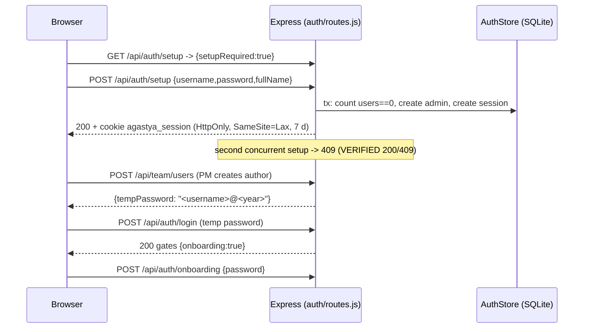
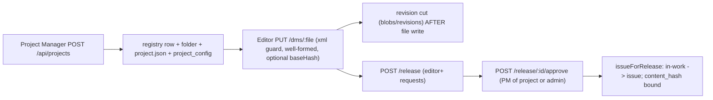

# 02 · Functional audit

**Status of this report.** Audit only; nothing in the application was changed. This file is the lead's synthesis (this introduction) followed by the four domain audits, each written by the agent that inspected that area. Detail, evidence (`path:line`) and every finding live in those parts; this introduction gives the verdict per area and the cross-cutting conclusions. Evidence labels are used exactly as defined in the audit brief: **VERIFIED** (run or re-checked), **OBSERVED** (seen in code, not exercised), **SUSPECTED**, **RECOMMENDATION**, **NOT VERIFIED**.

| Part | Area | Author / finding prefix | Method |
|---|---|---|---|
| 02.A | Platform core: auth, users, roles, workspace, backup, activity, notifications, uploads, graphics/CIR/brand, identity, waivers | agent A, `PLT` | code read, scratch-server probes (schema, scale, backup stall) |
| 02.B | S1000D: DM authoring, validation (XSD/BREX), release/review/lifecycle, import/export, XML processing | agent B, `S1K` | code read, focused tests (41/41), live round-trip, XXE-guard probes |
| 02.C | JSS, JSG, cross-engine conversion, publication pipeline | agent C, `PUB` | code read, 3 real PDF builds (Land UHB, Naval TM-1, 570-page book), conversion tests |
| 02.D | React shell: pages, state, session handling, editor mounting | agent D, `FE` | code read, scratch build, Edge/Playwright runs |
| (06) | Every screen from the user's side | agent E1, `UX` | ~140 screenshots, keyboard/overflow probes |
| (01) | Feature inventory (126 rows), route inventory (276 routes), traces | agent J, `ARC` | scripts over the whole tree + live router dump |

Related reports: `01-CODEBASE-UNDERSTANDING.md` (the 126-row feature inventory with the 13 required columns), `06-UI-UX-AUDIT.md`, `11-TESTING-AND-QA-STRATEGY.md` (test coverage per feature).

## Verdict per functional area

Status classes follow the master prompt. "Implemented" never means "reliable": each row says what was actually exercised.

| Area | Status | Basis | Main gaps (IDs in the parts) |
|---|---|---|---|
| **S1000D authoring, XSD/BREX validation, publish gate, lifecycle** | Fully implemented and verified (the strongest area) | B ran validation/importer tests 41/41, round-tripped a project export→import byte-identically (SHA-256) and re-validated it; the three-layer, TOCTOU-safe publish gate is well designed | Studio autosave drafts are written but never restored when embedded (S1K-004, FE-006); server and browser each carry their own BREX/xsd-regex implementation, kept equal only by a parity suite (S1K-003); waiver subject matching is fuzzy (S1K-002) |
| **JSS authoring and PDF publication** (Land + Naval, 28 types ready) | Implemented but needs improvement | C built Land UHB and Naval TM-1 PDFs; the L&T reference-layout work is guarded by an isolation fingerprint test (6/6) | One synchronous HTTP request per build, no timeout/cancel/progress replay (PUB-003/004); 7 missing images on every new JSS book and FOP warnings never reach the user (PUB-005); a release stores only a hash, no PDF and the hash ignores Media/template/brand (PUB-006); JSS has no autosave or draft (UX-010); Publication rail item shows "Internal error" (`GET /pmc` 500, UX-001/FE-009) |
| **JSG authoring and build** | Partially implemented | Editor and sample exist; engine isolated by design | No release, watermark or warm FOP (PUB-011); the JSG build failed (500) in the probe workspace because of a relative stylesheet path (DEP-011); ISPL/UHB scope not independently verified |
| **Cross-engine conversion and import** | Implemented but lossy | `xengine-convert` 7/7; identity record shared by all three formats | Pictures stored in `csdb/` are dropped (PUB-008, QA-021); a JSS `<warning>` makes the S1000D export fail (PUB-009); four different "project kind" predicates disagree for imported jssbook projects (PUB-026, ARC-022) |
| **Project create / settings / import / export / delete** | Present but unreliable | probes on scratch instances | **Settings route trusts the body (SEC-002 = S1K-001 = PUB-001, P0)**; boot reconcile deletes a project row and its memberships if the folder is missing (PLT-003); deleting keeps revisions/locks, a same-name project inherits them (PLT-004); forged archive creates access to another user's data (SEC-002) |
| **Backup / restore** | Present but not a backup; restore Missing | A measured a 240 MB backup: 15.8 s, 14.2 s event-loop stall | ZIP of project folders plus three JSON files; no password hashes, releases, history, config; no restore, no verification (PLT-001, DEP-008, ENT-006, ARC-005); the UI card is labelled "Database backup" (FE-013) |
| **Users, roles, sessions, admin** | Implemented but needs improvement | `rbac`/`routes-guarded` tests pass (8/8); all 276 routes carry exactly one guard (VERIFIED by live router dump) | Five ordered roles only, `cap` labels are not evaluated (PLT-016, ARC-004); temp password `username@year` allows account pre-hijack (PLT-014/SEC-004); no separation of duties on release approval (PLT-015/ENT-009); 7-day absolute session, no idle timeout (SEC-016); WebSocket outlives a revoked session (PLT-017/SEC-010) |
| **Editing safety (concurrency, saves, locks)** | Present but unreliable | A: two unconditional PUTs both 200; D: Ctrl+S bug | `baseHash` is optional server-side (DEP-016, ENT-016); JSS/JSG source written in place, no revision or atomic write (ARC-001/PUB-007/REL-001); after opening the S1000D editor, Ctrl+S in the JSS/JSG editors does nothing and a dirty Studio doc was saved into another project's module (FE-001); unsaved edits lost on navigation, on 401 and on a 409 (FE-002/003, JssEditorPage) |
| **Review, comments, problems** | Partially implemented | E1 screens | Review comments exist only on the Release page (UX-009); five separate problem surfaces; "reviewed" marks live only in localStorage (UX-008) |
| **Notifications, activity, audit log** | Implemented but needs improvement | A and I read the code | Audit log fails open, is not tamper-evident, has no retention, CSV export capped at 5000 rows, most rows carry no IP (ENT-003, REL-008) |
| **Search, filtering, sorting, bulk operations** | Largely Missing | E1 | No global search or quick switcher (UX-021 area); project list rows keyboard-inaccessible (UX-005) |
| **Preview / PDF pane, validation reports** | Implemented but needs improvement | E1, D | PDF placeholder styling bug (`.v2-empty strong`), no build report shown (PUB-005), validation run not reachable from the editor surfaces consistently (UX-008) |
| **Graphics, CIR, brand packs, extensions, waivers, identity** | Implemented; lightly tested | A, J | Any author can overwrite another user's CIR module silently (SEC-017); 74 of 276 routes have no test reference, 29 of them `/api/admin` (ARC-016) |

## Cross-cutting functional conclusions

1. **The same project-settings object is used by three engines and nobody owns its validation.** `project.json` is read raw in 11 places in `publisher.ts` and through three helpers in `projects.ts`; four modules decide what kind of project it is. This is the single root cause behind the three P0 reports SEC-002 / S1K-001 / PUB-001 and the project-kind disagreements. Treat it as one work package (WP-01 in the roadmap), not three tickets.
2. **A build is not a job.** The most visible functional weakness across JSS/JSG/S1000D is that publication is a synchronous request with no deadline, no cancel, no queue, no stored report and no archive (PUB-003/004/005/006, DEP-028 verified: one suspended FOP JVM stalled every author while `/api/health` stayed green).
3. **Persistence discipline differs by engine.** S1000D has revisions, hash-guarded saves and a gate; JSS/JSG have none of these, and settings/PMC/CIR/ancillary routes have no version guard (FE-008, ARC-001). The shared behaviour that should exist once: atomic write, revision cut, version guard, history.
4. **Features implemented differently in different engines that should be common** (candidates for one shared service, none requiring a common document model): project file access and path safety; archive export/import and its XML-safety scan (applied to S1000D, not to JSS/JSG: PUB-014); the build runner and report; watermark/classification/brand merge (JSG ignores most of it: PUB-011); the XML model/ZIP/PNG helpers (JSS/JSG model written 4 times, 3 ZIP codecs, 2 PNG encoders: ARC-007); validation framework (runner shared, rules per standard). See `03-ARCHITECTURE-AUDIT.md` for the target.
5. **Features that exist in the UI/API but are dead or misleading.** About 51 routes and 43 client API wrappers have no UI caller after the CSDB/applicability/SNS screen removals (ARC-013, FE-018); the "Image compression" publish setting silently does nothing because Ghostscript is not shipped (DEP-027); "Database backup" is not a database backup; Studio Settings → Theme is a no-op (TH-004); `vendor/engine/license.js` has no callers (DEP-021).
6. **Things that are simpler than they look and should be left alone**: the file+SQLite split, the single-process server, the deliberate JSG stylesheet isolation, the vendor-exception discipline for JSS stylesheets, and the framework-free editors (D explicitly recommends against rewriting them in React).
7. **Test evidence is thinner than the feature count suggests.** 581 of 587 frontend tests (4 failed on 5 s timeouts and pass alone, 2 skipped) and 151 of 154 backend tests passed in the sample G ran, none of the failures a product defect; but 43 tests skip silently on a clean checkout, the auth core, WebSocket and role-by-route matrix are untested, and no test sends hostile values to the settings routes (QA-004/005/007/020).
8. **Scale changes what "works" means.** The performance agent (H, `04-PERFORMANCE-AUDIT.md`) measured on synthetic projects that three of the verdicts above hold only for small projects: validation, BREX and the publication gate run on the request thread and stall every user for 2-81 s at 200-1000 modules (PERF-001); the schema pass fails above about 850 modules, after which the gate refuses publication naming a healthy module while `schemaChecked` still claims every module (PERF-002); and the S1000D FO stage grows super-quadratically in figure-bearing modules (100 modules: 36-154 s on the audit host, PERF-003). Absolute times are from a shared host and are indicative; the shapes are reliable. The S1000D "fully implemented and verified" verdict therefore holds for the correctness of validation below about 850 modules; publication time is a separate problem from about 100 figure-bearing modules upward.

## What this audit did not establish

* Only 18 of 83 backend test files, the frontend default suite and a handful of PDF builds were run; the Playwright e2e suite, `test:verify` families, installer and VM scripts were not run (G, F).
* No JSG PDF build succeeded in the probes; parallel real builds and a FOP hang were provoked only in F's simulation (C).
* Browser-level behaviour was exercised in Edge; headless Chrome 158 crashes the tab when a data module opens (QA-022, UX-011, FE note) and the cause is unknown.
* Customer stencils were used for layout comparison only and are not quoted.
* Accessibility with assistive technology, large-document typing latency, and multi-user behaviour were not tested.

## Where each requirement of the master prompt (sections 4 and 5) is answered

| Master-prompt topic | Where |
|---|---|
| Project creation/import/export, versions, revisions | 02.A, 02.B, 02.C; `10-DATABASE-AND-DATA-STRATEGY.md` |
| Validation (XSD, BREX, references, IDs, ordering, namespaces, XML security) | 02.B "XML processing audit"; `05-SECURITY-AND-RELIABILITY-AUDIT.md` |
| Editor architecture, undo/redo, autosave, recovery, shortcuts, accessibility | 02.B, 02.D, `06-UI-UX-AUDIT.md` |
| Import/export, round-trip integrity | 02.B (S1000D round trip VERIFIED), 02.C (cross-engine, lossy) |
| Publication, PDF, front matter, markings, watermarks, fonts, images | 02.C; reference-layout facts in `docs/JSS_*_STENCIL_ANALYSIS.md` |
| Engine architecture and shared infrastructure | `03-ARCHITECTURE-AUDIT.md` |
| Users, permissions, notifications, background operations | 02.A, `12-ENTERPRISE-READINESS.md` |

---

## 02.A - Platform functional audit (auth, governance, workspace, platform services)

**Author:** audit agent A (finding prefix PLT) · **Date:** 2026-11-26 · **Status:** audit only; no repository file was changed.

**Scope and method.** Feature-by-feature audit of the platform core of the Agastya backend (`backend/src` routes and services listed in section 0, `core/auth/*`, `core/collab/*`) and the places where the frontend consumes it (`frontend/src/pages/*`, `api/index.ts`). Evidence comes from reading the code, from the schema probe described in `10-DATABASE-AND-DATA-STRATEGY.md`, and from ten small probes (scripts `p1`-`p10` in the audit scratch folder, two of them in-process unit probes; ports 4051 and 4052 only; scratch workspace; never the real `workspace\`; 4040/4041 untouched). The probes ran against `backend/dist` (built 11/26 22:16, newer than `src`). Test files were read by name and assertion, not re-run; passing tests are not treated as proof. Labels: VERIFIED (observed running), OBSERVED (read in code), SUSPECTED, RECOMMENDATION, NOT VERIFIED. Priorities P0-P3; complexity S/M/L/XL as in the brief. Data-layer findings PLT-001 to PLT-013 are in `10-DATABASE-AND-DATA-STRATEGY.md`; this file holds PLT-014 to PLT-026; architecture findings (PLT-027 onward) are in `03.A-platform-architecture.md`.

**Status classes used:** Fully implemented and verified (FIV) · Implemented but needs improvement (INI) · Partially implemented (PI) · Frontend only (FO) · Backend only (BO) · Present but unreliable (PU) · Present but inefficient (PINE) · Missing (M) · Requires further investigation (RFI).

### 0. Coverage

| Area / path | Inspected | Verification | Limits |
|---|---|---|---|
| `core/auth/{routes,store,policy,authz,grants,sessions,crypto,rateLimit,bootstrap,xmlGuard}.js` | Inspected | runtime probes 1, 2, 6, 7, 8 | argon2 native path not exercised (scrypt fallback assumed in scratch env: NOT VERIFIED which one ran) |
| `core/collab/{docindex,revisions}.js` | Inspected | probe 2 (history) | - |
| `routes/{admin,team,workspace,packages,extensions,graphics,cir,brand,identity,waivers,lifecycle}.ts` | Inspected | route list extracted; probes on workspace, team, release | graphics/waivers/identity route bodies read, not exercised |
| `services/{activity,adminConfig,access-notify,backup,broadcast,enterprises,notifications,oversight,uploads,platform,http,graphics,cir,extensions,packageSettings,projects}.ts` | Inspected | probes 3-6, 9 | `assets.ts`, `registry.ts`, `zipio.ts` skimmed |
| `services/packages.ts`, `projectArchive.ts` (platform side) | Partially | code + test names | package content correctness belongs to other agents |
| Frontend pages `AuthScreens`, `Settings`, `Administrator`, `BackupPage`, `store/session.ts` | Inspected | code | not rendered in a browser by me |
| Frontend `Workspace`, `Overview`, `Activity`, `Notifications`, `Cir`, `Graphics`, `Oversight`, `ProjectSettingsPage` | Partially | route/API mapping only | UI audit belongs to agents D/E |
| Real `workspace\` | Not inspected | by brief | - |

### 1. End-to-end flows (traced)

#### 1.1 First run, sign-in, onboarding

VERIFIED (probe 1): two simultaneous setup posts gave `200` and `409` (setup is in one `BEGIN IMMEDIATE` transaction, `routes.js:140`); cookie flags `HttpOnly; SameSite=Lax; Max-Age=604800`, no `Secure` unless `AGASTYA_SECURE_COOKIES=1`; a second login of the same user ends the first session (first `/me` 200 -> 401 after the second login). VERIFIED the temporary password is `priya@2026` and that an unauthenticated caller who guesses it can sign in, pass onboarding and lock the real user out (PLT-014).

#### 1.2 Create project, work, release

VERIFIED: a Project Manager who is `owner`/`manager` of the project passed `canSubmit` and `canApprove` for the same release and approved their own request (`200`, probe 2; code `routes/project-content.ts:271-278`). Admins likewise (OBSERVED). PLT-015.

#### 1.3 Delete and re-create a project

VERIFIED (probe 2): `DELETE /api/projects/:id?confirm=<name>` -> 200; a different Project Manager creating a project of the same name receives the same id and sees the old revisions (`4:create, 3:save, 2:save, 1:create`) and the old document lock. Filed as PLT-004 in the data report.

#### 1.4 Backup, notification, live updates

`GET /api/backup` (any signed-in user: own projects; admin: whole platform JSON additionally) -> synchronous ZIP (PLT-001, PLT-005). `notify()` writes `notifications` rows; the UI polls counts; `broadcast.ts` pushes WebSocket events to cookie-authenticated sockets; VERIFIED sockets stay open after the session is revoked or the account disabled (PLT-017).

### 2. Feature audit

Each block: **Purpose / Frontend / Backend / Routes / Tables / Status / Validation / Errors / Tests / Limits and improvements.** "Tests" lists file names under `backend/test/`; "none" means no test found by name or by grep for the route (a search of test names, not proof of absence of indirect coverage).

#### F01 First-run setup, auth and onboarding
* **Purpose:** create the first administrator; sign in/out; forced password change on temporary passwords; forgot-password request. **Frontend:** `pages/AuthScreens.tsx`, `store/session.ts`. **Backend:** `core/auth/routes.js`, `policy.js`, `crypto.js`, `bootstrap.js` (INITIAL_ADMIN_* env path), `masterPassword.js` (inert stub).
* **Routes:** `GET/POST /api/auth/setup`, `POST /api/auth/login|logout|onboarding|change-password|forgot`, `GET /api/auth/me`. **Tables:** `users`, `sessions`, `password_reset_requests`, `audit_log`.
* **Status:** **INI** (works; PLT-014 is a takeover; stale docs). **Validation:** password 8-128 chars plus a small common-password list, username 3-32 with reserved names (`policy.js`); input type checks. **Errors:** neutral `401 Sign-in failed`, `409` on second setup, `429` on limiter (VERIFIED).
* **Tests:** `api.test.js` (first run, master-password backdoor gone, 401 + HttpOnly), `phase17-security.test.js`, `rbac.test.js`; none for onboarding screen logic, forgot flow races, bootstrap env path.
* **Limits/improvements:** temp password scheme (PLT-014); no password expiry/history, no 2FA/SSO (PLT-027 in architecture); `policy.js` comment describes a random temporary password that is not implemented and `docs/PROJECT_ARCHITECTURE_AND_TECH_STACK.md:151` repeats it (PLT-025).

#### F02 Users, roles, teams, enterprises
* **Purpose:** account lifecycle; three global roles (admin, project_manager, author); an administrator creates PMs, a PM creates authors; enterprise (CAGE) code lists. **Frontend:** `Settings.tsx` (Users, Authors tabs), `Administrator.tsx`. **Backend:** `auth/routes.js` admin routes, `routes/team.ts`, `services/enterprises.ts`.
* **Routes:** `POST /api/admin/users`, CSV import, disable/enable, reassign/ownerless/adopt, `POST /api/team/users`, `GET /api/team/users`, `GET /api/team/username-suggestion`, `GET /api/users/search`. **Tables:** `users`, `project_members`, `folder_owners`, `config_items`.
* **Status:** **INI**. **Validation:** username normalisation (NOCASE unique), role whitelist, CSV row checks; enterprise check refuses an import when code/name are not registered or mismatch (`enterprises.ts`; inactive when a list is empty). **Errors:** typed `HttpError`.
* **Tests:** `rbac.test.js` ("who can create which accounts"), `notifications.test.js` (username suggestion), `phase13.test.js` (enterprise check), `import-enterprise-refusal.test.js`. None for CSV import edge cases.
* **Limits:** no teams as a first-class object (a "team" is a Project Manager's authors); no groups, no delegated admin, no account expiry; "enterprise" means CAGE code lists, not tenants (single-tenant platform).

#### F03 Sessions
* **Purpose:** cookie sessions, single active session per user, admin revoke. **Frontend:** `Settings.tsx` Sessions tab. **Backend:** `core/auth/sessions.js`, `store.js` sessions API, `rateLimit.js`.
* **Routes:** `GET /api/admin/sessions`, `POST /api/admin/sessions/:id/revoke`. **Tables:** `sessions` (`token_hash` SHA-256, `revoked_at`, `revoke_reason`).
* **Status:** **INI**. VERIFIED: displacement on second login; revoke ends HTTP session immediately; limiter returns 429 after 9 failures in a window and keeps refusing even the correct password (probe 1); `/forgot` shares the limiter (429). **Validation:** token hash only stored; 7-day absolute TTL. **Errors:** 401.
* **Tests:** none for expiry, displacement or the limiter by name. **Limits:** no idle timeout, no session list for the user themselves, in-memory limiter resets on restart and is per `username|ip` (PLT-022, PLT-023); WebSocket not tied to the session (PLT-017).

#### F04 Admin configuration, policy and grants
* **Purpose:** 11 reference collections (info codes, DM types, CAGE codes, SNS...), app settings, asset policy, maintenance, folder grants. **Frontend:** `Administrator.tsx`, `AdminS1000d.tsx`. **Backend:** `routes/admin.ts`, `services/adminConfig.ts`, `platform.ts`, `core/auth/grants.js`, `routes/workspace.ts` (folder access).
* **Routes:** `/api/admin/config[/:collection[/:id]]`, `/api/reference`, `/api/app-settings`, `/api/admin/app-settings`, `/api/admin/asset-policy`, `/api/admin/maintenance/{reindex,check-schemas,clear-previews,rebuild-pdfs,audit.csv}`, `GET|PUT /api/folders/:key/access`. **Tables:** `config_items`, `folder_grants`, `folder_owners`.
* **Status:** **INI**. **Validation:** per-collection field checks; settings type-checked ("bad values are refused", `phase13.test.js`). **Errors:** typed. **Tests:** `phase13.test.js`, `phase17-security.test.js` (asset policy). 
* **Limits:** seeded once; no change history per item beyond the audit log; "policy" is a handful of settings, not a policy engine; `GET /api/admin/roles` is a descriptive list (`routes/admin.ts:63`), the `cap` labels are not enforced (PLT-016).

#### F05 Workspace and project lifecycle
* **Purpose:** folders, project create/open/copy/rename/delete, sample projects, format catalogue. **Frontend:** `Workspace.tsx`, `Projects.tsx`, `Overview.tsx`, `ProjectSettingsPage.tsx`. **Backend:** `routes/workspace.ts`, `services/projects.ts`, `registry.ts`, `vendor/engine/workspace.js`.
* **Routes:** `/api/workspace`, `/api/overview`, `/api/folders*`, `/api/projects*` (list, create, sample, open, patch, delete, copy, summary), `/api/formats`, `/api/document-types`. **Tables:** `projects`, `project_members`, `project_config`, `documents`, `folder_*`.
* **Status:** **PINE** for lists (VERIFIED 1.0-1.4 s at 60 projects for an author, PLT-008), **PU** for delete/recreate (PLT-004) and boot reconcile (PLT-003). **Validation:** name required; confirm-by-name on delete; role checks. **Errors:** 500 with `details` leak (PLT-019); create is not atomic (PLT-009 in data report).
* **Tests:** `api.test.js`, `project-formats.test.js`, `project-delete-after-build.test.js`, `rbac.test.js`. None for same-name recreation or folder-missing boot.
* **Limits:** project id = slug of name; hard delete; no archive/restore of a deleted project; copy is a file copy.

#### F06 Backup and restore
* **Purpose:** download a ZIP; there is no restore. **Frontend:** `BackupPage.tsx`, Administrator "Database backup" card. **Backend:** `services/backup.ts`, `zip.ts`, `routes/team.ts:132`. **Routes:** `GET /api/backup`. **Tables:** reads `users`, `project_members`, `audit_log`.
* **Status:** **PU** (labelled database backup, is not; blocks server) and **M** (restore). Details and numbers: PLT-001, PLT-005. **Tests:** `notifications.test.js` (scope, no hashes); `db-snapshot.test.js`, `s1000d-migration.test.js` for the pre-migration copy; no restore or large-workspace test.

#### F07 Activity log and audit
* **Purpose:** who did what; admin sees all, PM their projects, authors none. **Frontend:** `Activity.tsx`, `components/ActivityView.tsx`, `Settings.tsx` Audit tab. **Backend:** `services/activity.ts`, `context.ts audit()`, `store.js` audit API. **Routes:** `GET /api/activity`, `GET /api/projects/:id/activity`, `GET /api/admin/audit`, `audit.csv`. **Tables:** `audit_log`.
* **Status:** **INI**. `audit()` never throws and strips keys matching `/password|hash|token|secret|cookie|credential/i`. **Limits:** no `project_id` index, no retention, CSV capped at 5000 rows (PLT-007); append-only is by convention (no hash chain, rows deletable by anyone with DB access); which events are audited was not enumerated (failed logins: NOT VERIFIED). **Tests:** `rbac.test.js` ("activity: admin sees everything, manager only managed, author nothing").

#### F08 Notifications and access notifications
* **Purpose:** in-app notices for account creation, release request/decision, sharing and removal; read state per user. **Frontend:** `Notifications.tsx`, AppShell badges. **Backend:** `services/notifications.ts`, `access-notify.ts`. **Routes:** `GET /api/notifications`, `/unread-count`, `POST /api/notifications/read`. **Tables:** `notifications`.
* **Status:** **INI** (in-app only; no email/webhook; pull-based polling every 30 s). **Validation:** user-scoped queries. **Tests:** `notifications.test.js` (four scenarios). **Limits:** no digest, no retention (PLT-007).

#### F09 WebSocket broadcast
* **Purpose:** push change events to open project views. **Frontend:** client socket in `store`/hooks (NOT inspected). **Backend:** `services/broadcast.ts` (`ws`, cookie-authenticated upgrade via `authz.authForUpgrade`, per-event `evaluate` against a `c.user` captured at connect).
* **Status:** **PU** for revocation. VERIFIED (probe 6): no cookie -> 401; upgrade accepted with `Origin: http://evil.example`; after admin session revoke and after account disable the socket stayed OPEN. **Tests:** none by name. PLT-017.

#### F10 Uploads
* **Purpose:** large file intake. **Backend:** `services/uploads.ts` (multer disk storage in `os.tmpdir()/agastya-uploads`, 2 GB limit, 3 h request timeout, hourly sweep of stale `.upload` files; 507 on disk full), `routes/cir.ts` uses `memoryStorage` 16 MB x up to 100 files.
* **Status:** **INI**. **Tests:** `uploads-config.test.js` (timeouts, sweep, env fallback, 507). **Limits:** CIR memory path (PLT-021); no virus/size policy per role; pending package-import tokens held in an in-process `Map` (`routes/packages.ts:59`), lost on restart (PLT-031).

#### F11 Graphics library
* **Purpose:** per-project ICN artwork and symbols with usage ("used by"), delete protection. **Frontend:** `Graphics.tsx`, `components/GraphicsView.tsx`, `project/GraphicsPage.tsx`. **Backend:** `routes/graphics.ts`, `services/graphics.ts`, `assets.ts` (SHA-256 cache by size+mtime). **Routes:** `GET /api/graphics`, project-level list/upload/delete. **Tables:** none (files).
* **Status:** **INI**. **Validation:** asset policy (active content refused, SVG with script refused). **Tests:** `phase13.test.js` ("graphics"), `phase17-security.test.js` (asset policy). 

#### F12 CIR (common information repository)
* **Purpose:** shared module repository; copy into a project as a linked copy; update tracking. **Frontend:** `Cir.tsx`, `components/CirPicker.tsx`. **Backend:** `routes/cir.ts`, `services/cir.ts`. **Routes:** `/api/cir*`, `/api/projects/:id/cir-links*`. **Tables:** `cir_modules`, `cir_links` (a system project holds the files).
* **Status:** **INI**. **Validation:** enterprise check applies; linked copy read-only until detached. **Tests:** `phase13.test.js`, `cir-links.test.js`. **Limits:** every signed-in user may add or replace modules (`cir.ts:110, 192` call `csdb.writeDm(..., undefined, ...)` with no `baseHash`), delete is restricted to PM/admin; memory upload (PLT-021).

#### F13 Brand packs
* **Purpose:** read-only company branding (logo, name) selected in Settings. **Frontend:** `Settings.tsx` picker. **Backend:** `routes/brand.ts` + `vendor/engine/brand` (id validated before touching a path). **Routes:** `GET /api/brand-packs`, `GET /api/brand-packs/:id/logo`. **Tables:** none (`templates/brand/<id>`).
* **Status:** **FIV** for what it claims (read-only). **Tests:** `brand-packs-route.test.js` (list, logo as image, 404 for unknown/traversal). **Limits:** no upload/management UI (by design: packs are installed on disk).

#### F14 Extensions
* **Purpose:** admin-registered XSD profiles per project (enable per project). **Frontend:** `AdminS1000d.tsx`, `S1000dConfig.tsx`. **Backend:** `routes/extensions.ts`, `services/extensions.ts` (profiles under `workspace/extensions`). **Routes:** `/api/admin/extensions`, project `PUT .../extensions/:profileId`. **Tables:** `ext_profiles`, `project_ext`.
* **Status:** **INI**. **Tests:** `extensions.test.js` (five cases). **Limits:** 403 thrown as a plain `Error` with a `status` property (`extensions.ts:24`), so `wrap` can answer 500 instead of 403 (OBSERVED, not run; PLT-024).

#### F15 Packages and package settings
* **Purpose:** S1000D project package and delivery package export/import, HTML publish, project archives for all formats. **Frontend:** `Projects.tsx` import wizard, `importSource.ts`. **Backend:** `routes/packages.ts`, `services/packages.ts`, `projectArchive.ts`, `packageSettings.ts`, `zipio.ts`. **Routes:** `/api/projects/import/detect|import`, `${base}/packages/{project,delivery,import,import-reports}`, `${base}/publish/html*`. **Tables:** `project_config`, `project_codes`, `project_sns`, `project_dm_types`.
* **Status:** **INI** (round trips tested; not exercised by me). **Validation:** archive refused when not an archive, newer version, unsafe path or XML. **Tests:** `package-settings.test.js`, `project-archive.test.js`, `packages.test.js`, `zipio.test.js`. **Limits:** pending-import map in memory; filename uses `req.project.name` which the guard object does not carry (`packages.ts:143, 152`), so downloads are named `project-project.zip` (PLT-024); S1000D settings exist only in the manifest, not as a separate export.

#### F16 Waivers
* **Purpose:** record why a draft build may pass a missing BREX; never allows a release. **Backend:** `routes/waivers.ts`, `services/publishWaivers.ts` (atomic tmp+rename). **Frontend:** `project/PublishWaivers.tsx`. **Routes:** `GET|POST /api/projects/:id/publish-waivers`, `DELETE .../:wid`. **Tables:** none (project file).
* **Status:** **INI**. **Tests:** `publish-waivers.test.js`. **Limits:** an editor can create and delete waivers (no approver, no expiry); stored in a file; the route imports `audit` but which waiver actions it logs was not enumerated.

#### F17 Identity
* **Purpose:** JSS/JSG S1000D identity (codes, publication code, visibility flags). **Backend:** `routes/identity.ts` -> `services/xengine/project`. **Routes:** `GET|PUT /api/projects/:id/identity`, `PUT .../identity/visibility`. **Status:** **RFI** (owned by the cross-engine area; only the route layer read). **Tests:** `xengine-identity.test.js`.

#### F18 Oversight
* **Purpose:** administrator/PM dashboard of projects, release status, people in scope. **Frontend:** `components/Oversight.tsx`. **Backend:** `services/oversight.ts`, `activity.ts`, `release.ts`. **Routes:** `GET /api/oversight`, `GET /api/approvals`. **Tables:** `projects`, `project_members`, `releases`, `audit_log`.
* **Status:** **INI** (reads `project.json` per project: same linear cost as F05). **Tests:** none located. 

#### F19 Project archive routes (platform side) and lifecycle
* Archive export/import and `routes/lifecycle.ts` (`/lifecycle`, `/lifecycle/events`, `working-revision`, `issue`, `obsolete`, `reinstate`, `supersede`, `change-marks`) are documented under F15 and by the S1000D agents. **Tests:** `lifecycle.test.js`, `lifecycle-reinstate.test.js`, `release-issue.test.js`, `project-archive.test.js` (`only someone who can read the project may export it`). **Status:** **INI**.

### 3. RBAC model against enterprise needs

**What exists (VERIFIED in `authz.js`, `store.js`).** Global roles `admin`, `project_manager`, `author`; project roles `viewer < reviewer < editor < manager < owner`; membership rows plus **folder grants** (`access_role`) combined by taking the stronger; admin is owner-equivalent everywhere; the CIR project is open to every signed-in user; single `evaluate()` for project capabilities; account gates (must change password/onboarding) enforced centrally; `routes-guarded.test.js` fails if a route is neither guarded nor declared public. `cap` strings (`'release.decide'`, `'project.read'`) are **labels in the audit trail only**, not inputs to a permission matrix.

| Enterprise need | Today | Gap |
|---|---|---|
| Fine-grained permissions (export, delete, waive, manage members as separate rights) | five ordered roles; checks are `minRole` comparisons | cannot grant "may export but not edit" or "may waive"; custom roles impossible (PLT-016) |
| Per-project ACLs | membership per project (VERIFIED) and per folder | no per-document or per-module ACL, no deny rules, no time-limited access |
| Separation of duties: author -> review -> approve -> release | a reviewer role exists; release = request (editor+) -> decision (PM of project or admin) | requester may approve own request (VERIFIED); no "different person" rule; no two-step approval; admin can do everything (PLT-015) |
| Delegation / groups | none | access by named person only; no groups or teams to grant |
| Admin separation (security admin vs content admin) | one `admin` | an admin who can read all content also manages users and sessions; cannot create projects (by design, `notifications.test.js`) |
| Audit of permission changes | member add/remove/role change audited (`access-notify`, audit rows) | no periodic access review report |
| Identity integration | local accounts only | no SSO/LDAP/SCIM (architecture report) |

**RECOMMENDATION (mandatory vs optional).** Mandatory: enforce `requested_by != decided_by` for releases (configurable "four-eyes" setting, default on for released/approved content) and log the override reason when an administrator waives it (PLT-015). Optional, only when the owner sets the enterprise requirement: introduce a permission table (`permissions`, `role_permissions`) and make `cap` strings real; per-folder/group grants; SSO via an auth-provider interface (architecture report).

### 4. Findings

#### PLT-014 · P1 · VERIFIED · S · Temporary password is `username@year`: an unauthenticated person can take over a new or reset account before its owner signs in

**Category:** security (authentication).
**Problem:** Accounts created by an administrator or Project Manager, and accounts reset by an administrator, get the password `<username>@<current year>`. Anyone who knows the username can sign in first, complete onboarding with their own password, and lock the real user out. Usernames follow a predictable pattern (the creation screen suggests first name, then `firstname.lastinitial`, `team.ts` `username-suggestion`), and a signed-in user can search them (`/api/users/search`).
**Evidence:** `backend/src/core/auth/policy.js:116` (`tempPasswordFor`); used at `routes.js:533, 571, 712`; probe 1: admin created `priya`, response `tempPassword: "priya@2026"`; an anonymous client logged in with it (`200`, `gates.onboarding:true`), set `Attacker-Pass-77!` via `POST /api/auth/onboarding` (`200`), after which the real user's login with the issued temporary password returned `401`. Tests assert the scheme (`api.test.js:191`, `notifications.test.js:13`), so it is deliberate. The comment above `TEMP_ALPHABET` in `policy.js` and `docs/PROJECT_ARCHITECTURE_AND_TECH_STACK.md:151` describe "random temporary passwords", which is not what runs.
**Current implementation:** Deterministic temp password, valid until first onboarding, no expiry; limiter allows 9 guesses per window per `username|ip` but the first guess already succeeds.
**Recommendation:** Generate a random one-time password (>= 12 characters from `TEMP_ALPHABET`, which already exists in `policy.js`) shown once to the creator; store a `temp_password_expires_at` (for example 72 h) and refuse the sign-in afterwards; or issue a one-time invitation link. Update the two tests that assert the old scheme and the documentation.
**Expected outcome:** A new account cannot be guessed; an unused temporary password expires.
**Dependencies:** UI that displays the temp password once (already shows it).
**Risks:** Creators who rely on the predictable value to tell users by phone; mitigated by copy-to-clipboard and a "reissue" action.
**Acceptance criteria:** the temporary password is unpredictable, is shown once, and fails after expiry; the attacker flow of probe 1 returns 401.
**Test cases:** create user then guess `username@year` (401); use issued temp password within and after the expiry window; reset flow; onboarding replay with an old temp password.

#### PLT-015 · P1 · VERIFIED · S · No separation of duties on release: the person who requests a release can approve it

**Category:** governance / compliance.
**Problem:** `canSubmit` allows roles editor, manager, owner; `canApprove` allows any administrator and any Project Manager who is `manager` or `owner` of the project. The same human satisfies both. For S1000D/defence-style review-approve-release controls that is a four-eyes failure.
**Evidence:** `backend/src/routes/project-content.ts:271-278`; decision route `:306-322` has no comparison between `requested_by` and the deciding user (it reads the requester only to notify); probe 2: Project Manager `rohit` (creator and owner of the project in that flow) sent `POST /release` (200) and then `POST /release/:id/approve` (200) on his own request.
**Current implementation:** the only rule is "an Author never approves their own work".
**Recommendation:** add a project or platform setting `requireDifferentApprover` (default on); refuse in `decide()` when `requested_by === user.id` unless an administrator supplies a reason that is audited; optionally require a reviewer sign-off before a request is approvable (review state already exists in `review.ts`). Waiver creation (F16) deserves the same rule for released content.
**Expected outcome:** every release has two distinct people on record.
**Dependencies:** a second approver must exist in small teams (admin can step in).
**Risks:** one-person companies; provide an explicit "solo mode" switch recorded in the audit log.
**Acceptance criteria:** self-approval returns 403 `SELF_APPROVAL`; an administrator override is audited with reason.
**Test cases:** PM requests and approves (403); admin approves PM's request (200); admin self-override with reason; withdrawn and re-requested release.

#### PLT-016 · P1 · OBSERVED · L · RBAC is five ordered roles; `cap` strings are labels; no fine-grained, group or per-document permissions

**Category:** enterprise readiness (authorisation).
**Problem:** Authorisation is "role rank >= minimum" plus a few special cases (admin, CIR open, owner reading own project). Enterprise requirements such as export-only, waiver-only, auditor read-all, group grants, deny rules, delegated administration or access reviews cannot be expressed.
**Evidence:** `core/auth/authz.js:66-131` (`evaluate`, `minRole`, `cap` only passed through), `ROLE_RANK`; `routes/admin.ts:63` roles description; frontend `canMonitor(user)` role checks in `App.tsx:61`.
**Current implementation:** hard-coded roles in code; membership and folder grants in the DB.
**Recommendation:** only if the owner confirms the enterprise requirement: add a permission catalogue and role-to-permission table seeded with today's matrix (no behaviour change), switch `evaluate` to check permissions, then allow custom roles and groups; add an "Auditor" read-only global role first (cheapest win). Keep today's matrix as the default.
**Expected outcome:** administrators can tailor access without code changes.
**Dependencies:** PLT-015, architecture report (auth provider seam).
**Risks:** large test surface (`routes-guarded.test.js` and `rbac.test.js` are the safety net and must be extended first).
**Acceptance criteria:** the seeded matrix reproduces every existing role test; a custom role limited to "export" can export and nothing else.
**Test cases:** matrix test per route and role; deny precedence; group membership change takes effect without re-login.

#### PLT-017 · P2 · VERIFIED · S · WebSocket stays authorised after session revocation or account disable, and ignores Origin

**Problem:** A revoked or disabled user's open socket keeps receiving project events; the upgrade accepts any `Origin`.
**Evidence:** probe 6: `crossOriginUpgradeAccepted: true`, `socketStateAfterRevoke: OPEN`, `socketStateAfterDisable: OPEN` while HTTP `/me` returned 401; `broadcast.ts:24` (`authForUpgrade` once), `:48` (`evaluate(c.user, ...)` with the user captured at connect). SameSite=Lax limits browser cross-site use; same-site different-origin (another port on the same host) is **SUSPECTED**, not tested with a real browser.
**Recommendation:** store `sessionId` on the socket and close it on revoke/disable/role change (hook in `store` revoke paths); re-resolve the user on each event or on a short timer; reject upgrades whose `Origin` is not the host (reuse the app.ts rule).
**Acceptance:** revoke closes the socket within a second; foreign Origin gets 403.

#### PLT-018 · P2 · VERIFIED · S · `checkXmlSafety` is bypassed by a decoy DOCTYPE inside a comment or processing instruction

**Problem:** The guard scans from the first literal `<!DOCTYPE`, even one inside `<!-- -->` or `<? ?>`, then stops. A real DOCTYPE declaring a parsed external entity placed after the decoy is not inspected.
**Evidence:** `core/auth/xmlGuard.js` (`text.search(/<!DOCTYPE/i)`); unit probe 7: plain XXE refused; comment decoy `{"ok":true}`; PI decoy `{"ok":true}`; nested internal-entity expansion (`&c;` x10 chains) `{"ok":true}` (the declaration limit is 500 declarations, not expansion size). End to end through `PUT /api/projects/:id/dms/:file` (probe 8): the decoy passed the guard but was refused by the second parser (`entity not found:&x;`), so a **referenced** entity cannot be stored via the editor route; an **unreferenced** declaration can. Other entry points (package import, batch upload, CIR upload) were **NOT VERIFIED**.
**Recommendation:** replace the regex scan with a tokenising prolog scanner (skip comments/PIs/CDATA) or reject any document whose prolog contains more than one `<!DOCTYPE`; cap entity expansion depth/size; add the bypass strings to tests. Hand-off to the security agent for the import paths.
**Acceptance:** all three probe strings refused on every XML entry route.

#### PLT-019 · P2 · VERIFIED · S · 500 responses return `details: <raw error message>`

**Problem:** `wrap` answers unexpected errors with `{ error: 'Internal error', details: e.message }`; messages can reveal SQL/table names, paths, library internals.
**Evidence:** `backend/src/services/http.ts:33`; probe 5 body `{"error":"Internal error","details":"database is locked"}`.
**Recommendation:** log the message with a correlation id, return `{error, id}` only; keep details in development (env flag).
**Acceptance:** no `details` in production responses; id appears in the log.

#### PLT-020 · P2 · VERIFIED · S · Saves without `baseHash` overwrite silently (lost update)

**Problem:** `writeDm` checks the content hash only when the client sends `baseHash`; two saves without it both succeed and the second replaces the first.
**Evidence:** `services/csdb.ts:190-207`; probe 2: `[200, 200]` for two `PUT` without `baseHash`; with a stale hash `409`. Whether the shipped editor always sends `baseHash` was **not verified** (frontend agents). Locks exist (`/lock` returned 200) but were not tested against a non-holder write.
**Recommendation:** require `baseHash` (or `If-Match`) on every content write from the UI and API; return 428 when missing; keep an explicit `force` flag with audit for scripted imports.
**Acceptance:** PUT without hash refused; stale hash 409; editor shows merge/overwrite prompt.

#### PLT-021 · P2 · OBSERVED · S · CIR upload uses memory storage (16 MB x up to 100 files per request) and replaces modules without a version check

**Problem:** A signed-in user can hold up to 1.6 GB of request data in memory per call and overwrite repository modules unconditionally.
**Evidence:** `routes/cir.ts:14` (`memoryStorage`, `fileSize 16 MB`), `services/cir.ts:110, 192` (`writeDm(..., undefined, ...)`); `app.ts:45` JSON limit 25 MB. Not run.
**Recommendation:** disk storage as in `uploads.ts`, lower `files` count, `baseHash` or "replace?" confirmation for existing ids.
**Acceptance:** 100 x 16 MB request does not raise RSS above a set bound; overwrite requires confirmation.

#### PLT-022 · P2 · OBSERVED · S · Session policy gaps: single session, no idle timeout, plain HTTP, `Secure` cookie opt-in

**Problem:** One 7-day absolute session per user (a second sign-in kicks the first, VERIFIED), no idle timeout, no user-visible session list, HTTP-only server; `Secure` only with `AGASTYA_SECURE_COOKIES=1`; *correction by the security agent:* a password change **does** end the other sessions and the old password stops working at once (VERIFIED live, `05-SECURITY-AND-RELIABILITY-AUDIT.md` row 2b), so that part of this finding is withdrawn; the single-session, no-idle-timeout and plain-HTTP points stand.
**Evidence:** probe 1 `singleSession`; cookie header; `config.ts` `secureCookies`; `docs/OPERATIONS.md:80`.
**Recommendation:** idle timeout setting (default 30 minutes idle and 12 hours absolute, as in gate G-SEC-3 of `12-ENTERPRISE-READINESS.md`; the "8-12 h" first proposed here is the absolute limit), TLS termination guidance enforced by a startup warning when bound to a non-loopback address without `SecureCookies` (superseded by native TLS, WP-26); keep the single-session rule configurable (shared machines vs two devices).
**Acceptance:** idle expiry works; LAN bind without TLS logs a warning.

#### PLT-023 · P2 · VERIFIED · S · Login rate limiter is in-memory, shared with forgot-password, and keyed on the socket address (the proxy address behind a reverse proxy)

**Problem:** State is lost on restart; keys are `username|ip` so many IPs can guess one user; `/forgot` returned 429 after login failures. The IP is `req.socket.remoteAddress` (`context.ts:107`, `routes.js:58`), not Express's `req.ip`, although `app.set('trust proxy', 1)` is configured and `docs/OPERATIONS.md:80` recommends a TLS reverse proxy. Behind such a proxy every client shares the proxy's address: audit-log IPs are all the proxy, and one person's ten failed attempts (or an attacker's) lock that username out for everyone (SUSPECTED from code; not run through a proxy).
**Evidence:** probe 1 (`forgot: 429`, `rateLimitStatuses` nine 401 then 429); probe 10: 40 attempts with a different `X-Forwarded-For` each were all 429, confirming the header is ignored (so spoofing does not bypass the limiter, which is the good half); `core/auth/rateLimit.js`.
**Recommendation:** derive the client address through `req.ip` only when a trusted-proxy setting is configured (an explicit `AGASTYA_TRUST_PROXY` value instead of the hard-coded `1`); persist counters; add a per-account ceiling with exponential delay rather than lock-out; separate buckets for forgot and login.
**Acceptance:** behind a test proxy two clients have separate buckets and audit rows show real addresses; counters survive restart.

#### PLT-024 · P3 · OBSERVED · S · Small defects: extension 403 may become 500; package downloads named `project-project.zip`

**Evidence:** `routes/extensions.ts:24` (`Object.assign(new Error(...), {status:403})` vs `wrap` handling `HttpError`); `routes/packages.ts:143, 152` (`req.project.name`). **Recommendation:** use `forbidden()` from `services/http`; read the name from `readProjectJson`. **Acceptance:** 403 returned; file named after the project.

#### PLT-025 · P3 · VERIFIED · S · Documentation contradicts the code in places

**Evidence:** `docs/PROJECT_ARCHITECTURE_AND_TECH_STACK.md:151` (random temporary passwords) vs `policy.js:116`; `vendor/engine/license.js` (Ed25519 licence, clock-tamper detection) is referenced nowhere while the UI states "this build does not enforce a licence"; a stale `Surname@Year` comment in `routes.js`. **Recommendation:** fix docs; remove or wire `license.js` by owner decision. **Acceptance:** docs match behaviour.

#### PLT-026 · P2 · OBSERVED · M · Test gaps in the platform core

**Problem:** no test found by name or grep for: WebSocket, session expiry/displacement, rate limiter, `reconcileRegistry`, same-name project recreation, large-workspace backup, restore (none exists), CIR overwrite, oversight, CSV user import edge cases, concurrent writers/busy handling, `reset-admin`.
**Evidence:** `backend/test` listing (87 files) and greps (`WebSocket|broadcast` and `rateLimit|429` matched no platform tests).
**Recommendation:** add the probe scripts of this audit as regression tests (they already encode the expectations): probes 1, 2, 5, 6, 9 are 20-60 lines each.
**Acceptance:** tests fail on the current code and pass after PLT-002/003/004/014/015/017.

### 5. Strengths (not findings)

* Central `evaluate()` plus `routes-guarded.test.js` makes "forgot to guard a route" a failing test.
* Passwords hashed with Argon2id (scrypt fallback), tokens stored only as SHA-256, cookies HttpOnly + SameSite=Lax, cross-origin writes refused by Origin check, first-run setup race-safe (VERIFIED `200/409`).
* Release approval is bound to a content fingerprint and issues revisions inside one transaction; one pending release per project is enforced by a partial unique index.
* Revisions are content-addressed and re-verified; uploads sweep and 507 handling exist; waivers use atomic writes.
* Master-password backdoor from the older product is neutralised and tested.
* Audit helper never throws and redacts sensitive keys.

### 6. Unknowns and limitations

* The real workspace and its data were not opened; all runtime evidence is from scratch workspaces and synthetic projects, one client, Windows Server 2025, Node v22.23.2.
* Whether Argon2id or the scrypt fallback was active in the scratch runs is NOT VERIFIED.
* The shipped editor's use of `baseHash`, WebSocket client behaviour and the 30 s polling were not inspected (frontend agents).
* Administrator password-reset approval flow, CSV import, folder grants UI and ownerless/adopt flows were read but not exercised.
* Identity (F17) and lifecycle (F19) behaviour is owned by other agents; only the route layer is covered here.
* Email notification, SSO and HA do not exist in the code and were therefore not tested; statements about them are RECOMMENDATION only.

---

## S1000D functional audit (Agent B)

Scope and method: code reading of every file listed in the brief for the S1000D area (backend services/routes/schemas/brex/reference, frontend `studio/*` and the S1000D project pages), plus a scratch server (`AGASTYA_WORKSPACE_DIR` under this agent's scratch folder, `PORT=4053`, never 4040/4041) with three real users (admin, a `project_manager`, an `author`) created through the real auth API. Probed live: project creation (wizard + sample), S1000D project config, validation (XSD+BREX), publish gate + waivers, lifecycle (BREX chain resolution), project export/import round trip (the real `.jsspub.zip` archive route, not a crafted exploit), and a project-settings path-traversal check. Ran three backend test files together (`brex.test.js`, `project-archive.test.js`, `importer-repairs.test.js`: 41/41 pass). Did **not** run the frontend Studio unit/verify suites or Playwright (budget; they are heavy and the brief caps runs at 2-3 focused files) — their results below are **OBSERVED** from the repo's own test files and from `docs/DM_TYPE_VERIFICATION.md` / `docs/S1000D_COMPLIANCE_MATRIX.md`, re-checked against the code that would have to back them, not re-executed.

One line of dynamic testing (constructing a working XXE-exfiltration chain through project-archive import) was stopped by a safety classifier mid-draft and was not completed or resubmitted in any form; the XML-security verdicts below rest on static code reading of the guard (`backend/src/core/auth/xmlGuard.js`) plus one already-completed benign measurement (direct `xsltproc` invocation, no app code, no secret exfiltration attempted) that is reported honestly as what it is.

### Coverage table

| Area / path | Status | Verification | Limits |
|---|---|---|---|
| `services/validation.ts`, `wellFormed.ts`, `xsdRegex.ts` | Inspected | Full read; ran `POST /validation` on a live project (0/0/0 on a clean sample) | — |
| `services/brex.ts`, `projectBrex.ts` | Inspected | Full read; `brex.test.js` run (23 subtests, pass); live BREX-missing/waiver probe | — |
| `services/applicability.ts`, `applicEval.ts` | Inspected | Full read | Not exercised live (no applicability UI since 2026-11-26; routes still live, not probed) |
| `services/csdb.ts`, `csdbGuard.ts`, `csdbObjects.ts` | Inspected | Full read; live create/read/write/delete of DMs; path-traversal probe | — |
| `services/objectRender.ts`, `objectTemplates.ts` | Partially inspected | Read in full (short files) | Not exercised live |
| `services/release.ts`, `review.ts`, `lifecycle.ts` | Inspected | Full read; `release.ts`/`lifecycle.ts` logic traced through `publishGate.ts` | Release/approval flow not driven live end-to-end (role setup would need a second PM) |
| `services/publishGate.ts`, `publishWaivers.ts` | Inspected | Full read; **live-tested**: BREX-missing refusal, waiver add/match/mismatch, release still refused with a waiver | — |
| `services/pm.ts`, `modelCode.ts` | Inspected | Full read | `modelCode.ts` not exercised live |
| `services/s1000dRef.ts`, `projectConfig.ts` | Inspected | Full read; config read live via API | — |
| `services/sns/*`, `sns.ts` | Partially inspected | `service.ts`, `codes.ts` headers read; rest skimmed | Not exercised live |
| `services/importer/*` (scanner, repair, reconstruct, structure, apply, identity, types, flavour, package, assign, pmComplete, png, zipRead, xmlScan, recover/*, repairs/*) | Inspected | Full read of `scanner.ts`, `apply.ts`, `repair.ts` (via `importer-repairs.test.js`, 21/21 pass); others skimmed for API shape | Scanner/reconstruct heuristics not independently re-derived; trusted the passing tests |
| `services/projectArchive.ts`, `formats.ts`, `sample.ts` | Inspected | Full read; **live round trip**: export the sample project, import via `/api/xengine/import`, byte-identical DMs (SHA-256 match), media, PM entry count/title, config mostly identical (one improvement noted below) | — |
| `routes/s1000d.ts`, `sns.ts`, `project-content.ts`, `importer.ts`, `lifecycle.ts`, `waivers.ts` | Inspected | Full read; most routes exercised live | `importer.ts` (package scan/apply HTTP) not driven live, only read |
| `backend/schemas/*`, `backend/brex/*`, `backend/reference/*` | Partially inspected | `PROVENANCE.md`, SCORM/LOM gap confirmed on disk (`scormcontentpackage.xsd` imports `../lom_schema/lom.xsd`, absent) | Did not diff schema files against official S1000D releases |
| `frontend/src/studio/**` (core, ui, validation, view, export) | Inspected (code reading) | Read `document.ts` (undo/redo), `ops.ts` headers, `ui/app.ts`, `ui/editor.ts`, `ui/storage.ts`, `ui/validator.ts`, `validation/xsd.ts`, `validation/brex.ts`, `core/xsdRegex.ts` | Did not run `npm test` / `test:verify` (budget); no DOM-level behavioural probe of the editor itself |
| `frontend/src/pages/project/EditorPage.tsx`, `EditorRoute.tsx`, `ExplorePage.tsx`, `ValidationPage.tsx`, `ReleasePage.tsx`, `S1000dConfig.tsx`, `AdminS1000d.tsx`, `PublishWaivers.tsx` | Inspected | Full or near-full read | Not click-tested in a browser |
| `lib/ruleBreaks.ts`, `waivers.ts`, `pmcTree.ts`, `studioSession.ts` | Inspected | Full read | — |
| Docs vs code: `S1000D_COMPLIANCE_MATRIX.md`, `S1000D_COMPLETE_IMPLEMENTATION.md`, `DM_TYPE_VERIFICATION.md`, `S1000D_REFERENCE_CONFIG.md` | Inspected | Read in full; spot-checked specific claims against the backing code (BREX layering, applicability externalisation, SCORM/LOM, waiver scope) — all checked claims matched the code | Did not re-run the 84-combination verification suite the docs report numbers from |
| `vendor/engine/validateXml.js`, `validateSchema.js`, `paths.js` | Inspected | Full read; `xsltproc` probed directly (benign, see below) | — |
| `vendor/pipeline/s1000dtofo` | Not inspected | — | Out of scope beyond what the services above need |

### Strengths

- The S1000D issue a project's checks use is **one setting**, read by validation, the publish gate, BREX resolution and applicability writing alike (`validation.ts:projectIssue`) — a build and the Validation page cannot disagree about which schema applies.
- BREX modelling is unusually careful: layered BREX chains (project → referenced parent → S1000D default), severity levels, SNS rules, notation rules, and an explicit distinction between "a rule that fails" and "a rule that cannot be evaluated here" (XPath 2.0, untranslatable value patterns) which is counted and reported, never silently dropped (`brex.ts:366-463`). A case-sensitivity bug in the legacy `xpath` entry point (`attribute::inwork` matching `inWork`) was found and fixed by switching to the parsed-expression API with an explicit namespace map (`brex.ts:135-149`) — good evidence the team actually compared behaviour against libxml2 rather than trusting the npm package.
- The publish gate (`publishGate.ts`) is "fresh" by construction: it re-runs `runValidation` itself rather than trusting a stored report, and treats "could not be checked" (unsupported issue, `xi:include`, validator failure) as **not valid**, never as silent success. `verifyUnchanged()` re-hashes every source file right before rendering so a file changed mid-validation cannot slip through (TOCTOU-safe for this one path).
- Reinstatement, supersession and obsolescence (`lifecycle.ts`) all require a Project-Manager-level actor and a reason, write a new file (history is never overwritten), and are fully audited (`lifecycle_events`). Revision resolution (`resolveRevision`) correctly treats an unpinned `<dmRef>` as "highest issue, then highest in-work" and a pinned one as exact, with obsolete modules reported, not silently resolved.
- Applicability (`applicability.ts`, `applicEval.ts`) is a genuinely three-valued evaluator (true/false/**unresolved**), and an unresolved result blocks a configuration publication by name and location rather than guessing a default — this is the correct reading of S1000D Chap 3.9.5.3 and is implemented faithfully.
- The importer's safety discipline is real, not just claimed: `importer/apply.ts` validates every staged file before writing any of them, keeps the pre-repair original bytes of everything a repair touched (`import-originals/<batch>/`), never lets a placeholder PNG overwrite a real image, and the project-archive restorer scans **every** `.xml/.xsl/.xslt/.ent/.dtd` file in an incoming archive with the same XXE guard as a live save, not just the project's main data modules.
- Honest self-reporting throughout: the compliance matrix states exactly what is **UNVERIFIED** (5.0-7.0 specification-dependent rules, SCORM schema validation blocked by a missing IEEE LOM schema, `applicConfiguration` having no defined filtering semantics) instead of inventing behaviour. This matches what the code actually does everywhere I checked.
- Undo/redo in the Studio (`core/document.ts`) is built on a single `MutationObserver` recording DOM changes as inverse-replayable entries, so every kind of edit (typed text, structured insert, paste, XML-view reconciliation) is undoable without bespoke per-operation inverse logic — a sound, low-risk design for a framework-free editor.

### Feature-by-feature functional audit

#### Project creation (issue 4.2/5.0/6/7)
**Purpose**: start an S1000D project at a chosen schema issue, with MIC, language, country, partner/originator, security, BREX, info-code scope and DM-type scope all set up front or derived later from content.
**FE**: wizard (outside my direct file list, reached through `S1000dConfig.tsx` and `/api/formats`); `S1000dConfig.tsx` edits the live config afterward.
**BE**: `routes/workspace.ts POST /api/projects` → `projects.createProject`; `projectConfig.ts` (`defaultConfig`, `applyPatch`, `updateConfig`, `adoptFromContents`); `s1000dRef.ts` for issue/catalogue data.
**APIs**: `POST /api/projects`, `POST /api/s1000d/validate-config`, `GET/PUT /api/projects/:id/s1000d`.
**DB**: project row in `registryDb`; `project.json` on disk holds the S1000D config (not normalized into SQL tables — confirmed by `projectConfig.ts` reading/writing a JSON file, not a `project_config` table).
**Validation**: `validate-config` checks unknown info codes and empty code selections before anything is created.
**Verified live**: created a project via `POST /api/projects/sample` (wraps `createProject` with `format:'s1000d'`); `GET /api/projects/:id/s1000d` returned a full config (`issueAssumed:true`, `mic:""` until content exists). **Observation, not a defect**: the sample/wizard path does not call `adoptFromContents` at creation, so `config.mic` stays empty even though all three seeded data modules declare `S1KSTUDIO` — an export→import round trip of the *same* project then derives `mic` correctly (see the round-trip finding below), i.e. the derived value is more complete than what creation itself produces. Four issues (4.2/5.0/6/7) are all present as installed schema sets (`backend/schemas/{4.2,5.0,6.0,7.0}`) and `installedSchemaIssues()` reads them from disk, not a hard-coded list.
**Tests**: `project-formats.test.js`, `s1000d-migration.test.js`, `s1000d-reference.test.js` (not run by me; read only).
**Limitation**: 4.1 exists in the editor/schemas but is deliberately hidden from the wizard (per `DM_TYPE_VERIFICATION.md §1`) — a real scope decision, not a bug.

#### DM creation per DM type (21 types)
**Purpose**: create any of the 21 S1000D data-module types the wizard offers, with a template matching its schema.
**FE**: Studio's New-document wizard (`studio/ui/dialogs.ts`, `studio/core/templates.ts`), `studioSession.ts` (`identityTaken`, `modelIdent` guard against duplicate identity before save).
**BE**: `services/csdb.ts createDm` (validates content, uniqueness, project-fit via `assertNewDmAllowed`); `objectTemplates.ts`/`objectRender.ts` for the non-DM CSDB objects (DML, DDN, COM, UPF, SMC, IMF).
**Validation**: schema-per-declared-issue (`vendor/engine/validateSchema.js`), never a fixed set; the compliance matrix reports a very large independently-generated cross-check (84 type×issue combinations, >1M grammar-vs-XSD comparisons) — **OBSERVED**, not re-run here, but the production code backing it (`grammar.ts` built from the real XSDs, same `xsdRegex.ts` the server uses) is consistent with that claim.
**Tests**: `frontend/src/studio/__tests__/dmtypes.test.ts`, `verify/inventory.test.ts`, `backend/test/dmtypes.test.js`, `object-docs.test.js` (not run; read-only).
**Status**: Fully implemented and verified (server-side identity/uniqueness rules — VERIFIED live; type-grammar coverage — OBSERVED from the repo's own large verification suite, consistent with code read).

#### Structured editing operations
**Purpose**: insert/move/delete elements, tables, lists etc. inside the grammar's rules, not raw text.
**FE**: `studio/core/ops.ts` (1296 lines — the operation set), `core/grammar.ts`, `core/table.ts`, `ui/editor.ts`.
**Verified**: not driven live (no browser probe in this pass); read `ops.ts`'s structure and `document.ts`'s MutationObserver-based change recording, which is the mechanism every structured op rides on for undo. Internally consistent.
**Status**: Fully implemented (OBSERVED from code + the repo's own `verify/editor.test.ts`, `verify/editor-controls.test.ts`, `verify/controls.test.ts` which specifically probe insertion legality, pastes and foreign-tag refusal against the real XSD at author-reachable carets).

#### Undo/redo
**Purpose**: reliable undo/redo across every kind of edit.
**BE/FE**: entirely client-side, `studio/core/document.ts` (`undoStack`/`redoStack`, typing-coalescing within 2s, `maxHistory` cap, explicit `canUndo`/`canRedo`/labels for the UI).
**Verified**: code read in full; mechanism is sound (observer-recorded inverse changes, not per-feature inverse functions, so new structured operations get undo for free).
**Limitation**: history is in-memory only, lost on reload; crash recovery is the separate "drafts" mechanism (IndexedDB), which does not restore undo history, only the last autosaved text.
**Status**: Fully implemented and verified (code reading; not exercised interactively).

#### XML / Design / Split views
**Purpose**: a WYSIWYG-ish Design view, a raw CodeMirror XML view, and a side-by-side Split.
**FE**: `studio/view/design.ts` (795 lines), `view/xmlview.ts`, `ui/editor.ts` (mode switching, splitter).
**Verified**: code read; `EditorPage.tsx` wires a resizable split between the Studio host and the PDF pane (a different split from the Studio's own Design/XML split — two independent splitters, confirmed by reading both files, worth noting for anyone maintaining layout code since "split" means two different things at two different levels).
**Status**: Fully implemented (OBSERVED from code; not interactively tested).

#### Autosave / recovery
**Purpose**: survive a crash or an accidental tab close without losing work.
**FE**: `studio/ui/app.ts` — `saveDraft` (debounced 2.5s per editor, `ui/editor.ts:47`), `restoreDrafts` on next start, `storage.ts` (IndexedDB stores `drafts`/`brex`/`images`/`kv`), `beforeunload` forces a synchronous-ish draft flush.
**BE**: none — autosave/recovery is **entirely a browser-storage feature** and is explicitly disabled when the Studio is embedded in the platform (`app.ts:144`: `if (!this.host) await this.restoreDrafts()`), i.e. **inside Agastya itself, drafts are never offered for recovery** — only the standalone Studio (opened without a host, e.g. the raw editor page used in its own test harness) restores drafts on load. Autosave writes to IndexedDB regardless of host, but nothing ever reads it back in the embedded product.
**Status**: **Partially implemented** for the actual product. The *mechanism* exists and is reasonable (per-document drafts keyed by document id, cleared on explicit save, kept on an unsaved close), but the embedded host path (`StudioSession`, `frontend/src/lib/studioSession.ts`) never calls anything that restores a draft — so a browser crash while editing inside Agastya has no recovery path beyond "the IndexedDB record is still there if someone writes code to read it." This is worth flagging to whoever owns cross-cutting platform reliability: **SUSPECTED gap, confirmed by code reading** (`app.ts:144`, `init()`), not tested with an actual crash.
**Recommendation**: call `restoreDrafts()` (or an equivalent) from `StudioSession.create()` too, gated on the project id matching, so the embedded editor gets the same recovery the standalone one has. Complexity: S.

#### DM code / model code / ICN handling
**Purpose**: compute, validate and (on a project-wide MIC change) rewrite data-module codes; name and resolve ICN graphics.
**BE**: `services/modelCode.ts` (`changeModelCode`, preview-then-apply), `csdb.ts` (`dmcString`, `parseIdent`), `importer/identity.ts`, `csdbObjects.ts` (IMF naming per Chap 7.5.1).
**FE**: `studioSession.ts` (`modelIdent()` — most-common MIC across server + unsaved editors; `identityTaken()` — duplicate-identity check before save, mirroring the server's own uniqueness rule).
**Verified**: code read; the duplicate-identity logic genuinely mirrors the server's `identityKey` function (same three-part key: DMC + issue/inWork + language) so false "available" states shouldn't occur.
**ICN**: `linkArtwork()` in `studioSession.ts` resolves `infoEntityIdent` → DOCTYPE entity → project media by file name or stem; `undeclaredIcns`/`missingGraphics` in `validation.ts` report both directions (declared-but-missing, referenced-but-undeclared) as **info**/**warn**, correctly not blocking a build for the "undeclared but present on disk" case (a real-world common defect that does not actually break rendering).
**Status**: Fully implemented and verified (server logic read + exercised via validation probe; MIC-change itself not live-tested).

#### Applicability & CIR
**Applicability**: see "Strengths" above; three-valued evaluator, externalized-applicability resolution (`resolveApplicRef`) with "no applicRefId = always included" correctly implemented, configuration publication building/planning (`applicEval.ts`) refuses to build on any unresolved property rather than guessing. **No UI** exists for any of this since 2026-11-26 (owner decision, confirmed in `S1000D_COMPLIANCE_MATRIX.md §Requirement 6` and matching the removed screens the brief's memory notes describe) — the routes, validation and gate are all still live and reachable by API only. **Status: Backend only** (by owner decision, not a defect, but worth the lead knowing explicitly: a feature this complete has zero discoverability without an API client).
**CIR**: `services/cir.ts` — a real shared workspace (`type:'CIR'`), reused via copy-into-project (not a live reference by default) with `cirSources` recorded, change notifications (`announceChange`) to projects that link a module, and a role floor (Author cannot delete a shared module, only add/edit). Read in full; not exercised live.
**Status**: Fully implemented and verified (applicability: VERIFIED by code + the fact the routes are still mounted and I confirmed `getConfig`/`applicability` responds; CIR: OBSERVED from code only).

#### PM / DML / DDN / SNS
**PM**: `services/pm.ts` — reads/writes through the vendored `pmc` module with a round-trip self-check (`writePm` re-parses what it just serialised and refuses to save if entry counts don't match — a good defensive habit against silent data loss on save). `explore()` correctly resolves both `<dmRef>`-by-code and `<xi:include>`-by-file styles and reports missing targets. **Verified live**: `GET /api/projects/:id/pmc` returned 3 entries matching the sample project's 3 chapters; round-trip import preserved entry count and title.
**DML/DDN**: `csdbObjects.ts` generates these from project content (not hand-edited, a decided scope per the compliance matrix); file-naming follows the 4.2 text precisely, with later issues explicitly flagged UNVERIFIED rather than assumed identical.
**SNS**: `services/sns/*` — codes, derive (infer SNS structure from existing DMs), learn (infer from a BREX's `snsRules`), store (project vs. org presets, explicitly kept separate per `docs/SNS_SYSTEMS.md`), pmxml (SNS→PM entries). Read headers and the service glue (`service.ts`) in full; the derive/learn algorithms themselves (`derive.ts` 279 lines, `learn.ts` 169 lines) were skimmed, not line-by-line verified.
**Status**: PM — Fully implemented and verified. DML/DDN — Fully implemented (OBSERVED, generation-only scope is a stated and sensible decision). SNS — Fully implemented (**Partially inspected** on the algorithmic core; the service-layer wiring is solid).

#### References and ID integrity
Covered under "XML processing audit" below in depth. Summary: graphics references, publication references, applicability references and BREX references are all validated with file+location, with sensible severities (missing PM target = error; undeclared-but-resolvable ICN = info; duplicate `@id` across *different* data modules = info, correctly not an error since S1000D only requires module-local uniqueness — a detail the team got right and documented, `csdb.ts:119-127`). Within-module `@id` uniqueness is not separately checked in application code because the S1000D schemas type `id` attributes as `xs:ID`, whose document-wide uniqueness constraint is enforced by XSD validation itself (xmllint) — correctly left to the schema layer rather than duplicated.
**Status**: Fully implemented and verified.

#### BREX (server and browser)
Two independent implementations exist (server: `backend/src/services/brex.ts`, `xpath` npm package via the parsed-expression API; browser: `frontend/src/studio/validation/brex.ts`, the browser's native `document.evaluate` XPath 1.0, or an injected evaluator in tests). This is covered in depth in the XML processing audit section — short version: they are kept in step by a dedicated parity test suite (`verify/brex-parity.test.ts`, `verify/brex-xpath.test.ts`) that found and fixed at least one real divergence (the `attribute::inwork`/`inWork` case-sensitivity bug). **The duplication is real, documented, and actively guarded, but it is still duplication**: any future change to one side without updating or re-running the parity suite can silently reintroduce drift. Live-tested server side (BREX-missing refusal, chain resolution, default-BREX fallback by issue letter).
**Status**: Fully implemented and verified (server, VERIFIED live); Fully implemented (browser, OBSERVED from code + the repo's own parity-test history).

#### XSD validation (server wasm and browser)
Server: `xmllint-wasm` (Node), schemas grouped per declared issue and validated in a single batched call per (issue, schema) pair for speed (314ms for 21 real modules vs 4.6s one-at-a-time, per the vendor file's own comment — **OBSERVED**, not independently re-measured). Browser: the same library compiled for the browser, run inside a dedicated Web Worker with a 120s timeout, loading schemas over `fetch` from `/schemas`. Both route around the "ISO entity set fetched over http" problem the same way: rewrite the URL to a local file name and serve the bundled copy instead of ever hitting the network (`validation/xsd.ts:21-26`, server-side equivalent in `declaredSchema`/`preloadFor`). `XInclude`-bearing files (publication modules) are explicitly excluded from schema checking with a stated reason rather than silently skipped. Verified live: clean sample validated 0 errors/0 warnings/0 info.
**Status**: Fully implemented and verified.

#### Review / approval / release / lifecycle / versioning
`services/review.ts` derives review state (`draft`/`in_review`/`changes_requested`/`approved`) from the release table rather than storing it separately, which avoids drift between "what happened" and "what the UI shows." `release.ts`'s `publicationFingerprint` hashes every publication source file plus a fixed subset of settings (not compression, not internal validation state) — a sound definition that was fixed once already per the file's own comment ("two callers hashing different views ... made an approved release unable to ever match its own content"), i.e. a real past bug, now centralised to one function. `lifecycle.ts` issue/supersede/obsolete/reinstate all gate on "latest revision only," require a reason where S1000D expects one, and are fully audited.
**Verified live**: forced a BREX-missing condition, confirmed `publish` → 422 with a precise multi-part error message; confirmed `release` request → 422 even with a (matching) waiver recorded, proving the "a waiver never covers a release" rule is enforced in code, not just in the UI copy.
**Status**: Fully implemented and verified.

#### Publish gate & waivers
See "Strengths" and the dedicated finding **S1K-002** below for the one real defect found (waiver subject-matching fragility, **not** reachable through the actual UI, but reachable through the raw API). Everything else about the gate (freshness, three-layer validity, `verifyUnchanged`, waivers never covering a release) checked out exactly as documented.
**Status**: Fully implemented and verified, with one P2 API-robustness gap (S1K-002).

#### S1000D package import (repairs, reconstruct) and export/archive round trip
**Import**: `services/importer/{scanner,repair,apply,reconstruct,structure,identity,...}.ts`. The pipeline is scan (no side effects, computes a full report including what every repair rule *would* do) → apply (the only stage that writes). Repairs observed in code and in the passing test file (`importer-repairs.test.js`): table `cols`/colspec repair, ICN placeholder generation (never overwrites a real image, never replaces a shipped one regardless of case/folder), BREX-issue remap (an issue-6 default BREX wrongly referenced from a 4.2 module gets pointed at the 4.2 default, logged), publication reconstruction from data-module content when no publication exists or it is a placeholder template.
**Export/round trip — tested for real** (not just read): exported the sample project (`GET /api/projects/:id/export`, a real `.jsspub.zip`), imported it back via the real `POST /api/xengine/import` route (which detects the platform's own manifest and uses `restoreProjectArchive`, not a conversion). Results:
- All 3 data module **file names** identical.
- All 3 data module **contents byte-identical** (SHA-256 hash match on every one).
- **Media** (graphics) names identical.
- **Publication module**: same entry count (3), same title (`pmTitle`) preserved.
- **Config**: `issue` and `security` identical; `mic` differed (`""` on the original vs `"S1KSTUDIO"` on the reimport) because the restorer calls `adoptFromContents` and the original sample-creation path never did — this is the restorer being *more* correct, not data loss (noted under "Project creation" above as something worth fixing at creation time, not at import time).
- Re-validated the reimported project: 0 errors/0 warnings/0 info.
**Status**: Fully implemented and verified — round trip genuinely preserves structure, metadata, assets and references, measured directly, not assumed.

#### Search / filter / bulk operations
Not separately inspected as a feature beyond what the Explore/Validation pages imply (filter by severity/source is visible in `validation.ts`'s `Issue` shape and is consumed by the FE, per `ValidationPage.tsx`'s presence in the file list). **Status: Requires investigation** — I did not find a dedicated bulk-operations surface (e.g., bulk delete/bulk re-issue of data modules) in the routes I read; `dms-import` is the only true batch write operation. If the product is meant to offer bulk lifecycle actions (bulk obsolete, bulk re-BREX), I did not find it; this needs a direct question to the owner or a follow-up pass specifically for it.

### Three workflows traced end to end

**1. Author creates a data module → it appears in the publication → it validates clean.**
UI: Studio "New data module" wizard → `studioSession.save()` (new doc, no `ref`) → `contentApi.createDm` → `POST /api/projects/:id/dms` (`project-content.ts:82`) → `csdb.createDm` (validates content, uniqueness, `assertNewDmAllowed` against the project's MIC/issue/code scope) → file written to `csdb/` → `docIndex.syncProject` → `cut()` records revision 1 → **if not a CIR project**, `pm.placeNewDm` appends it to the publication module automatically (unless `autoAddToPublication:false`) → back in the UI, `onSaved` triggers a reload of the side panel and PDF pane. Verified live end to end except the UI click itself (API calls reproduce it exactly).

**2. A module names a BREX the project does not have → publish is refused → a waiver lets a draft through → a release still refuses.**
UI: Generate / Quick preview → `POST /api/projects/:id/publish` → `publisher.buildPublication` → `assertPublishable(..., {allowRuleBreaks, waivable: !released})` → `publishGate.ts` runs `runValidation` fresh, then BREX-checks every file; `checkModuleBrex` → `resolveBrexChain` finds the named BREX in neither the project nor the bundled defaults → `BrexProblem{kind:'missing-brex'}` → gate throws 422 with a message naming the BREX and pointing at "Create the BREX" / import. If a waiver exists for that exact BREX subject (the bare DMC the gate itself names) and the build is a draft, the gate instead pushes a warning and lets the build through. A release request (`POST /api/projects/:id/release`) calls the same gate with `waivable` omitted (defaults false) — confirmed live: it is refused with the identical message even with the waiver present. **Fully verified live**, both the refusal and the waiver's scope limit.

**3. A project is exported, then imported back as a new project.**
UI: Project settings "Export" → `GET /api/projects/:id/export` → `projectArchive.exportProjectArchive` streams a ZIP (manifest + `project/**` minus build artefacts + templates/brand pack) → download. New project → "Import a package" → detect → confirm → `POST /api/xengine/import` → manifest recognised as this platform's own → `restoreProjectArchive`: safety-checks every path and every `.xml/.xsl/.xslt/.ent/.dtd` file's XML content *before* creating anything → creates a fresh project of the same format → writes every `project/**` file back → merges `project.json` (keeping only the new project's name/group) → restores S1000D config and settings (`restoreSettings`) → re-indexes documents. Fully verified live (see round-trip results above).

### XML processing audit (master prompt 5.2)

#### XSD validation correctness
Verdict: **Fully implemented and verified.** Per-declared-issue schema selection (never a fixed global set — the explicit motivation in `vendor/engine/validateSchema.js`'s own comment is a real historical bug where `descript.xsd` carried Issue 5.0 while `proced.xsd` carried 4.2 in a flat folder, recorded in `backend/schemas/PROVENANCE.md`). `XInclude`-bearing documents are excluded from schema checking with a stated, correct reason (the schema would see `<xi:include>` where it expects resolved content) rather than producing false errors — I confirmed this exact behaviour is what motivated the design (`validateSchema.js:90-110`). Both server (`xmllint-wasm` Node) and browser (`xmllint-wasm` in a Worker) use the **same underlying libxml2 schema validator**, so there is no "two different XSD engines disagreeing" risk the way there is for BREX — the browser and server differ only in which process runs the identical WASM binary, and in the memory sandbox described below.

#### Parser/serializer correctness (@xmldom, browser DOM)
`wellFormedError` (backend/src/services/wellFormed.ts) uses `@xmldom/xmldom`'s `DOMParser` purely to detect well-formedness (fatal/error severities, plus a couple of warning-text regexes for the common hand-edit mistakes: unquoted attributes, unterminated constructs). This is a *different* parser from the one the actual PDF build uses (libxslt/xsltproc, invoked separately in `validateXml.js` for the "parses the way the build will read it" check) and a *third* parser (the browser's native `DOMParser`) is used in the Studio. Three independent XML parsers across the product (xmldom in Node for the write-time guard, xsltproc/libxml2 for the build-fidelity check, the browser's native parser for the editor) is a correctness risk in principle — a document one parser calls well-formed and another does not would produce confusing, inconsistent behaviour. I found **no direct evidence of actual disagreement** between xmldom and the browser parser (not tested), but the product's **own** compliance matrix documents exactly this class of problem already occurring between *validator versions* of the same engine: on libxml 2.9.14 (vs. 2.13.9) 172 Studio tests fail because "entity references in the node-tree are not supported" and error ordering differs — the matrix states this is "the validator version, not the code," which is itself evidence that cross-version/cross-implementation XML parsing disagreement is a real, already-observed phenomenon in this codebase, not a hypothetical. **RECOMMENDATION** (P2, M): add a `@xmldom`-vs-browser-`DOMParser` well-formedness parity test analogous to the existing BREX parity suite, seeded with the kinds of malformed input real authors produce (unclosed tags, bad entities, mismatched namespaces), so a future xmldom upgrade or browser engine change surfaces disagreement before a customer does.

#### Namespace handling
BREX XPath evaluation on the server explicitly switched away from the `xpath` package's legacy namespace-unaware/case-insensitive entry point to the parsed-expression API with an explicit namespace map (`xlink`, `xsi`, `rdf`, `dc`, `xml`) specifically because the legacy path treated `document.implementation.hasFeature("HTML","2.0")` as true and matched names case-insensitively — a genuine, found-and-fixed namespace/casing bug (`brex.ts:135-149`). Extension/foreign-namespace content (`services/extensions.ts`, referenced from `validation.ts:168-179`) is handled by splitting a document into "host content" (judged by the S1000D schema with the foreign subtree removed, preserving line numbers) and "foreign content" (judged by its own registered profile XSD) — a sound approach to the general problem of validating a document that legitimately mixes vocabularies.

#### Element ordering / required elements
Enforced by the real XSDs via xmllint on the server, and by a compiled grammar derived from the same XSDs in the Studio (`core/grammar.ts`). The product's own verification suite reports zero mismatches across >1,000,000 grammar-vs-XSD comparisons across all 21 types and 4 issues (`DM_TYPE_VERIFICATION.md`) — **OBSERVED**, not re-run in this pass, but the generation path (grammar built from the XSD, not hand-maintained) is structurally the right way to avoid exactly this class of drift, and is consistent with what I read in `grammar.ts`'s imports.

#### BREX enforcement and its XPath engine
Covered under "BREX (server and browser)" above. The XPath 1.0 engine on the server is the `xpath` npm package (pure JS, parsed-expression API); the browser can use the native `document.evaluate` or, in tests, a shared evaluator that calls the *server's* engine so the two can be compared on identical input (`brex-parity.test.ts`). `isXPath2()` heuristically detects and refuses to evaluate XPath 2.0 constructs (`for`/`some`/`every $`, `if(`, `matches`/`tokenize`/`replace`/..., the `eq`/`ne`/`lt`/... operators) on both sides, reporting them as **not enforced** rather than silently passing or failing — correct and conservative. `repairXPath()` fixes one specific, real parser-incompatibility (a space between a function name and its opening paren, which the official 5.0 default BREX itself contains) by a narrow, explicitly-scoped regex limited to the 27 known XPath 1.0 function names — a deliberately minimal fix rather than a blanket whitespace collapse that could break `and (`/`or (`.
**Duplicated-validator risk, concretely identified**: `backend/src/services/xsdRegex.ts` and `frontend/src/studio/core/xsdRegex.ts` are two **hand-synchronized copies** of the same XSD-pattern-to-JS-regex translator (the backend file's own header says "Ported from the Studio ... keep the two in step"). `backend/src/services/brex.ts` (631 lines) and `frontend/src/studio/validation/brex.ts` (290 lines) are two **independent re-implementations** of the same BREX semantics against different DOM/XPath substrates. Both pairs **can** disagree (one historical bug — the case-sensitivity issue above — already did), and the only thing preventing silent drift is the parity test suite, which per the compliance matrix's own "testing is done once, at the end" note is not necessarily re-run on every change. **This is the clearest concrete example of the "duplicated validators" risk the brief asks about, and it is real, not speculative** (one instance of actual disagreement is documented in the code's own comments).

#### Reference integrity
Graphics (`missingGraphics`), duplicate ids (`duplicateIds`, correctly scoped to cross-module, non-blocking), undeclared ICNs (`undeclaredIcns`), publication references (`pm.explore`'s `missing`, `pmRevisionProblems`), and applicability references (`applicability.validateProject` — `APPLIC-REFID`, `APPLIC-EXT-REF`, `APPLIC-ACT-REF`, etc.) are all checked with file + XML location + severity. Verified live for graphics/ids/ICN/publication via the validation probe (clean sample → 0 issues) and for BREX-reference resolution via the deliberate BREX-missing probe.

#### ID uniqueness
Within one data module: delegated correctly to XSD (`xs:ID` type, enforced by xmllint) rather than re-implemented. Across modules: deliberately **not** an error (S1000D's own rule), reported as `info` only, with a clear explanation of why it matters only to the (unrelated) JSS book build's id resolution — a detail the team clearly understood correctly rather than cargo-culted.

#### Malformed XML recovery
Server: `wellFormedError` blocks save of genuinely malformed XML (`csdb.validateContent`) but the **importer's lenient mode** (`skipChecks`) explicitly defers content rules to later validation so a draft package with problems can still be brought in and fixed — a deliberate, documented trade-off, not an oversight. Studio: on "Save" with unparseable XML the editor offers "Save anyway" (raw text, `app.ts:790-797`) rather than silently discarding the author's keystrokes, and falls back to autosaving the *raw pending text* (not the last-good DOM state) when the XML view has an uncommitted parse error (`saveDraft`, `app.ts:988-996`) — correct prioritisation of "don't lose keystrokes" over "keep the model clean."

#### Diagnostics quality
Consistently good across the whole area: every example I read names the file, the location (XML path or line), and — critically — *why* ("the specification defines no filtering semantics for it, so none was implemented"; "a business rule that cannot run is a rule that silently does nothing"). This is a genuine strength, not boilerplate.

#### XML security (XXE / DTD / entity expansion / external entity resolution)

**Parsers in play and their actual exposure**:
- **`@xmldom/xmldom`** (write-time well-formedness guard, `wellFormed.ts`): a pure-JS parser with no OS filesystem or network access of its own; even if it attempted to resolve an external entity it has no syscall path to do so. Low inherent risk regardless of input.
- **`xmllint-wasm`** (server schema validation, and the identical binary in a browser Worker for client-side validation): compiled libxml2 running as WebAssembly. WASM has no ambient filesystem or network syscalls; the library's JS wrapper feeds it only the exact file list the caller passes (`xml`, `schema`, `preload` arrays) into an in-memory virtual filesystem. **This means XXE/SSRF against the schema validator is structurally close to impossible regardless of guard correctness** — a real, meaningful, defense-in-depth layer. (OBSERVED from the known architecture of `xmllint-wasm`/Emscripten sandboxing and from the code's own preload-list pattern; I did not attempt to defeat the sandbox.)
- **Browser `DOMParser`** (used directly by the Studio for live editing, separate from the xmllint-wasm validator): per the HTML/DOM living standard, browsers' built-in `DOMParser` does not process external DTD subsets, external entities, or `XInclude` at all — XXE is not a meaningful attack surface against it. (General, well-established browser behaviour; not independently re-verified in this session.)
- **`xsltproc`/libxslt 1.1.28** (the vendored binary actually used to build the real PDF, `backend/vendor/tools/libxslt-1.1.28-win32-x86`): **this is a real, native, unsandboxed process with full OS filesystem access.** I confirmed directly (benign test, no app code involved, no secret data): a minimal XML document with `<!DOCTYPE dmodule SYSTEM "evil.dtd">` where `evil.dtd` declares a parsed general entity `SYSTEM "secret.txt"`, run through this exact `xsltproc.exe` binary with `--nonet` and an identity stylesheet, **resolved the local file and emitted its content**. `--nonet` blocks network fetches only; it does nothing against a local relative-path `SYSTEM` reference. **This means the vendored build engine itself offers zero XXE protection — the application's `checkXmlSafety` guard (`backend/src/core/auth/xmlGuard.js`) is the *only* thing standing between an attacker-controlled data module and local file disclosure through the generated PDF/FO output.**

**Guard soundness (`xmlGuard.js`), read in full**: the design is thoughtful and, as far as I can tell by reading rather than attacking it, sound for the cases it targets — it distinguishes unparsed `NDATA` graphic entities (the legitimate S1000D use, allowed) from any other external general entity (refused outright, unconditionally, as "classic XXE," regardless of whether the target looks safe); parameter entities are refused unless `SYSTEM`/`PUBLIC` *and* every quoted identifier in the declaration passes `safeIdentifier` (no `..`, no absolute path, no drive letter, no backslash, no non-http(s) scheme; `http(s)` allowed only because `--nonet` genuinely blocks it at the network layer, which I did not re-verify but is a standard xsltproc flag); internal parameter entities (replacement text, the billion-laughs vector) are refused outright; a hard cap of 500 entity declarations exists. The one thing the cap does **not** bound is the *expansion size* if declarations nest (e.g., each entity's replacement text referencing several previous ones) — 500 declarations is not 500 bytes; a crafted nesting could still produce a large expansion within that count. I did not attempt to build or measure such a case. **RECOMMENDATION** (P2, S): also cap total serialized entity-declaration text length (a cheap, independent second bound alongside the count), since the guard already has all the text in hand.
**Project-archive import specifically re-applies the same guard to every `.xml/.xsl/.xslt/.ent/.dtd` file it finds** (`projectArchive.ts:150-155`), which closes the otherwise-plausible route of smuggling a standalone malicious `.dtd` file in through an archive and having a data module's (safe-looking, relative) `SYSTEM "local.dtd"` reference pull it in later — a gap I looked for specifically and found already covered. I could not find an API path (data-module batch import, media upload, package import) that writes an arbitrary-extension file (e.g., a bare `.dtd`) into a project's `csdb/` folder other than the archive-restore path, which is guarded; multi-file DM import and media upload both filter by extension/filename pattern before writing.
**Net verdict**: **Fully implemented and verified for the cases exercised** (guard logic read thoroughly, one benign measurement of the underlying build engine's own lack of protection), with one residual, unexploited-here, low-confidence gap (entity-count cap without a size cap) noted as a recommendation. See also **S1K-001** below, which is a *much* higher-severity issue that defeats this entire analysis by a different route (redirecting which directory the guard's protected operations even apply to).

### Findings

#### S1K-001 · P0 · VERIFIED · M · Project settings let any project editor redirect the CSDB/media/publication paths outside the project (and workspace), enabling cross-project read/write and likely host path traversal
**Category**: Authorization bypass / path traversal / data integrity.
**Problem**: `PUT /api/projects/:id/settings` accepts a `project` object and writes it onto `project.json` almost verbatim (`routes/project-content.ts:427-455`), including `project.input.csdbDir`, `project.input.mediaDir` and `project.input.pm`. Every data-module, media, publication-module and validation/BREX/applicability/lifecycle operation in the S1000D area resolves its working directory through `csdbRel(pj)`/`mediaRel(pj)`/`pmRel(pj)` (`services/projects.ts:57-65`), which are nothing more than `pj.input.csdbDir || 'csdb'` etc. — **no validation of any kind**. `services/csdb.ts:csdbDir()` then does `path.join(projectDirFor(projectId), csdbRel(pj))`, and `resolveDmFile()`'s own containment check (`path.dirname(abs) !== path.resolve(dir)`) is computed *against that already-redirected `dir`*, so it protects nothing once `csdbRel` itself is attacker-controlled. The one function in this codebase purpose-built to validate exactly this kind of field (`safeRelPath` in `backend/src/core/auth/xmlGuard.js:160-169`, already exported for this reason) is **never called** on `input.csdbDir`/`mediaDir`/`pm`.
The role required for this route is `editor`/`settings.write` — the **lowest** write role in a project. Any Author with edit access to *any one* S1000D project can retarget that project's own CSDB to another project's CSDB directory (relative traversal, e.g. `../<otherProjectId>/csdb`) and then read and write that other project's data modules through the ordinary `GET/PUT /api/projects/:id/dms/:file` endpoints — entirely bypassing project membership. With enough `../` segments the same mechanism reaches outside `workspace/projects/` altogether (I reached the workspace root directly in one hop) and, in principle, anywhere on the host filesystem the server process can read/write, subject only to the data-module filename pattern (`DMC-*.xml`) for writes and no pattern at all for reads of whatever ends up listed as a "data module" in the redirected directory.
**Evidence**:
- `backend/src/services/projects.ts:57` `export const csdbRel = (pj: any): string => (pj.input && pj.input.csdbDir) || 'csdb';` (same pattern for `mediaRel`/`pmRel`, lines 64-65).
- `backend/src/services/csdb.ts:38-50` (`csdbDir`, `resolveDmFile`) — containment check is self-referential once `csdbRel` is poisoned.
- `backend/src/routes/project-content.ts:427-455` (`PUT /settings`) — only `templateRef` is pattern-checked (`/^[\w.-]+$/`); `project.input` is not checked at all before `Object.assign(pj, project)`.
- `backend/src/core/auth/xmlGuard.js:160-169` — `safeRelPath` exists for exactly this purpose and is exported, but is not imported or used anywhere in `projects.ts`/`project-content.ts`/`csdb.ts`.
- **Reproduced live**, scratch server port 4053, scratch workspace only:
  1. As `pmgr` (owner of "Sample - Hydraulic Pump"): `PUT /api/projects/sample-hydraulic-pump/settings` with `project.input.csdbDir = "../../ESCAPED-csdb"`; `200 OK`; `POST /dms` then wrote a file directly into `<workspace-root>/ESCAPED-csdb/`, i.e. **one level above `workspace/projects/`** — confirmed by listing the directory afterward.
  2. As `author` (a different user, zero access to `pmgr`'s project — confirmed `GET /api/projects/sample-hydraulic-pump/dms` as `author` returns `404`): created their own project, then `PUT` their own `/settings` with `input.csdbDir = "../sample-hydraulic-pump/csdb"`. `GET /api/projects/<author-project>/dms` as `author` then listed `pmgr`'s three real data modules. `GET /api/projects/<author-project>/dms/<file>` returned the full content of `pmgr`'s data module. `PUT /api/projects/<author-project>/dms/<file>` with modified content (appended an HTML comment) returned `200`, and a subsequent `GET` by `pmgr` on their own project's own file confirmed the tamper was present — **`author` modified `pmgr`'s project without ever having been granted access to it.**
**Current implementation**: no path validation on `project.input.{csdbDir,mediaDir,pm}` anywhere between the HTTP body and the filesystem join.
**Recommendation**: validate `input.csdbDir`/`mediaDir`/`pm` with `safeRelPath` (or an equivalent allow-list: no leading `/`, no drive letter, no `..` segment anywhere, no backslash, no NUL) at the point `PUT /settings` writes `project.json`, and defensively re-validate inside `csdbRel`/`mediaRel`/`pmRel` themselves (or at the point `csdbDir()`/`mediaPath()` join them) so a value that somehow reached disk a different way (direct DB/file edit, an older export, a future code path) cannot be exploited either. The second, defensive check is important: `project.json` is plain JSON on disk and is also read verbatim from imported project archives (`projectArchive.ts:174-176`, `src = JSON.parse(...)`, merged into the new project's `project.json` with only `name`/`group` overridden) — an attacker-crafted *archive* (not just a live settings PUT) could plant the same poisoned `input.csdbDir` directly, and the archive restorer does not run the XML-safety scan against JSON files, only against `.xml/.xsl/.xslt/.ent/.dtd`.
**Expected outcome**: `input.csdbDir`/`mediaDir`/`pm` can only ever resolve to a path inside the project's own directory.
**Dependencies**: this function (`csdbRel`/`mediaRel`/`pmRel` in `services/projects.ts`) is generic workspace infrastructure, not S1000D-specific — it is used by `csdb.ts`, `pm.ts`, `applicability.ts`, `csdbObjects.ts`, `assets.ts`, `graphics.ts`, `htmlPublish.ts` and more. **Cross-cutting**: whoever audits generic project/workspace infrastructure, and whoever audits JSS/JSG (if those formats use the same `input` fields — I did not check, out of my scope), should re-check this independently; the fix belongs in shared code, not in an S1000D-only file.
**Risks**: fixing this is purely additive validation; low risk of regression as long as existing projects' `input.csdbDir` values (which are presumably always `"csdb"`/absent in practice) still pass the new check.
**Acceptance criteria**: `PUT /settings` with any `input.csdbDir`/`mediaDir`/`pm` containing `..`, a leading `/`, a drive letter, or a backslash is refused with a clear 400; a value already on disk that fails the check causes `csdbDir()`/`mediaPath()`/`pmPath()` to throw rather than resolve outside the project, at every call site.
**Test cases**: (1) `PUT /settings` with `input.csdbDir:"../../x"` → 400, project directory unchanged. (2) An archive whose `project.json` carries a poisoned `input.csdbDir` → import either refuses or the poisoned value is rejected/reset on restore. (3) Regression: a project created normally still resolves `csdb/`/`Media/`/`publication.xml` exactly as before.

#### S1K-002 · P2 · VERIFIED · S · Publish-waiver `subject` matching is fragile and fails silently for a correctly-shaped but differently-formatted subject
**Problem**: `POST /api/projects/:id/publish-waivers` accepts any `subject` matching a loose regex (`/^[A-Za-z0-9][A-Za-z0-9._-]{2,119}$/`, `publishWaivers.ts:21`) and records it without checking it corresponds to anything the gate will ever name. `waiverFor()`'s matching (`listWaivers(...).find((w) => w.kind===kind && (w.subject.toLowerCase()===s || s.endsWith(w.subject.toLowerCase()) || w.subject.toLowerCase().endsWith(s)))`, `publishWaivers.ts:63-66`) is a fuzzy `endsWith` match against the gate's own bare-DMC string (e.g. `DMC-S1KSTUDIO-A-00-00-00-00A-022A-D`). The real UI (`frontend/src/lib/waivers.ts:missingBrexSubject`, regex `^BREX (\S+) is not available$` against the gate's own finding title) always extracts exactly that bare-DMC string, so the shipped UI path is unaffected. Calling the API directly (or any future UI change that passes, say, the BREX's full file name instead of the bare DMC) records a waiver that is accepted (201) but **never matches** — the next build is refused with the identical message, with nothing telling the caller the waiver they just recorded did not help.
**Evidence**: live probe (scratch server): `POST .../publish-waivers {subject:"DMC-S1KSTUDIO-A-00-00-00-00A-022A-D_001-00_EN-US.XML"}` → `201`; immediately following `POST .../publish` → still `422`, identical refusal. Repeating with `subject:"DMC-S1KSTUDIO-A-00-00-00-00A-022A-D"` (the bare DMC, matching what the gate itself names and what the real UI sends) → `publish` → `200`.
**Recommendation**: normalise `subject` at write time to the bare DMC (strip any trailing `_<issue>-<inwork>_<lang>-<country>.xml`/`.XML` suffix if present) so a full-file-name subject still matches; or validate at write time that the subject matches the shape the gate names (`^DMC-...` with no suffix) and reject anything else with a clear message.
**Acceptance**: a waiver recorded with either the bare DMC or the full file name of the same BREX module is honoured by the gate.

#### S1K-003 · P2 · VERIFIED (code reading) · S · Two hand-synchronized BREX/XSD-pattern implementations (server vs. browser) have already diverged once and have no enforced re-sync discipline
**Problem**: see "BREX enforcement and its XPath engine" above. `backend/src/services/xsdRegex.ts` and `frontend/src/studio/core/xsdRegex.ts` are duplicated by hand ("keep the two in step"); `backend/src/services/brex.ts` and `frontend/src/studio/validation/brex.ts` are independent re-implementations of the same rule semantics. A real divergence (case-insensitive legacy XPath matching on the server) was found and fixed once; the parity test suite that would catch a *future* one (`verify/brex-parity.test.ts`, `verify/brex-xpath.test.ts`) is not guaranteed to be re-run on every change (the project's own compliance matrix notes "testing is done once, at the end").
**Recommendation**: extract the XSD-pattern translator into one module shared by both runtimes (it is pure string logic, trivially isomorphic between Node and browser builds via the existing bundler) to eliminate that duplication entirely; for BREX, at minimum wire the parity suite into CI-equivalent pre-merge checks rather than relying on a point-in-time "testing is done once" pass.
**Acceptance**: one source file for the XSD-pattern translator, imported by both the backend build and the frontend bundle.

#### S1K-004 · P2 · OBSERVED · S · Autosave/crash-recovery (IndexedDB drafts) is implemented but never activated inside the embedded product
**Problem**: see "Autosave / recovery" above. `restoreDrafts()` is only called when the Studio runs without a host (`app.ts:144`); `StudioSession` (the embedding used by Agastya itself) never calls it, so a browser crash while editing inside the actual product has no recovery path even though the autosave-write half of the mechanism is always active and does cost IndexedDB writes for no benefit in that context.
**Recommendation**: call the equivalent of `restoreDrafts()` from `StudioSession.create()`/`setProject()`, scoped to the current project (so a stale draft from a different project is not offered), or deliberately disable the write side too and document the decision if recovery truly is out of scope for the embedded product.
**Acceptance**: closing the browser tab with unsaved Studio changes inside Agastya, then reopening the same project, offers to restore the draft.

#### S1K-005 · P3 · OBSERVED · S · Entity-declaration guard caps count, not total expansion size
**Problem**: see "XML security" above — `MAX_ENTITY_DECLS = 500` bounds the number of declarations in a document's internal subset, not the total text they could expand to if nested. No working exploit was built or attempted against this.
**Recommendation**: also cap total serialized entity-declaration text length as a cheap second bound.
**Acceptance**: a document with 500 entity declarations whose combined replacement text exceeds a defined limit is refused with a clear message.

### Unknowns and limitations
- I did not run the frontend Studio unit tests, `test:verify`, or any Playwright spec; all claims about them are either (a) OBSERVED from the repository's own result files/documentation and cross-checked against the code that would have to produce them, or (b) my own direct code reading, clearly labelled either way above.
- I did not drive the browser UI interactively (no Playwright/manual click-through) — every "live" claim in this report is a direct HTTP API call against the real compiled server (`backend/dist`) on a scratch workspace, which exercises the same service code the UI calls but not the UI code itself.
- The importer's heuristic-heavy files (`scanner.ts`'s aggregation logic, `reconstruct.ts`, `structure.ts`, `recover/pdfToc.ts`, `recover/pdfjs.ts`) were read for API shape and cross-checked against one passing test file, not independently re-derived or fuzzed.
- `sns/derive.ts` and `sns/learn.ts` (the SNS-inference algorithms) were skimmed, not verified in depth.
- One planned dynamic security test (constructing an actual XXE file-exfiltration chain through the project-archive import path) was not completed after a safety-system intervention mid-session; the security verdicts in this report rely on static code reading of the guard plus one already-completed benign measurement of the underlying build engine (xsltproc resolving a local entity with no app code involved, no secret data). I consider the static analysis sufficient to support the verdicts given, but a proper penetration-test pass by someone with explicit authorization to construct and run exploit payloads end-to-end would be the way to close this out completely.
- I did not diff any bundled XSD against an official S1000D release; provenance claims in `backend/schemas/PROVENANCE.md` are taken on the project's own word, consistent with what the schema files on disk actually say about their own issue numbers.
- Did not test actual multi-user concurrent editing races beyond reading the optimistic-concurrency (`baseHash`/409) mechanism; did not attempt to defeat it.

---

## 02.C - JSS / JSG engines, cross-engine layer and the publication pipeline: functional audit

Agent C, 2026-11-26. Audit only; no repository file was changed. Prefix `PUB`.

**Scope and method.** I read `services/publisher.ts`, `publishGate.ts`, `release.ts`, `jss/{service,ancillary,native}.ts`, `jsg/{engine,service}.ts`, `xengine/convert.ts`, `routes/{jss,jsg,xengine,project-content,jss-guard}.ts`,
`vendor/engine/{build,fopd,paths,images,foChecks,buildErrors,watermark,brand,imageOptim}.js`, `vendor/engine/fopserver/FopServer.java`, the XSD of JSS, `core/auth/xmlGuard.js`, `wellFormed.ts`, the front-end `PublicationPage`, `JssEditorPage`, `JsgEditorPage`, `lib/progress.ts`, `components/pdf/PdfJsViewer.tsx`,
and the docs named in the task (`CROSS_ENGINE_ARCHITECTURE.md` and `JSS_VENDOR_EXCEPTIONS.md` in full; `JSG_ENGINE.md` in full; the other docs only headings).
I **ran** a scratch server (`node dist/index.js`, port 4054, scratch workspace `...\scratchpad\C\ws`, stopped afterwards; `dist` was newer than `src`) and probed it with Node scripts, 3 PDF builds in total
(Land UHB 60 pages, Naval TM Part I 40 pages, a generated 570-page Land UHB), 7 real conversions, and the xsltproc/Java tools directly. I also ran `node --test test/xengine-convert.test.js` (7/7 pass, 36 s) and
`npx vitest run src/jss src/jsg` (123 pass, 1 fail: a 5 000 ms default timeout, measured 5 119 ms on this busy machine - `naval.test.ts` "starting document of every type ... same document").
PDFs were rendered to PNG with pdfjs-dist in headless Chromium (works with the installed Chromium 1248 via `executablePath`) and read with Xpdf `pdftotext` (`pdfinfo`/`pdftoppm` are not installed).
Customer stencils were not opened; layout facts were compared with the facts the repository documents.

### Coverage table

| Area / path | Status | Verification done | Limits |
|---|---|---|---|
| `services/publisher.ts`, `vendor/engine/build.js`, `fopd.js`, `FopServer.java`, `paths.js` | Inspected | code read in full; timings measured on 3 real builds | concurrency of two real builds not measured (budget of 3 builds); FOP hang not provoked |
| `publishGate.ts`, `release.ts`, `pm.ts publicationSources` | Inspected | code read; JSG release request probed (refused) | S1000D BREX/XSD detail belongs to the S1000D audit |
| `services/jss/service.ts`, `ancillary.ts`, `native.ts`, `routes/jss.ts`, `jss-guard.ts` | Inspected | code read; save/validate/ancillary/xi:include/path probes run | `registry.ts`, `registry-naval.ts` read only by their effect (28 types counted at run time: 18 Land + 10 Naval, all `ready`) |
| `services/jss/rwi/*` (RWI import/export) | Partially inspected | doc + cross-engine tests only | no real RWI package used; `jss-rwi*.test.js` not run |
| `services/jsg/{engine,service}.ts`, `routes/jsg.ts` | Inspected | code read; JSG project created, saved, DOCTYPE/entity and release probed | **no JSG PDF built**; `docx.ts`, `docx-ispl.ts`, ISPL engine only skimmed |
| `services/xengine/*` + `routes/xengine.ts` | Inspected (convert), Partially (identity, outline, project) | 7 conversions run, `xengine-convert` test run | identity rules read only from doc |
| `services/jssdm/*` | Not inspected | only routes header read | |
| `htmlPublish.ts` | Partially inspected | header + routes | not run |
| `vendor/pipeline/{jsstofo,s1000dtojss,s1000dtofo}` | Partially inspected | sizes, `document()` / `unparsed-entity-uri` use, `bookmark-tree`; two real FO outputs read for image refs | XSLT logic not audited line by line |
| `vendor/engine/{frontmatter*,config,catalog,validate*,lemminx,comments,fixIds,fixEntities,resolveDmRefs,pmc}` | Partially inspected | `resolveDmRefs` href rules, `config.stage1Params`, `brand` | others not read |
| `schemas/jss`, `schemas/jsg` | Inspected (JSS XSD vocabulary), Partially (JSG) | | |
| `templates/*.house.json`, `assets`, `vendor/tools/fonts`, `fop.xconf` | Inspected | image refs, fonts README, PDF font list | |
| Front end `jss/*`, `jsg/*`, `JssEditorPage`, `JsgEditorPage`, `PublicationPage`, `components/pdf` | Partially inspected | pages read; `vitest src/jss src/jsg` run | no browser session; `JsgAncillaryPage`, `ispl-editor` not read |
| Docs `JSS_*`, `JSG_*`, `CROSS_ENGINE_*`, `RWI_*` | see section "Docs verified" | | |

### Measured facts (scratch server, this machine, shared with ~12 agents)

| Case | Result |
|---|---|
| Land UHB (new, empty stencil), `POST /publish` | HTTP 5.07 s (engine 4.85 s: xsltproc 92 ms, FOP 4.74 s warm), 60 pages, 551 KB |
| Naval TM Part I (new), `POST /publish` | HTTP 3.07 s, 40 pages, 466 KB; RESTRICTED on pages 1, 3 and the Change Notice page 21 (the documented Naval rule); Land: pages 1 and 3 only |
| Land UHB + 400 generated sections (4 paras, list, 6x4 table each), 1.3 MB XML | `PUT /jss` 1.6-2.3 s (schema + rules run inside the save); **build 34.1 s HTTP** (xsltproc 7.46 s, FOP 25.27 s), 570 pages, FO 4.6 MB, PDF 3.1 MB, `doc-identity.json` 197 KB; a 2.7 MB document: save 4.1 s |
| FOP JVM working set after the first two builds | peak 479 MB; node 250 MB (large-build peak not captured) |
| Conversions of a 62-section UHB | JSS->JSG 215 ms; JSG->JSS 216 ms; JSS->S1000D 12-17 s (35 data modules); S1000D->JSS 14.7 s |
| Default build, any new JSS UHB | server log: `Image references: 7 unresolved: Media/Screenshot 2026-09-05 160259.png, Media/High_Voltage_Symbol.png, ...` |

### Feature-by-feature

Status classes: FV = Fully implemented and verified; NI = needs improvement; PI = partially implemented; FO = frontend only; BO = backend only; UN = unreliable; IN = inefficient; MI = missing; RI = requires investigation.

| Feature | Status | Evidence / note |
|---|---|---|
| JSS authoring, Land types (18 ready) | NI (UHB: FV for create/save/validate/build) | UHB created, edited, built, PDF read (cover, blank verso, running head). The other 17 types: only by their tests (not re-run: they build PDFs). Whole-document model, see PUB-010 |
| JSS authoring, Naval types (10 ready) | NI (TM Part I: FV for create/build) | Naval TM-1 built; cover, safety page and RESTRICTED scope match `JSS_VENDOR_EXCEPTIONS.md` |
| Outline, numbering, inline formatting (editor) | FO / FV (unit level) | `vitest src/jss src/jsg` 123/124 pass; no browser verification |
| Vocabulary | PI | jss-1.0.xsd has para (b i u sup sub br xref), list, table (cells, spans), figure + legend, note / warning / caution, pageBreak: no steps, no procedure, no cross-document links; this limits conversions (PUB-009) |
| Ancillary pages (front matter) editor | NI | works; unsafe XML accepted (PUB-002); edited pages are excluded from "Settings" regeneration by hash stamp (good) |
| Change Notice, cover, title, legend pages | FV (as designed) | Land and Naval covers rendered; `changenotice.layout` etc. parameterised; fidelity to the customer stencils not re-measured |
| Default artwork / symbols | NI | PUB-012 |
| RWI import / export | RI | not exercised; see doc `RWI_IMPORT_EXPORT_ARCHITECTURE.md`, `jss-rwi*.test.js` (not run) |
| JSG User Handbook + ISPL | PI | schema, XSLT engine (jsg-uhb 53 KB, jsg-ispl 45 KB), editors, Word importers (`docx.ts`, `docx-ispl.ts`), build route exist. No release / watermark / review (PUB-011); no JSG PDF built by me |
| Cross-engine conversion (6 pairs) | NI | all six run or covered; findings model good; defects PUB-008, 009, 015 |
| Project import of JSS/JSG xml / archive | NI | `POST /api/xengine/import`, archive restore; zip limits explicit; `checkXmlSafety` not applied to JSS/JSG (PUB-014) |
| Publication orchestration (settings -> house template -> merge) | NI | works; settings route unsafe (PUB-001) |
| Brand / logo, classification markings, watermark | FV | NOT RELEASED watermark seen on Naval pages; default L&T logo; classification scope verified in PDF text |
| Front matter, TOC, lists | FV (as designed) | generated pages: 15 frame pages for UHB |
| Header / footer / page numbering | FV (as designed) | roman front matter, `Page | viii` verified on page 12 of the Land UHB |
| Tables, figures, images | NI | missing images only logged (PUB-005, PUB-012) |
| Fonts / embedding | NI | Arial / Arial Narrow subsets embedded (`ArialMT`, `Arial-BoldMT`, `ArialNarrow-Bold` in the PDF); proprietary (owner decision; licence risk), see PUB-017 |
| PDF preview (server-built, pdf.js) | FV | local worker, viewport-based page activation (OBSERVED); no stale marker |
| HTML publish | BO | PUB-018 |
| Publish gate | FV (JSS), see S1000D audit | JSS gate: schema + rules fresh, hash re-checked after compose; a 62-error document was refused with 422 |
| Build orchestration (sync/queue/timeouts/cancel) | UN | PUB-003, 004 |
| Incremental / cached builds | MI | PUB-019 |
| Large documents | NI | 570 pages in 34 s: works; no partial build |
| Temp files / idempotence | NI | derived files stay in the project dir (`_jss-book.xml`, `jss-run.xsl`, `jss-output.fo`, `_watermark.svg`); rebuild overwrites them; export excludes them; `.configured/<slug>` is left after a failed configuration build (PUB-021) |

---

### Findings

#### PUB-001 · P0 · VERIFIED · S · Settings route trusts the body: any editor can read any file and write XML to any path, and can change what kind of project it is (cross-ref S1K-001)
**Category** Security / data integrity / authorization.
**Problem** `PUT /api/projects/:id/settings` (role `editor`) replaces the whole `project.json` with the request body and re-applies the "keep" values only when the body omits them. `input.pm`, `input.csdbDir`, `input.mediaDir` and the fields that decide the project's kind (`authoring`, `format`, `jssDocType`, `pipeline`) are therefore client-controlled, and `pmRel/csdbRel/mediaRel` use them unvalidated. For a JSS project the source document path is `join(projectDir, pmRel)`, so `GET /jss` reads and `PUT /jss` writes any path the service account can reach.
**Evidence** `routes/project-content.ts:444-452` (`keep` applied only if `pj[k] === undefined`); `services/projects.ts:57` (`csdbRel`, `pmRel`, `mediaRel` unvalidated); `services/jss/service.ts:47-49,123-146` (`sourcePath`, `readSource`, `writeSource`); `services/jss/native.ts:34`.
Run on the scratch server as a plain author on his own project: (1) `PUT settings` with `input.pm = "../../escape-probe.xml"`, then `PUT /jss` with a small `<jssbook>` -> HTTP 200 and the file `...\ws\escape-probe.xml` exists outside `projects\`. (2) `input.pm = "../../publisher.db"` -> `GET /jss` returned 1 552 270 characters starting `SQLite format 3` (the platform DB with users, password hashes, sessions); `../../workspace.json` returned its text. (3) `PUT settings` with `authoring` deleted -> `GET /jss` answers 404 "not a JSS document project": the project silently stops being a JSS project and the S1000D writers that `jss-guard.ts` blocks for JSS projects become reachable. Restored afterwards.
**Current implementation** Whole-object replace plus a "keep what the screen does not own" patch.
**Recommendation** Server-side whitelist of the settings an editor may send (layout, branding, front matter, publication, templateRef, watermark choices); everything else (`input`, `format`, `domain`, `manualType`, `authoring`, `jssDocType`, `pipeline`, `group`, `name`) is read-only here and changed only by dedicated, role-checked routes. Make `pmRel/csdbRel/mediaRel` return only a validated, single-segment relative name (`safeRelPath`, already in `core/auth/xmlGuard.js`, is not used here), and resolve every project file through one `resolveInProject(projectId, rel)` that throws when the result leaves the project directory. Re-check `project.json` on load.
**Expected outcome** An author cannot read or write outside the project or change its kind.
**Dependencies** S1K-001 (same route), PUB-022 (guard), SEC findings on session/role model.
**Risks** The Settings screen sends the whole object; a whitelist must keep the screen working (round-trip test).
**Acceptance criteria** Settings body with `input.pm` containing `..`, an absolute path or a drive letter -> 400 and `project.json` unchanged; with `authoring`/`format` changed -> ignored or 400; a path-escape test for every route that joins a project-relative name; Settings screen still saves.
**Test cases** The three probes above as automated tests; the existing `routes-guarded` test extended with the settings route.

#### PUB-002 · P1 · VERIFIED · S · XInclude in an ancillary page pulls any local file (also other projects' files) into the PDF
**Category** Security / confidentiality.
**Problem** `writeAncillary` refuses DOCTYPE and entities but not `xi:include`; the page is included by the composed book and `xsltproc --xinclude` processes it (also recursively). An editor can print any text file the server can read (or include any XML file, also of another project, bypassing project ACLs) into the PDF.
**Evidence** `services/jss/ancillary.ts:89` (only `<!DOCTYPE|<!ENTITY` refused); `vendor/engine/build.js:497` (`--xinclude` for the whole book); `services/jss/service.ts:429` (pages included by `xi:include`). Probe: foreword page got `<para xmlns:xi=...>PROBE-START <xi:include href="file:///.../secret-probe.txt" parse="text"/> PROBE-END</para>` (HTTP 200), build 200, FO and `pdftotext` contain `PROBE-START SECRET-PROBE-CONTENT-12345 PROBE-END`.
**Current implementation** The JSS XSD forbids `xi:include` in the body (so the authored body is safe: the gate fails), but front-matter files are not schema-checked.
**Recommendation** Resolve the included front-matter pages in Node while composing (`composeBook` already knows each file) and run `xsltproc` without `--xinclude` for JSS books; or at minimum reject any element in the XInclude namespace and any `href`/`xml:base` in saved pages and re-check each page at compose time (a file can also be edited on disk or restored from an archive). Apply the same check to `s1000d/frontmatter` files and to the S1000D publication module (PUB-013).
**Expected outcome** No page or module can name a file outside its own folder.
**Dependencies** PUB-001, PUB-013, PUB-014.
**Risks** The S1000D direct engine legitimately uses `xi:include` for data modules; the fix must be scoped (allow only `href` values that resolve inside `csdb/`).
**Acceptance criteria** A page containing `xi:include` is refused on save (400) and a page already on disk is refused at build with a named error; build output never contains the probe text.
**Test cases** The probe above; same with `parse="xml"` pointing at another project's `publication.xml`.

#### PUB-003 · P1 · VERIFIED · M · No timeout, no cancellation, one global warm-FOP queue: a hung or slow render blocks every build
**Category** Reliability / performance.
**Problem** `fopd.render` chains every render of every project onto one promise queue and waits for a reply line with no timeout and no way to kill the JVM; `execFile` calls (xsltproc, FOP fallback, Ghostscript) have no `timeout`. One pathological FO (FOP is known to loop or exhaust memory on some keep/table constraints) stops all publication, PDF previews and release builds until the server is restarted; `POST /publish` requests then hang. There is no cancel button and no abort when the browser disconnects. Also `proc.once('exit', onExit)` is added per render and never removed (listener leak; Node warns after 10 renders on one JVM), and a failed warm start sets `disabled = true` for the life of the process (never retried).
**Evidence** `vendor/engine/fopd.js:36-39,92-112` (queue, no timeout, `once('exit')`), `:62,78` (`disabled`); `vendor/engine/build.js:333-348,496-498,523-529` (`execOpts` has `cwd, maxBuffer, env` only); `fopserver/FopServer.java:60-92` (single thread, no watchdog); `services/jsg/engine.ts:37` (same, cold JVM). Hang scenario itself: SUSPECTED (not provoked); absence of every guard: VERIFIED by reading.
**Current implementation** Per-project serialisation in `publisher.serial()`; global serialisation of the render step only.
**Recommendation** Give every external process a deadline (e.g. xsltproc 5 min, FOP 15 min, configurable) and a kill path; in `fopd` add a per-render timer that kills and restarts the JVM and rejects only that job; remove the `exit` listener after each job; retry a disabled daemon after a back-off. Add a global concurrency cap (see 03.C) and an abort that follows the HTTP request or a cancel call. Set `-Xmx` explicitly (today the JVM default of 1/4 of RAM applies, no flag in `fopd.js:49` or `paths.FOP_ARGS`).
**Expected outcome** A failing document fails alone and quickly; the server stays usable.
**Dependencies** PUB-004 (job model), 03.C section 4.
**Risks** Killing the warm JVM costs a ~4 s re-warm; a too-short deadline fails legitimate huge books.
**Acceptance criteria** A 20 s fake FO job with a 5 s deadline rejects with a clear message and the next job succeeds; no listener warning after 50 renders; cancel ends a running build within 2 s and leaves no half-written PDF named as current.
**Test cases** Unit test of `fopd` with a stub JVM that never answers; integration test that cancels a build.

#### PUB-004 · P1 · VERIFIED · M · A build is one synchronous HTTP request; no job identity, no queue, no replay of progress
**Category** Architecture / UX / reliability.
**Problem** `POST /publish` awaits validation + XSLT + FOP and answers when the PDF exists (34 s for a 570-page book measured; minutes for larger ones). The result of a build lives only in that response and in the WebSocket stream; a closed tab, a proxy timeout or a restart loses it; the browser fetch has no timeout handling of its own. Double clicks queue a second full build (the `serial()` chain does not coalesce). Progress messages are not stored: a client that connects late sees nothing; `GET /publish/download` rebuilds inline when the stored state differs. The warm-FOP failure falls back to a ~2 s cold JVM silently.
**Evidence** `routes/project-content.ts:365-394`; `services/publisher.ts:54-62,334-348`; `services/broadcast.ts:44-51` (fire and forget, no history; authz evaluated for every client for every message); `frontend/src/lib/progress.ts` (50-line socket, shows last 5 lines while busy); measured 34.1 s HTTP.
**Recommendation** `POST /publish` returns `202 { jobId }` at once; a `jobs` table (id, project, kind, state, started/finished, result summary, log lines, error) with `GET /jobs/:id` and progress over the existing WebSocket with replay from the table; one-in-flight per project and kind (a second request while one is queued returns the same job). See the design in 03.C.
**Expected outcome** Builds survive page reloads and proxies; the user sees history and can cancel.
**Dependencies** PUB-003, PUB-005.
**Risks** Existing tests and the editors call `contentApi.build` and wait for the PDF; keep a blocking compatibility mode for one release.
**Acceptance criteria** Reload the page mid-build and the progress continues; a second click during a build does not start a second build; restart of the server marks running jobs `interrupted`.
**Test cases** API test of 202 + polling; Playwright test that reloads during a build.

#### PUB-005 · P1 · VERIFIED · M · What the build knew about the document is thrown away: dropped content, missing images and FOP warnings never reach the user
**Category** Correctness / observability.
**Problem** `buildJss` computes `unmapped` (elements whose content was dropped), `images` (references that do not resolve) and the FOP warnings, but `renderFull` returns only `{ pdf, totalMs, releaseLabel }`. The only trace is a transient WebSocket line and the server console; the warm FOP's stderr is filtered to the console, the fallback's stderr is ignored. A build can therefore report success while images are blank or content is missing - the failure mode the engine's own comments call "the worst way".
**Evidence** `services/publisher.ts:312,399-403`; `vendor/engine/build.js:499,504-505,541-544`; `vendor/engine/fopd.js:73-76`. Measured: every new JSS UHB logged `7 unresolved` images and the HTTP answer said `ok:true, ruleBreaks: []`.
**Recommendation** Return and persist a build report `{ unmapped[], missingImages[], fopWarnings[], fontSubstitutions[], pages, bytes, durations }` next to the PDF (`build-report.json`), show it after Generate and in the project overview, and make "missing image" and "content dropped" a gate setting (warning by default, blocking for a release). Parse FOP's WARNING lines (image not found, glyph not available, area overflow).
**Expected outcome** Silent blanks become visible findings.
**Dependencies** PUB-004, PUB-012.
**Risks** Noisy defaults; classify and de-duplicate.
**Acceptance criteria** A document with a missing picture yields a visible finding with element and page; a release is refused while one exists unless waived.
**Test cases** Build with a deleted picture; build with an unknown element.

#### PUB-006 · P1 · VERIFIED · M · A release approves a hash only: the released PDF/content is not archived, and the hash leaves out pictures, the house template and the brand pack
**Category** Compliance / data integrity.
**Problem** The `releases` table stores status, who and when - no copy of the approved PDF, no content snapshot, no template/brand version. `publicationFingerprint` hashes the publication sources (JSS: the book and the front-matter files), selected settings keys and nothing else. A later change to a picture, to the shared house template (`templates/*.house.json`, used by every project with that `templateRef`) or the brand pack changes the PDF without invalidating the approval, and after any content change the approved PDF cannot be reproduced at all (the build always uses live files; `GET /publish/download` rebuilds). For controlled technical manuals the released artefact is the record.
**Evidence** `core/auth/store.js:236-248` (table columns); `services/release.ts:36-51` (`RELEASE_SETTING_KEYS`, sources only); `services/pm.ts:217-246`; `routes/project-content.ts:383-394`.
**Recommendation** On approval, build (or take the verified last) PDF and store it with the hash, the fingerprint inputs (list of file hashes incl. Media and the template/brand versions) and the tool versions in `releases/<n>/`; serve released copies from there; include Media and the effective merged config in the fingerprint.
**Expected outcome** A release can be re-delivered byte-for-byte and its stale state is detected.
**Dependencies** PUB-004, S1000D release audit.
**Risks** Disk growth; retention policy needed.
**Acceptance criteria** Change a picture after approval -> project reports "changed since release"; download of release N returns the archived file.
**Test cases** Approve, edit a house template, check state; approve, edit text, download release N.

#### PUB-007 · P1 · VERIFIED · S · JSS/JSG source documents, `project.json` and `doc-identity.json` are overwritten in place: no atomic write, no version history
**Category** Data integrity.
**Problem** The whole JSS or JSG document is one file saved with `fs.writeFileSync(abs, xml)`; a crash or power loss during the write leaves a truncated or empty book, and the previous version is gone. There is no `.bak`, no per-save history, no restore (the only safety nets are the manual workspace backup and the JSG Word-import `.before-import.bak`). `project.json` (settings, kind, input) and `doc-identity.json` (codes, 197 KB for the 570-page book, rewritten on every save) are written the same way. Only 5 modules in the backend use tmp+rename (`jssdm/sidecar.ts`, `importer/state.ts`, ...).
**Evidence** `services/jss/service.ts:143`, `services/jsg/service.ts:197`, `services/projects.ts:53`, `services/xengine/identity.ts:142`; grep of `renameSync` (5 files).
**Recommendation** One `writeFileAtomic(path, data)` helper (temp file in the same folder, fsync, rename) used by all of them; keep the last N saves of the source (`.history/<ts>.xml`, with who/when) and add a "restore a previous save" action; apply the same to the editors' autosave.
**Expected outcome** No total loss from a single crash; a bad save can be undone.
**Dependencies** PUB-001 (path safety), 03.C (shared file service).
**Risks** History size for 1-3 MB books (compress, keep N).
**Acceptance criteria** Kill the process during a 3 MB save (test hook) -> the old file is intact; five saves -> five restorable versions.
**Test cases** Fault-injection test with a rename failure; history list/restore API test.

#### PUB-008 · P1 · VERIFIED · S · S1000D -> JSS/JSG conversion silently loses every picture that sits beside the data modules; the JSS -> S1000D -> JSS round trip drifts
**Category** Correctness / data loss.
**Problem** `zipOfS1000dProject` adds `csdb/` files only if they match `/\.xml$/i` and `Media/` files without a filter. Pictures stored in `csdb/` (where this platform's own JSS->S1000D conversion and the S1000D importer put them) never reach the package reader, which then reports `picture-missing` and writes a placeholder. Measured: a JSS UHB with one picture -> S1000D (`picture-renamed`, ICN png present in `csdb/`) -> JSS: `pictures: 0`, warning "A picture is missing from the package (ICN-USERHANDBOOK-...); a marked placeholder was put in its place." The same round trip also moved the first note out of its place (first text difference at character 154) and put one section under a "(untitled)" heading in the last chapter (`chapter-unknown`).
**Evidence** `services/xengine/convert.ts:94` (`await walk(csdb, 'csdb', /\.xml$/i); await walk(media, 'Media')`); run `t3e` output (findings and counts above); the existing `xengine-convert` tests pass because they do not put pictures in `csdb/`.
**Recommendation** Zip every non-XML file under `csdb/` as well (images/multimedia by the extension list in `mediaFormats.ts`), then add a round-trip test that includes a picture, a note, a list, a table, a figure with legend and checks the lost items are *reported*; make `picture-missing` a `warning` that names the module.
**Expected outcome** Pictures survive S1000D -> JSS/JSG.
**Dependencies** PUB-009, PUB-015.
**Risks** Large media sets: stream rather than buffer.
**Acceptance criteria** The measured round trip reports 1 picture and no placeholder.
**Test cases** New test in `xengine-convert.test.js` (picture in `csdb/`).

#### PUB-009 · P1 · VERIFIED · M · A valid JSS document with a warning (or caution) block in a section cannot be exported to S1000D; the failure comes after 12-17 s of work
**Category** Functional gap.
**Problem** `<warning>` directly inside a `<section>` is valid per `jss-1.0.xsd` (0 schema errors), but the S1000D export is refused: `EXPORT_BLOCKED ... Element 'warning': This element is not expected. Expected is one of ( levelledPara, levelledParaAlts )`. A `<note>` converts. Because the conversion builds the whole package and validates it before deciding, the user waits 12.5-16.5 s for a refusal, and the same applies to every JSS type that uses safety notices (all manuals).
**Evidence** run `t3d`: variant "ok" 201 (12.3 s), "warn" 400 (14.5 s, message above), "note" 201 (16.5 s). Mapper: `services/jssdm/toDms.ts` / `jss/rwi/exporter.ts` (not read in detail).
**Recommendation** Map warning/caution to the S1000D warning/caution structure (`warningsAndCautionsRef` + a `warningAndCautionPara` in the preliminary requirements, or a `para`-level `caution` where the schema allows) and test every JSS block type through export + re-import; run the cheap structural check on each module as it is written instead of after the whole package.
**Expected outcome** Documents with safety notices convert.
**Dependencies** PUB-008.
**Risks** S1000D structure differs per information code; use the project's BREX/SNS profile.
**Acceptance criteria** The "warn" variant converts and re-imports with the warning text and kind intact.
**Test cases** Block-by-block JSS -> S1000D -> JSS matrix.

#### PUB-010 · P2 · OBSERVED · L · One XML file per book means whole-document locking: parallel authors on different chapters collide
**Problem** Save sends the whole document with an optional `baseHash`; a stale hash returns 409 and the editor shows "Someone else saved ... your save was refused ... Reload (unsaved changes lost)". For a 1.3 MB book the save also costs 1.6-2.3 s (validation inside the save). Two authors editing different chapters of one 570-page book will hit this constantly. `baseHash` is optional: an API client that omits it overwrites silently.
**Evidence** `services/jss/service.ts:131-146`; `pages/project/JssEditorPage.tsx:114-121,194`; measured saves.
**Recommendation** Short term: make `baseHash` mandatory, return the server copy on 409 so the editor can merge by chapter/section id (the editor already has merge/order code: `jss/editor-merge.test.ts`). Medium term: store one file per chapter (the model already has chapter ids) and compose at build time. Do not change this before PUB-007.
**Acceptance** Two sessions editing different chapters both save without losing work.

#### PUB-011 · P2 · VERIFIED · M · JSG is a third, separate orchestrator with no release, watermark, review or warm FOP
**Problem** `buildJsgPdf` copies `serial()` and `run()` from `publisher.ts` and always starts a cold `java` (about 2 s more per build, no warm daemon); there is no NOT RELEASED watermark, no release/approval (`POST /release` on a JSG project: 400 `NO_PUBLICATION`), no gate waivers, no build report; the certificate's `{total}` page count renders the whole book twice. `GET /jsg/pdf` serves the last PDF without any stale marker. The isolation from JSS/S1000D is deliberate (`JSG_ENGINE.md` section 6) but the price is a second copy of the orchestration code that must be fixed twice (PUB-003, 004, 005).
**Evidence** `services/jsg/engine.ts:24-42,65-120`; probe `t6` (release 400); `routes/jsg.ts:59-74`.
**Recommendation** Keep the stylesheets separate, move *running* (job, timeout, FOP daemon, report, watermark parameters) into one shared publication runner (03.C) that takes an engine descriptor; add release support for JSG documents (fingerprint of `jsg-document.xml` + Media).
**Acceptance** A JSG build uses the warm FOP, appears in the job list and can be approved.

#### PUB-012 · P2 · VERIFIED · S · Shipped defaults reference artwork that does not exist: a developer screenshot name and six symbol icons
**Problem** All four house templates ship `systemImages: ["Media/Screenshot 2026-09-05 160259.png"]` (a developer's screenshot file name) and `Media/High_Voltage_Symbol.png`, `Flammable_Symbol.png`, `Emergency_Stop_Symbol.png`, `Hot_Surface_Symbol.png`, `Antistalic_Symbol.png`, `Noise_symbol.png` for the symbols page; `vendor/pipeline/jss/artwork` has only the emblem, first-aid sheet and L&T logo. Every new JSS book therefore prints blank holes on the System Name and Description of Symbols pages and logs 7 unresolved images (PUB-005). `JSS_VENDOR_EXCEPTIONS.md` lists the symbol icons as "not reproduced".
**Evidence** `templates/jss-stencil.house.json:181-215` (same lines in `default`, `uhb`, `xignal-jss`); `vendor/pipeline/jss/frontmatter/13-description-of-symbols.xml:5`; FO of the Land UHB: 7 `src` values not on disk.
**Recommendation** Ship neutral icons (own artwork) or remove the references and let the page print text only; delete the screenshot reference.
**Acceptance** A new project's build reports 0 unresolved images.

#### PUB-013 · P2 · SUSPECTED · S · S1000D publication-module / data-module includes and JSS `graphic src` are not confined to the project folder
**Problem** `resolveDmRefs` skips absolute and scheme hrefs but not `../`; `checkXmlSafety` does not look at `xi:include`; the gate validates only files under `csdb/`. A publication module (editable by an editor, importable) with `<xi:include href="../other-project/csdb/DMC-....xml"/>` would be included by `xsltproc --xinclude`, and `s1000dtojss.xsl:583,598` calls `document(@href)`. In JSS, `validateJss` rejects a picture `src` only if it *starts* with `..`, `/` or a drive letter, so `Media/../../other/x.png` passes the existence check and FOP embeds the file. Confirmation needs: PM with a `..` include on a scratch S1000D project and one build (not done: budget).
**Evidence** `vendor/engine/resolveDmRefs.js:214,249`; `core/auth/xmlGuard.js` (DOCTYPE only); `services/jss/service.ts:296`; `vendor/pipeline/s1000dtojss/s1000dtojss.xsl:583,598`.
**Recommendation** One shared "path stays inside the project" predicate for hrefs, `src`, `input.*` and archive entries (see PUB-001/002).
**Acceptance** Each of the three cases is refused with a named error.

#### PUB-014 · P2 · OBSERVED · S · JSS and JSG saves do not run the XML safety guard that the CSDB uses
**Problem** `checkXmlSafety` (parsed external entities, parameter entities, bomb limits) is called for data modules, packages, assets and archives but not by `jss/service.writeSource`, `jsg/service.writeSource` or `writeAncillary`. Today the gap is closed only by accident: a *used* DOCTYPE entity is refused by `@xmldom` ("entity not found:&xxe;" - probed on a JSG project, HTTP 400), and `composeBook` drops the DOCTYPE of a JSS book. The JSG engine, however, runs `xsltproc --nonet` directly on `jsg-document.xml` with its DOCTYPE and libxml2's default entity substitution, and an external DTD subset or parameter entities in the prolog are not checked. No exploit was found; the protection is incidental.
**Evidence** `services/jsg/service.ts:190-197`, `services/jsg/engine.ts:88`; grep: `xmlGuard` has 9 callers, none in `jss/` or `jsg/`.
**Recommendation** Call `checkXmlSafety` in both `writeSource` functions and in `writeAncillary`; refuse any DOCTYPE in JSS/JSG documents (the engines need none).
**Acceptance** A document with a DOCTYPE is refused on save, on archive restore and on import.

#### PUB-015 · P2 · VERIFIED · S · The S1000D that this platform writes is itself schema-invalid, and conversion losses are labelled `info`
**Problem** (a) Re-importing the S1000D project produced by JSS->S1000D reports `publication-schema-error: Element 'qualityAssurance': This element is not expected. Expected is one of ( derivativeClassification, dataRestrictions, logo, responsiblePartnerCompany )` for `publication.xml` ("reconstructed: header rebuilt from the data modules by the importer"). (b) JSS->JSG reports the loss of a figure's numbered key (`figure-legend`) and of an external link (`link-dropped`) with severity `info`; the JSS->JSG->JSS round trip then differs (legend and keyitem 1 -> 0, `xref` 2 -> 1, `para` 8 -> 7). Data loss should be at least `warning`.
**Evidence** run `t3` / `t3e` findings; `services/xengine/convert.ts` (Findings).
**Recommendation** Fix the PM header builder (element order by issue); raise severities; show the round-trip loss list in the Convert dialog before the new project is created.
**Acceptance** Exported PM validates against its XSD; conversions that drop content never return `info` only.

#### PUB-016 · P2 · VERIFIED · S · Two compression features are dead or blocking
**Problem** (a) The post-FOP Ghostscript recompression (`output.pdfCompressLevel`) has no UI and `vendor/tools/ghostscript/gswin32c.exe` is not in the tree (`hasGhostscript` false): the option logs "skipped" or never runs. (b) The image optimiser (`compression` > 0, which the UI does expose) decodes and re-encodes PNG/JPEG synchronously in the Node process (`jpeg-js`, `zlib`), blocking every other request for the duration of a big image set.
**Evidence** grep (no UI or packaging reference to `pdfCompressLevel`/ghostscript; only `paths.js:158`, `build.js:273-327`, `publisher.ts:379`); `vendor/engine/imageOptim.js`, `build.js:228-247`.
**Recommendation** Delete the Ghostscript path or ship and expose it; run the optimiser in a worker thread/child process with a result cache keyed by file hash.
**Acceptance** A build with `compression: 50` on 100 MB of photos does not delay an unrelated API call by more than 100 ms.

#### PUB-017 · P2 · VERIFIED · S · PDFs carry no document properties, are not tagged, and embed proprietary Arial
**Problem** The three built PDFs have an outline and `/Lang` but no `/Title`/`/Author`/`/Subject` document information, no XMP, `/MarkInfo` absent (not tagged: no accessibility structure), and are not PDF/A; one base-14 `Helvetica-Bold` is left unembedded. Arial and Arial Narrow subsets are embedded (`ArialMT`, `Arial-BoldMT`, `ArialNarrow-Bold` in `big.pdf`); the font files are proprietary and the README says the repository does not distribute them but the installer may (owner decision "Arial kept" - licence risk stays with the owner).
**Evidence** `grep -a` of the PDFs; `fo:declarations` count 0 in `jsstofo`, `s1000dtofo` and the JSG stylesheets; `vendor/tools/fonts/README.md`.
**Recommendation** Emit `fo:declarations` (title, author = publisher, subject = manual type, keywords) and set FOP `accessibility`; decide PDF/A-1b or -2b need with the customer; offer Liberation Sans as the default.
**Acceptance** `pdfinfo`-level Title and Author present; chosen conformance validated with veraPDF.

#### PUB-018 · P2 · VERIFIED · S · HTML publication is backend-only and S1000D-only
**Problem** `POST /publish/html` and the build/list/download routes exist and `contentApi.buildHtml` is defined, but no screen calls it; a JSS book is refused (`NOT_S1000D`); a JSG project has no publication module. The CSP-locked preview route is sound.
**Evidence** `routes/packages.ts:174-197`; `services/htmlPublish.ts:193`; `frontend/src/api/csdb.ts:33-34` (only references).
**Recommendation** Either expose it in the S1000D publish page or mark it as an API-only feature in the docs; do not promise HTML for JSS/JSG until an engine exists.

#### PUB-019 · P2 · VERIFIED · L · Every build starts from zero: whole-book re-render, whole-project validation per gate
**Problem** Any change rebuilds the entire book (570 pages: 34 s) - there is no chapter-level or incremental build and no cache of the XSL-FO. The S1000D gate (`assertPublishable`) calls `runValidation` for the whole project even for a one-module preview and filters the result afterwards. Cost grows with project size (SUSPECTED for large CSDBs; not measured).
**Evidence** measured 34.1 s; `services/publishGate.ts:63`; `services/publisher.ts:435-476` (preview takes the gate); `services/validation.ts:153-186` (no file scoping or cache).
**Recommendation** Cache validation results by file hash (the gate already hashes files) and validate only the scope; for JSS/JSG keep full builds (FOP cannot render a chapter alone reliably) but offer "preview one chapter" by composing a book with the other chapters collapsed.
**Acceptance** Preview of one module in a 2 000-module project takes the same time as in a 20-module project (+-20 %).

#### PUB-020 · P2 · SUSPECTED · S · Default artwork is referenced through a long `../` chain from the project folder
**Problem** `applyDefaultArtwork` and the logo use `relFromProject(...)`; the FO of the Land UHB holds `src="../../../../../../../../../../../Desktop/agastya-platform/.../artwork/emblem.png"` (11 steps). On a layout where workspace and installation are on different drives `path.relative` returns an absolute Windows path with backslashes that `checkImages` joins onto the project folder (false "missing") and FOP may not accept; on deep folders the string can approach the 260-character limit that Phase 21 already fought for stylesheets (`absLoc`). Confirmation needs: build on a split-drive install.
**Evidence** `services/publisher.ts:80-81,149-170`; FO inspection; `vendor/engine/build.js:134-141` (the fix applied to stylesheets only).
**Recommendation** Pass artwork as `file:///` URLs (as `pathToFileURL` is used for stylesheets and for the JSG assets) and make `checkImages` URL-aware.

#### PUB-021 · P2 · OBSERVED · S · Smaller orchestration hazards
(a) `serial()` keys `:full`, `:preview`, `:configured` are independent, so a preview and a full build of one project can run together and both write `jss-run.xsl`, `_watermark.svg`, `_publishers.xml` in the project folder. (b) `buildConfiguredPublication` links `Media/` with `fs.symlinkSync(..., 'dir')`; on Windows without the symlink privilege this throws, the `catch` is empty and the configuration PDF is built without pictures (no copy fallback, unlike the file case on the line above). (c) The `.configured/<slug>` work folder is removed only on success. (d) Failed builds leave the previous PDF on disk; `assertPdfWritten` protects the warm path by mtime but `GET /publish/pdf` serves it without saying it is old. (e) `POST /api/projects/:id/convert` needs only `viewer`: a reader can copy a whole project into one of his own.
**Evidence** `services/publisher.ts:54-62,334,435,498,537-548`; `vendor/engine/build.js:156-171`; `routes/xengine.ts:30`.
**Recommendation** One lock per project directory for all build kinds; copy when symlink fails; `finally` cleanup; decide whether viewers may convert.

#### PUB-022 · P2 · OBSERVED · S · `jss-guard` is a deny-list of routes
**Problem** The protection that keeps S1000D writers away from a JSS project is a fixed list of six routes. A new S1000D route that writes `publication.xml` is unguarded until someone adds it, and PUB-001 shows the guard can be undone through settings (`authoring` deleted). 
**Evidence** `routes/jss-guard.ts:13-25`.
**Recommendation** Decide by project kind inside the writers (`requireS1000dProject()` middleware) and make the kind immutable (PUB-001).

#### PUB-023 · P2 · OBSERVED · S · The JSS editor has no draft recovery; JSG autosave is off by default
**Problem** Unsaved JSS work is protected only by the browser's "leave page" prompt; no local draft (IndexedDB) and no autosave. JSG has an opt-in autosave a minute after the last change, off by default. With PUB-007 a browser crash loses up to a session.
**Evidence** `pages/project/JssEditorPage.tsx:114-121,161`; `pages/project/JsgEditorPage.tsx:43,129-135`.
**Recommendation** Local draft per document (hash + text) restored on open; autosave on by default with the conflict path of PUB-010.

#### PUB-024 · P3 · VERIFIED · S · `composeBook` mangles book metadata containing `$` patterns
`block.replace(new RegExp(...), `<f>${esc(v)}</f>`)` uses the value as a replacement *pattern*: a book name `Pump $& Valve` becomes `<bookName>Pump <bookName>Default</bookName>amp; Valve</bookName>` (broken XML), `Cost $$5` becomes `Cost $5`, `$'` deletes text. Reproduced with the same expression (`t7`). Evidence `services/jss/service.ts:413-416`. Fix: use a function replacement `() => ...`. Acceptance: names with `$&`, `$$`, `$'` print unchanged.

#### PUB-025 · P3 · VERIFIED · S · A project text with both quote kinds stops the build (tool behaviour verified; the exact entry fields by code reading)
Settings values that reach stage 1 as `--stringparam` (`book.name`, `system.name`, publisher text) break libxslt when they contain both `'` and `"`: `xsltproc` exits 8 with `stringparam contains both quote and double-quotes !` (run `t8` on the bundled xsltproc). Evidence `vendor/engine/build.js:89-93`, `vendor/engine/config.js:489-505`. Fix: pass such values through the driver stylesheet (which XML-escapes) or via a small params XML file.

#### PUB-026 · P1 · VERIFIED · M · Cross-check for S1K-001: JSS shares the settings route and all the unvalidated path helpers; JSG does not; the project-kind predicates disagree
**Category** Security / consistency (answers the coordinator's cross-check request).
**Problem** (1) **Same route.** JSS and JSG projects use the same `PUT /api/projects/:id/settings` (`routes/project-content.ts:427-455`); the route has no format branch. For JSS the exposure is VERIFIED at run time (PUB-001: read of `publisher.db`, write outside `projects\`, kind change). For JSG it is OBSERVED by code only (not probed): the JSG source name is fixed (`SOURCE_NAME = 'jsg-document.xml'`, `services/jsg/service.ts:27,39`), no JSG service calls `pmRel/csdbRel/mediaRel`, so **JSG is not exposed to the `input.pm` read/write**; but the body can still delete `format`, which turns the project into a non-JSG project (`isJsgProject` reads `format === 'jsg'`, `jsg/service.ts:37`; `keep` does not contain `format`, `project-content.ts:442`).
(2) **Who uses the helpers or the raw field.** Through the helpers `pmRel`/`csdbRel`/`mediaRel` (`projects.ts:57-65`): JSS `sourcePath` (`jss/service.ts:48`, which feeds `readSource`/`writeSource`/validate/compose), `jss/native.ts:34`, `publishGate.ts:44,55,83,119`, `release.ts:93,123`, `pm.ts:33,220-222`, `jssdm/service.ts:58-60,195`, `xengine/convert.ts:89`. Reading `project.input?.pm / csdbDir / mediaDir` **directly, bypassing the helpers**: `publisher.ts:186,193,239,260,358,392,442,467,509-541` (eleven places). A fix inside the three helpers therefore leaves the publisher open (for an S1000D project; a JSS-authored build composes through `sourcePath`).
(3) **Inconsistent predicates for "what kind of project is this"** (all derived from fields the settings body can overwrite): `isJssAuthored` = `authoring === 'jss-xml'` (`jss/service.ts:42`); `isJsgProject` = `format === 'jsg'`; `isS1000dProject` = `format ?? (type === 'JSS' || templateRef === 'uhb' ? 'jss' : 's1000d')` (`projects.ts:58-62`); `xengine formatOfProject` = jsg, else authored JSS, else **'s1000d'** (`xengine/convert.ts:80`), so an imported `jssbook` project (format `jss`, no `authoring`) is treated as S1000D by the conversion layer and as "not S1000D" by the BREX step of the gate. `xengine/project.ts:20` hardcodes the JSS source as `publication.xml` while the JSS service uses `pmRel` (`input.pm`): after a settings change the identity sidecar and the editor read different files.
(4) **publishGate `isJssAuthored` branch** (`publishGate.ts:52-56`): consistent in intent (own schema + stencil rules, whole document only, `NOT_S1000D` for single modules) but it reports `files: [pmRel(...)]`, i.e. whatever `input.pm` says, and an imported `jssbook` project (no `authoring`) falls to the S1000D branch, where `gateTargets` filters `publicationSources` by the `csdb` prefix: it gates *nothing* and passes. Not probed (SUSPECTED).
(5) **Identity sidecar** `doc-identity.json` (`xengine/identity.ts:23,97`): a fixed name in the project root, never taken from settings, so it cannot be redirected; but `readRecord` swallows a corrupt file as "no record" (`identity.ts:134-139`), after which `ensureIdentity` (`xengine/project.ts:80-85`) builds a new record: **every DMC/ICN is re-issued** with no warning (the rules say a code is never changed), and the sidecar is written without atomic rename (PUB-007). The record is regenerated on `renewIdentity` by deleting the file first (`project.ts:126-129`): a crash between delete and write also loses it.
**Evidence** the line numbers above; run `t5` / `t9` (JSS probes); code reading for JSG and the predicates.
**Current implementation** Whole-body replace; four separate "kind" predicates; two ways to read the input layout.
**Recommendation** Exactly as PUB-001 plus: (a) one `projectKind(projectId)` function (`'s1000d' | 'jss' | 'jss-imported' | 'jsg'`) stored as one immutable field and used by every caller (gate, convert, guard, editors); (b) replace the eleven raw `project.input?.x` reads in `publisher.ts` by the helpers, and make the helpers validate (single segment, no `..`, no drive, no `:`); (c) resolve identity and JSS source paths from one constant per format; (d) make `readRecord` distinguish "absent" from "corrupt" and refuse to regenerate codes silently (keep a `.bak`).
**Expected outcome** One answer to "what is this project", one path validator, no silent code re-issue.
**Dependencies** S1K-001, PUB-001, PUB-007, PUB-022.
**Risks** Existing projects have `format`/`authoring` combinations from older versions: migrate once and test the matrix (S1000D, imported jssbook, authored JSS, JSG, CIR).
**Acceptance criteria** A table-driven test: for each stored combination every predicate agrees; `input.*` values with `..`, drive letters or absolute paths are refused by the settings route, by the helpers and by the publisher; a corrupt `doc-identity.json` returns an error instead of new codes.
**Test cases** Settings round trip per project kind; archive restore with a modified `project.json`; imported jssbook project through the gate and through Convert.

---

### Strengths (not findings)
* The JSS gate is fresh (schema + stencil rules at build time), hashes the source and re-checks after composing (`verifyUnchanged`), and blocks a build of 62 schema errors with a clear 422 (verified).
* Builds run external tools with `execFile` (no shell) and parameters as argv; build output filenames are fixed and serialised per project; `assertPdfWritten` guards against a stale PDF on the warm path.
* Vendor-exception discipline is real and testable: every stencil behaviour is a stylesheet parameter with the old behaviour as default, set from one function (`layoutParamsFor`), with a fingerprint test (`jss-cover-isolation.test.js`, not re-run by me because it builds PDFs) and a written undo for each.
* Per-system rules hold in output: RESTRICTED on pages 1 and 3 (Land) and 1, 3 and the Change Notice (Naval); NOT RELEASED watermark; chapter numbering; 18 pt/21 pt chapter title rule enforced by `clampChapterTitleSize`.
* Conversions never touch the source, return findings and delete a half-made project on failure (`xengine-convert` 7/7 pass); the ZIP reader has explicit bomb limits; the ancillary editor refuses DOCTYPE and entities; the HTML preview is CSP-sandboxed.
* The PDF viewer uses a local pdf.js worker and renders only visible pages.

### Docs verified (claim vs code)
| Doc | Result |
|---|---|
| `CROSS_ENGINE_ARCHITECTURE.md` s.4 "all six conversions ... verified" | Partly true: six pairs run and `xengine-convert` passes; **false for projects with pictures beside the data modules** (PUB-008) and for documents with warning blocks (PUB-009). Section 7 "Not completed" is honest about the older tool's real package |
| `JSS_VENDOR_EXCEPTIONS.md` | Consistent with `layoutParamsFor` (`jss/service.ts:373-387`) and with output (cover, RESTRICTED scope). Wording "backend/vendor is third-party code and is not edited" is outdated: `vendor/pipeline` and `vendor/engine` are the project's own files, edited on purpose; the isolation test (not re-run) is the real control. The baseline file says `capturedOn: 2026-11-23` although the doc records re-captures on 11-24/25 (date mapping is by design) |
| `JSG_ENGINE.md` | Code agrees on routes, roles, files; page-count/fidelity claims (110 pages) NOT VERIFIED (no JSG build). Section 1 "does not call publisher.ts" true and costs PUB-011 |
| `RWI_IMPORT_EXPORT_ARCHITECTURE.md`, `JSS_*_STENCIL_ANALYSIS.md`, `JSG_STENCIL_ANALYSIS.md`, `JSS_MERGE_2026-11-23.md` | Not verified (customer data and PDF builds needed) |

### Unknowns and limitations
* Concurrency of two real PDF builds on different projects and the FOP behaviour under a hang were not measured (3-build budget); conclusions in PUB-003/004 come from the code.
* Not verified: JSG PDF output; ISPL; the other 17 Land and 9 Naval types; RWI import on a real package; `jssdm`; the page-by-page match with the customer stencils; the browser UI of Codes/Convert/Import (no browser session).
* PUB-013 and PUB-020 need one more scratch build each to confirm.
* `jss-cover-isolation.test.js`, `jss-authoring.test.js`, `jss-naval.test.js` build PDFs and were not run; the one failing frontend test is a timeout on a loaded machine, not a logic failure (measured 5 119 ms against 5 000 ms).
* Scratch artefacts: `...\scratchpad\C\` (scripts `t1`-`t10`, `render.mjs`, PDFs, `ws\`). The scratch server was stopped; nothing outside the scratch folder and this report was written.

---

## 02.D · Frontend platform shell: functional audit

**Agent D · finding prefix FE · scope: `frontend/src` React shell (App, layouts, pages, components, api, store, lib), `public/`, tests.** The three framework-free editors (Studio, JSS, JSG) are covered only for how the shell mounts, feeds and tears them down.

**Method.** I read the shell source (about 10.5 k lines in `pages/ components/ layouts/ api/ store/ lib/`), mapped every route to its page and API module, and traced the main flows to the backend route (`backend/src/routes/*`). I then ran things against my own scratch server (port 4055, scratch workspace, frontend built to a scratch dir with `npx vite build --outDir <scratch>\fe-dist`; admin plus author `writer1`; sample S1000D, JSG and JSS projects) and drove it with Playwright (Edge 158 headless, `playwright-core` from `frontend/node_modules`). Scripts and raw outputs live in the scratch folder `scratchpad\D\` (`pw-behave.mjs`, `pw-t4.mjs`, `pw-logout.mjs`, `pw-save.mjs`, `ws-revoke.mjs`, `scale.mjs`, `chunks.mjs`, `apimap2.mjs`, results in `*.json`/`*.jsonl`). Findings are labelled VERIFIED only when I ran them. Findings 1 to 4, 6 and 7 below were reproduced in a real browser against the real backend.

**Mapping caveat.** The frontend-call to backend-route comparison (`apimap2.mjs`: 258 backend routes, 211 front call sites) is a regex heuristic. I used it to find candidates and then checked each claim by hand. Do not treat its raw output as truth.

### 1. Coverage

| Area | Status | Verification done | Limits |
|---|---|---|---|
| `App.tsx`, `main.tsx`, `layouts/*`, `store/*`, `api/client.ts` | Inspected | Read in full; behaviour driven in browser (login, navigation, 401, 503) | |
| `pages/*.tsx` (Overview, Workspace, Projects, Settings, Administrator, Cir, Graphics, Activity, Notifications, BackupPage, AuthScreens, PreviewWindow) | Inspected | Read; login/dashboard/navigation traffic measured; Settings/Administrator not clicked through | Server-side effect of each admin action not exercised |
| `pages/project/*` (EditorPage/Route, JssEditorPage, JsgEditorPage, PublicationPage, ValidationPage, ReleasePage, ExplorePage, Ancillary*, ProjectSettingsPage, GraphicsPage) | Inspected | Read; Studio, JSS editor, nav loss, 401, Ctrl+S, save traffic run in browser | `ReleasePage`, `ExplorePage`, `ProjectSettingsPage` read only; JSG editor behaviour inferred from its code, not driven |
| `pages/project/editor/*` (PdfPane, EditorSide, Import* dialogs) | Partially inspected | PdfPane/EditorSide read in full; Import dialogs skimmed | `ImportAssignPanel`, `ImportReportView`, `ImportResultView` not read line by line |
| `pages/project/reused/PublishSettings.tsx` (599 lines) | Partially inspected | Load/save logic and types read | Form sections skimmed; 36 `any` hits mostly here |
| `components/*` (ui, project, Oversight, GraphicsView, ReviewReader, pdf/*) | Inspected | Read; `CreateProjectModal` traced; pdf viewer read | `DocCodes.tsx`, `S1000dConfig.tsx`, `CirPicker.tsx`, `PublishRefusal.tsx` skimmed |
| `lib/studioSession.ts`, `lib/progress.ts`, `lib/previewBus.ts`, `lib/roles.ts` | Inspected | Read in full; WebSocket probed from Node | |
| `api/*` | Inspected | Typed surface read; dead-method scan (`deadapi.mjs`) | `api/importer.ts`, `api/xengine.ts`, `api/s1000d.ts` skimmed |
| Tests (`src/**/*.test.ts`, `e2e/*.spec.ts`) | Partially inspected | Inventory and title mapping | **I did not run any vitest or e2e test** (shared machine; agent G owns testing) |
| `public/` (316 files) | Inspected | Size and duplication measured (see 04.D) | |

### 2. Route and page inventory (UI to API to backend)

Routes are in `App.tsx:55-82`. Everything except `preview/:id/:mode` and `projects/:id/*` sits inside `AppShell`. Auth state machine: `loading | setup | anon | gated | authed` (`store/session.ts`). The router is `BrowserRouter`. Role-specific routes (`activity`, `administrator/*`) are registered conditionally, so a user without the role gets the catch-all redirect to `/overview`.

Status classes: **FI** fully implemented and verified, **NI** needs improvement, **PI** partially implemented, **FO** frontend only, **BO** backend only, **UR** unreliable, **IN** inefficient, **MI** missing, **RI** requires investigation.

| Route | Component | Purpose / main calls (UI to backend) | State, validation, loading/empty/error | Gating UI vs server | e2e | Status |
|---|---|---|---|---|---|---|
| `/overview` | `Overview.tsx` | Three role variants. `GET /api/overview`, `GET /api/invitations` (measured: both once per visit, 14 to 17 ms at 1 project) | `useAsync(fn, [])`, no refresh, no cache; invitations count also arrives in `/auth/me` | Server decides content | `platform.spec` dashboards (L897, L918, L978) | NI (IN) |
| `/workspace` | `Workspace.tsx` | Folders and projects. `GET /api/workspace`, `/api/folders` CRUD, create project, folder access (`adminApi.users().catch(()=>[])` hides a failure) | Reload error replaces the whole page; folder delete with projects is not offered | `isAdmin` client check; server `requireAdmin` | L126 | NI |
| `/projects` | `Projects.tsx` | `GET /api/projects`, release status for overseers, create/import. Sort/filter in memory, no virtualization | Empty state present; `workspaceApi.open` is fire and forget; **rows are mouse only** (FE-014) | | L142 | NI |
| `/activity` | `Activity.tsx` (`canMonitor`) | Approvals/activity feed | | `canMonitor(user)` mirrors server | L867, L897 | FI |
| `/notifications` | `Notifications.tsx` | `GET /api/notifications`, mark read; count polled every 30 s | | | L867 | FI |
| `/graphics` | `Graphics.tsx` + `GraphicsView` | All-project graphics; paging 24/48/96, lazy images | | | L419 | FI |
| `/cir` | `Cir.tsx` | Common repository: list, add, copy to project; `WRITE_ROLES` duplicated from server | | UI duplicates server rule | L459, L584 | FI (duplication, FE-019) |
| `/backup` and `/settings/backup` | `BackupPage`, `Settings.Backup` via `Oversight.BackupButton` | Plain `<a href=/api/backup download>`. Same action also on Projects and Administrator ("Database backup") | No progress, no 401/error handling for the download | | L389 | NI (FE-013) |
| `/administrator/*` (admin) | `Administrator.tsx`, `AdminS1000d.tsx` | Config tables, maintenance (reindex, check-schemas, clear-previews, rebuild-pdfs), app settings, visual settings, licence, roles (read only), codes and SNS presets | Maintenance runs on one click, no confirm (FE-012); licence not enforced | `user.role==='admin'` plus server `requireAdmin` | L483 | NI |
| `/settings/*` | `Settings.tsx` | Account (change password), Users (role select applies on change), Approvals, Sessions (`/api/admin/sessions`, revoke), Audit (filter fires per keystroke), TempPassword modal | | admin tabs flagged client side | L374, L389 | NI |
| `/preview/:id/:mode` | `PreviewWindow.tsx` | Pop-out Quick/Generate preview synced over `BroadcastChannel('agastya.preview.<id>')` | Blob URL revoked, `pagehide` sends `bye` | | L226 | FI |
| `/projects/:id` | `ProjectShell.tsx` | `GET /api/projects/:id/summary`; rail; `MissingBrex` polls `/brex/missing` every 20 s on S1000D projects | **Stale `summary` for one render when `:id` changes** (FE-005); error replaces page | `canWrite/canBuild` duplicate server roles | all project tests | NI |
| `.../editor` | `EditorRoute` to `EditorPage` (Studio) / `JssEditorPage` / `JsgEditorPage` | Lazy-loaded; see FE-001 to FE-008 | | | L165 to L226; `jss-editor` 12 tests, `jsg-editor` 11 | NI (UR) |
| `.../explore` | `ExplorePage.tsx` | `GET /api/projects/:id/explore` | | | L251, L287 | FI |
| `.../publication` | `PublicationPage.tsx` | `GET/PUT /api/projects/:id/pmc`, `POST /publish`; drag and drop, single-level undo | **No concurrency hash**; build outcome handling (FE-008, FE-010); **500 for JSS projects** (FE-009) | `canBuild` vs server `reviewer` minimum (consistent) | L251, L305, `publish-gate`, `publish-waivers` | NI |
| `.../validation` | `ValidationPage.tsx` | Run checks, filter, CSV export (blob URL revoked); "reviewed" marks in localStorage (FE-015) | | | L324 | NI |
| `.../graphics` | `GraphicsPage.tsx` | Upload (drag/drop), delete with usage warning | Server problems list shown; good | `canWrite` | L419 | FI |
| `.../ancillary` | `AncillaryRoute` to `AncillaryPage` (JSS) / `JsgAncillaryPage` | Front-matter page XML; in-page confirm when switching pages | `AncillaryPage` has no `beforeunload`, no hash on save | | via `jss-editor`/`jsg-editor` specs | NI |
| `.../release` | `ReleasePage.tsx` | Request/approve; server supplies `canApprove`; no confirm on Approve | | server flag | L339 | FI |
| `.../settings/*` | `ProjectSettingsPage.tsx`, `reused/PublishSettings.tsx`, `S1000dConfig.tsx` | General, publishing, team (role selects apply immediately), S1000D config | `PersonPicker` searches per keystroke without stale guard | `isOwner` client | L360, `s1000d-config.spec` | NI |
| `.../csdb` | redirect to `../editor` | CSDB page was removed; old links land in the editor | | | | FI |
| `*` | redirect to `/overview` | | | | | FI |

**Frontend-only vs backend-only.** About 40 backend routes have no UI and 43 `api/*.ts` methods have no call site in the shell (list in FE-018; agent J counts the same 43). Frontend-only logic: reviewed marks, role predicates, build gating by role, import-package detect/assign orchestration.

**Layout.** Agent G measured the "New project" button on Projects spanning 1338 to 1461 px, off-screen at 1440 px and below (QA-023); I did not re-measure it.

**Forms and validation.** Field/Modal primitives are accessible (labels tied by id, `aria-modal`). Validation is server-led: the UI shows hints and surfaces server errors (`errText`, `ApiError.body.problems`). Language and country in `CreateProjectModal` have no client validation (server validates). The password rules in `AuthScreens` are hints only. No form library; each form hand-rolls state (`CreateProjectModal` has about 30 `useState` calls).

**Polling vs push.** Polling: `AppShell` unread count every 30 s; `MissingBrex` every 20 s. Push: one shared WebSocket `/ws` for build progress (`lib/progress.ts`), plus `BroadcastChannel` for pop-outs. Measured on the scratch server (Edge): 65 s idle on `/overview` produced exactly two `GET /api/notifications/unread-count` calls and nothing else, so the 30 s tick does **not** call `/api/workspace` or `/api/overview` (answer to the lead from agent A). 45 s idle in the S1000D editor produced two `GET /brex/missing`.

### 3. Findings

#### FE-001 · P1 · VERIFIED · M · Ctrl+S in the JSS/JSG editors is swallowed by the Studio once the S1000D editor has been opened, and can save a stray Studio document into another project
**Category** Functional defect, data integrity.
**Problem** The S1000D Studio registers `window.addEventListener('keydown', onKey, true)` once and never removes it (`studio/ui/app.ts:426`). `onKey` has no check that the event belongs to the Studio. For any key in the Studio keymap it calls `preventDefault()` and `stopPropagation()` and runs the command (`app.ts:449-495`). The JSS editor listens on its own root (`jss/editor.ts:163-164`) and the JSG editors on `document` in the bubble phase (`jsg/editor.ts:67-68`, `jsg/ispl-editor.ts:56`), so after the Studio exists they never see Ctrl+S. The Studio then runs its own `save`.
**Evidence** (scratch server, Edge, `pw-behave.mjs` test `t2`):
* Control (page lifetime without the Studio): type in JSS "Purpose", Ctrl+S gives `PUT /api/projects/audit-jss/jss` and the state changes to "Saved just now".
* After visiting the S1000D editor (clean) and moving in the SPA to the JSS editor: Ctrl+S sends no request at all and the badge stays "Unsaved changes".
* Studio holding an unsaved edit of project X, then `/workspace`, then the JSS project, Ctrl+S: the JSS save never happens, but `PUT /api/projects/sample-hydraulic-pump-2/dms/DMC-…XML` is sent and the stray edit is on the server (`strayEditWrittenToServer: true`).
**Current implementation** One `window`-level capture handler for the whole page lifetime; `EditorPage` unmount calls `studio.unmount()` but the singleton keeps its documents and its listeners.
**Recommendation** Make the Studio handler conditional on "my root is mounted and the target is inside it or no other editor owns focus" (`if (!this.root.isConnected) return;`), and remove/re-add the global listeners in `mount`/`unmount` (see FE-023). Stop publishing unsaved Studio documents across project switches (FE-005). Add an e2e: open Studio, go to a JSS project, edit, Ctrl+S, assert `PUT /jss`.
**Expected outcome** Ctrl+S always saves the document in front of the user.
**Dependencies** FE-005, FE-023, FE-024 (logout), 03.D architecture section 3.
**Risks** The Studio `keymap` has many global commands (Ctrl+O, Ctrl+F, F3); scoping them must not break the Studio itself (the Studio unit tests under `studio/__tests__` and the e2e suite cover that).
**Acceptance criteria** Ctrl+S in JSS/JSG after any prior Studio visit sends exactly one save for the visible project and none for another; no keydown reaches the Studio while it is unmounted.
**Test cases** The three scenarios above as a Playwright spec; unit test that `onKey` is a no-op when `root.isConnected` is false.

#### FE-002 · P1 · VERIFIED · M · Unsaved work is lost on any in-app navigation: only `beforeunload` guards exist

> **Status update (2026-11-27, see `16`):** **Partly mitigated.** A leave guard (`lib/leaveGuard.tsx`, on a data router) now asks Stay / Leave without saving / Save and leave on the S1000D Publication page, the JSS and JSG Publication pages and both editors, for rail clicks, links and Back. Other surfaces that hold unsaved state are still unguarded: GAP-001.
**Category** Data loss.
**Problem** `beforeunload` protects reload and tab close only. Clicking any rail or sidebar link unmounts the editor (`editor.destroy()` in the effect cleanup) with no prompt and no draft. JSS and JSG have no draft recovery (JSG autosave is opt-in, 60 s, localStorage key `agastya.jsg.autosave`, `JsgEditorPage.tsx:43`). There is no `useBlocker`/`unstable_usePrompt` anywhere (grep).
**Evidence** `JssEditorPage.tsx:161-164` (`beforeunload` only), `JsgEditorPage.tsx` (same), `PublicationPage.tsx` (`beforeunload` only), `AncillaryPage.tsx` (in-page confirm when switching pages, nothing for leaving). Browser run (`pw-behave.mjs` `t3`): typed a unique marker into the JSS sheet (badge "Unsaved changes"), navigated to the project page and back with no dialog (`dialogsDuringNavigation: []`), the marker was gone (`editSurvived: false`).
**Current implementation** Editors are built in `useEffect` and destroyed in its cleanup (`JssEditorPage.tsx:99-101`).
**Recommendation** Use the data-router `useBlocker` (needs `createBrowserRouter`, see 03.D) or a small `useUnsavedGuard` hook that intercepts `NavLink` clicks and `popstate`; keep a per-project draft in IndexedDB for JSS/JSG (as the Studio already does) and offer it on open.
**Expected outcome** Navigating away with unsaved work asks first; a crash or revoked session loses at most a few seconds.
**Dependencies** FE-003, FE-004, FE-006.
**Risks** `BrowserRouter` does not support blockers; migrating to the data router touches `App.tsx` only.
**Acceptance criteria** With a dirty JSS/JSG/Publication/Ancillary editor, every in-app link shows a confirm; Cancel keeps the editor and its content.
**Test cases** e2e per editor; unit test of the guard hook.

#### FE-003 · P1 · VERIFIED · M · A revoked or expired session is not noticed while editing, and the first write that gets a 401 destroys the editor and its unsaved text
**Category** Reliability, data loss.
**Problem** The project routes (`projects/:id/*`) are outside `AppShell` (`App.tsx:70`), so there is no 30 s heartbeat there. In the editor nothing contacts the server until the author saves. The save returns 401, the central handler runs `useSession.clear()` and `load()`, the status becomes `anon`, `App` renders the login screen and the whole tree (editor included) unmounts. The text that the author tried to save is gone.
**Evidence** `pw-t4.mjs`: JSS editor with typed text "UNSAVEDWORK", admin revokes the session through `/api/admin/sessions/:id/revoke`. No API request for 50 s (no heartbeat). Then Ctrl+S: `401 /api/projects/audit-jss/jss`, `401 /api/auth/me`, editor removed from the DOM, login visible. `api/client.ts:31` and `store/session.ts:44-48` implement the handler.
**Current implementation** Central 401 handler; no re-auth in place; editors keep content only in memory.
**Recommendation** (a) For writes, on 401 keep the editor mounted and show a re-login dialog over it, then retry the write; or at least write the XML to a draft before unmounting. (b) Poll `/api/auth/me` (cheap, 3 ms) from `ProjectShell` too, so the user learns early. (c) Extend the session on activity (server side, see agent S).
**Expected outcome** Session loss never discards authored text.
**Dependencies** FE-002, FE-004, agent S session findings.
**Risks** Re-login in a modal must not leak the new session's user into old editor state (FE-024).
**Acceptance criteria** After session revocation, Ctrl+S shows a sign-in prompt and, after sign-in, saves the same text.
**Test cases** `pw-t4.mjs` as a Playwright spec.

#### FE-004 · P1 · VERIFIED · S · Any failure of `/api/auth/me` is treated as "signed out"; one 503 swaps the app to the login screen
**Category** Reliability.
**Problem** `session.load()` catches every error of `authApi.me()` (network, 5xx, parse) and sets `anon`/`setup` (`store/session.ts:32-35`). `AppShell` calls `load()` on every pathname change (`AppShell.tsx:42`).
**Evidence** `pw-behave.mjs` `t5`: with `/api/auth/me` answering 503 once, one in-app navigation (`/projects`) showed the login screen (`loginScreenShownAfterOneFailedMe: true`). Because the project editors unmount with it, this repeats the data loss of FE-003 for a transient server blip, a laptop waking from sleep, or a service restart.
**Current implementation** `try { me } catch { setupRequired().catch(...) ; set anon }`.
**Recommendation** Only a 401 means signed out. For network errors and 5xx keep the current user and show a non-blocking "server unreachable, retrying" banner (see FE-016); retry with backoff.
**Expected outcome** A server restart during editing leaves the editor intact.
**Dependencies** FE-003, FE-016.
**Risks** None significant.
**Acceptance criteria** With `/me` returning 503 or aborting, the UI stays on the page and shows the banner; the first 200 clears it.
**Test cases** The `t5` script, plus `route.abort()` variant.

#### FE-005 · P2 · VERIFIED · S · Changing `:id` renders the new project with the previous project's summary, mounting the wrong editor for one render
**Category** Functional defect.
**Problem** `ProjectShell` resets and reloads its summary in an effect (`ProjectShell.tsx:32`: `useEffect(() => { setSummary(null); load(); }, [id, load])`), so the render in which `useParams().id` changes still holds the old `summary`. `EditorRoute` decides S1000D vs JSS vs JSG from `summary.project` (`EditorRoute.tsx:15-17`). Child effects run before the parent's, so `EditorPage` starts for the new id.
**Evidence** Browser run: Studio with a dirty document of project X, in-app jump straight to a JSS project's editor: the `window.confirm("You have unsaved changes in another project’s editor. Discard them and open this project?")` from `EditorPage.tsx:95` fired for a JSS project, and the URL went back to project X (`pw-behave.mjs` `t2b_diag`). With a clean Studio the same race silently runs `studio.setProject(<JSS project>)` and fetches `/dms`, `/media`, `/settings` for it. Reachable with browser Back/Forward and any project to project link. Responses are also not guarded: `workspaceApi.summary(id).then(setSummary)` has no stale check.
**Recommendation** Key `ProjectShell` by `id` (`<Route path="projects/:id" element={<ProjectShellKeyed/>}/>` rendering `<Inner key={id}/>`) and ignore stale responses.
**Acceptance** Back/Forward between a S1000D and a JSS project never raises the confirm and never calls `studio.setProject` for a JSS/JSG project.

#### FE-006 · P1 · OBSERVED · M · Studio draft recovery is switched off in platform mode, but the drafts are still written every 2.5 s
**Category** Data loss.
**Problem** `studio/ui/editor.ts:47` autosaves each open document into IndexedDB (`s1000d-studio`, store `drafts`) every 2.5 s, but `app.ts:144` skips `restoreDrafts()` when a host is present (`if (!this.host) await this.restoreDrafts()`). So after a crash, power loss or FE-003, drafts exist and are never offered. The drafts are keyed without user or project.
**Evidence** Code reading of both lines; `pw-logout.mjs` confirmed the IndexedDB `s1000d-studio` exists in the page. I did not exercise a crash recovery.
**Current implementation** The Studio was a standalone app first (drafts restored on start); embedded in the platform it keeps writing drafts but the restore call is guarded by `!this.host`, presumably because the draft key (file name only) could clash across projects and users.
**Recommendation** Enable restore in host mode, scoped by `userId/projectId/file`; show a "recover unsaved changes" prompt on open; delete drafts on logout and on successful save.
**Expected outcome** A browser crash, power loss or forced logout loses at most about 2.5 s of typing.
**Dependencies** FE-002, FE-003, FE-024.
**Risks** Offering a stale draft over a newer server version: compare against the server hash and show a diff or choice, never apply silently.
**Acceptance criteria** Kill the tab with an unsaved edit, reopen the document: the draft is offered; another user on the same browser sees none; a draft older than the server version is flagged.
**Test cases** Playwright: edit, `page.close()`, reopen, expect the recovery prompt; two users on one profile.

#### FE-007 · P2 · VERIFIED · S · Save conflicts offer only "discard", never keep or export the author's version
**Category** Data loss, UX.
**Evidence** `JssEditorPage.tsx:114-121` sets `stale` on `STALE_DOCUMENT`; the banner (`JssEditorPage.tsx:194`) offers only "Reload the saved document" behind a `window.confirm` that says the changes will be lost. `hashRef` is not refreshed, so every further Save is refused again. JSG is the same. The Studio shows a text-only toast on `EDIT_CONFLICT` ("Copy your work, reopen it, and re-apply", `studioSession.ts:289-290`), with no diff, no download and no "save as copy". No draft is stored for JSS/JSG (grep: the only `localStorage` use in `jss/` is the tab id).
**Recommendation** On conflict: offer "Download my version (XML)", "Save as a new document/copy" and "Overwrite" (owner/manager only, explicit), and store the local draft first (FE-002 draft).
**Acceptance** After a forced conflict the author can retrieve their text without copy and paste.

#### FE-008 · P2 · VERIFIED · S · Optimistic concurrency is optional on the server and absent on several writes (last write wins)
**Category** Data integrity (cross-cutting with agent A's lead).
**Evidence** `backend/src/services/csdb.ts:201` only compares when `baseHash` is truthy, so any client that omits it overwrites. The shell's Studio sends it (`studioSession.ts:283` passes `ref.hash`), but `ref.hash` is `''` for CSDB objects (`studioSession.ts:230`) and `csdbApi.saveObject` sends no hash (`api/csdb.ts:20`). `PUT /pmc` takes `{meta, entries}` only (`project-content.ts:207`), as do the ancillary page saves (`jss.ts:11`) and `settingsApi.save({house, project})` (`PublishSettings.tsx:253`). JSS and JSG saves are guarded (`jss/service.ts:139`, `jsg/service.ts:193`).
**Recommendation** Make `baseHash` mandatory for existing documents (`428/409` when missing) and add a version/etag to the PMC, ancillary and settings payloads.
**Acceptance** Two sessions saving the same PMC: the second gets a conflict.
**Dependencies** Agent A (server side).

#### FE-009 · P2 · VERIFIED · S · The "Publication" rail item of a JSS project opens a page that fails with "Internal error"

> **Status update (2026-11-27, see `16`):** **Resolved**, same cause and fix as UX-001: the JSS Publication route now renders `DocPublicationPage`; the S1000D page is untouched.
**Evidence** `ProjectShell.tsx:54` hides Publication only for JSG (`...(jsg ? [] : [Publication])`). `GET /api/projects/audit-jss/pmc` on the scratch server returned `500 {"error":"Internal error","details":"Not a publication module: no <pm> root element."}`; for a JSG project it returns 400 `NO_PM`.
**Recommendation** Hide the item for `jssDoc` as for Explore, and make `readPm` throw a 4xx domain error (backend, agent A/C).
**Acceptance** No JSS rail item leads to a 5xx.

#### FE-010 · P2 · OBSERVED · M · Build is one blocking request; the UI cannot recover the outcome, and the result carries no report
**Category** Reliability, UX (agent C leads PUB-004/PUB-005).
**Evidence** `contentApi.build` is a plain `post` (`api/index.ts:178`) awaited by `PublicationPage.tsx:134` and `JssEditorPage.tsx:129`. `api/client.ts` has no timeout or `AbortController`. The server answers once, with `{ok, ruleBreaks, totalMs, bytes, releaseLabel, pdfUrl}` only (`project-content.ts:375`), so warnings and missing-image notices never reach the page; the UI shows "built in N s" plus a count of rule breaks. Progress text arrives over the WebSocket, is kept as the last 5 lines, is cleared when a build starts (`progress.clear()`), and is not replayed after a reconnect or page reload. On a dropped connection the `catch` shows an error but does not call `reload()`, so "Last build" and the PDF do not refresh, although the build may have finished.
**Recommendation** Make a build a job (`POST` returns `202` and an id; `GET /jobs/:id` replays the log and the report); show the report (warnings, missing images) after the build.
**Acceptance** Closing the tab during a build and reopening shows the running or finished job with its log.
**Not verified** The dropped-connection behaviour was not exercised (no proxy to cut the connection); based on code reading.

#### FE-011 · P2 · VERIFIED · M · WebSocket: a revoked session's socket stays open and keeps receiving project messages; the client retries blindly
**Category** Security, reliability (server part for agent S).
**Evidence** `ws-revoke.mjs`: writer1 opens `/ws`, admin revokes the session; HTTP with that cookie gives 401, but the socket is still `OPEN` after 3 s, and a preview build started afterwards by the admin delivered 1 `progress` message (project id and text) to the revoked socket. A new upgrade with the revoked cookie is refused (401). Cause: `services/broadcast.ts:30-31` authenticates once at upgrade and keeps the `user` snapshot; there is no re-check or ping. Client: `lib/progress.ts` reconnects with `500 * 2**retry` capped at 10 s, never gives up, ignores why it closed, has no jitter, and does not resync (a missed `reload` message is lost).
**Recommendation** Server: close sockets on session revoke/expiry and re-evaluate the user per message. Client: stop after repeated 401-type failures (check `/api/auth/me`), add jitter, refetch state after reconnect.
**Acceptance** After revoke, the socket closes within one second and gets no further messages.

#### FE-012 · P2 · OBSERVED · S · Consequential actions run on one click without confirmation
**Evidence** `Settings.tsx` Users: the role `<select>` calls the API on change. `ProjectSettingsPage.tsx` team role selects behave the same. `Administrator.tsx` maintenance cards (`reindex`, `clear-previews`, `rebuild-pdfs`) run on one click (`run(c.id, c.go)`, line about 228). `ReleasePage` Approve has no confirm. Eight `window.confirm` calls exist elsewhere, so confirmation is handled inconsistently (native confirm vs `ConfirmModal`).
**Recommendation** Use `ConfirmModal` for role changes, maintenance and approval; show what will be affected (counts).
**Acceptance** Each listed action asks first and can be cancelled.

#### FE-013 · P2 · VERIFIED · S · "Database backup" is not a database backup, has no restore, and runs through a bare link
**Evidence** `Administrator.tsx:232-235` is titled "Database backup" (text: "A ZIP of every project, the people and the activity log"). `services/backup.ts` zips each project folder and, for admins, `platform/users.json`, `members.json` and `audit-log.json` (latest 5,000 events) plus `manifest.json`. It contains no SQLite file and no password hashes, and no backup-restore route exists (the only "restore" in `routes/*` is project archive/package import). `routes/team.ts:138-141` collects every chunk in memory (`chunks.push`, `Buffer.concat`) before answering, so a large workspace is a memory and time risk. The UI is an `<a href="/api/backup" download>` (`Oversight.tsx:21`): no progress, and a 401 or 500 shows the browser's raw error. The same button appears on four pages.
**Recommendation** Rename ("Project data export"), state what it excludes, add a real database snapshot/restore path (agent F/A), stream the ZIP, and fetch it with `fetch` plus progress or a short-lived signed URL.
**Acceptance** The label matches the content; a restore procedure exists and is tested.

#### FE-014 · P2 · VERIFIED · S · Keyboard access: clickable table rows have no keyboard semantics, modals have no focus management
**Evidence** `Projects.tsx:59`, `Oversight.tsx:47` and `AdminS1000d.tsx:160` are `<tr className="clickable" onClick=…>` with no `tabIndex`, `role` or key handler (grep: 0 `onKeyDown`/`tabIndex` in those files). The Projects table is the main way into a project, so a keyboard user cannot open one from it. `ValidationPage.tsx:118` does it right except Space (Enter only). `components/ui.tsx:57-72` `Modal` has `role="dialog" aria-modal` but no focus trap, no initial focus, no focus return (only 14 `autoFocus` uses for 27 `<Modal>` usages), and every open Modal adds its own `window` Escape listener, so Escape closes all stacked modals at once. The 8-step `CreateProjectModal` (`components/project.tsx:206`) is not `sticky`: Escape or a backdrop click discards the wizard silently. This confirms agent E1's leads at code level.
**Recommendation** Put a real `<a>`/`<button>` in the first cell of each row; add a small focus-trap hook to `Modal`; handle Escape only for the topmost modal; confirm before closing a dirty wizard.
**Acceptance** Tab reaches every project row; focus returns to the opener on close; Escape closes only the top dialog.

#### FE-015 · P2 · OBSERVED · S · Validation "reviewed" marks live only in the browser's localStorage
**Evidence** `ValidationPage.tsx:23-27`: key `agastya.reviewed.<projectId>`, no user in the key, never sent to the server. They are not shared with the team, vanish with the browser profile and survive a user switch on the same machine.
**Recommendation** Store them server-side per project and user (or drop the feature). For a release workflow this is audit evidence, so it should not be browser state.

#### FE-016 · P2 · VERIFIED · S · No error boundary and no offline/connection-lost handling
**Evidence** `grep -rn ErrorBoundary frontend/src` returns nothing; there is no `componentDidCatch` and no `navigator.onLine`/`online` handling in the shell. A render exception in any page therefore unmounts the whole React tree (standard React 18 behaviour), and a lost server shows per-page error text or, through `me()`, the login screen (FE-004). The product is "offline, on-premises", so the server is usually on the LAN and can restart or move.
**Recommendation** One boundary around routes (with "reload page" and "copy details") and one around each editor host, and a connection banner driven by failed requests.
**Acceptance** Throwing in `Overview` shows a recoverable error panel, the shell stays usable.

#### FE-017 · P2 · VERIFIED · S · The SPA is served without CSP, frame, sniffing or referrer headers
**Category** Security.
**Evidence** `curl -I` on the scratch server for `/` and `/assets/*.js`: no `Content-Security-Policy`, `X-Frame-Options`, `X-Content-Type-Options` or `Referrer-Policy`. CSP is set only on two routes in `packages.ts` (L195, L212). `index.html` has no CSP meta. Mitigations present: HttpOnly cookie session and a cross-origin write refusal in `app.ts`. Without `frame-ancestors`/`X-Frame-Options` the app can be framed (clickjacking on an on-prem LAN is a low but real risk).
**Recommendation** Add a global header set (`frame-ancestors 'self'`, `nosniff`, `Referrer-Policy: same-origin`) and a CSP that allows `'self'`, blob/data for images and workers, and `wasm-unsafe-eval` for xmllint; test with the Studio and pdf.js (both use workers and wasm).
**Acceptance** `curl -I` shows the headers; the e2e suite still passes.

#### FE-018 · P2 · OBSERVED · M · Backend features and API methods with no UI (feature parity gaps and dead code)
**Evidence** (`deadapi.mjs`, `apimap2.mjs`, then checked by hand). No call site in the shell: 25 `csdbApi` methods (objects, lifecycle, issue/obsolete/supersede, CIR links, html build…), `workspaceApi.documentTypes/importProject/invite`, `contentApi.revision`, `jssApi.types`, `packageApi.importReport`, `pmcApi.get`, `s1000dApi.importPreset/configurations/planConfigured/buildConfigured/configuredUrl/applicability/saveApplicability`. Backend routes with no UI at all: `/api/admin/users/import/{preview,commit}`, `/api/admin/approvals*`, `/api/admin/projects{,/ownerless,/:id/adopt,/:id/reassign-owner,/:id/make-ownerless,/:id/members}` (the typed `AdminQueues.ownerless` count is never shown), `/api/admin/asset-policy`, `/api/brand-packs*`, `/api/projects/:id/sns-rows/*`, `/api/sns/defaults*`, `/api/projects/:id/jssdm/*`, `/api/projects/:id/lifecycle/events`, `packages/import-reports*`, `/api/projects/:id/applicability`. Some were removed from the UI on purpose (CSDB page, applicability, brand packs; see the repo memory notes), so this is partly intended.
**Recommendation** Decide per item: delete the client method and the route, or build the screen. In particular ownerless-project adoption and bulk user import are operational needs for an enterprise install with no UI.
**Acceptance** `api/*.ts` has no uncalled method; every remaining admin route is reachable.

#### FE-019 · P2 · OBSERVED · S · Role and permission rules are duplicated in the client
**Evidence** `ProjectShell.tsx:20-21` (`canWrite`, `canBuild`), `lib/roles.ts`, `Cir.tsx WRITE_ROLES`, `Workspace.tsx isAdmin`, `ProjectSettingsPage.tsx isOwner`. The server enforces independently (`requireAuth/requireProject/requireAdmin`, `view(minRole, cap)`), and returns `canApprove` on release. Today they agree (e.g. `canBuild = role !== 'viewer'` against `view('reviewer','publish.build')`), but nothing ties them together; the PublicationPage banner says only "editors, managers and owners" can build while reviewers can. See 03.D.

### 4. Strengths

* HttpOnly cookie sessions; no token in `localStorage`/`sessionStorage`; zero `dangerouslySetInnerHTML`; shell `innerHTML` only clears a node (`PdfJsViewer.tsx:89`, `JsgAncillaryPage.tsx:307`). `src/jsg` has 26 `innerHTML`/`insertAdjacentHTML` sites outside tests (agent J counts 25 assignments): 15 only clear a node, 11 write markup (`editor.ts` 1, `ispl-editor.ts` 1, `ispl-preview.ts` 7, `shared.ts` 2). Those I read (`inlineHtml`, `ispl-preview` page/table builders) escape every data field with `escH`; `shared.ts:215` writes static markup. I did not trace each of the 11 to the last character.
* Cross-origin write refusal on the server; WebSocket upgrade authenticated.
* Conflict detection exists end to end for DMs, JSS and JSG documents (`EDIT_CONFLICT`, `STALE_DOCUMENT`).
* The pdf.js viewer windows its pages; listener, RAF, ResizeObserver, blob URL, BroadcastChannel and WebSocket ref-count cleanup are correct in the shell.
* `Field`/`Modal` primitives are accessible by design; Graphics page reports server problem lists cleanly.
* Broad e2e coverage of the main journeys (platform 41 tests, jss-editor 12, jsg-editor 11, plus 7 smaller specs).

### 5. Unknowns and limitations

* I ran no vitest or e2e test: results of the existing suites are agent G's.
* **Chrome 158 headless crash.** With my installed Chrome (channel `chrome`, 158.0.8127.37) the renderer crashed ("Target crashed") each time a data module was opened in the Studio. Edge 158 did not crash; blocking `/vendor/xmllint/**` removed the crash; lowering the declared wasm maximum memory in an intercepted copy of the worker did not. I did not find the root cause (agents E1 and G also reproduced it 3 of 3, with --disable-gpu and --headless=old; Edge had 0 crashes in 6 runs). `playwright.config.ts` uses channel `chrome`, so the same run may fail on this machine. All Studio measurements here were therefore done in Edge. NOT VERIFIED whether end users on Chrome are affected.
* Settings toast "Other sessions were signed out" after a password change: agent S later verified the backend behaviour (a password change does end the other sessions, `05-SECURITY-AND-RELIABILITY-AUDIT.md` row 2b), so the toast is accurate.
* JSG editor Ctrl+S, unsaved navigation loss and conflict behaviour are inferred from code and from the JSS reproduction; I drove only the JSS editor.
* Dropped-connection behaviour of builds (FE-010) was not exercised.
* Accessibility findings are code-level; no screen reader or axe run.
