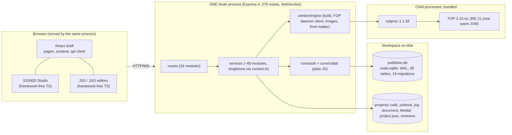
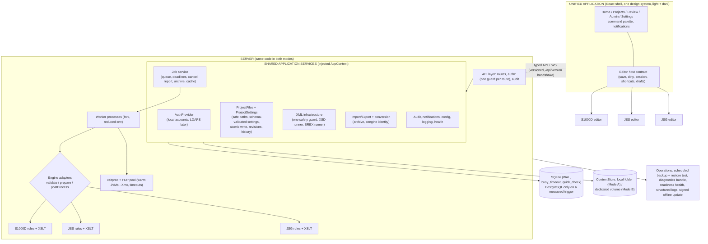
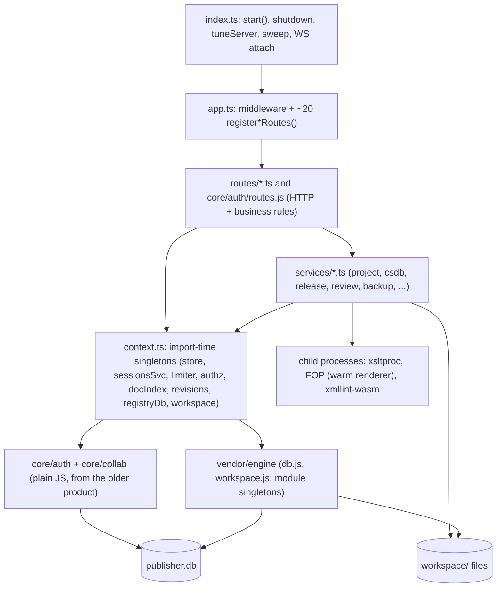
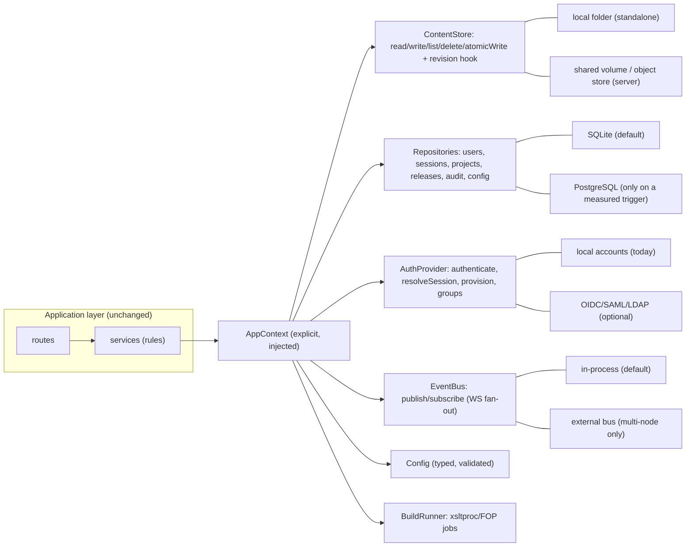
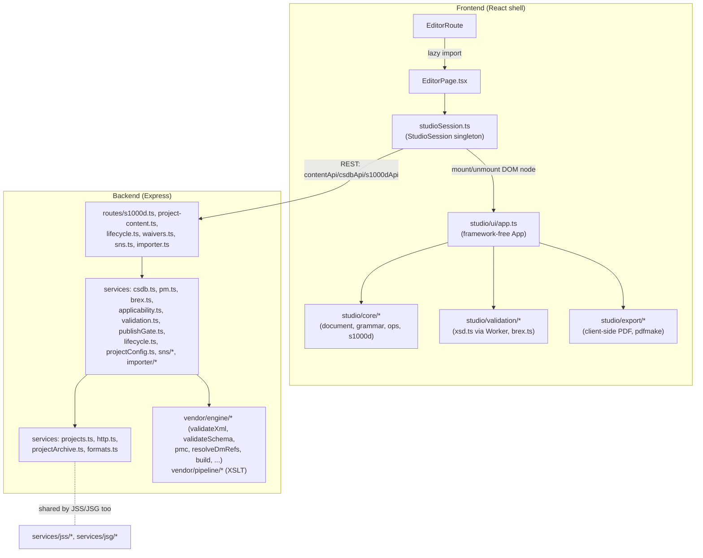
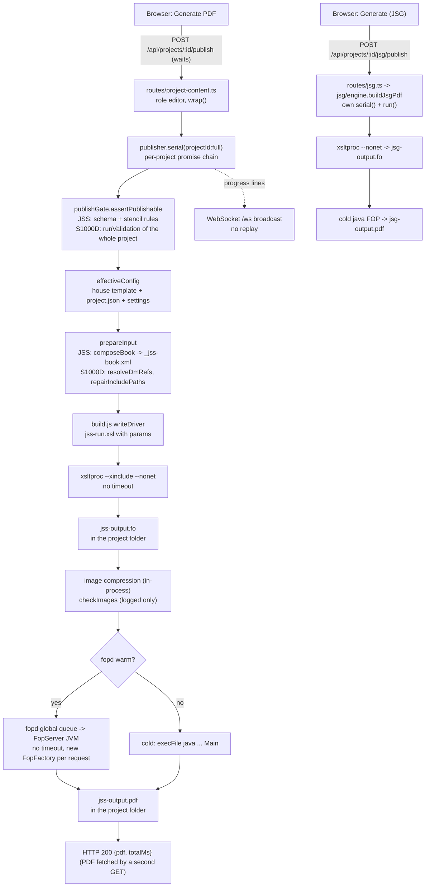
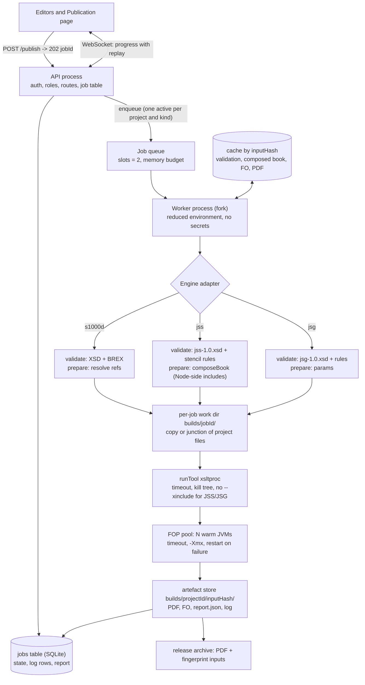
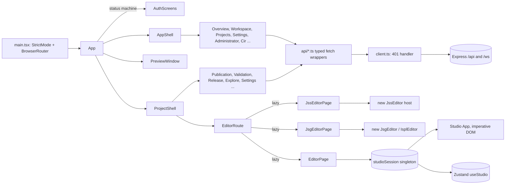

# 03 · Architecture audit and recommended architecture

**Status of this report.** Audit only; nothing in the application was changed. This file is the lead's synthesis (existing architecture, weaknesses, the recommended unified architecture and the alternatives weighed) followed by four domain architecture audits written by the agents that inspected the code (03.A platform core, 03.B S1000D engine, 03.C engines and publication, 03.D frontend). Evidence labels: **VERIFIED / OBSERVED / SUSPECTED / RECOMMENDATION / NOT VERIFIED**. The recommended architecture below is a proposal derived from the evidence, not a decision; the owner approves or changes it before any work starts.

## 1. The architecture as it exists (OBSERVED unless marked)

* **Shape.** A modular monolith by accident rather than by design: one process holds HTTP, auth, parsers, validation (`xmllint-wasm` in process), image recompression and the orchestration of the external tools. Everything is wired through import-time singletons in `context.ts` (74 importers, 03.A); there is no `Config`, `Storage` or `Auth` interface to substitute.
* **Engines.** S1000D (direct XSLT `s1000dtofo`), JSS (`jsstofo`, also used by the S1000D→JSS route) and JSG (own stylesheets, deliberately isolated) share a neutral identity record and outline (`services/xengine`) but not a runner: JSG is a third orchestrator without release, watermark, review or warm FOP (PUB-011).
* **Frontend.** A React shell hosting three framework-free editors that do not share a host contract. The shell is clean (lazy loading, tidy cleanup, typed API client; 03.D) but the editors own global handlers (Studio's window-level keydown capture caused FE-001), their own session/draft state (FE-006, FE-024) and their own CSS vocabularies (DS-001).
* **Packaging.** One installer for one deployment shape: a per-machine or per-user server plus a tray/service host (`AgastyaHost.cs`), a bundled Node 22, JRE, FOP and libxslt. The browser is the client.

## 2. Architectural weaknesses (ranked; evidence in the parts)

| # | Weakness | Evidence | Consequence |
|---|---|---|---|
| 1 | **No owner of "a project's files and settings".** `project.json` is trusted raw by three helpers and by `publisher.ts` in 11 places; four modules decide the project kind; the settings route replaces the whole object | PUB-026, ARC-022, SEC-002 (P0) | The P0 path-traversal/IDOR class; kind confusion; every new engine repeats the risk |
| 2 | **Builds are not jobs.** Synchronous HTTP request, no deadline/cancel/queue/report/archive; native-crash history (`PDF21_CRASH_INVESTIGATION.md`) and a verified FOP-hang simulation that stalls every user while health stays green | PUB-003/004/005/006, DEP-028, QA-019 | One hung build is an outage; releases are not reproducible or auditable |
| 3 | **Singleton wiring, no seams.** Import-time context, env reads scattered, `trust proxy` hard-coded, process-local state (rate limiter, pending imports, WS clients, statement cache) | PLT-028, PLT-023, PLT-031 | Cannot run a second mode (server, multi-user) or test a service in isolation; limits restart safety |
| 4 | **Persistence discipline differs by engine.** S1000D: revisions + hash-guarded saves + gate. JSS/JSG: one file overwritten in place. Settings/PMC/CIR/ancillary: no version guard. Plain `writeFileSync` everywhere | ARC-001, PUB-007, REL-001, DEP-016, FE-008 | Lost updates and torn writes are possible; no history for two of three formats |
| 5 | **Data protection is not designed.** The "backup" omits the database, has no restore and is built in memory; migration snapshot is hard-coded to migration 016; no downgrade guard; busy_timeout 0; project delete/reconcile lose or inherit state | PLT-001/002/003/004/006, DEP-001/002/008 | The recovery story is unproven; Mode B cannot rely on it |
| 6 | **Duplicated implementations** (JSS/JSG model ×4, ZIP codecs ×3, PNG encoders ×2, BREX and xsd-regex ×2 across server/browser, role predicates in client and server) | ARC-007, S1K-003, FE-019 | Divergence bugs; each fix must be made 2-4 times |
| 7 | **Security is enforced at the edges, not in one place.** One XML guard (bypassable, SEC-001) not applied to JSS/JSG (PUB-014); path safety only in some routes; no TLS; no headers/CSP | SEC-001/002/003/011, ENT-001/012 | Defence in depth is missing; a single bypass is a critical issue |
| 8 | **Frontend has no host contract for editors.** Three editors, three headers/save vocabularies/shortcut sets; a router without guards; session policy treats any `/auth/me` error as sign-out | FE-001/002/003/004, UX-003 | Data loss paths and inconsistent UX |
| 9 | **Dead surface and stale layers.** 51 routes, 43 client wrappers, dead `license.js`/`lemminx.js`, four unused auth-store tables | ARC-013, DEP-021 | Larger attack surface and maintenance cost than necessary |

## 3. Recommended architecture: one codebase, one modular monolith, two deployment shapes

**Recommendation.** Keep the single-process modular monolith and make its seams explicit; add a job abstraction with worker processes; make both deployment modes configurations of the same server. Do not introduce microservices, a message broker, a second database engine or a rewrite of the editors. Reasons: no requirement in the repository needs a multi-node system, the product ships to isolated networks where every extra service is an installer, firewall, signing and support burden, and every serious defect found is fixed by seams and discipline, not by distribution.

### 3.1 Decisions, component by component

| Component | Decision | Why (evidence) |
|---|---|---|
| Express API, route/guard model (one guard per route, test-enforced) | **Reuse** | 276/276 routes single-guarded (VERIFIED by J's live dump and `routes-guarded`); the control already works |
| Project settings, project files, path resolution | **Redesign** (new `ProjectFiles`/`ProjectSettings` service; validate on write, resolve under the project root on read, one place for atomic write + revision + version guard) | SEC-002/S1K-001/PUB-001 (P0), PUB-007, ARC-022, REL-001 |
| XML safety (guard, xi:include, DTD, FOP URI resolution) | **Consolidate** into one XML infrastructure module used by every engine and every write route; replace the text-scan with a parse-based check and an allow-list resolver | SEC-001/003/011, PUB-002/014 |
| Publication orchestration | **Redesign** as a job service + worker processes + engine adapters (modular monolith, not separate services); keep the XSLT pipelines and the vendor-exception discipline | PUB-003/004/005/006/011/027, DEP-028; 03.C §6-7 |
| Engines (S1000D/JSS/JSG rules and stylesheets) | **Isolate** per standard behind one small adapter interface; share runner, report, release record; do NOT force a common document model | 03.C §4; JSG isolation is deliberate and valid |
| Validation framework | **Consolidate** the runner (XSD cache, findings model, severity, waiver policy); rule sets stay per standard; generate the browser BREX/xsd-regex from the server implementation or share the source | S1K-003 |
| `context.ts` singletons | **Redesign** to an explicit `AppContext` with `Config`, `ContentStore`, repositories, `AuthProvider`, `EventBus`, `JobService`; migrate service by service, keep a compatibility export | PLT-028/023/031; 03.A §6 (only Config, ContentStore and session/limiter stores are mandatory for server mode; do not interface the 109-method `AuthStore` yet) |
| Auth and RBAC | **Reuse + extend**: keep five roles, add the missing controls (separation of duties, idle timeout, lockout in DB, random temp passwords); add an `AuthProvider` seam so LDAPS can arrive without touching `routes.js` | PLT-014/015/016, SEC-004/016, ENT-005 |
| Data layer | **Reuse** file+SQLite split; **add** tested backup/restore, migration framework with downgrade guard, retention, quick_check | 10 §9; PostgreSQL has no case today |
| Audit log | **Redesign** modestly: hash-chain, fail-closed for critical actions, IP from request, retention and export | ENT-003, REL-008 |
| WebSocket/broadcast | **Reuse** with session re-check, Origin check and replay for job progress | PLT-017, SEC-010, PUB-004 |
| Frontend shell | **Reuse** React/Vite/Zustand; **add** editor host contract, data router with blockers, session-policy fix, shared accessible primitives, then feature folders gradually | 03.D §7 (items 1-3, 8 are what the evidence calls for) |
| Three editors | **Reuse** (framework-free, tested); **unify** the chrome (header, save state, find, shortcuts) through the host contract and the design system, not by rewrite | UX-003; 03.D "what I do not recommend" |
| Design system and themes | **Replace** the four token vocabularies with one generated token set and two first-class themes | 07, 08 |
| Dead code (51 routes, 43 wrappers, `license.js`, `lemminx.js`) | **Remove** after the owner confirms the feature removals were intended | ARC-013, DEP-021 |
| Packaging and update | **Evolve**: one Inno Setup family for four artefacts, signed, versioned program folders, offline update with automatic rollback | `09-DEPLOYMENT-ARCHITECTURE.md` |

### 3.2 Alternatives evaluated

| Question | Options | Recommendation and trade-off |
|---|---|---|
| **Modular monolith vs microservices** | (A) today's monolith; (B) modular monolith + workers + job table; (C) separate publishing/validation/API services | **B.** C multiplies installers, ports, signing and failure modes on a user's PC with no stated requirement for multiple machines; A has no failure isolation. B is reversible: the synchronous publish route can stay as a thin wrapper while jobs are introduced (03.C §6) |
| **Shared libraries vs independent services** | Shared TypeScript modules in one repo vs per-engine deployables | Shared modules with enforced boundaries (lint rule on imports, one folder per standard); revisit only if engines get different release cadences |
| **Process isolation for engines** | none / per-job `child_process.fork` workers with reduced environment / containers | Per-job workers (no secrets, own work dir, deadline + kill tree). Containers are not available on the target Windows desktops and are not needed |
| **Background workers** | in-request / in-process queue / external queue (Redis etc.) | SQLite-backed job table + 2 slots + replayable WebSocket progress; no external queue |
| **Event-driven processing** | none / internal event bus / external broker | Internal `EventBus` for WebSocket fan-out and audit hooks only; an external broker would be justified only by multiple server nodes (no evidence) |
| **Database boundaries** | single SQLite / SQLite + replication / PostgreSQL | Single hardened SQLite per workspace; abstract content storage first; PostgreSQL only when a measured trigger occurs (p95 write latency > 200 ms or event-loop lag > 100 ms at normal load, two nodes, RPO < 1 min, or a mandated corporate DB) — `10` §9.3 |
| **Storage abstraction** | direct `fs` / `ContentStore` interface | `ContentStore` (atomic write, revision hook, list, stat, stream, materialise-working-directory for the external tools); default local folder, dedicated volume in server mode |
| **Version compatibility** | none / explicit | `/api/version` handshake (app version, API level, schema level); server refuses incompatible clients with a clear message; older build refuses a newer database (DEP-002/004) |
| **Client for Mode B** | Electron / Tauri / WebView2 host / browser | Thin WebView2-based launcher built on the existing C# host (same server API as the browser); Electron, Tauri and MSIX rejected — `09` §5 |

### 3.3 What must exist before the second deployment mode is credible

Mode B (central server, many clients) needs, at minimum and in this order: (1) the settings/path P0 fixed and project files behind one service; (2) mandatory version guards (`baseHash`) and check-out/locks for all three formats, JSS/JSG history, atomic writes; (3) TLS (native or documented proxy), security headers, WebSocket Origin/session re-check, idle timeout, lockout counters in the database; (4) the job service with deadlines and per-job directories so one author's build cannot stall others; (5) a tested backup that includes the database, plus restore; (6) config and session/limiter stores that survive restart; (7) the `/api/version` handshake and a server-side readiness endpoint. None of these requires a different architecture; all are the "seams" above. Detail: `09-DEPLOYMENT-ARCHITECTURE.md`, `10-DATABASE-AND-DATA-STRATEGY.md`, `12-ENTERPRISE-READINESS.md`.

### 3.4 Things deliberately not recommended

Rewriting the editors in React; replacing Zustand or React; server-side rendering; micro-frontends; a message broker; Kubernetes/containers; a common cross-standard document model; migrating to PostgreSQL "because enterprise"; Electron/Tauri for the client; CRDT co-editing of structured XML (no source shows a merge that keeps S1000D XML valid; check-out plus version guards is the sound design, `13` §8).

## 4. Where the detail is

| Topic | Part |
|---|---|
| Platform layering, singletons, seams for standalone vs server, wiring weaknesses | 03.A |
| S1000D engine boundaries, coupling, Studio embedding, dead/duplicated code | 03.B |
| Three engines, shared vs per-standard table, job/worker design, caching, monolith vs services comparison | 03.C |
| Frontend structure, editor coupling, state management, target frontend architecture | 03.D |
| Dependency graph, cycles (`projects.ts` in an 8-module cycle), dead code, duplication method and limits | `01-CODEBASE-UNDERSTANDING.md` §8 |

---

## 03.A - Platform architecture audit (layering, wiring, seams for standalone and server)

**Author:** audit agent A (finding prefix PLT) · **Date:** 2026-11-26 · **Status:** audit only; no repository file was changed.

**Scope and method.** Structure of the Agastya backend platform core: `backend/src/{index,app,config,context}.ts`, `types.d.ts`, `core/auth/*`, `core/collab/*`, the routes and services listed in the brief, `vendor/engine/{db,workspace,license}.js`, and how the test harness boots the application. Evidence: reading the code, counting imports and call sites with grep, the schema probe and the scratch-server probes described in `10-DATABASE-AND-DATA-STRATEGY.md` and `02.A-platform-functional.md` (ports 4051/4052, scratch workspace, never the real `workspace\`, never 4040/4041). Labels: VERIFIED (run or counted), OBSERVED (read in code), SUSPECTED, RECOMMENDATION, NOT VERIFIED. Priorities P0-P3; complexity S/M/L/XL. Findings in this file are PLT-027 to PLT-032. Recommendations are **minimum seams**, not a rewrite; each is marked mandatory (needed for a safe server mode) or optional.

### 0. Coverage

| Area / path | Inspected | Verification | Limits |
|---|---|---|---|
| `index.ts`, `app.ts`, `config.ts`, `context.ts`, `types.d.ts` | Inspected | runtime (boot, probes) + grep counts | - |
| `core/auth/*.js` (11 files), `core/collab/*.js` (2 files), 3,746 lines of plain JS | Inspected | runtime probes | argon2 path not distinguished |
| Platform routes and services in the brief | Inspected | grep counts for coupling; probes | `assets/registry/zipio` skimmed |
| `vendor/engine/{db,workspace,license}.js` | Inspected | code; `db.js` singleton confirmed | licence module has no caller |
| `test/helpers.js` boot pattern | Inspected | code | tests not re-run |
| Build/packaging wiring (`start.mjs`, host service) | Not inspected here | - | agent F |
| Other engines (S1000D/JSS/JSG internals) | Not inspected | - | agents B, C |

### 1. Layering as it is

Facts (VERIFIED by count unless stated): **74** source files import `context` (71 via `'../context'`), 27 call sites of `store.stmt(` / `store.db.prepare(` / `store.db.exec(` sit directly in `routes/` and `services/` (7 files: `routes/extensions.ts`, `routes/project-content.ts`, `services/{activity,bootReference,cir,extensions,lifecycle}.ts`). `context.ts:68-84` exports `store`, `sessionsSvc`, `limiter`, `authz`, `docIndex`, `revisions`, `registryDb`, `workspace` all typed `any`; `types.d.ts` types `req.auth` and `req.project` as `any`. `AuthStore` has about 109 methods in one 1,571-line class (counted by method-signature grep; approximate) covering users, sessions, notifications, audit, releases, locks, invitations, folders, change requests, review comments, config items, CIR.

### 2. Plain-JS core versus TypeScript

* The TypeScript layer (routes, services) is compiled and type-checked, but everything it calls in `core/*` and `vendor/*` is untyped JS reached through `any`. A wrong argument name or a renamed store method fails at run time. `config.ts` documents `vendor()` as "engine code that is deliberately not type-checked".
* `core/auth/routes.js` is a **route module inside the core**: it mixes HTTP, authentication, user administration, project membership, invitations, ownerless/adopt/reassign and admin approval queues (700+ lines). Project-governance routes (`/api/projects/:id/members`, adopt, make-ownerless) live there while `routes/team.ts` has a second membership entry point (`POST /api/projects/:id/assign`). `access-notify.ts` states that both call it. Two doors to the same mutation (PLT-029).
* Positive: the core was written with injection in mind in places (`createAuthz({ store, sessions, workspaceDir, projectDirFor })`, `ensureBootstrapAdmin({ store, audit, env, log, now })`, `new AuthStore(sqlite)`), so the pattern for a factory already exists; `context.ts` simply instantiates it once at import.
* **RECOMMENDATION (optional, M):** add JSDoc or `.d.ts` interfaces for `AuthStore`, `SessionService`, `Authz` and replace `any` in `context.ts`; do it per aggregate, starting with the methods used by routes. No rewrite needed.

### 3. Singleton coupling in `context.ts`

**VERIFIED (code + test harness).** Importing `context` performs work: `ensureWorkspace`, template seeding (`seedTemplates()`, revision-based replace with `.revN.bak`), `registry.open` (the engine `db` is a module singleton; `db.js` returns the existing handle when `db` is set), `new AuthStore`, the pre-migration snapshot, `store.migrate()`, then constructs sessions, limiter, authz, doc index and revisions. `config.ts` reads `AGASTYA_WORKSPACE_DIR` once, at first load.

Consequences:

1. **The wrong-workspace hazard is real and already documented by the test harness:** `test/helpers.js` refuses to run if `dist/config` was loaded before `boot()` set the environment, because otherwise "the app would then open, seed and write to THAT" - the developer's real workspace. Any script or future tool that requires `dist/services/*` first has the same risk (this audit's own probes had to set the environment before the first `require`).
2. **One instance per process.** Two workspaces, or an in-process restore into a fresh directory, are impossible without a new process. A restore command (PLT-001) and a "verify backup" job (data report 9.7) must run as separate processes.
3. **No way to substitute parts** for server mode (shared auth, different storage) or for tests (clock, ids, disk). 74 files import the singleton; replacing it later is a mechanical but large change.
4. **Side effects at import** hide failures (OBSERVED, not run): a migration error is thrown while `index.ts` is still importing `context`, so `start()`'s own error handling (`index.ts:55`, "Failed to start") is never reached; Node prints the stack and exits.

**RECOMMENDATION (mandatory for server mode, L):** introduce `createAppContext(config): AppContext` returning the same objects, keep `context.ts` as a facade (`export const { store, ... } = defaultContext()`) so 74 files do not change on day one, and migrate modules to receive `ctx` (or `req.ctx`) incrementally, starting with new code and with the places that need substitution (backup/restore, auth, content store). Remove import-time `migrate()` in favour of an explicit `ctx.start()` step so the process can report migration errors cleanly (see PLT-028).

### 4. Route and service boundaries

| Observation | Evidence | Impact |
|---|---|---|
| Business rules live in routes | `routes/project-content.ts:271-338`: `canSubmit/canApprove`, issuing, fingerprint update via `store.stmt('UPDATE releases SET content_hash...')`, notifications and audit in the handler | rules cannot be reused by CLI/API/batch, and unit-testing needs HTTP; self-approval gap (PLT-015) sits here |
| Raw SQL outside the store | 27 sites in 7 files (section 1) | schema changes need grep; no single place to add tenancy filters or soft delete |
| Services depend on HTTP-free helpers (good) | `services/http.ts` `HttpError`, `wrap`, `forbidden` | consistent error shape; but `extensions.ts:24` throws a plain `Error` with `status` (PLT-024) |
| Cross-service reach into engine internals | `services/projects.ts` calls `workspace.*`, `registryDb.*`, `store.*`, `docIndex.*`, `PC.*` in one function (`createProject`, `deleteProject`) | multi-step orchestration without a transaction or unit of work (data report PLT-009, PLT-004) |
| Two sources of truth for "project" | engine `projects` row, `project.json` on disk, `documents` rows, `project_config`, folder mirror `store.setProjectFolder`; reconciled at boot by `reconcileRegistry` | drift is corrected by deleting rows (PLT-003); list routes read `project.json` per project (PLT-008) |

**RECOMMENDATION (optional, M):** move release/review rules into `services/release.ts` (it already holds `releaseStateOf`, `decideRelease`) with a pure function `assertCanDecide(user, project, release)` used by the route and tests; forbid new `store.stmt` outside `core/` by a lint rule.

### 5. Duplicated implementations

* **Two ZIP writers.** `services/zip.ts` `ZipWriter` (in memory, no ZIP64, truncating `u16/u32`) is used only by `services/backup.ts`; `services/zipio.ts` has `ZipFileReader` with extraction limits and `ZipStreamWriter` (streaming, back-pressure, ZIP64) used by `packages.ts`, `htmlPublish.ts`, `routes/jss-rwi.ts` (VERIFIED by grep). The weaker one guards the most important output (backup).
* **Two project registries** (engine `projects`/`files` tables in `db.js` and `documents`/`project_config` in the auth store) plus `project.json`; the engine `files` table is unused.
* **Two reference stores for SNS and information codes:** legacy flat `config_items` collections (`sns`, `info-codes`) and the `ref_*`/`sns_presets` tables; `bootReference.ts` carries authored legacy rows over once and leaves the old collections in place.
* **Two membership mutation paths** (`core/auth/routes.js` member routes and `routes/team.ts` assign), each calling `notifyAccess`.
* **Name collision:** `services/registry.ts` is the document-type registry; `registryDb` in `context.ts` is the engine project registry.
* Dead code: `vendor/engine/license.js` (no caller), tables listed in the data report (PLT-010).

### 6. What must be abstracted so one code base serves standalone and client-server

| Seam | Mandatory for server mode? | Minimal shape | Why |
|---|---|---|---|
| **Config** | yes (S) | one typed `Config` built and validated at start (`port`, `host`, `workspaceDir`, `trustProxy`, `secureCookies`, `uploadTmp`, limits); all env reads in `config.ts` | today env is also read in `app.ts:54` (`AGASTYA_DEV_ORIGINS`), `index.ts:61` (`AGASTYA_SHUTDOWN_ON_STDIN_CLOSE`), `uploads.ts:12` (timeouts), `services/importer/recover/pdfjs.ts:22`; `app.set('trust proxy', 1)` is hard-coded (PLT-023) |
| **Storage (content)** | yes (M-L) | `ContentStore` interface covering the ~dozen operations `csdb.ts`, `projects.ts`, `backup.ts`, `packages.ts` perform (read, atomic write, list, delete, stat, stream); default `LocalFolderStore`; revision cut is part of `write` so it cannot be skipped (data report PLT-009) | gives atomic writes in one place, a seam for locking and for a shared volume, and makes backup/restore implementable; engines (xsltproc/FOP) still need a local path, so the store must be able to materialise a working directory |
| **Storage (metadata)** | no, until PostgreSQL is adopted | keep `AuthStore`; split it by aggregate behind interfaces only when a second engine is real | an interface with 109 methods written for a database that is not adopted is waste |
| **Auth provider** | only if the owner needs SSO | `AuthProvider { authenticate(req): Principal; resolveSession(token); provisionUser(external) }` with today's local accounts as the default implementation; keep roles in the platform, take identity from the provider | server customers will ask for directory sign-on; adding it later inside `routes.js` is harder than a seam now |
| **Session/limiter stores** | yes for more than one node (S) | interface with in-memory default and a table-backed implementation | limiter and sessions must survive restart (PLT-023) |
| **Event bus** | only for more than one node | `publish(event)` / `subscribe`; default `EventEmitter`; WS layer subscribes | `broadcast.ts` keeps client sockets in process memory (PLT-031) |
| **Clock/ID/logger** | optional (S) | injected `now`, `newId`, `log` | deterministic tests; correlation ids for PLT-019 |

**Mode matrix (RECOMMENDATION).**

| Concern | Standalone | Server |
|---|---|---|
| Bind / TLS | loopback, HTTP | LAN/proxy; TLS at proxy; `trustProxy` explicit; refuse non-loopback bind without TLS setting or print a warning |
| Auth | local accounts | local or provider; stronger password policy; idle timeout (PLT-022) |
| Data | local folder + SQLite | same on a dedicated disk, optional second engine on trigger |
| Backup | in-product scheduled backup | backup to separate volume + off-box copy; restore command |
| Jobs | in-process child processes | same; queue limit per server |
| Config source | `agastya.ini` via the host | same plus environment overrides |

The data strategy that matches these seams is in `10-DATABASE-AND-DATA-STRATEGY.md` section 9.

### 7. How services are wired: weaknesses

* **Startup sequence.** `index.ts` `start()`: reconcile registry -> bootstrap admin -> `createApp()` -> start renderer -> `tuneServer` -> hourly upload sweep -> attach WebSocket -> listen. Migrations run earlier, at import. A failure in the middle leaves the warm renderer or timers running until process exit (OBSERVED). Boot work (`reconcileRegistry` reads every project; `docIndex.reconcileAll`) grows with content.
* **Shutdown.** `stop()` stops the renderer, closes the WS server and `server.close()` (keep-alive connections remain until they end); `process.exit(0)` follows after 500 ms. The SQLite connection is never closed and no `wal_checkpoint` is issued (OBSERVED; data report PLT-013). Windows stdin-close shutdown (`AGASTYA_SHUTDOWN_ON_STDIN_CLOSE`) is documented in `index.ts`.
* **Health.** `GET /api/health` returned `{"status":"ok","version":"2.0.0","time":...}` (VERIFIED) and, from the code, is a pure liveness probe (`app.ts:65`): it does not touch the database or disk. A server behind a monitor needs a readiness check (DB `SELECT 1`, free disk, workspace writable).
* **Error handling.** One `wrap` helper, one global error handler (`507` for disk full), good; leaks `details` on 500 (PLT-019); SQLite `BUSY` is not mapped (data report PLT-002).
* **Process-local mutable state** (section 8, PLT-031): rate limiter `Map`, pending package-import tokens `Map` (`routes/packages.ts:59`), WS client set, prepared-statement cache `Map` (`store.js:638`), warm FOP renderer. Fine for one process; blocks horizontal scale and loses state on restart.
* **Tests as architecture feedback.** The suite boots the real compiled app in-process on a temp workspace (`test/helpers.js`) and needs `npm run build` first; it is a strength for realism and a symptom of the singleton (tests cannot isolate a service).

### 8. Findings

#### PLT-027 · P2 · OBSERVED · L · Authentication is hard-wired to local accounts; no seam for SSO, directory sign-on or two-factor

**Problem:** `routes.js` verifies passwords against `users.password_hash`; sessions, the limiter and the password policy are fixed implementations. There is no provider interface, no group concept, no external-identity linking, no TOTP/WebAuthn.
**Evidence:** `core/auth/routes.js` login handler (`:184-`), `core/auth/{crypto,policy,sessions,rateLimit}.js`, `users` columns (no external id); `vendor/engine/license.js` (unused) shows no identity hooks either.
**Recommendation:** only when the owner states the requirement: extract `AuthProvider` (section 6), implement OIDC first (one standards-based protocol covers most corporate directories), map claims to the existing roles, keep local accounts as the standalone default and as the break-glass admin. Not before.
**Acceptance:** with a test OIDC provider, a user signs in, is provisioned with the default role, and revocation at the provider ends access at the next token refresh; local mode unchanged.

#### PLT-028 · P1 · VERIFIED · XL · No explicit application context: import-time singletons prevent server-mode variants, in-process restore and isolated tests, and can write to the wrong workspace

**Category:** architecture / deployability.
**Problem:** `context.ts` builds the whole platform at import using module-level singletons (`vendor/engine/db.js` handle, `config`, `AuthStore`), and 74 files import it. The data directory is frozen at first load; migration and seeding run as a side effect of `require`.
**Evidence:** `backend/src/context.ts:27-84` (construction and exports, all `any`); `vendor/engine/db.js:17-19` (`if (db) return db`); `backend/src/config.ts:30` (workspace read once); `test/helpers.js:20-30` (guard against loading `dist/config` before the environment is set, with the comment that otherwise the app would write to the developer's real workspace); count of 74 importing files and 27 raw SQL sites (section 1).
**Current implementation:** one process = one workspace = one database = one auth store; configuration by environment only.
**Recommendation:** section 3: `createAppContext(config)` factory; `context.ts` becomes a facade; start-up becomes an explicit `ctx.start()` (migrate, seed, reconcile); new code (backup/restore, auth provider, content store) takes `ctx`. Do it in this order: (1) `Config` object and explicit start (S-M), (2) `ContentStore` extracted from `csdb.ts`/`projects.ts`/`backup.ts` (M-L), (3) `AuthProvider` seam (M), (4) migrate remaining modules opportunistically.
**Expected outcome:** a server build can swap storage/auth; restore and "verify backup" run in-process on a scratch context; tests isolate services.
**Dependencies:** PLT-001 (restore needs it), PLT-006 (explicit start owns the pre-migration snapshot).
**Risks:** large mechanical diff; mitigate with the facade so behaviour does not change and the existing suite stays green after each step.
**Acceptance criteria:** two `AppContext` instances with different workspaces run in one test process without interference; the existing API suite passes unchanged with the facade; a restore into a new directory works without restarting the process.
**Test cases:** two contexts, two workspaces, write in one and assert absence in the other; migration failure reported by `start()` rather than as an import exception; a context built on a read-only workspace fails fast with a clear message.

#### PLT-029 · P2 · VERIFIED · S · Duplicated implementations, notably the weak ZIP writer guarding the backup

**Problem:** two ZIP writers (`zip.ts` for backup, `zipio.ts` for everything else), two project registries, two SNS/info-code stores, two membership-mutation entry points, one dead licence module, a naming collision between `registry.ts` and `registryDb`.
**Evidence:** section 5; grep `ZipWriter`/`ZipStreamWriter` usages (`backup.ts:11,30` versus `packages.ts:34`, `htmlPublish.ts:28,250`, `routes/jss-rwi.ts:16,60`).
**Recommendation:** point `backup.ts` at `ZipStreamWriter` and delete `zip.ts` (data report PLT-005); route team `assign` through the same service function as the member routes; rename `registry.ts` to `docTypes.ts`; decide on `license.js`.
**Acceptance:** one ZIP writer in the tree; one function mutates membership; no unused module in `vendor/engine`.

#### PLT-030 · P2 · VERIFIED · M · Untyped core boundary and SQL outside the store

**Problem:** every platform object is `any` at the boundary; 27 raw SQL call sites in 7 routes/services files bypass the store's methods; business rules sit in route handlers.
**Evidence:** `context.ts:68-84`; `types.d.ts`; grep counts; `routes/project-content.ts:316`.
**Recommendation:** typed facades for the store methods that routes use; a lint rule against `store.stmt(`/`store.db.` outside `core/`; move the release decision rule into `services/release.ts`.
**Acceptance:** `tsc` flags a renamed store method used by a route; no raw SQL outside `core/` and `services/*Repository`.

#### PLT-031 · P2 · VERIFIED · M · Process-local state, shallow health check and no graceful database shutdown

**Problem:** limiter, pending package-import tokens, WebSocket clients and statement cache live in process memory (lost on restart, impossible to share across two servers); `/api/health` is liveness only; shutdown never closes the DB or checkpoints the WAL; the unbounded `stmt()` cache would grow with any dynamic SQL.
**Evidence:** `routes/packages.ts:59`, `core/auth/rateLimit.js`, `services/broadcast.ts`, `store.js:638`, `app.ts:65`, `index.ts:53-60`; probe 1 (limiter 429 behaviour), probe 6 (sockets).
**Recommendation:** persist pending import tokens (a table or temp-file manifest with expiry), add `GET /api/ready` (DB `SELECT 1`, workspace writable, free disk threshold), close the DB and `wal_checkpoint(TRUNCATE)` on shutdown, cap the statement cache.
**Acceptance:** a pending import survives a restart within its expiry; readiness fails on a read-only workspace; clean shutdown leaves no `-wal` residue.

#### PLT-032 · P3 · OBSERVED · S · Configuration is scattered and partly hard-coded

**Problem:** environment variables are read outside `config.ts` (`app.ts:54`, `index.ts:61`, `services/uploads.ts:12`, `services/importer/recover/pdfjs.ts:22`); `trust proxy` is fixed to 1; there is no startup validation or "print effective configuration" (the host's `agastya.ini` maps to env outside this repo layer).
**Recommendation:** one typed `Config` with defaults and validation, logged at start (without secrets); `AGASTYA_TRUST_PROXY` explicit.
**Acceptance:** `grep process.env` outside `config.ts` returns nothing; invalid values stop start-up with a named variable.

### 9. Strengths (not findings)

* Routes, services and core are in separate folders with a consistent `register*Routes(app)` pattern and one error type; `routes-guarded.test.js` enforces that every route declares its access.
* The core already accepts injected dependencies in several constructors; a factory is a small step.
* The engine and pipeline are isolated as child processes; the warm FOP renderer is encapsulated in `services/renderer.ts`.
* Content/metadata split (files + SQLite) is simple and fits both modes.
* The test harness runs the real compiled app, so integration coverage is genuine.

### 10. Unknowns and limitations

* Counts (74 importers, 27 SQL sites, about 109 store methods) are grep-based and approximate; they are not a complete dependency graph.
* No profile was taken of where request time goes beyond the probes in the data report; the interface sizes proposed in section 6 are estimates from reading `csdb.ts`, `projects.ts`, `backup.ts`, `packages.ts`, not measured.
* Packaging, service hosting and the Windows host program were not inspected (agent F).
* Whether the frontend assumes cookie-session semantics that an SSO provider would change was not examined (agent D).
* Behaviour with two server processes on one workspace, and behind a real reverse proxy, was not run; statements about them are SUSPECTED.

---

## S1000D engine architecture (Agent B)

Scope and method: same code base as the functional report (`02.B-s1000d-functional.md`); this file focuses on boundaries, coupling, dead/duplicated code, and how the Studio is embedded in the React shell. Evidence is code reading plus the same scratch-server probes already run for the functional report (not repeated here).

### Coverage table

| Area | Status | Notes |
|---|---|---|
| Service-layer boundaries (`services/*.ts`) | Inspected | Full read of the S1000D-specific services; cross-referenced against `services/jss/*`, `services/jsg/*`, `services/xengine/*` to judge what is shared vs. S1000D-only |
| Route-layer boundaries (`routes/*.ts`) | Inspected | Full read of the S1000D routes; skimmed JSS/JSG routes for comparison |
| `vendor/engine/*`, `vendor/pipeline/*` | Partially inspected | Read the files the S1000D services call into (`validateXml.js`, `validateSchema.js`, `pmc.js`'s API shape, `resolveDmRefs.js`'s API shape, `paths.js`); did not read the XSLT pipelines themselves |
| Studio embedding (`lib/studioSession.ts`, `pages/project/EditorPage.tsx`, `EditorRoute.tsx`) | Inspected | Full read |
| Studio internals (`studio/core`, `studio/ui`, `studio/view`, `studio/export`) | Partially inspected | Read enough to characterise the architecture (document model, undo, validation orchestration, PDF export entry points); did not read every file line by line |
| Cross-engine architecture doc (`docs/CROSS_ENGINE_ARCHITECTURE.md`) | Inspected | Read in full, cross-checked against `services/xengine/*` API shapes (not line-by-line) |

### High-level picture

### What is S1000D-specific vs. generic infrastructure

**Genuinely S1000D-specific** (would need to be rewritten, not reused, for another engine):
- `services/brex.ts`, `projectBrex.ts`, `applicability.ts`, `applicEval.ts` — BREX and applicability have no JSS/JSG equivalent; S1000D's rule model (`structureObjectRule`, `applic`/`assert`/`evaluate`) is specific to the standard.
- `services/csdbObjects.ts`, `objectRender.ts`, `objectTemplates.ts` — DML/DDN/COM/UPF/SMC/IMF file-naming and rendering are S1000D Chap 7.5.1 constructs.
- `services/modelCode.ts`, `s1000dRef.ts`, `sns/*` — DMC structure, the info-code/learn-code/SNS catalogues, and SNS derivation are S1000D vocabulary.
- `services/lifecycle.ts` — issue/in-work/supersede/obsolete/reinstate is S1000D's own revision model (JSS has its own, separate versioning story per the memory notes, not reviewed here).
- `frontend/src/studio/**` almost entirely — the grammar, the 21 DM-type templates, the BREX/XSD validators, the S1000D-shaped PDF export (front matter, DMC-aware headers/footers) are all S1000D-only. This is the single largest S1000D-specific surface in the product by line count (~16,500 lines under `studio/`).

**Generic infrastructure the S1000D engine happens to be the heaviest user of** (already shared, or structurally shareable):
- `services/projects.ts` — project CRUD, `project.json` read/write, `csdbRel`/`mediaRel`/`pmRel` (the path-resolution helpers at the centre of **S1K-001** in the functional report) are generic; they are consumed by `csdb.ts`, `pm.ts`, `applicability.ts`, and also by non-S1000D code paths (confirmed by `isS1000dProject()` existing specifically to let *other* formats opt out of S1000D-only checks, `projects.ts:58-63`).
- `services/projectArchive.ts` — explicitly format-agnostic (S1000D/JSS/JSG share one archive layout, branching only on `format` for the handful of S1000D-only extras: settings restoration, `adoptFromContents`).
- `services/review.ts`, `release.ts`, `publishGate.ts` (partially), the audit log, the notification system — release/review/watermark machinery is generic; `publishGate.ts`'s `assertPublishable` explicitly branches to a **separate** JSS gate (`isJssAuthored(projectId)` → `assertJssPublishable`) at its very top, meaning the "publish gate" concept itself is shared infrastructure with a format-specific implementation plugged in, not an S1000D-owned function that JSS happens to call.
- `services/zipio.ts`, the importer's ZIP reading (`importer/zipRead.ts`, `importer/package.ts`), and the whole upload/security story (`phase17-security.test.js`'s scope) are format-agnostic.
- `services/xengine/*` (outline, identity, convert) is **deliberately** the shared cross-engine layer described in `docs/CROSS_ENGINE_ARCHITECTURE.md` — it stores DMC/PMC/ICN identity in a backend-side sidecar (`doc-identity.json`) specifically so JSS/JSG documents (which carry no such codes in their own XML) can still participate in the same identity/conversion model S1000D provides natively. This is good evidence the team already recognised the "S1000D has structured identity, the others don't" boundary and built a proper abstraction for it rather than leaking S1000D concepts into JSS/JSG.

**The boundary is mostly clean, with one real leak**: `services/projects.ts`'s `csdbRel`/`mediaRel`/`pmRel` are named with S1000D vocabulary ("csdb") but are generic path-resolution plumbing used (at minimum) by every format that stores content under a configurable subdirectory — meaning the path-traversal defect found in the functional report (S1K-001) is **not an S1000D-only bug**, it is a generic-infrastructure bug that happens to be most exploitable through S1000D's richer per-file API surface (data modules, media, publication module all resolve through it). Any other engine's equivalent read/write routes that also trust `project.input.*` unchecked would have the same exposure. I did not check the JSS/JSG routes for this directly (out of my assigned area) — **flagged as a cross-cutting lead for whoever owns JSS/JSG or generic project infrastructure.**

### Coupling problems

1. **`services/projects.ts` is a hub with no internal boundary between "generic project record" and "S1000D defaults".** `isS1000dProject()` (`projects.ts:58-63`) infers format from `pj.format` with two legacy fallbacks (`pj.type === 'JSS'`, `pj.templateRef === 'uhb'`) — a small but real smell: a project's *format* is sometimes inferred from its *template*, meaning a future template reuse across formats (or a renamed template) could silently misclassify a project's engine. Low risk today (I found no code path that would hit the fallback with current data), but worth noting as technical debt.
2. **`publishGate.ts` knows about JSS by name.** `assertPublishable`'s very first line branches on `isJssAuthored`. This is defensible (one gate, one entry point, callers never need to know which engine they're building) but it does mean the "generic" gate file is not actually engine-neutral — it is an S1000D gate with a JSS escape hatch bolted on, not a shared abstraction with two implementations behind an interface. A cleaner shape would be a tiny `PublishGate` interface with an S1000D and a JSS implementation selected by the caller, so this file's line count (and its S1000D-specific imports: `runValidation`, `checkModuleBrex`) doesn't grow every time a third engine needs a gate too (JSG, per the memory notes, is on a different track).
3. **The Studio talks to the server only through `StudioSession`, which is good, but `StudioSession` itself is a 359-line class carrying both the editor-host contract (`StudioHost`) and a fair amount of S1000D domain logic** (`modelIdent()`, `identityTaken()`, `linkArtwork()` — all DMC/entity-specific). This is appropriate coupling (the Studio *is* the S1000D editor), not a defect, but it does mean `StudioSession` cannot be reused as-is for a hypothetical "framework-free editor" pattern for another format without extracting the identity/artwork logic out first. Noted for completeness, not raised as a finding.
4. **Duplicated BREX/XSD-pattern logic between server and browser** (detailed in the functional report, S1K-003) is an architecture-level coupling problem as much as a correctness one: two runtimes implementing the same domain rule independently, synchronized by comment and by a parity test suite rather than by a shared module, is the kind of coupling that *looks* like no coupling (the files don't import each other) but actually requires every change to be made twice and verified twice.

### Dead / duplicated code

- **Duplicated**: `backend/src/services/xsdRegex.ts` vs `frontend/src/studio/core/xsdRegex.ts` (near-identical, by the backend file's own admission). `backend/src/services/brex.ts` vs `frontend/src/studio/validation/brex.ts` (independent implementations of the same rule semantics, not literal duplicates, but duplicated *logic*). Both already covered as S1K-003 in the functional report; not repeated as a separate finding here.
- **Two "single BREX source" entry points coexist in `brex.ts`**: `resolveBrex()` (the original, single-model entry point) is kept explicitly "for callers and tests that already hold a single model" alongside the newer, chain-aware `resolveBrexChain()`. The file's own comment is honest about this being legacy-compatibility, not an oversight — low-risk, self-documented, did not find any production caller still using the old one-model path outside tests.
- **No outright dead code found** in the files I read in full. The codebase is unusually good about deleting rather than commenting-out (every file I opened that referenced a removed feature — e.g. applicability's removed UI — did so by explaining the removal in a comment, with the underlying logic still live and reachable by API, not by leaving orphaned code around).
- **`services/csdbObjects.ts`'s regex-based attribute reader** (`attrs()`, a hand-rolled `([\w:.-]+)\s*=\s*"([^"]*)"` scanner) duplicates a nearly identical helper that also appears in `csdb.ts` (`attrs()`), `applicability.ts` (similar inline patterns), and `lifecycle.ts` (`attrsOf()`). None of these are large (a few lines each) and all solve the same narrow problem (read XML attributes off a head-of-file string without a full parse, for speed), but four near-identical private helpers across four files is the kind of small, low-risk duplication worth consolidating into one shared `attrsOf(xmlFragment)` utility in `xmlHead.ts` (which already owns the "look at the head of the document" concern). **Recommendation, P3, S**: extract one shared helper.

### How the Studio (framework-free TS) is embedded in the React shell

**Data flow and state**: the Studio is a single long-lived class instance (`StudioSession`, a plain singleton module export, not a React component) holding a detached DOM node (`this.root`) that React only *moves* into and out of the DOM via `mount()`/`unmount()` (`EditorPage.tsx:97-113`). This is a deliberate and correct design for a framework-free, imperative editor embedded in a React tree: it means switching routes away from the editor and back does not destroy and recreate CodeMirror instances, undo history, or open-document state — `App` (the Studio's own root class) is created exactly once per browser session (`ensure()`/`create()`, guarded against concurrent initialisation from React's StrictMode double-invoke). React's only visible state about the Studio is a tiny Zustand store (`useStudio`, `{docs, ready, projectId}`) that `StudioSession.publish()` updates whenever the open-document list changes — a narrow, one-directional signal from the imperative world into React, not a full state mirror. This keeps the coupling surface small and legible: React never reaches into the Studio's internals, and the Studio never imports React.

**Save path**: `StudioHost.save(ed, text)` is the *only* way the Studio's `App.writeFile()` persists anything when embedded (`App.save()` → `writeFile()` → `this.host.save(ed, text)`, `app.ts:790-812`); when there is no host (the Studio's own standalone test harness) it falls back to the File System Access API or a browser download instead. `StudioSession.save()` (the host implementation) looks up a `WeakMap<EditorDocument, Ref>` to decide whether this document maps to an existing CSDB file (`PUT /dms/:file` with the `baseHash` the author loaded, giving optimistic concurrency) or is new (`POST /dms`, server decides the file name from the module's own identity). This is a clean inversion-of-control boundary: the Studio has no concept of "project," "CSDB," or HTTP at all — it only knows "save this text, tell me if it worked," and every S1000D/server concept (identity, project id, hash-based conflict detection) lives entirely on the host side (`studioSession.ts`), not inside the editor.

**What crosses the boundary, concretely**: `StudioHost` (the interface the Studio depends on, defined and documented at the top of `studioSession.ts`) is five methods and a getter — `save`, `isDark`/`toggleTheme`, `beforeNew` (refresh reference data before the New-document wizard opens), `reference()`/`projectRefs()` (admin catalogues + project config for the wizard), `modelIdent()`/`identityTaken()` (duplicate-identity guard), `changed()` (publish to the Zustand store), `pdfSettings()` (publication settings for quick preview). This is a small, well-named surface; I did not find any place where the Studio reaches past this interface to call a REST endpoint or React hook directly, which is the thing that would actually make this architecture fragile if it existed.

**Session lifecycle**: `setProject()` closes every open editor and clears all per-project caches (`media`, `serverDms`, `settingsCache`, `projectRefs`) when the project id changes, but **keeps the single `App` instance alive** — so switching between two S1000D projects in the same browser tab reuses one editor instance, which is efficient but also means any accumulated client-side state the Studio itself keeps outside the per-document model (settings, recent-files list, the BREX library in IndexedDB) is **shared across every project the user ever opens in that browser**, not scoped per project. The BREX library (`storage.ts`, IndexedDB store `brex`) is explicitly called out as project-independent in the compliance matrix ("The Studio's BREX library in the browser is still per browser, not per project") — this is a known, documented limitation, not something I'm raising as new, but it is architecturally relevant here: it is a direct consequence of the Studio being a single long-lived instance with project-scoped and browser-scoped state intermixed in the same persistence layer (`storage.ts` has no project-id dimension in its IndexedDB key scheme at all).

**Validation inside the embedded editor** runs entirely client-side (`ui/validator.ts`'s `ValidationService`, using the same `xsdRegex`/BREX logic discussed above) and is **independent of, and can disagree with, the server's own validation** that the publish gate runs — this is the browser half of the "duplicated validators" risk (S1K-003) made concrete at the architecture level: the editor shows the author one verdict live, and `publishGate.ts` computes a second, independent verdict at publish time using different code. They are *intended* to agree (that is the whole point of the parity test suite) but there is no runtime cross-check — an author could see "0 problems" in the editor and still have the publish gate refuse the build if the two implementations have drifted, with no code path that would surface *why* they disagree (the gate's error message describes the schema/BREX failure, not "this differs from what the browser told you").

### Recommendations (architecture-level, not repeated from the functional report)

#### S1K-006 · P2 · OBSERVED · M · `publishGate.ts` hard-codes a JSS branch instead of exposing a format-neutral interface
**Problem**: `assertPublishable`'s first line is `if (isJssAuthored(projectId)) { ... }`, making the "generic" publish gate an S1000D-shaped function with a JSS escape hatch bolted on, not a shared abstraction. **Evidence**: `backend/src/services/publishGate.ts:52-56`. **Recommendation**: a small `checkPublishable(projectId, scope, opts)` interface with S1000D and JSS implementations registered by format, so the next engine (JSG) does not need a third branch added to this same function. **Acceptance**: adding a new format's publish check requires no edit to the existing branches in `publishGate.ts`.

#### S1K-007 · P3 · OBSERVED · S · Four near-identical "read attributes off a string" helpers
**Problem**: `csdb.ts:attrs`, `csdbObjects.ts:attrs`, `lifecycle.ts:attrsOf`, and an inline equivalent pattern in `applicability.ts` all solve the same narrow problem (read XML attributes off a head-of-file string without a full parse) with separate, near-identical regex-based implementations. **Recommendation**: consolidate into one function in `xmlHead.ts`, which already owns the "look at the head of the document" concern. **Acceptance**: one shared helper, four call sites.

#### S1K-008 · P3 · OBSERVED · S · Format inferred partly by template-name convention
**Problem**: `isS1000dProject()`'s fallback (`projects.ts:61`, `pj.templateRef === 'uhb'`) infers a project's engine from its template name when `pj.format` is absent, rather than from a stored fact. **Evidence**: `backend/src/services/projects.ts:58-63`. **Recommendation**: confirm (one query against the live database) that every project now carries an explicit `format` field — the Phase-21 database-restoration work referenced in project memory suggests this may already be true — and remove the fallback if so. **Acceptance**: `isS1000dProject()` reads only `pj.format`.

### Unknowns and limitations
- I did not read `vendor/pipeline/s1000dtofo`'s XSLT in any depth (out of scope per the brief: "only as far as the data it needs"); the architecture description above treats it as an opaque rendering backend fed by `services/publisher.ts` (not in my file list) and the vendored `build.js`/`pmc.js`/`resolveDmRefs.js` glue, whose *API shapes* I read but whose internals I did not.
- I did not independently verify the JSS/JSG side of the shared infrastructure claims (`projectArchive.ts`'s format branching, `publishGate.ts`'s `isJssAuthored` escape hatch, `xengine/*`'s identity sidecar) beyond reading their S1000D-facing code and the cross-engine architecture document; a JSS/JSG-focused agent should confirm these from their side.
- "Dead code" was assessed by reading, not by a coverage/call-graph tool; a few unused exports may exist that a static analysis pass would find and I did not.

---

## 03.C - Engines architecture: how S1000D, JSS and JSG relate, what to share, and how to run builds

Agent C, 2026-11-26. Audit only. Prefix `PUB`; numbering continues after `02.C-jss-jsg-publication-functional.md` (PUB-001 to PUB-026). Findings of that file are referred to by ID.

**Scope and method.** Static reading of the orchestration code (`services/publisher.ts`, `services/jsg/engine.ts`, `vendor/engine/{build,fopd,paths}.js`, `fopserver/FopServer.java`, `services/xengine/*`, `routes/*`),
grep inventories of duplicated helpers over `backend/src`, and the measurements taken on the scratch server in 02.C (3 builds, 7 conversions). Nothing in this file is a prototype: the recommended design is **not implemented or tested** anywhere; where I give numbers they are the measured ones from 02.C.
Remarks on `docs/PDF21_CRASH_INVESTIGATION.md` are quoted from that document, not reproduced by me.

### Coverage table

| Area | Status | Verification | Limits |
|---|---|---|---|
| Publication orchestration (`publisher.ts`, `jsg/engine.ts`, `xengine/convert.ts`) | Inspected | code read in full; runtime behaviour measured | concurrent builds across projects not measured |
| Vendored engine runner (`vendor/engine/build.js`, `fopd.js`, `paths.js`, FopServer) | Inspected | code read | JVM memory behaviour under load not measured beyond one 570-page build |
| XSLT pipelines (`jsstofo`, `s1000dtojss`, `s1000dtofo`, `schemas/jsg/engine`) | Partially | sizes, `document()` and include usage grep, outputs read | stylesheet logic not audited |
| Job/queue/worker facilities in the platform | Inspected | grep for `worker_threads`, `fork(`, job tables: **none exist** in `backend/src` or `vendor/engine` | `xmllint-wasm` internal threading NOT VERIFIED |
| Helper duplication | Inspected | grep over `backend/src` (counts below) | semantic differences between copies only spot-checked |
| Packaging / deployment constraints (offline desktop install) | Partially | `paths.js` comments, `PACKAGING.md` headings | installer not examined (agent F's area) |

---

### 1. How the three engines relate

| | S1000D | JSS (authored) | JSG (authored) |
|---|---|---|---|
| Source of truth | data modules in `csdb/` + `publication.xml` (PM) | one `<jssbook>` file named by `input.pm` (default `publication.xml`) + ancillary front-matter pages | one `jsg-document.xml` (`<jsgdoc type="uhb\|ispl">`) |
| Validation | XSD per declared issue, BREX, rules (`validation.ts`, `publishGate.ts`) | `jss-1.0.xsd` + stencil rules (`jss/service.validateJss`) | `jsg-1.0.xsd` + rules (`jsg/service`) |
| To XSL-FO | either `s1000dtofo` (direct) or `s1000dtojss` then `jsstofo` (two stages) | `jsstofo` (stage 2 only) | `schemas/jsg/engine/jsg.xsl` (+ `jsg-uhb`, `jsg-ispl`, `jsg-common`) |
| Orchestrator | `publisher.ts` + `vendor/engine/build.js` | the same (`prepareInput` JSS branch composes `_jss-book.xml`) | **its own**: `services/jsg/engine.ts` |
| FOP | warm daemon (`fopd`), cold fallback | same | cold `java` only |
| Release / watermark / review | yes (hash + status) | yes | **none** (PUB-011) |
| Cross-engine | `xengine`: outline + identity sidecar + 6 conversions, as new projects with findings | same | same |

So there are really **two FO generators sharing one runner (`jsstofo` for S1000D-via-JSS and JSS) and one generator with its own runner (JSG)**; the "engine" name hides that the S1000D route can end in the JSS stylesheets. Consequences seen in 02.C: a JSS defect is an S1000D defect in the two-stage pipeline (vendor-exception rules protect that with `jss-cover-isolation.test.js`); a runner defect (timeouts, cancel, report) must be fixed twice (PUB-003, PUB-011).

### 2. Current publication data flow

Things the diagram shows that matter: the request is the job (no identity); the only shared state between builds is the project folder and the one FOP JVM; every engine writes its intermediate and result files into the project directory; the gate, the build and the result live in one HTTP call.

### 3. Duplicated helpers (verified by grep)

| Helper | Copies | Where | Note |
|---|---|---|---|
| XML text escape `esc` | **14** near-identical definitions (+ 2 attribute escapes) | `applicability.ts:57`, `dispatch.ts:30`, `htmlPublish.ts:34`, `jsg/docx.ts:26`, `jsg/service.ts:32`, `jss/rwi/canonical.ts:44`, `jss/service.ts:35`, `jssdm/toDms.ts:68`, `objectRender.ts:18`, `objectTemplates.ts:20`, `profiles.ts:55`, `projectBrex.ts:22`, `projects.ts:131`, `sns/pmxml.ts:47` | some also escape `"` (`dispatch`, `htmlPublish`, `objectRender`, `objectTemplates`, `projectBrex`), the others do not: the attribute vs text distinction is implicit in which copy a caller happened to import |
| SHA-256 helper `sha` | 5 named, with 3 signatures (string, Buffer, file) + 3 inline `createHash` | `csdb.ts:36`, `jss/service.ts:37`, `jsg/service.ts:34`, `jss/rwi/exporter.ts:29`, `publishGate.ts:40` | the gate and the editors compare hashes of *different representations* of the same file |
| Per-key promise chain `serial` | 2 | `publisher.ts:55`, `jsg/engine.ts:25` | identical bodies; neither coalesces, limits or times out |
| `execFile` runner `run` | 2 (+ 3 in `build.js`) | `jsg/engine.ts:34`, `build.js` `run()/execOpts` | different `maxBuffer` (20 MB vs 10 MB), neither has a timeout |
| "kind of project" predicate | 4 | PUB-026 | they disagree for imported jssbook projects |
| `bad/conflict/notFound` error builders | shared (`core/errors`) | good: not duplicated | - |
| Project-relative path join | 8+ ad-hoc `path.join(projectDir, rel)` | PUB-001 | no single `resolveInProject()` |

**Recommendation (PUB-028).** One `backend/src/lib/` module family: `xml.ts` (`escText`, `escAttr`, `escXmlName`), `hash.ts` (`sha256Text/Buffer/File`), `proc.ts` (`runTool` with timeout, kill, output cap), `paths.ts` (`resolveInProject`, `safeRelPath`), `atomic.ts` (`writeFileAtomic`), and move the `serial` chain into the job service of section 5.

### 4. What to share across the three engines, and what stays per standard

| Concern | Share | Keep per standard | Why |
|---|---|---|---|
| Validation **framework** | the runner (`validateXml`, XSD cache, finding model, severity, waiver/gate policy, report shape) | the rule sets: BREX + issue XSDs (S1000D), stencil rules (JSS), JSG rules | `publishGate.ts` already has the generic part (hash before/after, `verifyUnchanged`) but is wired to S1000D file lists |
| Project / asset / file services | one `ProjectFiles` service: safe path resolve, atomic write, history, media (`Media/`), asset metadata, archive export/import | what files a project has (CSDB, jssbook, jsg-document) | PUB-001, 007, 026 |
| Import / export | the archive (`.jsspub.zip`) code, ZIP limits, `checkXmlSafety` call on every XML, the findings model of `xengine` | the readers/writers (Word importer, S1000D package, RWI) | already partly shared in `xengine`; the XML guard is not applied to JSS/JSG (PUB-014) |
| Publication orchestration | **job service**: queue, per-job work dir, deadlines, cancel, progress with replay, build report, result store, release archive | engine adapters: how to make FO from a project | PUB-003/004/005/006/011 |
| Logging / errors | `HttpError` + one structured build log (per job id) + the audit log | engine-specific message texts | build logs today are WebSocket lines and console output |
| Versioning | project history (source snapshots, release snapshots, tool versions in the build report) | issue/standard numbering | PUB-006, 007 |
| Preview | the PDF viewer, stale marker, build report panel | HTML preview of S1000D modules (own) | |
| Branding, watermark, classification, house templates | the settings merge (`effectiveConfig`) and brand pack | the layout parameter mapping per engine (`layoutParamsFor`) | JSG ignores most of it today |
| Stylesheets | **nothing** in the XSLT is worth sharing beyond what exists (`jsstofo` is already shared by two) | `jsg*.xsl` stays isolated by design (`JSG_ENGINE.md` s.6) | the isolation is a valid decision; the runner is not part of it |

A neutral outline (`xengine/outline.ts`) and the identity record (`doc-identity.json`) are the right shared abstractions for conversion; they should not grow into a common *document model* for rendering: the JSS and JSG XSLTs render their own vocabularies and that is what the owners' stencils need.

### 5. Process isolation and background design

#### 5.1 What exists
No job table, queue, worker thread or forked process in `backend/src` or `vendor/engine` (grep: none). The Node process runs the gate, XML validation (`xmllint-wasm`, in-process), image recompression (`jpeg-js`/`zlib`, in-process, PUB-016), `composeBook`, and spawns `xsltproc` and the FOP JVM. `docs/PDF21_CRASH_INVESTIGATION.md` records an **unresolved intermittent native crash (0xC0000005) of a test process** that validates with `xmllint-wasm` and renders with FOP under load, and 10-15 minute hangs; whatever its cause, it is an argument against running validation and heavy rendering inside the API process.

#### 5.2 Recommended behaviour (not implemented)
* **Job record** in the existing SQLite store: `id, project, kind (build|preview|configured|release|convert), engine, state (queued|running|done|failed|cancelled|interrupted), requestedBy, createdAt, startedAt, finishedAt, inputHash, resultPath, report (JSON), log (rows)`. The API answers `202` with the job id; progress and log lines go over the existing WebSocket **with replay from the table** (PUB-004).
* **Worker**: one Node child process per slot (`child_process.fork`, default 2 slots, configurable; a slot is chosen by memory budget because one FOP build peaked near 480 MB), running validation, compose and the external tools. The API process keeps only HTTP, auth and the job table. A crash of a worker fails its job (`interrupted`) and the slot is respawned.
* **Per-job work directory** `workspace\builds\<jobId>\` containing a *copy-on-need* view of the project (source, ancillary pages, `Media/` by junction or copy fallback - PUB-021) and all generated files (`_jss-book.xml`, `jss-run.xsl`, FO, PDF, `_watermark.svg`). On success the PDF, FO, report and log are moved to `builds\<projectId>\<hash>\`; on failure they are kept for N days for diagnosis, then removed. This removes derived files from the project folder (they are never exported or backed up today by exclusion rules) and makes concurrent builds of one project safe (PUB-021 a).
* **Deadlines and cancel**: `runTool(file, args, {timeoutMs, signal})` kills the process tree (`taskkill /T` on Windows); FOP daemon requests carry an id and a timer; a stuck request restarts the JVM and fails only that job (PUB-003). `DELETE /jobs/:id` aborts the signal.
* **Retries**: none for deterministic failures; one automatic retry only for infrastructure errors (JVM exited unexpectedly, spawn failure). Idempotent by input hash: a job whose `inputHash` already has a stored result completes at once (see 5.3).
* **Backpressure**: per-project one active job per kind (a second request returns the active job), global cap = slots, queue length visible in the UI.
* **FOP pool**: N warm JVMs (N = slots), explicit `-Xmx`, a fresh `FopFactory` only when configuration changes (today a new factory per request, `FopServer.java:60-92`).

#### 5.3 Incremental builds, caching, parallelism
* **Cache key** = hash of (source + ancillary + referenced Media hashes + effective config + brand/house version + stylesheet fingerprints + tool versions). The release fingerprint of `release.ts` should be extended to this key (PUB-006); the same key serves the stale marker and the cache.
* **What can be cached safely**: validation result per file hash (PUB-019), the composed book, the FO (by key), the PDF (by key), image recompression results (by file hash + settings). FOP cannot render a chapter alone reliably (page numbering, TOC, cross references), so a build stays whole-book; the saving is "no change = no work" and "preview of one module without validating the project".
* **Parallelism**: independent projects in parallel (N slots); within one project, the front matter pages could be rendered in a separate pass, but the interdependence of page numbers makes it not worth the complexity. Measured: 570 pages in 34 s; the cost is dominated by FOP (25 s of 34 s), so FOP pool size is the lever.

### 6. Modular monolith vs separate services (honest comparison)

| Criterion | A. Today: monolith, in-process orchestration | B. **Modular monolith + worker processes + job table** (recommended) | C. Separate services (publishing service, validation service, API) |
|---|---|---|---|
| Fits the product (offline Windows desktop-style install, one machine, sometimes air-gapped; `PACKAGING.md`, owner decisions "Windows-only packaging") | yes | yes | poorly: more processes to install, port, sign, start and monitor on a user's PC |
| Failure isolation | none (one hung FOP stops all) | per job (worker crash, deadline, cancel) | full |
| Operational cost | lowest | low (the same installer, same DB, a few more files) | high (service discovery, auth between services, versioned APIs, a message broker or at least HTTP between them) |
| Change cost | lowest today, grows with every copied helper | moderate once; one runner for three engines | high |
| Latency | best | +10-50 ms per job | + network hop |
| Scaling | one machine, one request at a time per heavy step | one machine, N slots | many machines (not needed by any stated requirement) |
| Test effort | existing suites | existing suites + job tests | many contract tests |
| Security | the API process holds everything (secrets, DB) and runs the parsers | workers can run with a reduced environment (no secrets, PUB-030) | strongest, at high cost |
| Reversibility | - | high (the old synchronous route can stay as a thin wrapper) | low |

**Verdict.** Option B. The audit found no requirement that justifies separate deployables; what the code lacks is a *job abstraction* and *process isolation*, both of which fit inside the monolith. Revisit C only if the product becomes a multi-tenant server with several machines (no evidence of that in the repository).

### 7. Recommended design

Adapters implement one small interface (`validate(project) -> findings`, `prepare(project, workDir) -> {inputXml, params, stylesheet}`, `postProcess(result) -> report`), so the S1000D, JSS and JSG engines keep their stylesheets and rules and share the runner, the job record, the report and the release record. The existing `serial()` per-key chain becomes the "one active per project and kind" rule of the queue; the `GateOptions` waiver policy stays as it is.

**Migration order (smallest steps first).** (1) `runTool` with timeouts and kill, and the `fopd` deadline (PUB-003); (2) build report returned and stored (PUB-005); (3) per-job work directory; (4) job table with 202 and WebSocket replay, keeping a blocking compatibility mode; (5) workers; (6) JSG onto the shared runner and warm FOP; (7) release archive and cache.

### 8. XML / XSLT / FOP security notes for the security agent

Findings that already exist in 02.C, repeated here only as pointers: PUB-001 (settings route, path escape), PUB-002 (xi:include in ancillary pages, verified file disclosure), PUB-013 (PM/DM includes, JSS `Media/../`), PUB-014 (JSS/JSG not under `checkXmlSafety`), PUB-024 (`$` replacement in `composeBook`), PUB-025 (`--stringparam` with both quote kinds). Additional observations:

* `xsltproc --xinclude --nonet` is used for every JSS/S1000D build (`build.js:497`); `--nonet` blocks network fetches but not local files. The vendored stylesheets call `document()` (`s1000dtojss.xsl:583,598`); `--nonet` does not constrain a local path. (OBSERVED by reading.)
* `external-graphic src`: JSS `validateJss` rejects only `..`, `/` and drive-letter prefixes and demands that the path exists (`jss/service.ts:296`), so `http:` fails by accident (not found) while `Media/../x.png` passes (PUB-013). JSG `JSG-GRAPHIC-PATH` rejects schemes and absolute paths but not `..` (`jsg/service.ts:251`). FOP resolves `http:`/`ftp:` URLs in `src` by default; the document checks, not the FOP configuration, are the only barrier. Whether `FopServer`/`fop.xconf` restricts the resolver is NOT VERIFIED.
* The FOP JVM and `xsltproc` run with the full server environment: `paths.childEnv()` copies `process.env` (`paths.js:184-185`), so session secrets or tokens held in environment variables are visible to every tool child. A worker with a reduced environment (section 5.2) removes that.
* No JVM flags restrict file access or memory: `fopd.js:49` and `paths.FOP_ARGS` pass only `-cp`/class name; there is no `-Xmx`, no security manager or `--sandbox`-style limit (Java 21 JRE bundled).
* Entities: JSS composes without the DOCTYPE; JSG feeds `jsg-document.xml` with its prolog to `xsltproc` (`jsg/engine.ts:88`); an entity that is *used* is refused by the editor's parser, an external DTD subset is not examined (PUB-014). No exploit found.
* XSD validation uses `xmllint-wasm` in-process; an XSD or document that is pathological for libxml2 (deep nesting, huge attribute) is a denial-of-service risk to the API process (SUSPECTED; not provoked).

---

### Findings

#### PUB-027 · P1 · RECOMMENDATION · L · Introduce one publication job service (queue, worker processes, per-job work directories, build report) shared by S1000D, JSS and JSG
**Category** Architecture / reliability.
**Problem** Builds are synchronous HTTP requests that run validation, composition, image recompression and two external tools inside or beside the API process, with no job identity, deadline, cancel, concurrency limit or isolated directory (02.C PUB-003/004/005/021). JSG has its own copy of the runner and lacks the warm FOP, the report and the release path (PUB-011). One hung FOP or one native crash in the API process (see `PDF21_CRASH_INVESTIGATION.md`) takes everything down.
**Evidence** Section 2 diagram; section 5.1 (no job/queue/worker facility exists); `publisher.ts:54-62`, `jsg/engine.ts:24-42`, `fopd.js:36-112`, `build.js:333-529`.
**Current implementation** Per-project promise chain, global FOP promise queue, project directory as work area.
**Recommendation** Sections 5 and 7: SQLite job table, `202` + WebSocket replay, forked workers with a reduced environment, per-job directories, `runTool` with timeout and kill-tree, FOP pool with deadline, input-hash cache, engine adapters. Migrate in the order given in section 7.
**Expected outcome** A failing or slow document affects only its own job; builds survive reloads and restarts; the three engines share one runner and one report format.
**Dependencies** PUB-003, 004, 005, 006, 011, 021; the security agent's view on worker environment (PUB-030).
**Risks** Windows process-tree kill and junction handling need care; the blocking API contract used by editors and tests must be kept for one release; SQLite writes from workers must go through the API process (single writer).
**Acceptance criteria** (a) Two builds of two projects run in parallel up to the slot limit and a third waits; (b) a never-answering FOP is killed at its deadline and the next job succeeds; (c) restart of the server marks running jobs `interrupted`; (d) the same inputs return the cached PDF in under a second; (e) a build does not create or change files outside `builds\` except the stored artefacts.
**Test cases** Stub-tool tests (hang, crash, huge output); parallel-project test; cancel test; restart test; cache-hit test; existing `jss-authoring`, `jss-cover-isolation`, `xengine-convert` suites unchanged.

#### PUB-028 · P2 · VERIFIED · S · Helpers are copied instead of shared: 14 XML escapers, 5 hash helpers, 2 job chains
See section 3 for counts and file:line. **Problem** A defect fixed in one copy stays in the others, and the attribute-vs-text escape difference is implicit (whether the copies diverge in behaviour beyond `"` was not checked). **Evidence** grep results in section 3. **Recommendation** The `lib/` family listed in section 3, added behind unit tests, then replace callers file by file (a mechanical change). **Acceptance** One definition each remains (`grep` count 1), `esc` has separate text and attribute variants, and callers that need `"` use the attribute one.

#### PUB-029 · P2 · VERIFIED · S · Builds write intermediate and result files into the project folder
**Problem** `_jss-book.xml`, `jss-run.xsl`, `_watermark.svg`, `_publishers.xml`, `jss-output.fo` and `jss-output.pdf` (and the JSG equivalents) are created in the project directory and overwritten by the next build. They are not versioned, are excluded from export only by name rules, are visible to any project reader through file routes if a route lists the folder (NOT VERIFIED which routes list it), and two builds of one project (preview + full, PUB-021) share them. A failed build leaves a mixture of old and new files; the `assertPdfWritten` mtime guard exists exactly because of this.
**Evidence** `services/publisher.ts:176-180,238-262`; `vendor/engine/build.js:156-171,497-529`; scratch workspace listing after the builds (`...\ws\projects\<id>\jss-output.fo`, 4.6 MB for the large book).
**Recommendation** Per-job work directories (section 5.2).
**Acceptance** After a build the project folder differs from before only by explicit stored artefacts.

#### PUB-030 · P2 · OBSERVED · S · External tools run with the server's whole environment and no resource limits
**Problem** `paths.childEnv()` copies `process.env` to xsltproc and the FOP JVM; the JVM has no `-Xmx` and the child processes have no CPU or memory limits, no job object, no low priority (a 570-page build raised FOP to 479 MB; the API process shared the machine).
**Evidence** `vendor/engine/paths.js:184-199`, `fopd.js:49-56`, `jsg/engine.ts:34-39`.
**Recommendation** Pass a minimal environment (PATH, TEMP, JAVA_HOME only), set `-Xmx` from a setting, run tools below normal priority, and put workers into a Windows job object when the worker design of PUB-027 is built.
**Acceptance** A test that sets a secret variable in the server environment shows it absent in the tool's environment.

#### PUB-031 · P2 · SUSPECTED · M · Intermittent native crash and hangs reported by the owner's own investigation point at in-process validation and FOP under load
**Problem** `docs/PDF21_CRASH_INVESTIGATION.md` (2026-11-23/24) states an unresolved `0xC0000005` crash of test processes and 10-15 minute hangs when many `xmllint-wasm` + FOP workloads run together; the cause is "not identified". I did not reproduce it (3-build budget, one server). The production code has no watchdog for either symptom (PUB-003), so a hang found by the test suite is a hang a user will find.
**Evidence** the document, sections 1-3 (quoted, not re-measured); `build.js` and `fopd.js` as in PUB-003.
**Recommendation** Treat as a reliability defect of the production path, not of the test environment: put validation in the worker (not the API process), add deadlines, record the stderr and exit code of every external run into the build report, and run the 21-type suite with a per-test timeout and a crash reporter on.
**Acceptance** The suite fails fast with a captured reason instead of hanging; no API-process crash under 10 parallel builds in a stress test.

---

### Strengths (not findings)
* The vendor-exception discipline (parameters with the old behaviour as default, one mapping function, fingerprint tests, written undo) is a mature way to share one stylesheet set between standards without regressions; it should be kept as the pattern for any shared stage.
* `xengine`'s neutral outline + identity record + findings is already the right shape for cross-standard services: conversions never touch the source, create a new project, and report what was lost.
* JSG isolation at the stylesheet level is deliberate and documented; moving only the *runner* to a shared service does not undo it.
* The gate (`publishGate.ts`) already hashes before and after (`verifyUnchanged`), which is the primitive an input-hash cache and a reproducible release need.
* The WebSocket channel is authenticated and per-user filtered; adding replay is incremental.

### Unknowns and limitations
* The recommended design is a design; nothing here was prototyped, and the worker memory budget (slots x ~500 MB for a large FOP run) is an extrapolation from one measurement.
* Not measured: two heavy builds in parallel, FOP behaviour after a deadline kill, `xmllint-wasm` internal threading, the cost of the whole-project validation for a large CSDB (PUB-019 is SUSPECTED for large CSDBs).
* Packaging constraints (installer, code signing, antivirus control of `.bat`/`java`, noted in `paths.js`) may restrict the use of `child_process.fork`; `PACKAGING.md` was read by headings only. Agent F covers deployment.
* The JSG engine was not built in this audit; statements about its runner come from code.
* Customer material was not quoted; layout statements refer to the repository's own documents.

---

## 03.D · Frontend platform shell: architecture

**Agent D · finding prefix FE (numbering continues from 02.D, FE-020 onward).** Scope: structure of `frontend/src` outside the three embedded editors, how the editors are mounted, fed and torn down, state management, API typing, duplicated logic, code organisation, build configuration, and a recommended target architecture.

**Method.** Source reading (shell about 10.5 k lines: pages 6,066, components 2,121, lib 1,158, api 869, layouts 189, store 144), greps for coupling, listeners and typing, a production build into a scratch dir (`npx vite build --outDir <scratch>\fe-dist --emptyOutDir`, exit 0, 29.6 s, 2,285 modules), and browser runs against a scratch server on port 4055 (Edge 158 headless). The route-cycle leak check mounts and unmounts the S1000D editor 16 times and reads Chrome DevTools Performance metrics after forced GC. Raw data: `scratchpad\D\pw-perf.json`, `pw-behave.json`, `pw-logout.mjs` output, `ws-revoke.mjs` output.

### 1. Coverage

| Area | Status | Verification | Limits |
|---|---|---|---|
| Shell structure, routing, stores, API client | Inspected | Read; behaviour driven | |
| Studio/JSS/JSG mounting (`EditorPage`, `JssEditorPage`, `JsgEditorPage`, `lib/studioSession.ts`, `lib/previewBus.ts`, `pages/PreviewWindow.tsx`) | Inspected | Read in full; Studio mount/unmount cycles measured; JSS driven; JSG read only | Inside of the editors (`studio/`, `jss/`, `jsg/`) only where they touch the shell |
| Build config (`vite.config.ts`, `tsconfig.json`, `tailwind.config`, `postcss`, `index.html`, `package.json`) | Inspected | Build run and chunks measured | `postcss`/`tailwind` read briefly |
| Typing and duplication | Partially inspected | Greps (`any`, `eslint-disable`, swallowed catches) and manual review of `api/*` | Backend response shapes not diffed against the TS types one by one |
| Tests | Partially inspected | Inventory; vitest config read | No test run by me |

### 2. Structure as found

* **Layers.** `pages/` (about 6 k lines, no feature folders), `components/` (shared and some page-specific), `layouts/` (`AppShell`, `ProjectShell`), `api/` (7 modules, typed), `store/` (5 Zustand stores: `session`, `ui`, `appSettings`, `inbox`, a `navStore` adapter), `lib/` (pure helpers plus `studioSession`, `progress`, `previewBus`).
* **Router.** `BrowserRouter` with a declarative `<Routes>` (`App.tsx:55-82`). Role routes are registered conditionally. There is no data router, so no `useBlocker`, `errorElement` or route loaders.
* **Build.** Vite 5, one manual chunk (`react`), `chunkSizeWarningLimit: 1500`, worker format `es`. Tailwind 3 with `preflight: false` (layout utilities only; CSS variables shared with the Studio). Three class vocabularies are in use: `v2-*` (994 uses in TSX), `btn`/`modal*` (207) and `x-*` (31, only `PublishSettings` and `JsgAncillaryPage`, carried over from V1).
* **Tests.** vitest `include: ['src/**/*.test.ts']` (so no `.tsx` tests), no testing-library, no component, store, hook or api-client tests; 6 pure-logic test files in the shell, 23 in the editors; Playwright e2e 12 spec files.

### 3. Coupling with the embedded editors

| Aspect | Studio (S1000D) | JSS editor | JSG / ISPL editor |
|---|---|---|---|
| Host | `lib/studioSession.ts` singleton wrapping the imperative `App`; root element created once, React moves it in and out (`mount`/`unmount`) | `new JssEditor(host, {...})` in `useEffect`, `editor.destroy()` on cleanup | `new JsgEditor/IsplEditor(host, ...)` in `useEffect`, `destroy()` on cleanup |
| Lifetime | Page lifetime; documents survive route changes and **logout** (FE-024) | One document per mount | One document per mount |
| Shell state | `useStudio` (docs, ready, projectId) | local `useState` | local `useState`, opt-in autosave (localStorage) |
| Keyboard | `window` keydown **capture** that stops propagation (FE-001) | listener on its own root | `document` keydown in bubble phase |
| Dirty guard | `beforeunload` (Studio) plus `window.confirm` on a project switch | `beforeunload` only | `beforeunload` only |
| Persistence | IndexedDB drafts every 2.5 s (never restored in host mode, FE-006) | none | none (autosave off by default) |
| Global side effects | `window.studio = this` (`studio/ui/app.ts:131`), `beforeunload`, `document` dragover/drop/mousedown, `matchMedia` change, `window` `studio:modal-closed`, a `MutationObserver` that is never disconnected (`studioSession.ts:119`) | none outside root | document keydown (removed in `destroy`) |
| Data in | Shell passes `projectId`; the session fetches DMs, media, settings itself through `api/*` | shell loads the document and passes XML plus hash | same |
| Data out | `studio.notify`, `studio.onSaved` callbacks set by `EditorPage` | `host` callbacks (`onSaveRequested`, `notify`, `onDirty`) | same |
| Reverse coupling | none | `jss/PackagePanel.tsx` imports shell `api`, `components`, `store` | none |

**Verified lifecycle behaviour.** Cycling `/projects/:id/graphics` and `/projects/:id/editor` 8 and then 16 times (Edge, 500 data modules, forced GC): nodes 12,094 then 19,800 then 19,800; listeners 1,566 then 2,598 then 2,598; heap 13.9 then 15.0 then 15.1 MB. So there is a one-time step on the first cycles and then a plateau: **no per-mount leak** in the shell/Studio mount path (VERIFIED for this route pair). The Studio is a once-built singleton, so its global listeners do not accumulate; the problem is not growth, it is that they stay active and unscoped (FE-001, FE-023). JSS and JSG editors were not cycled (NOT VERIFIED).

**Preview pop-outs.** `PdfPane` and `PreviewWindow` use `BroadcastChannel('agastya.preview.<projectId>')`, close the channel in cleanup, revoke blob URLs on change and unmount, and send a `bye` on `pagehide`. No leak found by reading.

#### FE-020 · P2 · VERIFIED · M · Data fetching has no cache, de-duplication or cancellation, and navigation multiplies requests
**Problem** All server state is fetched through `useAsync(fn, deps)` (`components/ui.tsx`, 57 call sites) or ad hoc `useEffect` calls. It guards against stale responses with a run counter but has no abort, no keyed cache, no dedup and no refetch policy. Effects: duplicate and redundant requests, data re-fetched on every visit, and race-prone ad hoc loaders (`ProjectShell` summary: FE-005; `PersonPicker` search per keystroke; Settings audit filter per keystroke).
**Evidence** Playwright request logs (`pw-behave.mjs` `t1`, `pw-perf.json`):
* One login produced `GET /api/auth/me` three times and `GET /api/notifications/unread-count` twice within a second (session `load()` after login, `AppShell` effect, and a second tick).
* Every in-app navigation adds `GET /api/auth/me` plus `GET /api/notifications/unread-count` (`AppShell.tsx:42` runs `load()` and `refreshCount()` on each `pathname`); navigating to `/settings` did it twice (redirect to a subroute).
* `/overview` calls `/api/overview` and `/api/invitations` on every visit, while `/auth/me` already returns `pendingInvitations`.
* One Studio save causes 7 requests (FE-029).
**Current implementation** `useAsync` plus hand-written effects; `useSession.load()` as a cheap-looking global refresh.
**Recommendation** Replace `useAsync` with a keyed query layer (stale-while-revalidate, abort on unmount, dedup, `invalidate(key)` after mutations). Two options: (a) a 150-line in-house hook on top of `AbortController` and a `Map` cache, no new dependency; (b) TanStack Query, which gives the same plus devtools and mutation helpers at the cost of a dependency and its bundle size (not measured here). Start with (a) for the three hottest paths (session, project summary, DM list) and adopt (b) only if the team wants the extra features. Drop the per-navigation `load()`; refresh the session on a timer and on focus only.
**Expected outcome** The editor save follow-up falls from 6 GETs to 1 or 2 targeted invalidations; navigation stops issuing identity requests.
**Dependencies** FE-004, FE-029.
**Risks** Cache invalidation errors show stale data; keep TTLs short and invalidate on every mutation.
**Acceptance criteria** `pw-behave.mjs t1` shows no `/auth/me` on navigation; login issues one `/auth/me`; a save issues at most 2 GETs.
**Test cases** Unit tests for the query hook (dedup, abort, invalidate); request-count e2e.

#### FE-021 · P2 · OBSERVED · M · The three editors are hosted three different ways and the shell re-implements dirty, save, shortcut and recovery handling in each
**Problem** There is no common "editor host" contract. Each page re-solves dirty tracking, save, conflict banner, `beforeunload`, Ctrl+S, draft and preview wiring, which is why the same defects recur (FE-001, FE-002, FE-003, FE-006, FE-007). The Studio is also a process-wide singleton whose documents outlive their route.
**Evidence** `EditorPage.tsx`, `JssEditorPage.tsx`, `JsgEditorPage.tsx` each carry their own `beforeunload` effect and save/conflict logic; `lib/studioSession.ts` holds `projectId`, `refs`, `docs` and `window.confirm` calls.
**Recommendation** Define one interface the shell uses for all editors, for example `EditorHandle { mount(el); destroy(); isDirty(); getXml(); markSaved(hash); onDirty(cb); focus() }`, and a `useEditorHost` hook that owns: the router blocker, draft persistence per user and project, save with conflict policy, 401 re-login, shortcut routing (only for the focused or visible editor) and the beforeunload guard. Migrate JSS first (smallest), then JSG, then the Studio behind the same handle.
**Expected outcome** Each defect above is fixed once and covered by one test suite.
**Dependencies** FE-001, FE-002, FE-003, FE-006, FE-007.
**Risks** The Studio's internal save and multi-document model is richer than a single-document handle; keep a `documents()` extension for it.
**Acceptance criteria** All three editors use the hook; a shared Playwright spec runs the same dirty, conflict, 401 and navigation scenarios against each.

#### FE-022 · P2 · OBSERVED · M · API typing is hand-copied and weak at the edges; swallowed errors and escape hatches are common
**Evidence** `api/*.ts` has typed wrappers, but the TS shapes are written by hand next to each call, with no link to the backend types. Greps over `frontend/src` excluding editors: 36 `: any`/`as any` (mostly `PublishSettings.tsx`, `PdfJsViewer.tsx`), 20 `eslint-disable` comments, 47 empty or swallowing `catch` blocks (for example `Workspace` `adminApi.users().catch(()=>[])`, `useInbox.refresh`). `tsconfig` has `strict: true` but `noUnusedLocals: false`; 43 api methods have no shell call site by my scan (FE-018; agent J counts 43 too: my raw scan listed 50, of which 7 `referenceApi.*` entries are regex misattributions of `platformApi` methods). I did not diff the TS types against the actual JSON the server returns, so type drift is SUSPECTED, not measured.
**Recommendation** Put the 15 to 20 core DTOs (User, Gates, ProjectSummary, Dm, Pmc, Finding, BuildResult, Session, AuditEvent…) in one `shared/` types folder imported by both `backend/src` and `frontend/src/api` (same language, same repo, no codegen needed). Validate at trust boundaries only (import/detect, settings, build report) with a small guard function. Replace blanket catches with an `onError` policy in the query layer; turn `noUnusedLocals` on.
**Acceptance** Backend response types and client types compile from one definition; zero uncalled api methods; `any` count in `PublishSettings` below 5.

#### FE-023 · P2 · OBSERVED · S · The Studio installs page-wide listeners once and never scopes or removes them; `window.studio` is exposed in production
**Evidence** `studio/ui/app.ts:425-446` (`bindGlobal`: `window` keydown capture, `beforeunload`, `document` dragover, drop and mousedown, `matchMedia` change, `window` `studio:modal-closed`); `app.ts:131` (`window.studio = this`); `studioSession.ts:119` (MutationObserver on `<html>`, no `disconnect`). The `document` `drop` handler opens dropped XML/images into the Studio on any page (`e.preventDefault()`), including pages that have their own drop zones (Graphics). `window.studio` is used by e2e tests but ships in production.
**Recommendation** Install in `mount`, remove in `unmount` (or guard every handler with `root.isConnected`); set `window.studio` only when `import.meta.env.DEV` or a test flag.
**Acceptance** After `unmount`, `getEventListeners(window)` shows none from the Studio; a file dropped on `/graphics` is not swallowed by the Studio.

#### FE-024 · P2 · VERIFIED · S · The Studio session, its open documents and its drafts survive logout and a different user's sign-in
**Category** Privacy on shared workstations.
**Evidence** `pw-logout.mjs` (Edge): writer1 opens a data module and types `WRITER1PRIVATE` (not saved), moves to `/overview`, signs out through the account menu, then signs in as admin in the same tab. `window.studio.editors.length` is still 1 and the open document still contains `WRITER1PRIVATE`; the IndexedDB database `s1000d-studio` (drafts) is still there. `store/session.ts` `logout()`/`clear()` resets only the inbox store; no code calls a Studio reset (`grep studio.reset|dispose` finds none; `EditorPage` calls `studio.unmount()` only).
**Impact** The next user who opens the same project's editor sees (and can save under their own name) the previous user's unsaved text; with another project, the `window.confirm` about "another project's editor" reveals that unsaved work exists. Draft XML is stored unscoped in IndexedDB.
**Recommendation** On `clear()`: destroy the Studio session (documents, refs, caches, observers) and clear drafts; scope draft keys by user and project.
**Acceptance** After logout, `window.studio` is gone or empty, and the next user finds no document or draft of the previous one.
**Dependencies** FE-006, FE-021.

#### FE-025 · P2 · OBSERVED · M · Monolithic components and three CSS vocabularies slow change; the shell has no component-level tests
**Evidence** `components/project.tsx` `CreateProjectModal` (about 290 lines, 20 `useState` hooks in the file, four API calls on mount even for JSS/JSG: formats, reference, presets, catalogue; import detect uploads the file, then `xengineApi.importAs` uploads it again). `PublishSettings.tsx` 599 lines. `ProjectSettingsPage` 12 `useState`. Class systems: `v2-*`, `btn`, `x-*`. Tests: vitest picks only `*.test.ts` (`vite.config.ts`), none of the 6 shell test files exercises a component, store or hook. FE-003 and FE-004 live in `store/session.ts` and `api/client.ts`, which have no tests.
**Recommendation** Split the wizard into a state machine plus step components; fetch step data lazily; send the import file once. Retire `x-*`. Add `jsdom` plus testing-library for `session`, `client` (401), `useAsync`/query layer, `Modal`, and the wizard.
**Acceptance** Wizard opens without network for non-S1000D formats until a step needs data; session and client have unit tests covering 401, 503 and abort.

### 4. State management evaluation

| Concern | Today | Assessment |
|---|---|---|
| Session/identity | Zustand `useSession` with `status` machine and a global 401 handler | Good shape; wrong policy on errors (FE-004) and no reset hook for other singletons (FE-024) |
| UI chrome (theme, toasts) | `useUi`; `useApp` (accent, compact, default theme); both use the localStorage key `agastya.theme` | Fine; the two stores couple through `useUi.setState` inside `applySettings` |
| Server data | `useAsync` and local state | Needs a query layer (FE-020) |
| Cross-page project context | `ProjectShell` context (`useProject`) with `reload()` | Works; stale for one render on id change (FE-005) |
| Studio documents | `useStudio` Zustand store written by the singleton | Appropriate use of a store as a bridge from imperative code; add reset |
| Forms | local state per component | OK for size; the wizard is the exception (FE-025) |

Zustand is adequate for client state. The gap is server state, not the choice of store library.

### 5. Duplicated logic with the backend

| Logic | Client copy | Server rule | Risk |
|---|---|---|---|
| Project roles for write/build | `ProjectShell.tsx:20-21`, `lib/roles.ts` | `view(minRole, cap)` in `routes/*`, capabilities in `authz` | Silent drift; today consistent |
| CIR write roles | `Cir.tsx WRITE_ROLES` | CIR route guards | Same |
| Admin/monitor visibility | `canMonitor(user)`, `user.role==='admin'` in `App.tsx:61,66` | `requireAdmin` | Same; UI hides, server decides (correct direction) |
| DM file name pattern | `studioSession.ts DM_FILE` | `assertUnique`, `validateContent` in `csdb.ts` | Client regex can refuse names the server accepts |
| Password rules | hints in `AuthScreens` | server policy | Hints may lag server policy |
| Release approval | `canApprove` from the server | server | Good: server supplies the flag |

**Recommendation.** For permissions, have `/auth/me` and the project summary return a `can: { write, build, approve, manageTeam }` map computed by the server, and delete the client predicates (the release page already works this way). This is the cheapest way to remove the duplication.

### 6. Code organisation and build

#### FE-026 · P3 · OBSERVED · S · Build configuration is minimal and hides size regressions
Single manual chunk, `chunkSizeWarningLimit: 1500` (raised so the warning does not fire; the build still reports chunks above it), no bundle report, no size budget in CI, Studio CSS imported globally in the entry (`main.tsx:5-6`, 58.7 KB raw of the 82.4 KB CSS), `vite.config.ts` test `globalSetup` compiles a C# launcher at test start. Details and numbers are in 04.D (FE-031, FE-032).

### 7. Recommended target architecture (incremental, no rewrite)

The code that exists is serviceable: lazy-loaded editors, clean cleanup in the shell, a typed API layer and good e2e coverage. The recommendation keeps React, Vite and Zustand and fixes the seams where the defects cluster.

| # | Change | Problem solved (evidence) | Effort | Trade-off |
|---|---|---|---|---|
| 1 | **Editor host contract and `useEditorHost` hook** (section FE-021) | FE-001, 002, 003, 006, 007, 023 | M | Studio needs an extension for multi-document |
| 2 | **Data router** (`createBrowserRouter`), `errorElement` per route group, `useBlocker` | FE-002, FE-016 | S (touches `App.tsx` and the two shells) | Router API change; `Routes` conditional registration becomes route objects |
| 3 | **Session policy fix**: only 401 signs out; heartbeat in `ProjectShell`; re-login overlay on 401 in writes; reset Studio on `clear()` | FE-003, 004, 024 | S | Needs a small overlay component |
| 4 | **Query layer** (in-house first) | FE-020, 029, 005 | M | A second place for cache bugs; mitigate with short TTLs and tests |
| 5 | **Server-computed `can` map** replacing client role predicates | FE-019 | S (server) + S (client) | Server payload grows by a few booleans |
| 6 | **Shared DTO types** between backend and frontend | FE-022 | M | Needs a shared folder both `tsconfig`s include |
| 7 | **Feature folders**: `features/{auth,workspace,projects,admin,project/*}`, each with page, components, hooks, tests; `shared/ui` for `Field`, `Modal`, table, toasts; editors under `editors/{studio,jss,jsg}` | FE-025; makes ownership clear | L, do opportunistically while touching a page | Large diff if done at once; move one feature per change |
| 8 | **Accessible primitives** (`Modal` focus trap and Escape on top only, `RowLink`) | FE-014 | S | None |
| 9 | **Static assets**: compress and cache hashed files, one copy of schemas, de-duplicate worker bundles | 04.D | S to M | See 04.D |
| 10 | **Component and store tests** (jsdom plus testing-library) | FE-025 | S per area | Adds a dev dependency (not an install in this audit) |

**Suggested order:** 3 (hours to days, removes the data-loss class), 1 and 2 together for JSS first, 8, 5, 4, 9, 6, then 7 gradually. Items 7 and 6 are optional for correctness; items 1, 2, 3 are the ones the evidence calls for.

**What I do not recommend.** A rewrite of the editors in React (they are large, tested and framework-free by design); a state library change (Zustand is fine); server-side rendering (offline LAN app, no SEO need); micro-frontends.

### 8. Strengths

* Lazy loading is real: the entry chunk (346 KB raw, 91 KB gzip) contains no CodeMirror, pdf.js or pdfmake; the Studio, JSS, JSG, ancillary pages and the PDF viewer are separate chunks.
* The shell cleans up after itself: `BroadcastChannel`, blob URLs, WebSocket ref-count, pdf.js listeners/RAF/ResizeObserver (read in `PdfPane`, `PreviewWindow`, `lib/progress.ts`, `PdfJsViewer`). No growth across 16 Studio mounts.
* A single central 401 handler and a typed `ApiError` carrying `code` and `body`.
* The project id comes from the URL (`navStore` adapter), not a second global.
* `useAsync` already ignores stale responses.

### 9. Unknowns and limitations

* JSS/JSG editor lifecycle leak behaviour was not cycled in a browser.
* TanStack Query size and behaviour in this codebase were not measured; the choice is left to the team.
* Backend response shapes were not diffed against the TS types.
* Impact of `StrictMode` double-effects on editor construction was not examined (dev only).
* Which of the `any` and swallowed-catch sites hide real bugs was not individually triaged.
