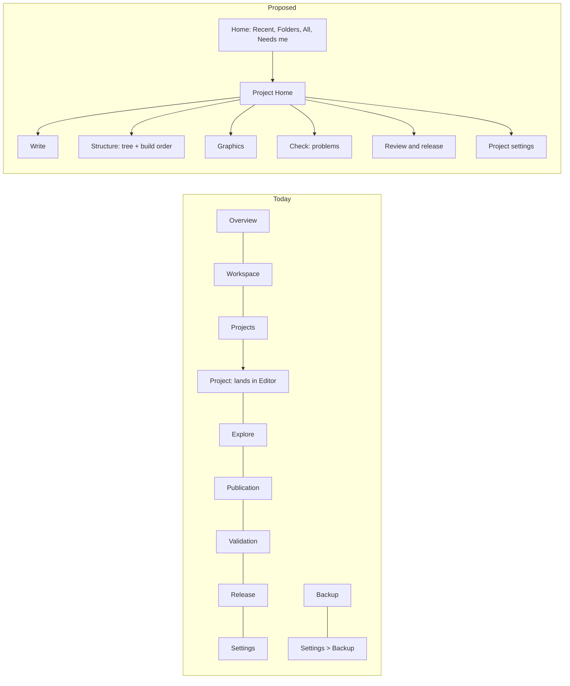
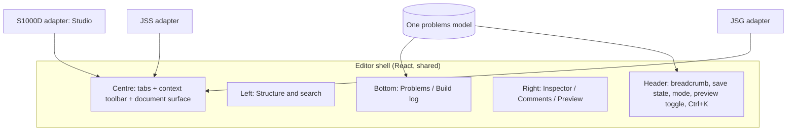
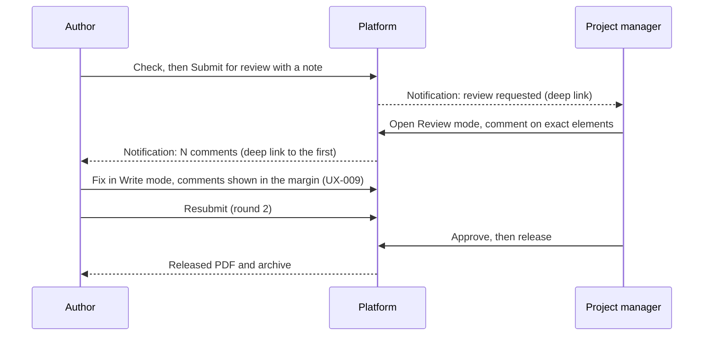

# 06 · UI/UX audit and workflow redesign proposal

Auditor: E1 (finding prefix `UX`) · Date: 2026-11-26 · Scope: the whole Agastya user interface (platform shell, project pages, the three embedded editors, wizards, dialogs) and the UX/workflow redesign. Colour tokens, theming and mockups are agent E2's and are deliberately absent here.

## 1. Scope and method

This audit combines reading the UI code with looking at the running product.

1. **Code.** I read the route table and shells (`frontend/src/App.tsx`, `layouts/AppShell.tsx`, `layouts/ProjectShell.tsx`), the shared primitives (`components/ui.tsx`, `styles/platform.css`), every page under `frontend/src/pages` that is listed in section 4, the three editors (`src/studio`, `src/jss`, `src/jsg`) at the level of layout, commands, keyboard handling and save logic, and the Playwright responsive spec (`frontend/e2e/zz-responsive-layout.spec.ts`).
2. **Running product.** I built the frontend into a scratch folder (`vite build --outDir <scratch>`), booted a scratch backend on port 4056 with a scratch workspace (no real workspace, no ports 4040/4041), created an administrator through the real first-run screen, then seeded an author, a project manager and six projects through the API: an S1000D sample, an empty S1000D project, two JSG samples (user handbook, illustrated spare parts list) and two JSS projects (Land user handbook, Naval TM-1).
3. **Capture and measurement.** Playwright with the Edge channel, headless. About 140 screenshots at 1366x768, 1920x1080, 820x1100 and 390x780, each looked at; `getBoundingClientRect` measurements of the editing surface; Tab-order and focus probes; horizontal-overflow probes at 390, 820, 1024, 1280 and 1366 px; one measured timing of the editor opening.

Evidence labels used throughout: **VERIFIED** (reproduced in the running instance or measured, or a plain fact in the code), **OBSERVED** (seen in a screenshot or in code but not measured or exercised end to end), **SUSPECTED**, **RECOMMENDATION** (a proposal, not a defect), **NOT VERIFIED** (not checked). Sizes: S under a day, M a few days, L one to three weeks, XL more.

## 2. Coverage

| Area | Status | What was done | Limits |
|---|---|---|---|
| Setup, login, login error, forgot-password | Inspected | Screenshots, flow driven, code read | Forced password change and onboarding gate: code only |
| App shell, sidebar, top bar, account menu, notifications | Inspected | Screenshots, keyboard probe (14 Tab stops), code | Notification list with real entries not seen (empty only) |
| Overview (author, administrator) | Inspected | Screenshots at 1366 and 390 | Project-manager variant: code only |
| Workspace, Projects, Graphics, CIR, Backup | Inspected | Screenshots at 1366; overflow probes 1024-1366; narrow shots | Graphics and CIR with content: code only |
| Activity, Settings (account, approvals, sessions) | Inspected | Screenshots, code | |
| Administrator (users, roles, catalogue, SNS, DM types, cages, maintenance, visual, audit log) | Partially inspected | Screenshots of nine sections, code of the page | Language/country/classification/interface-language/PDF-customisation, templates, partner/originator companies, DDN, Advanced, JSS manual types: code only |
| New-project wizard (5 steps, import step) | Inspected | Screenshots of each step, error state, Escape and Tab behaviour | |
| Project: Explore, Publication, Graphics, Validation, Release, Settings | Inspected | Screenshots (S1000D, JSS, JSG); code | Validation with findings, Release with a submitted review and comments, waiver dialog: code only |
| S1000D Studio (ribbon, Design/Tags/Split/XML views, panes, palette, shortcuts, find/replace, element picker, File menu, new-DM dialog, Settings dialog, malformed-XML dialog, validation) | Inspected | Screenshots, DOM measurements | Right-click context menu: capture failed, not seen. Dialogs not listed here: code only |
| JSS editor (Land, Naval), JSS ancillary, JSS publication/graphics/release/settings | Inspected | Screenshots at both sizes | Editing interaction depth (tables, cross-references): not exercised |
| JSG editors (user handbook, spare parts list), JSG ancillary | Inspected | Screenshots at both sizes | Large-document typing latency not measured |
| PDF pane, pop-out preview window, PDF viewer controls | Partially inspected | Empty state and toolbar seen | A generated PDF was not displayed in the pane; pop-out not opened |
| Import-package dialog, Import PM, waiver and refusal dialogs | Partially inspected | Code read | Not rendered |
| Dark theme | Not inspected | | Belongs to E2 |
| Screen reader, Windows High Contrast, touch, real users | Not inspected | | No assistive technology available; see section 11 |
| Chrome stable | Not inspected | | The tab crashed in this environment (UX-011); Edge used throughout |

## 3. Current UI assessment

**Honest summary.** The platform shell is calm, consistent and well written. A new author can find the project list, create a project and reach an editor without help; the copy explains itself ("Everything about this project that is not authoring", the refusal and waiver text, the offline reminder). The S1000D Studio is a serious editor with a unified command registry and live validation. The weaknesses are structural rather than cosmetic: the editing area is cramped by default, the three editors behave as three products, a project has no home page, problems and review comments are spread over several places, and the basics of keyboard and landmark accessibility are missing. A few plain defects (a dead JSS Publication page, a primary button pushed off-screen) are cheap to fix and visible to everyone.

**What the UI gets right today (strengths).**

1. **One command registry** (`frontend/src/studio/ui/commands.ts:3`): every ribbon button, menu item, palette entry and shortcut maps to one command, with a command palette (Mod+Shift+P) and a shortcuts dialog.
2. **Plain, specific microcopy.** Errors and empty states say what to do. The publish-gate refusal and waiver text (`components/PublishRefusal.tsx`) explains what a waiver covers and, just as important, what it does not.
3. **Role-aware UI.** Read-only roles get an explanation instead of dead buttons (for example the Validation page notice for viewers).
4. **Publication page drag and drop with button alternatives** (`pages/project/PublicationPage.tsx:165`, row buttons for up, down, remove), plus an Undo.
5. **A real review loop on Validation**: filter by severity and check, group by file, open at the exact line, mark reviewed, export CSV (`pages/project/ValidationPage.tsx`).
6. **Anchored review comments** that keep the words they were made on and move to "Moved or changed" if the text changes (`components/ReviewReader.tsx:1-4`). OBSERVED from code; not rendered in this audit.
7. **Careful failure handling in Studio**: a malformed-XML dialog offering "Go to error" or "Discard XML changes" (screenshot `62-s1k-problems.png`), recovery drafts on by default (Studio Settings dialog), `beforeunload` guards in all three editors (`studio/ui/app.ts:427`, `JssEditorPage.tsx:161`, `JsgEditorPage.tsx:179`).
8. **Live save state in the header** of every editor ("All changes saved", "Unsaved changes").
9. **Visible focus**: all 14 focusable elements tried in the shell had a 2 px outline (VERIFIED, Tab probe).
10. **Persisted layout choices** (editor view, split width, list width, pane visibility) in `localStorage` keys `agastya.editor.*`, `agastya.jss.view`, `studio.layout`.
11. **Fast editor start in the scratch run**: editor shell ready in about 1.0 s, first data module open in about 0.5 s (one measurement, small sample project, Edge).
12. **Graphics view built for volume**: paging, kind and usage filters, sort, grid/list, usage list in the preview (`components/GraphicsView.tsx`).

## 4. UX weaknesses, ranked

Ranking weighs how often an author, reviewer, publisher or administrator meets the problem, how much work or trust it costs, and how cheap the fix is. Finding IDs refer to section 12.

| Rank | Weakness | Who feels it | Finding |
|---|---|---|---|
| 1 | The editing surface is small by default and shrinks further with panes: 29% of a 1366x768 screen in the default Split view, 24% with Studio panes open | Authors, all day | UX-002 |
| 2 | Three editors with three toolbars, three save vocabularies, different find/replace and palette support | Authors on mixed projects, trainers | UX-003 |
| 3 | A project has no home; status is scattered over Editor, Validation, Publication, Release and Settings behind a 56 px icon-only rail | Authors, PMs | UX-007 |
| 4 | Five separate problem surfaces; "reviewed" marks live in one browser only | Authors, reviewers | UX-008 |
| 5 | Review comments appear only on the Release page, not where the author fixes things | Authors, PMs | UX-009 |
| 6 | No focus trap in dialogs; no skip link or `main` landmark; partial keyboard operation of menus and clickable rows | Keyboard and assistive-technology users, accessibility procurement | UX-004, UX-005 |
| 7 | The primary "New project" button is off-screen on Projects at 1366 px and below | Every author | UX-006 |
| 8 | JSS Publication shows "Internal error" | Every JSS user | UX-001 |
| 9 | JSS has no autosave or draft recovery; JSG autosave is opt-in | JSS/JSG authors of long documents | UX-010 |
| 10 | Duplicate views of the same tree and the same lists (Explore, Publication, DM panel; Overview, Workspace, Projects) | New users | UX-013, UX-014 |
| 11 | Narrow windows: JSS/JSG editor pages scroll sideways below about 1100 px | Authors with snapped windows | UX-020 |
| 12 | Raw codes and layout slips in visible places (activity feed code, unstyled JSG cover form, broken PDF placeholder text) | Everyone | UX-015, UX-016, UX-018 |

## 5. Screen-by-screen gap analysis

Priority is the priority of the recommendation (P1 fix soon, P2 plan, P3 when convenient). A "screenshot" reference names a file in the auditor's scratch folder; it is evidence, not a deliverable. Evidence labels as in section 1; a row with no label is VERIFIED from a screenshot or the code named.

### 5.1 Sign-in, setup and onboarding

| Screen | What is there | Problems | Recommendation | Pri |
|---|---|---|---|---|
| First-run setup (`00-setup.png`) | Card: full name, username (rule shown), password and repeat (rule shown), "Create administrator". States "nothing ships with a default" | No show/hide password. Nothing says what happens next; the administrator lands on an empty Overview | Add a reveal toggle. After setup show a short first-run checklist (originator company, language and country defaults, first user, first project) | P3 |
| Sign in and error (`04`, `05`) | Username, password, "Forgot your password?". Error "Invalid username or password." | Tagline reads "Offline, on-premises S1000D authoring and publishing." (`AuthScreens.tsx:68`) although JSS and JSG are first-class (UX-026) | Name all three document families | P3 |
| Reset password (`06-forgot.png`) | Honest offline copy: approval by an administrator, "Ask an administrator" | The sign-in error stays on screen after switching to this view (UX-023). "Back to sign in" and "Forgot" are `<a href="#">` used as buttons (`AuthScreens.tsx:63,73,117,139`) | Clear errors on mode change; render these as buttons styled as links | P2 |
| Forced password change, onboarding gate | New account chooses its own username and password (`AuthScreens.tsx:100-139`) | Code only. Same `<a href="#">` for Sign out | As above | P3 |
| Session loss by newer sign-in | Audit log records `auth.session.displaced` on every sign-in (`99-admin-audit.png`) | What the displaced user sees is NOT VERIFIED (UX-022) | Show a clear "You were signed out because this account signed in elsewhere" screen | P2 |

### 5.2 Platform shell and main dashboard

| Screen | What is there | Problems | Recommendation | Pri |
|---|---|---|---|---|
| Shell: sidebar and top bar (`AppShell.tsx`) | 224 px sidebar with seven to nine role-filtered items, 52 px top bar with page title, theme toggle, bell, account menu; "Offline · on-premises" footer | The top-bar title repeats the page header directly below it on every page ("Administrator" twice, `90`, `91`): 52 px spent on nothing. No breadcrumb, no search or quick switcher. No skip link, no `main` landmark (UX-005) | Replace the title with breadcrumb plus quick switcher (Ctrl+K); add landmarks | P1 |
| Account menu | Account settings, Sign out | `role="menu"` but arrow-key navigation and focus return not implemented (`AppShell.tsx:87-91`) | Roving focus or drop the menu role | P2 |
| Overview (author, `10`) | Greeting; four count tiles; Recent projects cards; Recent activity feed | Three sample-project buttons beside "New project" (UX-014). Activity feed shows `auth.session.displaced` (UX-015). Tiles are counts, not actions: nothing says what needs the author's attention | "Continue" card for the last document; "Needs you" list (review comments, failed validation); move samples to an empty-state or Help | P1 |
| Overview (administrator, `90`) | Six tiles, filterable project table, People table, activity | Project table rows have no keyboard target (`Oversight.tsx:47`, UX-005). People table repeats every project name in one tall cell | Row link; show a count with a popover | P2 |
| Workspace (`11`) | Folders as sections, project cards (`role="link"`, keyboard reachable), filter, New folder | Folder actions are three icon buttons (members, rename, delete) with tooltips only. Same projects as Overview and Projects (UX-014) | Fold into one Home with views (section 6) | P2 |
| Projects (`12`) | Table: search, sort, Back up, Import package, three sample buttons, New project; per-row Copy | "New project" is pushed off-screen at 1366 px and below (UX-006). The row opens a project on click only: after New project, Tab reaches only the Copy buttons (UX-005). Backup button here, on Overview, on Backup, in Settings | Wrap the toolbar, keep one primary action; make the name a link; one Backup entry | P1 |
| Graphics (library) | Read-only graphics across projects (shares `GraphicsView`) | Code only for content states | None beyond UX-020 | P3 |
| CIR (`14`) | Empty state, Upload and Create data module, filter | "CIR" is unexplained in the sidebar (the page title spells it out) | Tooltip or label "Shared modules (CIR)" | P3 |
| Backup (`15`) | One card: "Back up my projects", ZIP | Says nothing about restoring (import lives on Projects). A fourth place for the same action | Add "To restore, use Import package" with a link; keep a single entry point | P2 |
| Activity (administrator, project manager; `99c`) | Range select, four tiles, release requests waiting, tabs Projects/People/Activity feed | A long project title runs under the Open button on cards (UX-025) | Truncate with ellipsis, reserve the button column | P3 |
| Notifications (`17`) | All/Unread, Mark all as read; empty state | Only the empty state was seen; click-through behaviour NOT VERIFIED (UX-029) | Entries must deep-link to the file and line | P2 |
| Settings (`16`) | Tabs Account and Backup; profile; change password; Sign out | Sign out sits below the fold at 768 px high | Move Sign out to the account menu only | P3 |
| Administrator (`91`-`99`) | Left sub-navigation of about 20 entries in four groups plus an "Advanced" fold; Users table (role select, Reset password, Disable); catalogues with filter and tabs (`93`); numbering presets (`94`); audit log (`99`) | Three levels of navigation inside one page. Users has no search or bulk action. SNS: the "Choose a preset to see its entries" hint sits far below a long table. Audit log: no user or date filter, raw `::ffff:127.0.0.1` (UX-025) | Make the sub-navigation a searchable list; add filters; show IPv4 cleanly | P2 |

### 5.3 Create and import

| Screen | What is there | Problems | Recommendation | Pri |
|---|---|---|---|---|
| New-project wizard (`20`-`26`) | Five steps (start, project, model and identity, and so on), Back/Next, error state, an import branch | Model code starts empty with no example and no inline rule; "Responsible partner company" is a bare 5-character code plus name (UX-024). Escape closed the whole wizard at once (`25-wiz-after-esc.png`); by code a click on the backdrop does too, because this dialog is not `sticky` (`components/project.tsx:206`, `ui.tsx:58-64`), and nothing asks before discarding (UX-004). No focus trap | Persist a draft while the dialog is open; ask before discarding; pre-fill from the last project | P2 |
| Import package dialog (`ImportPackageDialog.tsx`) | Progress in a `role="status"` region | Code only | Keep; verify the result summary links to the first failing file | P3 |

### 5.4 Inside a project (S1000D)

| Screen | What is there | Problems | Recommendation | Pri |
|---|---|---|---|---|
| Project rail (`ProjectShell.tsx`) | 56 px icon-only rail: back, project tile, Editor, Explore, Publication, Graphics, Validation (badge), Release (badge), Settings. CSS tooltips (`data-tip`) plus `aria-label` | No project home. The project name appears only in a tooltip and on some pages: it is absent from Validation, Release and Settings headers (`35`, `36`, `37`). Icons alone for eight destinations | Add Project Home; show the name and a label rail (pinnable) (UX-007) | P1 |
| Editor page header (`EditorPage.tsx:118-134`) | DM-panel toggle, project name, breadcrumb of the open file, save state or "Save (n)", Editor / Split / PDF | Below ~900 px the ribbon groups run beyond the right edge (UX-020). The persisted view makes the first impression Split with a 29% editing area (UX-002) | Default to Editor with a one-click preview; see section 7 | P1 |
| DM panel (`EditorSide.tsx`) | Publication / All tree, search, New, five icon-only buttons (import, problems, package, library, refresh) | Five icon-only buttons; the Publication/All switch is clipped to "Publica" at 248 px (`31`) | Labelled menu "More"; widen the switch | P2 |
| Studio ribbon and views (`30`-`53`) | File, Home, Insert, Review, View, Tools tabs; Design, Tags, Split, XML; Outline, Attributes/Elements, Problems panes (closed by default); status bar with word count, S1000D issue, validity | Ribbon is 131 px tall and labels are clipped at 1366 and even 1920 px with the DM panel open: "Delete elemen", "Select element / parent" (`hd-s1k-split.png`, UX-012). Studio Settings repeats a Theme control already on the platform bar (`55`) | Collapsible ribbon; overflow menu; one theme control | P2 |
| Command palette, shortcuts (`44`, `45`) | Palette lists File and Edit commands with shortcuts | Commands only: no project navigation (Validation, Release), no file jump (UX-021). Mod+Shift+P may collide with a browser's private-window key (UX-027) | Add navigation and file commands; bind Ctrl+K as well | P2 |
| Find and replace (`46`) | Find, Replace, Go to ID; scopes (all, content, element) | Searches the open data module only | Project-wide search (section 7.5) | P2 |
| Malformed XML dialog (`62`) | "XML is not well-formed", Go to error, Discard XML changes, banner in the view | A good pattern; keep | Reuse in JSS/JSG | |
| Explore (`32`) | Tree with expand/collapse, search, Hierarchy/All toggle, five tiles, side panel "Select a data module" | The same tree as Publication and the DM panel (UX-013); the side panel is empty until a click | Merge into one Structure page | P2 |
| Publication (`33`) | Tiles, chapters with drag handles and up/down/remove buttons, unplaced pool, Output (View in editor, Export PM, Import PM), Build publication, Publish waivers card | Long waiver paragraph competes with the structure; page is S1000D-only and dead for JSS (UX-001) | Collapse waivers into a disclosure; hide for JSS | P1 |
| Project Graphics | Drop zone, `GraphicsView` with delete | None beyond narrow widths | | P3 |
| Validation (`35`) | Issue selector, Include BREX, Run validation; after a run: filters, findings by file, detail panel, Open at line, Mark reviewed, CSV | Needs a manual run although the editor validates live. "Reviewed" lives in `localStorage` (`ValidationPage.tsx:23`). Row `role="button"` handles Enter only, not Space (`:118`) (UX-008, UX-005) | One problems model shared by editor and page; store reviewed server-side | P1 |
| Release (`36`) | Status tiles, Download PDF (NOT RELEASED), Submit for review with note and delayed-effect option, Review comments, Watermark card | Watermark settings occupy as much space as Submit. Comments appear only here (UX-009). Reviewer is always "the Project Manager" | Reorder by task; surface open comments elsewhere | P1 |
| Waiver and refusal UI (`PublishRefusal.tsx`) | Findings list, Build drafts without this BREX, reason (10 to REASON_MAX characters), what a waiver does not cover | Code only (not rendered). Strong copy | Keep. The refusal is an `Alert` with `role="alert"` (`ui.tsx:28`) | P3 |
| Project settings (`37`) | Tabs General, S1000D, Publishing, Team, Activity, Danger zone; tiles for members, type, your access | Folder is a free-text field, not a picker. PDF layout checkboxes sit in General next to a separate Publishing tab | Picker; group by task | P3 |

### 5.5 JSS and JSG

| Screen | What is there | Problems | Recommendation | Pri |
|---|---|---|---|---|
| JSS editor (`70`, `71`, `hd-jss`) | Own header: state badge, Check, Save, Import project, Export, Codes, Convert, Generate PDF, Editor/Split/PDF; ribbon Write/Insert/Arrange/Document with ARIA tabs; outline; findings strip "Problems: 0 errors, 52 warnings" | Two Export buttons (UX-019). No find or replace, no palette; only Ctrl+S/Z/Y (`jss/editor.ts:162`) (UX-017). No autosave (UX-010). Header "PDF" segment beyond the right edge at 1280 px (UX-006); sideways scroll below ~1100 px (UX-020) | Bring onto the shared editor shell (section 7) | P1 |
| JSS Publication (`73`) | A rail item | Ends in "Internal error" (UX-001) | Hide the item or build a JSS build page | P1 |
| JSS Ancillary, Graphics, Release, Settings (`72`, `74`-`76`) | Same shells as S1000D | None beyond shell issues | | P3 |
| JSG editors (`80`, `82`, `hd-jsg`) | Toolbar Import Word, Auto-save (opt-in), Check, Save, Codes, Convert, Export, Generate PDF; Write/Insert/Table/Arrange/Document; Find and Replace; outline with chapters and appendices; status bar counts (47,447 words in the sample) | Header "PDF" segment beyond the right edge at 1366 px, "Split" and "PDF" at 1280 (UX-006). Opt-in autosave stored per browser (`JsgEditorPage.tsx:43`). Cover and ancillary information is "edited elsewhere": a banner inside the document says so | Merge ancillary pages into the document tree | P2 |
| JSG ancillary (`81`) | Checklist in print order, form per page | The Cover form is unstyled: labels and inputs flow inline, two-line lists in raw buttons (UX-018) | Use the standard `Field` layout | P2 |

## 6. Recommended navigation architecture

### 6.1 Principles

1. **Where am I, what is next.** Every page carries the project name and a breadcrumb; every project has a home that answers "what needs me" in one screen.
2. **One place per thing.** One project list, one tree, one problems model, one Backup entry. Today each exists in two to four forms (UX-013, UX-014, UX-008).
3. **Navigation by task, not by object.** Write, Check, Review and release are tasks; "Explore" and "Publication" are two views of the same structure.
4. **Keep the keyboard first.** A quick switcher (Ctrl+K) and landmarks make the platform operable without the mouse (UX-005, UX-021).
5. **Do not widen the product.** Nothing below adds a back-end concept; it re-arranges what already exists.

### 6.2 Today and proposed



The proposed structure removes three top-level items (Workspace and Projects merge into Home; Backup moves to account settings and the project menu) and replaces Explore, Publication and the DM panel's tree with one Structure view (UX-013).

### 6.3 Global shell

```
+----------------------------------------------------------------------------------+
| Agastya  Home > Hydraulic Pump > DMC-...-040A     [ Jump to...  Ctrl+K ]  (bell) RA|
+--------+-------------------------------------------------------------------------+
| Home   |                                                                         |
| Graph. |   page content                                                          |
| CIR    |                                                                         |
| Review |   (project manager / administrator only: Review queue, Administration) |
| Admin  |                                                                         |
|--------|                                                                         |
| Help   |                                                                         |
| Offline|                                                                         |
+--------+-------------------------------------------------------------------------+
```

- The top bar stops repeating the page title; it carries the breadcrumb and the quick switcher (RECOMMENDATION; replaces the `h1` at `AppShell.tsx:75`).
- A visually hidden "Skip to content" link and a `main` landmark are added (UX-005).
- Notifications stay in the bell; the page becomes a list with deep links (UX-029).

### 6.4 Home, by role

| Role | First thing they need | Home shows |
|---|---|---|
| Author | Get back to the document they were in | "Continue" card (last file, last cursor position), "Needs you" (open review comments, problems from the last check), Recent, Folders, All projects as a table view |
| Project manager | See what waits for them | Review queue (today's "Release requests waiting for you" from Activity), projects by status, people active this week |
| Administrator | Know the platform is healthy | Users and sessions, last backup age, disk and workspace health if available (NOT VERIFIED: data source), audit shortcuts |
| Reviewer, viewer | Read and comment | Only projects they can open; entry straight into the reading view |

Sample-project buttons move to the empty state of Home and to Help; they are not a daily action (UX-014).

### 6.5 Project shell and Project Home

The rail keeps its 56 px collapsed form, gains a text label that shows on hover **and on keyboard focus**, and can be pinned open (about 168 px). The project name is shown at the top of every project page. Items: Home, Write, Structure, Graphics, Check, Review and release, Settings. JSS and JSG show the same items; Structure shows the chapter outline for those formats and "Ancillary pages" becomes part of it (UX-001, UX-007).

```
Hydraulic Pump Maintenance Manual      S1000D 4.2 · you are owner          [ Open editor ]
+--------------------+ +--------------------+ +--------------------+ +---------------+
| Continue           | | Check              | | Review             | | Last build    |
| DMC-...-040A       | | 0 errors 3 warnings| | Not submitted      | | never         |
| edited 12:04       | | run 11:50  [Run]   | | [Submit for review]| | [Build draft] |
+--------------------+ +--------------------+ +--------------------+ +---------------+
Needs attention
  - 2 open review comments  ->  Description / General
  - 1 data module is not in the publication  ->  Structure
Recent documents                         Team                          Activity
```

Acceptance for Project Home is in UX-007. It reuses data the project already exposes (`ProjectShell` summary, validation run, release status); no new back-end concept is proposed, but the exact fields available per format are NOT VERIFIED for JSS and JSG.

## 7. Workspace architecture and the editor workspace redesign

### 7.1 One workspace shell, three document adapters

Today the S1000D Studio owns its layout (`studio/ui/app.ts`), while JSS (`jss/editor.ts`) and JSG (`jsg/editor.ts`) draw their own. The redesign does not ask to rewrite the engines. It asks for one **page-level shell** in React (the part that already exists as `EditorPage`, `JssEditorPage`, `JsgEditorPage`) that owns the regions, the header, the save state, the preview pane, the problems panel and the shortcuts, with each editor supplying an adapter: its document surface, its toolbar content, its outline and its findings.



### 7.2 Layout and the editing area

Measured today (Edge, one data module open; share of the viewport taken by the editing surface, VERIFIED):

| State | 1366x768 | 1920x1080 |
|---|---|---|
| Default: Split, DM panel open | 28.9% | 35.9% |
| Editor only, DM panel open | 51.7% | 64.1% |
| Editor only, DM panel hidden | 64.1% | 74.2% |
| Editor only, DM panel hidden, Outline + Attributes + Problems panes open | 23.7% | 40.4% |

Proposal (targets, to be tested in UX-002): the default for a new session is **Write** mode with the structure panel at 220 px and the preview closed, giving at least 55% of a 1366x768 screen; a "Focus" toggle (F11-like, or `Ctrl+.`) hides everything but the surface and a slim header; the 131 px ribbon collapses to a 32 px tab strip that expands on click, with the context toolbar (7.3) providing the most used actions; the Problems panel opens as a **bottom drawer of at most 25% height** and closes with Escape. Panel widths are remembered per format, per user.

```
Write mode, 1366x768 (editing surface >= 55%)
+------------------------------------------------------------------------------+
| <  Hydraulic Pump / Description    * Saved 12:04     [Write|Review|Source]  K |
+---+----------------+---------------------------------------------------------+
|rl | Structure      | [DMC-...040A x] [DMC-...520A x] [+]                      |
|   | search...      | B I U  x2  list  insert v   (context toolbar, 32 px)     |
|   | v Description  |                                                         |
|   |   Hydraulic p. |             document surface                            |
|   | > Procedures   |                                                         |
|   | > Fault isol.  |                                                         |
+---+----------------+---------------------------------------------------------+
| Problems: 0 errors 3 warnings   Draft PDF 12:01 (stale)   289 words  S1000D 5.0 |
+------------------------------------------------------------------------------+
```

### 7.3 Modes and context-sensitive toolbars

- **Write** (default): the document surface. Toolbar contents change with the selection (text, list, table, figure, reference) instead of showing every group at once. This is how the existing ribbon groups (Text, Paragraph, Structure) can be reused with a third of the width.
- **Review**: read-only surface with comments in the margin (the existing `ReviewReader` anchoring), and a "next comment" key. Reviewers and project managers open here by default (UX-009).
- **Source** (S1000D only): the existing XML and Split views, kept as they are; JSS and JSG do not expose XML.
- **Preview** is not a mode but a toggle (right panel); full-width PDF stays available (UX-002).

### 7.4 Validation feedback

Four tiers, one model (UX-008): (1) inline marks on the element or the line, (2) a status-bar chip with counts that opens the drawer, (3) the Problems drawer with severity filter, "next problem" (F8) and "open at location", (4) the project-level Check page that lists the same items for every file. "Reviewed" and "waived" are stored per project on the server, not in the browser. Live validation, already on by default in Studio (Settings dialog), is offered to JSS and JSG as "check after pause", not only on the Check button.

### 7.5 Search and replace

One find bar for all three editors, with scopes: this document, this section, **all documents in the project**. Replace across documents shows a list of changes first and applies them as one undoable step. Studio already has scopes within a document (`studio/ui/findbar.ts`); JSG has a find bar; JSS has none (UX-017). Project-wide search needs a server or index capability that this audit did not check (NOT VERIFIED).

### 7.6 Preview

Keep the side-by-side PDF as an opt-in panel with an explicit state: "up to date", "stale since 12:04 (3 edits)", "building". A preview that is only a build button plus a placeholder (`hd-s1k-split.png`) wastes half the screen before the first build; show it only after a build exists or on request. Click-to-source between the PDF and the document depends on the build emitting positions: NOT VERIFIED.

### 7.7 Shortcuts

A single table for all editors, shown in one dialog and in the palette (`?` or Ctrl+/): Ctrl+S save, Ctrl+Z / Ctrl+Y undo and redo, Ctrl+F find, Ctrl+H replace, Ctrl+K jump to anything, Ctrl+Shift+P command palette (alias, see UX-027), Ctrl+B / I / U, F8 and Shift+F8 next and previous problem (already in Studio, `commands.ts:136-137`), Ctrl+. focus mode, Alt+1 / 2 / 3 switch panels, Esc close drawer. Today JSS handles only Ctrl+S, Ctrl+Z, Ctrl+Y (`jss/editor.ts:162`), JSG adds Ctrl+F and Ctrl+H (`jsg/editor.ts:94`), Studio has the full registry (UX-003).

### 7.8 Large documents

The JSG sample loaded and rendered a 47,447-word handbook with 244 figures and 60 tables within the 4 s wait of this audit (VERIFIED as a load, not as a timing). Typing latency, outline update cost and scroll smoothness at that size were not measured (NOT VERIFIED). Proposed behaviour: outline built lazily and collapsed beyond level 2; sections beyond the viewport rendered on demand; validation incremental per section; a visible "large document" notice when a feature is deferred. Acceptance target for a later performance agent: input latency under 100 ms at 50,000 words on the reference laptop.

### 7.9 Save state and recovery

One vocabulary in all three headers: "Saved 12:04", "Unsaved changes", "Saving…", "Save failed: retry". Autosave on by default for every format with a draft that survives a crash or tab close (S1000D already offers recovery drafts, `55-settings.png`; JSS has none, JSG autosave is off by default: UX-010). The Save button stays for those who want it, and Ctrl+S always works.

## 8. Evaluation of candidate UX features

Each feature is judged against four real jobs: **authors** (write and fix all day), **reviewers and project managers** (read, comment, approve), **publishers** (assemble, build, release) and **administrators** (people, reference data, backup). Value: H high, M medium, L low, - none. The platform is offline and on-premises with small teams, which weighs against anything that needs a network, a large admin effort or heavy maintenance.

| Feature | Today | Auth. | Rev. | Pub. | Adm. | Verdict and reasoning |
|---|---|---|---|---|---|---|
| Command palette | S1000D Studio only: File and Edit commands, Mod+Shift+P (`commands.ts:169`); not in JSS, JSG or the platform | M | L | H | M | **Do next, widen.** Cheap because the Studio registry exists. Add navigation ("Go to Validation", "Open DMC-...", "Build draft") and a platform-level Ctrl+K. Publishers jump between Structure, Check and Release; authors already have the ribbon. |
| Global search | None. DM-panel search only filters the open project (`EditorSide.tsx`); Projects and Workspace have name filters | M | M | H | L | **Do next, scoped.** First "jump to": projects and files by title, code or name. Full-text across projects needs an index: NOT VERIFIED whether the back end supports it. Not worth a large investment before the quick switcher exists (UX-021). |
| Keyboard shortcuts | Complete in Studio; Ctrl+S/Z/Y only in JSS; JSG adds Ctrl+F/H | H | M | M | L | **Do now for parity** (UX-003). Authors type for hours; a missing Ctrl+F in JSS is felt immediately. One shared table, one dialog. |
| Customizable workspace | Layout and split widths remembered in `localStorage` (`agastya.editor.*`, `studio.layout`) | M | L | L | L | **Do selectively.** Offer three presets (Write, Review, Focus) and remember the last one. Free customisation costs support and tests for a small user base. Preferences kept only in the browser do not follow a user to another PC: moving them to the user profile is worth doing if a profile store exists (NOT VERIFIED). |
| Resizable and dockable panels | Resizable: DM list and editor/PDF dividers (`role="separator"`); Studio panes toggle | M | L | L | - | **Resizable yes, docking no.** Keep fixed regions with collapse and resize. Floating or re-dockable panels are an IDE feature; technical authors do not ask for them. The editor/PDF divider must become keyboard-operable (`EditorPage.tsx:147`, UX-005). |
| Split views | Editor/PDF; Design/XML; Tags | H | M | M | - | **Keep; add one.** Two documents side by side (reference while writing, compare while reviewing) is useful for reviewers: do later (P3). |
| Tabbed documents | Studio has document tabs; JSS and JSG are one document per project | H | L | - | - | **Keep in Studio only.** JSS and JSG do not need tabs. Add "reopen closed tab" and per-project restore of open tabs if not present (NOT VERIFIED). |
| Breadcrumbs | Studio status bar shows the element path (`dmodule > content > ...`); header shows project and file | M | M | M | L | **Do now.** A platform breadcrumb (Home > project > file) answers "where am I" on pages that show no project name (UX-007). Very cheap. |
| Context-sensitive toolbars | Ribbon always shows every group; items grey out | H | - | - | - | **Do with the layout work** (UX-002). It is what lets the ribbon shrink without losing function. |
| Drag and drop | Publication chapters and modules (with button alternatives), graphics drop zone, file drops into Studio (`app.ts:434`) | M | - | H | - | **Keep; add keyboard parity** where missing. Do not add more drag-only interactions. |
| Bulk actions | None seen: Projects, DM panel, Users, Validation findings act one at a time | M | L | M | M | **Do selectively.** Multi-select in the DM panel (add to publication, delete), "mark all in this file reviewed" in Validation, multi-disable in Users. Only where the list is long. |
| Undo/redo, autosave, save-state | Undo/redo in all editors; Publication has Undo; three save vocabularies; recovery drafts only in S1000D; JSG autosave opt-in | H | L | L | - | **Do now** (UX-010, UX-003). Loss of work is the costliest failure in an authoring tool. |
| Recents and favorites | Recents: Overview, Projects sort "Recently opened", Studio "Recent files". Favorites: none | M | M | M | L | **Recents yes; favorites later.** Pinning only helps once a person has more projects than fit on one screen. |
| Quick actions | Header buttons per page | M | M | M | M | **Do with Home and Project Home** ("Continue", "Build draft", "Submit for review"). Not a separate feature. |
| Dashboards | Overview tiles and tables; Activity page | L | M | M | M | **Replace, do not add.** Counts do not tell anyone what to do. Use "needs attention" lists. An analytics dashboard has no audience in a small offline team. |
| Advanced filtering | Present in Validation, Graphics, Overview tabs; absent from audit log, Users, DM panel by status or type | M | L | M | H | **Do selectively** for the audit log (user, date, action), Users, and the DM panel (status, type). |
| Smart notifications | One list page with All/Unread; no email by design | M | H | M | L | **Do next, narrowly.** Only events that ask for action (review requested, comments added, release approved or refused, build failed) with a deep link to the place. No toast storms. What notifications exist and how they link is NOT VERIFIED (UX-029). |
| Contextual help | None found: no Help item, no inline explanations of CIR, BREX, SNS, DMC, ICN | M | M | M | M | **Do now, small.** Short inline explanations for the jargon and a Help page with the offline documentation. No chatbot, no tour. |
| Onboarding | Credentials gate only (`AuthScreens.tsx:100`); samples as buttons | M | L | L | H | **Do selectively.** An administrator first-run checklist and a guided empty state for a new author's first project. Skip tours: they are ignored and cost maintenance. |

## 9. Ideal end-to-end workflows

Where today's UI interrupts the ideal path, the finding is named.

### 9.1 Author: the daily loop

1. Sign in. Home shows **Continue: DMC-...-040A, edited yesterday 17:42** and what needs attention (UX-007).
2. One click opens the document in Write mode with at least 55% of the screen (UX-002), the structure panel shows where it sits, the breadcrumb says so.
3. Typing is validated after a short pause; the status chip counts, F8 jumps to the next problem (UX-008).
4. Saving is automatic with a visible time; a crash loses nothing (UX-010).
5. Preview opens beside the text on request and says whether it is stale (7.6).
6. Before handing over, **Check** runs the whole project; findings can be marked reviewed once, for everyone (UX-008).
7. **Submit for review** with a note, from the page the author is already on.

### 9.2 Review loop



Today the comment reader exists on the Release page only (`ReleasePage.tsx:168`), and the author does not see a comment while editing (UX-009).

### 9.3 Publisher: structure, draft, release

Structure (order chapters, see what is not placed) then Build draft, where a refusal explains itself and a waiver is offered only for what it can cover (`PublishRefusal.tsx`, a strength), then Release, where the PM approves. The ideal differs from today in three places: JSS has no working Publication page (UX-001); Explore and Publication show the same tree (UX-013); Watermark options take as much room as Submit on the Release page (section 5.4).

### 9.4 Import an existing package

Home, New project, Import. After import, a summary that links to the first failing file and offers "Open the first problem". The dialog already shows progress with a `role="status"` region (`ImportPackageDialog.tsx:168`); the result screen was not rendered in this audit (NOT VERIFIED).

### 9.5 Administrator: first run and upkeep

First-run checklist (organisation defaults, first users, first project), then users and roles with search and filters, then a regular backup with the age of the last one on Home. Restore guidance sits next to Backup (section 5.2). The audit log is filterable by user, action and date (UX-025).

## 10. Accessibility recommendations (WCAG 2.2 AA)

Probes: a Tab walk through the shell (14 stops), overflow probes, structural queries (landmarks, headings, skip link), code reading. No screen reader was run (section 13). Contrast is E2's remit and is not assessed.

| Criterion | Status | Evidence | Recommendation |
|---|---|---|---|
| 1.3.1 Info and relationships | Partial | Forms use `Field` with `htmlFor` and `aria-describedby` (`ui.tsx:46-55`): good. No `main` landmark; zero `main` elements found (VERIFIED). `role="menu"` is used for the account menu without menu behaviour | Add `main`; use `role="menu"` only with arrow-key support (UX-005) |
| 1.4.10 Reflow | Fails on JSS and JSG project pages | Page scroll width 1112 and 1121 at 390 and 820 px wide (VERIFIED, UX-020). Toolbar-heavy editor surfaces may fall under the two-dimensional layout exception; the page header controls do not | Wrap or overflow-menu the header actions below 900 px |
| 2.1.1 Keyboard | Fails | Projects table rows and the administrator Overview rows open only on click: Tab after "New project" reaches only the Copy buttons; 0 of 6 rows had a focusable target in the administrator table (VERIFIED, UX-005). Editor/PDF divider is pointer-only (`EditorPage.tsx:147`) | Make the name a link; add key handling to the divider |
| 2.4.1 Bypass blocks | Fails | No skip link, no `main` (VERIFIED) | Add both |
| 2.4.2 Page titled | Weak | `index.html:7` sets "Agastya Platform"; no code updates it per route (only the pop-out window and standalone Studio do) (VERIFIED by search) | Set the title per route: "Validation - Hydraulic Pump - Agastya" |
| 2.4.3 Focus order | Fails in dialogs | 50 of 60 Tab presses left an open dialog (VERIFIED, UX-004) | Trap focus; return it on close |
| 2.4.7 Focus visible | Passes in the shell | 2 px outline on all 14 stops probed. Studio, JSS and JSG surfaces not probed | Probe the editors |
| 2.4.11 Focus not obscured (2.2) | NOT VERIFIED | Sticky headers and the Problems drawer could cover focus | Test with the drawer open |
| 2.5.7 Dragging movements (2.2) | Mostly passes | Publication drag has up/down/remove buttons (`PublicationPage.tsx`); the editor/PDF divider has no alternative | Keyboard resize |
| 2.5.8 Target size minimum (2.2) | NOT VERIFIED | Icon-only buttons in the DM panel looked about 24 px; not measured | Measure; enlarge below 24 px |
| 3.2.6 Consistent help (2.2) | Not applicable yet | No help mechanism exists | When Help is added, keep it in the same place |
| 3.3.1 and 3.3.3 Error identification | Passes in forms | `Field` error uses `role="alert"` (`ui.tsx:51`) | Stale error across Sign in and Reset (UX-023) |
| 3.3.8 Accessible authentication (2.2) | NOT VERIFIED | Password fields present; paste handling not tested | Allow paste and password managers |
| 4.1.2 Name, role, value | Partial | Icon buttons carry `aria-label`; segmented controls use `aria-pressed`; JSS ribbon has ARIA tabs; `div role="button"` rows handle Enter only (`ValidationPage.tsx:118`, `jss/editor.ts:630`) | Handle Space; prefer real buttons |
| 4.1.3 Status messages | Mostly passes | `Alert` uses `role="alert"` for the bad tone and `role="status"` otherwise (`ui.tsx:28`); save state is `aria-live`; all toasts share one polite region (`ui.tsx:111`) | Assertive region for error toasts (UX-028) |
| Studio design surface | NOT VERIFIED | Role, name and instructions of the editable surface for a screen reader not examined | Test with NVDA before promising conformance |

A conformance claim cannot be made from this audit; the table lists what was checked.

## 11. Responsive behaviour

Probe: horizontal overflow of the page and of key controls on the author account, Edge headless, scratch data (VERIFIED unless marked).

| Width | Platform pages | Project pages | Editors |
|---|---|---|---|
| 1920x1080 | Fine; content max width leaves empty right space on Projects and Overview | Fine | Fine; S1000D Split gives 902 px editing width with DM panel open (35.9% of the screen); ribbon label "Delete elemen" still clipped |
| 1366x768 | Projects toolbar overflows: "New project" right edge at 1461 px (UX-006). Others fit | Fine | Editing surface 29% by default (UX-002). JSG header: the "PDF" segment lies beyond the right edge (UX-006); JSS and S1000D headers fit |
| 1280 | Projects as above | Fine | JSS header: "PDF" beyond the right edge; JSG header: "Split" and "PDF" beyond it; the header does not scroll (UX-006) |
| 1024 | Projects as above; Workspace "New project" right edge at 1145 px | Fine | Not measured separately |
| 820 | Overview, Admin Users fit; Projects and Workspace controls clipped | Publication fits | JSS and JSG page scroll width 1112 and 1121; Editor/PDF controls and Export clipped; S1000D ribbon groups beyond the right edge, DM panel becomes an overlay (`platform.css` 900 px rules) |
| 390 | Overview fits in width but the "Recent projects" heading overlaps the next heading (`m-overview.png`) | Publication fits | JSS and JSG: page scroll width 1112 and 1121; S1000D editor usable only with the DM panel closed |

The existing responsive spec covers only publishing settings, publication and release (`frontend/e2e/zz-responsive-layout.spec.ts`). The product is a Windows desktop tool; phones are not a target. The realistic narrow cases are a half-width snapped window (about 683 px on a 1366 px screen) and a second monitor in portrait. Recommendation: add the three editor pages, Projects and Workspace to that spec at 683, 820 and 1024 px, and make the header actions wrap or fold into a "More" menu (UX-006, UX-020).

## 12. Prioritised UX findings

Heading format: `UX-id · priority · evidence label · size · title`. P1 findings use the full form; P2 and P3 use the compact form. All findings were measured or read on the isolated scratch instance (Edge, port 4056) unless the label says otherwise. Paths are relative to the repository root `Agastya-platform-v2`; `Agastya-platform-v2/backend/dist/...` lines are compiled output and are given only where the TypeScript source is named beside them.

### UX-001 · P1 · VERIFIED · S · JSS Publication page ends in "Internal error"

> **Status update (2026-11-27, see `16`):** **Resolved.** At the owner's request JSS and JSG projects now have their own Explore and Publication pages (`DocPublicationPage`, `DocExplorePage`); the rail opens an error-free page for every project kind (`frontend/e2e/doc-pages.spec.ts`, first test). The text below is the finding as audited.

**Category:** Functional defect in navigation.
**Problem:** every JSS project shows "Publication" in the project rail; opening it renders "Internal error" instead of a page.
**Evidence:** `73-jss-publication.png` (Land); the Naval project was not opened on this page. `frontend/src/layouts/ProjectShell.tsx:54` adds the Publication item for everything except JSG (`jsg ? [] : [...]`), so JSS receives it. The page calls `contentApi.pmc(id)`, which hits `GET /api/projects/:id/pmc` (`backend/src/routes/project-content.ts:202`); the compiled chain `backend/dist/services/pm.js:63/66/71` then `importer/pmComplete.js:72`, `importer/identity.js:112`, `backend/vendor/engine/pmc.js:204` throws "Not a publication module: no <pm> root element" and the route answers 500.
**Current implementation:** the rail is built from the format, with a special case for JSG only; the Publication page assumes an S1000D publication module.
**Recommendation:** hide the item for JSS as for JSG, or let the route answer 404 or an empty body for non-S1000D projects and let the page say "JSS documents are built from the editor (Generate PDF)" with a link. Long term, Project Home (UX-007) shows build state for every format.
**Expected outcome:** no destination in the rail ends in an error.
**Dependencies:** the route guard belongs to the back-end owner; the UI change is independent.
**Risks:** a JSS user may expect build history there; check where JSS output lives (the Release page offers the PDF, `75-jss-release.png`) before removing the item.
**Acceptance criteria:** for JSS Land, JSS Naval, JSG user handbook and JSG spare parts list, every rail item opens a page with no error banner and no 5xx in the server log.
**Test cases:** Playwright, per project type: click each rail item, record `page.on('response')`, fail on status 500 or the text "Internal error". API test: `GET /pmc` on a JSS project returns a 4xx with a message.

### UX-002 · P1 · VERIFIED · M · The editing surface gets 29% of a 1366x768 screen by default

**Category:** Layout and editor workspace.
**Problem:** the area where authors spend their day is the smallest region on the screen. Default Split view with the DM panel open leaves 592 by 513 px at 1366x768 (28.9% of the viewport); with Outline, Attributes and Problems panes also open, 730 by 341 px (23.7%). At 1920x1080 the default gives 902 by 825 px (35.9%).
**Evidence:** `getBoundingClientRect` of `.editor-host` in four states (table in section 7.2); `hd-s1k-split.png`. At 1920x1080: top bar 42 px, ribbon 131 px, status bar 18 px, rail 56 px, DM panel 248 px, PDF pane 705 px.
**Current implementation:** `frontend/src/pages/project/EditorPage.tsx` defaults to Split (view saved in `agastya.editor.view`); the DM panel is open; the Studio ribbon is always fully expanded; `frontend/src/lib/studioSession.ts:108-114` already closes the three Studio panes on first run, which shows the problem was noticed.
**Recommendation:** section 7.2: default to Write mode without the preview, collapsible ribbon with a context toolbar, Focus mode, Problems as a bottom drawer of at most 25% height, preview as an opt-in panel with a stale indicator.
**Expected outcome:** at least 55% of a 1366x768 screen for the editing surface by default, 70% in Focus mode.
**Dependencies:** the shell work in UX-003; a Studio API to collapse the ribbon (the layout toggles in `studio/ui/app.ts` `applyLayout()` suggest it is feasible; NOT VERIFIED).
**Risks:** authors who like seeing the PDF lose the default; remember the last mode per user. A collapsed ribbon hides commands: keep File, search and the palette one click away.
**Acceptance criteria:** the same measurement script, fresh browser profile: `.editor-host` at least 55% of the viewport area at 1366x768 and at 1920x1080; Focus mode at least 70%; the Problems drawer never exceeds 25% of the height; the last mode survives a reload.
**Test cases:** Playwright measuring `.editor-host` in default, Focus and Problems-open states at both sizes; visual snapshot of each.

### UX-003 · P1 · VERIFIED · XL · Three editors behave as three products

**Category:** Consistency and learnability.
**Problem:** the same job (write a long technical document, check it, build it) is done with three different headers, toolbars, save vocabularies and keyboard sets.
**Evidence:**

| | S1000D Studio | JSS | JSG |
|---|---|---|---|
| Header | Panel toggle, crumb, "All changes saved" or "Save (n)" (`EditorPage.tsx:118-134`) | Badge, Check, Save, Import project, Export (twice), Codes, Convert, Generate PDF (`JssEditorPage.tsx:176-183`) | Import Word, Auto-save checkbox, Check, Save, Codes, Convert, Export, Generate PDF (`JsgEditorPage.tsx:194-200`) |
| Toolbar | Ribbon File, Home, Insert, Review, View, Tools | Tabs Write, Insert, Arrange, Document | Tabs Write, Insert, Table, Arrange, Document |
| Find and replace | Find, Replace, Go to ID | None found (`jss/editor.ts`) | Ctrl+F, Ctrl+H bar (`jsg/editor.ts:94,167`) |
| Command palette | Yes (`commands.ts:169`) | No | No |
| Shortcuts | Full registry | Ctrl+S, Ctrl+Z, Ctrl+Y (`jss/editor.ts:162`) | Ctrl+S, F, H, Z, Y |
| Save state words | "All changes saved" | "Unsaved changes" or "Saved" with a relative time | Same as JSS |
| Recovery | Recovery drafts (on by default) | None | None; autosave opt-in |
| Problems | Pane with counts | Strip "Problems: 0 errors, 52 warnings" | Check button |

**Current implementation:** each editor is a framework-free component with its own chrome, mounted by a React page that duplicates the split and divider logic three times (`EditorPage.tsx:142-147`, `JsgEditorPage.tsx:225`, `JssEditorPage.tsx:201`).
**Recommendation:** section 7.1, in stages that do not touch the engines: (1) one header and one save-state vocabulary; (2) one shortcut table, Ctrl+F and Ctrl+K in all three; (3) one problems drawer fed by a common model (UX-008); (4) one split and divider component.
**Expected outcome:** one set of habits for authors and trainers; one accessibility fix lands everywhere.
**Dependencies:** UX-008, UX-010; the owners of the JSS and JSG engines.
**Risks:** large; regressions in engines tuned to the customer's format; mitigate by keeping the adapters thin and extending the existing end-to-end suites.
**Acceptance criteria:** in all three editors the same state words, Ctrl+S, Ctrl+F, Ctrl+K, Esc behaviour, and a single shortcuts dialog.
**Test cases:** one parameterised Playwright spec over the three formats asserting those behaviours.

### UX-004 · P1 · VERIFIED · S · Dialogs do not trap or restore focus

**Category:** Accessibility (WCAG 2.4.3 Focus Order, with 2.1.2 and 3.2 related).
**Problem:** with a dialog open, Tab walks into the page behind it. In a probe on the New-project wizard, 50 of 60 Tab presses landed outside the dialog. Closing does not return focus to the control that opened it.
**Evidence:** the probe; `frontend/src/components/ui.tsx:57-72` (`Modal`: Escape handler on `window`, `aria-modal="true"`, no trap, no focus return, no `inert` on the page). The wizard's `Modal` is not `sticky` (`components/project.tsx:206`), so a backdrop click or Escape closes it at once (`25-wiz-after-esc.png`).
**Current implementation:** one shared `Modal` serves every platform dialog (wizard, confirm, prompt, waiver, graphics preview, import).
**Recommendation:** fix once in `Modal`: focus the first control on open, trap Tab and Shift+Tab, make the app root `inert` while open, return focus on close, make Escape close only the top dialog, and ask before discarding a partly filled wizard.
**Expected outcome:** every platform dialog becomes keyboard-safe from one change.
**Dependencies:** none. Studio's own dialogs (`frontend/src/studio/ui/dialogs.ts`) are a separate implementation: NOT VERIFIED.
**Risks:** nested dialogs (the waiver opens above a refusal); a focus trap must not fight the PDF viewer or CodeMirror.
**Acceptance criteria:** with any platform dialog open, 60 consecutive Tab presses never leave it; on close focus is on the opener; with two dialogs open, Escape closes only the upper one; the wizard asks before closing when it holds input.
**Test cases:** Playwright: open the wizard, Tab 60 times, assert `document.activeElement.closest('.modal')`; close and assert focus; repeat for the waiver dialog.

### UX-005 · P1 · VERIFIED · M · No landmarks or skip link; menus and clickable rows only partly keyboard-operable

**Category:** Accessibility (WCAG 2.1.1, 2.4.1, 2.4.2, 4.1.2).
**Problem:** (a) there is no `main` landmark and no skip link; the page title is "Agastya Platform" on every route. (b) On Projects, the administrator Overview and the numbering-preset list, a project or row opens only by clicking the row: after "New project", Tab reaches only the Copy buttons, and 0 of 6 rows in the administrator table had a keyboard target. (c) `div role="button"` rows handle Enter but not Space. (d) The account menu has `role="menu"` without arrow-key behaviour. (e) The editor/PDF divider is pointer-only.
**Evidence:** queries on `/overview`: `main` count 0, skip link absent, one `h1`, title "Agastya Platform". Tab probe on `/projects` (Copy buttons only), row probe on `/overview` as administrator (0 of 6). Code: `frontend/src/pages/Projects.tsx:59`, `components/Oversight.tsx:47`, `pages/AdminS1000d.tsx:160` (`tr.clickable onClick`), `pages/project/ValidationPage.tsx:118`, `jss/editor.ts:630,672`, `layouts/AppShell.tsx:87-91`, `pages/project/EditorPage.tsx:147`. Index title: `frontend/index.html:7`.
**Current implementation:** shell and pages are `div` based with a mouse-first click handler; Workspace and Overview cards are correct (`role="link" tabindex="0"`).
**Recommendation:** add `main` and a skip link; make the project name a real link in tables; handle Space and Enter on role-button rows or use `button`; give the account menu arrow-key and Escape handling or drop the role; add arrow-key resizing to the divider; set `document.title` per route.
**Expected outcome:** a keyboard-only user can open a project, move through a table, and bypass the sidebar.
**Dependencies:** none.
**Risks:** low; the Studio contenteditable surface is separate (NOT VERIFIED).
**Acceptance criteria:** Tab from the page top reaches a skip link first; Enter on a project name opens the project; Space and Enter activate every `role="button"` row; the account menu responds to arrows and Escape; the divider resizes with arrow keys; titles differ per route.
**Test cases:** Playwright keyboard scripts for each of those; a landmark query asserting exactly one `main`.

### UX-006 · P1 · VERIFIED · S · Primary controls fall off-screen at 1280 and 1366 px

**Category:** Responsive layout.
**Problem:** the "New project" button on Projects lies beyond the right edge of the viewport (right edge at 1461 px) at 1366, 1280 and 1024 px wide, because the toolbar does not wrap. In the editors the header does not scroll, so controls beyond the edge cannot be reached with the mouse: the JSG "PDF" segment at 1366 px; the JSS "PDF" segment at 1280 px; the JSG "Split" and "PDF" at 1280 px.
**Evidence:** probes `s73-overflow` and `s75-jsshdr`: Projects `newProjectRight` 1461 at all three widths; header `scrollWidth` equals its width. `12-projects.png` shows the button cut at 1366; `25-wiz-after-esc.png` shows the page scrolled sideways. Code: `frontend/src/pages/Projects.tsx:49` (a row of up to seven buttons, no wrap).
**Current implementation:** a flex row with fixed buttons; three sample-project buttons share the row (UX-014).
**Recommendation:** let toolbars wrap; keep one primary action and fold the rest into a "More" menu; move sample buttons to the empty state (UX-014); in editor headers keep state, Editor/Split/PDF and Generate visible and fold Import, Codes, Convert and Export into a Document menu.
**Expected outcome:** every primary action is visible at the most common laptop widths.
**Dependencies:** UX-014 and UX-003 reduce the number of controls.
**Risks:** folding actions can hide ones people use daily: keep Generate and Save visible.
**Acceptance criteria:** at 1280x720 and 1366x768, on Projects, Workspace and the three editor pages, every button and link with a visible box has `right <= innerWidth`; at 1024 on platform pages.
**Test cases:** extend `frontend/e2e/zz-responsive-layout.spec.ts` with those routes and widths and a bounding-box assertion.

### UX-007 · P1 · VERIFIED · M · A project has no home

**Category:** Information architecture.
**Problem:** opening a project lands in the Editor. Project status is split over a Validation badge, a Release badge, Publication tiles ("Last build: never"), and Settings > Activity. The rail has eight icon-only destinations with CSS tooltips; the project name is missing from the Validation, Release and Settings headers.
**Evidence:** `frontend/src/layouts/ProjectShell.tsx:53-56,69-75` (rail items; `data-tip` tooltips), the route table in `frontend/src/App.tsx` (no project index route), `35-validation.png`, `36-release.png`, `37-psettings.png` (no project name beyond the rail tile "S").
**Current implementation:** a 56 px rail, one page per item.
**Recommendation:** Project Home and a labelled rail (section 6.5), plus a breadcrumb.
**Expected outcome:** one screen answers "what is the state of this manual and what is next".
**Dependencies:** UX-008 (problems model), release status API (exists), JSS and JSG status fields (NOT VERIFIED).
**Risks:** a home page that only repeats counts adds a click: it must carry actions ("Continue", "Run check", "Submit for review").
**Acceptance criteria:** the project route lands on Home (or opens the editor via "Continue" in one click); Home shows Continue, Check, Review and Build cards for all three formats; the project name is visible on every project page; rail labels appear on hover and on keyboard focus.
**Test cases:** Playwright: open each project type, assert the four cards and that every project page contains the project name; keyboard focus on a rail item shows its label.

### UX-008 · P1 · VERIFIED · L · Five problem surfaces, and "reviewed" marks live in one browser

**Category:** Workflow and consistency.
**Problem:** a finding appears in the Studio Problems pane, on the Validation page, in the publish refusal, in the JSS findings strip and marks, and behind the JSG "Check" button, each with its own wording and persistence. The "reviewed" mark on the Validation page is stored in the browser, so a colleague, or the same author on another PC, sees everything unreviewed.
**Evidence:** `frontend/src/pages/project/ValidationPage.tsx:23-27` (`localStorage` key `agastya.reviewed.<project>`), `components/PublishRefusal.tsx`, `jss/editor.ts:113` (`setFindings`), `55-settings.png` (live validation on in Studio), `35-validation.png` (a manual run is needed).
**Current implementation:** each surface is built separately on top of different report shapes (`ValidationIssue`, gate findings, JSS `Finding`).
**Recommendation:** section 7.4: one problems model (source, severity, file, line, rule, state open, reviewed or waived) behind every surface; store the reviewed state and who and when on the server. The settled gate-and-waiver policy is unchanged.
**Expected outcome:** the number an author sees in the editor equals the number on the Check page; a reviewer's marks are visible to everyone.
**Dependencies:** a server-side store for review state (a schema change, outside this audit's remit).
**Risks:** merging report shapes touches the engines' output adapters; stage it behind a read-only view first.
**Acceptance criteria:** a finding marked reviewed by user A shows as reviewed for user B in another browser; editor chip counts equal Check page counts for one file after the same run; one wording for severities.
**Test cases:** two Playwright contexts; a parity test comparing counts between the pane and the page.

### UX-009 · P1 · VERIFIED · M · Review comments exist only on the Release page

**Category:** Workflow.
**Problem:** the project manager's anchored comments are read and resolved on the Release page; none of the editors shows a comment indicator, so an author fixing a text has to leave the editor to see what was asked. In Studio, the ribbon tab "Review" means validation and change marks, while the platform's "Review and release" means the manager's approval loop: one word, two meanings.
**Evidence:** `frontend/src/pages/project/ReleasePage.tsx:168` renders `ReviewReader`; a search of `src/studio`, `src/jss`, `src/jsg` and the editor pages for review-comment types returned no hits; `commands.ts:131-138` (Review group = validate, BREX, next problem, mark modified). The Release page with a submitted review and comments was not rendered here (code only).
**Current implementation:** comments are anchored by element path and words (`ReviewReader.tsx:1-4`), with a "Moved or changed" list. Good design, wrong place.
**Recommendation:** a Review mode in the editor shell (section 7.3) with comments in the margin, a "next comment" key, an unread count in the header, and a "Comments" tab in the Inspector; rename the Studio ribbon tab to "Check" or "Validate".
**Expected outcome:** the author works from the comments in place.
**Dependencies:** the comment API (exists); JSS and JSG comment anchoring: NOT VERIFIED.
**Risks:** anchoring in a contenteditable surface that is being edited is delicate; the "Moved or changed" logic must carry over.
**Acceptance criteria:** with two open comments on a data module, the author sees both markers in the editor, can step through them, and resolving one updates the Release page.
**Test cases:** Playwright with two contexts (manager comments, author reads); renamed tab asserted.

### UX-010 · P1 · VERIFIED · M · JSS has no autosave or draft recovery; JSG autosave is opt-in and per browser

**Category:** Data safety.
**Problem:** in JSS a closed tab, crash or power loss loses everything since the last manual Save; only a `beforeunload` warning stands in the way. JSG can autosave, but only if each author ticks "Auto-save", remembered in the browser.
**Evidence:** `frontend/src/pages/project/JssEditorPage.tsx:161` (`beforeunload` only; no timer, no draft store); `JsgEditorPage.tsx:43,128-135` (opt-in, one minute after the last change, key `agastya.jsg.autosave`); S1000D has recovery drafts on by default (`55-settings.png`, `studio/ui/app.ts:988` `saveDraft`).
**Current implementation:** three different safety nets (UX-003).
**Recommendation:** section 7.9: autosave on by default for all three, with a local recovery draft that survives a crash and is offered on the next open; keep Save and Ctrl+S.
**Expected outcome:** a crash costs seconds, not hours, in long documents (the JSG sample is 47,447 words).
**Dependencies:** a draft store (browser storage is enough for the first step; server drafts if a multi-PC workflow matters).
**Risks:** autosave of an invalid JSS document must not be mistaken for a clean save: keep the "saved as a draft: n errors" language already used (`JssEditorPage.tsx:117`).
**Acceptance criteria:** edit, kill the tab without saving, reopen: the document offers to restore; JSG autosave is on by default and stored with the user, not the browser.
**Test cases:** Playwright: edit, `page.close()` without saving, reopen and assert the restore prompt and content.

### UX-011 · P1 · OBSERVED · M · Chrome (stable channel, headless) crashed the tab when opening a data module in Studio

> **Status update (2026-11-27, see `16`):** **Reproduced, and narrowed to Chrome stable.** On 2026-11-27 the browser suite crashed the Chrome stable tab ("Target crashed") in five places whenever the Studio opened a data module (the full run: publish-gate, publish-waivers, s1000d-config, zz-dmtypes; platform.spec run alone: its eighth test). The same suite on Microsoft Edge (E2E_CHANNEL=msedge) ran green, 132 of 133. Cause still unknown. Decision D18 and GAP-007 in report 16.

**Category:** Reliability seen while testing the UI.
**Problem:** with Playwright's `channel: 'chrome'`, opening a data module in the S1000D editor produced "Page crashed" twice, also with GPU and software rasterizer disabled. The same steps in Edge did not crash and all later captures used Edge.
**Evidence:** the two runs (not kept as artifacts); `frontend/playwright.config.ts` defaults to `channel: 'chrome'`.
**Current implementation:** not investigated; the cause may be this environment (Windows Server 2025 evaluation image, no GPU), a memory limit, or the product.
**Recommendation:** hand to the performance and QA agents to reproduce on a normal workstation with Chrome and with the shipped browser setup, and capture a crash dump or the renderer's console. Until then do not state that Chrome is supported.
**Expected outcome:** either a product fix or a documented environment limit.
**Dependencies:** a Windows 11 workstation with Chrome.
**Risks:** if real, it affects the most common browser; if environmental, no impact.
**Acceptance criteria:** the e2e smoke opens a data module and types in Chrome stable and Edge on a reference machine without a crash.
**Test cases:** run the existing editor e2e against both channels.

### UX-012 · P2 · VERIFIED · S · Studio ribbon labels are clipped and there is no overflow menu

**Problem:** at 1920 px with the DM panel open and Split view, the Structure group reads "Delete elemen" and "Select element" (`hd-s1k-split.png`); at 1366 px the Editing group is cut ("Go to ID /"). The ribbon is 131 px high.
**Evidence:** `hd-s1k-split.png`, `62-s1k-problems.png`.
**Recommendation:** an overflow "More" per group, or shorter labels, or the collapsible ribbon of UX-002.
**Acceptance:** no ribbon label is truncated at 1366x768 in Split view; overflow items reachable by keyboard.

### UX-013 · P2 · OBSERVED · M · Explore, Publication and the DM panel show the same tree three ways

> **Status update (2026-11-27, see `16`):** The same is now true for JSS and JSG (Explore, Publication and the editor show one document three ways), with one identity model behind all three views. Section 2.1 of `16`.

**Problem:** the three show the same chapters and data modules; Explore's side panel is empty until a click (`32-explore.png`, `33-publication.png`, `31-s1k-editor-dm.png`). New users do not know which one to use.
**Evidence:** screenshots; `ProjectShell.tsx:53-54`.
**Recommendation:** one Structure page (tree, build order, not-placed pool, metadata panel); the DM panel stays as the editor's navigator.
**Acceptance:** one tree page; the identity, schema and history panel from Explore appears when a module is selected in Structure.

### UX-014 · P2 · VERIFIED · S · Sample buttons and three overlapping project lists crowd the first screens

**Problem:** "Sample project", "JSG sample" and "ISPL sample" sit beside "New project" on Overview, Workspace and Projects (`Overview.tsx:104`, `Projects.tsx:49`). The same projects appear as cards (Overview), folders (Workspace) and a table (Projects). Backup is offered in the sidebar, Settings, Overview and Projects.
**Evidence:** `10-author-overview.png`, `11-workspace.png`, `12-projects.png`, `15-backup.png`, `16-settings-account.png`.
**Recommendation:** Home with three views; samples in the empty state and in Help; one Backup entry plus a project-menu export.
**Acceptance:** one project list route with Recent, Folders and Table views; sample buttons absent when the user has projects.

### UX-015 · P2 · VERIFIED · S · The activity feed shows a raw event code

**Problem:** the first screen after sign-in lists an internal event name next to plain sentences, and the same names appear in the audit log.
**Evidence:** `10-author-overview.png` shows "rita auth.session.displaced" beside "rita signed in"; `99-admin-audit.png` shows the dotted codes in the Action column.
**Recommendation:** map event codes to sentences; hide sign-in noise from the author's own feed.
**Acceptance:** no dotted event code is visible on Overview, Activity or Notifications.

### UX-016 · P2 · VERIFIED · S · Empty-state typography breaks the PDF placeholder and looks off-centre elsewhere

**Problem:** the PDF placeholder steps are split into one short group of words per line, and other empty states centre the title but left-align the body.
**Evidence:** `hd-s1k-split.png` and `hd-jsg.png` ("Press / Quick preview / to proof ..."); the cause is `.v2-empty strong { display: block }` (`frontend/src/styles/platform.css:69`), which turns inline emphasis into blocks. Off-centre empty states: `35-validation.png`, `32-explore.png`.
**Recommendation:** scope the block rule to the title element; align title and body the same way everywhere.
**Acceptance:** the placeholder reads as three numbered sentences; all empty states align title and body consistently.

### UX-017 · P2 · VERIFIED · M · JSS has no find or replace; JSS and JSG have no command palette

**Problem:** long JSS documents cannot be searched from the editor, and neither JSS nor JSG offers the palette that Studio has.
**Evidence:** the JSS root key handler covers Ctrl+S, Ctrl+Z and Ctrl+Y only (`frontend/src/jss/editor.ts:162`) and no find UI exists in that file; JSG has a find bar (`jsg/editor.ts:167-168`); the palette is registered only in Studio (`studio/ui/commands.ts:169`).
**Recommendation:** the shared find bar and palette of sections 7.5 and 7.7.
**Acceptance:** Ctrl+F opens a find bar in JSS; Ctrl+K opens a palette in all three editors.

### UX-018 · P2 · VERIFIED · S · The JSG ancillary Cover form is unstyled

**Problem:** on the page where a user enters the cover data of every handbook, labels and inputs flow inline with no layout and list rows use raw buttons.
**Evidence:** `81-jsg-ancillary.png`.
**Recommendation:** build it from the platform `Field` layout with a two-column grid and reuse it for the other ancillary pages.
**Acceptance:** each field has its label above a full-width input; the page passes the same visual review as Project settings.

### UX-019 · P2 · VERIFIED · S · Duplicate Export in the JSS header; icon-only buttons in the DM panel

**Problem:** the JSS header shows "Export" twice; the DM panel has five icon-only buttons and a Publication/All switch cut to "Publica".
**Evidence:** `frontend/src/pages/project/JssEditorPage.tsx:180` (`PackagePanel`) and `:183` (`ExportProjectButton`); `31-s1k-editor-dm.png`; `frontend/src/pages/project/editor/EditorSide.tsx`.
**Recommendation:** one Export; a labelled "More" menu in the DM panel and a wider switch.
**Acceptance:** one Export per header; no truncated switch label at 248 px.

### UX-020 · P2 · VERIFIED · M · JSS and JSG pages scroll sideways below about 1100 px; the S1000D ribbon overflows at 820 px

**Problem:** below about 1100 px the JSS and JSG editor pages scroll sideways, the S1000D ribbon runs beyond the edge at 820, and a heading overlaps another on the narrowest Overview. Snapped half-screen windows (about 683 px on a 1366 px screen) are a realistic case.
**Evidence:** page scroll width 1112 (JSS) and 1121 (JSG) at both 390 and 820 px (`m-jss.png`, `t-jss.png`); `t-editor-dm.png` (ribbon groups beyond the right edge, DM panel as an overlay); `m-overview.png` ("Recent projects" heading over the next heading).
**Recommendation:** section 11: fold header actions into a menu; add the editors to the responsive spec.
**Acceptance:** no sideways page scroll at 683, 820 and 1024 px on the three editor pages.

### UX-021 · P2 · RECOMMENDATION · M · No quick switcher or global search

**Problem:** moving between projects, files and pages needs menus and clicks; the palette exists only inside S1000D Studio.
**Evidence:** no search control in `frontend/src/layouts/AppShell.tsx`; palette registered only at `studio/ui/commands.ts:169`; filters exist only per list (`Projects.tsx`, `Workspace.tsx:84`, `EditorSide.tsx`).
**Recommendation:** Ctrl+K "jump to" for projects, files and pages first (section 8); full-text search later and only if the back end can support it (NOT VERIFIED).
**Acceptance:** Ctrl+K opens a list that searches project names and, inside a project, data module titles and codes, and opens the chosen item.

### UX-022 · P2 · SUSPECTED · S · A newer sign-in silently ends the older session

**Problem:** every sign-in displaces the account's previous session; no message explaining that to the displaced user was found.
**Evidence:** `auth.session.displaced` is written on each sign-in (`99-admin-audit.png`); `frontend/src/store/session.ts:44` treats a 401 as "expired, revoked, or displaced". What the displaced user actually sees is NOT VERIFIED.
**Recommendation:** show "You were signed out because this account signed in on another computer" and keep unsaved work as a recovery draft (UX-010).
**Acceptance:** a displaced browser shows that sentence and offers to restore its draft.

### UX-023 · P2 · VERIFIED · S · A sign-in error stays on screen after switching to Reset password

**Problem:** the error from a failed sign-in remains visible on the reset screen.
**Evidence:** `06-forgot.png` shows "Invalid username or password." under the reset form; the error state is shared and not cleared when the mode changes (`frontend/src/pages/AuthScreens.tsx:39-44,63,73`).
**Recommendation:** clear the error on mode change.
**Acceptance:** after switching modes no error text is shown until a new attempt.

### UX-024 · P3 · OBSERVED · S · The project wizard asks for codes with no example

**Problem:** "Model code" starts blank with no example or length rule, and the partner company is a bare "Code (5)" box.
**Evidence:** `22-wiz-model.png`.
**Recommendation:** show an example, the rule and the last used values.
**Acceptance:** each code field shows an example and its rule before input.

### UX-025 · P3 · VERIFIED · S · Audit log and Activity cards need filters and polish

**Problem:** the audit log can be filtered by action only and shows an IPv4-mapped address; Activity cards let a long project title run under the Open button.
**Evidence:** `99-admin-audit.png` (`::ffff:127.0.0.1`, one filter box); `99c-activity.png`.
**Recommendation:** user and date filters, plain IPv4, ellipsis on titles.
**Acceptance:** filter by user and by date; no overlap at 1366 px.

### UX-026 · P3 · VERIFIED · S · The sign-in tagline names only S1000D

**Problem:** the product serves S1000D, JSS and JSG, but the sign-in text mentions one.
**Evidence:** `frontend/src/pages/AuthScreens.tsx:68`: "Offline, on-premises S1000D authoring and publishing."
**Recommendation:** name all three.
**Acceptance:** the line mentions S1000D, JSS and JSG.

### UX-027 · P3 · SUSPECTED · S · The palette shortcut may collide with a browser key

**Problem:** the command palette is bound to Mod+Shift+P, which some browsers use for a private window.
**Evidence:** `frontend/src/studio/ui/commands.ts:169`. The collision itself was not tested in any browser.
**Recommendation:** add Ctrl+K as the primary key and keep Mod+Shift+P as an alias.
**Acceptance:** Ctrl+K opens the palette in each supported browser.

### UX-028 · P3 · VERIFIED · S · The platform styles ignore reduced motion; error toasts are announced politely

**Problem:** the platform stylesheet does not respect the reduced-motion setting, and error toasts share a polite live region with success toasts.
**Evidence:** `prefers-reduced-motion` appears only in `frontend/src/studio/styles/app.css:528` (search of the CSS under `frontend/src`); the toast container is `aria-live="polite"` for every tone (`frontend/src/components/ui.tsx:111`). Inline alerts are correct: `Alert` uses `role="alert"` for the "bad" tone (`ui.tsx:28`), so the publish refusal is announced.
**Recommendation:** put error toasts in an assertive region; add the reduced-motion rule to the platform CSS.
**Acceptance:** an error toast is announced as soon as it appears; animations stop under the reduced-motion setting.

### UX-029 · P3 · NOT VERIFIED · S · Notification content, restricted-role views and unrendered dialogs were not seen

**Problem:** several screens were read in code only, so their real behaviour is unknown.
**Evidence:** only the empty Notifications page was captured (`17-notifications.png`); the project-manager, reviewer and viewer variants, the submitted-review Release page, the waiver dialog and the import result are listed as "code only" in section 2.
**Recommendation:** seed review and release activity in a later pass and capture those screens.
**Acceptance:** every screen in section 2 marked "code only" has a capture that has been reviewed.

## 13. Unknowns and limitations

1. **No assistive technology was run.** Screen-reader behaviour of the platform pages and of the Studio, JSS and JSG editing surfaces is NOT VERIFIED. Section 10 reports structure, focus and keyboard probes only; it is not a conformance claim.
2. **No users were observed.** Rankings come from expert inspection of the running product and the code, not from task timing or interviews. Where a persona's workflow is described (sections 8 and 9) it follows the product's own role model (`frontend/src/lib/roles.ts`), not field research.
3. **One browser engine.** Everything was captured in headless Edge. Chrome stable crashed the tab on opening a data module in this environment (UX-011); whether that is the product or the environment is not known. Firefox was not tried. How the shipped product is hosted for end users (browser, installed window) was not checked.
4. **One machine, small data.** The scratch instance ran on a Windows Server 2025 evaluation image without a GPU, with six small projects. Measurements are layout measurements (pixels, overflow), not performance measurements. The only timing taken is a single editor-open time (about 1.0 s shell, 0.5 s first data module). Typing latency, scroll smoothness and validation cost on large documents are NOT VERIFIED; the 47,447-word JSG sample loaded and displayed, nothing more was measured.
5. **Not rendered.** The right-click context menu in Studio (the capture failed); the Release page with a submitted review and comments; the waiver dialog; the import-package result; a generated PDF in the PDF pane and the pop-out window; Notifications with entries; Graphics and CIR with content; Administrator sections for language, country, classification, interface language, PDF customisation, templates, partner and originator companies, DDN, Advanced and JSS manual types; the project-manager, reviewer and viewer variants of each page. These were read in code or are listed as "code only" in section 2.
6. **Studio's own dialogs** (`frontend/src/studio/ui/dialogs.ts`) are a separate implementation from `components/ui.tsx`; whether they trap focus is NOT VERIFIED (UX-004).
7. **Back-end capabilities assumed by the proposals are unchecked.** Project-wide search and replace, a per-user preference store, server-side review state (UX-008), comment anchoring for JSS and JSG (UX-009), build-position mapping for click-to-source (7.6), health data for an administrator Home (6.4). Each is flagged NOT VERIFIED where proposed.
8. **Colour, contrast, theming and dark mode** are outside this report (agent E2). Contrast ratios were not assessed.
9. **Diagrams.** The Mermaid blocks were written to standard syntax but not rendered with a Mermaid renderer.
10. **Scratch artefacts.** Scripts, screenshots, the scratch build and the scratch workspace live in the auditor's scratchpad folder, not in the repository. The scratch server on port 4056 was started and stopped by this audit only. No repository file other than the report parts under `docs/audit` was changed.

### Cross-cutting leads for other agents

| Lead | Where | For |
|---|---|---|
| `GET /pmc` answers 500 for a JSS project (no guard for non-S1000D) | `backend/src/routes/project-content.ts:202`, throwing in `backend/vendor/engine/pmc.js:204` | JSS and publication agent, back-end |
| One shared `Modal` without focus trap, focus return or stacked Escape | `frontend/src/components/ui.tsx:57-72` | Frontend platform agent |
| Clickable table rows with no keyboard target | `frontend/src/pages/Projects.tsx:59`, `frontend/src/components/Oversight.tsx:47`, `frontend/src/pages/AdminS1000d.tsx:160` | Frontend platform agent |
| Reviewed-finding state stored in browser storage | `frontend/src/pages/project/ValidationPage.tsx:23-27` | Data strategy and security agents |
| Session displacement on every sign-in, raw IPv4-mapped address in the audit log | `frontend/src/store/session.ts:44`; `99-admin-audit.png` | Security agent |
| Responsive spec covers only three project pages; default browser channel is Chrome | `frontend/e2e/zz-responsive-layout.spec.ts`, `frontend/playwright.config.ts` | Testing and QA agent |
| Tab crash in Chrome stable when opening a data module (environment or product) | UX-011 | Performance and QA agents |
| Large-document typing latency unmeasured | JSG sample, 47,447 words | Performance agent |
| JSS has no draft store; JSG autosave key is per browser | `frontend/src/pages/project/JssEditorPage.tsx:161`, `JsgEditorPage.tsx:43` | JSS and JSG agent |
| `.v2-empty strong { display: block }` breaks the PDF placeholder; Studio Settings duplicates the platform theme control; reduced motion only in Studio CSS | `frontend/src/styles/platform.css:69`; `55-settings.png`; `frontend/src/studio/styles/app.css:528` | Design system agent (E2) |

## 14. Suggested order of work

| Wave | Items | Why this order |
|---|---|---|
| 1, days | UX-001 (hide or guard JSS Publication), UX-006 (wrap toolbars), UX-004 (Modal focus trap), UX-005 (skip link, `main`, project-name links, Space key), UX-015, UX-016, UX-023, UX-026 | Each is S, visible or blocking, and independent. They remove the plainly broken impressions and the Level A keyboard failures |
| 2, weeks | UX-002 (default layout and Focus mode), UX-010 (autosave and recovery for JSS and JSG), UX-007 (Project Home and labelled rail), UX-014 (one project list, samples to empty state), UX-017 (find in JSS) | Biggest gain per author-hour; mostly front-end |
| 3, a quarter | UX-008 (one problems model with server-side review state), UX-009 (review comments in the editor), UX-003 (shared editor shell in stages), UX-013 (Structure page), UX-021 (quick switcher) | Needs the back end and touches the engines; the earlier waves reduce risk |
| Backlog | UX-012, UX-018 to UX-020, UX-022, UX-024, UX-025, UX-027 to UX-029 | Polish, plus verification passes that need seeded data |
