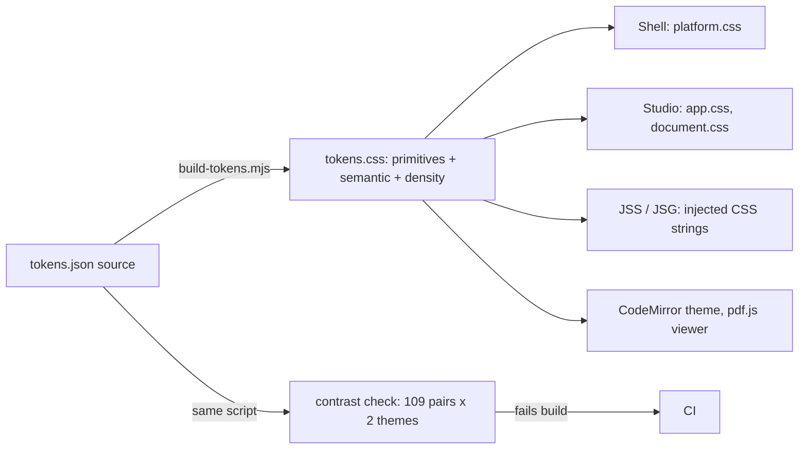
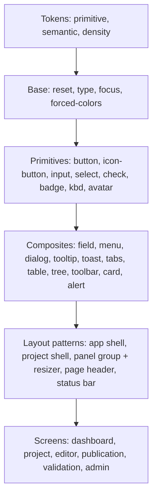

# 07 - Design system proposal (agent E2)

**Scope and method.** This report audits the current visual language of the Agastya platform (the React shell, the framework-free S1000D Studio, the JSS and JSG editors, the pdf.js viewer) and proposes one design system for all of them: tokens, typography, spacing, layout, elevation, density, component standards, a migration path, and six verified mockups. Theme-specific work (the light/dark mapping, parity, state tables and the automated validation plan) is in [08-DARK-LIGHT-THEME-STRATEGY.md](08-DARK-LIGHT-THEME-STRATEGY.md); screen-by-screen UX and navigation belong to agent E1 (`docs/audit/` UI/UX report).

What I did: read the three style files and the components that carry colour (`frontend/src/styles/platform.css`, `studio/styles/app.css`, `studio/styles/document.css`, `components/ui.tsx`, `jsg/shared.ts`, `jss/style.ts`, `components/pdf/*`, `store/ui.ts`, `store/appSettings.ts`, `tailwind.config.ts`); ran an inventory script over 156 files under `frontend/src` (32,868 lines); measured WCAG contrast statically (current token pairs) and at runtime (computed-style sweep of 17 routes and 13 interactive states in both themes) against a scratch server on port 4057 with Edge 158; probed disabled-state rendering, modal focus handling, the administrator accent override and clipped controls on the real app; researched 15 public design systems, tools and standards; then built `docs/audit/mockups/` (`tokens.css`, `components.css`, six screens, `index.html`) from one token definition whose 109 colour pairs (218 theme checks) all pass. Nothing in the repository was changed apart from the files under `docs/audit/`.

Evidence labels follow the common brief. Numbers marked "sweep" come from `E2/sweep.json`, `E2/states.json` and `E2/probe-*.json` in my scratch folder.

## 1. Coverage

| Area / path | Status | Verification | Limits |
|---|---|---|---|
| `frontend/src/studio/styles/app.css`, `document.css` | Inspected | read in full; token inventory; static contrast of every token pair | dynamic class names (`x-*`, `cm-*`) cannot be matched by a name scan |
| `frontend/src/styles/platform.css`, `pdf.css` | Inspected | read in full; dead-class and duplicate-rule scan | same |
| `frontend/src/components/ui.tsx`, `ThemeToggle.tsx`, `Icon.tsx`, `store/ui.ts`, `store/appSettings.ts`, `index.html`, `main.tsx` | Inspected | read; theme and modal behaviour run on the scratch server | - |
| `jsg/shared.ts` (BASE_CSS), `jss/style.ts` (JSS_CSS), `jsg/ispl-*.ts` | Partially inspected | CSS blocks read; dark rendering screenshotted and swept | editor logic not read |
| `components/pdf/PdfJsViewer.tsx`, `LazyPdfViewer.tsx`, `pages/project/ReleasePage.tsx` | Partially inspected | inline colours and styles read; rendered in both themes | viewer behaviour not audited |
| `frontend/tailwind.config.ts`, `postcss.config.js`, `package.json` | Inspected | grep for directives and utility classes: none | - |
| 17 platform routes + 13 editor states, light and dark | Inspected | computed-style contrast sweep (Edge 158, 1366x768) on seeded sample data | only the seeded sample content; text on images not measured; hover/active states are covered by the static pair check, not the sweep |
| Login / setup screens (`AuthScreens.tsx`), `PreviewWindow.tsx` | Not inspected | - | not rendered in either theme |
| PDF output styling (`studio/export/pdf-theme.ts`, JSS/JSG print CSS) | Not inspected | only the colour literals were counted | print fidelity follows the customer reference and is out of scope |
| Web research | Inspected | 15 sources (section 4); some read as search snippets only, marked in the table | no source was a paid or private document |
| `docs/audit/mockups/*` | Inspected (own work) | Edge at 1366x768, 1280x720, 1920x1080, both themes: 0 horizontal overflow, 0 contrast failures, no console errors; theme switch exercised | Chrome not used (renderer crash, see Unknowns); no screen reader or real forced-colors run |

## 2. Executive summary

The platform already has a sound core idea: CSS variables on `:root`, flipped by `html[data-theme='dark']`, shared by the shell and the Studio (`studio/styles/app.css:4-83`), Lucide icons that follow `currentColor`, and a theme choice applied before first paint (`index.html:9-12`). What is missing is everything around that idea:

- **No single token source.** Four vocabularies coexist (`--bg/--text` in the Studio, `--page-*` in the document view, `--x-*` compat in the shell, and per-editor overrides in JSG/JSS), with 14 unused definitions, one undefined variable, and 362 colour literals in 21 files (DS-001).
- **Dark theme is a re-skin, not a design.** Seven distinct WCAG failures were measured at runtime (six in dark, one in light), including the selected tab in the JSG editor (2.35:1, accent text on a legacy light-blue fill) and the XML bracket colour across 96 nodes of the light split view (TH-001, TH-002).
- **States are incomplete.** Disabled `.btn`, `.btn-primary`, `.input` and `.v2-input` render exactly like enabled controls, and disabled buttons keep `cursor: pointer` (DS-002, measured).
- **The administrator accent can break the product.** `#ffcc00` is a valid value for the backend and gives 1.51:1 button text in light theme; a navy accent gives 1.77:1 in dark (TH-003, measured).
- **Layout has no overflow strategy.** "New project" is beyond the viewport at 1440, 1366 and 1280 px; ribbon and mode switches are clipped in all three editors (DS-006; same result as QA-023 in `11-TESTING-AND-QA-STRATEGY.md`).

The proposal replaces this with three tiers of tokens (primitives, semantic, component), generated from one definition and verified by script in both themes; a dark theme built on lighter surfaces with a hairline ring rather than shadows; two density modes; one canonical class vocabulary; and a phased, reversible migration that starts with a lint in report-only mode. The mockups show the result on six screens.

### Strengths (keep these)

- One mechanism for the theme (`html[data-theme]`) and a pre-paint script that prevents the light flash; the OS preference is followed live (`main.tsx:13`).
- Studio and shell already share variables; CodeMirror syntax colours come from `--xml-*` variables (`studio/view/xmlview.ts:42-51`), so the editor follows the theme.
- JSS editor CSS (`jss/style.ts`) is almost fully tokenised and keeps the print sheet white on purpose.
- Icons are Lucide through `currentColor`; no icon font, no network.
- `:where(...):focus-visible` gives every control a 2px accent ring (`app.css:401`); `prefers-reduced-motion` is honoured (`app.css:528`).
- Studio's `modal()` traps focus and carries `role="dialog"`: 60 Tab presses never left it (measured).
- Everything ships offline: no web fonts, no CDN; `color-scheme` is declared so native controls follow the theme (`app.css:45,82`, `index.html:6`).

## 3. Part 1 - Measured audit of the current styling

### 3.1 Inventory (frontend/src, 156 files)

| Measure | Value | Where / evidence |
|---|---|---|
| Colour literals | 323 hex + 39 `rgb()/rgba()` = 362 in 21 files | `jsg/shared.ts` 104, `studio/styles/app.css` 77, `document.css` 46, `jss/style.ts` 38, `jsg/ispl-editor.ts` 24, `PdfJsViewer.tsx` 19, `ispl-preview.ts` 15, `platform.css` 8, `pdf-theme.ts` 6; about 95 of these are the token definitions themselves (`app.css:4-83`, `document.css:4-41`) |
| Same literals by the stricter lint in 08 | 336 | counts differ because the lint ignores comments and aligns to files, not lines |
| Inline `style=` attributes | 683 | TSX/TS; 1,006 `var()` uses overall |
| Distinct border radii | 23 | `3px` 24x, `6px` 23x, `8px` 17x, `4px` 15x, `10px` 11x, plus 18 more (`7px`, `9px`, `11px`, `16px`, `50%`, corner shorthands) |
| Distinct font sizes | 45 | `12px` 53x, `11px` 34x, `11.5px` 24x, `12.5px` 22x, `13px` 19x, plus pt and em values |
| Distinct z-index values | 12 | 0, 2, 3, 5, 6, 30, 40, 50, 60, 100, 120, 300 (no scale; Studio toasts use 120) |
| Token definitions | 3 places | `app.css:4-83` (light and dark), `document.css:4-41`, `platform.css:193-204` (`--x-*` compat) |
| Unused definitions | 14 | `--x-s1/2/3/5/6`, `--x-text`, `--x-line-strong`, `--x-surface-alt`, `--x-accent-bg/-tint`, `--x-warn/-bg/-line`, `--x-font-mono` |
| Undefined variable | 1 | `--line` (1 use) |
| Tailwind | installed, generates nothing | `package.json:43` `tailwindcss ^3.4.6`; 0 `@tailwind`/`@apply` directives in `src` or `index.html`; the 22 grep hits for utility-like class names are `v2-grid` |
| Fonts | named, not shipped | `--font-ui` starts with Segoe UI Variable, `--font-mono` with JetBrains Mono (`app.css:5-6`); no `@font-face` anywhere in `frontend/src` |
| `prefers-contrast`, `forced-colors` | 0 media queries | one `forced-color-adjust: none` in the pdf.js text layer (`pdf.css:21`); `prefers-reduced-motion` only in `app.css:528` |

### 3.2 Two component vocabularies

The shell reuses the Studio's `.btn`, `.modal-*`, `.icon-btn` (the `ui.tsx` header comment says so) and adds a `v2-*` family. Where both families define the same thing they disagree:

| Component | Studio (`app.css`) | Shell (`platform.css`) | Disagreement |
|---|---|---|---|
| Text input | `.input` 30px high, 3px soft ring on focus (`:408-409`) | `.v2-input/.v2-select/.v2-textarea` 32px, 2px outline (`:75-77`) | height, focus style |
| Toasts | `.toasts` z-index 120, bottom 34px, `.toast-warning` hard-coded `#8a5300` (`:506-509`) | `.v2-toasts` bottom 16px, `.v2-toast.success` solid `--success` with white text (`:123-126`) | position, colours, no dismiss on either |
| Spinner | `.spinner` 11px (`:511`) | `.v2-spin` 16px (`:97`) | size |
| Modal | `modal()` in `studio/ui/dialogs.ts`, focus trapped (measured) | `Modal` in `components/ui.tsx:57`, no focus management (measured) | accessibility behaviour |
| Tile | - | `.v2-tile` defined twice (`:110` dashboard tile, `:357` stat tile) | later rule overrides the earlier one |
| Empty state | - | `.v2-empty` defined twice (`:68-69`, `:394-397`) | see DS-004 |
| Badge/chip | `.chip-toggle`, `.chip-count` | `.v2-badge`, `.v2-chip` | three shapes of one idea |

### 3.3 Contrast, static (token pairs as defined today)

Full table in `E2/current-contrast.md`. Failures of the 4.5:1 text rule or the 3:1 non-text rule:

| Theme | Pair | Ratio | Notes |
|---|---|---|---|
| light | warning text on white / on warning-soft | 4.08 / 3.75 | `--warning #b86b00` used as text and badge |
| light | caution label on document page | 3.40 | `--caution-c #c27c00` (`document.css`) |
| light | `--text-faint` on hover row | 4.37 | nav hover, table row hover |
| light | XML bracket on white | 3.85 | `--xml-bracket #7a8294`; 96 text nodes in the runtime sweep |
| light | input border on white | 1.66 | `--border-strong`; WCAG 1.4.11 needs 3:1 for a boundary that identifies a control |
| dark | `--text-faint` on hover / on selected row | 4.21 / 4.29 | runtime: DM row meta and the segmented-control count |
| dark | accent text on pressed surface | 4.20 | runtime: ribbon `Live validation` |
| dark | white on success toast | 2.07 | `.v2-toast.success` |
| dark | white on accent (rail badge) | 2.70 | `.v2-rail-badge` |
| dark | document step numbers (`--sel`) on page | 2.44 | `--sel` is not redefined in the dark block of `document.css` |
| dark | input border on panel | 1.58 | same 1.4.11 issue |

Card and table rules at 1.24-1.41:1 are decorative separators and are not a WCAG failure; the proposal keeps them quiet on purpose and moves the 3:1 requirement to `--border-control`.

### 3.4 Contrast, at runtime (computed styles, Edge)

Light theme: 17 routes had 0 failures; the split XML view had 96 (all `<` `>` at 3.85:1). Dark theme: 6 distinct failures (plus the one light failure above, 7 in total): `.v2-seg button.on .v2-hint` 4.29, DM row meta on the active row 4.29, Release hint over a hard-coded white box 3.23, ribbon `Live validation` 4.20, `.jsg-nav h4` 2.72, and `.jsg-tab.on` ("Insert") 2.35 (dark-theme accent text on the legacy light-blue hover fill). Details and fixes: TH-001, TH-002, TH-007.

### 3.5 Behaviour measured on the real app

| Probe | Result |
|---|---|
| Disabled `.btn`, `.btn-primary`, `.input`, `.v2-input` | computed colour, background, border and opacity identical to the enabled control, in both themes; `cursor: pointer` on disabled buttons (DS-002) |
| Platform `Modal` (`ui.tsx:57`) | initial focus stays on the trigger outside the dialog; 32 of 40 Tab presses landed outside it; after Esc focus is not returned to the trigger (DS-005) |
| Studio `modal()` | 0 of 60 Tab presses escaped; has `role="dialog"` (strength) |
| Admin accent `#ffcc00` | accepted by the API (HTTP 200); primary button text 1.51:1 in light theme; the Projects toolbar and the "owner" badge become hard to read (`E2/shots/accent-ffcc00-light.png`); `#1d3a8a` gives 1.77:1 for button text in dark (TH-003) |
| Clipped controls (own measurement, same result as QA-023) | Projects: "New project" at 1338-1461 px beyond a 1440/1366/1280 viewport; S1000D Studio: "Publication", "XML", list buttons clipped; JSS: "PDF" at 1366; JSG: "Split" and "PDF" at 1440 (DS-006) |
| Empty-state placeholder | each inline `<strong>` in the PDF placeholder list is rendered as a block (`display:block; margin-bottom:4px`), breaking every sentence; in both themes (DS-004) |

## 4. Part 2 - Research (what I took, and what it means here)

| Source | URL | Used for |
|---|---|---|
| WCAG 2.2 (W3C) | https://www.w3.org/TR/WCAG22/ | 1.4.3 (4.5:1, 3:1 large), 1.4.11 (3:1 for UI boundaries and states), 1.4.1 (not colour alone), 2.4.7 / 2.4.11 / 2.4.13 focus, 1.4.12 text spacing |
| Understanding SC 2.5.8 Target Size (Minimum) | https://www.w3.org/WAI/WCAG22/Understanding/target-size-minimum.html | 24x24 CSS px targets, spacing exception: sets the 28px floor of the compact density |
| `forced-colors` media feature (MDN) | https://developer.mozilla.org/en-US/docs/Web/CSS/@media/forced-colors | author colours overridden, `box-shadow` forced to `none`, use real borders and outlines, `forced-color-adjust`; do not design a separate forced-colors theme |
| Dark Mode (Apple HIG) | https://developer.apple.com/design/human-interface-guidelines/dark-mode | semantic adaptive colours instead of hard-coded values; base vs elevated backgrounds; 4.5:1 minimum and 7:1 aim for custom small text; soften white images; test with Increase Contrast; avoid an app-specific appearance setting (read here as: default to System) |
| Tone-based surfaces in Material 3 | https://material.io/blog/tone-based-surface-color-m3 | surface container roles replace elevation overlays; surface-container is the default contained area. Read via search snippet; the colour-roles page itself returned no text |
| Material 2 dark theme | https://m2.material.io/design/color/dark-theme | dark elevation = lighter surface, shadows stay dark. Legacy guidance, used for the principle only. Search snippet |
| Carbon themes | https://carbondesignsystem.com/elements/themes/overview/ | four themes (White, G10, G90, G100); layer tokens alternate in light and step lighter in dark; role-named tokens with theme-supplied values. Search snippet |
| Fluent 2 colour tokens | https://fluent2.microsoft.design/color-tokens | global tokens hold raw values, alias tokens switch per theme; `colorNeutralBackground1` white / grey[16]. Search snippet; full tables not read |
| VS Code theme colour reference | https://code.visualstudio.com/api/references/theme-color | `area.element.state` naming; active/inactive selection pairs (`list.activeSelectionBackground` / `inactiveSelectionBackground`); `contrastBorder` for high-contrast themes |
| How we redesigned the Linear UI | https://linear.app/now/how-we-redesigned-the-linear-ui | LCH theme generation; three inputs (base, accent, contrast) instead of 98 variables; a contrast variable for accessibility themes; lighter text/icons in dark, darker in light; less visual noise and higher density |
| Tailwind CSS dark mode | https://tailwindcss.com/docs/dark-mode | custom variant on `[data-theme=dark]`; three-way (light, dark, system) toggle with an inline head script against flash. The page documents v4; the installed 3.4.6 uses the `darkMode: 'selector'` option (NOT VERIFIED here) |
| Design Tokens Format Module (DTCG) | https://www.designtokens.org/tr/drafts/format/ | `$value` / `$type`, aliases, groups. A community draft ("not a W3C Standard"), so CSS variables stay the runtime format and JSON is optional |
| Islands theme (JetBrains) | https://blog.jetbrains.com/platform/2025/12/meet-the-islands-theme-the-new-default-look-for-jetbrains-ides/ ; https://plugins.jetbrains.com/docs/intellij/supporting-islands-theme.html | a light/dark pair as the product default; an explicit minimum contrast (1.20:1) between tool-window and main backgrounds. Search snippets |
| Figma variables, modes | https://help.figma.com/hc/en-us/articles/15343816063383-Modes-for-variables | collections with light/dark modes, primitive / semantic / component layers; a reported pitfall: a cross-collection alias falls back to the source collection's default mode. Search snippets and community threads |
| Oxygen XML Editor (closest authoring tool) | https://www.oxygenxml.com/forum/post77663.html ; https://www.oxygenxml.com/doc/ug-editor/topics/preferences-author.html | dark "Graphite" theme since v17, with a reported unreadable-tabs bug in 27.1; author-mode content is styled by its own CSS, separate from the UI theme. Search snippets |

What this means for Agastya (the decisions it supports):

1. **Semantic, role-named tokens with theme-supplied values** (Carbon, Fluent, VS Code): components never name a colour, only a role.
2. **Three tiers** (primitives, semantic, component) with modes only on the semantic tier (Figma): avoids the cross-collection fallback pitfall.
3. **Selected vs selected-inactive** and a high-contrast mechanism built on borders (VS Code, MDN): needed for the tree, lists and tabs.
4. **Dark = lighter surfaces plus a ring** (Material, Apple, Carbon): the dark elevation rule in section 5.6.
5. **Few inputs to generate a theme** (Linear): the accent is one input and the build derives and verifies both theme variants; today the administrator sets one hex for both themes (TH-003).
6. **The document canvas is a separate concern** (Oxygen): the S1000D design view and the JSS/JSG print sheets get their own token family, with an explicit paper rule (TH-007).
7. **Do not trust a draft format at runtime** (DTCG): CSS variables are the contract.

## 5. Part 3 - The proposed design system

Everything below is implemented once, as data, in my scratch generator and emitted into `docs/audit/mockups/tokens.css` (288 lines, 68 colour tokens) and `components.css` (about 200 lines). Open `docs/audit/mockups/index.html` to see it. Nothing is applied to the product.

### 5.1 Principles

1. **Roles, not colours.** A component names what a colour is for (`--surface-selected`, `--danger`), never what it looks like. Both themes supply the values.
2. **Both themes are verified by script, not by eye.** Every foreground/background pair in the token file is listed and checked (text 4.5:1, UI boundary 3:1); the build fails when a pair fails (08, section 7.3).
3. **Chrome and content are different things.** UI chrome follows the theme. The S1000D design view has its own family (`--doc-*`) and print-fidelity sheets (JSS, JSG, the PDF page) use `--paper*` and stay white in both themes, inside a themed canvas (`--viewer-canvas`).
4. **One theme mechanism.** `data-theme` on `<html>`, defaulting to the OS (`prefers-color-scheme`) when absent. Three user choices: System (default), Light, Dark.
5. **Never colour alone, never shadow alone.** Status carries an icon or label; selection and focus carry an outline or edge, so they survive Windows High Contrast (`forced-colors`) where shadows and background colours are removed.
6. **Two densities, one set of sizes.** Comfortable for reading and forms, compact for the editor and long lists; font sizes stay the same, only control heights and paddings change, and no target drops below 24 px (WCAG 2.5.8).
7. **Offline by construction.** No web fonts, no CDN, no icon font. The stack is system fonts; a bundled option is described and not required.

### 5.2 Token architecture

Three tiers; modes (light/dark) exist only on the middle one.

| Tier | Example | Defined | Consumed by |
|---|---|---|---|
| Primitive | `--p-blue-600: #2456c9` (ramps for neutral, blue, red, amber, green, teal) | `tokens/primitives.css`, no modes | semantic tier only |
| Semantic | `--surface-panel`, `--text-secondary`, `--border-control`, `--accent`, `--danger-subtle` | `tokens/semantic.css`: `:root` (light), the `prefers-color-scheme` block, and `[data-theme=dark]` | every component and every editor |
| Component | `--btn-bg: var(--surface-panel)`, `--tree-row-h: var(--row-h)` | next to the component, only where one component needs a knob (button, tree, table, toolbar, dialog) | that component |

The mockups collapse the primitive tier into literal hex values inside the semantic tier, because 68 tokens are easy to review that way. In production keep the ramp as a separate file so an accent or a brand change touches one place.



**File layout (proposal).** `frontend/src/styles/tokens/{primitives,semantic,density,legacy-alias}.css` generated from `frontend/design/tokens.json`; `frontend/src/styles/components.css` (the canonical class vocabulary, section 5.8); `frontend/scripts/build-tokens.mjs` and `check-tokens.mjs` (the same logic as my `E2/gen-css.mjs` and `check-tokens.mjs`, about 150 lines in total). JSON is a repo-private format; the DTCG draft is a convenient shape for it but is not required (it is an unfinished community draft).

**Legacy alias layer.** `tokens.css` ends with a block that maps today's names onto the new ones (`--bg: var(--surface-canvas)`, `--text-faint: var(--text-tertiary)`, `--xml-bracket: var(--syntax-bracket)`, `--x-error: var(--danger)`, `--page-bg: var(--doc-page)`, ...). With it, the existing CSS keeps working while it is migrated, and the corrections ship at once: `--text-faint` becomes 4.5:1 on every surface, `--info` and `--sel` become theme-aware. Delete an alias when the lint (08, section 7.1) shows no consumer.

**Naming.** `category-role[-modifier]`: `surface-*`, `text-*`, `border-*`, `accent*`, `<status>`, `<status>-subtle|-border|-solid`, `syntax-*`, `doc-*`, `paper*`. State is expressed by the token (`surface-hover`, `surface-selected-inactive`), not by a suffix on a component name, following the VS Code active/inactive pairing.

**Tailwind mapping.** Tailwind generates no CSS today (DS-008). Recommended: remove it. If utilities are wanted later, map them to the semantic tier only, one line per token, and drive dark mode from the attribute:

```ts
// tailwind.config.ts (only if Tailwind is kept)
darkMode: ['selector', '[data-theme="dark"]'],      // v3.4 syntax; NOT VERIFIED against the 3.4 docs
theme: { extend: { colors: {
  surface: { canvas: 'var(--surface-canvas)', panel: 'var(--surface-panel)', raised: 'var(--surface-raised)', inset: 'var(--surface-inset)' },
  content: { DEFAULT: 'var(--text-primary)', muted: 'var(--text-secondary)', faint: 'var(--text-tertiary)', link: 'var(--text-link)' },
  line: { DEFAULT: 'var(--border-default)', control: 'var(--border-control)' },
  accent: 'var(--accent)', danger: 'var(--danger)', warning: 'var(--warning)', success: 'var(--success)', info: 'var(--info)',
} } }
```

Because the values are variables, `dark:` variants are almost never needed; this is the reason to prefer plain CSS classes in `components.css`.

### 5.3 Colour (summary; the full side-by-side mapping, 68 tokens, is in 08 section 4)

All values below are in `docs/audit/mockups/tokens.css`. Minimum measured ratios over the 109 pairs: text 4.54 (light) and 4.57 (dark); UI components 3.04 (light) and 3.10 (dark). Failures: 0.

| Token | Light | Dark | Ratio on `surface-panel` (L / D) | Use |
|---|---|---|---|---|
| `surface-canvas` | `#f3f5f8` | `#111419` | (surface) | app background behind panels and document pages |
| `surface-panel` | `#ffffff` | `#171b22` | (surface) | sidebars, cards, tables, editors (level 1) |
| `surface-raised` | `#ffffff` | `#1e232c` | (surface) | menus, popovers, dialogs, command palette (level 2) |
| `surface-inset` | `#eceff4` | `#0d1015` | (surface) | wells: input fields, code gutters, table headers, search boxes |
| `surface-chrome` | `#eaeef4` | `#0e1116` | (surface) | activity bar, status bar, title bar |
| `text-primary` | `#1a2030` | `#e6e9f0` | surface-panel 16.24 / 14.21 | body, headings, values |
| `text-secondary` | `#475266` | `#aab3c3` | surface-panel 7.87 / 8.18 | labels, secondary lines |
| `text-tertiary` | `#5b6579` | `#939db0` | surface-panel 5.86 / 6.32 | hints, meta, placeholders (still >= 4.5:1 on every surface) |
| `text-link` | `#2456c9` | `#86abff` | surface-panel 6.46 / 7.63 | links and accent-coloured text |
| `border-control` | `#7d889d` | `#6b768c` | surface-panel 3.57 / 3.78 | inputs, checkboxes, toggles, segmented controls (>= 3:1, WCAG 1.4.11) |
| `focus-ring` | `#2456c9` | `#86abff` | surface-panel 6.46 / 7.63 | keyboard focus outline (>= 3:1 against both neighbours) |
| `accent` | `#2456c9` | `#3666df` | surface-panel 6.46 / 3.39 | primary button / active indicator fill |
| `danger` | `#b42323` | `#ff8a82` | surface-panel 6.55 / 7.57 | error text/icon |
| `warning` | `#8a4f00` | `#f2b450` | surface-panel 6.56 / 9.39 | warning text/icon |
| `success` | `#17703f` | `#5fd093` | surface-panel 6.13 / 8.99 | success text/icon |
| `info` | `#0e6f8c` | `#6ec5e8` | surface-panel 5.72 / 8.89 | info text/icon |

Selected pairs (needs = WCAG minimum):

| Pair | Needs | Light | Dark |
|---|---|---|---|
| text-primary on surface-panel | 4.5 | 16.24 | 14.21 |
| text-secondary on surface-hover | 4.5 | 6.70 | 7.01 |
| text-tertiary on surface-hover | 4.5 | 4.99 | 5.42 |
| text-tertiary on surface-selected | 4.5 | 5.04 | 5.24 |
| text-link on surface-selected | 4.5 | 5.55 | 6.32 |
| text-link on surface-pressed | 4.5 | 5.01 | 5.68 |
| text-on-accent on accent | 4.5 | 6.46 | 5.09 |
| text-on-accent on accent-pressed | 4.5 | 10.41 | 7.42 |
| border-control vs surface-panel | 3.0 | 3.57 | 3.78 |
| border-control vs surface-inset | 3.0 | 3.10 | 4.17 |
| focus-ring vs surface-selected | 3.0 | 5.55 | 6.32 |
| accent fill vs surface-panel (button boundary) | 3.0 | 6.46 | 3.39 |
| danger on danger-subtle | 4.5 | 5.74 | 6.58 |
| warning on warning-subtle | 4.5 | 6.02 | 7.68 |
| success on success-subtle | 4.5 | 5.40 | 7.44 |
| info on info-subtle | 4.5 | 5.01 | 7.35 |
| text-on-accent on success-solid | 4.5 | 6.13 | 4.91 |
| text-on-accent on danger-solid | 4.5 | 6.55 | 4.93 |
| text-on-warning-solid on warning-solid | 4.5 | 8.88 | 8.83 |
| tooltip-text on tooltip-bg | 4.5 | 13.90 | 10.58 |
| syntax-bracket on surface-panel | 4.5 | 5.45 | 5.61 |
| syntax-comment on surface-inset (gutter/selection line) | 4.5 | 4.68 | 6.20 |
| doc-selection on doc-page | 4.5 | 6.46 | 7.22 |
| doc-caution on doc-page | 4.5 | 6.56 | 8.82 |
| paper-warning on paper | 4.5 | 5.88 | 5.88 |

Rules that make the set work:

- **Three surface levels plus inset and chrome.** `canvas` < `panel` < `raised`. `inset` is for wells (inputs, code gutters, table headers). `chrome` is the activity bar, status bar and title bar. In dark theme each step is lighter than the one below, with a hairline ring (section 5.6).
- **Selected has two states.** `surface-selected` when the list has focus, `surface-selected-inactive` when it does not (the tree and the validation list use `:focus-within`), so users can see where the keyboard is.
- **Control boundaries are 3:1.** `--border-control` is the only border that identifies a control; `--border-default` and `--border-subtle` are decorative rules and are deliberately quiet.
- **Status colour has four forms:** text/icon (`--danger`), subtle fill (`-subtle`), outline (`-border`), solid fill (`-solid`, with `--text-on-accent` or the dark `--text-on-warning-solid`). `warning` text is a dark amber in light theme (`#8a4f00`, 6.0:1 on its fill) and the brighter `#f2b450` in dark.
- **Accent is one input.** `accent`, `accent-hover`, `accent-pressed`, `text-link`, `focus-ring` and `surface-selected` are derived from it per theme. The administrator setting (today a bare hex) must produce both theme variants and pass the same checks before it is saved (TH-003). Linear's three-input model (base, accent, contrast) is the reference.
- **Text-on-accent is white in both themes** (6.46:1 light, 5.09:1 dark), instead of today's dark text on a light-blue accent in dark theme; this keeps a button looking like the same button in both themes.

### 5.4 Typography

| Role | Value | Why |
|---|---|---|
| UI stack | `"Segoe UI Variable Text","Segoe UI", system-ui, -apple-system, "Helvetica Neue", Arial, sans-serif` | present on every supported OS (packaging is Windows-only by decision); falls back sanely elsewhere; no download |
| Mono stack | `"Cascadia Mono","Cascadia Code", Consolas, "Liberation Mono", "Courier New", monospace` | XML view, data module codes, IDs; Consolas is on every Windows; JetBrains Mono is not shipped today and is dropped from the stack |
| Print sheets | `--font-paper` Arial (JSS), `--font-paper-serif` Times New Roman (JSG) | user decision "Arial kept"; the PDF embeds its own fonts |
| Weights | 400, 500, 600 | replaces 550 and 650, which static fonts round to 500 and 600 anyway |
| Line heights | 1.25 (headings), 1.4 (UI), 1.55 (prose and the document canvas) | |
| Mono size | 0.92em of the surrounding text (12px at 13px) | |

Scale (px): `2xs 11` (uppercase pane labels and keycaps only), `xs 12` (meta, badges, table headers, hints), `sm 13` (default UI text, as today's `body`), `md 14` (comfortable prose, card titles), `lg 16` (dialog and section titles), `xl 20` (page title), `2xl 24` (statistic values), `3xl 28` (index and empty-state headings). This replaces 45 distinct sizes. Layout must survive the WCAG 1.4.12 text-spacing overrides (line height 1.5, paragraph spacing 2x, letter spacing 0.12 em, word spacing 0.16 em): no fixed heights on text containers, `min-height` instead.

**Bundled-font option (not recommended now).** Self-host Inter (UI) and JetBrains Mono (code) as `woff2` in `frontend/public/fonts/`, `font-display: swap`, latin subsets, listed in `@font-face` before the system stack. Choose it only if identical rendering on every machine matters more than a smaller install, or when macOS/Linux packaging is added. Size impact: NOT MEASURED; set a budget before adopting. Licence note: both families are published under the SIL Open Font License 1.1, which allows bundling and redistribution with software, requires the licence text to ship with the font files, and forbids selling the font on its own; this is from general knowledge and NOT VERIFIED against the licence files of the exact releases, which must be checked first. Segoe UI is a Microsoft system font: it is referenced by name and must never be copied into the installer.

### 5.5 Spacing, grid and dimensions

**Spacing** (4 px base): `2, 4, 6, 8, 12, 16, 20, 24, 32, 40, 48`. Today's off-grid paddings map as `7, 9 -> 8`, `10 -> 8 or 12`, `14 -> 12 or 16`, `18 -> 16 or 20`. `6` is the only half step and is used inside dense controls.

**Containers.** Dashboards and forms use a centred content column: `--content-max 1280px`, `--reading-max 880px` (prose, release notes), `--form-max 560px` (a single-column form). Tables use the full content width and scroll inside their own container.

**Regions** (these are the dimensions the mockups use):

| Region | Size | Notes |
|---|---|---|
| Top bar | 48 px | brand, breadcrumb, search/command trigger, actions, theme switch, account |
| Global side navigation | 232 px (200 at <=1180 px) | text labels; groups: work, library, operations, platform |
| Project activity bar | 48 px, icon only | tooltips on hover and focus; badge for validation errors |
| Explorer tree | 248 px (editor default at 1366), 272 max, 232 at <=1200 | resizable in the product (`panel-resize`) |
| Properties panel | 288 px (312 max, 280 at <=1200), hidden at <=1060 | becomes a drawer below that |
| Problems panel | 148 px at 768 px height, 208 px max | resizable, collapsible |
| Document tabs / toolbar / path bar | 36 / 36 / 24 px | |
| Status bar | 24 px | save state, validation counts, schema, cursor, language, zoom |

Width budget of the editor at the minimum supported viewport 1366 x 768: 1366 - 48 (activity) - 248 (tree) - 288 (props) = 782 px for the document column, enough for a 700 px canvas page. At 1280 the column is 696 px; at 1200 the side panels shrink (232 / 280) and give back 40 px; at 1060 the properties panel leaves. Rule: **the centre column never goes below 640 px; panels give way first.** The mockups were run at 1280x720, 1366x768 and 1920x1080 with no horizontal overflow.

**Toolbars (QA-023, DS-006).** A toolbar is a flex row with `min-width: 0` and a priority order. At each breakpoint the lowest-priority groups collapse into one "More" menu (`.menu`), labels turn into icon-only buttons with tooltips, and no button is ever clipped by `overflow: hidden`. The mockup editor toolbar shows the compact form (icons for most commands, text only for the view switch).

### 5.6 Radius, elevation, z-index, motion

**Radius** (replaces 23 values): `xs 2` (keycaps, progress), `sm 4` (checkboxes, segmented items, badges), `md 6` (buttons, inputs, menu items), `lg 8` (cards, panels, popovers), `xl 12` (dialogs, palette), `pill 999` (badges that are capsules, avatars use 50%). Old values map: `2 -> xs`, `3, 4, 5 -> sm`, `6, 7 -> md`, `8, 9, 10 -> lg`, `11, 12, 16 -> xl`, `50% -> pill`.

**Elevation.**

| Level | Used for | Light theme | Dark theme |
|---|---|---|---|
| 0 canvas | page behind panels | `surface-canvas`, no edge | `surface-canvas` (darkest) |
| 1 panel | sidebars, cards, tables, editors | `surface-panel` + `border-default`; cards may add `shadow-1` | `surface-panel` (lighter than canvas) + `border-default` |
| 2 raised | menus, popovers, tooltips, select lists | `surface-raised` + border + `shadow-2` | `surface-raised` (lighter again) + border + `shadow-2` with an inset 1px ring |
| 3 overlay | dialogs, command palette | `surface-raised` + `shadow-3` over `scrim` | same, `scrim` is darker (0.62 vs 0.40) |

Why dark theme does not use shadows for depth: a shadow is a darker patch, and on a surface that is already near black it has almost nothing to darken, so it is invisible; designers therefore express "closer to the user" by a lighter surface (Material 2 dark theme, Apple's base vs elevated backgrounds, Carbon's layers stepping lighter). Shadows are kept only on floating layers, where they separate the layer from the dimmed backdrop, and each floating layer also gets a hairline inset ring so that its edge exists without the shadow. In Windows High Contrast `box-shadow` is forced to `none`, so every edge that matters is also a real border.

**Z-index scale** (replaces 12 free values): sticky 10, rail 20, resize 25, menu 100, popover 110, scrim 200, modal 210, palette 220, toast 300, tooltip 400.

**Motion:** 80 / 140 / 220 ms with `cubic-bezier(0.2, 0, 0, 1)`; all collapse to ~0 under `prefers-reduced-motion`. Motion is never the only signal.

### 5.7 Density modes

| Token | Comfortable (default) | Compact | Notes |
|---|---|---|---|
| `--control-h` (button, input, select) | 32 px | 28 px | small buttons are 28 / 24 px; both >= the 24 px target minimum |
| `--row-h` (tree, menu, list, nav item) | 36 px | 28 px | |
| `--table-row-h` | 40 px | 32 px | |
| `--icon-btn` | 32 px | 28 px | |
| `--pad-ctl` | 12 px | 10 px | |
| Font sizes | unchanged | unchanged | density never shrinks text |

Applied with `data-density="compact"` on any container. Defaults: dashboards, project overview, publication, admin = comfortable; editor workspace, validation lists and long tables = compact; each user can switch the whole app. The administrator "compact layout" setting maps onto the same attribute; today it is three CSS rules (`platform.css:323-325`: page padding, table cell padding, card padding), so controls and rows do not change at all.

### 5.8 Component standards

Dimensions and rules below; interaction states are in 08 section 6. "Canonical" means the one class that replaces its duplicates (section 5.11).

| Component | Canonical class | Anatomy and size | Rules |
|---|---|---|---|
| Button | `.btn` + `.primary` `.danger` `.subtle` `.sm`; `.icon-btn` | height `--control-h`, radius md, padding `--pad-ctl`, icon 16 px with 8 px gap; one primary per view | disabled shows a distinct fill and text colour and `cursor: not-allowed`; busy sets `aria-busy` and a spinner and keeps its width; toggles use `aria-pressed`; icon-only buttons need `aria-label` and a tooltip |
| Input / textarea | `.input` | height `--control-h`, border `--border-control`, placeholder `--text-tertiary`, label above (xs, medium), hint and error below | error uses `aria-invalid` + `aria-describedby` and an icon with text, not only a red border; never placeholder-as-label |
| Select | `.select` | same box as input, native control kept (platform behaviour, `color-scheme` aware) | custom listbox only where a search is needed |
| Menu / dropdown | `.menu` + `.item` | `surface-raised`, level 2, item height `--row-h`, min width 200 px, shortcut right-aligned in `kbd` | arrow keys, Home/End, type-ahead, Esc returns focus to the trigger |
| Context menu | `.menu` | same as menu, opens at the pointer or on the Menu key | replaces `.ctx-menu` |
| Modal / dialog | `.dialog` (`role="dialog"` `aria-modal`) | 460 px (form 560 px), radius xl, level 3, header with icon + title, footer with actions on `surface-inset` | focus moves in on open, is trapped, returns to the trigger on close; destructive action is never the default; scrim from the token |
| Command palette | `.palette` | 640 px wide, 48 px input, rows 36 px, grouped, keycaps right | opened by Ctrl+K; combobox pattern; shows the shortcut of each command |
| Tooltip | `[data-tip]` | `tooltip-bg` / `tooltip-text`, 12 px, level 2, 6 px offset | on hover and focus; never the only place a label exists; dismissible with Esc |
| Table | `.table` in `.table-wrap` | header `surface-inset`, 12 px semibold; row `--table-row-h`; sticky header; numeric columns right-aligned, tabular figures | row hover `surface-hover`; selected row `surface-selected` and, in forced colours, a 2 px `Highlight` outline (the mockups implement that for nav, tree and tabs; a table row needs the same rule); sortable header uses `aria-sort` |
| Tabs | `.tabs` / `.tab`, `.doctabs` / `.doctab` | 36 px, underline 2 px in `accent` for the selected tab; document tabs carry a modified dot and a close button | `role="tablist"`; Left/Right moves; the modified marker has a text alternative |
| Navigation | `.sidenav` / `.nav-item`, `.activity` / `.act-btn` | nav item `--row-h`; selected = `surface-selected` + 3 px accent edge + `aria-current` | the activity bar is icon-only and every button has a tooltip and an `aria-label` |
| Tree | `.tree` / `.node` | row `--row-h`, indent 16 px per level, twist 16 px, status dot 8 px, count right-aligned | `role="tree"`; selected vs selected-inactive; Left/Right collapse/expand; `aria-selected` |
| Toast / notification | `.toast` in `.toast-stack` | 300-420 px, level 3, 3 px edge in the status colour, icon + title + one line | `aria-live="polite"` (errors `assertive`); success 4 s, error stays until dismissed, with a dismiss button; pause on hover; never covers the status bar |
| Alert (inline) | `.alert` + status | subtle fill, border, icon, message, optional action | `role="alert"` only for new errors |
| Card | `.card` (+ `.link`) | level 1, radius lg, header 44 px, body 16 px padding | clickable cards use one stretched link, not a nested anchor |
| Progress | `.progress` | 6 px track on `surface-inset`, fill `accent` or status solid | `role="progressbar"` with value; indeterminate gets a label |
| Toolbar | `role="toolbar"` | 36 px, groups separated by 1 px rules, icon buttons 28-32 px | roving tabindex; overflow rule in section 5.5 |
| Badge / chip | `.badge` + tone | 20 px, xs text, subtle fill + border, optional icon | colour is never the only carrier (the text says "Draft", "3 errors") |

### 5.9 How each consumer adopts the tokens

| Consumer | Today | After |
|---|---|---|
| React shell | `platform.css` + Studio classes; `--x-*` compat | imports `tokens.css`; `v2-*` classes migrate to the canonical set (5.11); the compat block is deleted last |
| S1000D Studio (framework-free DOM) | `app.css` defines tokens at `:4-83`; `.design-scroll` defines a second set | `app.css` keeps only component rules and imports the tokens; `.design-scroll` reads `--doc-*`; `--sel` becomes `--doc-selection` and is defined in dark |
| JSS editor (`jss/style.ts`) | CSS string, tokenised, sheet `#fff` / `#000` | unchanged structure; the sheet uses `--paper` and `--paper-ink`; 38 literals become tokens |
| JSG editor (`jsg/shared.ts`, `ispl-*.ts`) | BASE_CSS with 104 literals; legacy light rules at `:51-90` followed by token overrides at `:95-130` | delete the legacy block, keep one tokenised block; the white sheet uses `--paper*`; this removes TH-001 |
| CodeMirror 6 (`studio/view/xmlview.ts`) | `HighlightStyle` via `var(--xml-*)`; `EditorView.darkTheme` from `isDark()` | `var(--syntax-*)`; gutter, selection, active line, search match and panel colours from tokens; dark flag unchanged |
| pdf.js viewer (`PdfJsViewer.tsx`, `pdf.css`) | 19 literals, always-dark canvas, `var(--x-accent,#6cf)` | canvas `--viewer-canvas` (follows the theme), toolbar uses surface tokens, pages are always white, text-layer selection from `--accent` |
| PDF export (`studio/export/pdf-theme.ts`) | 6 literals | stays a print palette; read from `--paper*` values at build time so UI and print agree |
| Release watermark preview (`ReleasePage.tsx:192-195`) | `#fff` box with `rgba` text | a `.paper` surface with `--paper-warning` ink |

### 5.10 Component hierarchy



Rule: a level may use only the levels above it. Screens contain no colour values and no pixel sizes except through tokens; page-local CSS (the `<style>` block of each mockup) is limited to grid placement.

### 5.11 Migration approach

The current CSS is about 970 lines (`platform.css` 433, `app.css` 541, minus overlap) plus about 700 lines of injected CSS strings and 683 inline styles. A big-bang rewrite is not proposed. Each phase ships on its own and is reversible by removing its file.

| Phase | Work | Exit criteria | Rollback |
|---|---|---|---|
| 0 (S) | Add the colour lint in **report-only** mode and the token contrast check to the test run; commit `tokens.css` unused | lint report committed as the baseline (336 hits); contrast check green | delete two scripts |
| 1 (M) | Load `tokens.css` first; add the legacy alias layer; delete the three old token definitions (`app.css:4-83`, `document.css:4-41`, `platform.css:193-204`) | visual diff limited to the listed contrast corrections; all e2e green; unused tokens gone | revert the import order |
| 2 (M) | Fix the P1 defects on the new tokens: JSG BASE_CSS, disabled and loading states, accent validation (backend and UI), PDF viewer and release preview colours | TH-001, TH-002, TH-003, DS-002 acceptance criteria | per fix |
| 3 (L) | One component vocabulary: codemod `v2-input`, `v2-select`, `v2-tab(s)`, `v2-toast(s)`, `v2-spin`, `v2-badge`, `v2-seg`, `v2-card` to canonical classes; one `Modal` with focus management used by both shell and Studio; remove duplicates (`.v2-tile`, `.v2-empty`); drop Tailwind | no duplicate selectors (lint rule); both modals pass the keyboard test | codemod is mechanical; keep a map file |
| 4 (M) | Layout: region dimensions and toolbar overflow; density attribute replaces `v2-compact` | 1366x768 and 1280x720 have no clipped control on the 6 reference screens | feature flag by attribute |
| 5 (S) | Switch the lint to **error**; delete the alias layer file by file; add per-theme visual baselines (08, section 7.4) | 0 hard-coded colours outside `tokens/`; baselines green | re-enable report mode |

Class mapping for the codemod (excerpt): `.v2-input/.v2-select/.v2-textarea -> .input/.select`, `.v2-tabs/.v2-tab -> .tabs/.tab`, `.v2-toasts/.v2-toast -> .toast-stack/.toast`, `.v2-spin/.spinner -> .spinner`, `.v2-badge.ok/.warn/.bad -> .badge.success/.warning/.danger`, `.v2-seg -> .seg`, `.v2-card -> .card`, `.v2-hint -> .muted/.faint`, `.btn-primary -> .btn.primary`, `.btn-danger -> .btn.danger`.

### 5.12 The mockups

| File | Shows | Notes |
|---|---|---|
| `index.html` | gallery, token swatches that follow the theme | links to every screen and to the two overlay states |
| `workspace.html` | main dashboard: resume cards, projects table, attention list, activity, system health | global shell, comfortable |
| `project.html` | project dashboard: readiness, publish-gate alert, areas of work, status by SNS chapter, timeline, team | project shell |
| `editor.html` (+ `#palette`) | activity bar, explorer, tabs, toolbar, path bar, document canvas, properties with an invalid field, problems list, status bar with save state, toast, command palette | compact; the palette opens with the URL hash, no script |
| `publication.html` | structure checklist, themed canvas with white pages and a watermark, build settings, build history | paper rule |
| `validation.html` | severity filters, issue table, source excerpt with syntax tokens, waiver form with an error | |
| `admin.html` (+ `#confirm-disable`) | users, appearance defaults with a two-theme contrast check, storage, audit log, toast, confirm dialog | dialog opens with the hash |

Verification: Edge 158 at 1366x768 (and the overflow check at 1280x720 and 1920x1080), light and dark, plus the overlay states: no console errors, no horizontal overflow, 0 contrast failures by computed-style sweep on all 9 page/state combinations in both themes (18 runs), and the theme switch toggles `data-theme`, persists across pages and returns to the OS setting. A hard-coded colour lint over the folder finds 0 literals outside `tokens.css`.

## 6. Findings (DS-xxx, design system)

Theme-specific findings (TH-001 to TH-010) are in 08. Labels follow the common brief.

### DS-001 · P1 · VERIFIED · L · Four overlapping token vocabularies and no single source of truth

**Category** Design system / architecture.
**Problem** Colour, shape and spacing values are defined in at least four places that do not know about each other, so no change (a theme fix, an accent, a density mode) can be made once, parity between light and dark cannot be guaranteed, and the same role has several names. Three live defects come straight from this: white buttons in the JSG dark editor (TH-001), a document-view token missing in dark (TH-005), and an accent that is not re-derived per theme (TH-003).
**Evidence**
- `frontend/src/studio/styles/app.css:4-83` defines the main set (`--bg`, `--bg-elev`, `--text`, `--accent`, `--xml-*`, ...), light and dark.
- `studio/styles/document.css:4-41` defines a second set on `.design-scroll` (`--page-*`, `--warn-c`, `--caution-c`, `--sel`); the dark block (`:27-41`) does not redefine `--sel`.
- `styles/platform.css:193-204` defines a third set, `--x-*`, "compat" names; 14 definitions are never used (`--x-s1/2/3/5/6`, `--x-text`, `--x-line-strong`, `--x-surface-alt`, `--x-accent-bg/-tint`, `--x-warn/-bg/-line`, `--x-font-mono`) and one variable is used but never defined (`--line`).
- `jsg/shared.ts:51-90` is a legacy light stylesheet followed by token overrides at `:95-130`; `jss/style.ts` carries 38 literals.
- Inventory: 362 colour literals in 21 files, 683 inline `style=` attributes, 23 radii, 45 font sizes (`E2/inv.json`).
**Current implementation** Variables on `:root` and `:root[data-theme='dark']`; components reference them by name; the editors inject their own CSS strings.
**Recommendation** One generated `tokens.css` (primitives, semantic, density) with a legacy alias layer, verified by a script in both themes, as in section 5.2; migrate in the phases of section 5.11; delete the three old definition blocks in phase 1.
**Expected outcome** One place to change a colour; the alias file shrinks to nothing; dark and light cannot drift because the check fails the build.
**Dependencies** TH-001, TH-003, TH-005, TH-006, TH-009; DS-003 (class vocabulary) follows.
**Risks** The alias layer outlives the migration; corrected values (`--text-faint`, `--info`) change pixels slightly and need a reviewed visual diff; JSG/JSS inject CSS as strings, so their migration is manual.
**Acceptance criteria** (1) `tokens.css` is the only file that contains colour literals (lint: 0 hits, 08 section 7.1); (2) `check-tokens` passes 0 failures over every listed pair in both themes; (3) the three old definition blocks and the 14 unused tokens are gone; (4) the six mockup screens are reproducible from `tokens.css` + `components.css`.
**Test cases** Lint over `frontend/src` returns 0; `check-tokens` run with a deliberately weakened token fails the build; screenshot baselines of 8 reference screens in both themes show only the reviewed differences.

### DS-002 · P1 · VERIFIED · M · Disabled and busy states are missing or identical to the enabled state on core controls

**Category** Design system / interaction states.
**Problem** A disabled `.btn`, `.btn-primary`, `.input` or `.v2-input` looks exactly like an enabled one, and disabled buttons show the pointer cursor. The product disables primary actions while work runs or preconditions fail ("Generate", "Save", "Generate anyway"), so users cannot tell an unavailable action from a slow one. Per-class disabled rules that do exist disagree (opacity .38, .4, .45, .5).
**Evidence**
- Runtime probe on the scratch server, both themes (`E2/probe-components.json`): for `.btn`, `.btn.btn-primary`, `.input`, `.v2-input` the computed `color`, `background-color`, `border-color` and `opacity` are identical for `disabled` and enabled; `cursor` stays `pointer` on buttons.
- `studio/styles/app.css:399-409` (`.btn`, `.btn-primary`, `.input`) has no `:disabled` rule; `platform.css:75-77` (`.v2-input`) none; `.icon-btn:disabled` opacity .4 (`:141`), `.vs-btn` .45 (`:165`), `.rb` .38 (`:177`), `.fm-item` .4 (`:194`), `.ctx-item` .4 (`:499`), `.x-btn` .5 (`platform.css:187`).
- `components/ui.tsx:80`: `ConfirmModal` adds a class `btn-danger-solid` that no stylesheet defines, and works around it with an inline style.
- No `aria-busy` or loading variant for `.btn`; the spinner exists only as separate `.spinner` / `.v2-spin`.
**Current implementation** Opacity-based disabled styling on a few classes, nothing on the two most used ones.
**Recommendation** Canonical rules in `components.css` (section 5.8, implemented in the mockups): `:disabled, [aria-disabled="true"]` use `--surface-disabled`, `--text-disabled`, `--border-subtle` and `cursor: not-allowed`; `[aria-busy="true"]` shows a spinner, keeps the width and ignores pointer events; destructive solid button is `.btn.danger.solid`. Use `aria-disabled` plus a tooltip explaining why for actions that should stay focusable. Remove the opacity variants.
**Expected outcome** Every control has the same visible disabled and busy state in both themes; the 08 matrix columns "disabled" and "loading" are all filled.
**Dependencies** DS-001 (tokens `surface-disabled`, `text-disabled`), DS-003.
**Risks** Existing e2e tests that look for `disabled` still pass; screenshot baselines change on every screen that has a disabled control.
**Acceptance criteria** For each control class in 08 section 7.7, the computed background or text colour of the disabled state differs from the enabled state by at least the token difference, in both themes; `cursor` is `not-allowed`; `btn-danger-solid` is defined or removed.
**Test cases** Component theme test (08 section 7.5) renders each control enabled/disabled/busy in both themes and asserts the computed styles; one Playwright test disables "Generate" and checks the pointer cursor.

### DS-003 · P2 · VERIFIED · L · Two parallel component vocabularies with different sizes and behaviour

**Problem** Inputs are 30 px (`.input`) in the Studio and 32 px (`.v2-input`) in the shell; there are two toast systems, two spinners, two modals (focus managed in one, not the other), two badge families. Users see the difference between the shell and the embedded editor; developers pick whichever class is nearby.
**Evidence** Table in section 3.2; `app.css:408-409,506-511`; `platform.css:75-77,97,123-126`; `components/ui.tsx:57,108-115`.
**Recommendation** One canonical class set (section 5.8) and the codemod mapping in section 5.11; one `Modal` implementation used by the shell and the Studio.
**Acceptance** The duplicate-selector lint (08 section 7.1) reports 0; both modals pass the same keyboard test; input height is `--control-h` everywhere.

### DS-004 · P2 · VERIFIED · S · CSS collisions: `.v2-empty strong` breaks the PDF placeholder lists; duplicated `.v2-tile`; undefined and unused tokens

**Problem** `platform.css:68-69` styles `.v2-empty strong` as a block for the shell's `Empty` component (`ui.tsx:20`: `<strong>title</strong>` then children). The PDF placeholders in the three editors reuse `.v2-empty` with an ordered list that contains inline `<strong>` words (`PdfPane.tsx:168-176`, `JssEditorPage.tsx:210`, `JsgEditorPage.tsx:234`), so each word becomes its own line. A second `.v2-empty` rule at `:394-397` changes alignment and width, and `.v2-tile` is defined twice (`:110`, `:357`) for two different purposes.
**Evidence** Reproduced on the scratch server in both themes: three `li strong` elements compute `display: block; margin-bottom: 4px` and each occupies a 250 px wide, 20 px high line; screenshots `E2/shots/lead-pdf-placeholder-light.png` and `-dark.png`, JSG: `E2/shots/10-editor-jsg-dark.png`. The same defect was reported by agent E1 (`platform.css:69`). Also `--line` undefined, 14 unused tokens, 9 candidate dead classes in `platform.css` (`v2-nav-head`, `v2-crumbs`, `v2-page-narrow`, `v2-pside-head`, `v2-quick`, `v2-brandprev`, `v2-subtabs`, `v2-subtab`, `is-collapsed`; name scan only, dynamic names not excluded). Lines `431-432` then force `#d5dae0` and `#fff` on the placeholder because the viewer is dark.
**Recommendation** Change line 69 to a child selector (`.v2-empty > strong:first-child`) or give `Empty` a title class; merge the two `.v2-empty` rules; rename the stat tile (`.v2-stat`); delete the dead tokens and verify the dead-class candidates by search before removal.
**Acceptance** In the PDF placeholder every `li strong` computes `display: inline`; no selector is defined twice (lint); `--line` resolves or is removed.

### DS-005 · P2 · VERIFIED · M · Dialogs and toasts: no focus management in the shell modal, weak scrim, toasts not operable by keyboard

**Problem** The platform `Modal` (`ui.tsx:57-72`) has `role="dialog"` and closes on Esc but never moves focus into the dialog, does not trap it and does not return it. Toasts are a `div` with `onClick` (no button, not focusable) and errors disappear after 6 s and others after 3.2 s (`store/ui.ts:37`); there is no pause on hover.
**Evidence** Probe on the scratch server (`E2/probe-modal.mjs`): after opening "New project" the active element is still the trigger button outside the dialog; 32 of 40 Tab presses ended outside it; after Esc focus lands on a link, not the trigger. The Studio `modal()` passes the same test (0 of 60 escaped). The scrim is `rgba(15,20,30,.42)` in both themes (`app.css:424`). `Toasts` at `ui.tsx:108-115`.
**Recommendation** One `Modal` with initial focus, a focus trap, focus return and `inert`/`aria-hidden` on the background (the Studio implementation is the reference); scrim from `--scrim` (0.40 light, 0.62 dark); toast with a dismiss button, pause on hover/focus, errors stay until dismissed, `role="alert"` for errors.
**Acceptance** The keyboard test (open, Tab x40, Esc) keeps focus inside and returns it to the trigger for both modals; toasts can be dismissed with the keyboard.

### DS-006 · P2 · VERIFIED · M · No layout or density system: toolbars clip at 1280-1440 px; "compact" changes three rules

**Problem** Headers and ribbons are rows of fixed-width controls inside `overflow: hidden` boxes, so controls are cut off or pushed out at common laptop widths. The administrator's "compact layout" setting only touches page, table-cell and card padding.
**Evidence** Own measurement on the real app (Edge, author role), same result as QA-023 in `11-TESTING-AND-QA-STRATEGY.md`: Projects - "New project" at x 1338-1461 beyond a 1440, 1366 and 1280 px viewport (also "ISPL sample" at 1280); S1000D Studio - "Publication", "All", "XML", "Promote", "Move up/down" clipped at 1440/1366, plus "Split" and the list buttons at 1280; JSS - "PDF" clipped at 1366, "Split" and "PDF" at 1280; JSG - "Split" and "PDF" clipped already at 1440, "Editor" and "Document" at 1280. `platform.css:323-325` is the whole compact mode.
**Recommendation** Region dimensions, the 640 px centre-column rule and the toolbar overflow pattern of section 5.5; the density attribute of section 5.7 in place of `v2-compact`.
**Acceptance** At 1366x768 and 1280x720 no control on the six reference screens is clipped or beyond the viewport (the check in my `overflow.mjs`, and the corrected layout spec of QA-023).

### DS-007 · P2 · VERIFIED · S · Scale sprawl: 23 radii, 45 font sizes, 12 z-index values, 683 inline styles

**Problem** Without scales, every new screen invents values (`11.5px`, `12.5px`, `7px`, `9px`, weights 550 and 650), layering bugs are likely (Studio toasts at 120, modals at 100), and inline styles bypass any future token change.
**Evidence** `E2/inv.json` (counts in section 3.1); `platform.css:44,50,104,423` and `app.css:220,238,369` use weights 550/650.
**Recommendation** The scales of sections 5.4-5.6 as tokens, a lint that flags raw `px` in `font-size`, `border-radius` and `z-index` outside the token files, and a stylelint rule for inline-style properties that carry colour.
**Acceptance** The lint baseline decreases phase by phase; the radius, font-size and z-index inventories each list only token values.

### DS-008 · P2 · VERIFIED · S · Tailwind is installed and configured but generates nothing

**Problem** `tailwind.config.ts` maps colours to variables and says "Tailwind supplies layout utilities only", but no stylesheet contains `@tailwind`, so no Tailwind CSS is produced; the toolchain (`tailwindcss`, `postcss`, `autoprefixer`) and the config are dead weight and mislead new developers.
**Evidence** 0 directives in `frontend/src` and `index.html`; `package.json:40-43`; the utility-looking class names found by grep are `v2-grid`.
**Recommendation** Remove Tailwind (default), or adopt it deliberately with the semantic mapping in section 5.2. Do not keep it half-configured.
**Acceptance** Build output unchanged after removal; no `tailwind` reference left, or utilities used by at least one reference screen and mapped only to semantic tokens.

### DS-009 · P2 · OBSERVED · S · Fonts are named but not shipped, so the XML view renders in whatever mono font the machine has

**Problem** `--font-mono` starts with JetBrains Mono and `tailwind.config.ts` names it too, but there is no `@font-face` and nothing under `frontend/public` supplies it. On a machine without it the stack silently falls through to Cascadia, Consolas or `monospace`, so column alignment and line wrapping in the XML view differ between workstations.
**Evidence** `studio/styles/app.css:5-6`; no `@font-face`/`woff` match in `frontend/src`; `frontend/public` contains `brex`, `grammar`, `samples`, `schemas`, `vendor` only. Whether the delivery machines have JetBrains Mono is NOT VERIFIED.
**Recommendation** Use the offline-safe stacks of section 5.4 and drop names that are not present; bundle fonts only if identical rendering is a requirement (licence check first).
**Acceptance** The first family in each stack is one that the supported OS ships; if a font is bundled it is loaded from `public/fonts` with `font-display: swap` and listed in the notices file.

### DS-010 · P3 · RECOMMENDATION · M · No living style guide

**Problem** There is no place that shows every component in every state in both themes, so reviewers cannot see a regression and developers cannot discover a component.
**Evidence** No gallery route or documentation of components found in `frontend/src`; `docs/audit/mockups/` is the first.
**Recommendation** Turn `components.css` plus a static `design-system.html` (every component, every state, both themes) into a dev-only route served from the same tokens; it doubles as the fixture for the component theme tests (08 section 7.5) and the visual baselines (7.4).
**Acceptance** One page lists all components of section 5.8 with the 10 states of the 08 matrix; CI screenshots it in both themes.

## 7. Unknowns and limitations

- **Chrome crash (cross-cutting).** Headless Chrome 158 stable crashes the tab when an S1000D data module is opened in the Studio (reproducible, enough free memory); Edge 158 works. All my runtime evidence is from Edge. The cause is not verified; the e2e config uses `channel: 'chrome'` (`frontend/playwright.config.ts`).
- **No assistive-technology run.** Screen reader behaviour (NVDA/JAWS), real Windows High Contrast and `prefers-contrast` were not exercised; the forced-colors block in `components.css` follows the MDN guidance only.
- **Runtime sweep scope.** Contrast was measured on seeded sample data: 17 routes and 13 editor states; text over images, canvas content and pdf.js pages were not measured, and the document view's numbered headings (`--sel`) are only SUSPECTED to fail in dark because the sample module did not exercise them. Hover, pressed and disabled colours are covered by the static pair check, not the sweep.
- **Dead-class and unused-token scans** are name-based; dynamically composed class names (`x-*` from element names, `cm-*`, `sev-*`) are excluded from the "dead" list.
- **Not inspected:** login and setup screens, `PreviewWindow`, PDF print stylesheets, installer and report templates.
- **Font licences and sizes** (section 5.4) are not verified against the font releases; bundled-font weight in KB was not measured.
- **Tailwind 3.4 syntax** for `darkMode: 'selector'` was not checked against the v3.4 documentation (the fetched page documents v4).
- **Research quality.** Material 3, Carbon, Fluent 2, JetBrains, Figma and Oxygen are search-snippet summaries; the WCAG, MDN, Apple HIG, Tailwind, VS Code and Linear pages were read directly. The Material 3 colour-roles page returned no text.
- **Customer expectations** (WCAG conformance level, Section 508 or EN 301 549) are not stated in the repository; I used WCAG 2.2 AA as a reasonable bar.
- **Brand.** The final accent, logo colours and tone are a product decision; the proposal keeps the current blue family (`#2456c9`) so nothing is invented.
