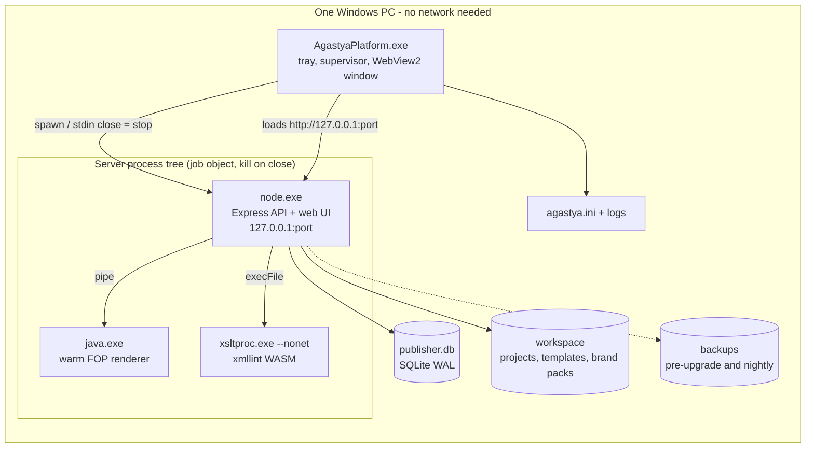
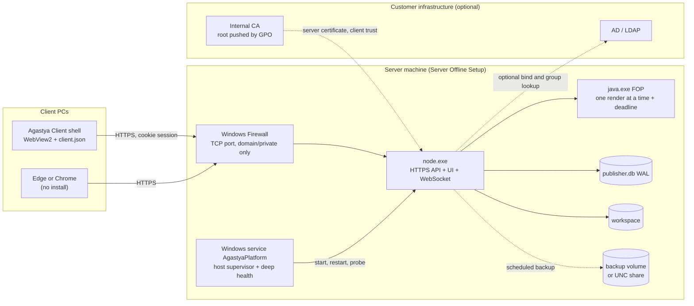
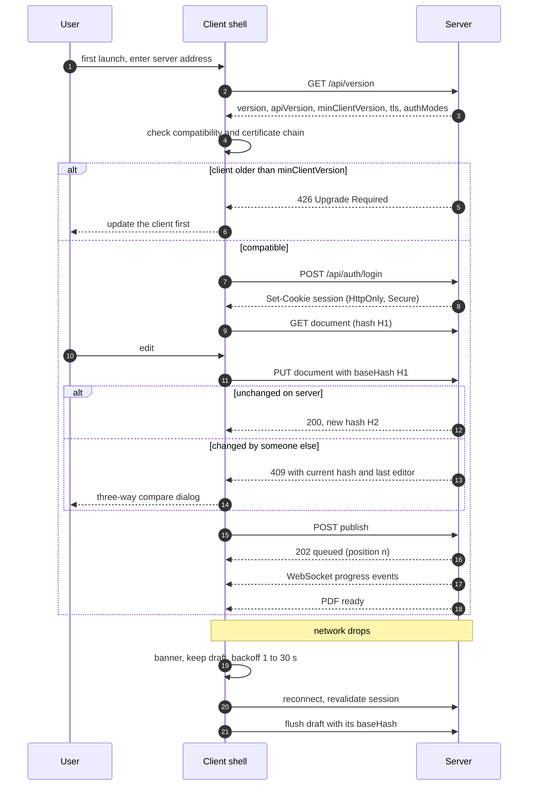
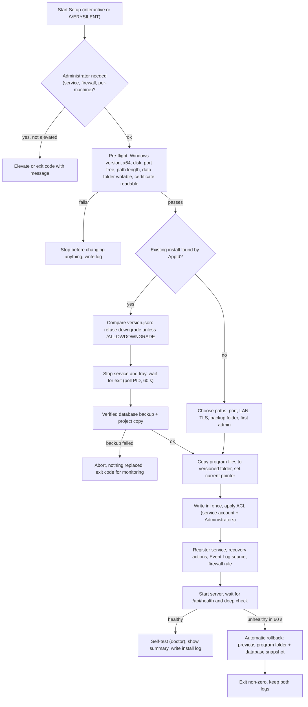
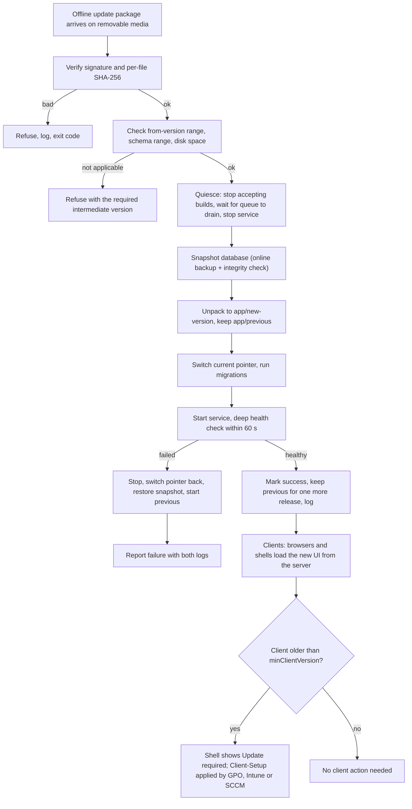
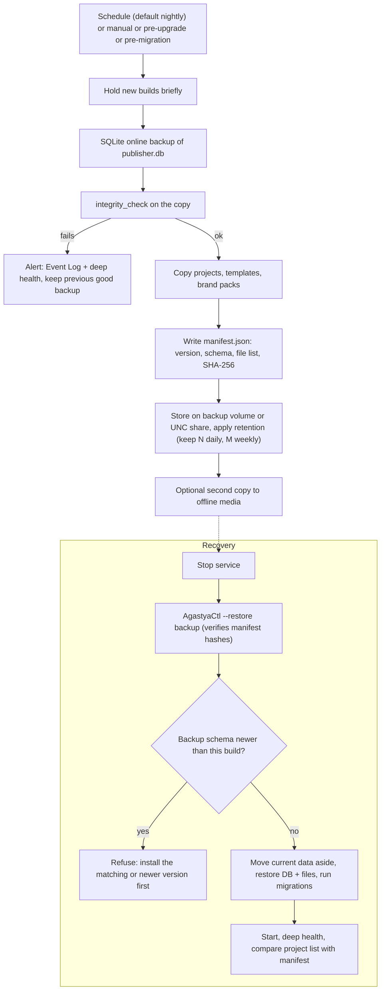

# 09 - Deployment, packaging, offline operation and the two target architectures

Audit agent F, finding prefix **DEP**. Audit only: no repository file was changed; the only files written are this report and scratch files.

**Scope and method.** Part 1 audits what exists today for packaging and operations (`scripts/package-windows.mjs`, `packaging/**`, `scripts/start.mjs`, `scripts/verify-*.mjs`, `scripts/signing/*`, `scripts/vm-acceptance/*`, `backend/scripts/{doctor,reset-admin}.js`, `backend/src/{config,index,app,context}.ts`, `backend/src/core/auth/{bootstrap,sessions}.js`, `backend/src/services/{backup,dbSnapshot,projectArchive}.ts`, `release/`, `docs/{PACKAGING,OPERATIONS,SIGNING,DATABASE_RESTORATION}.md`). Part 2 sweeps the source for anything that touches the network or external resources. Part 3 designs MODE A (standalone) and MODE B (client-server) with web research (sources are listed at the end; every external fact in the text carries a bracketed source number).

What I ran (all on scratch folders, port 4058 only, nothing on 4040/4041, nothing inside `workspace\`, no installer run, no service installed):

| # | Command / probe | Result |
|---|---|---|
| 1 | `scratch\F\scan-urls.mjs` over `backend/src`, `frontend/src`, `backend/vendor/{engine,pipeline}`, `backend/{schemas,templates,brex,samples,reference,assets}`, `frontend/public`, `frontend/dist` (every `http(s)://` classified) | no outbound client in `backend/src` (only `http.createServer`); every hit is a namespace id, schemaLocation id, DOCTYPE id, comment/doc text or a vendored library comment |
| 2 | `scratch\F\probe.mjs`: boot `backend/dist/index.js` (dev layout, NODE_ENV=production, scratch workspace, port 4058) with a Node `net/dns/dgram` trap preloaded, a TCP-table poll of the server's process tree and `JAVA_TOOL_OPTIONS` proxy sinkhole `127.0.0.1:1`; first admin through `POST /api/auth/setup`, an author, then S1000D sample publish, a JSS (land / `uhb`) project publish, a JSG sample build | boot to `/api/health` 2.6 s; listens on `:::4058` (all interfaces; AGASTYA_HOST unset); S1000D publish 200 in 9.8 s, PDF 463,901 B; JSS publish 200 in 4.5 s, PDF 550,547 B; JSG build **500** (DEP-011); Node trap: 0 non-local connect/dns/udp; TCP poll: 0 foreign connections (13 polls in ~28 s, coarse); `stdin` close shutdown 216-546 ms; working set node 150 MB + JVM 95 MB at idle (~245 MB), 166 + 271 MB after the S1000D publish, 196 + 402 MB (~600 MB) after the JSS publish and the failed JSG build |
| 3 | `release\...\AgastyaCtl.exe --doctor --home <scratch>` | exit 0, every check OK (Node v22.23.2, Java 21.0.13.1, port free, 159 GB free) |
| 4 | `Get-AuthenticodeSignature` on `release/*` | Setup.exe, AgastyaPlatform.exe, AgastyaCtl.exe, xsltproc.exe **NotSigned**; node.exe (OpenJS Foundation) and java.exe (Eclipse Foundation) **Valid** |
| 5 | `sha256sum release/...Setup.exe` vs `SHA256SUMS.txt` | equal (959ebb23...ee77) |
| 6 | bundled `java.exe` + FOP 2.10 CLI on three hand-made FO files with the proxy sinkhole | (a) `external-graphic src=url(http://...)`: FOP tries the URL ("Image not found. URI: http://offline-canary-a.invalid/x.png"); (b) local SVG whose `<image>` points at http: Batik 1.18 refuses ("not allowed for security reasons"); (c) SVG with an external DOCTYPE entity: no error, PDF written, **no evidence either way** |
| 7 | `xsltproc.exe --nonet` with the JSG engine's stylesheet argument built exactly as `engine.ts:78` builds it, from the probe's project folder | relative `../../..` path (272 chars with the cwd): "failed to load external entity"; the same stylesheet by absolute path: 3.8 MB FO written (DEP-011) |

Not run, and why: `verify-installer.mjs` and `scripts/vm-acceptance/*` (they install software / need Hyper-V and a Windows ISO; the brief forbids installers); `verify-package-offline.mjs` (uses ports 4070-4079 and a ~5-minute full workflow; outside my port range); `npm audit` (needs the registry). Their code was read in full and their claims are assessed below.

## Summary

* **What exists**: a competent single-machine Windows product (Inno Setup + C# tray/service host + Node/SQLite + bundled JRE, FOP and libxslt) with a genuinely instrumented offline test. The code has no outbound network client. In the one run that watched for connections (S1000D and JSS publishes, a failed JSG build) nothing left the machine, and the FOP tests ran behind a proxy sinkhole; that is evidence, not proof (the test host had a NIC and the watchers are coarse).
* **What blocks enterprise deployment today** (P1): unsigned binaries and a stale, unversioned release (DEP-003, DEP-004); upgrade data safety is best-effort and has no downgrade guard (DEP-001, DEP-002); the "database backup" cannot restore (DEP-008); bundled Node 22, FOP/Batik and libxslt have no patch process (DEP-005); LAN mode is plain HTTP and a per-machine install lets every local user modify the data folder (DEP-010, DEP-012); one hung renderer stalls every author while health stays green (DEP-028); the offline claim is proven for one format only (DEP-006); the concurrency model cannot support several authors safely (DEP-016).
* **Target**: ONE codebase. MODE A = the same server on loopback with a WebView2 launcher; MODE B = the same server as a Windows service with native TLS, a `/api/version` handshake, check-out and required version hashes, plus thin clients. Inno Setup stays the installer for all four artefacts; a signed offline update package with versioned program folders and automatic rollback replaces re-running Setup; an MSI is added only if a customer needs Group Policy software installation. Electron, Tauri and MSIX are rejected with reasons (section 5).
* **Findings**: 11 P1, 16 P2, 1 P3 (index below). No P0: nothing I found loses data by itself today, but DEP-001, DEP-002 and DEP-008 remove the safety net that would catch an operator mistake.

## Coverage table

| Area / path | Status | Verification done | Limits |
|---|---|---|---|
| `scripts/package-windows.mjs` | Inspected | read in full | not executed (it writes `release/`, which the brief forbids) |
| `packaging/installer/agastya.iss` | Inspected | read in full; behaviour inferred from code and from the VM script | installer never executed by me |
| `packaging/host/AgastyaHost.cs` | Inspected | read in full; the compiled `AgastyaCtl.exe --doctor` run | service/tray paths not executed |
| `packaging/{agastya.ini.template,product.json,assets,third-party}` | Inspected | read | - |
| `scripts/start.mjs`, `scripts/verify-installer.mjs`, `scripts/verify-package-offline.mjs` | Inspected | read in full; assessed for what they prove | not run (see above) |
| `scripts/signing/*`, `scripts/vm-acceptance/*` | Inspected | read in full | not run |
| `backend/scripts/{doctor,reset-admin}.js` | Inspected | read; the packaged host doctor run | `reset-admin.js` not run |
| `backend/src/{config,index,app,context}.ts`, auth bootstrap/sessions, `backup.ts`, `dbSnapshot.ts`, `projectArchive.ts` | Partially inspected | read the deployment-relevant parts; boot + API probe on 4058 | auth/RBAC internals belong to other agents |
| `release/` | Inspected (list only, signature and checksum read) | `ls`, `Get-AuthenticodeSignature`, `sha256sum` | contents of the staged tree sampled, not diffed |
| `docs/{PACKAGING,OPERATIONS,SIGNING,DATABASE_RESTORATION}.md` | Inspected | every claim cross-checked in code (table in section 2) | - |
| Offline sweep: `backend/src`, `frontend/src`, `frontend/index.html`, `frontend/public`, `vendor/engine`, `vendor/pipeline`, `schemas`, scripts | Inspected | URL scan + targeted greps for fetch/http/net/dns/spawn/nonet + runtime probe | `frontend/dist` scanned as text; browser behaviour not re-run (the repo's own Chrome log test was read, not run) |
| Third-party binaries (`node.exe`, JRE, FOP/Batik jars, `xsltproc` DLLs) | Partially inspected | versions read from the files, Authenticode status read | no binary analysis, no CVE scan of the 83 npm packages |
| Windows versions other than this machine (Server 2025) | Not inspected | - | NOT VERIFIED |

## Findings index

| ID | Pri | Evidence | Size | Title |
|---|---|---|---|---|
| DEP-001 | P1 | OBSERVED | S | The pre-upgrade database copy is best-effort and thin: a fixed 4 s wait, failure only logged, no retention, absent outside the installer |
| DEP-002 | P1 | VERIFIED | M | A newer database is opened silently by an older build, and the migration snapshot exists for one migration only |
| DEP-003 | P1 | VERIFIED | M | Every Agastya-built binary and the installer ship unsigned, and the signing workflow cannot meet current public-CA rules |
| DEP-004 | P1 | VERIFIED | S | Version identity is not managed: "2.0.0" is a literal, the build in `release/` is older than the source, and there is no version/compatibility endpoint |
| DEP-005 | P1 | OBSERVED | L | Bundled runtimes have no patch process and some sit inside published advisory ranges |
| DEP-006 | P1 | VERIFIED | M | "Works offline" is documented as a guarantee but proven only for one format, on a networked host |
| DEP-008 | P1 | VERIFIED | M | "Database backup" in the UI is not a restorable backup, and there is no scheduled or central backup |
| DEP-010 | P1 | VERIFIED | M | LAN mode serves login and session cookies over plain HTTP; the server has no TLS, no security headers and no version handshake |
| DEP-012 | P1 | OBSERVED | S | A per-machine install grants every local user Modify on the database and state folders |
| DEP-016 | P1 | OBSERVED | L | The concurrency model does not support several authors: optional version guards, one restrictive DM lock, no JSS/JSG check-out, last-writer-wins settings |
| DEP-028 | P1 | VERIFIED | M | A hung FOP JVM blocks every publish for every user, the health endpoint stays green, and nothing in the server or the host notices |
| DEP-007 | P2 | SUSPECTED | S | JSS image validation skips scheme-less authority paths (`//host/share/x.png`), which then reach FOP unchanged |
| DEP-009 | P2 | OBSERVED | S | After the supervisor gives up, the service keeps running and the Service Control Manager reports it healthy |
| DEP-011 | P2 | VERIFIED | S | The JSG build passes xsltproc a relative `..\..\` stylesheet path and fails in deep workspaces |
| DEP-013 | P2 | OBSERVED | M | No integrity check at start, no repair mode, checksums cover only two files |
| DEP-014 | P2 | OBSERVED | M | Enterprise rollout has no MSI, no GPO/SCCM/Intune recipe and no unattended first-admin or TLS configuration |
| DEP-015 | P2 | RECOMMENDATION | L | Identity is local-only: no AD/LDAP/OIDC hook, 7-day absolute sessions |
| DEP-017 | P2 | VERIFIED | S | SQLite is opened with no busy timeout and nothing prevents two server processes on one workspace |
| DEP-018 | P2 | VERIFIED | M | `node:sqlite` is still an experimental Node module, and the bundled runtime is not a stable pin |
| DEP-019 | P2 | OBSERVED | M | Windows support matrix is untested; x64 only; a 32-bit `xsltproc.exe` is in the critical path |
| DEP-020 | P2 | VERIFIED | S | No EULA is shown and the publisher metadata is a placeholder |
| DEP-021 | P2 | VERIFIED | S | Dead vendored code from the older Electron product ships in the install |
| DEP-022 | P2 | VERIFIED | S | `reset-admin.js` takes the new password on the command line |
| DEP-023 | P2 | OBSERVED | M | Program files are replaced in place; no versioned folders, so rollback is "reinstall the old Setup" |
| DEP-024 | P2 | RECOMMENDATION | S | No support bundle |
| DEP-025 | P2 | VERIFIED | S | The platform backup route buffers the entire archive in memory |
| DEP-027 | P2 | VERIFIED | S | The PDF recompression step is wired and offered in the UI, but the tool is not shipped, so the setting silently does nothing |
| DEP-026 | P3 | RECOMMENDATION | S | No SBOM and no reproducible-build record |

## 1. What exists today (verified inventory)

**Release artefacts** (`release/`, built 2026-11-22, **before** the JSS/JSG/cross-engine merges; `backend/dist` was rebuilt today 22:16): `Agastya-Platform-2.0.0-win-x64-Setup.exe` (71.6 MB, Inno Setup), `...-portable.zip` (100.3 MB), the staged folder (275 MB, 1,698 files, 83 npm packages, Node v22.23.2, JRE 21.0.13.1, FOP 2.10) and `SHA256SUMS.txt` (covers Setup and ZIP only). All of `release/` is git-ignored (`.gitignore`).

**Installed layout** (`AgastyaHost.cs:37-88`, `agastya.iss`): program folder `C:\Program Files\Agastya Platform` (never written to at run time); `state.dir` marker in the program folder points at the state folder (`C:\ProgramData\Agastya Platform`: `agastya.ini`, `logs\`); data (`publisher.db` + `projects\` + `templates\` + `backups\`) in `workspace\` there or at `DataDir`. Portable mode (`portable.flag`) keeps everything beside the exe.

**Host program** (C#, `csc.exe` of .NET Framework 4, C# 5, compiled at package time): `AgastyaPlatform.exe` (tray / `--service`) and `AgastyaCtl.exe` (`--console --doctor --status --start --stop --install-service --uninstall-service --quit --backup-db --version`). It parses `agastya.ini` (the Node server never reads the ini: the host turns it into the env contract `PORT, AGASTYA_HOST, AGASTYA_WORKSPACE_DIR, AGASTYA_CLIENT_DIST, AGASTYA_SECURE_COOKIES, AGASTYA_SHUTDOWN_ON_STDIN_CLOSE`, `AgastyaHost.cs:380-386`), supervises `node.exe` (backoff 1-30 s, gives up after >6 starts in 120 s, `:343-364`), puts it in a kill-on-close job object (`:275-313`) and stops it by closing its stdin (25 s grace, `:409-425`). Service: `sc create ... start= auto obj= "NT AUTHORITY\LocalService"`, `sc failure ... restart/5000/restart/30000/restart/60000` (`:537`), Event Log source `Agastya Platform` created only by `--install-service` (`:538`).

**Installer** (`agastya.iss`): per-machine by default (`PrivilegesRequired=admin`, override `/CURRENTUSER`), `ArchitecturesAllowed=x64compatible`, `MinVersion=10.0`, `AppId` GUID from `product.json`, tasks `service`, `lan`, `autostart`, `desktopicon`; wizard pages for data folder and port; switches `/DIR /DATADIR /STATEDIR /PORT /LAN /SVCNAME /NOSERVICE /TASKS /CURRENTUSER`; `PrepareToInstall` stops the running copy then runs `--backup-db`; post-install writes `agastya.ini` once (upgrades keep it, only explicit switches change it), `icacls` grants, one inbound firewall rule for `runtime\node.exe` on **private,domain** profiles, optional service registration; uninstall stops/removes the service and the rule and keeps data and config. Inno command-line semantics (`/VERYSILENT /SUPPRESSMSGBOXES /LOG /LOADINF /SAVEINF /DIR /NORESTART /CLOSEAPPLICATIONS /RESTARTEXITCODE`, exit codes 0-8) are as documented by the vendor [S1][S2].

**Verification tooling** (what each really proves, from the code):

| Script | Proves | Does not prove |
|---|---|---|
| `verify-installer.mjs` (28 checks) | silent **per-user** install into folders with spaces/non-ASCII, `state.dir`/ini/data placement, server answers, program folder not written to, same-package reinstall keeps ini+data and makes a DB copy, uninstall keeps data | the **service**, **firewall**, per-machine paths, reboot, LAN bind (all `/NOSERVICE`, loopback); an upgrade from a *different* version; anything about JSS/JSG. It also hard-codes `h.version === '2.0.0'` (`:96`) |
| `vm-acceptance/Test-InstallerInVm.ps1` (43 checks) | in a disposable Windows Server 2025 Hyper-V guest **with no NIC**: service as LocalService, auto start, firewall rule scope (private+domain, node.exe, TCP), reboot survival, same-package upgrade, uninstall cleanliness, loopback-only default, value-less switches over a kept ini, a real S1000D (`uhb` profile) PDF with bundled Java | other Windows versions; JSS/JSG; a real version-to-version upgrade; a downgrade; DB-migration across versions; anything under load. Not re-run since 2026-11-22 as far as I can tell (no logs at `%TEMP%\agastya-vmtest`) |
| `verify-package-offline.mjs` (37 checks) | static scan of the web client; four instruments each proven by a canary (Node preload for connect/dns/udp, JVM proxy trap, OS TCP-table poll of the product's processes, Chrome request log with name resolution disabled); portable ZIP boot; read-only program folder; first admin, author, sample S1000D publish, subset S1000D import, validation, gated publish + waiver, 7 web pages | **one** run on a **networked** machine (absence of observed traffic, not inability to connect); S1000D only (no JSS, JSG, cross-engine, RWI, archive, brand pack); `xsltproc.exe` DNS lookups that fail leave no TCP trace; polling at 250 ms misses short connections (TIME_WAIT shows owner 0); `dns.resolve*`, `child_process` of non-Node tools and non-HTTP JVM sockets are outside the Node trap; the `@src` URL vector (DEP-007) is not exercised |

## 2. Documentation claims versus the code

| Claim (doc) | Verdict | Evidence |
|---|---|---|
| "never contacts the internet when it runs ... no telemetry or update check" (PACKAGING 1, OPERATIONS 11) | **Mostly true.** No HTTP/WebSocket client, DNS call or update/licence check exists in `backend/src`; the browser code only calls same-origin `fetch`/`WebSocket`/`Worker`. One gap: FOP will fetch an `http:` image URL that reaches the FO unchanged (DEP-007) | Part 2 |
| every xsltproc call passes `--nonet` (`xmlGuard.js:88`) | **True**: `build.js:480,497,668`, `validateXml.js:47`, `jsg/engine.ts:88` | grep |
| program folder "never written to at run time" | Plausible, **tested by the scripts** (manifest before/after) and consistent with the code; not re-run by me | `verify-installer.mjs:93,107` |
| service restarts the server, gives up after six stops in two minutes, "which it logs" | True (an Error entry goes to the host log and the Windows Event Log), but **after giving up the service process keeps running, so the SCM shows RUNNING and its own recovery actions never fire** (DEP-009) | `AgastyaHost.cs:350-355`, `:466-489` |
| "Before every upgrade the installer copies `publisher.db`" | True only if the server has stopped within a fixed 4 s; otherwise the copy is skipped and **Setup continues** (DEP-001) | `agastya.iss:298-332`, `AgastyaHost.cs:827` |
| "Back it up ... or use the application's own Backup page" (OPERATIONS 7) | **Misleading**: the page produces a ZIP of project files plus users/members/audit JSON, not the database, and nothing can restore it (DEP-008) | `backup.ts:28-65`, `Administrator.tsx:232-234` |
| "go back: uninstall, install the older version, put `publisher.db` back" | A manual procedure, **never exercised by any script**; nothing stops an older build from opening a newer DB (DEP-002) | `backend/src/core/auth/store.js:644-671` |
| "43 checks at the time of writing" (VM test) | True (43 `Check` calls) | `Test-InstallerInVm.ps1` |
| `db.js` comment "node:sqlite (built into Node 24)" | **Stale**: the product ships Node 22.23.2; the module still prints `ExperimentalWarning: SQLite is an experimental feature` on boot (seen in the probe log) | `vendor/engine/db.js:9`, probe log |

## 3. Part 2 - Offline audit

### 3.1 Method

1. `scan-urls.mjs` walked every text file (xsl, xsd, xml, js, ts, tsx, html, json, svg, css, cs, iss, ps1, java ...) of the trees below and classified each `http(s)://` occurrence by the characters in front of it (`xmlns=`, `schemaLocation=`, `DOCTYPE PUBLIC/SYSTEM`, `href|src=`, comment, other). The "other" bucket was then opened and read for the interesting hosts.
2. Targeted greps for every way a process can leave the machine: `fetch(`, `http(s).request/get`, `net.connect`, `net.createConnection`, `dns.*`, `new WebSocket(`, `axios|node-fetch|undici`, `ServerSocket|DatagramSocket` (Java), and every `spawn/execFile` (what binaries run, with which flags).
3. Runtime probe on port 4058 (the table in the Scope section, rows 2, 6 and the product-level `@src` tests below): Node `net/dns/dgram` preload trap, JVM proxy sinkhole, process-tree TCP poll, a product-level test of an author-controlled image URL, and three FOP/Batik tests with the bundled JRE.

### 3.2 Classification of every network-looking string

| Tree (files scanned) | Distinct hosts | What the hits are | Class | Runtime network? |
|---|---|---|---|---|
| `backend/src` (160) | 7: w3.org, s1000d.org, purl.org, localhost, example.com, schemas.openxmlformats.org | XML namespace URIs the code matches or writes (`services/applicability.ts:246`, `jsg/docx.ts:14`); `xsi:noNamespaceSchemaLocation` text written into generated DMs; DOCTYPE/entity ids named in the guard (`core/auth/xmlGuard.js:15`); `http://localhost:5174` = dev CORS origin (`app.ts:54`); `example.com/ns/ext` in an example (`services/extensions.ts:44`) | namespace id / identifier text / dev origin | **No.** No `fetch`, `http(s).request/get`, `net.connect`, `dns.*`, `WebSocket(` client or HTTP library exists in `backend/src` or `vendor/engine` (grep returned nothing; only `http.createServer`) |
| `frontend/src` (226) | 4: w3.org, s1000d.org, purl.org, example.com | namespaces and `schemaLocation` text for the Studio's generated S1000D | identifier text | **No.** Only same-origin `fetch('/api/...')`, same-origin `ws(s)://<host>/ws`, workers/WASM from `new URL(..., import.meta.url)` (`public/vendor/xmllint`, `pdf.worker`). `index.html` has no `<script src=http>`/`<link href=http>`; its icon is a `data:` URI (`index.html:8`) |
| `frontend/public` (313) | 9 | the xmllint WASM payload and bundled XSD copies: namespaces, `<xs:documentation>` anchors (`href="http://www.w3.org/TR/REC-xml"`, `xml.xsd:19-21,64`), licence comments (`tug.org`) | identifier / documentation text | No (read by humans, never resolved) |
| `frontend/dist` (337) | 45 | the Vite bundle: library licence and comment URLs (pdfmake.org, tc39.es, stackoverflow, github, reactjs.org, mathiasbynens ...) plus the namespaces above | comment/doc text | **No.** Comments in bundled libraries; the repo's own `verify-package-offline.mjs` greps the built client for URLs in code position and drives Chrome with host resolution disabled (read, not re-run) |
| `backend/vendor/engine` (31) | 2 | namespaces, DOCTYPE ids in `xmlGuard` style checks | identifier | No |
| `backend/vendor/pipeline` (61, the XSLT) | 3: w3.org (47 files, 95 ns), s1000d.org (4 `schemaLocation`), exslt.org | `xmlns:` declarations; `schemaLocation` text emitted into output | namespace id | **No fetch by xsltproc**: every call passes `--nonet` (`build.js:480,497,668`, `validateXml.js:47`, `jsg/engine.ts:88`); the DOCTYPE guard refuses external subsets before xsltproc sees the file |
| `backend/schemas` (247) | 8 | 924 `xmlns`/`targetNamespace`; `xml.xsd` documentation text (including an escaped example `&lt;import ... schemaLocation="http://www.w3.org/2009/01/xml.xsd"/>` inside a `<pre>`, `4.2/xml.xsd:217`); OASIS/TUG/IEEE/IANA/RFC links in comments | namespace / doc text | **No.** The one real http import was rewritten to local `xml.xsd` on 2026-11-16 (`schemas/PROVENANCE.md:102-105`); a grep for `schemaLocation="http` now returns only the five escaped documentation examples |
| `backend/{templates,brex,samples,reference,assets}` (25) | 3 | namespaces and `schemaLocation` text inside sample DMs/BREX | identifier | No |
| `scripts/`, `packaging/` (23) | 11 | `github.com`/`ftp.gnu.org`/`gnu.org`/`fsf.org`/`jrsoftware.org` in licence and comment text, `schemas.microsoft.com` (a .NET manifest namespace), `127.0.0.1`/`localhost` health probes, `offline-canary.invalid` (the canary host of the offline test), `timestamp.example` (signing doc) | build-time/doc, loopback, canary | Not in the shipped product. `package-windows.mjs` itself calls no network: it copies the installed `node_modules` and requires Inno Setup and `csc.exe` already present |

Other runtime surfaces checked:

| Surface | Evidence | Result |
|---|---|---|
| Processes the product starts | `execFile`/`spawn` only at `jsg/engine.ts:37` (xsltproc), `vendor/engine/build.js:61` (xsltproc), `fopd.js:49` (java, `FopServer`, pipe-driven; no `ServerSocket`/`DatagramSocket` in `FopServer.java`), `validateXml.js:47`, and `lemminx.js:58` (dead: its JAR is not shipped, nothing imports it) | no helper opens a listening port; only the Node server listens |
| Updater, telemetry, licence check | none in `backend/src`; `vendor/engine/license.js` (Ed25519 licence verification with a baked-in `DEFAULT_PUBLIC_KEY`, `:22`) is **not imported** by `backend/src` | none (see DEP-021 for the dead code) |
| xmllint | `xmllint-wasm` with schemas preloaded from local files; WASM served by the server | local only |
| Node runtime flags | the host passes no `--experimental-*` flag and sets no proxy variable (`AgastyaHost.cs:380-386`) | no outbound |
| JRE | jlink image with `java.base`, `java.datatransfer`, `java.xml`, `java.prefs`, `java.desktop`, `java.logging`. `java.net.http` is absent, but `java.base` still contains the `http:`/`https:`/`ftp:`/`file:` URL handlers, so **FOP can fetch an image URL** (test 6a). Removing modules is not a network control | see 3.3 |
| Bound address | packaged host sets `AGASTYA_HOST` from `agastya.ini` (`AgastyaHost.cs:382`; default loopback). Source/dev start with `AGASTYA_HOST` unset listens on `:::4058` (all interfaces; **VERIFIED** in the probe) | loopback by default in the product, all interfaces when started with `node dist/index.js` |

### 3.3 The one place a URL can reach a fetcher: author-controlled image paths

FOP resolves `fo:external-graphic src="url(...)"`. The XSLT pipelines emit the author's value unchanged: `vendor/pipeline/jsstofo/**/figures.xsl:191,228`, `frontmatter.xsl` (many lines), `s1000dtofo/**/figures.xsl:264,313,321`; the JSS schema types it `xs:string` (`schemas/jss/jss-1.0.xsd:204`).

| Test (all with the JVM proxy sinkholed to 127.0.0.1:1, nothing left the machine) | Result |
|---|---|
| 6a FOP CLI, FO with `url(http://offline-canary-a.invalid/x.png)` | **VERIFIED**: FOP attempts the URL ("SEVERE: Image not found. URI: http://offline-canary-a.invalid/x.png"); the page still renders |
| 6b SVG whose `<image href="http://...">` is rendered by FOP/Batik 1.18 | **VERIFIED**: refused by Batik ("references a external resource ... not allowed for security reasons") |
| 6c SVG with an external DOCTYPE entity | **NOT VERIFIED either way** (no error, PDF written; no capture tool to see an attempt) |
| Product route: JSS `PUT /api/projects/:id/jss` with `<graphic src="http://offline-canary-f.invalid/pic.png"/>`, then `POST .../publish` | **VERIFIED blocked**: the save is accepted (200, 1 error reported) and the publish gate refuses with 422 `JSS-GRAPHIC-MISSING` (`services/jss/service.ts:297`) |
| Same route, `<graphic src="//offline-canary-f.invalid/share/pic.png"/>` | **VERIFIED passes**: the check at `jss/service.ts:297` skips every `src` starting with `..`, `/` or `<letter>:`; the publish returned 200 and the generated `jss-output.fo` contains `url('//offline-canary-f.invalid/share/pic.png')`. FOP CLI with the same string logs "Image not found" |
| Does Windows then contact `\\offline-canary-f.invalid\share`? | **NOT VERIFIED** (needs a packet capture on a lab VM; see DEP-007). A `C:/...` drive path in `url()` is reported "Image not found" by FOP (test 6, `f.fo`), so the local-file variant was not usable in that form |
| S1000D (`ICN`/`infoEntityIdent`) and JSG image references | **NOT VERIFIED** (not exercised) |

Conclusion: no build was shown to make a network connection. One validator gap (scheme-less `//host/...`) lets a string that can name a UNC path or URL reach FOP; the consequence on a real Windows host is unproven. Filed as **DEP-007 (P2, SUSPECTED)**.

### 3.4 What is and is not proven offline

| Claim | Status | Basis |
|---|---|---|
| The code contains no outbound HTTP/DNS/socket client (Node) | **VERIFIED** (code) | grep over `backend/src` and `vendor/engine`; only `createServer`/listening |
| The browser client makes no third-party request | **OBSERVED** | static scan above; the repo's Chrome request log test was read, **not run by me** |
| xsltproc never fetches | **VERIFIED** (code) + OBSERVED | `--nonet` on all 4 call sites. The DOCTYPE text guard is **not** a reliable second layer: a decoy comment bypasses it (SEC-001, VERIFIED by agent S). A runtime trap on a child process was not possible |
| FOP/Batik never fetch | **PARTLY** | FOP fetches `http:` image URLs (6a); the product validator blocks `http:` for JSS (VERIFIED) but not `//host/...` (DEP-007); **the publisher-logo field is not validated at all and makes FOP fetch URLs during every build, and no egress is blocked (SEC-003, VERIFIED by agent S: SSRF)**; S1000D/JSG routes not exercised |
| A full workflow ran with no connection | **NOT PROVEN** | `verify-package-offline.mjs` runs on a networked host and observes silence (S1000D only, see the verification-tooling table in section 1); my probe likewise (host has a NIC). The VM harness has no NIC but runs one S1000D publish only and has no recorded run |
| A machine with no NIC can install and run every format | **NOT PROVEN** | JSS, JSG, cross-engine, RWI, archive import/export, brand packs, docx/ODT export were never run inside the no-NIC guest |
| Installer needs no prerequisite download | **OBSERVED** | Node, JRE, FOP, libxslt and the web client are all inside the Setup; the host is compiled against .NET Framework 4, which Windows 10 and later include (not checked on every build) |

### 3.5 Air-gapped test strategy (what "proven offline" should mean)

Goal: show that the product installs, runs, upgrades and uninstalls with **no network path of any kind**, and that if something tries, it is seen.

| Layer | Setup | Pass criterion |
|---|---|---|
| Machine | Hyper-V Gen2 VM, **no virtual NIC** (the existing `New-TestVm.ps1` already does this), clean Windows 10 22H2, Windows 11 and Server 2022/2025 checkpoints, never domain-joined, no WebView2/.NET extras beyond the OS image | VM has no adapter in `Get-NetAdapter`; `Test-NetConnection 1.1.1.1` fails |
| Second variant | same VM **with** a private-switch NIC to a "sink" VM: firewall deny-all outbound (`netsh advfirewall set allprofiles firewallpolicy blockinbound,blockoutbound` plus an allow rule for loopback only), the sink answers every DNS name (dnsmasq-style wildcard) and every TCP port with a logger | sink log is empty; this variant catches attempts that a missing NIC would hide (DNS lookups, SMB) |
| Capture | `pktmon start --capture` (built into Windows 10/11/Server 2022+) on the sink side, or Wireshark/`dumpcap` on the Hyper-V switch; Process Monitor filtered on `Operation is TCP/UDP Connect|Send` and `Path contains \\` (SMB/UNC) for `node.exe`, `java.exe`, `xsltproc.exe`, `AgastyaPlatform.exe`, `Setup*.exe`, `msedgewebview2.exe` | zero packets with a non-loopback destination during install, first run, all workflows, upgrade and uninstall |
| Workload | one script that drives all formats through the real API and UI: first admin; S1000D sample publish; subset import; BREX/validate; JSS Land + Naval (every type); JSG sample build; cross-engine import/convert; project archive export/import; brand pack; DOCX/ODT export; revisions/compare; backup; waiver; PDF open in the built-in viewer; 20 minutes idle with the service running | all steps pass |
| Canaries | author documents with `http://`, `https://`, `//host/share/` and `file://host/` image sources, an SVG with external href/entity, a DOCTYPE with SYSTEM id, an `xsi:schemaLocation` pointing to a dead host | each is refused or ignored **and** produces no packet; any attempt fails the run |
| Integrity | hash the whole install tree before and after the workload (the existing `verify-installer.mjs` manifest check, extended to every file) | no byte under the program folder changes |
| Repeat | after upgrade from the previous release, and with the service stopped/started | same criteria |

Implementation note: the harness exists (`scripts/vm-acceptance/`); the work is to extend its smoke workload to all formats, add the sink variant and the capture, and keep the last run's log in `release/` next to `SHA256SUMS.txt` as the proof artefact. Estimate: M.

## 4. Findings

Order: P1 first, then P2/P3. Cross-references to other agents' IDs (PLT-xxx) come from the coordinator's leads and were not re-verified by me unless stated.

### DEP-001 · P1 · OBSERVED · S · The pre-upgrade database copy is best-effort and thin: a fixed 4 s wait, failure only logged, no retention, absent outside the installer

**Category** Data safety / upgrade.
**Problem** The only safety net before a schema migration is a file copy that can be skipped without the operator knowing, and it covers only `publisher.db`.
**Evidence**
- `packaging/installer/agastya.iss:298-309` `StopRunningCopy` runs `--stop`, `--quit`, then `Sleep(4000)`; `:323-324` runs `AgastyaCtl --backup-db` and, on a non-zero exit, only `Log(...)`; `PrepareToInstall` (`:327-332`) never returns an error, so **Setup continues to overwrite the program files and the next start runs the migrations with no copy**.
- `packaging/host/AgastyaHost.cs:827` refuses to copy when anything answers on the port (`Probe.Alive`); the host itself allows the server 25 s to stop (`:419`), so a build in flight at upgrade time can outlast the 4 s.
- `:830-836` copies `publisher.db`, `-wal`, `-shm` into `<data>\backups\pre-upgrade-<ver>-<time>` on the **same volume**; no retention, no verification (`PRAGMA integrity_check`), no copy of `projects\`.
- A source / `node dist/index.js` / portable-ZIP upgrade has no such step at all (`scripts/start.mjs` does not back up) (coordinator lead 1; consistent with my reading).
- The VM harness only exercises the same-package upgrade (`Test-InstallerInVm.ps1`), not the "server still running" or "copy failed" paths.
**Current implementation** Copy by the C# host before files are replaced, verified only on the happy path.
**Recommendation** Make the backup a precondition: wait for the server process to exit (poll the port and the PID, up to 60 s), take a consistent copy with SQLite's online backup (`node:sqlite` `backup()` exists in the bundled Node 22.23.2: I confirmed `typeof require('node:sqlite').backup === 'function'` with `release/.../runtime/node.exe`, and the Node docs list it since v22.16.0 [S3]) or `VACUUM INTO` as `dbSnapshot.ts` already does, run `PRAGMA integrity_check` on the copy, and **abort Setup (return text from `PrepareToInstall`) when it fails**, with an explicit "continue without backup" only for `/SUPPRESSMSGBOXES` runs that pass `/SKIPBACKUP`. Keep the last N copies and show their path in the final page and in the log.
**Expected outcome** No upgrade can reach the migrations without a verified copy; operators can restore in minutes.
**Dependencies** DEP-002 (in-app snapshot per migration), DEP-008 (real backup), PLT-006.
**Risks** Aborting Setup on a locked DB may block unattended rollouts; mitigate with the explicit skip switch and an exit code (Inno 8 or a custom code) that SCCM/Intune can alert on.
**Acceptance criteria** Setup refuses (non-zero exit, log line) when the copy fails; a copy exists, passes `integrity_check`, and is listed after every upgrade; last 5 kept.
**Test cases** (1) upgrade with a publish running; (2) read-only `backups\`; (3) disk with < DB size free; (4) corrupt `-wal`; (5) silent upgrade with `/SKIPBACKUP`.

### DEP-002 · P1 · VERIFIED · M · A newer database is opened silently by an older build, and the migration snapshot exists for one migration only

**Category** Data safety / rollback.
**Problem** There is no schema-version check, so "install the older version" (the documented rollback, `OPERATIONS.md`) lets an old build open and write a database a newer build already migrated. And the snapshot taken before a migration is hard-coded to migration 016.
**Evidence** `backend/src/core/auth/store.js:644-671` `migrate()` builds the set of applied names and **skips** those; names it does not know are never inspected, there is no `PRAGMA user_version`, no max-known-migration comparison, no refusal. `backend/src/context.ts:74`: `snapshotBeforeMigration(sqlite, workspaceDir, '016-s1000d-reference', nowIso())`, so the other 18 of the 19 migrations (`store.js` `MIGRATIONS`, 001...019, including 017-019) run with no `VACUUM INTO` copy (coordinator lead 1, PLT-006). `/api/health` does not report a schema version (`app.ts:65-66`).
**Current implementation** Additive named migrations, each in its own transaction with rollback (good), but unversioned and unguarded.
**Recommendation** (a) At boot compare `schema_migrations` with the build's `MIGRATIONS`: if the database holds a name this build does not know, **refuse to start** with a message naming both versions; (b) generalise `snapshotBeforeMigration` to "before the first pending migration", every time; (c) store the program version that last migrated the DB; (d) expose `schemaVersion` and `minClient` in a new `/api/version` (see DEP-004).
**Expected outcome** Rollback is either safe or impossible-by-design; every migration has a restore point.
**Dependencies** DEP-001, DEP-004, PLT-006.
**Risks** Developers who run two branches against one workspace will hit the guard (intended; provide `--allow-newer-db` for tests only).
**Acceptance criteria** Starting build N-1 on a DB migrated by N exits non-zero with a clear message and logs it; a pending migration always leaves `backups\pre-migrate-<name>-<time>.db`.
**Test cases** Boot with a DB that has an unknown migration row; boot with one pending migration and assert the snapshot file; fail a migration and restore from the snapshot.

### DEP-003 · P1 · VERIFIED · M · Every Agastya-built binary and the installer ship unsigned, and the signing workflow cannot meet current public-CA rules

**Category** Release engineering / enterprise trust.
**Problem** Windows SmartScreen, AppLocker/WDAC publisher rules, and many AV products treat unsigned installers and service executables as untrusted; an unsigned `xsltproc.exe` and a self-built service host are the typical false-positive triggers.
**Evidence** `Get-AuthenticodeSignature` on `release/`: `Agastya-Platform-2.0.0-win-x64-Setup.exe`, `AgastyaPlatform.exe`, `AgastyaCtl.exe` and the bundled `xsltproc.exe` are **NotSigned**; `node.exe` (OpenJS Foundation) and `java.exe` (Eclipse Foundation) are Valid. `package-windows.mjs` signs only if `AGASTYA_SIGN_CMD` is set. `scripts/signing/Sign-File.ps1:15` documents that by default the signature is **not timestamped**, so it stops being valid at certificate expiry; it needs a `.pfx` file and the password in `AGASTYA_SIGN_PASSWORD`. `docs/SIGNING.md` states SmartScreen, GPO and Intune behaviour were not verified. Since 1 Mar 2026 publicly trusted code-signing certificates may be valid for at most 460 days and keys must be on hardware [S21][S22], so a `.pfx` on a build box is only valid with an internal CA.
**Current implementation** Optional signing hook, internal-CA helper scripts, no signed release ever produced.
**Recommendation** Decide the trust model per customer: (1) internal CA (distribute the root by GPO/Intune, sign with a timestamp server reachable on the build machine only), or (2) a public OV/EV certificate in an HSM or a cloud signing service. Sign **all** first-party PE files (host exes, installer, uninstaller via `SignedUninstaller=yes`, the 32-bit `xsltproc.exe` rebuilt or re-signed by you) and timestamp every signature. Fail `package:win` when the signature check fails in release mode.
**Expected outcome** Installer opens without a SmartScreen "unknown publisher" wall; WDAC/AppLocker publisher rules are possible; fewer AV quarantines.
**Dependencies** DEP-004 (release process), customer PKI.
**Risks** Certificate cost and HSM logistics; re-signing third-party DLLs changes nothing for their own signatures.
**Acceptance criteria** `Get-AuthenticodeSignature` returns Valid with a timestamp for every first-party PE in the Setup and the install tree; `Test-Signature.ps1` is a gate in the release script.
**Test cases** Fresh Windows 11 download via browser (Mark-of-the-Web) -> no SmartScreen block; AppLocker publisher rule allows only the signed exes; AV scan of the Setup on 3 engines.

### DEP-004 · P1 · VERIFIED · S · Version identity is not managed: "2.0.0" is a literal, the build in `release/` is older than the source, and there is no version/compatibility endpoint

**Category** Release engineering / support.
**Problem** Nobody (installer, support, a future client) can tell which build is running. Two different builds both report 2.0.0, and the Setup in `release/` predates the JSS, JSG and cross-engine merges.
**Evidence** `backend/src/app.ts:66` returns the literal `version: '2.0.0'`; root `package.json` is 2.0.0 and was never bumped; `scripts/verify-installer.mjs:96` asserts `h.version === '2.0.0'` (a hard-coded pass criterion); `release/Agastya-Platform-2.0.0-win-x64-Setup.exe` is dated 22 Nov 19:18 and `version.json` says built 2026-11-22T13:46:56Z while `backend/dist` was rebuilt on 26 Nov 22:16 (after the 24-26 Nov merges recorded in the project memory). `SHA256SUMS.txt` matches the Setup (checked), so the artefact is intact but old. Inno `AppVersion` comes from the same string, so an "upgrade" from a build to a different build of 2.0.0 looks like a same-version reinstall.
**Current implementation** One manually maintained number in several places, no build id, no API version, no minimum client version.
**Recommendation** Single source of truth: `version.json` generated at package time with `semver+gitsha`, read by the host (`Layout.Version`), by `/api/health` and a new `/api/version` returning `{ version, build, apiVersion, schemaVersion, minClientVersion }`, and by the Inno `AppVersion`/`VersionInfoVersion`. Bump per release; make `verify-installer` read the expected value from the package. Rebuild and sign `release/` before any customer drop.
**Expected outcome** Detectable upgrades/downgrades, a usable compatibility handshake (MODE B), accurate support tickets.
**Dependencies** DEP-002, DEP-003, the MODE B design (section 5).
**Risks** None technical; process discipline.
**Acceptance criteria** `/api/version` agrees with the exe's file version, the Add/Remove Programs entry and `version.json`; CI fails when they differ.
**Test cases** Build twice from different commits and compare; install over an older build and read `DisplayVersion`.

### DEP-005 · P1 · OBSERVED · L · Bundled runtimes have no patch process and some sit inside published advisory ranges

**Category** Supply chain / security maintenance.
**Problem** The installer freezes Node, a JRE, FOP/Batik and libxslt for the life of the install; an offline customer cannot `npm update` or run Windows Update for them.
**Evidence** Versions read from the shipped files: Node **v22.23.2** (`release/.../runtime/node.exe -v`), JRE Temurin **21.0.13.1** (`--doctor` output "openjdk version 21.0.13.1 2026-11-17 LTS", current), FOP **2.10** / Batik **1.18**, `xsltproc --version` = libxml **2.9.3**, libxslt **1.1.28** (2013-era). Node 22 left active support on 21 Oct 2025 and reaches end of life **30 Apr 2027**; latest 22.x is 22.23.5 (11 Nov 2026) [S4]. Apache lists FOP advisories CVE-2026-126627 (temporary files readable by other local users) and CVE-2026-71395 (unsafe deserialisation in hyphenation loading) as affecting "through 2.11.0" (covers 2.10), and FOP 2.12 was released 20 Oct 2026; Batik 1.20 fixes a batch of SSRF/XXE/DoS issues "through 1.19.0" (covers 1.18) [S14][S15]. libxslt/libxml2 lost their upstream maintainers in 2025 and only distro builds carry fixes for known CVEs against 1.1.28 [S16][S17]. `FopServer.java` uses the default `FopFactory`/Batik settings. Applicability of each CVE to this product's code paths was **not** tested; the product feeds FOP only XSLT output generated from validated DMs plus author-chosen images.
**Current implementation** Pinned versions in `backend/vendor`, third-party notices generated, no update record, no SBOM, no scheduled review.
**Recommendation** (1) Plan Node 24 LTS (EOL 30 Apr 2028 [S4]) before April 2027 and track 22.x patch releases meanwhile; (2) upgrade FOP to 2.12 and Batik to 1.20 and re-run the PDF golden tests; (3) replace libxslt 1.1.28 either with a patched build (an in-house rebuild of 1.1.4x/libxml2 2.1x for win32/x64) or by moving XSLT in-JVM (JDK XSLTC / Saxon-HE) behind golden-PDF regression tests - note the S1000D/JSS stylesheets use EXSLT, so test coverage must prove equivalence first; (4) publish an SBOM (CycloneDX) with each release and a quarterly patch window with a "Offline Update" package (artefact 4).
**Expected outcome** A documented, repeatable way to ship security fixes to air-gapped sites.
**Dependencies** DEP-006 (golden tests), DEP-018 (`node:sqlite`).
**Risks** Layout drift in PDFs after FOP/XSLT changes; the largest cost item here.
**Acceptance criteria** `scripts/` prints a "bundled components" table with version, release date and advisory status; no component older than its vendor support window at release time.
**Test cases** Golden-PDF comparison of the sample S1000D, JSS (Land+Naval) and JSG outputs before/after each bump; `npm audit --omit=dev --offline` with a cached advisory database (not run by me).

### DEP-006 · P1 · VERIFIED · M · "Works offline" is documented as a guarantee but proven only for one format, on a networked host

**Category** Verification / offline operation.
**Problem** The product promise is air-gapped operation; the evidence behind it is narrower than the claim.
**Evidence** Section 1 table and section 3.4: `verify-package-offline.mjs` observes absence of traffic on a host that has a NIC, for S1000D only; the Node trap misses `dns.resolve*` (my probe's trap had to add `resolve4` by hand) and traffic of non-Node children; the TCP poll is 250 ms and misses short connections; the VM harness (no NIC) runs a single S1000D smoke publish and has **no recorded run** in this checkout; JSS/JSG/cross-engine/archive/brand/export workflows were never executed in a no-NIC guest. `verify-installer.mjs` hard-codes the 2.0.0 version (DEP-004).
**Current implementation** Good instruments and honest scripts, narrow workload.
**Recommendation** Implement the strategy in section 3.5, add a wildcard-DNS "sink" variant, store the capture and the run log with each release, and run it on every release candidate.
**Expected outcome** "Offline" becomes a measured, repeatable property with a stored proof.
**Dependencies** DEP-004, DEP-007.
**Risks** Hyper-V and a Windows evaluation image are required on the build side (already the case for the VM harness).
**Acceptance criteria** One run covers all formats and the canary documents of 3.5 with zero non-loopback packets and an unchanged install-tree hash; its log is archived next to `SHA256SUMS.txt`.
**Test cases** As in 3.5.

### DEP-008 · P1 · VERIFIED · M · "Database backup" in the UI is not a restorable backup, and there is no scheduled or central backup

**Category** Data safety / operations.
**Problem** The Administrator page offers "Database backup - a ZIP of every project, the people and the activity log" (`frontend/src/pages/Administrator.tsx:232-234`), and OPERATIONS.md points to it. It cannot restore the platform.
**Evidence** `backend/src/services/backup.ts:28-65` writes: each project's files, the CIR folder, and for admins `platform/users.json` (no password hashes, by design), `members.json`, and `audit-log.json` **limited to 5,000 rows** (`store.listAudit({ limit: 5000 })`). It does not contain `publisher.db`, the registry rows, comments, package settings, revisions or waivers held in the DB. A grep of `backend/src` finds the only consumer of `writeBackup` is `GET /api/backup` (`routes/team.ts:132-141`): **no route reads this ZIP back** (`restoreProjectArchive` reads the different `.jsspub.zip` project archive). The route also buffers the whole archive in memory before sending (`team.ts:137-140`; DEP-025). The Inno uninstaller keeps the data, but nothing schedules a copy of it.
**Current implementation** A manual content export; the DB is protected only by the installer copy (DEP-001).
**Recommendation** Add a real backup: (a) a nightly service job that takes a consistent SQLite online backup plus a copy of `projects\`, `templates\` and the brand packs into `<backupDir>` with retention and a manifest + SHA-256 per file; (b) an `AgastyaCtl --backup <dir>` and `--restore <backup>` pair (server stopped, integrity check, DB schema guard from DEP-002); (c) rename the UI card to "Export content" unless it is made restorable; (d) in MODE B a configurable backup folder on another volume/UNC share.
**Expected outcome** A documented recovery that an administrator can rehearse.
**Dependencies** DEP-001, DEP-002, the backup flow (section 6, diagram 6).
**Risks** Backing up while projects are built: use quiesce (hold the build queue) or SQLite online backup plus per-file copy with a manifest.
**Acceptance criteria** Restore of a backup into a clean install reproduces the project list, members, comments and revisions byte-for-byte for a sample workspace (compare a manifest of SHA-256).
**Test cases** Full cycle: back up, wipe, restore, diff; restore on a machine with a different data path; restore of a backup made by version N into N+1.

### DEP-010 · P1 · VERIFIED · M · LAN mode serves login and session cookies over plain HTTP; the server has no TLS, no security headers and no version handshake

**Category** Security of the server mode.
**Problem** `/LAN` (installer) and `Bind=lan` (ini) make the server reachable from the network, and the only transport is HTTP: passwords, session cookies and documents cross the LAN in clear text, and the cookie is not `Secure` unless the operator sets `AGASTYA_SECURE_COOKIES` behind a proxy that the product does not provide.
**Evidence** No `https.createServer`/`tls` in `backend/src` (grep: none). Probe on 4058: the Set-Cookie of `POST /api/auth/setup` carries `Path, HttpOnly, SameSite, Max-Age` and no `Secure`; `/api/health` and `GET /` return no `Content-Security-Policy`, `X-Frame-Options`, `X-Content-Type-Options` or `Strict-Transport-Security` (only `cache-control: no-cache` on `/`). `app.ts:43` sets `trust proxy` = 1, so behind a proxy the `X-Forwarded-*` headers are honoured but the proxy itself is the operator's job (the rate limiter uses `socket.remoteAddress`, `context.ts:107`, so spoofing does not defeat it). The WebSocket upgrade authenticates by cookie but checks no `Origin` (`services/broadcast.ts:22`), whereas state-changing API requests do (`app.ts:55-63`) - cross-site WebSocket use is **SUSPECTED**, mitigated by SameSite=Lax (not tested).
**Current implementation** Loopback by default; LAN as an opt-in checkbox with a firewall rule on private/domain profiles.
**Recommendation** Native TLS in the Node server (certificate and key paths in `agastya.ini`; the installer wizard can create a self-signed pair or import a PFX), HSTS and the standard security headers on every response, `Secure` cookies automatically when TLS is on, an Origin check on the WebSocket upgrade, and a `LAN without TLS` warning in the installer, in `--doctor` and on the login page.
**Expected outcome** A LAN install is safe by default for a server deployment.
**Dependencies** MODE B design (sections 5.2-5.3), DEP-004, security agent S.
**Risks** Certificate handling on air-gapped sites (internal CA); browsers require SAN entries (common-name matching was removed in Chrome 58 [S20]).
**Acceptance criteria** `https://host:port` works with an internal-CA certificate; HTTP either redirects or is refused; a header check shows CSP, nosniff, frame-ancestors, HSTS; cookies are `Secure`.
**Test cases** Curl with the CA bundle; Chrome and WebView2 against a GPO-trusted root; WebSocket from a foreign Origin is refused.

### DEP-012 · P1 · OBSERVED · S · A per-machine install grants every local user Modify on the database and state folders

**Category** Security / least privilege.
**Problem** On a shared or server machine any logged-on standard user can read and rewrite `publisher.db` (accounts, sessions, audit rows), bypassing every application permission.
**Evidence** `agastya.iss:371-378`: when `IsAdminInstallMode`, `icacls ... /grant *S-1-5-32-545:(OI)(CI)M` on the state folder and on the data folder (S-1-5-32-545 = BUILTIN\Users); `OPERATIONS.md` documents it as deliberate because the **tray** (run as the logged-in user) writes there. In service mode the server runs as LocalService, which does not need the Users grant. Not executed by me (installer not run), hence OBSERVED.
**Current implementation** One ACL policy for both tray and service installs.
**Recommendation** Grant Users Modify only for the tray (non-service) install; for the service install give `NT AUTHORITY\LocalService` (or a dedicated virtual account `NT SERVICE\AgastyaPlatform`) and Administrators, and remove inherited Users; make the ini/log folder read-only for Users.
**Expected outcome** A server deployment where only the service and administrators can touch the data.
**Dependencies** DEP-010, DEP-014.
**Risks** Existing installs keep the old ACL until an upgrade rewrites it (handle in the upgrade path).
**Acceptance criteria** `icacls` on the data folder after a service install shows no `BUILTIN\Users` entry; a non-admin user cannot open `publisher.db` for write or read.
**Test cases** In the VM harness: standard user attempts `copy publisher.db` and `echo x >> publisher.db`; upgrade from an older install clears the grant.

### DEP-016 · P1 · OBSERVED · L · The concurrency model does not support several authors: optional version guards, one restrictive DM lock, no JSS/JSG check-out, last-writer-wins settings

**Category** Multi-user readiness (matters for MODE B).
**Problem** With more than one concurrent author, silent overwrites are possible and there is no check-out workflow.
**Evidence** `baseHash` is optional on whole-document saves: DM `services/csdb.ts:196-203` (EDIT_CONFLICT), JSS `services/jss/service.ts:131-139`, JSG `services/jsg/service.ts:186-193`; the check is skipped when the client omits it (`if (baseHash && ...)`). The editors pass it (`studioSession.ts:283`, `JssEditorPage.tsx:115`, `JsgEditorPage.tsx:75`), but the publication-module save (`PublicationPage.tsx:123`), settings (`reused/PublishSettings.tsx:253`) and ancillary pages (`AncillaryPage.tsx:70`) send none. The DM "lock" (`routes/project-content.ts:104-118`, enforced at `csdb.ts:139-141,194`) only blocks non-owners/non-admins; it is not a per-user check-out and JSS/JSG have none. The WebSocket carries build progress only (an `app.ts` comment says there are no live-collaboration rooms). Builds are serialised per project (`publisher.ts:54-59`, `fopd.js:39,95-110`: one FO at a time for the whole server).
**Current implementation** Optimistic concurrency on the three main document types, advisory, client-driven.
**Recommendation** Server-side: require `If-Match`-style `baseHash` (reject saves without it), add per-document check-out with owner, timeout and "break lock" for admins on JSS/JSG/DM, and apply the same version check to publication-module, settings and ancillary saves. Co-editing (CRDT/OT) is **not** recommended for XML-structured technical documents at this stage; the build queue needs a visible position and a global limit (see section 5.5).
**Expected outcome** Two authors cannot silently destroy each other's work; builds from several users stay predictable.
**Dependencies** MODE B design, PLT/S1000D agents for the editors.
**Risks** UX friction of check-out; mitigate with auto-expiry and "take over" for owners.
**Acceptance criteria** Concurrent save test: second save with a stale hash gets 409 for every document type; a save without a hash is refused; a checked-out document rejects other authors with the holder's name.
**Test cases** Two sessions, same document, interleaved saves; lock expiry; admin break; server restart while locked.

### DEP-028 · P1 · VERIFIED · M · A hung FOP JVM blocks every publish for every user, the health endpoint stays green, and nothing in the server or the host notices

**Category** Reliability / service supervision (agent C lead, PUB-003; `docs/PDF21_CRASH_INVESTIGATION.md` records unresolved `0xC0000005` crashes and 10-15 minute hangs of the Node/FOP/xmllint workload on this machine).
**Problem** The renderer is one warm JVM shared by the whole server. A crash heals itself, a **hang does not**, and in server mode one stuck build stops all authors.
**Evidence** (probe `scratch\F\probe-hang.mjs`, port 4058, scratch workspace; the warm JVM was **suspended** with `NtSuspendProcess` to model a hang, and only my own processes were touched):
- Two users, two projects, JVM suspended: both publishes got no answer until the clients gave up (35 s and 40 s aborts); `/api/health` answered 200 in 4 ms and `GET /api/projects` 200 in 5 ms during the hang; the Node process stayed alive throughout.
- `vendor/engine/fopd.js:39,92-110` serialises every render of the whole server through one promise chain (`queue`); the only timeout in the file is the 20 s JVM **start-up** (`:78`); a render waits for `OK`/`ERR` or for the process `exit` event, so a live-but-stuck JVM never settles and every later job queues behind it. No `timeout` option exists on any `execFile` (`vendor/engine/build.js:61`, `services/jsg/engine.ts:37`, `validateXml.js:47`) and `publisher.ts` has none.
- The host supervisor restarts `node.exe` only when it **exits** (`AgastyaHost.cs:344-364`); it probes `/api/health` once at start (`:435`) and never again, so neither the tray nor the service can see the stall; `/api/health` is a static liveness reply (`app.ts:65-66`).
- Recovery that worked: killing the stuck `java.exe` made the in-flight render reject ("Warm FOP unavailable (FopServer died mid-render); running FOP via java" in the server log), the next publish returned 200 in 11.7 s and a new JVM appeared. So the operator workaround is "kill `java.exe` under `node.exe`", which nothing documents (`OPERATIONS.md`).
- The JVM is started without heap flags (`fopd.js:49`), so the default maximum heap is a quarter of the machine's RAM; the JVM working set grew from 95 MB at idle to 271 MB after one S1000D publish and 402 MB after two more builds (node 150 to 196 MB) on this host.
**Current implementation** Warm renderer with fallback to a one-shot `java` FOP when the warm process dies; no deadline, cancel, watchdog or per-user fairness.
**Recommendation** (1) A per-render deadline (for example 10 minutes, configurable) that kills the JVM, rejects the job and lets the next render restart it; the same `timeout` + `killSignal` on every `execFile` child; (2) a deep health check (`/api/health?deep=1` or `/api/status` for admins) reporting queue length, age of the oldest render, JVM pid and last successful build; (3) in the host, an optional liveness probe every 30 s that restarts the server after N consecutive failures of the deep check; (4) `-Xmx` and `-XX:+ExitOnOutOfMemoryError` flags from `agastya.ini`; (5) a visible build queue (position, cancel) in the UI. Fix the crash cause separately (WER LocalDumps on a lab VM, newer Node 22.x).
**Expected outcome** A stuck renderer costs minutes, not an outage that needs an administrator at the console.
**Dependencies** DEP-009 (service state), DEP-005 (Node/FOP versions), PUB-003 (agent C), the section 5.5 build-queue design.
**Risks** A deadline that is too short kills legitimate large builds; make it per-project-size aware and log every kill.
**Acceptance criteria** With the JVM suspended, a publish fails with a clear message within the deadline, `/api/status` shows the stall while it lasts, the next publish succeeds without any operator action, and the Event Log has an entry.
**Test cases** The `probe-hang.mjs` scenario as an automated test (suspend, publish, assert 5xx within the deadline, assert next publish 200); `xsltproc` replaced by a sleeping stub; JVM killed mid-render; 3 users publishing at once.

### DEP-007 · P2 · SUSPECTED · S · JSS image validation skips scheme-less authority paths (`//host/share/x.png`), which then reach FOP unchanged

**Problem** Only `http(s):`, `file:` and relative names are checked for existence; a `src` starting with `..`, `/` or `X:` is skipped (`services/jss/service.ts:297`).
**Evidence** VERIFIED: a JSS document with `<graphic src="//offline-canary-f.invalid/share/pic.png"/>` saves, publishes (200) and the FO contains `url('//offline-canary-f.invalid/share/pic.png')`; `http://` is refused with `JSS-GRAPHIC-MISSING` (422). FOP CLI logs "Image not found" for that string. NOT VERIFIED: whether Windows/Java then attempts an SMB/UNC connection (would need a capture), and the S1000D/JSG image paths.
**Recommendation** Reject absolute, UNC, drive and `..` paths in all three formats at save (resolve inside the project folder and refuse anything that leaves it); add the canary documents to the air-gapped test (3.5).
**Acceptance** Each of `//h/s/x.png`, `\\h\s\x.png`, `C:\x.png`, `../../x.png`, `file://h/x.png` fails validation; capture shows no packets.

### DEP-009 · P2 · OBSERVED · S · After the supervisor gives up, the service keeps running and the Service Control Manager reports it healthy

**Problem** More than 6 server exits in 120 s: `Host.Error` + an Event Log error, then `GaveUp = true` and the supervisor returns (`AgastyaHost.cs:350-355`); `AgastyaService` has no path that stops the service (`:466-489`), so `sc query` stays RUNNING, `sc failure` restart actions (`:537`) never fire, and monitors that watch the service state see nothing. The tray reads `GaveUp` to show "Stopped (see logs)"; the service has no equivalent.
**Recommendation** On give-up, stop the service with a non-zero exit code so the SCM recovery actions and monitors apply (with a longer, bounded retry ladder), or keep retrying every 5 minutes; write the reason to `agastya-server.log` and expose it in `/api/health` failure details.
**Acceptance** Kill the server 7 times in 2 minutes in the VM: the service state leaves RUNNING (or recovers on the slower ladder) and the Event Log shows both events.

### DEP-011 · P2 · VERIFIED · S · The JSG build passes xsltproc a relative `..\..\` stylesheet path and fails in deep workspaces

**Problem** `backend/src/services/jsg/engine.ts:78`: `forward(path.relative(dir, path.join(JSG_ENGINE_DIR, 'jsg.xsl')))`.
**Evidence** Probe on 4058 in a scratch workspace nested under a long temp path: S1000D and JSS builds succeeded, the JSG build returned 500 `failed to load external entity ".../jsg.xsl"` (relative path 272 characters, over Windows MAX_PATH for the 32-bit `xsltproc.exe`); the same stylesheet by absolute path produced a 3.8 MB FO. `doctor.js` warns about long workspaces, so this is partly inside documented limits, but the other two formats do not fail here.
**Recommendation** Pass an absolute stylesheet path (or copy the engine next to the data with `cwd` set to the engine folder) as the JSS/S1000D builders do; add a test with a 200-character workspace.
**Acceptance** JSG build succeeds in a 250-character workspace path.

### DEP-013 · P2 · OBSERVED · M · No integrity check at start, no repair mode, checksums cover only two files

**Problem** `AgastyaCtl --doctor` verifies that files exist, versions and ports (`AgastyaHost.cs`, `Doctor`), not that they are the shipped bytes; `SHA256SUMS.txt` lists the Setup and the ZIP only; the Inno script offers no repair entry.
**Recommendation** Ship `manifest.sha256` (all files, signed with the exes), verify it in `--doctor --deep` and optionally at service start (log only), add "Repair" (re-run Setup with the same package) to the runbook, and sign `SHA256SUMS.txt`.
**Acceptance** Altering one byte of `node.exe` or a jar makes `--doctor --deep` fail naming the file.

### DEP-014 · P2 · OBSERVED · M · Enterprise rollout has no MSI, no GPO/SCCM/Intune recipe and no unattended first-admin or TLS configuration

**Problem** Inno's silent switches work (`/VERYSILENT /SUPPRESSMSGBOXES /NORESTART /LOG` plus the product's `/DATADIR /PORT /LAN /NOSERVICE`, exit codes 0-8 [S1][S2]), but: Group Policy Software Installation only handles Windows Installer packages [S6]; the product has no MSI; Intune and SCCM accept an EXE but need detection rules and a silent command that nobody has written; the first administrator is created through the browser (`POST /api/auth/setup`), and `INITIAL_ADMIN_USERNAME/PASSWORD` support exists in `core/auth/bootstrap.js` but is not reachable from the installer or the ini.
**Recommendation** Document install/uninstall/detection commands for SCCM and Intune (`.intunewin` wrapper [S7]) and a GPO startup-script recipe; add `/ADMINUSER` + `/ADMINPASSWORDFILE` (read once, deleted) to the installer; build an MSI wrapper only if a customer needs GPSI (see section 5.6).
**Acceptance** A scripted Intune and SCCM deployment on the VM installs, detects and uninstalls with exit code 0.

### DEP-015 · P2 · RECOMMENDATION · L · Identity is local-only: no AD/LDAP/OIDC hook, 7-day absolute sessions

**Problem** Server deployments in managed networks usually require directory accounts.
**Evidence** `core/auth/*` local users; `sessions.js:11` 7-day absolute TTL, cookie HttpOnly + SameSite=Lax.
**Recommendation** Keep local accounts as the offline default and add an optional authentication adapter (LDAP bind or Kerberos/Windows-integrated through the reverse of the existing interface) behind the same session service; make the session lifetime and idle timeout configurable. Design only (section 5.4); implementation belongs to the platform/security owners.
**Acceptance** An AD user logs in without a local password; disabling the AD account ends access at the next login.

### DEP-017 · P2 · VERIFIED · S · SQLite is opened with no busy timeout and nothing prevents two server processes on one workspace
**Problem** Two processes can open one workspace, and a competing writer fails at once instead of waiting.

**Evidence** `vendor/engine/db.js:20-22`: `new DatabaseSync(file)` (default busy timeout 0 per the Node docs [S3]) then only `PRAGMA journal_mode = WAL`; no `synchronous`, no `busy_timeout`; `index.ts` has no workspace lock (coordinator lead 3, PLT-002); the host guards by port only (`Probe.Alive`, tray mutex per port `Global\AgastyaPlatform-tray-<port>`). A second instance on another port, `reset-admin.js` run while the service is up, or a backup tool holding the file would fail immediately with `SQLITE_BUSY`.
**Recommendation** `new DatabaseSync(file, { timeout: 5000 })`, `PRAGMA busy_timeout`, an exclusive lock file in the workspace (or `BEGIN EXCLUSIVE` probe) with a clear "already in use by PID n" message.
**Acceptance** Starting a second server on the same workspace exits with that message; a concurrent `reset-admin` waits instead of failing.

### DEP-018 · P2 · VERIFIED · M · `node:sqlite` is still an experimental Node module, and the bundled runtime is not a stable pin
**Problem** The whole data layer rests on a Node module that Node still labels experimental.

**Evidence** The probe's server log prints "ExperimentalWarning: SQLite is an experimental feature" on Node 22.23.2; Node's docs label the module "Stability 1.1 - Active development" and removed only the `--experimental-sqlite` flag in v22.13.0 [S3]; `vendor/engine/db.js:9` still says "built into Node 24" (stale). Impact: API changes between Node majors can break the data layer; there is no fallback driver.
**Recommendation** Keep Node pinned per release, add a data-layer contract test that runs on every Node bump (open, WAL, `backup()`, transactions, large blobs), and decide by mid-2027 between staying on `node:sqlite` (when stable) or `better-sqlite3` as the prebuilt alternative.
**Acceptance** CI test fails on an incompatible Node; the stale comment is corrected.

### DEP-019 · P2 · OBSERVED · M · Windows support matrix is untested; x64 only; a 32-bit `xsltproc.exe` is in the critical path
**Problem** The supported Windows versions and architectures are neither stated nor tested.

**Evidence** `agastya.iss:61,63` `ArchitecturesAllowed=x64compatible`, `MinVersion=10.0`; `package-windows.mjs` refuses non-x64 Node; `xsltproc.exe` is win32-x86; the VM harness uses one Windows Server evaluation image (this machine is Server 2025 Datacenter). ARM64 Windows 11 can emulate x64 but neither the JRE jlink image nor `argon2`'s `win32-x64` prebuild nor `xmllint-wasm` have been run there (argon2 itself **was** verified to load in the packaged x64 runtime on this host). Windows 10 22H2, Windows 11 and Server 2016/2019/2022 are **NOT VERIFIED**.
**Recommendation** Publish a support matrix (Windows 10 22H2+, Windows 11, Server 2019+), run the VM acceptance on each, state "ARM64 via x64 emulation: not supported" until tested, and plan removal of the 32-bit dependency with DEP-005.
**Acceptance** Matrix in the docs with a pass/fail per OS from an archived run.

### DEP-020 · P2 · VERIFIED · S · No EULA is shown and the publisher metadata is a placeholder
**Problem** The installer shows no licence text and the publisher fields are placeholders.

**Evidence** `agastya.iss:77-80` includes `LicenseFile` only if `docs\EULA.txt` exists; it does not (only `docs/legal/EULA.template.txt`); `packaging/product.json` has `publisher: "Agastya Platform"`, empty `copyright` and `url`, so Add/Remove Programs and file Properties carry no real publisher.
**Recommendation** Ship the approved EULA and real publisher/support URL before release; the bundled fonts and third-party licences are already in `licenses/`.
**Acceptance** The wizard shows the EULA; the Properties dialog of every exe shows the publisher and copyright.

### DEP-021 · P2 · VERIFIED · S · Dead vendored code from the older Electron product ships in the install
**Problem** Code from the older product ships in every install although nothing calls it.

**Evidence** `backend/vendor/engine/license.js` (Ed25519 time-limited licence check with a baked-in `DEFAULT_PUBLIC_KEY`, `:22`) is not imported by `backend/src`; `vendor/engine/lemminx.js:58` spawns a JAR that is not shipped; `vendor/tools-linux` is a stub. They add attack surface and confuse licence and security reviews.
**Recommendation** Delete or exclude from `package-windows.mjs` after confirming nothing requires them; record in the third-party notices if a licence feature is planned.
**Acceptance** `grep` finds no reference; the staged tree has no `license.js` / `lemminx.js`.

### DEP-022 · P2 · VERIFIED · S · `reset-admin.js` takes the new password on the command line
**Problem** The lost-administrator recovery path exposes the new password to other local users.

**Evidence** `backend/scripts/reset-admin.js:24`: `const [username, password] = process.argv.slice(2)`; process command lines are readable by other users and land in shell history; the packaged `AgastyaCtl` does not wrap it, so the support path for a lost admin password is "find `node.exe` and run a script".
**Recommendation** Prompt without echo or read a file/stdin; expose it as `AgastyaCtl --reset-admin <user>` that runs as an administrator against the configured data folder (with the busy-timeout fix, DEP-017).
**Acceptance** No password appears in `Get-CimInstance Win32_Process` command lines.

### DEP-023 · P2 · OBSERVED · M · Program files are replaced in place; no versioned folders, so rollback is "reinstall the old Setup"
**Problem** An upgrade overwrites the only copy of the program files, so going back needs the old Setup.

**Evidence** Single `{app}` folder, `UsePreviousAppDir=yes`, Inno overwrites files; the previous Setup must still exist; the DB side is DEP-002.
**Recommendation** For the offline-update artefact install into `app\<version>\` with a `current` pointer file read by the host, keep the previous version until the next successful start, and switch back automatically if the new server fails its health check within 60 s (see section 5.7).
**Acceptance** A deliberately broken update returns to the previous version without operator action and restores the DB snapshot taken for it.

### DEP-024 · P2 · RECOMMENDATION · S · No support bundle
**Problem** An air-gapped customer has no single command that gathers what support needs.

**Recommendation** `AgastyaCtl --support-bundle` collecting `--doctor`, `version.json`, `agastya.ini` (secrets masked), the last N MB of `agastya-host.log`/`agastya-server.log`, the migration list and Windows service/firewall state into one ZIP; helps air-gapped customers who cannot screen-share.
**Acceptance** The ZIP contains no passwords/tokens (check by grep) and opens on a support laptop.

### DEP-025 · P2 · VERIFIED · S · The platform backup route buffers the entire archive in memory
**Problem** A large workspace can exhaust server memory during a backup.

**Evidence** `routes/team.ts:137-140` pushes every chunk to an array and `Buffer.concat`s it before `res.end`; `services/backup.ts` `readFileSync` per file. A multi-GB workspace risks the Node heap (the node process measured 150 MB at idle and 196 MB after three builds in the probe).
**Recommendation** Stream to the response (`ZipWriter` writing to `res`) or to a file under `backups\` and return a download link.
**Acceptance** A 2 GB workspace backs up with the RSS under 300 MB.

### DEP-027 · P2 · VERIFIED · S · The PDF recompression step is wired and offered in the UI, but the tool is not shipped, so the setting silently does nothing

**Problem** `vendor/engine/build.js:250-313` runs a lossless Ghostscript pass when `project.output.compression > 0`; the UI exposes "Image compression" (`frontend/src/pages/project/reused/PublishSettings.tsx:366-368`).
**Evidence** `vendor/engine/paths.js:158` expects `vendor/tools/ghostscript/gswin32c.exe`; `backend/vendor/tools` holds only `fonts`, `fop-2.10`, `fop.xconf`, `jre`, `libxslt-1.1.28-win32-x86` (also in the staged release), so `hasGhostscript` is false (`paths.js:241`) and the build logs "PDF compression skipped (Ghostscript not available)" (`build.js:277`). No code in `backend/src` or the frontend reads `hasGhostscript`, so the user is never told. `docs/PACKAGING.md` and `OPERATIONS.md` do not mention it. Ghostscript is distributed under the AGPL or a commercial licence (general knowledge, **not re-checked here**): shipping it needs a licence decision, which is probably why it is absent.
**Recommendation** Either remove the option and the dead code path, or ship a licensed build and add it to the notices; if kept, expose `hasGhostscript` through the capabilities API and disable the control with an explanation. Measure first whether the output sizes matter (the sample S1000D PDF is 464 KB, the JSS `uhb` book 551 KB in my probe).
**Acceptance** The setting is either absent or works, and the UI never offers a control that has no effect.

### DEP-026 · P3 · RECOMMENDATION · S · No SBOM and no reproducible-build record
**Problem** Customer security reviews ask for a bill of materials and a build record that the release does not carry.

**Recommendation** Emit a CycloneDX SBOM from the staged tree (npm packages, jars, native binaries with hashes) and store it with the release; record the exact toolchain (Inno version, csc version, Node version) in `version.json`.
**Acceptance** SBOM lists all 83 npm packages and the 8 non-npm components.

## Strengths (deployment area)

* Honest, instrumented offline test (every instrument has a canary that must fire before silence counts; `SKIPPED` is never reported as passed) and a no-NIC Hyper-V acceptance harness: the right basis for DEP-006.
* Native host with a kill-on-close job object, graceful stdin shutdown (216-546 ms measured), crash backoff, service recovery actions, rotating logs and a side-effect-free `--doctor` (the packaged `AgastyaCtl.exe --doctor` ran clean against a scratch home).
* Installer: data and configuration outside the program folder, never deleted on uninstall, stable `AppId`, value-less switches handled over a kept ini, `LocalService` account, firewall rule scoped to private/domain and to `node.exe`, loopback default.
* Offline hardening where it counts: `--nonet` on all four xsltproc call sites, schemas localised with a provenance record, same-origin client with local workers and WASM, no outbound client in the Node backend. Two correction notes from the security agent: the DOCTYPE/entity text guard is bypassable by a decoy comment (SEC-001) and is therefore not counted as a hardening strength; and FOP can still make outbound requests through the publisher-logo field (SEC-003), so "offline by construction" holds for the Node code, not for the PDF step.
* Packaging guards: stale-build refusal, MAX_PATH ceiling at stage time, third-party notices and font licences included, optional signing hook.
* Data layer: `VACUUM INTO` snapshots that never trust a file name, additive migrations each in a transaction with rollback.

## 5. Part 3 - Target architecture: MODE A (standalone) and MODE B (client-server)

Everything in this part is **RECOMMENDATION** unless marked with a measured or code-based fact. External facts carry a source tag [S#] (list in section 8). I did not build or run any of the proposed components.

### 5.1 Decisions at a glance

| # | Question | Decision | Evidence / reason |
|---|---|---|---|
| 1 | One codebase or two? | **One.** The server is the product. MODE A = the same server bound to loopback with a local launcher; MODE B = the same server bound to the LAN with TLS, plus thin clients. No fork, no second UI | Today's packaged product already is "Node server + web UI + host", and the host already has `Bind = loopback \| lan \| <ip>` (`AgastyaHost.cs`, `agastya.ini.template`); the UI is served by the server (`AGASTYA_CLIENT_DIST`), so UI and API versions cannot drift |
| 2 | Client shell | Extend the existing C# host with a **WebView2 window** for the Client and Standalone editions; keep "any modern browser" as a supported client | 5.1a |
| 3 | Server runtime | Keep **Node (move 22 to 24 LTS before April 2027) as a Windows service with SQLite WAL**; PostgreSQL only past stated triggers | 5.1b |
| 4 | Installer technology | **Keep Inno Setup** for all four artefacts; MSI wrapper only on customer demand | 5.6 |
| 5 | Updates | Signed **offline update package**, applied by `AgastyaCtl`, versioned program folders, automatic rollback | 5.7, diagram 5 |
| 6 | Compatibility | `/api/version` handshake with `minClientVersion` and `apiVersion`; **server is upgraded first** | DEP-004, 5.3 |
| 7 | Collaboration | Mandatory optimistic concurrency + check-out on every document type; **no co-editing** | DEP-016, 5.5 |

#### 5.1a Desktop shell options

| Option | Fit | Cost / risk | Verdict |
|---|---|---|---|
| **Electron** | Full Chromium + Node in the app; mature updater | ~150 MB+ per client and you own Chromium security patches: Electron supports only the latest three majors, so a client must be re-released frequently [S12]; v23+ needs Windows 10+ [S12]; the product already ships its own Node, and the server must run as a service without a logged-in user, so Electron's Node would duplicate rather than replace it | **No** |
| **Tauri 2 (WebView2)** | Small shell, Rust; can bundle a Node sidecar [S10]; NSIS or WiX installers [S9] | Adds Rust toolchain and a second installer stack that cannot register our service/firewall rule as simply as Inno; WebView2 install modes: offline installer adds ~127 MB, fixed runtime ~180 MB [S9] | **No for now** (revisit only if a cross-platform client is ever needed) |
| **Thin WebView2 host in the existing C# host** | Smallest delta: `AgastyaPlatform.exe` already owns the tray, the supervisor, single-instance mutex and port logic; WebView2 gives a Chromium window that loads `https://server` or `http://127.0.0.1:port`, with the Windows certificate store and no URL bar | Runtime availability: the Evergreen runtime is in Windows 11 and on most Windows 10 devices, auto-updates, and has an **offline standalone installer** (`/silent /install`); the Fixed Version is over 250 MB, is not updated for you and cannot run from a UNC path [S8]. Windows Server SKUs: **NOT VERIFIED** (not stated in the cited page). The .NET Framework 4 / C# 5 compile of the host must be proven against the WebView2 SDK (its minimum .NET Framework version is **NOT VERIFIED**) - a one-week spike | **Yes** (Client and Standalone) |
| **Plain browser / PWA** | Zero install for clients; the UI already is a web app | No window of its own, per-browser differences, the Studio's File System Access calls only exist in Chromium browsers (`studio/ui/app.ts:738,816`, each with a fallback path); no service worker today, so no offline shell | **Keep as supported client** and as the fallback when WebView2 is missing |

Because the server serves the matching UI bundle, **client updates mostly disappear**: a browser or WebView2 window loads the new UI when the server is upgraded. The shell itself changes only when its native code changes.

#### 5.1b Server runtime options

| Option | Notes | Verdict |
|---|---|---|
| Node service + SQLite (WAL) | One process owns all writes, which is the supported SQLite pattern: WAL needs all users on the same host and does not work over a network filesystem; there is one writer at a time [S5][S23]. Builds are already serialised (`fopd.js:39`), so write contention is low. Needs `busy_timeout` and a workspace lock (DEP-017) | **Keep** |
| PostgreSQL | Needed for multi-server, HA, hot standby, many concurrent writers, or central reporting. Costs: a second service to install, patch, back up and secure in an air-gapped site; a data-layer rewrite of `core/auth/store.js` and `vendor/engine/db.js` (SQL dialect, `node:sqlite` calls) | **Not now.** Triggers: measured `SQLITE_BUSY` after DEP-017, sustained write latency, > the user count that agent H's load test supports (NOT VERIFIED: no multi-user load test exists), or an HA requirement |
| Windows service vs container | A Windows service gives auto-start, recovery, event log, LocalService/virtual account, and needs nothing but Windows. Containers need Docker/Podman and, on Windows hosts, Hyper-V or WSL2 - unusual on the target air-gapped Windows estates; `vendor/tools-linux` is only a stub | **Service.** Offer a Linux container later only if a customer asks |
| Node vs a rewrite | Not recommended: the stack works; the risk is runtime upkeep (DEP-005, DEP-018) | Keep, add a Node-bump contract test |

#### 5.1c One codebase: the runtime adapters

| Adapter | MODE A today / target | MODE B target | Where it lives |
|---|---|---|---|
| **Storage** | local workspace directory (`AGASTYA_WORKSPACE_DIR`): `publisher.db`, `projects\`, `templates\`, `backups\` | the same layout on the server; clients hold none (optional read cache, 5.3) | `config.ts`, `context.ts`; already one implementation |
| **Auth** | local users, opaque DB sessions, cookie | same session service + optional directory adapter (5.4) | `core/auth/*`: add an interface `authenticate(username, secret) -> identity` with `local` and `ldap` providers |
| **Config** | `agastya.ini` read by the host, passed to Node as env | server: ini + installer wizard (TLS paths, backup folder, service account); client: per-user `client.json` (server URL, pinned CA thumbprint) | `AgastyaHost.cs` Settings; new `Client` section |
| **Transport** | loopback HTTP (no TLS needed) | HTTPS (native), HSTS, Secure cookies | new `tls` options in `index.ts` (DEP-010) |
| **Update** | Setup.exe, later offline update | same package applied on the server; client shell via Client-Setup or silent update | `AgastyaCtl --apply-update` (new) |
| **Locking / collaboration** | optimistic hash on three editors, DM restriction lock | mandatory hash + check-out with timeout + notifications over the existing WebSocket | `csdb.ts`, `jss/service.ts`, `jsg/service.ts`, `broadcast.ts` (DEP-016) |
| **Shell** | WebView2 window or browser | WebView2 window or browser | `AgastyaPlatform.exe` |

Modes differ in **packaging and configuration**, not in code paths: that is what keeps the test matrix small.

### 5.2 MODE A - standalone, one machine, one installer

* **Artefact**: `Agastya-Standalone-<ver>-Setup.exe`: today's Setup, repaired per DEP-001/002/003/004, with the WebView2 window as default launcher and the browser as fallback.
* **Topology**: tray host starts `node.exe` bound to `127.0.0.1` (no firewall rule, no service by default, per-user data under `%LOCALAPPDATA%` for a per-user install (target; today the default data folder is under ProgramData)); `java.exe` and `xsltproc.exe` are children in the kill-on-close job object; stop = close stdin (216-546 ms measured).
* **First run**: create the first administrator in the wizard (not in a browser page), set the data folder and port, show the result of `--doctor`; `/ADMINUSER` and `/ADMINPASSWORDFILE` for silent installs (DEP-014).
* **Offline guarantees**: section 3.5 test is the release gate; no update checks, no telemetry; updates by the offline package.
* **Promotion path to MODE B**: because both modes use the same workspace layout, a standalone workspace can be adopted by a server (copy the workspace folder, or set `DataDir`), or projects can be moved with the existing project archive (`.jsspub.zip`, `projectArchive.ts`: creates *new* projects, users are not carried over). NOT VERIFIED: a full promote test.

### 5.3 MODE B - client-server

**Roles**: Server (Windows service, TLS, firewall, backups), Client (WebView2 shell or browser, no local data, outbound only).

**First-run server-address wizard (Client-Setup or first launch)**
1. Ask for the server address (`agastya.corp:4443`), or read it from `/SERVER=` or a GPO-delivered `client.json`.
2. `GET /api/version` (unauthenticated): `{ product, version, build, apiVersion, schemaVersion, minClientVersion, tls, authModes }`.
3. TLS check: chain validated by the Windows store; if the certificate is self-signed or from an unknown CA, show the SHA-256 fingerprint and let an administrator pin it in `client.json` (trust-on-first-use is acceptable only with an out-of-band fingerprint).
4. Compatibility rule: the client refuses a server whose `apiVersion` is outside its range; the server answers `426 Upgrade Required` (with the minimum version and where to get it) to a client that sends a lower `X-Agastya-Client` version than `minClientVersion`.
5. Sign in (local or directory account), store nothing but the server URL and pin; the session lives in a cookie.

**Authentication and session** Keep opaque server-side sessions in an `HttpOnly; Secure; SameSite=Lax` cookie (works identically in browsers and WebView2); make the 7-day absolute TTL (`sessions.js:11`) configurable and add an idle timeout; a 401 never discards unsaved editor text (the editor keeps a local draft and re-authenticates in place).

**Optional local cache** Not a replica. Cache only (a) the UI bundle by version, and (b) read-only copies of recently opened documents so a user can keep reading during an outage. Edits made while disconnected are held as drafts with the `baseHash` they started from and are submitted on reconnect; a 409 opens a three-way compare (base, mine, theirs). No automatic XML merge. PDF builds need the server's FOP, so they are unavailable offline. Effort: M for banner + drafts + reconnect, L for the read cache; NOT VERIFIED today whether the editors keep any local draft.

**Offline-client behaviour and reconnect** Health ping every 10 s; banner "Server unreachable - your changes are kept on this PC"; exponential backoff 1 s to 30 s; WebSocket re-subscribe with the last event id; after reconnect, re-validate the session, then flush drafts.

**TLS** Native Node TLS (no extra proxy to install in an air-gapped site). Certificate sources: (1) internal CA: administrator supplies a PFX/PEM issued by the company CA, the root is distributed by GPO/Intune, and clients trust it through the Windows store; (2) the installer can generate a self-signed pair for a lab and prints the thumbprint; (3) none, loopback only. Certificates **must** carry the host name in the Subject Alternative Name because Chrome-based clients ignore the common name [S20]. That Edge/Chrome/WebView2 use the Windows root store on Windows is the usual behaviour but was **NOT VERIFIED** here. Add HSTS and the security headers (DEP-010).

**AD/LDAP hooks** 5.4.

**Central backups** The server runs the backup job (DEP-008): online SQLite backup + project files + manifest to a configured folder (local second volume or UNC share), retention policy, verification, `AgastyaCtl --restore`. Clients never hold the only copy.

**Server upgrade vs client update order** Server first, always: the server accepts clients from `minClientVersion` (policy: current and previous minor), so existing clients keep working until their shell is updated. Because the UI is served by the server, most client "updates" are automatic; the Client-Setup update is needed only for shell changes. Document the order in the Server setup's final page and in the update package's manifest (`requires.clientMin`).

### 5.4 Identity and permissions

* Default stays **local accounts** (offline, no dependencies): `core/auth/*`.
* Optional **directory adapter**: LDAP bind over LDAPS to validate credentials and read group membership, mapping groups to the platform roles (admin, author, reviewer, viewer) and optionally to project membership; a local break-glass admin remains. Windows-integrated sign-on (Kerberos/NTLM negotiate) would need an SSPI binding or a front-end that Node does not provide natively; OIDC against an on-prem IdP is the standard alternative. Which library to use is **NOT VERIFIED** (not researched); do not add a dependency before a customer needs it (DEP-015).
* Permissions model stays server-enforced RBAC with per-project roles (`requireProject(...cap...)` in the routes); add `clientVersion` and the client address to the `audit()` entries.

### 5.5 Multi-user concerns

| Concern | Today (evidence) | Target |
|---|---|---|
| Concurrent edits | optional `baseHash` on DM, JSS, JSG; none on publication/settings/ancillary | **required** `baseHash` (reject without it) on every whole-document write; 409 body carries the server hash and last editor |
| Locking / check-out | DM "lock" only blocks non-owners (`csdb.ts:139-141`); none for JSS/JSG | per-document check-out by user, with expiry (default 30 min, renewable) and admin "break lock"; lock events broadcast on the WebSocket so other users see who holds it |
| Co-editing | none; server comment says no live-collaboration rooms | **not recommended**: structured XML and stencil-driven pages make CRDT/OT costly; check-out gives the needed safety |
| Version conflicts | EDIT_CONFLICT / STALE_DOCUMENT on three editors | same, plus a three-way compare dialog; revisions already exist (`core/collab/revisions.js`) |
| Network interruption | none (page is gone if the server is) | drafts, banner, reconnect (5.3) |
| Build load | one FO at a time, server-wide (`fopd.js`); no deadline (DEP-028) | a visible queue (position, cancel), per-user fairness, per-render deadline |
| DB concurrency | `DatabaseSync(file)`, busy timeout 0 | `timeout: 5000`, workspace lock file (DEP-017) |
| Permissions | RBAC in routes | unchanged, plus directory groups |
| Audit | `audit()` rows with IP | add client version, successful and failed logins, backup/restore, update applied; export is CSV already (`Administrator.tsx`) |
| Capacity | **NOT VERIFIED**: no multi-user load test exists; my probe measured one user (~245 MB working set at idle, ~600 MB for node plus JVM after three builds) | agent H's load test sets the supported-user statement; do not publish a number before it exists |

### 5.6 Installer technology comparison

Legend: ++ strong, + adequate, ~ partial, - weak or absent, ? not verified. Facts tagged with a source are researched; cells without a tag come from this repository or from general practice and are marked "?" where I could not confirm them.

| Criterion | Electron Builder | Tauri bundler | WiX / MSI | NSIS | **Inno Setup** | MSIX | EXE bootstrapper (Burn or custom) |
|---|---|---|---|---|---|---|---|
| Simplicity for this product (service + firewall + tray + data folder) | ~ built for Electron apps [S11] | ~ built for Tauri apps; sidecar for Node possible [S10] | ~ powerful, XML-heavy; service/firewall are standard elements | + script-based | **++ already working** (`agastya.iss`, 71.6 MB Setup) | - services and firewall rules need manifest declarations and Windows 10 2004+ [S19] | ~ extra layer, only needed to chain prerequisites |
| Offline packaging | + | ~ WebView2 offline installer ~127 MB or fixed runtime ~180 MB [S9] | + (cabs; Burn can chain prerequisites) | + | **++** single EXE, lzma2 | + but the signing cert must be trusted on the machine | + |
| Dependency bundling (Node, JRE, WebView2) | bundles Chromium+Node itself | WebView2 modes [S9] | merge modules / chained packages | manual file sets | files + a `[Run]` of the WebView2 offline installer `/silent /install` [S8] | dependency packages, harder offline | main purpose |
| Upgrade | in-place NSIS; updater needs a feed [S11] | updater plugin (feed) or re-run installer | major upgrade by UpgradeCode, downgrade blocking [S24] | in-place, own logic | **in-place by AppId**; verified for same-package in the VM test | atomic package replace | chains |
| Uninstall | + | + | ++ tracked components | + | + (keeps data; verified) | ++ container clean | + |
| Silent / enterprise deploy | NSIS: per-machine for GPO [S11]; MSI target exists [S11] | NSIS per-user default, per-machine needs admin; MSI via WiX v3 [S9] | **++ GPSI handles MSI only [S6]**; SCCM/Intune native | `/S`, `/D=` last [S25] | `/VERYSILENT /SUPPRESSMSGBOXES /LOG /DIR /NORESTART`, exit codes 0-8 [S1][S2]; Intune wraps any EXE [S7] | Intune supported ?; needs trust | depends |
| Code signing | + | + | + | + | + `SignTool`, `SignedUninstaller` (`agastya.iss:83-84`) | **required** and must chain to a trusted root | + |
| Logs | inherits NSIS/WiX | inherits | `msiexec /l*v` ? | needs build-time logging ? | `SetupLogging=yes`, `/LOG` [S1] | event log only ? | own |
| Rollback | ~ | ~ | **++ transactional rollback of a failed install; custom actions need authoring** [S24] | - manual | ~ no transactional rollback documented in the pages I read ? | + package-level | ~ |
| Custom paths | + | ~ | + (properties) | + (`/D`) | **++** (`/DIR`, `/DATADIR`, `/STATEDIR`) | - fixed location | + |
| Windows compatibility | Win10+ for Electron 23+ [S12] | WebView2 [S8][S9] | built into Windows | + | `MinVersion=10.0` here | services need 2004+ [S19] | + |
| Licence / cost (general knowledge except WiX; confirm before release) | MIT | MIT/Apache | **WiX v6+ Open Source Maintenance Fee for revenue-generating use; v5 security fixes ended 2026-02-05** [S13] | zlib | free for commercial use ? (check the Inno licence text before release) | free; signing cert cost | - |

**Recommendation.** Keep **Inno Setup** for all four artefacts: it is the only column where the service, firewall rule, data-folder wizard, silent switches, signing and a VM acceptance harness already exist and were exercised. Do not adopt Electron Builder or the Tauri bundler: they would force the client shell to be Electron or Tauri and replace nothing on the server side. Reject MSIX: service and firewall limits, mandatory trusted signing [S19]. Add an **MSI** only if a customer's deployment is GPO software installation, because Group Policy Software Installation accepts only Windows Installer packages [S6]; for everyone else Intune wraps the EXE [S7] and SCCM runs it with a detection rule. If an MSI is built, make it a real WiX package of the same file set (not an MSI that launches the EXE: that loses the transactional behaviour [S24] that is the reason to want an MSI) and budget the WiX v6 fee [S13].

### 5.7 The four release artefacts

Naming: `Agastya-Standalone-<ver>-Setup.exe`, `Agastya-Client-<ver>-Setup.exe`, `Agastya-Server-<ver>-Setup.exe` (offline, all runtimes inside), `Agastya-Update-<from>-to-<to>.agupdate` (signed package) plus `AgastyaUpdate.exe` (tiny signed wrapper, optional). All signed with timestamp (DEP-003); every artefact ships `version.json`, a file manifest with SHA-256 per file, THIRD-PARTY-NOTICES and an SBOM (DEP-026).

| Aspect | Standalone Setup | Client Setup | Server Offline Setup | Offline Update |
|---|---|---|---|---|
| Purpose | everything on one PC | thin shell for a remote server | the server for an administrator | patch a Standalone or Server install with no internet |
| Contents | Node, JRE, FOP, libxslt, UI, host, WebView2 launcher | shell (host + WebView2), optional WebView2 offline installer prerequisite | as Standalone minus the launcher, plus TLS and backup tooling, `AgastyaCtl` extras | manifest, changed or full files, release notes, schema range, signature |
| Install type | per-user or per-machine; tray, loopback | per-user (no admin) or per-machine; no service | per-machine, **admin**; Windows service | applied by `AgastyaCtl --apply-update <file>` as administrator |
| Version detection | `AppId` + `DisplayVersion` + `version.json` + `/api/version` | same on `AppId` of the client | same on the server `AppId` | manifest `from` range must include the installed `version.json`; refuses otherwise |
| Safe upgrade | stop, **verified DB backup (abort on failure)**, replace, migrate, health check (DEP-001/002) | replace the shell; keep `client.json` | as Standalone + service stop/start + firewall rule refreshed | pre-flight (signature, hashes, disk, schema), stop, snapshot, switch program folder, migrate, health check |
| Data preservation | data outside the program folder; never removed unless `/PURGEDATA` | `client.json` and cache kept | data and backups kept; ACL re-applied (DEP-012) | no data file is replaced, only the program tree and migrations |
| Rollback | restore the pre-upgrade DB copy and the previous program folder | previous shell folder kept until next launch succeeds | same as Standalone; automatic on failed health check within 60 s | automatic: previous version folder + DB snapshot restored, the update log written (DEP-023) |
| Diagnostics | `--doctor`, logs, support bundle (DEP-024) | `AgastyaClient --diagnose`: DNS, TCP, TLS chain and fingerprint, `/api/version`, compatibility | `--doctor --deep`, Event Log, deep health (DEP-028), support bundle | `update-<ts>.log`, exit code table, dry-run (`--verify-only`) |
| Uninstall | removes program, keeps data | removes shell, optional cache purge | removes service and firewall rule, keeps data | not applicable (an update can be undone by the rollback of the same tool) |
| Service registration | none by default (optional) | none | **yes**: LocalService now, a virtual account `NT SERVICE\AgastyaPlatform` target (DEP-012), recovery actions, Event Log source | re-registers only if the service definition changed |
| Firewall | none (loopback) | none inbound; outbound to the server is the customer's policy | inbound TCP rule on the chosen port, **domain/private only, optional remote-address filter**; today's rule is bound to `runtime\node.exe`, so a versioned program folder (DEP-023) must move to a port-based rule or a stable path | unchanged unless the manifest says so |
| Silent install | `/VERYSILENT /ADMINUSER=... /ADMINPASSWORDFILE=...` | `/VERYSILENT /SERVER=https://host:port` | `/VERYSILENT /PORT /LAN /CERT=... /BACKUPDIR=...` | `AgastyaUpdate.exe /quiet` |
| Enterprise deploy | Intune `.intunewin`, SCCM, GPO startup script | same; MSI only if required | same | same |

## 6. Diagrams

### Diagram 1 - Standalone architecture (MODE A)

### Diagram 2 - Client-server architecture (MODE B)

### Diagram 3 - Client-server communication flow

### Diagram 4 - Installation flow (any artefact)

### Diagram 5 - Update flow (offline update, server first)

### Diagram 6 - Backup and recovery flow

## 7. Phased migration plan

Sizes follow the brief's scale (S <= 2 days, M <= 1 week, L <= 3 weeks, XL more). Dependencies refer to the findings.

| Phase | Goal | Work (findings) | Size | Exit criteria |
|---|---|---|---|---|
| **P0 - release hygiene** (do first) | A trustworthy artefact | single version source and `/api/version` (DEP-004); rebuild and **sign** `release/` with timestamps (DEP-003); EULA + publisher metadata (DEP-020); remove dead vendored code (DEP-021); `reset-admin` without a password argument (DEP-022); JSG absolute stylesheet path (DEP-011); service stops on give-up (DEP-009) | M | `Get-AuthenticodeSignature` Valid on all first-party PEs; `/api/version` equals file version; JSG builds in a 250-char path |
| **P1 - data safety and proof** | Upgrades and backups that cannot lose data; offline claim measured | verified pre-upgrade backup that aborts Setup (DEP-001); schema guard + snapshot before **every** migration (DEP-002); busy timeout + workspace lock (DEP-017); real backup/restore with `AgastyaCtl` (DEP-008, DEP-025); render deadline, deep health, queue visibility (DEP-028); air-gapped suite across all formats on the VM harness (DEP-006); `@src` hardening (DEP-007) | L | VM run log with zero non-loopback packets and an unchanged install-tree hash; restore rehearsal diff = empty |
| **P2 - supply chain** | A patch story for bundled runtimes | FOP 2.12 + Batik 1.20 with golden-PDF tests; Node 22.x latest now, plan Node 24 before 2027-04-30; decide libxslt replacement (patched build or in-JVM XSLT) (DEP-005); integrity manifest + `--doctor --deep` (DEP-013); SBOM (DEP-026); Windows support matrix (DEP-019); Ghostscript decision (DEP-027); Node-bump data-layer contract test (DEP-018) | L to XL (libxslt is the XL part) | every bundled component inside its vendor support window at release; golden PDFs match |
| **P3 - server mode foundations** | A safe LAN server | native TLS, security headers, WebSocket Origin check, Secure cookies (DEP-010); least-privilege ACL and service account (DEP-012); required `baseHash` + check-out on all documents (DEP-016); `Server` edition of the Inno script (`#define Edition`) reusing the same sources; scheduled backups; deep health | L | Chrome and WebView2 reach `https://server` with an internal-CA cert; two-author conflict tests pass; `icacls` shows no Users grant |
| **P4 - client shell** | Thin client and first-run wizard | WebView2 spike (C# 5 / .NET Framework 4 compile, Server SKUs); Client edition of the Inno script with `/SERVER` and a connection test page; handshake and 426 flow; disconnected banner, drafts, reconnect; per-user install | L | Silent client install via Intune on a clean VM reaches the login page; version mismatch shows the update screen |
| **P5 - offline update and rollback** | Safe patches on air-gapped sites | versioned program folders and `current` pointer; `AgastyaCtl --apply-update`; signed package format; automatic rollback; firewall rule by port rather than by path (DEP-023); support bundle (DEP-024) | L | A deliberately broken update rolls back unattended; update log archived |
| **P6 - optional** | On customer demand | MSI (WiX v6, budget the fee [S13]) for GPSI; LDAP/OIDC adapter (DEP-015); read-cache for recent documents; PostgreSQL only past the 5.1b triggers | M each | per-customer acceptance |

**Risks (ordered by impact)**

| Risk | Why | Mitigation |
|---|---|---|
| Replacing libxslt 1.1.28 changes PDF output | the S1000D/JSS/JSG stylesheets use EXSLT and 40+ templates; output is compared to customer references | build the golden-PDF/FO corpus **first**; swap behind a feature flag; patched native build as the low-risk alternative |
| `node:sqlite` or Node 24 behaviour changes | module is experimental [S3] | contract test on every Node bump; keep Node pinned per release |
| WebView2 missing or old on Server SKUs and locked-down PCs | Evergreen updates come from Microsoft Update; air-gapped sites may never update it [S8] | bundle the offline runtime installer as an optional prerequisite; browser fallback; document the patch path; decide Evergreen vs Fixed per customer |
| C# 5 / .NET Framework 4 host limits | `csc.exe` of .NET Framework 4 compiles only C# 5 | spike early; if blocked, move the host build to the .NET SDK compiler (build-time only) while still targeting .NET Framework 4.x |
| Signing logistics | public CA validity capped at 460 days with hardware keys [S21][S22]; internal CA needs root distribution | decide the trust model per customer in P0; automate timestamped signing |
| Versioned program folders break the firewall rule and the service path | today's rule is bound to `runtime\node.exe`; the service points at the program folder | keep a stable launcher path (`current` junction or a tiny launcher exe) and use a port-based rule |
| Mandatory `baseHash`/check-out frustrates authors | new friction | expiry, take-over, clear holder name, trial on one project |
| Scope creep into co-editing or full offline replica | high cost, merge complexity for XML | explicitly out of scope; revisit after P4 with real usage data |
| No capacity data for multi-user | no load test exists | agent H's results gate the "supported users" statement |

## 8. Sources

[S1] Inno Setup help, "Setup Command Line Parameters": https://jrsoftware.org/ishelp/topic_setupcmdline.htm - `/VERYSILENT /SUPPRESSMSGBOXES /LOG /LOADINF /SAVEINF /DIR /NORESTART /CLOSEAPPLICATIONS /ALLUSERS /CURRENTUSER /TASKS`.
[S2] Inno Setup help, "Setup Exit Codes": https://jrsoftware.org/ishelp/topic_setupexitcodes.htm - exit codes 0-8 (for example 4 fatal error, 7 refused in Preparing to Install, 8 restart needed).
[S3] Node.js v22 docs, `node:sqlite`: https://nodejs.org/docs/latest-v22.x/api/sqlite.html - Stability 1.1 (active development); `backup()` added in v22.16.0; `timeout` option (busy timeout, default 0) added in v22.16.0; the experimental flag was dropped in v22.13.0.
[S4] endoflife.date, Node.js: https://endoflife.date/nodejs - Node 22 active support ended 21 Oct 2025, EOL 30 Apr 2027; latest 22.23.5 (11 Nov 2026); Node 24 EOL 30 Apr 2028.
[S5] SQLite, "Write-Ahead Logging": https://www.sqlite.org/wal.html - all processes must be on the same host, no network filesystems; one writer at a time.
[S6] Microsoft Learn: https://learn.microsoft.com/en-us/training/modules/provide-apps-users/5-automate-desktop-app-installation and https://learn.microsoft.com/en-us/training/modules/deploy-update-applications/6-deploy-applications-group-policy - Group Policy Software Installation deploys Windows Installer packages; other installers go through scripts.
[S7] Microsoft Learn, "Win32 app management in Microsoft Intune": https://learn.microsoft.com/en-us/mem/intune/apps/apps-win32-app-management - any installer can be wrapped as `.intunewin` with silent install, uninstall and detection rules; ARM64 supported; 30 GB limit.
[S8] Microsoft Learn, "Distribute your app and the WebView2 Runtime": https://learn.microsoft.com/en-us/microsoft-edge/webview2/concepts/distribution - Evergreen runtime (auto-update, in Windows 11, most Windows 10), offline standalone installer, ~2 MB bootstrapper, Fixed Version over 250 MB and not runnable from a UNC path; ship the .NET assemblies and `WebView2Loader.dll`.
[S9] Tauri 2, "Windows Installer": https://v2.tauri.app/distribute/windows-installer/ - MSI via WiX v3 (Windows only), NSIS `-setup.exe`; `webviewInstallMode` (offline installer ~127 MB, fixed runtime ~180 MB); NSIS per-user by default.
[S10] Tauri 2, "Embedding External Binaries": https://v2.tauri.app/develop/sidecar/ - `externalBin` with target-triple suffix; sidecars can bundle runtimes such as Node.js.
[S11] electron-builder: https://electron.build/configuration/nsis (oneClick default, `perMachine` needed for GPO) and https://www.electron.build/docs/msi (MSI target uses WiX), generic update provider.
[S12] Electron: https://electronjs.org/blog/windows-7-to-8-1-deprecation-notice (Electron 23+ requires Windows 10+) and https://electronjs.org/docs/latest/tutorial/electron-timelines (latest three majors supported).
[S13] WiX / FireGiant: https://docs.firegiant.com/wix/osmf/ and https://www.firegiant.com/blog/2025/4/7/wix-v600-available/ - Open Source Maintenance Fee from v6 for revenue-generating use; v5 security fixes ended 2026-02-05, v6 ends 2027-02-05.
[S14] Apache FOP news: https://xmlgraphics.apache.org/fop/news.html - 2.10 (9 Oct 2024), 2.11 (6 May 2025), 2.12 (20 Oct 2026).
[S15] Apache security, XML Graphics: https://security.apache.org/projects/xmlgraphics/ - FOP advisories CVE-2026-126627 and CVE-2026-71395 (through 2.11.0), CVE-2024-28168 fixed in 2.10; Batik 1.20 fixes SSRF/XXE/DoS issues through 1.19.0.
[S16] GNOME Discourse, libxslt maintainer stepping down: https://discourse.gnome.org/t/stepping-down-as-libxslt-maintainer/27615
[S17] GNOME Discourse, libxml2 maintainer stepping down: https://discourse.gnome.org/t/stepping-down-as-libxml2-maintainer/31398/1 ; Chrome, deprecating XSLT: https://developer.chrome.com/docs/web-platform/deprecating-xslt
[S18] libxslt 1.1.28 fixes only in distro builds: https://security-tracker.debian.org/tracker/DLA-1860-1 and https://www.freexian.com/lts/extended/updates/ela-658-1-libxslt/ (CVE-2021-30560).
[S19] MSIX services and firewall rules (community, weaker evidence): https://www.tmurgent.com/AppV/images/WhitePapers/Windows%20Firewall%20Rules%20and%20MSIX%20Packages.pdf and https://zenn.dev/okazuki/articles/fb36fad5d6d0a6906b68 - packaged services need Windows 10 2004+ and the `packagedServices` capability; firewall rules must be declared in the manifest.
[S20] Chromium security-dev, "Intent to Remove: Support for commonName matching in certificates": https://groups.google.com/a/chromium.org/g/security-dev/c/IGT2fLJrAeo ; Eric Lawrence: https://textslashplain.com/2017/03/10/chrome-deprecates-subject-cn-matching/ - certificates must carry the host name in subjectAltName; private-CA certificates were affected.
[S21] DigiCert, code-signing validity change: https://www.digicert.com/blog/understanding-the-new-code-signing-certificate-validity-change ; [S22] https://knowledge.digicert.com/alerts/code-signing-certificates-459-day-validity - CA/B Forum ballot CSC-31: public code-signing certificates limited to 460 days from 1 Mar 2026, keys on hardware.
[S23] SQLite, "Appropriate uses": https://www.sqlite.org/whentouse.html - client/server DB when many clients send SQL over a network; an application server on the same machine is fine; one writer at a time.
[S24] Microsoft Learn, Windows Installer: https://learn.microsoft.com/en-us/windows/win32/msi/rollback-installation (a rollback script restores the prior state; custom actions need extra authoring), https://learn.microsoft.com/en-gb/windows/win32/msi/major-upgrades, https://learn.microsoft.com/en-us/windows/win32/msi/preventing-an-old-package-from-installing-over-a-newer-version (downgrade prevention).
[S25] NSIS documentation: https://nsis.sourceforge.io/Docs/Chapter3.html and https://nsis.sourceforge.io/Which_command_line_parameters_can_be_used_to_configure_installers - `/S` silent, `/D=path` must be last and unquoted.

Repository evidence uses `path:line` references; runtime evidence names the probe (`scratch\F\probe.mjs`, `probe-src.mjs`, `probe-hang.mjs`, `scan-urls.mjs`).

## 9. Unknowns and limitations

* **Not run by me**: `verify-installer.mjs`, `verify-package-offline.mjs`, the Hyper-V harness, any installer, any service installation, `reset-admin.js` (brief forbids installers and the harness needs Hyper-V/ISO). Their claims are assessed from source only; no recorded run of the VM harness exists in this checkout.
* **Probe limits**: one user, dev layout (`node dist/index.js`), loopback; the Node trap, the proxy sinkhole and the TCP poll all ran on a machine with a NIC, so "no traffic observed" is **weak evidence**, not proof of offline operation. The host (`AgastyaPlatform.exe`) supervisor path was inspected, not exercised (only `AgastyaCtl --doctor` was run).
* **Hang test** models a hang by suspending the JVM; a real hang inside FOP may differ, but the server-side behaviour (no deadline, no detection) does not depend on the cause.
* **FOP image fetch from product routes**: JSS `http://` blocked, `//host/share/...` passes validation; whether Windows contacts the share is NOT VERIFIED; S1000D and JSG image paths NOT VERIFIED; the SVG external-entity case is inconclusive.
* **CVE applicability** to this product's code paths was not tested; versions and advisory ranges are from the vendor pages.
* **Windows**: only Windows Server 2025 (this machine) was available; Windows 10 22H2, Windows 11, Server 2016-2022 and ARM64 NOT VERIFIED. WebView2 on Server SKUs, the WebView2 SDK's minimum .NET Framework, the Chromium use of the Windows root store, Inno rollback behaviour, NSIS logging, licence cells in the 5.6 table: NOT VERIFIED or general knowledge as marked.
* **Capacity**: no multi-user load test exists; no number of supported users is claimed.
* **Temurin 21 support dates** and the Adoptium roadmap were not confirmed from a primary page; JRE 21.0.13.1 reports build date 2026-11-17.
* **Other agents' leads** (PLT-002, PLT-006, PUB-003, PUB-005) were taken from the coordinator's message; I re-verified: the migration snapshot (`context.ts:74`), the missing busy timeout (`db.js:20`), that `node:sqlite` `backup()` exists in the packaged Node, that the packaged build ships `argon2` with a `win32-x64` prebuild and that it loads and hashes with the bundled `node.exe` (so the scrypt fallback is not used in the packaged x64 build), the absent Ghostscript folder, that a fresh JSS project's `Media\` folder is empty while the house templates reference `Media/*.png`, and the hang behaviour. I did not re-verify the count of seven missing images or the crash investigation's conclusions.
* **Cleanup**: every server and helper process I started was stopped (checked: nothing listening on 4058, only TIME_WAIT sockets); no repository file was modified; scratch workspaces remain under the scratch folder only.
