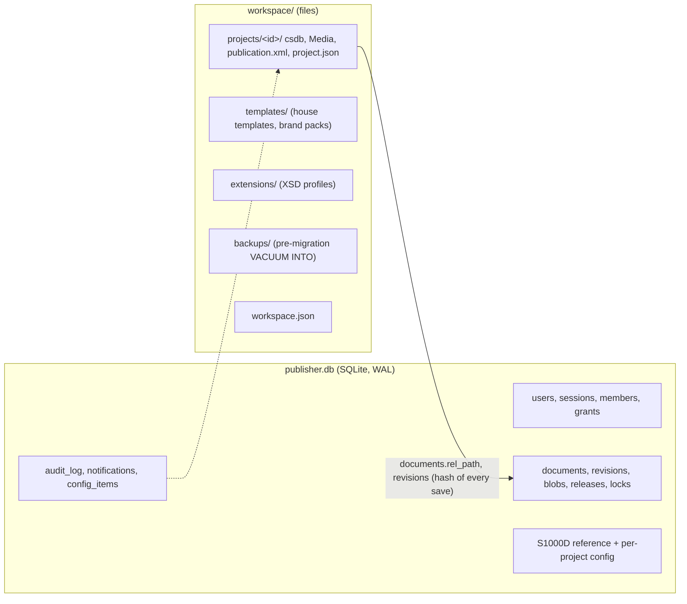
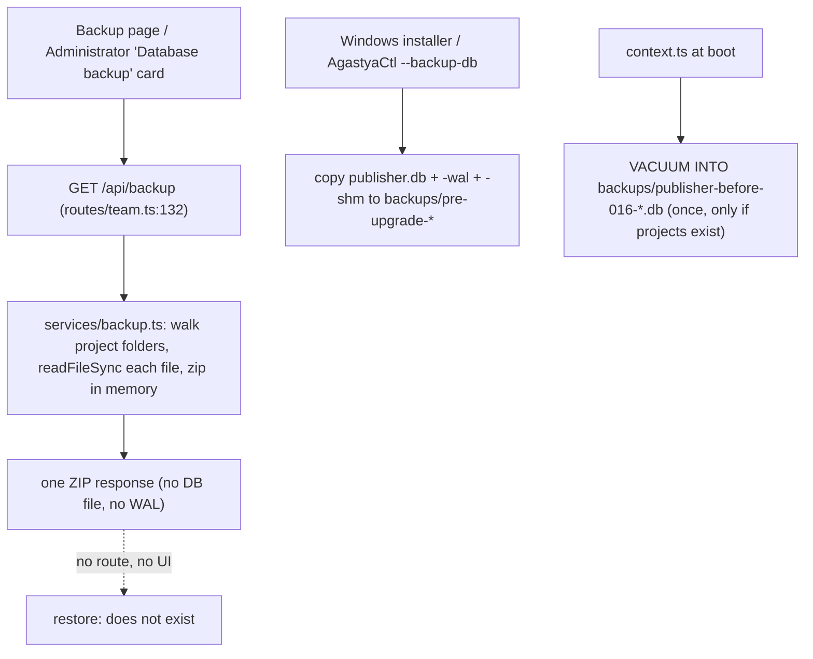

# 10 - Database and data strategy (platform core)

**Author:** audit agent A (finding prefix PLT) · **Date:** 2026-11-26 · **Status:** audit only, no repository file changed.

**Scope and method.** This document covers the SQLite data layer of the Agastya platform backend (`backend/vendor/engine/db.js`, `backend/src/core/auth/store.js`, `backend/src/context.ts`, `backend/src/services/dbSnapshot.ts`, `backend/src/services/backup.ts`, `backend/src/services/projects.ts`, `backend/scripts/*`) and the on-disk workspace layout, which was read from code only (the real `workspace\` folder was never opened). The schema, PRAGMA values, row-count behaviour and migration list were obtained by running the application's own start-up path (`backend/dist/context.js`) against an empty scratch workspace and dumping `sqlite_master`, `PRAGMA` values, `integrity_check` and `foreign_key_check`. Behaviour claims were then checked with small scripts against a scratch server on port 4051/4052 (ports 4040/4041 untouched). Evidence labels: **VERIFIED** (observed by running code), **OBSERVED** (read in code, not run), **SUSPECTED** (inference), **RECOMMENDATION**, **NOT VERIFIED**. Passing unit tests are not treated as proof. Priorities: P0 security hole / data loss / core broken; P1 major gap; P2 maintainability; P3 optional. Complexity: S <= 2 d, M <= 1 w, L <= 3 w, XL more.

**Reading guide.** Sections 1-7 describe what exists. Section 8 lists findings (PLT-001 to PLT-013). Section 9 is the recommended data strategy for (a) a standalone machine and (b) an enterprise server, with backup policy, point-in-time recovery, migration framework, restore testing, retention and disaster recovery. Functional findings are in `_parts/02.A-platform-functional.md` (PLT-014 onward) and architecture findings in `_parts/03.A-platform-architecture.md`.

## 0. Coverage

| Area / path | Inspected | Verification | Limits |
|---|---|---|---|
| `vendor/engine/db.js` (connection, engine tables) | Inspected | schema probe, runtime | `files` index functions unused (grep) |
| `core/auth/store.js` (DDL, 19 migrations, all data access) | Inspected | schema probe, runtime probes 1-6, 9 | 1571 lines read; not every query timed |
| `src/context.ts` (singleton wiring, snapshot hook) | Inspected | runtime | - |
| `services/dbSnapshot.ts`, `services/backup.ts`, `routes/team.ts:132` | Inspected | runtime probe 4 | restore path does not exist |
| `services/projects.ts`, `csdb.ts` (write paths) | Inspected | runtime probes 2, 5, 9 | - |
| `vendor/engine/workspace.js` (folder layout, writes) | Inspected | code only | - |
| `backend/scripts/doctor.js`, `reset-admin.js` | Inspected | code only | not executed against a DB |
| Installer pre-upgrade copy (`packaging/host/AgastyaHost.cs:821`) | Partially | code + `docs/OPERATIONS.md` | Windows host code not run |
| Real `workspace\publisher.db` | Not inspected | by brief | numbers below come from scratch data |
| PostgreSQL / multi-node behaviour | Not applicable | RECOMMENDATION only | nothing built or tried |

## 1. What the database is

**VERIFIED.** One SQLite file, `<workspace>/publisher.db`, opened with Node's built-in `node:sqlite` `DatabaseSync` (Node v22.23.2, SQLite 3.51.3 in this environment) by a **single process-wide connection** (`vendor/engine/db.js:17-21`, wrapped by `AuthStore` in `store.js`). Effective settings on that connection, from the probe:

| PRAGMA | Value | Meaning |
|---|---|---|
| `journal_mode` | `wal` | set explicitly in `db.js:22` |
| `synchronous` | 2 (FULL) | default; durable on commit |
| `foreign_keys` | 1 | `node:sqlite` default, not set by the app |
| `busy_timeout` | **0** | a second writer fails at once (see PLT-002) |
| `wal_autocheckpoint` | 1000 pages | default; no explicit checkpoint on shutdown found |
| `user_version` | 0 | not used; version lives in `schema_migrations` |
| `page_size` / `cache_size` | 4096 / -2000 (2 MB) | defaults |

**VERIFIED** (probe): fresh database, 38 tables, 23 explicit indexes, 11 declared foreign keys, `integrity_check` = ok, 19 rows in `schema_migrations`.

### 1.1 Tables by domain (38)

| Domain | Tables (columns) | Notes |
|---|---|---|
| Identity and access (9) | `users`(13), `sessions`(10, `token_hash` UNIQUE), `password_reset_requests`(7), `project_members`(5), `project_invitations`(8), `folder_owners`(4), `folder_grants`(8), `folder_access_requests`(7), `change_requests`(13) | last two are **dead** (no route writes them; `docs/PROJECT_ARCHITECTURE_AND_TECH_STACK.md:293` agrees) |
| Content governance (8) | `documents`(9, `UNIQUE(project_id, rel_path)`), `revisions`(7), `blobs`(4, content hash PK), `releases`(12), `review_comments`(11), `lifecycle_events`(10), `doc_state`(3), `doc_comments`(9) | `doc_state`, `doc_comments` are dead in the platform (OBSERVED) |
| Platform (6) | `audit_log`(10), `notifications`(9), `config_items`(5, 11 admin collections + app-state markers), `schema_migrations`(2), `projects`(engine, 12), `files`(engine, 5) | `files` is created by `db.js` and never used |
| S1000D reference and config (15) | `ref_sources`, `ref_codes`, `ref_code_ranges`, `ref_dmtype_codes`, `sns_presets`, `sns_preset_nodes`, `project_config`, `project_codes`, `project_sns`, `project_dm_types`, `catalogue_impacts`, `ext_profiles`, `project_ext`, `cir_modules`, `cir_links` | seeded by `bootReference()` at start-up (idempotent) |

### 1.2 Indexes (explicit) and foreign keys

Indexes: `idx_doc_comments_doc`, `idx_doc_comments_open`, `idx_folder_requests_one_pending`, `idx_folder_requests_open`, `idx_lifecycle_project`, `ix_audit_action`, `ix_audit_at`, `ix_changes_folder/open/project/user`, `ix_documents_project`, `ix_members_user`, `ix_notes_user`, `ix_releases_doc/project/status`, `ix_review_project`, `ix_revisions_doc`, `ix_sessions_user`, and three partial unique indexes that enforce workflow invariants: `ux_invite_pending`, `ux_release_pending_project` (one pending release per project), `ux_reset_pending`.

**VERIFIED** foreign keys (all 11): `sessions`, `notifications`, `password_reset_requests`, `project_members`, `project_invitations` -> `users(id)`; `revisions` -> `documents(id)` and `blobs(hash)`; `releases` -> `documents(id)`; `doc_comments` (CASCADE) and `doc_state` -> `documents(id)`; `project_ext` and `sns_preset_nodes` (CASCADE) -> their parents.

**Gap (PLT-010).** No `project_id` column in any table is a foreign key. The `projects` table belongs to the engine registry; `documents`, `project_members`, `releases`, `project_config`, `project_codes`, `project_sns`, `lifecycle_events`, `review_comments`, `audit_log` all hold a free-text project id. Referential integrity between "project" and everything about it is therefore maintained only by application code (`clearProjectGovernance`, `deleteProjectConfig`, `reconcileRegistry`), and PLT-003 / PLT-004 show where that code leaves rows behind or removes too much.

### 1.3 Files versus database

Source of truth for authored content is the **file** (`csdb/*.XML`); the DB holds an index (`documents`), the content-addressed history (`blobs`/`revisions`, re-verified on read), and governance. Consequence: neither half is a complete backup of the other. Restoring only `publisher.db` brings back users and history but not files; restoring only the folders brings back content but not users, memberships, releases or review state (and see PLT-003 for what the next boot does to the mismatch).

Not in the database and not in `projects/`: platform settings are `config_items` rows (DB); S1000D package settings are DB rows carried only in the project-package manifest (`services/packageSettings.ts`); uploads are staged in `os.tmpdir()/agastya-uploads` (`services/uploads.ts:14`) and swept hourly (`index.ts:29-30`); brand packs are read-only under `templates/brand`.

## 2. Migrations

**VERIFIED** (code `store.js:14` `MIGRATIONS`, `644-675` `migrate()`; probe).

| Aspect | Behaviour | Assessment |
|---|---|---|
| Registry | `schema_migrations(name PK, applied_at)`; 19 entries 001-019 | name-keyed, **no checksum**, no `user_version` |
| Order | array order in source, not numeric | VERIFIED: probe list begins `014-notifications`, `015-review-config-cir`, `001-users-sessions-audit`, ... `006` after `009` (also noted in `PROJECT_ARCHITECTURE_AND_TECH_STACK.md:161`). Works only because SQLite does not validate `REFERENCES` targets at DDL time |
| Atomicity | `BEGIN` ... `INSERT schema_migrations` ... `COMMIT`; `ROLLBACK` on error; throws `Migration X failed` | good: DDL is transactional in SQLite |
| Idempotence | `CREATE TABLE IF NOT EXISTS`, `ADD COLUMN` only if `pragma_table_info` lacks it; applied names skipped | good; re-running is safe (also tested by `s1000d-migration.test.js`) |
| FK-affecting change | migration 013 sets `fkOff`, runs `PRAGMA foreign_keys=OFF` outside the transaction, then `foreign_key_check` in `finally` | correct pattern (`store.js:651-670`) |
| Rollback / down | none | restore from snapshot is the only path |
| Backup before migrating | `snapshotBeforeMigration` is called **only for `016-s1000d-reference`** (`context.ts`), via `VACUUM INTO workspace/backups/publisher-before-016-s1000d-reference.db`; skipped when the migration is already recorded or no projects exist; error is logged and swallowed | **PLT-006**: the safety net exists for one historical migration, not as a mechanism |
| Failure mode | an exception in `migrate()` aborts import of `context.js`, so the server does not start | safe (no half-applied schema) but gives no repair guidance |
| Downgrade | an older build against a newer DB is not prevented; `docs/OPERATIONS.md:104` tells the operator to restore the pre-upgrade copy by hand | OBSERVED |
| Installer | `AgastyaCtl --backup-db` copies `publisher.db`, `-wal`, `-shm` to `backups\pre-upgrade-<ver>-<time>` after stopping the service (`AgastyaHost.cs:821-835`, `agastya.iss:307-324`) | good for Windows installs only, not for `npm start` or a server deployment |

`dbSnapshot.ts` itself was hardened on 2026-11-22 (`docs/DATABASE_RESTORATION.md:43-46`): an existing snapshot file is never trusted; a time-stamped copy is made instead. `db-snapshot.test.js` covers four cases (complete copy, no copy for a fresh DB, existing file untouched, failure reported). That is the one place with real restore evidence: `DATABASE_RESTORATION.md` documents a rehearsed restore with row-by-row comparison.

## 3. Transactions, concurrency, connection handling

**VERIFIED.** There is exactly one connection per process; `DatabaseSync` is synchronous, so every SQL statement blocks the Node event loop and requests are serialised by construction. That is a strength for correctness (no interleaving inside one process) and a ceiling for throughput.

* `AuthStore.tx(fn)` uses `BEGIN IMMEDIATE` and rolls back on throw (`store.js:676-686`). Used for first-run setup, release approval, displacement of a session on login, and other multi-row operations.
* `replaceFolderGrants` and `rekeyFolder` use a bare `BEGIN` (deferred), OBSERVED; harmless with one connection, wrong if a second writer exists.
* The prepared-statement cache `stmt()` is an unbounded `Map` keyed by SQL text (`store.js:638`); safe today because SQL strings are constant, but any dynamically built text (for example `IN (${q})` lists in `activity.ts:51-56`) would grow it. OBSERVED.
* **No busy handling** (`busy_timeout = 0`). Probe 5: while an external process held `BEGIN IMMEDIATE` for a few seconds, the live server answered `POST /api/notifications/read` 500, `POST /api/auth/login` 500 `Sign-in failed.`, `POST /api/projects` 500 `{"error":"Internal error","details":"database is locked"}`; read routes kept working (WAL readers). After release everything recovered. Anything else touching the file triggers this: `scripts/reset-admin.js`, a backup tool reading the file, antivirus on `-wal`, an operator with a DB browser. See PLT-002.
* WAL files (`publisher.db-wal`, `-shm`) must travel with the main file; the installer copy handles this, the in-app backup does not include any of them (PLT-001).
* Multi-process or multi-host use of the same file is unsupported and unguarded: there is no lock file or second-instance check. **SUSPECTED** (not run): two servers on one workspace each hold a connection and race on `busy_timeout=0` errors.

## 4. Query patterns

| Pattern | Evidence | Assessment |
|---|---|---|
| Per-project file reads on list routes | `workspaceFor` (`projects.ts:389`) and `/api/overview` read `project.json` and mirror data per project | **VERIFIED** linear growth, PLT-008: member-only author, `/api/workspace` 65 ms (10 projects), 360 ms (30), 1019 ms (60); `/api/overview` 54, 382, 1397 ms. Folder-owner PM stays at 23, 37, 64 ms because that path avoids the per-project fallback. The shell refreshes its badge counters every 30 s (`layouts/AppShell.tsx:42` comment); the dashboard cost itself is paid on each load of the Overview / Workspace pages (not measured in the browser) |
| Boot reconcile | `reconcileRegistry` lists every project folder and reads each `project.json`; `docIndex.reconcileAll` walks every project's documents (`projects.ts:500-516`) | boot time grows with total content; 62 scratch projects booted in under 7 s including renderer start (probe 9) |
| Audit aggregation | `activity.ts:51-56` `GROUP BY project_id, actor_id ... WHERE project_id IN (...)`; indexes exist only on `audit_log(action)` and `(at)` | **VERIFIED by index list**: no `project_id` index; full scan that grows with the unbounded log (PLT-007) |
| Unbounded lists | `auditCsv` and backup cap at 5000 rows (`platform.ts`, `team.ts`), other list routes not paged (users, notifications, revisions history) | OBSERVED; fine at 10^2, not at 10^5 |
| Release lookups | `ix_releases_project/status/doc` plus partial unique `ux_release_pending_project` | adequate |
| Hash-verified reads | `revisions.content()` re-hashes blob on read | strength; cost proportional to size |

No ORM; all SQL is hand-written with bound parameters (OBSERVED in `store.js`); no string-concatenated user input found in the data layer, only fixed table names in the `columns` helper of `migrate()`.

## 5. Atomic writes and retention

* **Atomic-write discipline is inconsistent.** Good: `publishWaivers.ts` writes tmp + rename; package export builds to a temp file and streams (`routes/packages.ts:139-153`). Not atomic: `csdb.writeDm` and `createDm` (`csdb.ts:206, 226`), `workspace.js` `writeState` / `project.json` writes (`workspace.js:39, 198, 226`) use `fs.writeFileSync` directly on the destination. A crash or disk-full mid-write leaves a truncated data module or `project.json`. The revision is cut **after** the write and a failure in `cut()` is swallowed (`csdb.ts:182-186`), so file and history can diverge silently. PLT-009.
* **No retention anywhere** (grep for `DELETE FROM` in `store.js` shows deletes only for membership, grants, config items, CIR rows, doc comments, pending releases). `audit_log`, `notifications`, `sessions` (revoked/expired rows), `password_reset_requests`, and every revision/blob accumulate forever; blobs are never garbage-collected. PLT-007.
* Deleting a project is a recursive `fs.rmSync` (`workspace.js`, via `removeReleasingRenderer`) plus row removal for members/config only; documents, revisions, locks and audit rows are kept (`store.js:992-1003` comment: "Revisions and audit rows are history and stay"). Intended as history; it has a side effect (PLT-004).

## 6. Backup and restore as they actually work

**VERIFIED** (probe 4 and code):

* The user-facing backup is **a ZIP of project folders plus three JSON files** (`platform/users.json`, `members.json`, `audit-log.json`, the last capped at 5000 rows) for administrators. Probe: a 61-project scratch workspace gave 505 entries: 61 `project.json`, `manifest.json`, the three platform JSONs. `users.json` carries id, username, full name, role, disabled flag and created-at, **not** the password hash (by design, `notifications.test.js` asserts "never password hashes").
* It does **not** contain: password hashes, sessions, releases and approvals, review comments, revision history and blobs, document locks, folder grants/owners, notifications, `config_items` (the Administrator reference data, SNS presets, DM-type settings), CIR tables, extension profiles' enablement. A person restoring from it would have files and a list of users who cannot sign in.
* **There is no restore.** No route, no CLI, no UI; `docs/OPERATIONS.md:95-96` says to stop the server and put the data folder back. The Administrator card is titled "Database backup" with the text "A ZIP of every project, the people and the activity log" (`frontend/src/pages/Administrator.tsx:232`); the maintenance comment in `platform.ts` says "Database backup is the platform backup". Operators reading "Database backup" will believe the database is covered. PLT-001.
* **Live-ness.** The ZIP is built synchronously in the request handler from `fs.readFileSync` of every file, in memory (`backup.ts:39-53`). Probe 4 with 240 MB of project media: 15.8 s total, `/api/health` latency during the build up to **14.2 s** (the event loop was blocked), process RSS 130 MB -> 370 MB, ZIP 252 MB returned in one buffer. The ZIP writer has no ZIP64 and truncates sizes with `& 0xffff` / `>>> 0` (`zip.ts:7-8`), so more than 4 GiB or 65535 entries would corrupt the archive (OBSERVED in code, **not** run). PLT-005.
* **Consistency.** Files are read one by one while users keep saving, so the archive is not a point-in-time view; no DB snapshot is taken with it. OBSERVED.
* **Restore verification.** None: nothing validates a backup ZIP, there is no checksum list, no test that restores one. The only rehearsed restore in the repository is the manual recovery recorded in `docs/DATABASE_RESTORATION.md` (hash-verified, row-by-row compared) - good evidence that restoring a `publisher.db` is possible by hand, not that the product supports it.
* **Integrity checks.** `foreign_key_check` after migration 013 and `integrity_check` only inside tests/doctor-style scripts; `scripts/doctor.js` checks runtime prerequisites (Node >= 22.5, `node:sqlite`, Java, xsltproc, FOP, schemas, 259-character path limit, client build) but **does not open the database**. No scheduled `quick_check`. PLT-013.
* **Portability and export.** Project-level: JSS/JSG/S1000D archive export and import exist (`routes/packages.ts`, `services/projectArchive.ts`, `project-archive.test.js` round-trips three formats), which is real portability for content but not for governance (members, releases, history). Platform-level: audit CSV (5000 rows), users JSON in the backup. There is no full-fidelity export of the governance tables, so migration to another database engine would need a purpose-built exporter.

## 7. Data-layer findings that touch security (reported as PLT)

Three security-relevant observations were met in the data layer and are filed in the functional report: temporary passwords of the form `username@year` allow an unauthenticated takeover of any account before its first sign-in (PLT-014); a Project Manager can approve a release they requested themselves (PLT-015); and 500 responses return the raw error message in `details` (PLT-019, e.g. `database is locked`).

## 8. Findings

### PLT-001 · P1 · VERIFIED · L · "Database backup" is a project-folder ZIP; there is no database backup and no restore

**Category:** data safety, disaster recovery.
**Problem:** The only in-product backup (`GET /api/backup`) archives project folders and three JSON lists. It omits password hashes, sessions, releases and approvals, review comments, revision history, locks, grants and all `config_items`. No restore route, CLI or UI exists, and nothing verifies a backup. The Administrator card calls it "Database backup".
**Evidence:** `backend/src/routes/team.ts:132-141`; `backend/src/services/backup.ts:39-53`; `frontend/src/pages/Administrator.tsx:232`; `backend/src/services/platform.ts` header comment ("Database backup is the platform backup"); probe 4 ZIP listing (505 entries, `platform/users.json` 1043 B with no hashes); no `restore` symbol under `backend/src` (grep).
**Current implementation:** In-memory ZIP of files; admin scope adds users, members and 5000 audit rows. Recovery today means copying the whole data folder offline (`docs/OPERATIONS.md:95-96`) or hand surgery as in `docs/DATABASE_RESTORATION.md`.
**Recommendation:** (1) Rename the card to "Project files backup" immediately (S). (2) Add a first-class backup that includes a consistent database image taken with the SQLite online backup API (`require('node:sqlite').backup`, present in Node v22.23.2; **NOT VERIFIED** for the runtime shipped in the installer) or `VACUUM INTO`, plus the project folders, a manifest with SHA-256 per file and schema version, written to disk (not memory) as a streamed ZIP. (3) Add a restore command (CLI first: `agastya-restore <archive>`, offline, refuses a non-empty target, verifies hashes and `integrity_check`, runs migrations). (4) Rehearse it in CI.
**Expected outcome:** One artefact that restores users, history and approvals; an operator can answer "can we recover?" with a tested yes.
**Dependencies:** PLT-005 (use the existing streaming ZIP writer), PLT-006 (snapshot mechanism), section 9.
**Risks:** Backup contains password hashes and session-adjacent data, so it must be treated as secret (encrypt at rest or restrict path); restore of a DB with a newer schema than the binary must be refused.
**Acceptance criteria:** A backup taken during writes restores on a clean machine; users sign in with their old passwords; releases, history and grants are present; a corrupted archive is refused with a named reason.
**Test cases:** backup under concurrent saves then restore; truncated ZIP; archive from a newer schema; restore into a non-empty workspace (refused); hash mismatch (refused).

### PLT-002 · P1 · VERIFIED · S · SQLite `busy_timeout` is 0: any second writer turns into HTTP 500, and project creation leaves an orphan

**Category:** reliability / concurrency.
**Problem:** The connection never sets `PRAGMA busy_timeout`. While another process holds a write lock, writes and **sign-in** fail immediately with 500; a failed `POST /api/projects` also leaves a half-created project folder on disk.
**Evidence:** `backend/vendor/engine/db.js:17-22` (no busy_timeout); probe `schema-out.json` `busy_timeout: 0`; probe 5: external `BEGIN IMMEDIATE` -> `POST /api/notifications/read` 500, `POST /api/auth/login` 500 `Sign-in failed.`, `POST /api/projects` 500 `details: "database is locked"`, reads 200; after the release logins work again; `ws-srv/projects/busy-test/` (with `csdb`, `Media`, `project.json`) remained after the failed create; server log `[auth] login error: database is locked`.
**Current implementation:** Single in-process connection; `scripts/reset-admin.js` opens a second connection with the same default; backups, antivirus and operators can hold the lock.
**Recommendation:** Set `PRAGMA busy_timeout = 5000` (and keep `foreign_keys = ON`) immediately after opening in `db.js`, and in `reset-admin.js`; map `SQLITE_BUSY` to HTTP 503 with `Retry-After`; make `createProject` clean up its folder when the registry insert fails (see PLT-009).
**Expected outcome:** Short lock contention is absorbed; long contention yields a clear 503 rather than lost sign-ins.
**Dependencies:** none.
**Risks:** A long timeout blocks the event loop (the connection is synchronous): a 5 s busy wait freezes every request, so keep it small and treat it as protection against brief external locks, not as a concurrency strategy.
**Acceptance criteria:** With an external write lock held for 2 s the same requests succeed; held for 10 s they return 503, not 500; no orphan folder remains.
**Test cases:** hold-lock script (as probe 5) for 2 s and 10 s; create project during lock then list folders.

### PLT-003 · P1 · VERIFIED · S · Boot-time `reconcileRegistry` deletes a project's row and all memberships when its folder is momentarily absent; restoring the folder does not restore access

**Category:** data loss.
**Problem:** At every start the registry is reconciled to the disk. A project whose folder is missing loses its `projects` row and **all `project_members`** (and pending invitations are revoked). The folder reappearing later is indexed as a new, ownerless project.
**Evidence:** `backend/src/services/projects.ts:500-516` (`registryDb.deleteProject(row.id); store.clearProjectGovernance(row.id)`); `store.js:995-1003`. Probe 9: project `scale-5` with 2 members and 8 documents; folder renamed away; server booted; result `projectRow 1 -> 0`, `members 2 -> 0`, `documents 8 -> 8` (rows kept, now orphaned), total members 121 -> 119; the renamed folder was registered as a **new** project (projects total 61 -> 62). After renaming back and restarting, the original id returns without members.
**Current implementation:** Treats "folder missing" as "project deleted". Triggers in practice: data folder on a not-yet-mounted drive, antivirus quarantine, a person moving a folder, restoring `publisher.db` from the installer backup into a workspace whose folders differ, a partial restore.
**Recommendation:** Never delete governance at boot. Mark the project `missing_at` (as `docIndex` already does for documents), show it to administrators with "folder missing - restore or remove", and delete only on an explicit administrator action; refuse to start reconcile when `projects/` itself is absent or empty while the DB has projects.
**Expected outcome:** A transient filesystem problem cannot silently erase who may open what.
**Dependencies:** PLT-004 (same area of code).
**Risks:** Needs a UI state for "missing" projects.
**Acceptance criteria:** Rename a project folder, boot, rename back, boot: memberships, releases and ACL unchanged.
**Test cases:** the probe 9 sequence as a regression test; empty `projects/` with a populated DB (start refuses or enters read-only recovery).

### PLT-004 · P1 · VERIFIED · S · Deleting a project keeps its documents, revisions and locks; creating a project with the same name re-attaches them to a different owner

**Category:** data integrity and confidentiality.
**Problem:** Project ids are derived from the name (`uniqueId(slug(name))`). Deleting removes folder, registry row, memberships and config but intentionally keeps `documents`, `revisions`, `blobs`, locks and audit rows. Creating a new project with the same name by another Project Manager yields the **same id**, so the old history and locks appear in the new project and are readable.
**Evidence:** `store.js:992-1003` comment and statements; `projects.ts:322-329`. Probe 2: PM `meera` created `alpha-manual`, saved a module twice, locked it, deleted the project; PM `rohit` (not a member of the old project) created `Alpha manual` -> same id `alpha-manual`; history of his new module listed revisions `4:create, 3:save, 2:save, 1:create` (three belong to the deleted project) and the module showed `locked: true` (inherited lock); `GET .../history/<id>` returned the old revision content with HTTP 200.
**Current implementation:** "History stays" is a deliberate comment; there is no tombstone or id uniqueness across time.
**Recommendation:** Either (a) give each project an immutable random id (the slug stays a display handle), or (b) on delete, purge `documents`/`revisions`/locks/releases/review comments for that project (keeping `audit_log`), with an explicit "delete history too" confirmation. Option (a) also fixes URL/slug reuse. Release records and audit are the legitimate history; content revisions of a deleted project are not.
**Expected outcome:** A new project starts empty; deleted content is not reachable.
**Dependencies:** PLT-010 (FKs), PLT-003.
**Risks:** Existing installations have stale rows: a one-off cleanup migration is required (snapshot first).
**Acceptance criteria:** Delete then recreate with the same name: zero revisions, no locks, no releases visible; old content unreachable by id.
**Test cases:** probe 2 as a test; deleted project's revision id requested by another user (404).

### PLT-005 · P1 · VERIFIED · M · `/api/backup` is built in memory on the event loop; large workspaces stall the whole server and the ZIP writer has no ZIP64

**Category:** availability, scalability.
**Problem:** The backup reads every file with `readFileSync` and zips in a single synchronous pass. During it, no other request is served; memory grows by the archive size; archives beyond 4 GiB or 65535 entries are written with truncated header fields.
**Evidence:** `backend/src/services/backup.ts:39-53`; `backend/src/services/zip.ts:1-8`; probe 4: 240 MB media -> 15.8 s, max `/api/health` latency 14.2 s, RSS +240 MB, 252 MB single buffer. The >4 GiB corruption is **OBSERVED, NOT RUN**.
**Current implementation:** Request handler builds and returns the complete buffer; any authenticated user can request their own scope (authors get their projects), so any author can trigger it.
**Recommendation:** Switch `backup.ts` from the old in-memory `ZipWriter` (`services/zip.ts`) to the **ZIP64-capable, back-pressured `ZipStreamWriter` that already exists in `services/zipio.ts:187`** and is used by `packages.ts`, `htmlPublish.ts` and `routes/jss-rwi.ts` (VERIFIED by grep; `zip.ts` is then dead code, see PLT-029), add files from disk with `addFile` instead of `readFileSync`, rate-limit to one backup at a time per server, and consider a worker or child process if the read loop still starves the event loop. For the whole-platform backup use the strategy in section 9 and keep the in-product ZIP as a convenience "export my projects".
**Expected outcome:** Backing up a 10 GB workspace does not freeze other users.
**Dependencies:** PLT-001.
**Risks:** Streaming while files change gives inconsistent archives unless the DB and files are snapshotted together.
**Acceptance criteria:** During a 1 GB backup `/api/health` stays under 200 ms; RSS stays flat; archive opens with a standard unzip tool above 4 GiB.
**Test cases:** probe 4 at 1 GB; two concurrent backups (second queued or refused).

### PLT-006 · P1 · VERIFIED · S · The pre-migration snapshot is hard-coded to one migration (016); future migrations run without an automatic safety copy

**Category:** upgrade safety.
**Problem:** `snapshotBeforeMigration(...)` is invoked once with `'016-s1000d-reference'`. Migrations 017-019 and any 020+ run with no snapshot unless the Windows installer made one. `npm start`, server installs and Docker-like deployments have none.
**Evidence:** `backend/src/context.ts` (call before `store.migrate`), `backend/src/services/dbSnapshot.ts` (skips when the named migration is recorded or no projects exist); `db-snapshot.test.js` covers only that function; installer copy is in `packaging/host/AgastyaHost.cs:821-835`.
**Current implementation:** One-off safeguard added for the 016 upgrade.
**Recommendation:** Make it generic: before applying **any** pending migration, take one snapshot named `publisher-before-<first-pending>-<timestamp>.db` via the backup API, verify it opens (`quick_check`), keep the last N, and abort the migration if the snapshot fails (today the error is swallowed). Keep the existing never-overwrite rule.
**Expected outcome:** Every schema change is reversible by file copy.
**Dependencies:** section 9.4 migration framework.
**Risks:** Disk use for large databases; snapshot time blocks boot.
**Acceptance criteria:** Adding a dummy migration 020 produces a snapshot before it runs; failure to snapshot stops the upgrade with a clear message.
**Test cases:** extend `s1000d-migration.test.js` with a synthetic pending migration; read-only backups directory (boot refuses).

### PLT-007 · P2 · VERIFIED · M · No retention or purge; `audit_log` has no `project_id` index

**Problem:** `audit_log`, `notifications`, `sessions`, `password_reset_requests`, revisions and blobs grow without bound; activity queries filter and group on `project_id` without an index.
**Evidence:** `store.js` deletes list (only membership, grants, config items, CIR, doc comments, pending releases); index list shows `ix_audit_action`, `ix_audit_at` only; `activity.ts:51-56`; `platform.ts` audit export capped at 5000 rows.
**Recommendation:** Add `CREATE INDEX ix_audit_project ON audit_log(project_id, id)`; scheduled purge of expired/revoked sessions (> 30 d) and read notifications (> 90 d); audit retention policy with archive-to-file before delete (section 9.6); blob GC for unreferenced hashes after project purge.
**Acceptance:** audit query plan uses the index; a purge job is logged; retention values are settings.

### PLT-008 · P2 · VERIFIED · M · Dashboard routes do per-project work for member-only users (linear growth)

**Problem:** `/api/workspace` and `/api/overview` take 65 / 360 / 1019 ms and 54 / 382 / 1397 ms for an author at 10 / 30 / 60 projects (folder-owner PM: 23-96 ms).
**Evidence:** probe 3 (`p3-scale.js`), `projects.ts:389-` `workspaceFor`, `routes/workspace.ts:32,58`. Root-cause line not isolated beyond "per-project reads" (OBSERVED).
**Recommendation:** Serve lists from DB columns (name, type, group, updated) maintained at write time; read `project.json` only on open; add paging above ~100 projects. Re-measure at 300 projects.
**Acceptance:** author dashboard under 150 ms at 100 projects.

### PLT-009 · P2 · VERIFIED · M · Content writes are not atomic and the revision is cut after the file is written (errors swallowed)

**Problem:** `fs.writeFileSync` straight onto `csdb/*.XML`, `project.json`, `workspace.json`; revision insert follows and a failure is ignored; `createProject` is multi-step with rollback only for the config stage.
**Evidence:** `csdb.ts:182-186, 206-207, 226-228`; `workspace.js:39, 198, 226`; `projects.ts:267` ("best effort"); probe 5 orphan folder.
**Recommendation:** write temp + `fsync` + rename; cut the revision first (or in the same logical step) and fail the save if it fails; wrap project creation in a compensating cleanup that removes the folder on any later failure.
**Acceptance:** killing the process mid-save leaves either the old or the new file, and the history contains whichever is on disk.

### PLT-010 · P2 · VERIFIED · S · Only 11 foreign keys in 38 tables; dead tables remain

**Problem:** No `project_id` FK; `files`, `doc_state`, `doc_comments`, `folder_access_requests`, `change_requests` are unused; `projects`/`files` exist in the engine layer with a `type DEFAULT 'JSS'` legacy.
**Evidence:** probe FK list; `db.js:22-` DDL; `PROJECT_ARCHITECTURE_AND_TECH_STACK.md:293`.
**Recommendation:** Decide per table: drop in a numbered migration (after snapshot) or document as reserved; make `project_id` an FK to `projects(id)` with `ON DELETE` semantics matching PLT-004 once ids are stable.
**Acceptance:** `foreign_key_check` covers project ownership; no unused DDL in `store.js`.

### PLT-011 · P2 · VERIFIED · S · Migration framework gaps: unsorted array, no checksum, no down, no schema version

**Problem:** Order is source order (014 and 015 before 001); changes to an applied migration are undetectable; `user_version` unused.
**Evidence:** probe migration list; `store.js:14, 644-675`.
**Recommendation:** section 9.4 (sort by numeric prefix, record SHA-256 of the SQL, refuse if an applied migration's checksum changed, set `user_version`, refuse to run a newer DB).
**Acceptance:** tampering with an applied migration aborts start-up with the migration name.

### PLT-012 · P2 · OBSERVED · S · `reset-admin.js` takes the password on the command line, makes no snapshot and sets no busy timeout

**Problem:** The password lands in shell history and process listings; the script writes to the live DB with a second connection (fails with "database is locked" while the server runs).
**Evidence:** `backend/scripts/reset-admin.js` (read, not executed against a DB).
**Recommendation:** read the password from a prompt or stdin; require the server to be stopped (or use busy_timeout); revoke the user's sessions; write an audit row.
**Acceptance:** no password in `argv`; sessions of the account end.

### PLT-013 · P2 · VERIFIED · S · No scheduled integrity check; `doctor` does not examine the database

**Problem:** `integrity_check` and `foreign_key_check` run only during migration 013 and in tests; `scripts/doctor.js` verifies the toolchain but never opens `publisher.db`; no explicit WAL checkpoint/`PRAGMA optimize` on shutdown.
**Evidence:** `scripts/doctor.js` check list; `index.ts` shutdown path; grep for `integrity_check` in `src` (none).
**Recommendation:** run `PRAGMA quick_check` at boot (fail loudly), `integrity_check` weekly, `wal_checkpoint(TRUNCATE)` on clean shutdown and before each backup; expose "Database health" in the Administrator maintenance panel.
**Acceptance:** a corrupted copy of the DB is detected at boot with a clear message.

### Strengths (not findings)

* Migrations are transactional, idempotent and name-keyed; the 013 FK dance is done correctly.
* Revisions are content-addressed and re-hashed on read; partial unique indexes enforce "one pending release per project" and "one pending invitation/reset".
* All SQL is parameterised; one connection means no interleaving bugs inside the process.
* The 2026-11-22 restoration was done with hashes, rehearsal and row-by-row comparison (`docs/DATABASE_RESTORATION.md`) - the method to automate.
* Audit rows strip password/token/secret keys before storing (`context.ts` `audit()`).

## 9. Data strategy recommendations

### 9.1 Principle

**RECOMMENDATION.** Keep the **file + SQLite split** (content on disk, governance in the DB). It is the right shape for XML authoring and costs nothing to operate. The decision that matters is not "SQLite or PostgreSQL" but whether there is a **tested way to take a consistent copy and bring it back** (PLT-001), plus fixing the integrity holes (PLT-003, PLT-004). Fix those first; they are needed under either engine.

### 9.2 (a) Standalone single machine - harden SQLite, no new server

| Item | Recommendation | Type |
|---|---|---|
| Engine | Stay on `node:sqlite`, WAL, one connection | mandatory (already true) |
| Pragmas | `busy_timeout=5000`, `foreign_keys=ON` (explicit), `wal_checkpoint(TRUNCATE)` on shutdown, `quick_check` at boot | mandatory (PLT-002, PLT-013) |
| Backup | In-product "Back up now" and nightly job writing `backups/auto-<date>/` = SQLite backup-API image + `projects/` zip (streamed), manifest with SHA-256, keep 7 daily + 4 weekly + 12 monthly; one-click "copy to folder/USB" | mandatory |
| Restore | CLI + guided UI: pick archive, verify, restore into new folder, switch; refuses downgrade | mandatory |
| Migrations | generic pre-migration snapshot, checksums (9.4) | mandatory |
| Retention | purge sessions/notifications; audit kept 2 years | optional for a single user |
| Encryption | rely on OS disk encryption; backups are secret | optional |

PostgreSQL has **no case here**: it adds a service, an installer dependency and an operator, for a workload one process serves.

### 9.3 (b) Enterprise server with concurrent users

Facts that drive the choice: one Node process, one synchronous connection (every query blocks the loop); all heavy work (FOP, xsltproc) already runs as child processes; writes are small and infrequent compared with reads; content lives on the filesystem; in-memory state exists in the process (rate limiter, pending package uploads, WebSocket clients, statement cache; see architecture report).

| Option | Fits when | Trade-offs |
|---|---|---|
| **A. SQLite hardened, single server (minimum complexity)** | up to roughly tens of concurrent editors, one server, one data disk | + zero operations, atomic file backup via backup API, WAL gives concurrent reads; - one writer, event-loop blocking queries, no HA, no read replicas, restore means downtime; backups must be file-system consistent with `projects/` |
| **B. SQLite + Litestream-style continuous replication** | A plus point-in-time recovery and off-box copy | + RPO of seconds without a DB server; - extra process, Windows support and licensing of that tool **NOT VERIFIED**; protects the DB only, not the `projects/` files |
| **C. PostgreSQL** | HA, many concurrent writers, multiple app nodes, corporate DBA/backup tooling, PITR via WAL archiving, row-level security wanted | + real concurrency, tooling, replication; - a second service, a driver and an async data-access rewrite (the store is synchronous and used everywhere), SQL dialect work (partial indexes, `pragma_table_info`, `INSERT OR IGNORE` patterns), migration of existing installs, and **the files still need a shared file system** |

**Minimum-complexity answer (RECOMMENDATION):** an enterprise server with up to a few dozen concurrent users should run **option A now**, with the hardening in 9.2, a scheduled backup to a second disk or share, and an off-box copy, and should **introduce a storage-abstraction seam** (architecture report) so that PostgreSQL can be adopted **when a measured trigger occurs**, not before. Triggers: sustained p95 write latency over 200 ms or event-loop lag over 100 ms at normal load; a requirement for two application nodes or hot standby; a policy requiring RPO under 1 minute; corporate rule that application data lives in the managed database platform. Do **not** move to PostgreSQL for "enterprise" as a label.

If PostgreSQL is chosen later: keep content-addressed `blobs`/`revisions` in the DB or object storage, keep project files on a shared volume or object store behind the same `ContentStore` interface, convert the data-access layer to async behind the interface in one pass, and migrate with a purpose-built exporter (PLT-001 manifest is the starting point).

### 9.4 Migration framework (minimum)

1. Files `migrations/NNN-name.sql` (or the existing array) sorted by number; reject gaps and duplicates.
2. Table `schema_migrations(name, checksum, applied_at, app_version)`; refuse start when an applied checksum differs.
3. Before the first pending migration: generic snapshot via the backup API, `quick_check` on the copy, keep last N; abort on failure (PLT-006).
4. Each migration in one transaction; `fkOff` migrations flagged and followed by `foreign_key_check`.
5. Set `PRAGMA user_version` to the highest applied number; **refuse to open a newer database** (downgrade guard).
6. Forward-only; "down" is the snapshot. Document it.
7. Test: every migration applied to a fixture DB of the previous release and to an empty DB, compare schema dumps (the probe in this audit is a starting point).

### 9.5 Point-in-time recovery

* **Standalone:** daily consistent backup is enough; PITR not required.
* **Enterprise:** (i) continuous WAL shipping or a replication tool for `publisher.db` (option B) and (ii) because content is revisioned, the file side can be rolled back per module from `revisions` (already exists) - but new files, deletes and `project.json` are not revisioned. Therefore PITR for the whole workspace needs periodic file-level snapshots (volume shadow copy / storage snapshots) taken **together with** a DB backup. If PostgreSQL is adopted, WAL archiving gives true PITR for the DB; files still depend on volume snapshots. State the achievable RPO honestly in the operations guide: with nightly backup RPO is up to 24 h.

### 9.6 Retention

| Data | Proposed default | Mechanism |
|---|---|---|
| `sessions` | 30 days after expiry/revoke | scheduled delete |
| `notifications` | 90 days after read | scheduled delete |
| `audit_log` | keep 2 years live; archive older to compressed file then delete (configurable, compliance may require longer) | scheduled job, index (PLT-007) |
| `password_reset_requests` | 90 days after resolution | scheduled |
| revisions/blobs | keep all for live projects; purge with the project (PLT-004); optional "squash older than N issues" | explicit action |
| backups | 7 daily / 4 weekly / 12 monthly; verify the latest weekly by restore (9.7) | policy job |
| pre-migration snapshots | last 5 | policy job |

### 9.7 Restore testing and disaster recovery

* **Automated restore test:** weekly job restores the latest backup into a scratch directory, runs `integrity_check`, `foreign_key_check`, boots the app on a scratch port and compares counts of users, projects, documents, revisions against the manifest; failure raises an administrator notification. The method is exactly the manual rehearsal in `docs/DATABASE_RESTORATION.md`.
* **DR runbook (enterprise):** objectives to be agreed with the owner (suggested start: RPO 24 h, RTO 4 h for option A); steps: provision host, install same version, restore archive, verify hashes, boot, smoke test (sign-in, open project, build PDF), reconnect users. Keep one off-site copy and one offline copy; keep the installer of the exact version with each backup.
* **Standalone:** the runbook is "install same or newer version, run restore, open"; show the date of the last successful backup on the home page and warn after 7 days.

## 10. Unknowns and limitations

* The real `workspace\publisher.db` was not opened (brief); row counts, sizes and growth of production data are unknown. All performance numbers are from a scratch server with synthetic projects (empty modules), single client, Windows Server 2025, Node v22.23.2.
* The installer's bundled Node runtime version was not checked; availability of `node:sqlite.backup` there is NOT VERIFIED.
* ZIP64 failure above 4 GiB, behaviour of two server processes on one workspace, and restore of releases for a re-created project id were reasoned from code and not run.
* `scripts/reset-admin.js` and the Windows host backup routine were read, not executed.
* Throughput under truly concurrent users (tens of simultaneous writers) was not load-tested; the synchronous single connection makes serial behaviour expected but latency under load is NOT VERIFIED.
* The backend tests named in this document were read for what they assert; only the scratch-server probes in `scratchpad/A` were executed for this report.
