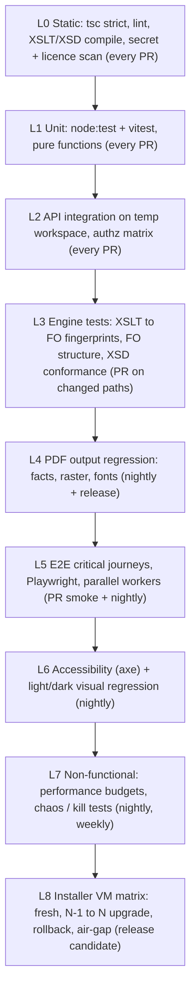
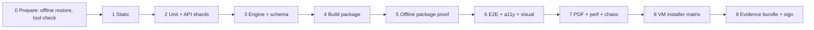

# 11 - Testing and QA Strategy (audit agent G)

**Audit date:** 2026-11-26. **Repository:** `Agastya-platform-v2`, branch `main`, HEAD `e85fa94` (2026-11-26 22:36). **Finding prefix:** QA. **Mode:** audit only; the only file written in the repository is this one.

## 1. Scope and method

Scope: the complete existing test and verification infrastructure of the Agastya platform (backend `node:test` suite, frontend `vitest` suites, Playwright e2e, verification scripts, installer/VM scripts, golden/fingerprint tests, CI configuration), its measured health on this machine, its coverage gaps, and a proposed complete QA strategy (master prompt section 14) for an offline, one-click-installable, enterprise product.

What I did:

- **Read** `backend/test/*.js` (83 test files, 12 933 lines, three helper modules), `backend/test/helpers.js`, `frontend/src/**/*.test.ts` (29 files), `frontend/e2e/*.spec.ts` (12 specs), `frontend/playwright.config.ts`, `frontend/vite.config.ts`, `frontend/test-support/*`, `backend/scripts/*`, `scripts/verify-*.mjs`, `scripts/vm-acceptance/*`, the three `package.json` files, `.gitignore`, and sampled 14 tests end to end for assertion depth (Section 5.7).
- **Searched** for CI configuration (`.github`, Azure Pipelines, Jenkinsfile, GitLab CI, any `*.yml`/`*.yaml` outside `node_modules`/`vendor`), lint/format configuration, git hooks. None exist (Section 5.5).
- **Extracted the live route table** by loading `backend/dist/app` on a throw-away workspace in a scratch script (`scratchpad\G\routemap.js`) and mapped each of the 282 `/api` routes to tests (Section 5.1). Method limits are stated there.
- **Ran** (Section 4): the frontend default unit suite exactly as `npm test` defines it; the two failing frontend files again in isolation; 18 backend test files (15 planned plus 3 added: two to confirm missing-tool behaviour, one for the Naval JSS types), one at a time, with a 900 s cap, from a Git Bash shell; three of them again with every directory containing `pdftotext` removed from `PATH`; `tsc --noEmit` for both packages.
- **Did not run:** the repo's Playwright e2e suite (its config hard-codes port 4050 in `baseURL` and the web-server URL, outside my allowed port 4059, with `reuseExistingServer: false`; I did drive the served client with my own scripts on port 4059, Section 4.6), the `test:verify` families (about 30+ minutes), `verify-package-offline.mjs`, `verify-installer.mjs`, the VM scripts (no Hyper-V guest here), the whole backend suite.

Evidence labels follow the common brief: VERIFIED = run or re-checked in code; OBSERVED = visible in code, not run; SUSPECTED; RECOMMENDATION; NOT VERIFIED.

**Side effects of my runs, disclosed.** Running the existing tests wrote into the working tree because the tests do (QA-010): the frontend default suite rewrote the git-ignored `frontend/verification-results/inventory.json` (23:01) and the backend `publish-gate.test.js` rewrote `frontend/verification-results/publish-gate.json` (merge of the previous content with the issue 5.0 results). Before the second I saved a copy of the five result files in my scratch folder (`scratchpadGr-backup`, SHA-256 in `sha.txt`); afterwards `publish-gate.json` was byte-identical (only its modification time changed), see Section 4.5. No tracked file was modified. All runs used temp workspaces; port 4059 was not even needed because the backend tests bind port 0.

## 2. Coverage table

| Area / path | Status | Verification done | Limits |
|---|---|---|---|
| `backend/test/*.test.js` (83 files) | Inspected | all files counted and classified; 14 read in depth; 18 executed | the other 65 files not run; counts of `test(` are static (539), parametrised loops generate more at run time |
| `backend/test/helpers*.js`, `fixtures/` | Inspected | read `helpers.js` fully | golden fixture JSON read only for shape |
| `backend/scripts/test-verify.js`, `perf-phase17.js`, `golden-xignal.js` | Partially inspected | read headers and logic summary | not executed |
| `frontend/src/**/*.test.ts` (29 files) | Inspected | default suite executed (22 files); 7 `verify/*` files read, not run | `test:verify` families not run (long) |
| `frontend/e2e/*.spec.ts` (12 specs, about 100 tests) | Partially inspected | counted, headers and support code read, page-to-spec map made; the responsive spec's logic re-run by me on pages it does not visit; headless Chrome and Edge driven on port 4059 (Section 4.6) | the suite itself NOT executed (port 4050 hard-coded in the config; I was allowed 4059 only) |
| `frontend/playwright.config.ts`, `vite.config.ts`, `test-support/global-setup.ts` | Inspected | read | - |
| `scripts/verify-package-offline.mjs`, `verify-installer.mjs`, `verify-e2e.mjs`, `verify-elements.mjs`, `verify-report.mjs` | Partially inspected | headers and structure read | not executed; installer needs `release/*-Setup.exe` and installs on this machine |
| `scripts/vm-acceptance/*.ps1` | Partially inspected | read phases and checks | no Hyper-V guest available to me; NOT VERIFIED that they pass today |
| CI/CD (`.github`, Jenkins, Azure, GitLab), lint, hooks | Inspected | searched the tree | absence of a file in the repo does not prove no CI exists elsewhere (owner's machine, other servers) - NOT VERIFIED beyond the repository |
| Route-to-test map (282 routes) | Inspected | live router extracted and compared with test text | heuristic text matching; see Section 5.1 limits |
| Test quality (assertion depth) | Partially inspected | 14 tests read in full | a sample, not a census |
| Flakiness / determinism | Partially inspected | static grep + one real flake reproduced | no repeated-run statistics |
| Coverage percentages | Not inspected | there is no coverage tooling in the repository | I did not run `--experimental-test-coverage` |

## Summary and findings index

**Verdict.** The repository holds a deep, carefully written functional test base (539 backend `test(` declarations in 83 files, 587 frontend tests, about 100 Playwright tests) and an unusually serious offline/installer proof harness. It is, however, a set of hand-run scripts and not yet a quality gate: there is no CI, three of the 18 backend files I ran failed on this machine for environmental or timeout reasons (none is evidence of a product defect), the owner's own investigation records an unresolved intermittent native crash in the full parallel run, about 43 tests skip silently when the customer material is absent, and the areas that matter most to an enterprise customer have no automated regression protection at all: authentication and authorisation boundaries (28 of 282 routes unreferenced, no role matrix, the WebSocket channel unreachable by the suite), the PDF output itself (no raster, font or link check), reliability under interruption, accessibility, theme visuals, performance budgets, upgrade and rollback.

| Measure (this audit) | Result |
|---|---|
| Frontend `npm test` (22 files, 587 tests) | 581 pass, 4 fail (5 s timeouts under load; pass alone), 2 skip; 160 s |
| Backend, 18 files, 154 tests | 151 pass; 1 cancelled at its own 600 s limit (`publish-gate`); 2 TypeErrors from missing `pdfimages`/`pdfinfo` |
| `tsc --noEmit` | backend 0 errors (21 s), frontend 0 errors (41 s) |
| Without `pdftotext` on PATH | `pdf-furniture` 0/2, `jss-change-notice` 1/2 (misleading message) |
| API routes | 282 (5 public, 50 auth, 61 admin, 6 admin/PM, 160 project-scoped); 28 with no test reference (lower bound), 63 by the strict reading |
| CI, lint, git hooks | none |
| Tests that skip on a clean checkout | about 43 (customer samples, stencils, proprietary fonts) |
| Browser probe (own script, port 4059) | Chrome 158.0.8127.37 headless: tab crash on opening a data module, 3 of 3 rounds and 3 launch variants; Edge 158.0.4370.33: 0 crashes in 6 |
| Layout probe at 1440/1366/1280/1024 | "New project" off-screen on Projects at every width; JSG/JSS editor header controls clipped or off-screen; the repo's responsive spec would not see it |

| ID | Pri | Label | Size | Title |
|---|---|---|---|---|
| QA-001 | P1 | VERIFIED | M | No automated gate of any kind: no CI, no lint, no hooks; the installer predates 18 commits |
| QA-002 | P2 | VERIFIED | S | Default gates fail by timeout (frontend 5 s default; backend 21-type test at its 600 s limit) |
| QA-003 | P1 | VERIFIED | S | PDF-tool tests fail with a TypeError when poppler tools are missing; tools found only by PATH accident (Xpdf here) |
| QA-004 | P1 | VERIFIED | M | Authentication core untested: rate limit, sessions, password policy, logout, disable, revoke, audit, cross-origin refusal |
| QA-005 | P1 | VERIFIED | M | No role-by-route authorisation matrix; 28 routes unreferenced; WebSocket unreachable by the suite |
| QA-006 | P1 | VERIFIED | L | No PDF regression (raster, fonts, links); the one geometry golden needs customer material |
| QA-007 | P1 | VERIFIED | M | About 43 tests skip silently on a clean checkout; green proves less than it says |
| QA-008 | P1 | VERIFIED | L | No reliability or chaos tests (kill mid-publish/import/migration, disk full, FOP crash) |
| QA-009 | P1 | VERIFIED | M | Installer checks: same-version upgrade only, no rollback, no signature check, host untested |
| QA-010 | P2 | VERIFIED | S | Tests leak temp folders and write into the source tree |
| QA-011 | P2 | VERIFIED | M | e2e: fixed port, one serial server, order-dependent specs, unpinned browser |
| QA-012 | P2 | VERIFIED | M | No accessibility, visual or theme regression tests |
| QA-013 | P2 | VERIFIED | M | Performance measured by hand, not gated |
| QA-014 | P2 | VERIFIED | S | Cross-package and out-of-repo fixture coupling; phase-named test files |
| QA-015 | P2 | VERIFIED | S | Backend tests run on compiled `dist`; a stale build is tested silently |
| QA-016 | P2 | OBSERVED | M | No React component tests |
| QA-017 | P2 | VERIFIED | S | Test evidence not kept; one report generated under another Node major |
| QA-018 | P2 | VERIFIED | S | A few tests can pass without asserting |
| QA-019 | P1 | OBSERVED | M | Full parallel backend run has an unresolved intermittent native crash and long hangs |
| QA-020 | P1 | OBSERVED | S | No hostile-value tests for routes that rewrite project configuration; the settings route lets an editor replace `input.csdbDir/mediaDir/pm`, which become file paths |
| QA-021 | P2 | VERIFIED | S | Conversion tests do not check pictures: graphics stored in `csdb/` are dropped by S1000D to JSS/JSG and nothing notices |
| QA-022 | P1 | VERIFIED | M | The e2e browser (installed Chrome 158, headless) crashes the tab on opening an S1000D data module; Edge does not; one browser, no matrix, no crash handling |
| QA-023 | P2 | VERIFIED | S | The responsive-layout spec visits 3 pages at 3 widths and excuses clipped controls; "New project" and the editor mode switches are off-screen at 1366/1280/1024 and the test passes |

## 3. Inventory of the existing test infrastructure

### 3.1 Backend (`backend/test`, `node --test test/*.test.js`, plain JS, runs against compiled `backend/dist`)

- 83 `*.test.js` files, 539 `test(` declarations (static count; `dmtypes`, `publish-gate`, `brex-gate`, `pdf21` generate more by looping over 21 types x issues). 73 `boot()` calls; `boot()` (`helpers.js:13-22`) creates `fs.mkdtempSync(os.tmpdir()/agastya-v2-test-*)`, sets `AGASTYA_WORKSPACE_DIR`, refuses if `dist/config` was loaded first, listens on **port 0**, and returns a cookie-aware HTTP client.
- `helpers.js:verifyZip` verifies ZIPs with Python/unzip/bsdtar and refuses to use the product's own reader: a good independent-oracle rule.
- Tests per area (static `test(` counts, my classification by file name):

| Area | Files | Tests |
|---|---|---|
| Auth / RBAC / security / uploads / zip (`api`, `rbac`, `phase17-security`, `routes-guarded`, `uploads-config`, `zipio`) | 6 | 39 |
| Projects, lifecycle, release, packages, archive, backup, brand, CIR, extensions | 21 | 84 |
| Validation, BREX, publish gate, waivers, DM types | 7 | 35 |
| Importer + cross-engine (`import*`, `importer-*`, `xengine-*`) | 11 | 104 |
| S1000D engine: SNS, applicability, PDF layout, Xignal profile, golden | 23 | 146 |
| JSS (authoring, Naval, RWI, SDM, stencils, layout) | 12 | 116 |
| JSG | 3 | 15 |
| **Total** | **83** | **539** |

- Skips: **0** `.only`, **0** active `todo` (`dmtypes.test.js:91` keeps an empty `SUPPORT` exemption set: "nothing is exempt any more"), and about 60 conditional `skip:` options (Section 5.9). One mid-test `t.skip` path in `golden-xignal.test.js` when pdf.js is missing.
- Sleeps: five fixed waits of 0.3-1.5 s (`api.test.js:176`, `rbac.test.js:156`, `phase13.test.js:214,244`, `project-delete-after-build.test.js:49`); no fixed ports.
- Naming: three files carry development-phase names (`phase13.test.js`, `phase17-security.test.js`, `pdf21.test.js`) instead of the feature they cover.
- Coupling: 27 backend test files read the **frontend** fixtures `frontend/e2e/fixtures/dm21/**` and 5 read `frontend/public/samples/**`; `jss-rwi-verify.test.js:13` looks in `~/Downloads/agastya docs/RWI.zip`; `jss-naval.test.js:16` defaults to a folder outside the repository (`../../../Sampels/NAval_stencil`).
- Entry points: `npm run test:backend` (all files in parallel by `node --test`), `npm --prefix backend run test:verify` (`scripts/test-verify.js`: publish-gate, brex-gate, dmtypes with `VERIFY_FULL=1`, all four issues). Neither builds `dist`; only the root `npm test` does (`package.json:19`).

### 3.2 Frontend unit (`vitest 2.1.9`, jsdom, `src/**/*.test.ts`)

- 29 files, 3 232 lines. `npm test` excludes seven `verify/*` files (rules, controls, editor, editor-controls, elements, brex-parity, brex-xpath) that are run by `npm run test:verify` (`--no-file-parallelism`) and by `scripts/verify-elements.mjs` ("about 6 minutes each" per issue, one process per issue because a single worker dies accumulating grammar memo tables).
- Content: pure logic and the three framework-free editors (Studio grammar/editing, JSS editor, JSG editor); `verify/inventory.test.ts` (193 tests) cross-checks the 21 DM types against independent reference dictionaries. No React component tests: `@testing-library/*` is not a dependency; the 57 `.tsx` files (8 440 lines) are exercised only through Playwright.
- `vite.config.ts:30` sets no `testTimeout`, so every test has vitest's default 5 000 ms (QA-002). `globalSetup` compiles a tiny C# launcher with the .NET Framework `csc.exe` so that a native-looking `xmllint` exists, falling back to the wasm build.

### 3.3 End-to-end (`@playwright/test` 1.49, 12 specs, about 100 tests)

`platform.spec.ts` 41, `jss-editor` 12, `jsg-editor` 11, `project-import-package` 9, `publish-waivers` 8, `s1000d-config` 5, `zz-dmtypes` 5, `publish-gate` 3, `zz-verify-21` 3 and `zz-verify-wizard` 1 (the last two excluded unless `VERIFY_E2E`, about 5 minutes), `zz-import-refusal` 1, `zz-responsive-layout` 1 declared (18 generated: 3 screens x 3 widths x 2 themes). Counts are static `test(` declarations. The brief's "17 specs" is not what the tree holds (12 spec files plus `serve.mjs`, `support/`, `fixtures/`). Config (`playwright.config.ts`): `workers: 1`, `fullyParallel: false`, one server for all specs started by `e2e/serve.mjs` on **hard-coded port 4050** with `reuseExistingServer: false`, `channel: 'chrome'` (the installed Chrome, not a pinned browser; `E2E_CHANNEL=msedge` is documented in the config comment and used nowhere else; no Firefox or WebKit project; QA-022), traces and screenshots only on failure. Order dependence is by design and by file name: `zz-responsive-layout.spec.ts` says "the file name sorts last on purpose: platform.spec.ts creates the administrator through the first-run screen".

### 3.4 Verification scripts and golden tests

- `scripts/verify-package-offline.mjs` (463 lines): proves the packaged product runs offline with four instruments each validated by a canary (Node preload recording non-loopback connections, JVM proxy trap, TCP-table poll, browser request log), tests the portable ZIP in a path with spaces/non-ASCII, and the installed layout with a read-only program folder; ports 4070-4079 only.
- `scripts/verify-installer.mjs` (146): silent per-user install, run, upgrade over the top, uninstall; `scripts/vm-acceptance/New-TestVm.ps1` + `Test-InstallerInVm.ps1` (108 + 216 lines): throw-away Hyper-V guest via PowerShell Direct, six phases (service+LAN+firewall install, reboot, same-version upgrade, uninstall, default install loopback-only, switches over a kept ini).
- `scripts/verify-report.mjs` builds `docs/DM_TYPE_VERIFICATION.md` from `frontend/verification-results/*.json` ("nothing typed by hand"). `verification-results/` is git-ignored, so the evidence is local to one machine; the committed report states it was generated 2026-11-21 under Node v26.13.0, while the product ships and requires Node 22.x (`package-windows.mjs:93`).
- Golden/fingerprint: `jss-cover-isolation.test.js` (SHA-256 of canonicalised XSL-FO against `fixtures/cover-baseline.json`, three cases captured 2026-11-23, plus a declared-parameter check across the vendored stylesheets); `golden-xignal.test.js` (import, publish gate with one recorded waiver, publish, then page counts, first/last body line within 1 pt and picture boxes within 0.5 pt against `fixtures/golden/xignal-sample.json`, "ratchet" that can only grow); `pdf-reference.test.js` and `pdf21.test.js` (text of the produced PDF against reference data modules).

### 3.5 CI, lint, hooks

None. VERIFIED: no `.github/`, `azure-pipelines*`, `Jenkinsfile`, `.gitlab-ci.yml`, no `*.yml` outside dependencies; no `eslint`/`prettier` config or dependency (`grep lint` over the three `package.json` files only finds `xmllint-wasm` and CodeMirror's `@codemirror/lint`); `.git/hooks` holds only the `*.sample` files. The only automation is `npm test` at the root (`build`, backend, frontend, e2e in one chain), run by hand.

## 4. Measured run results

### 4.1 Environment (VERIFIED)

Windows Server 2025 Datacenter Evaluation 10.0.26100; Node v22.23.2 (the major the product ships); vitest 2.1.9 (jsdom); backend `dist` current (no `src` file newer than `dist/app.js` when checked); runs started from a Git Bash shell whose `PATH` contains `C:\Program Files\Git\mingw64\bin` (this is where `pdftotext` comes from: `pdftotext version 4.06 [www.xpdfreader.com]`, i.e. **Xpdf, not poppler**); `pdfinfo`, `pdfimages`, `pdftoppm`, `pdffonts`, `java`, `xsltproc`, `xmllint` are not on `PATH` in either shell (the product uses its own bundled JRE, FOP and libxslt from `backend/vendor/tools`); from PowerShell not even `pdftotext` is on `PATH`. The machine was shared with about 12 other agents: ten `java.exe` processes were alive at one point. Timings are therefore upper bounds.

### 4.2 Frontend (`cd frontend`)

| Run | Command | Files | Tests | Result | Duration |
|---|---|---|---|---|---|
| Default suite | `npm test` = `vitest run --exclude "src/studio/__tests__/verify/{rules,controls,editor,editor-controls,elements,brex-parity,brex-xpath}.test.ts"` | 22 (2 failed, 19 passed, 1 skipped) | 587 | **581 passed, 4 failed, 2 skipped** (exit 1) | 160 s (vitest), 166 s wall; `dmtypes.test.ts` alone 119 s |
| The two failing files again, alone | `npx vitest run src/jss/naval.test.ts src/studio/__tests__/verify/objects.test.ts` | 2 | 34 | 34 passed | 35 s |
| Type check | `npx tsc --noEmit` | - | - | 0 errors | 41 s |

The four failures, all `Test timed out in 5000ms`: `jss/naval.test.ts` "the starting document of every type ... reads and writes back as the same document, and what is written is valid against the schema" (5 129 ms in the loaded run, 4 835 ms alone); `verify/objects.test.ts` "5-0 update" (5 177 ms), "5-0 imf" (5 163 ms), "7 imf" (5 205 ms). Classification: **environmental plus a design fault** (no configured timeout, QA-002); not a product defect. The two skips: `verify/fixtures21.test.ts` (`describe.skipIf(!process.env.WRITE_FIXTURES)`, a fixture generator) and one in `dmtypes.test.ts`. Side effect: the run rewrote `frontend/verification-results/inventory.json` (git-ignored).

### 4.3 Backend (`cd backend`, `node --test test/<file>`, one file at a time, 900 s cap per file)

| # | File | Area | Tests | Pass | Fail | Skip | Wall | Result and reason |
|---|---|---|---|---|---|---|---|---|
| 1 | `routes-guarded.test.js` | authz structure | 1 | 1 | 0 | 0 | 2 s | pass |
| 2 | `zipio.test.js` | zip I/O | 5 | 5 | 0 | 0 | 1 s | pass |
| 3 | `db-snapshot.test.js` | backup before migration | 4 | 4 | 0 | 0 | 1 s | pass |
| 4 | `phase17-security.test.js` | authz sweep, traversal, upload policy | 5 | 5 | 0 | 0 | 4 s | pass |
| 5 | `rbac.test.js` | roles, migration 013 | 7 | 7 | 0 | 0 | 9 s | pass |
| 6 | `brex.test.js` | BREX engine | 16 | 16 | 0 | 0 | 3 s | pass |
| 7 | `xengine-identity.test.js` | identity codes | 11 | 11 | 0 | 0 | 3 s | pass |
| 8 | `project-archive.test.js` | project export/import | 5 | 5 | 0 | 0 | 5 s | pass |
| 9 | `importer-repairs.test.js` | importer | 20 | 20 | 0 | 0 | 1 s | pass |
| 10 | `jss-cover-isolation.test.js` | XSLT fingerprints + JSS build | 6 | 6 | 0 | 0 | 26 s | pass |
| 11 | `jss-change-notice.test.js` | JSS publish, PDF text | 2 | 2 | 0 | 0 | 23 s | pass (with Xpdf `pdftotext`) |
| 12 | `golden-xignal.test.js` | golden master: import, gate, publish, geometry | 4 | 4 | 0 | 0 | 104 s | pass; the customer sample is present here, so it ran rather than skipped |
| 13 | `api.test.js` | API, sessions, project lifecycle, PDF preview | 17 | 17 | 0 | 0 | 41 s | pass |
| 14 | `publish-gate.test.js` | publish gate, 21 types, issue 5.0 only | 3 | 2 | 0 (1 cancelled) | 0 | 728 s | **FAIL: "all 21 types" cancelled by its own 600 000 ms limit**; the other two passed. Environmental/performance, not a logic failure: the log shows builds of 10 s, 3 s and 0.7 s and then a long run of schema validations. The owner's own records say the same test takes 594 s alone and timed out in the full parallel run (`docs/S1000D_COMPLIANCE_MATRIX.md:152`, `docs/JSS_MERGE_2026-11-23.md:63`: "490 pass, 0 fail, 1 cancelled by its own 600 s limit"). Content of `verification-results/publish-gate.json` after the run: byte-identical (SHA-256 unchanged), mtime changed |
| 15 | `jss-authoring.test.js` | JSS authoring + publish | 13 | 12 | 1 | 0 | 44 s | **FAIL: "default artwork: ..." `TypeError: Cannot read properties of undefined (reading 'split')`** at `jss-authoring.test.js:379` (`spawnSync('pdfimages', ['-list', f]).stdout.split`): `pdfimages` is not installed. Environmental; documented by the owner as known (`docs/CROSS_ENGINE_ARCHITECTURE.md:114`: "4 tests that need pdfinfo / pdfimages ... They fail the same way without these changes") |
| 16 | `jsg-engine.test.js` | JSG engine, PDF | 7 | 6 | 1 | 0 | 10 s | **FAIL: "a new User Handbook prints the stencil ..." `TypeError: Cannot read properties of null (reading '1')`**: `pdfinfo` is not installed (`jsg-engine.test.js:124` takes `/Pages:\s+(\d+)/.exec(<pdfinfo stdout>)[1]`). Environmental |
| 17 | `pdf-furniture.test.js` | PDF furniture | 2 | 2 | 0 | 0 | 24 s | pass (uses `pdfimages` when present, else counts `/Subtype /Image` in the raw file) |
| 18 | `jss-naval.test.js` | ten Naval JSS types, PDF text | 26 | 26 | 0 | 0 | 48 s | pass (with Xpdf `pdftotext` on the Git Bash PATH; the stencil folder outside the repository is present on this machine, so nothing skipped). Added after audit agent C reported it had not run the PDF-building JSS files |

Roll-up: 18 files, 154 tests: **151 passed, 3 did not** (1 cancelled by its own timeout, 2 TypeErrors from missing poppler tools), 0 skipped. None of the three is evidence of a product defect; all three are properties of the test design and of this machine (QA-002, QA-003). `tsc --noEmit` of the backend: 0 errors, 21 s. Files 16-17 were added to the planned 15 to confirm what happens without poppler tools, file 18 after audit agent C asked for the JSS PDF-building files (`jss-cover-isolation` 6/6 = row 10, `jss-authoring` = row 15, `jss-naval` = row 18; their `pdftotext`/`pdfimages` needs are described in Sections 4.4 and 5.8).

### 4.4 The same tests with no `pdftotext` on `PATH` (directories containing it removed from `PATH`)

| File | With Xpdf `pdftotext` | Without | What the failure looks like |
|---|---|---|---|
| `jss-change-notice.test.js` | 2 / 2 pass | **1 pass, 1 fail** | the failing assertion is `'the Change Notice page is in the PDF'`: it reads as a product defect (the page is missing) but the cause is an empty text extraction. The passing test uses `xsltproc` only |
| `pdf-furniture.test.js` | 2 / 2 pass | **0 / 2** | `TypeError: Cannot read properties of undefined (reading 'replace')` |
| `jsg-engine.test.js` | 6 / 7 (pdfinfo) | 6 / 7, same failure | missing `pdfinfo` fails in both |

So 16 files depend on a text tool that exists on the developer machine only because Git for Windows bundles Xpdf's `pdftotext`; from a PowerShell, a Windows service or a clean CI agent the same files fail with a type error, not a skip, and the message does not name the missing tool (QA-003). I did not run the other 13 `pdftotext` files in this mode (NOT VERIFIED; same helper pattern by reading).

### 4.5 Disclosure of side effects

`frontend/verification-results/inventory.json` was rewritten by the frontend default run (it is a git-ignored generated file; the new content is what I saved as the backup `scratchpad\G\vr-backup\inventory.json`, so I cannot show the previous content). `publish-gate.json` was rewritten by `publish-gate.test.js` with identical content. The other three result files I backed up (`brex-gate.json`, `backend.json`, `pdf-reference.json`) are unchanged (SHA-256 compared). `%TEMP%` gained the usual leaked `agastya-v2-test-*` workspaces from my runs (QA-010). For the browser probes of Section 4.6 I started one server (`frontend/e2e/serve.mjs`, port 4059, its own temp workspace, process stopped and workspace deleted afterwards) and stopped nothing that I had not started. Nothing under `backend/dist`, `frontend/dist`, `release/`, `backend/vendor` or `workspace\` was touched; no tracked file changed.

### 4.6 Browser and layout probes (my own scripts, after a lead from audit agent E1; not the repo's Playwright suite)

Set-up (VERIFIED): the repo's `frontend/e2e/serve.mjs` started with `PORT=4059` (it honours `PORT`; only `playwright.config.ts` hard-codes 4050) on a throw-away temp workspace, serving the existing `frontend/dist`; an author and sample projects made through the API; Playwright 1.49 launched from `frontend/node_modules` with the installed Chrome 158.0.8127.37 and Edge 158.0.4370.33 (headless). Server stopped and temp workspace removed afterwards. Scripts: `scratchpad\G\layout-probe.mjs`, `probe2.mjs`, `probe3.mjs`; raw results `layout-probe.json`, `probe2.json`, `probe3.json`.

**Browser crash (QA-022).** Open `/projects/:id/editor` of the S1000D sample (3 data modules), click the first data module:

| Browser | Launch variant | Result |
|---|---|---|
| Chrome 158.0.8127.37 | default headless | editor loads; **tab crashes at the first module click**; 3 of 3 rounds in the first probe |
| Chrome 158.0.8127.37 | `--disable-gpu` | same crash |
| Chrome 158.0.8127.37 | `--headless=old` | same crash |
| Edge 158.0.4370.33 | default headless | three modules opened in turn, 3 rounds, 0 crashes |

Cause NOT VERIFIED (no crash dump collected). It is deterministic here, so it is not a load effect.

**Layout (QA-023).** Controls beyond the viewport edge or clipped by an `overflow:hidden` ancestor, Chrome and Edge giving the same numbers on the pages both ran. "Spec rule" = the logic of `zz-responsive-layout.spec.ts` applied to the page (it does not visit these pages itself):

| Page | 1440 | 1366 | 1280 | 1024 | Would the spec's own rule see it? |
|---|---|---|---|---|---|
| Projects | "New project" 1338-1461 px: beyond viewport | same | same, plus "ISPL sample" cut | "Sample project", "JSG sample", "ISPL sample", "New project" all off-screen | yes (content 1237 px in a 1216 / 1142 / 1056 / 800 px container); but the page is not in its list |
| Workspace | fits | fits | fits | "New project", "New folder" off-screen | yes at 1024 and 820 |
| S1000D Studio | "Publication" segment clipped to "Publicat"; ribbon groups cut | same | same, plus "Split", "XML", list buttons cut | more cut | rule 3 excuses them (clipped by an `overflow:hidden` box) |
| JSG editor | "Split" and "PDF" of the mode switch clipped (1392 and 1434 px against an edge of 1387) | same | only "Editor" visible | "Generate PDF" (1080 px) and theme toggle (1121 px) beyond 1024 | rule 3: nothing at 1440-1280, "Generate PDF" only at 1024 |
| JSS editor | fits | fits | "PDF" segment clipped | "Generate PDF" (1071 px) off-screen, mode switch clipped | rule 3: "Generate PDF" only at 1024 |
| Overview | fits | fits | fits | fits | no findings |

Screenshots seen by me: Projects at 1280 (the toolbar ends at "ISPL sa..."; no "New project" button in view) and the JSG editor at 1280 (title "Sample - JS...", the mode switch cut after "Editor"). One mistake of mine, disclosed: in the first probe the "JSG sample" was requested from `/api/projects/sample`, which made another S1000D sample (the JSG route is `/api/projects/sample-jsg`); the rows labelled JSG in `layout-probe.json` are the S1000D Studio, and the real JSG and JSS editors are in `probe3.json` (Edge only).

## 5. Gap analysis

### 5.1 Route map: 282 API routes against the tests

**Method (VERIFIED, with limits).** `scratchpad\G\routemap.js` loads `backend/dist/app` on a temp workspace and walks `app._router.stack`, reading the guard marker each route carries (`requireAuth`, `requireAdmin`, `requireRoles(...)`, `requireProject(<minRole>,param)`, or the public marker). It then searches the text of `backend/test/*.js`, `frontend/e2e/*.ts` and `scripts/` for each route's literal path segments. Text matching has two failure directions: a test that builds a URL from a helper variable (`${U}/objects`) can hide a reference (false "untested"), and a path word that also appears elsewhere can create a false "tested". I therefore report two numbers: **strict** (the full path, parameters elided, appears in one string: 63 routes miss) and **loose** (only the last literal path segment appears anywhere in the backend tests: 28 routes miss). The loose number is a lower bound on untested routes.

Guard distribution of the 282 routes: 5 public (exactly the set pinned by `routes-guarded.test.js`), 50 `requireAuth`, 61 `requireAdmin`, 6 `requireRoles(admin,project_manager)`, and 160 project-scoped (`viewer` 73, `reviewer` 10, `editor` 47, `manager` 26, `owner` 4). 166 routes are state-changing (POST/PUT/PATCH/DELETE); 16 of them have no loose reference.

**Routes with no reference in any backend test, e2e spec or script (loose miss, 28):**

| Guard | Routes |
|---|---|
| `requireAuth` (6) | `POST /api/auth/logout`, `POST /api/auth/change-password`, `GET /api/users/search`, `POST /api/invitations/:id/decline`, `POST /api/s1000d/validate-config`, `GET /api/jsg/schema` |
| `requireAdmin` (16) | `POST /api/admin/users/:id/disable`, `.../enable`, `POST /api/admin/users/import/preview`, `.../import/commit`, `GET /api/admin/resets`, `/releases`, `/approvals`, `/projects`, `/projects/ownerless`, `GET /api/admin/sessions`, `POST /api/admin/sessions/:id/revoke`, `GET /api/admin/audit`, `POST /api/admin/projects/:id/adopt`, `.../reassign-owner`, `.../make-ownerless`, `POST /api/admin/maintenance/rebuild-pdfs` |
| `requireRoles(admin,project_manager)` (1) | `GET /api/oversight` (referenced from one e2e check of the UI only) |
| project-scoped (5) | `POST /api/projects/:id/dms/:file/unlock` (owner), `GET /api/projects/:id/publish/status` (viewer), `POST /api/projects/:id/sns/preset` (manager), `GET /api/projects/:id/sns/export` (viewer), `POST /api/projects/:id/sns-rows/import-brex` (editor) |

These are not trivia: session revocation, user disable, password change, audit trail, ownerless-project adoption and force-unlock are the administrative and incident-response paths of a multi-user server; the audit endpoint is the only read path for the audit log the product keeps. The three of them with most exposure are covered as findings QA-004 and QA-005.

**Per area (strict-miss / total):** `admin/*` 21 of 52 routes (users 5/8, projects 6/6, resets, releases, approvals 3/3 each, sessions 2/2, audit 1/1); `projects/ancillary` 5/5 (the loose check finds the word elsewhere); `projects/publish` 6/13; `projects/dms` 3/17; `projects/import` 3/9; `auth` 2/8; `projects/brex` 2/2. Project-scoped S1000D routes with a strong test history (`objects`, `pmc`, `packages`, `release`, `members`, `graphics`, `validation`) have 0 misses.

**Role coverage.** Only `phase17-security.test.js` (39 hand-listed routes: anonymous 401, outsider 403/404, admin-only) and `api.test.js:188` (non-member sees nothing, viewer cannot write, invited editor can) test role boundaries by route. There is no table that says, for each of the 282 routes, which role gets 403 and which gets through (QA-005).

### 5.2 Source modules without a test that names them

`scratchpad\G\svcmap.js` lists the 159 files under `backend/src/{services,core,routes}`; 50 are `require`d by a test through `dist/...`, 37 are neither required nor named in any test. Many of those are exercised through HTTP (for example `services/projectArchive` by `project-archive.test.js`), so this list is a lead, not a verdict. The ones whose behaviour is **only** reachable through code paths that the HTTP tests do not drive (VERIFIED by grepping for any call in the tests):

| Module | Lines | What nothing tests |
|---|---|---|
| `core/auth/rateLimit.js` | 55 | 10 attempts / 15 min lock-out, `retryAfterSeconds`, shared with `/api/auth/forgot`; the constructor takes an injectable `now()` clock precisely so it can be tested, and no test uses it |
| `core/auth/sessions.js` | 130 | session expiry, displacement beyond the one login in `api.test.js`, revoke, cookie parsing for WebSocket upgrade |
| `core/auth/grants.js`, `bootstrap.js`, `crypto.js`, `policy.js` | 45, 76, 86, 147 | the who-may-grant-which-role rule (exercised only by the happy paths in `rbac.test.js`), first-admin bootstrap, argon2-or-fallback hash selection (`crypto.js:14` makes `argon2` optional: no test says which path runs or that a hash written by one verifies under the other), and the password policy `policy.js:validatePassword` (denylist of common passwords, length): no test submits a weak password |
| `core/auth/xmlGuard.js` | 169 | the XXE guard has one HTTP case (`api.test.js:99`, a `file:///` SYSTEM entity) and no corpus: parameter entities, entity expansion, external DTD by http, NDATA vs parsed entities (the module's own header distinguishes them), other entry points (package import, JSS/JSG import) |
| `services/broadcast.ts` | 58 | the `/ws` upgrade (`authz.authForUpgrade`: no session = 401) and "deliver only to users who can read the project". `helpers.js:boot` creates a bare `http.createServer(createApp())` and never calls `broadcast.attach`, so no backend test can reach it; `src/index.ts:31` attaches it only in the real start-up path. The file's own header says the original product leaked project ids over an unauthenticated `/ws` |
| `services/dispatch.ts`, `services/oversight.ts`, `services/adminConfig.ts`, `services/access-notify.ts` | 135, 69, 136, 30 | admin-side behaviours (some covered through e2e UI checks only) |
| `app.ts` cross-origin write refusal (403 `Cross-origin request refused.`) | about 12 lines | no test sends an `Origin` header |

### 5.3 Frontend pages against e2e

Every top-level route in `frontend/src/App.tsx` (overview, workspace, projects, activity, notifications, graphics, cir, backup, administrator, settings, preview, and the project routes editor, explore, publication, validation, graphics, ancillary, release, settings) appears in at least one spec (`platform.spec.ts` carries most of them in its 41 tests). Depth is uneven: `explore`, `backup`, `activity`, `cir` and `administrator/*` sub-pages are touched by a navigation plus one or two assertions each (OBSERVED from `grep` of `goto(` and test titles; I did not run the specs). There is no spec for: session expiry while an editor is open, the WebSocket progress channel (the UI shows build progress from it), a second browser tab editing the same data module (conflict UI), upload of a large file, the offline behaviour of the SPA when the server restarts mid-session, keyboard-only use, or either colour theme beyond the PDF toolbar (`platform.spec.ts:774`) and the overflow check in `zz-responsive-layout.spec.ts`.

### 5.4 Areas with no automated test at all (VERIFIED by searching `backend/test`, `frontend/**/*.test.ts`, `frontend/e2e`, `scripts`)

| Area | Evidence of absence | Finding |
|---|---|---|
| Security: rate limit, session lifecycle, cookie `Secure`, cross-origin writes, security headers on the SPA, WebSocket auth, XXE/entity-expansion corpus, ZIP bomb by ratio at the HTTP level | greps for `rateLimit`, `limiter`, `Too many`, `Cross-origin`, `Origin`, `SIGKILL`, `ENTITY` in tests return nothing relevant (`DOCTYPE` appears only inside XML fixtures) | QA-004, QA-005 |
| Reliability: kill during publish/import/backup/migration, disk full, FOP crash, concurrent publishes | no test kills a process or injects a fault; `catalog-race*.test.js` and `project-delete-after-build.test.js` are the only concurrency/lock tests | QA-008 |
| Performance regression | `perf-phase17.js`, `zip-perf.js`, `upload-e2e.js` exist and are run by hand; no budgets, no stored results | QA-013 |
| Accessibility | no `axe`, no role/keyboard assertions in any spec | QA-012 |
| Visual / PDF regression | no `toHaveScreenshot`, no `pdftoppm`, no pixel diff anywhere; screenshots are saved for people to look at | QA-006, QA-012 |
| Light/dark theme | a theme toggle test (`platform.spec.ts:104-123`), one dark-mode PDF-toolbar check, one overflow check | QA-012 |
| Installer upgrade from an older release, rollback, signature verification | `Test-InstallerInVm.ps1:125` reinstalls the same version; no `Get-AuthenticodeSignature` anywhere in `scripts/` | QA-009 |
| Service host (`packaging/host/AgastyaHost.cs`, tray + Windows service) | no tests under `packaging/`; only the VM script exercises the built service | QA-009 |
| Doctor / reset-admin scripts (`backend/scripts/doctor.js`, `reset-admin.js`) | not referenced by any test | QA-009 |
| React component logic | no component tests | QA-016 |
| Hostile values in body-supplied configuration that becomes a path (`input.csdbDir`, `input.mediaDir`, `input.pm` through the settings route) | `grep -rn "mediaDir\|csdbDir" backend/test` finds only importer-function parameters | QA-020 |
| Picture fidelity of cross-engine conversion (graphics stored in `csdb/`) | `xengine-convert.test.js` has no picture in its input and no picture assertion on its output | QA-021 |

### 5.5 What the absence of CI means in practice

Nothing in the repository runs a test when code is pushed, a branch is merged or a release is built. The release folder holds `Agastya-Platform-2.0.0-win-x64-Setup.exe` and `-portable.zip` dated 2026-11-22 19:17-19:18, while HEAD is 2026-11-26 22:36 and `git log` shows 18 commits after the initial import of 2026-11-22 20:43-20:55 (JSS merge, ten Naval types, JSG engine, cross-engine compatibility, JSS reference layout, project archive). Whether the installer was re-verified after those commits is NOT VERIFIED (no log of `verify-package-offline` or the VM run is kept in the repository). The test run depends on the person remembering `npm run build` first: `helpers.js` says so in a comment and `npm run test:backend` does not do it (QA-015).

### 5.6 Reliability of the suites: flakiness, isolation, determinism, cost

- **The full backend run is documented as unreliable by the owner's own investigation (OBSERVED, I did not run the full suite).** `docs/PDF21_CRASH_INVESTIGATION.md` (2026-11-23/24) records that `node --test test/*.test.js` (about 15 Node processes at a time) killed a heavy test process with exit code `3221225477` (`0xC0000005`, access violation, no stderr, no Node report) in 3 of 4 full runs, also on a clean checkout of an older commit (there it hit `brex-gate`), plus 10-15 minute hangs in other "21 types" files; the root cause is "NOT identified"; its recommendations (run `pdf21`, `brex-gate`, `publish-gate` separately, lower `--test-concurrency`, clean up `mkdtemp` folders, capture dumps) are marked "nothing below has been done" (QA-019).
- **Real flake reproduced (VERIFIED).** In the default frontend run, 4 of 587 tests failed with "Test timed out in 5000ms": `src/jss/naval.test.ts` ("reads and writes back as the same document, and what is written is valid against the schema") and three in `verify/objects.test.ts` (5-0 update, 5-0 imf, 7 imf). Re-run alone, both files passed (34/34, 35 s), but the same `naval` test took **4 835 ms against the 5 000 ms limit even in isolation**, and `objects` tests ranged 1.7-3.6 s. Cause: no `testTimeout` in `vite.config.ts` and a machine shared with about 12 other agents running JVMs. On a loaded CI node this will fail intermittently (QA-002).
- **Temp-dir leaks (VERIFIED).** Tests create 61 `mkdtemp` folders and call `rmSync` in 19 places. `%TEMP%` on this machine holds 3 074 `dmt-*`, 329 `agastya-cover-*`, 327 `agastya-v2-test-*`, 168 `pdf21-*`, 165 `pdf-*`, 121 `agastya-fontconf-*`, 63 `naval-*` and more folders from previous runs (the machine is shared, so the absolute numbers include other agents' and earlier runs; the point is that nothing removes them). Each `boot()` workspace holds a database plus project folders; on a CI runner this accumulates until the disk fills (QA-010).
- **Tests write into the repository tree (VERIFIED).** `brex-gate`, `publish-gate`, `dmtypes`, `pdf21`, `pdf-reference` (backend) and `inventory`, `rules`, `editor`, `brex-*` (frontend) write JSON into `frontend/verification-results/` at `after()`. The folder is git-ignored, but a test that mutates the source tree makes a read-only checkout or parallel shards impossible, and two different runs overwrite each other's evidence (QA-010).
- **Shared global state.** `catalog-race*.test.js` and `fop-fonts.test.js` write catalogue/config files into the shared `os.tmpdir()`; the concurrent catalog test ends with "leave it in place for whoever runs next" (`catalog-race-concurrent.test.js:50`). When the schemas are absent it returns early (`if (!file) return;`) and **passes with zero assertions**.
- **Ordering and shared state inside files.** 62 of 83 backend files use `before()` to build one server and then run tests that depend on state left by earlier tests (for example `api.test.js` starts with first-run setup, then a login that *displaces the first session*, and later tests rely on the second). Order dependence is deliberate and within one file; `node --test` runs files in separate processes, so cross-file independence holds. Playwright is the opposite: one server for the whole run and spec order matters (QA-011).
- **Determinism.** Backend: `Date.now()`/`Math.random()` appear in 8 files, mostly to make unique names; `jss-cover-isolation.test.js` removes today's date from FO before hashing (it once failed from the day after a baseline was captured). The seeded-LCG pattern (`sns.test.js:36`) is the right model and is used once. Fonts: output depends on the machine's Arial files (proprietary, git-ignored) vs Liberation Sans; two tests branch on `haveNarrow`.
- **Runtime cost (measured, Section 4):** 18 backend files took 1-104 s each, except `publish-gate` (728 s, cancelled by its own limit); PDF-building files dominate; the frontend default suite 160 s of wall clock for 587 tests, with `environment` (jsdom set-up) at 262 s of summed worker time. The documented heavy families are `test:verify` (frontend elements about 6 min x 4 issues, e2e `zz-verify-21` about 5 min). I cannot give a measured total for the whole backend suite because I did not run it (NOT VERIFIED); from the 18 files measured, the PDF-heavy files (`golden-xignal`, `publish-gate`, `jss-authoring`, `dmtypes`, `pdf21`, `pdf-reference`, `applic-publish`, `jss-naval`, `jss-stencil-corrections`, `jss-xignal-look`) are the cost drivers.
- **Port use.** Backend tests bind port 0 (good). The e2e config fixes 4050 and refuses to reuse a server (`reuseExistingServer: false`), so any process on 4050 fails the whole run; `verify-package-offline.mjs` and `verify-installer.mjs` fix ranges 4070-4079 (documented, deliberate).

### 5.7 What the tests actually assert: a sample of 14 judged

I read these tests in full. "Meaningful" = fails when the behaviour it names is broken, asserts specific values, and includes negative or boundary cases. "Shallow" = can pass while the behaviour is wrong.

| # | Test | Area | What it asserts | Verdict |
|---|---|---|---|---|
| 1 | `brex.test.js` "value form range: integer, code-like and decimal bounds" | BREX engine | boundaries `1~12` at 1, 12, 0, 13; `A01~A09`; decimals; non-numeric; then the same through `checkBrexModels` | Meaningful (boundaries, negatives) |
| 2 | `db-snapshot.test.js` "a file that already has the standard name is left exactly as it is" | backup before migration | a decoy file with the standard name is byte-identical afterwards; the copy is of THIS database (row count); second call in the same second gets a third file | Meaningful (adversarial case, integrity_check on the copy) |
| 3 | `phase17-security.test.js` "anonymous: 401 on every route" / "not a member: 403/404" | authorisation | 39 hand-listed routes (33 project-scoped, 5 admin, 1 coverage) return 401, and the 33 project routes 403/404 for a non-member | Meaningful but narrow: the list is hand-written, 39 of 282 routes (QA-005) |
| 4 | `api.test.js` "unauthenticated requests are refused with 401 and a cookie is HttpOnly" | sessions | 401 on two routes, `HttpOnly` and cookie name asserted, and that a second login displaces the first session | Meaningful; does not cover `Secure`, `SameSite`, expiry |
| 5 | `catalog-race-concurrent.test.js` | concurrency | 4 forked workers rewrite the XML catalogue 400 times while the test reads it; every read must equal the full text | Meaningful as a race test; **silently passes with zero assertions if no schemas are installed** (`if (!file) return;`), writes to the shared `%TEMP%` |
| 6 | `xengine-identity.test.js` "a code is made once: reordering, renaming, adding and removing sections never change the others" | identity codes | reorder keeps codes; rename keeps code; removed section retired and its code never reused | Meaningful (stateful sequence, close to a property test, but with hand-picked sequences) |
| 7 | `release-issue.test.js` | release workflow | create DM, working revision, request release, approve, the next issue file exists with `issueType="changed"`, history kept, lifecycle event recorded | Meaningful end to end, but one test carries ten assertions: a failure at step 3 hides steps 4-10 |
| 8 | `jss-cover-isolation.test.js` fingerprints | XSLT isolation | SHA-256 of canonicalised FO for 3 cases equals the stored value; declared parameters present in the vendored files | Meaningful guard against unintended stylesheet change; a mismatch prints only two hashes (no diff), and the same developer can re-capture the baseline in the same commit |
| 9 | `jss-stencil-corrections.test.js` "fonts: the PDF embeds Arial Narrow" | PDF fonts | `pdf.includes('ArialNarrow')` on the raw PDF bytes for each type | **Shallow**: a name string in the file is not proof of an embedded, subset font; skipped without the proprietary font files |
| 10 | `golden-xignal.test.js` | S1000D publish regression | import, gate with exactly one recorded waiver, publish, then per module page count, A3 foldouts, first/last body line within 1 pt, pictures within 0.5 pt | Meaningful and the strongest test in the repository; geometry only (no pixels, no colour, no fonts); runs only where the customer sample exists (QA-007) |
| 11 | `dmtypes.test.js` "server PDF contains its real content" | PDF content | a marker string per DM type appears in `pdftotext` output | Partly shallow: a marker token proves the module was rendered, not that it is rendered correctly |
| 12 | `frontend/src/lib/waivers.test.ts` | waiver logic | refusal recognised only for HTTP 422 + `VALIDATION_FAILED`; only "BREX x is not available" of kind `brex-source` is waivable; five negative variants | Meaningful |
| 13 | `frontend/.../verify/inventory.test.ts` | DM type inventory | 21 types exactly (no TECHREP), XSD + grammar + schema URL agree for 21 x 4, wizard output body element declared in the XSD, cross-check against independent dictionaries | Meaningful (independent oracle, negative control) |
| 14 | `frontend/e2e/zz-responsive-layout.spec.ts` | layout at 3 widths x 2 themes | no horizontal scroll, nothing cut off at the right edge, no script error; screenshots saved for a human | Shallow for visual quality by its own statement ("what a screenshot cannot say reliably"): no baseline comparison |

Result: 5 meaningful without reservation (1, 2, 6, 12, 13), 6 meaningful with a stated limit (3, 4, 5, 7, 8, 10), 3 shallow or partly shallow (9, 11, 14). The pattern across the repository is: logic and structure are asserted precisely; **rendered output is asserted by substring and geometry only**.

### 5.8 External binaries and what happens when they are missing

| Tool | Used by | Missing: behaviour (VERIFIED by reading; the run in Section 4.3 confirms for the first rows) |
|---|---|---|
| `pdftotext` (poppler) | 16 backend files: `applic-publish`, `dmtypes`, `jsg-engine`, `jsg-word`, `jss-authoring`, `jss-change-notice`, `jss-cover-foot`, `jss-cover-isolation`, `jss-naval`, `jss-stencil-corrections`, `object-docs`, `pdf-furniture`, `pdf-long-doctype`, `pdf-multi-ipd`, `pdf-reference`, `pdf21` | `spawnSync('pdftotext')` returns an object with `error: ENOENT` and no usable `stdout`; the helpers then call `.stdout.replace/.split/.match` on it (the TypeErrors I observed read "of undefined" and "of null"). The test **fails with a `TypeError`**, it does not skip. No file checks for the binary first. It is found on this machine only because Git for Windows ships it in `mingw64\bin`: a PowerShell, service or CI-agent shell without Git's PATH has none |
| `pdfinfo` | `jsg-engine`, `jsg-word` | not shipped by Git for Windows; absent here even from Git Bash; no usable `.stdout` -> `TypeError` |
| `pdfimages` | `jss-authoring.test.js:379` (unguarded), `pdf-furniture.test.js:17` (guarded: falls back to counting `/Subtype /Image` in the raw bytes, with a comment saying Git for Windows has no pdfimages) | one test fails, one weakens silently to a byte-count |
| `pdftoppm` | none | not used anywhere; there is no raster test |
| Java / FOP / libxslt | vendored (`backend/vendor/tools/{jre,fop-2.10,libxslt-1.1.28-win32-x86}`; Linux copies in `tools-linux`) | `fop-fonts.test.js` skips when Java is missing; the xsltproc-dependent files (`xignal-cover`, `xignal-prelim-marking`, `notices-lists`, `repeated-dm-ids`, 29 tests) skip with a reason when `paths.XSLTPROC` is absent. Both are present here |
| `xmllint` (native) | frontend `dmtypes`, `isoentities`, `verify/*` | `test-support/global-setup.ts` substitutes a wasm launcher built with `csc.exe`; falls back automatically; good design |
| Python / `unzip` / `bsdtar` | `helpers.js:verifyZip` | throws "no independent ZIP verifier" if none; `python` on this machine is the Windows Store stub, correctly detected and skipped; `unzip` and `tar` found |
| Chrome (or Edge) | Playwright (`channel: 'chrome'`) | Chrome 158.x is installed here; unpinned |
| .NET Framework `csc.exe` | vitest global setup | present on every Windows install |
| Customer samples, stencils, proprietary Arial/Arial Narrow | about 43 tests | skipped with reason (Section 5.9) |

### 5.9 Tests that silently disappear on a clean checkout

`.gitignore` excludes `/SAMPLE PROJECTS/*`, `/manual format/` and `backend/vendor/tools/fonts/arial*.ttf` (customer and licensed material). The following tests are written as `skip: !fs.existsSync(...)` and **the run still ends green**: `golden-xignal` 4 (the strongest regression test), `importer-structure` 6, `importer-scan` 3, `importer-repairs` 1, `jss-rwi` 4, `jss-rwi-verify` 1, `jss-naval` 5 (every stencil-conformance test), `jss-stencil-corrections` 7, `jss-authoring` 1, `jssdm` 4, `jssdm-http` 1, `sns` 1, `project-formats` 4, `pdf-reference` 1: about **43 tests**, concentrated exactly in the areas where customer conformance matters (Xignal and Naval layouts). Tap output records `# SKIP <reason>`, but `node --test` exits 0 and nothing aggregates the skips. On this machine all of them have their inputs, so the owner's runs execute them; any other checkout, CI runner or contractor machine runs a materially smaller suite without saying so (QA-007).

## 6. Findings

Priorities and complexity follow the common brief. No P0: no finding here is a confirmed security hole or data-loss defect in the product; the P1s are gaps in what the tests can prove about security, PDF output, reliability and installation. The one suspected product weakness that surfaced while reading the code (QA-020, body-supplied path keys) is recorded as a missing test and handed to the security agent for confirmation.

### QA-001 · P1 · VERIFIED · M · No automated gate of any kind: no CI, no lint, no hooks, installer older than HEAD

**Category** Process / release engineering.
**Problem** Nothing runs a test, a type check or a build when code changes. Four suites (backend 83 files, frontend 29 files, e2e 12 specs, verification scripts) and three installer checks exist but only run when a person remembers. The shipped installer in `release/` is dated 2026-11-22 19:18 while HEAD is 2026-11-26 22:36 and 18 commits (JSS merge, Naval, JSG, cross-engine, project archive) were added after the repository's initial import on 2026-11-22 20:43, later than the installer build; whether the installer was re-verified after them cannot be established from the repository. A green result today depends on one person's memory and one machine's contents (QA-007).
**Evidence** No `.github/`, `azure-pipelines*`, `Jenkinsfile`, `.gitlab-ci.yml` or other `*.yml` outside dependencies; no eslint/prettier config or dependency; `.git/hooks` has only `*.sample` (VERIFIED by listing). `package.json:19` is the only chain (`build && test:backend && test:frontend && test:e2e`) and it excludes `test:verify`, `verify:package`, the installer and the VM scripts. `release/*` mtimes 2026-11-22; `git log --since="2026-11-22 19:30"` lists 30 commits, 12 of them the initial import (2026-11-22 20:43-20:44), 18 after it.
**Current implementation** Manual `npm` scripts and PowerShell scripts, each with its own flags and port ranges.
**Recommendation** Add pipeline-as-scripts (`scripts/ci/gate-pr.ps1`, `gate-nightly.ps1`, `gate-release.ps1`) that call the existing npm scripts in the order of Section 11, run by any self-hosted CI on a Windows agent; add `tsc --noEmit` and a small lint set; make the release gate refuse to publish artefacts whose build commit differs from the verified commit; write all results to one evidence folder (QA-017).
**Expected outcome** Every merge to `main` gets the PR gate; every release candidate gets the full gate; the release folder can only contain artefacts that passed it.
**Dependencies** QA-002, QA-003, QA-007, QA-010, QA-015 must be fixed first or the gate is unreliable.
**Risks** A gate that is slow or flaky gets bypassed; keep the PR gate under 15 minutes and fix flakes before enforcing.
**Acceptance criteria** A deliberately broken test on a branch turns the PR gate red; a clean checkout on a clean runner turns it green with a skip list equal to the approved budget; the release script refuses a Setup.exe built from a commit with a red gate.
**Test cases** Break one assertion; remove a route guard; edit a vendored stylesheet; bump a dependency; verify each is caught at the stage Section 11 predicts.

### QA-002 · P2 · VERIFIED · S · The default gates fail by timeout: frontend 4 of 587 tests at vitest's 5 s default, and the backend 21-type publish-gate test at its own 600 s limit

**Problem** Two tests/suites are calibrated at the edge of their limit, so the "everyday" run is red on a loaded machine and the cause looks like a product failure. `vite.config.ts:30` sets no `testTimeout` (schema-validating tests take 4-5 s here); `publish-gate.test.js` runs 21 types x every gated request as ONE test with a 600 000 ms limit.
**Evidence** Frontend default run: 22 files, 587 tests, 581 passed, 4 failed ("Test timed out in 5000ms": `jss/naval.test.ts` "reads and writes back as the same document", `verify/objects.test.ts` 5-0 update, 5-0 imf, 7 imf), 2 skipped, 160 s; the two files alone: 34/34 passed in 35 s, the `naval` test at 4 835 ms (97 % of its limit). Independent corroboration: audit agent C saw the same test at 5 119 ms against the 5 000 ms limit in its own run (relayed by the coordinator; I did not see that log). Backend: `publish-gate.test.js` 2 of 3 passed, "issue 5-0: all 21 types ..." cancelled at 600 000 ms, 728 s wall. The owner's own records show the same: 594 s alone and cancelled once in the full run (`docs/S1000D_COMPLIANCE_MATRIX.md:152`; `docs/JSS_MERGE_2026-11-23.md:63`), and `docs/PDF21_CRASH_INVESTIGATION.md:76` advises running the heavy files outside the parallel run.
**Recommendation** Set `test.testTimeout` and `hookTimeout` to 30 000 ms in `vite.config.ts` (per-test overrides stay for the slow verification suites); split the 21-type backend test into one `test()` per DM type (generated in the existing loop at `publish-gate.test.js:67`) so each has its own 120 s limit and the files can be sharded; run the three heavy backend files (`pdf21`, `brex-gate`, `publish-gate`) in their own shard with `--test-concurrency=1`. Never add retry-on-failure.
**Acceptance** Three consecutive default runs on a loaded runner are green; no test above 50 % of its limit.

### QA-003 · P1 · VERIFIED · S · Tests that need poppler tools fail with a TypeError (or weaken silently) when the tool is missing, and the tools are found only by accident of the shell's PATH

**Category** Test environment / determinism.
**Problem** The backend suite assumes command-line PDF tools that are not part of the product or of Windows. On this machine only Xpdf's `pdftotext` exists, and only when started from Git Bash. When a tool is missing the helpers read `.stdout` of a failed `spawnSync` and throw a `TypeError`; the message never names the tool, and one test fails with a sentence that reads like a product defect ("the Change Notice page is in the PDF"). The recorded green numbers in the owner's documents come from a Debian 12 image with poppler (`docs/S1000D_COMPLIANCE_MATRIX.md:87`: "217 pass, 0 fail, 0 skipped") while the daily Windows machine runs Xpdf and has known red tests (`docs/CROSS_ENGINE_ARCHITECTURE.md:114`), so two different text extractors produce the evidence. Whether Xpdf and poppler extract identical text for every assertion is SUSPECTED, not measured.
**Evidence** Code: 16 files spawn `pdftotext` (`applic-publish`, `dmtypes`, `jsg-engine`, `jsg-word`, `jss-authoring`, `jss-change-notice`, `jss-cover-foot`, `jss-cover-isolation`, `jss-naval`, `jss-stencil-corrections`, `object-docs`, `pdf-furniture`, `pdf-long-doctype`, `pdf-multi-ipd`, `pdf-reference`, `pdf21`), 2 spawn `pdfinfo`, 2 `pdfimages`, none `pdftoppm`; no file tests for the binary first except `fop-fonts.test.js` (Java). Machine: `Get-Command pdftotext` in PowerShell finds nothing; in Git Bash it is `C:\Program Files\Git\mingw64\bin\pdftotext.exe` "version 4.06 [www.xpdfreader.com]"; `pdfinfo`, `pdfimages`, `pdftoppm`, `pdffonts` are absent in both. Runs (Section 4.3/4.4): `jss-authoring.test.js:379` TypeError (`pdfimages`), `jsg-engine.test.js:124` TypeError (`pdfinfo`), both failing even with Git's PATH; without `pdftotext` on PATH `pdf-furniture` fails 0/2 (TypeError) and `jss-change-notice` 1/2 (misleading assertion).
**Current implementation** `spawnSync('pdftotext', ...).stdout` is repeated as a one-line helper in each file; `pdf-furniture.test.js:15-20` is the only place that falls back (counts `/Subtype /Image` in the raw bytes when `pdfimages` is missing, which is a weaker check).
**Recommendation** (1) One module `backend/test/pdftools.js` with `text(pdfBuffer, {page, layout})`, `pageCount`, `imageCount`: resolve the tool from `AGASTYA_QA_TOOLS` (a pinned folder on the runner) then `PATH`; if absent, fail the file at start-up with one message naming the tool and where it looked (or skip through the skip budget of QA-007 when the owner allows), and print `tool -v` once so the evidence records which extractor ran. (2) Remove two of the three dependencies by using the pdf.js that the backend already borrows from the frontend (`services/importer/recover/pdfjs.ts`, used by `helpers-golden.js`) for page count and image count; keep `pdftotext -layout` where layout matters. (3) Decide the supported runner: Linux image with poppler (the docs show it was done once and `backend/vendor/tools-linux` exists) for the backend gate, Windows for packaging, installer and e2e. (4) Pin one poppler build and use it everywhere, including the developer's Windows machine, so the evidence is comparable.
**Expected outcome** A missing tool is a one-line, named, up-front failure; the same assertions give the same result on the developer machine and the runner.
**Dependencies** QA-001, QA-006 (the PDF tiers reuse the same module), QA-007 (skip budget).
**Risks** Xpdf vs poppler differences may force re-baselining some substring assertions; poppler is GPL (a build-side tool that is not shipped; owner to confirm).
**Acceptance criteria** With `PATH` stripped of every PDF tool the suite stops before running tests with a message per missing tool; with poppler pinned, `jss-authoring`, `jsg-engine`, `jsg-word`, `pdf-furniture` and `jss-change-notice` pass on a clean runner.
**Test cases** Run the 16 files with no tool, with Xpdf only, with poppler only; compare the extracted text of a fixed PDF between the two tools and record the differences.

### QA-004 · P1 · VERIFIED · M · The authentication core has no direct tests: rate limiting, session lifecycle, password policy, logout, change-password, disable, revoke, audit, cross-origin refusal

**Category** Security testing.
**Problem** The code that decides who gets in is the part with the thinnest tests. A regression in lock-out, session expiry, password policy or cross-origin refusal would pass every suite. This is a multi-user server on a LAN (the installer offers a LAN/firewall option).
**Evidence** No test references `core/auth/rateLimit.js`, `sessions.js`, `grants.js`, `bootstrap.js`, `crypto.js`, `policy.js` directly (grep for `core/auth` finds only `masterPassword` and `store` in two files). `rateLimit.js:8-9` (10 attempts per 15 minutes) and its injectable `now()` clock have no test; `routes.js:116-119,191-194` return 429 with `Retry-After`; no test provokes a 429 (grep for `429`, `Too many`, `limiter` in `backend/test`: nothing). No test submits a weak password (`policy.js:validatePassword`). Routes `POST /api/auth/logout`, `POST /api/auth/change-password`, `POST /api/admin/users/:id/disable|enable`, `GET /api/admin/sessions`, `POST /api/admin/sessions/:id/revoke`, `GET /api/admin/audit` have no reference in any test, e2e spec or script (Section 5.1). `app.ts` refuses a foreign `Origin` with 403; no test sends an `Origin` header. `api.test.js:33` asserts `HttpOnly` and cookie name only.
**Current implementation** Auth is exercised only as set-up for other tests (`setup`, `login`, `onboarding`) and by `rbac.test.js` (account creation rules, project roles) and `phase17-security.test.js` (401/403 sweeps of 39 routes).
**Recommendation** Add `backend/test/auth-core.test.js` (unit, no server: limiter with an injected clock, sessions expiry and revoke, policy accept/reject table, grants matrix, crypto hash/verify for the argon2 path and the fallback path) and `backend/test/auth-http.test.js` (HTTP: 11th login attempt returns 429 with `Retry-After` and a correct credential is still refused while limited; limit key is per user+IP; `forgot` shares the limit; logout invalidates the cookie; change-password invalidates other sessions; disabled user cannot log in and an existing session stops working; revoked session returns 401 on the next request; audit endpoint is admin-only and records the above; foreign `Origin` on POST/PUT/PATCH/DELETE returns 403 and a same-origin or absent `Origin` passes; cookie attributes on every `Set-Cookie`).
**Expected outcome** Every behaviour the auth code promises is a failing test when removed.
**Dependencies** QA-005 (the matrix); the WebSocket case needs `boot()` to attach the broadcaster (QA-005).
**Risks** Tests of expiry need an injectable clock; `sessions.js` may need a small seam (a `now()` parameter like the limiter has). That is a source change and outside this audit.
**Acceptance criteria** Mutation check: deleting `limiter.attempt`, the `Origin` check, session expiry or the weak-password denylist each turns at least one test red.
**Test cases** As listed in Recommendation; plus: lock-out expires after the window; 10 failures then success after the window; two users from one IP do not lock each other out; username case folding (`rateLimit.js:key`).

### QA-005 · P1 · VERIFIED · M · No role-by-route authorisation matrix; 28 API routes unreferenced by any test; the WebSocket channel cannot be reached by the backend suite

**Category** Security testing.
**Problem** `routes-guarded.test.js` proves every route has *a* guard, not that it has the *right* one. A destructive route registered with `viewer` instead of `editor` passes. The 160 project-scoped routes carry five different minimum roles; nothing pins them. The WebSocket progress channel (`services/broadcast.ts`) has its own authentication and per-project filtering and is not attached by `helpers.js:boot`.
**Evidence** `backend/test/routes-guarded.test.js` (structure + public list of 5); `phase17-security.test.js` hand-lists 39 routes; live table: 282 routes (5 public, 50 `requireAuth`, 61 `requireAdmin`, 6 `requireRoles(admin,project_manager)`, 73 viewer, 10 reviewer, 47 editor, 26 manager, 4 owner) from `scratchpad\G\routes.json`; 28 routes with no reference (Section 5.1). `broadcast.ts:21-27` rejects an upgrade without a session; `helpers.js` never calls `attach`.
**Current implementation** Guard markers are attached by `authz.js` (`mw.isAuthGuard = 'requireProject(editor,param)'`, line 221) which makes the matrix derivable; `phase17-security.test.js` sweeps only Phase 17 routes.
**Recommendation** Implement the generated matrix of Section 10.1: derive the expected minimum role of every route from the marker, build one project with one member per role, assert anonymous 401, non-member 403/404, one-below-minimum 403, minimum role passes the guard (any status other than 401/403). Commit `authz-policy.snapshot.json` so a guard change needs an explicit reviewed diff. Extend `boot()` with an option to attach the broadcaster and add three WebSocket tests (no cookie: 401; user A connected does not receive project B's progress; a user removed from a project stops receiving). Add an `Origin` check test for `/ws` upgrades if the owner decides one is required (SUSPECTED gap: `authForUpgrade` reads the cookie only; with SameSite=Lax a same-site page on another port of the same host could open the socket; confirm with the security agent).
**Expected outcome** The effective authorisation policy of the server is a reviewed, versioned artefact; a mis-guarded route cannot be merged unnoticed.
**Dependencies** QA-001 (to run it), QA-004.
**Risks** The matrix needs placeholder values for `:file`/`:id` parameters that make handlers return 404 rather than act; use a project with one DM and an invalid body so the minimum-role request is harmless.
**Acceptance criteria** Changing one route's guard from `editor` to `viewer` fails the matrix test; adding a route fails until the snapshot is updated; the 28 unreferenced routes each have at least a guard-boundary assertion.
**Test cases** 282 x 8 principals; WebSocket 401/200/filtering; removed-member cutoff.

### QA-006 · P1 · VERIFIED · L · The product's deliverable is a PDF and there is no regression test for how it looks: no raster comparison, no fonts-embedded check, no link/bookmark check; the only geometry golden needs customer material

**Category** Output regression.
**Problem** Layout is the main thing customers judge (the project history is full of layout parity work with reference publications) and it is protected by text substring tests, page counts, and one geometry golden. A change that moves a logo, drops shading, swaps a font, breaks a table rule or an internal link passes every test.
**Evidence** `grep` for `pdftoppm`, `toHaveScreenshot`, `pixelmatch`, `pngjs`, `pdffonts` across `backend/test`, `frontend/e2e`, `scripts`: none. PDF checks are `pdftotext` (16 files), page counts (`pdfinfo`), `pdfimages` or a raw-byte count of `/Subtype /Image` (`pdf-furniture.test.js:15-20`), and `pdf.includes('ArialNarrow')` on raw bytes (`jss-stencil-corrections.test.js:80`). `golden-xignal.test.js` compares geometry (1 pt lines, 0.5 pt pictures) but only when `SAMPLE PROJECTS/S1000D/...` and a customer-derived golden JSON exist; it ran green on this machine in 104 s (4/4). The fingerprint test protects three FO outputs only (`cover-baseline.json`, 3 cases).
**Current implementation** Strong FO-level isolation for the cover change; strong geometry for one customer publication; otherwise text.
**Recommendation** Implement the three tiers of Section 10.4 (PDF facts via pdf.js, raster regression via pinned `pdftoppm` + pixel diff on 40-60 curated pages, fonts/integrity gate via `pdffonts`) over redistributable synthetic publications; extend FO fingerprints to every engine x sample x parameter set; keep the customer golden as a release-time local suite. Require a reviewer note for baseline updates.
**Expected outcome** Any visible layout change is a red test with a diff image; baseline changes are deliberate and reviewed.
**Dependencies** QA-003 (pinned tools), QA-007 (synthetic fixtures), QA-001.
**Risks** Raster baselines are brittle across font sets and FOP/JRE versions: pin Liberation Sans in CI (Arial files are not redistributable), pin FOP 2.10 and the bundled JRE, and set per-page tolerances from a first measured noise level rather than guessing. License of poppler (GPL) is acceptable for a build-side test tool that is not shipped; the owner should confirm.
**Acceptance criteria** Moving a logo by 3 mm, replacing the heading font, removing a table border, deleting a bookmark and breaking an internal link are each detected by at least one tier; unchanged builds are pixel-stable across 5 consecutive runs on the runner.
**Test cases** 8-10 synthetic publications (S1000D x4 issues, JSS Land, JSS Naval type, JSG UHB, JSG ISPL); curated page list: cover, divider, contents, requirements table, warning box, foldout A3, rotated margin marks, back page.

### QA-007 · P1 · VERIFIED · M · About 43 tests skip silently on any checkout without the customer material, so a green run on a clean runner proves materially less

**Category** Test strategy / reproducibility.
**Problem** Skips are legitimate (the material is customer-owned and git-ignored) but nothing counts them and `node --test` exits 0. The skipped tests are the ones that guard Xignal and Naval conformance: the golden master, all Naval stencil checks, importer structure on the real export, JSS-0251 round trips. A contractor, a CI runner or a new machine reports "all green" while the customer-facing guarantees are untested.
**Evidence** Section 5.9: `skip: !fs.existsSync(...)` in `golden-xignal` (4), `importer-structure` (6), `importer-scan` (3), `importer-repairs` (1), `jss-rwi` (4), `jss-rwi-verify` (1), `jss-naval` (5), `jss-stencil-corrections` (7), `jss-authoring` (1), `jssdm` (4), `jssdm-http` (1), `sns` (1), `project-formats` (4), `pdf-reference` (1). `.gitignore` excludes `/SAMPLE PROJECTS/*`, `/manual format/`, `backend/vendor/tools/fonts/arial*.ttf`. `frontend` adds `describe.skipIf(!have)` in `naval.test.ts` (5 blocks). The default frontend run reports 2 skipped.
**Recommendation** (1) One skip helper (`backend/test/helpers.js:skipUnless(cond, why)`) that appends `{file, test, why}` to a JSON list; a pipeline step compares it with `backend/test/skip-budget.json` and fails on growth. (2) Synthetic, redistributable stand-ins for the same code paths (Section 10.10) so the CI gate exercises Xignal-like and Naval-like documents. (3) Keep the customer suites as a named local suite whose log is attached to each release (checklist item 8).
**Expected outcome** "Green" means a known, small, explained set of skips.
**Dependencies** QA-001, QA-006.
**Risks** Synthetic fixtures can drift from real documents; the local customer suite stays the arbiter.
**Acceptance criteria** The CI run lists its skips and fails when a new one appears; synthetic fixtures make at least the layout/stencil structure tests run in CI.
**Test cases** Remove a sample folder on a branch and check the budget check fails; add a new `skip` and check it is flagged.

### QA-008 · P1 · VERIFIED · L · No reliability or chaos tests: nothing kills the server mid-publish, mid-import, mid-backup or mid-migration, and nothing injects disk-full, FOP failure or concurrent publishes

**Category** Reliability.
**Problem** A single-server product that writes its database, project folders and PDFs to local disk will be interrupted (power loss, service restart by an installer upgrade, antivirus lock, disk full). Whether an interrupted import leaves a half-project, or an interrupted publish leaves a truncated PDF marked as published, is unknown.
**Evidence** Search of `backend/test` for kill, crash, abort, SIGKILL, ENOSPC: only comments about "truncated" catalogue reads. The only concurrency tests are `catalog-race*.test.js` and a Windows file-lock test (`project-delete-after-build.test.js`). `app.ts` contains a `diskFull` handler in its error middleware; `uploads.ts:sweepStaleUploads` exists; both are tested in isolation (`uploads-config.test.js`) but not under real interruption. `db-snapshot.test.js` tests the pre-migration copy, not a kill during migration.
**Recommendation** Add the chaos suite of Section 10.6 (child-process server, kill points, disk-full quota volume, FOP kill, concurrent clients), weekly and at release; add a 30-minute soak.
**Expected outcome** Each documented interruption has a defined, tested outcome (complete or absent, never half) and the operations manual can state it.
**Dependencies** QA-001; may expose real defects in `services/importer`, `services/projectArchive`, `services/publisher` that need fixes (not part of this audit).
**Risks** Harness effort; some scenarios (clock jump, AV lock) are easier in the VM.
**Acceptance criteria** The scenarios in Section 10.6 pass; each is deterministic (kill at a named point, not a timer) or repeated 20 times.
**Test cases** As the table in 10.6.

### QA-009 · P1 · VERIFIED · M · Installer verification gaps: upgrade tested only as same-version reinstall, no rollback, no signature check, no test for the service host, outputs not tied to the commit

**Category** Release / deployment testing.
**Problem** Customers upgrade from an older release with real data and sometimes need to go back. The VM script proves install, reboot, uninstall and a same-version upgrade; it cannot detect a schema-migration failure, a renamed config key, or a broken rollback.
**Evidence** `scripts/vm-acceptance/Test-InstallerInVm.ps1:125-141` ("install the same package over itself"), the six phases at lines 40, 108, 125, 142, 164, 185; `grep -iE "rollback|downgrade"` over the script and `verify-installer.mjs`: nothing; `grep Authenticode|Get-AuthenticodeSignature scripts`: nothing (signing is described in `docs/SIGNING.md`, verification is not scripted); no tests under `packaging/` (`AgastyaHost.cs`). `release/` artefacts predate HEAD (QA-001). This audit could not run the VM scripts (no Hyper-V guest): NOT VERIFIED that they pass today.
**Recommendation** Section 10.9: add N-1 to N upgrade with a seeded workspace, rollback by restoring the pre-upgrade backup, interrupted-upgrade, air-gap, signature and checksum verification, OS matrix, service crash recovery. Keep one seeded workspace archive per released version in the runner image.
**Expected outcome** "Upgrade-safe" and "rollback-able" become tested statements, with evidence per release.
**Dependencies** QA-001, QA-017.
**Risks** Needs a Hyper-V host or equivalent with Windows images (licensing); forward-only DB migrations make rollback = restore backup (the owner should confirm the supported policy).
**Acceptance criteria** The VM run upgrades a seeded N-1 workspace, opens every project, publishes one, then rolls back and opens the same data; exit 0 with a log per phase.
**Test cases** Section 10.9 phases 1-7.

### QA-010 · P2 · VERIFIED · S · Tests leak temp folders and write into the source tree

**Problem** Fills the CI disk, makes read-only checkouts and parallel shards impossible, and lets two runs overwrite each other's evidence.
**Evidence** 61 `mkdtemp` vs 19 `rmSync` in `backend/test`; `%TEMP%` here holds 3 074 `dmt-*`, 329 `agastya-cover-*`, 327 `agastya-v2-test-*` folders (shared machine; accumulated); `publish-gate`, `brex-gate`, `dmtypes`, `pdf21`, `pdf-reference` and frontend `inventory`, `rules`, `editor`, `brex-*` write `frontend/verification-results/*.json`; my two runs modified `inventory.json` and `publish-gate.json` there; `catalog-race*` write the shared catalogue in `os.tmpdir()`.
**Recommendation** `boot()` returns a `cleanup()` that removes the workspace; `test.after` calls it; one `tmp()` helper that registers folders for removal; results written to `$AGASTYA_TEST_RESULTS` (default `os.tmpdir()/agastya-test-results`) and copied to the evidence folder by the pipeline.
**Acceptance** After a full backend run, `%TEMP%` holds no `agastya-*` folder created by it; `git status --ignored` shows no changed file.

### QA-011 · P2 · VERIFIED · M · e2e suite cannot run in parallel or on a busy port; spec order matters; browser unpinned

**Problem** (The browser side of this suite is QA-022, the layout spec is QA-023.) One server, one workspace, `workers: 1`, port 4050 fixed in the config (`baseURL` and the web-server URL; `serve.mjs` itself honours `PORT`) with `reuseExistingServer: false`; `platform.spec.ts` must run before specs that call `adminApi` (a spec's own comment: "the file name sorts last on purpose"); `channel: 'chrome'` uses whatever Chrome is installed.
**Evidence** `frontend/playwright.config.ts:13,18,19,27`; `frontend/e2e/serve.mjs:13`; `zz-responsive-layout.spec.ts:7-8`.
**Recommendation** A Playwright fixture that starts a server per worker on a free port with its own temp workspace (the backend suite's `boot()` shows how), specs that create their own administrator, a pinned Chromium via `PLAYWRIGHT_BROWSERS_PATH`, and a tagged smoke subset (8 tests).
**Acceptance** The suite passes with `--workers=4` in any spec order, twice in a row, while another process holds port 4050.

### QA-012 · P2 · VERIFIED · M · No accessibility tests and no automated visual or theme regression

**Problem** No axe, no keyboard-journey tests, no screenshot baselines; light/dark is checked for overflow only (`zz-responsive-layout.spec.ts`) and the theme toggle once (`platform.spec.ts:104-123`) plus one dark PDF-toolbar contrast check (`:774`). Whether customers require WCAG conformance is NOT VERIFIED.
**Recommendation** Sections 10.7 and 10.8; the layout spec's own weakness is QA-023. **Acceptance** `@axe-core/playwright` run over every route in both themes with a reviewed allow-list; 56 screenshot baselines on a pinned browser; keyboard journeys for login, create, import, publish.

### QA-013 · P2 · VERIFIED · M · Performance and scale are measured by hand and not gated

**Problem** `perf-phase17.js`, `zip-perf.js`, `upload-e2e.js` print numbers that someone copies into documents; nothing compares runs.
**Evidence** the scripts' own headers ("numbers are recorded in docs/..., never estimated"); `golden-xignal.test.js` alone takes 104 s here, an unrecorded performance data point.
**Recommendation** Section 10.5: nightly on a fixed runner, JSON per run, regression alert at +25 %, release gate at +40 %, soak test. **Acceptance** A deliberately slowed stylesheet or an O(n^2) loop in the importer is caught by the nightly.

### QA-014 · P2 · VERIFIED · S · Cross-package and out-of-repository fixture coupling; phase-named test files

**Problem** 27 backend test files read `frontend/e2e/fixtures/dm21/**`, 5 read `frontend/public/samples/**`; `jss-rwi-verify.test.js:13` reads `~/Downloads/agastya docs/RWI.zip`; `jss-naval.test.js:16` defaults to `../../../Sampels/NAval_stencil`; three files carry phase numbers (`phase13`, `phase17-security`, `pdf21`). Moving a frontend fixture breaks the backend suite; a reader cannot tell from `phase13.test.js` ("Review workflow, Administrator reference data, enterprise check on import, shared CIR, graphics") what it covers.
**Recommendation** Move shared fixtures to `test-fixtures/` at the root; rename by feature; one `FIXTURES` constant in `helpers.js`. **Acceptance** No test path leaves the repository except through a documented environment variable.

### QA-015 · P2 · VERIFIED · S · Backend tests run against compiled `dist`; a stale build is tested silently

**Problem** `npm --prefix backend test` and `test:verify` run `node --test` on `backend/dist`; only the root `npm test` builds first. `helpers.js` documents "Run `npm run build` first". Today `dist` is current (no `src` file newer than `dist/app.js` at the time I checked), but nothing enforces it.
**Recommendation** `"pretest": "tsc"` in `backend/package.json`, or a `dist` freshness check in `helpers.boot()` comparing newest `src` mtime with `dist/app.js` (fail with an instruction). **Acceptance** Editing a `src` file then running the backend tests either rebuilds or fails with a clear message.

### QA-016 · P2 · OBSERVED · M · No React component tests

**Problem** 57 `.tsx` files (8 440 lines) have no unit/component test (`@testing-library` is not a dependency); the only coverage is slow serial e2e. Logic in Release, Publication, import wizard, Settings pages is only reachable through a browser.
**Recommendation** Add component tests for the 5-6 logic-heavy components (Section 9.1). **Acceptance** Those components have tests that run in the vitest default suite in under 30 s.

### QA-017 · P2 · VERIFIED · S · Test evidence is not kept: results are git-ignored, local, and one report was generated under a different Node version than the product ships

**Problem** `frontend/verification-results/` is git-ignored and overwritten by tests; `docs/DM_TYPE_VERIFICATION.md` is "generated 2026-11-21 ... Node v26.13.0 ..." while the product requires Node 22 (`package-windows.mjs:93`); no TAP/JUnit is stored per commit, so a release cannot point at its evidence.
**Recommendation** Evidence folder per run (Section 11 stage 9) with commit hash, tool versions, TAP/JUnit, skip list, PDF diffs, perf JSON; the report generator reads from it and prints the Node version used. **Acceptance** For any release tag the evidence bundle can be retrieved and re-hashed.

### QA-018 · P2 · VERIFIED · S · A few tests can pass without asserting

**Problem** `catalog-race-concurrent.test.js:16,31` return early when no schemas are found (`if (!file) return;`) and pass with zero assertions; the golden test's `t.skip` inside a test body after `before` may hide a missing pdf.js; `jss-stencil-corrections.test.js:80` accepts a font-name substring as proof of embedding; `jss-cover-isolation` baselines can be re-captured by the author of the stylesheet change.
**Recommendation** Replace silent `return` by the skip helper of QA-007; use `pdffonts` (QA-006); require a second reviewer and a commit-message tag for baseline files. **Acceptance** Each such test either asserts or is listed in the skip budget.

### QA-019 · P1 · OBSERVED · M · The primary regression run (`node --test test/*.test.js`) has an unresolved intermittent native crash and long hangs, so it cannot yet be used as an automated gate

**Category** Gate reliability.
**Problem** The owner's investigation found that the full parallel backend run kills a heavy test process with an access violation in most runs on the development machine, and that other heavy files hang for 10-15 minutes; the cause is not identified. A gate that is red for an unknown reason in 3 runs of 4 cannot block or release anything, and a red that is "known to be noise" teaches people to ignore reds. I did not run the full suite (the brief and the machine load forbid it), so I did not reproduce the crash; my single-file runs of the heavy files passed or timed out as in Section 4.3.
**Evidence** `docs/PDF21_CRASH_INVESTIGATION.md` sections 1-3 and 7: exit code `3221225477` (`0xC0000005`) with no assertion text and no stderr; run 1 `pdf21` after 454 s, run 2 after 143 s, run 3 passed, run 4 crashed again and added two timeouts of 900 s and 600 s, run 5 on a clean checkout of the original commit crashed in `brex-gate.test.js` after 358 s; `pdf21` alone passed 8/8 three times; "It is not specific to `pdf21`": every "21 types x issues" file validates with `xmllint-wasm` and renders with FOP; recommendations "nothing below has been done". `docs/JSS_MERGE_2026-11-23.md:63` records a later full run (67 files, 491 tests, 490 pass, 1 cancelled by its 600 s limit). Node 22.14.0 then, 22.23.2 now: the crash was not re-tested on the newer Node (NOT VERIFIED).
**Current implementation** `npm run test:backend` = `node --test test/*.test.js`, default file concurrency (about the CPU count), no sharding, no per-file isolation of the heavy files.
**Recommendation** (1) Reproduce on the runner: run the heavy files 20 times alone and 20 times in parallel pairs to measure the crash rate. (2) Mitigations to test, cheapest first: run the heavy files (`pdf21`, `brex-gate`, `publish-gate`, `dmtypes`, `golden-xignal`, `jss-naval`, `jss-stencil-corrections`) in their own shard with `--test-concurrency=1`, and the rest with `--test-concurrency=4`; use the native `xmllint` of the runner image instead of the wasm build when present (the product's validator may stay wasm in production; the tests of the gate can use the native one as an independent oracle, which is also better practice); capture a WER dump (LocalDumps for `node.exe`) on the first crash; try the current Node 22 LTS. (3) Record the crash rate in the evidence bundle until it is zero over 50 runs.
**Expected outcome** The backend gate is deterministic enough to block a merge.
**Dependencies** QA-001, QA-002, QA-010 (the investigation also recommends cleaning `mkdtemp` folders).
**Risks** If the crash is in `xmllint-wasm` or in Node itself, mitigation by sharding hides it and it could also occur in production under load (the product validates with the same wasm module in the server process); flag to the backend/runtime agent.
**Acceptance criteria** 50 consecutive full backend runs on the runner without a crash and without a timeout; crash rate measured and logged.
**Test cases** 50-run soak of the heavy shard; same on Node latest 22.x; same with native xmllint.

### QA-020 · P1 · OBSERVED · S · No test sends hostile values to the routes that rewrite a project's configuration; the settings route lets a project editor replace `input.csdbDir`, `input.mediaDir` and `input.pm`, which become file-system paths

**Category** Security regression tests (input handling).
**Problem** `PUT /api/projects/:id/settings` (`backend/src/routes/project-content.ts:427-455`, guard `editor` with capability `settings.write`) replaces the whole `project.json` with the `project` object from the request body (`Object.assign(pj, project)` after deleting every key; only `group`, `name`, `input`, `watermark`, `validation` are carried over when the body omits them). `input.csdbDir`, `input.mediaDir` and `input.pm` are then used as path components with no validation in `projects.ts:57,65` (`csdbRel`, `mediaRel`, `pmRel`) and from there in `csdb.ts:39`, `assets.ts:40,66`, the upload route (`project-content.ts:191-193`: `path.join(projectDirFor(id), target)` then `writeFileSync`) and the package/convert exporters. The file-name guards in `csdb.ts:42` protect the **file** inside the directory, not the directory. No backend test, e2e spec or script sends an `input` object, `..` segments, an absolute path or a drive letter through this route (VERIFIED by search: the only `csdbDir`/`mediaDir` strings in `backend/test` are parameters of the pure importer functions in `jssdm.test.js`). Whether the values can really reach outside the project folder is SUSPECTED (I read the call chain; I did not send the request). The finding is about the missing test; the exploit analysis belongs to the security agent (the coordinator relayed the item as S1K-001 / PUB-001).
**Evidence** `project-content.ts:427-455` (replace-all merge), `projects.ts:57,65` (`(pj.input && pj.input.csdbDir) || 'csdb'`), `csdb.ts:38-40`, `project-content.ts:186-196` (the upload writes to `mediaRel(pj)` or `csdbRel(pj)` with `path.join`); `phase17-security.test.js:51,56` sends `..` only in file-name positions (`..%2F..%2Fproject.json`, `../DML-X.XML`); `grep -rn "mediaDir\|csdbDir" backend/test` finds nothing at HTTP level.
**Current implementation** `phase17-security.test.js` covers path traversal in the file-name parameters of the DM and media routes and upload policy. Body-supplied configuration that later becomes a path is not exercised.
**Recommendation** (1) Add a hostile-value table test for every route whose body is merged into `project.json`, `project/settings`, `house` template, `sns`, brand and conversion options: for each path-bearing key send `../x`, `..\\x`, an absolute path, `C:\\x`, a UNC path, a name with NUL and one of 4 000 characters; assert a 400 refusal and that `project.json` is unchanged. (2) After the refusal, assert on disk that no file appeared outside `workspace/projects/<id>/`. (3) Put the table in the generated authz matrix harness (Section 10.1) as a second pass, so a new route that merges a body must be added to it (a route with a body schema that is not in the table fails the suite). (4) Fix belongs to the security agent; this test is its acceptance test.
**Expected outcome** A configuration key that becomes a path cannot silently reach the file system outside the project.
**Dependencies** QA-005 (matrix harness), the fix chosen by the security agent.
**Risks** A project may legitimately carry a custom relative `input.csdbDir` or `mediaDir` (the code reads them, so some layout must use them; I did not find which importer writes them, NOT VERIFIED): the test needs a positive case with a nested relative directory so a fix does not break it.
**Acceptance criteria** The table covers every path-bearing key found by grepping `csdbRel|mediaRel|pmRel|input\.` in `backend/src`; 100 % of hostile values are refused; the positive case passes.
**Test cases** PUT settings with `input.csdbDir = "../../other"` then GET dms / upload image / publish; with `input.pm = "..\\..\\x.xml"` then publish; with an absolute `mediaDir`; then re-read `project.json` and list the directory above the project.

### QA-021 · P2 · VERIFIED · S · Cross-engine conversion tests do not check pictures: graphics stored in `csdb/` are dropped by the S1000D-to-JSS/JSG conversion and nothing would notice

**Problem** The product's own upload puts ICN artwork beside the data modules (`project-content.ts:189-193`: "ICN artwork declared by `<!ENTITY ... SYSTEM "file">` resolves beside the data modules (csdb/)"), but `zipOfS1000dProject` (`backend/src/services/xengine/convert.ts:89-94`) packs `csdb/` with the filter `/\.xml$/i` and only the `Media/` folder with everything, so pictures in `csdb/` never reach the package importer and the converted JSS/JSG project has none (the importer then reports `no-pictures`; reported by the audit of the conversion engine as PUB-008). `xengine-convert.test.js` asserts only the format, `<jssbook ` present and `report.errors === 0` for the sample project; it has no picture in its input and no assertion about pictures in the output; the one `no-pictures` assertion (`:93`) is for an uploaded package.
**Evidence** `convert.ts:94` vs `project-content.ts:189-193`; `xengine-convert.test.js:101-114` and `:93`; grep of the file for `ICN|png|Media` finds only the `no-pictures` finding code.
**Recommendation** Add a fixture project with two pictures (one in `Media/`, one in `csdb/` referenced by an ICN entity) and assert, for every conversion pair (S1000D to JSS, to JSG; JSS to S1000D and JSG; JSG to S1000D), that the target project contains both pictures with identical SHA-256 and that the references in the target XML resolve; make "pictures in = pictures out" a property of the round-trip tests (Section 10.3).
**Acceptance** The new test fails against the current `convert.ts` and passes after the fix; the same assertion exists for the project archive round trip.

### QA-022 · P1 · VERIFIED · M · The e2e suite's configured browser (installed Chrome, headless) crashes the tab when an S1000D data module is opened; the suite has one browser, no matrix and no crash handling

**Category** Test environment / UI gate reliability.
**Problem** `playwright.config.ts:19` runs `channel: process.env.E2E_CHANNEL || 'chrome'`: whatever Chrome is installed, headless, one project, no Firefox/WebKit/Edge project, no pinned build. On this machine (Chrome 158.0.8127.37) opening a data module of the S1000D sample in the editor crashed the renderer in every attempt, with three launch variants; Microsoft Edge 158.0.4370.33 did not crash once. The crash is therefore specific to the Chrome build, not to load, GPU or headless mode, and the cause is NOT VERIFIED. Audit agent E1 reported the same behaviour independently (relayed by the coordinator). The suite's editor journeys open data modules (`platform.spec.ts:165-177` imports modules and clicks one in the Studio), so on a machine like this one they are likely to fail with "Page crashed" (SUSPECTED: I did not run the repo's suite, because its config fixes port 4050). No spec registers `page.on('crash')`; a crash appears as a timeout or "Page crashed" in the middle of a test, indistinguishable from a product failure. An enterprise customer's browser estate (Chrome and Edge, versions that the product team does not control) is the thing the suite should sample, and it samples exactly one browser by accident of installation.
**Evidence** My own probe (`scratchpad\G\probe2.mjs`, not the repo's suite): server = the repo's `frontend/e2e/serve.mjs` with `PORT=4059` on a temp workspace; author created through the API; `POST /api/projects/sample` (3 data modules); open `/projects/:id/editor`; click the first entry of `dm-list`. Results: Chrome 158.0.8127.37 headless: editor loads, the tab crashes at the first data-module click ("page.waitForTimeout: Page crashed"), repeated in 3 of 3 rounds in the first probe and again, on the first click, in the second probe; the same with `--disable-gpu` and with `--headless=old`; Edge 158.0.4370.33: three data modules opened one after the other, three rounds, 0 crashes (6 of 6 clean). `grep -rn "on('crash'" frontend/e2e` finds nothing. Config comment: "set E2E_CHANNEL=msedge to use Edge instead", so a second browser is possible but not exercised or documented as a gate.
**Current implementation** One implicit browser; Edge available through an environment variable; no browser version recorded in any result; screenshots and traces only on failure.
**Recommendation** (1) Find the cause before choosing a fix: collect the renderer crash dump (`--enable-crash-reporter`, `chrome://crashes`, or `--enable-logging=stderr --v=1`), bisect the Studio open path (grammar/XSD load, CodeMirror, the pdf.js preview in the Split layout), and try the same page in the same Chrome with the extensions/policies of the customer image. Hand the result to the frontend agent (D) if the product page triggers it. (2) Make the matrix explicit: two Playwright projects, `chrome` and `msedge`, both required in the nightly gate, plus the pinned Chromium that ships with Playwright (offline image) for the visual baselines (QA-012); the smoke subset runs on all three. (3) A shared test fixture that turns a crash into a labelled failure: `page.on('crash')` throws "BROWSER CRASH <name> <version>" and attaches the browser version to every result. (4) Record browser name and exact version in the evidence bundle (QA-017) and fail the gate if the version differs from the pinned list without an approved change.
**Expected outcome** A browser crash can no longer be mistaken for a product failure, and the product is shown to work in the browsers the customer actually uses.
**Dependencies** QA-011 (e2e restructure), QA-017 (evidence).
**Risks** A crash that only the Chrome stable build shows may be a Chrome bug that a user cannot work around: then the product needs a documented supported-browser statement (Edge or a pinned Chrome) in the installation guide. Whether customers can install Playwright's Chromium offline is a packaging question (agent F).
**Acceptance criteria** The cause is identified or the crash is demonstrated to be a browser bug with a filed reproduction; both `chrome` and `msedge` projects run the smoke subset green on the runner image; a forced `process.kill` of the renderer produces a "BROWSER CRASH" failure and not a timeout.
**Test cases** Open each data-module type in the Studio 20 times in each browser; open the editor in the Split and PDF layouts; kill the renderer on purpose and read the failure text.

### QA-023 · P2 · VERIFIED · S · The responsive-layout spec is weaker than the defects it is meant to catch: it visits 3 project pages at 3 widths, excuses clipped controls, and passes while "New project" and the editor mode switches are off-screen at common laptop widths

**Problem** `zz-responsive-layout.spec.ts` runs 18 generated tests (3 screens x 375/820/1440 px x light/dark; Section 3.3's static count of 1 is the loop). The screens are only the project pages Publishing settings, Publication and Release. It never opens the Projects list, the Overview, the Workspace, the S1000D Studio, the JSS editor or the JSG editor, and none of the widths 1366, 1280 and 1024 where laptops sit. Its third rule ("nothing the person has to press is cut off") compares an element only with the viewport edge and **excuses it whenever any ancestor has `overflow: auto|scroll|hidden` and is wider than its box** (`:64`), which is exactly how a clipped toolbar hides a control. The assertion cannot see a control cut off by `overflow:hidden`.
**Evidence** I ran the spec's own overflow logic (type annotations removed, logic unchanged) plus a stricter list (controls clipped by an ancestor with `overflow:hidden|clip`, or beyond the viewport) in Chrome and Edge against the repo's served client, author session, widths 1440/1366/1280/1024/820 (`layout-probe.mjs`, `probe3.mjs`; screenshots `shot-projects-1280.png`, `shot-jsg-1280.png`, `shot-jsg-editor-1280.png`; Section 4.6). Results: **Projects page**: "New project" spans 1338-1461 px at every viewport width, i.e. beyond the viewport at 1440 (by 21 px), 1366, 1280, 1024 and 820; at 1280 the "ISPL sample" button is also cut, at 1024 "Sample project", "JSG sample", "ISPL sample" and "New project" are all off-screen; the spec's own rule would report this page (content 1237 px in a 1056 px container at 1280) but the page is not on its list. **Workspace** at 1024 and 820: "New project" and "New folder" off-screen (spec rule would report). **JSG editor**: at 1440 the mode switch "Editor | Split | PDF" is clipped by its own container (Split 1392 and PDF 1434 px against an edge of 1387 px), at 1280 only "Editor" is visible, at 1024 "Generate PDF" and the theme toggle end beyond the viewport (1080 and 1121 px of 1024); the spec's third rule reports nothing at 1440, 1366 and 1280 (it excuses the clipped control) and reports only "Generate PDF" at 1024. **JSS editor**: the "PDF" segment is clipped at 1280 and "Generate PDF" is off-screen at 1024; the third rule reports only the latter. **S1000D Studio** : the "Publication" segmented control is truncated to "Publicat" and the ribbon groups (Paragraph, Design, Tags) are cut at 1280 (`shot-jsg-editor-1280.png`, which shows the Studio although its name says jsg: Section 4.6 explains my mislabel). On the pages both browsers ran, Chrome and Edge gave identical numbers (layout facts, not browser differences); the JSG and JSS rows are Edge only. The defects themselves are for the UI agents (E1, E2); the point here is that the test would not have caught them: a 1366 x 768 laptop, the most common business screen, cannot see the primary action of the Projects page.
**Recommendation** (1) Widen the matrix to the sizes that matter: 1024, 1280, 1366, 1440 and 1920 plus the two small ones, and put every top-level route and every editor on the list (generated from `App.tsx` routes, so a new page is included automatically). (2) Replace the "excuse" rule: a control is acceptable only if it is fully inside the viewport **or** inside a scroll container that is itself visible and has a scroll affordance; a control clipped by `overflow:hidden|clip` is always a failure. (3) Add the explicit assertions for the product's primary actions (`New project`, `Generate PDF`, mode switch, theme toggle, `Save`): `toBeInViewport({ratio: 1})` at each width. (4) Turn on screenshot baselines (QA-012) so that clipped titles ("Sample - JS...") are also seen.
**Acceptance** On the current build the extended spec fails on Projects at 1440 and 1366, on Workspace at 1024, and on the JSG, JSS and S1000D editors at 1280, and passes after the layout is fixed; the "excuse" rule no longer exists.

---

# PART II - THE PROPOSED QA STRATEGY (master prompt section 14)

Everything in this part is a RECOMMENDATION unless a sentence says otherwise. Effort figures are engineering estimates in working days for one person who knows the repository; they are not measurements. The strategy is built from what the repository already does well (Section 14 "Strengths"): in-process server on a throw-away workspace (`backend/test/helpers.js:boot`), independent oracles (`helpers.js:verifyZip`, XSD through `xmllint`), fingerprint tests for vendored XSLT (`backend/test/jss-cover-isolation.test.js`), the golden-master geometry test (`backend/test/golden-xignal.test.js`), the offline proof (`scripts/verify-package-offline.mjs`) and the Hyper-V installer test (`scripts/vm-acceptance/`). The job is to (a) make these run automatically and deterministically, (b) fill the holes listed in Section 5, (c) add the layers that do not exist (PDF raster regression, accessibility, theme visuals, chaos, performance budgets, upgrade/rollback).

## 7. Principles

1. **A gate must be able to fail for the right reason and only that reason.** Today `npm test` failed four tests for a machine-load reason (QA-002) and a clean checkout would pass with about 45 tests silently skipped (QA-007). Both make a green run weaker than it looks.
2. **Independent oracle wherever the product writes a format.** A ZIP is checked with Python/unzip/bsdtar, not the product's own reader (the existing rule in `helpers.js:verifyZip`); XML with libxml2 from the official XSDs, not the editor's compiled grammar; PDF with pdf.js/poppler, not FOP's own log.
3. **Assert at the cheapest layer that can see the defect.** XSL-FO (XML) is cheaper, faster and more deterministic than PDF; PDF text is cheaper than pixels; pixels only for what text cannot say (rules, shading, logos, foldouts, rotated margin marks).
4. **Offline and pinned.** Every tool a gate needs (Node 22.x as shipped, bundled JRE, libxslt, poppler binaries, a pinned Chromium, the npm cache) is on the runner image; nothing is downloaded at run time. The gate prints the tool versions it used.
5. **Every skip is budgeted.** A test may skip only through one helper that records the reason in a machine-readable list; the pipeline compares the list with an approved budget file and fails when it grows (Section 11).
6. **Tests write only to their own temp folder** (QA-010) and remove it.
7. **Customer material never enters the repository or the CI logs.** Redistributable synthetic fixtures carry the CI gate; customer-sample suites are a separate, local, release-time suite whose result is attached as evidence (Section 10.10).

## 8. Test pyramid for this product

| Layer | Tool (already in repo unless stated) | What it must catch | Runs | Target wall time on the runner |
|---|---|---|---|---|
| L0 static | `tsc --noEmit` (backend and frontend are `strict`); NEW: a small eslint rule set (no-floating-promises, no-misused-promises, eqeqeq) because `await`-less calls in route handlers are the typical silent failure; NEW: `xsltproc --noout` on every vendored stylesheet; secret scan | type errors, un-awaited promises, stylesheet syntax errors | every PR | < 2 min |
| L1 unit | `node:test` (backend), `vitest` (frontend) | pure logic: BREX engine, importer repairs, identity codes, SNS derivation, zip, auth core (NEW) | every PR | < 3 min |
| L2 API/integration | `node:test` + `boot()` (73 call sites today) | route behaviour, role boundaries, validation, import/export, lifecycle | every PR, sharded by file list | < 10 min with 4 shards |
| L3 engine | fingerprint tests (existing), NEW FO-level assertions, XSD validation of every emitted XML | stylesheet drift, vendor-isolation, schema conformance | PR when `backend/vendor/**`, `schemas/**` or `services/**` changed; full nightly | < 6 min |
| L4 PDF | NEW: PDF facts JSON (pdf.js, already borrowed from the frontend by `services/importer/recover/pdfjs.ts`), pinned poppler `pdftoppm`/`pdffonts`, pixel diff | missing text, wrong page flow, missing/un-embedded fonts, broken links/bookmarks, layout drift | nightly + release | 15-25 min (the Xignal golden alone took 104 s in Section 4) |
| L5 e2e | Playwright (exists, 12 specs, serial) | UI to API to file journeys | smoke subset per PR (about 8 tests), full nightly | < 8 min smoke, < 25 min full when parallelised |
| L6 a11y + visual | NEW: `@axe-core/playwright`, `toHaveScreenshot` | WCAG A/AA violations, theme regressions | nightly | < 15 min |
| L7 non-functional | existing `backend/scripts/perf-phase17.js`, `zip-perf.js`; NEW chaos harness | regressions in time/memory; crash safety | nightly (perf), weekly (chaos) | < 30 min |
| L8 installer | existing `scripts/verify-installer.mjs`, `scripts/verify-package-offline.mjs`, `scripts/vm-acceptance/*.ps1`; NEW upgrade/rollback phases | install/upgrade/rollback/uninstall/offline | every release candidate | 40-60 min |

**Where the weight should be.** About 60 % of the test count at L1-L3 (fast, deterministic; exactly where the repository is strongest: 539 declared backend tests plus 587 frontend tests), about 15 % at L4 (a curated set, not every sample), about 10 % at L5/L6 (critical journeys only, because Playwright runs serially on one server today and costs minutes per file), the rest L7/L8.

## 9. Per-area plan (unit / API / component / e2e)

| Area | Unit | API / integration | Component (frontend) | E2E | To add first |
|---|---|---|---|---|---|
| Auth, sessions, RBAC, audit | NEW tests for `core/auth/rateLimit.js` (injectable clock `now()` exists), `sessions.js` expiry, `policy.js`, `grants.js`, `crypto.js` (argon2 path and fallback path) | generated authz matrix (Section 10.1); login lockout and `Retry-After`; `change-password`, `forgot`, session revoke, user disable; cross-origin refusal in `app.ts`; WebSocket upgrade (no test attaches `broadcast.attach` today: `helpers.js:boot` never does) | login/onboarding forms (needs a component test harness, QA-016) | first-run, login, forced password change (exists in `platform.spec.ts`), session expiry banner | QA-004, QA-005 |
| Projects, workspace, folders, archive, backup | `modelCode`, `projectConfig`, `dbSnapshot` (exists) | project export/import round trip (exists: `project-archive.test.js`), restore of a corrupt archive, delete-after-build (exists) | - | create/import/export project (exists) | kill-during-import (Section 10.6) |
| S1000D authoring (Studio) | vitest `core/*` grammar tests (exists, 179 + 193 tests) | save/conflict/history (exists in `api.test.js`) | - | open-edit-save-reload per DM type (exists, `zz-verify-21`, 5 min) | keep; move the 5-minute suite to nightly |
| Validation, BREX, gate, waivers | `brex.test.js` 16 tests | `publish-gate`, `brex-gate`, `publish-waivers` | `lib/waivers.test.ts` 12 tests | `publish-gate.spec.ts`, `publish-waivers.spec.ts` | schema conformance of emitted XML (10.2) |
| Importer / cross-engine | importer-repairs 20, importer-scan 19, importer-structure 18, xengine-* 28 | `importer-http` 12 | `importPackage.test.ts` 22 | `project-import-package.spec.ts`, `zz-import-refusal.spec.ts` | hostile archives corpus (10.1), round-trip property tests (10.3) |
| Publishing S1000D (XSLT to FO to PDF) | fingerprints | `pdf-*`, `xignal-*`, `golden-xignal` | - | publish from UI (platform.spec) | PDF L4 (10.4) |
| JSS (Land/Naval) | `jss-*` 116 tests | `jssdm-http`, `jss-rwi` | `jss/*.test.ts` 94 tests | `jss-editor.spec.ts` 12 | synthetic stencil fixtures so the stencil tests run in CI (QA-007) |
| JSG | `jsg-*` 15 tests | via `jsg-engine` | `jsg/*.test.ts` 33 tests | `jsg-editor.spec.ts` 11 | `pdfinfo` independence (QA-003) |
| Admin, settings, notifications, SNS | `sns*` 37 tests | `notifications` 6, `sns-http` 10 | - | platform.spec | admin routes with no test reference (Section 5.1) |
| Packaging, service host, installer | - | `verify-package-offline.mjs` | - | - | `AgastyaHost.cs` has no test; covered only by the VM script |

### 9.1 Component tests (frontend)
57 `.tsx` files (8 440 lines) have no component test; `@testing-library/react` is not a dependency (`frontend/package.json`). The vitest environment is already `jsdom`. Recommendation: add component tests only for the logic-heavy panels (Release page, Publication page, import wizard, PublishRefusal, Settings > Users) rather than for every page; the rest stays at e2e. M (about 6 days).

## 10. The specific test families asked for

### 10.1 Security tests
**Authorisation matrix generated from the route table.** The mechanism almost exists: every route carries a marker such as `requireProject(editor,param)` (`backend/src/core/auth/authz.js:221`), `routes-guarded.test.js` already walks `app._router.stack`, and I extracted 282 `/api` routes with their guard label in Section 5.1. Proposed test (`backend/test/authz-matrix.test.js`, about 150 lines):

1. Build the matrix from the live router: for each `(method, path, guard)` derive the minimum role (`viewer < reviewer < editor < manager < owner`, global `admin`, `requireRoles(admin,project_manager)`, `requireAuth`, public).
2. Create one project, six people (anonymous, non-member author, and one member per project role) plus an administrator. Substitute `:id` and a placeholder for other params.
3. Assert only the **boundary**, which needs no valid request body: anonymous gets 401 on every non-public route; non-member 403/404 on every project route; the role one step below the minimum gets 403; the minimum role gets anything except 401/403 (a 400/404/422 proves the guard passed). About 282 x 8 = 2 250 requests, a few seconds because refusals happen before handlers.
4. Commit the derived matrix as `backend/test/fixtures/authz-policy.snapshot.json`. A new route or a changed guard changes the snapshot and the reviewer has to approve the diff (same idea as the public-route list in `routes-guarded.test.js`). This is what stops a destructive route being registered with `viewer` by mistake, which the existing structural test cannot see.

**Other security tests to add** (each is small): login lockout (10 attempts per 15 min, `core/auth/rateLimit.js:9-10`, today untested), session absolute expiry and revocation on password change (agent S verified live that a password change ends other sessions, `05-SECURITY-AND-RELIABILITY-AUDIT.md` row 2b; the idle-expiry test can only be written once the control exists, because **no idle expiry exists today**, SEC-016, planned in WP-03), cookie flags on every `Set-Cookie` (HttpOnly and SameSite are asserted once in `api.test.js`; `Secure` behind `trust proxy` is not), cross-origin write refusal (`app.ts` returns 403 for a foreign `Origin`; no test mentions it), security headers on served HTML (only the HTML-publish preview sets CSP/nosniff: `routes/packages.ts:195,212`), upload hostile corpus (zip-slip names, absolute paths, drive letters, NTFS alternate streams `a.xml::$DATA`, reserved device names `CON`/`NUL`, 260+ paths, zip bombs by ratio, ZIP64 edge sizes, symlink entries), XXE/entity expansion corpus for every XML entry point (import, DM save, JSS/JSG import, BREX upload, DOCX/ISPL import; the corpus must include the decoy-comment, processing-instruction and CDATA bypass forms of SEC-001 and the `xi:include` forms of SEC-011, because the current text-scan guard passes them), path traversal on every `:file` parameter (the sweep in `phase17-security.test.js` covers four routes), WebSocket upgrade (no cookie = 401; cookie of user A never receives project messages of project B), and an SSRF check that the XSLT/FOP/xmllint children cannot fetch `http://` (the offline proof does this at package level; add a unit-level canary: a DM with `<!DOCTYPE ... SYSTEM "http://127.0.0.1:<port>/x">` must not produce an incoming connection). Effort: matrix M (4 days), the rest M (6-8 days).

### 10.2 XML schema conformance
Exists: 21 types x 4 issues validated through `xmllint` in `frontend/src/studio/__tests__/verify/*` and `backend/test/dmtypes.test.js`, with negative controls (corrupted grammars must be caught). Add: **post-condition validation of every XML the product emits**, wired into the existing round-trip tests rather than new suites: project archive manifest, delivery package (DDN, DML, PMC, comments), JSS and JSG documents written by `services/jss`, `services/jsg`, `xengine` conversions, RWI export (`jss-rwi-verify` checks identity and relationships, not XSD validity of every written document), `publication.xml` after SNS edits. One helper `assertValid(xml, schemaId)` in `helpers.js` backed by the same `xmllint-wasm` the product uses plus the native `xmllint` when present (two engines agreeing is the oracle). Issues 3.0 and 4.1 ship in `backend/schemas` but no suite validates against them (the wizard offers 4.2, 5.0, 6, 7): decide whether they are supported and test or remove. S (3 days).

### 10.3 Import / export round-trip and property tests
Exists and is good: RWI byte-for-byte unchanged re-export (`jss-rwi.test.js:60`), project archive (`project-archive.test.js`), packages (`packages.test.js`), identity reconcile examples (`xengine-identity.test.js`), editor write-back of every Naval starting document (`naval.test.ts`). Add **seeded generative properties** (the repository already hand-rolls a seeded LCG in `sns.test.js:36`; use it, do not add a library first): (1) `import(export(P))` is equal to `P` in structure, ids and codes for random projects (random titles with Unicode, `&<>`, 200-character names, empty sections, duplicate titles, 0/1/500 modules); (2) `export(import(export(P)))` is byte-identical to `export(P)` (idempotence); (3) reorder/rename/add/remove sequences never change an existing identity code and never reuse a retired one (property form of the example in `xengine-identity.test.js`); (4) every conversion S1000D to JSS to S1000D keeps the document codes; (5) the editors' `read(write(doc)) == doc` for random documents (vitest). Each failing seed is printed so it can be replayed. M (5 days).

### 10.4 PDF output regression
The deliverable of the product is a PDF, and today the PDF is checked by `pdftotext` substring tests, page counts, and one geometry golden that needs a customer sample (QA-006). Proposed three tiers (all offline):

- **T1 PDF facts (no raster, every nightly).** A node script using the pdf.js that the backend already borrows from the frontend extracts, per PDF: page count and sizes, per-page first/last text line with baseline (this is `helpers-golden.js` generalised from one sample to a set of 8-10 synthetic publications: S1000D 4.2/5.0/6/7, JSS Land, JSS Naval type, JSG UHB, JSG ISPL), outline/bookmark tree, every link annotation's destination resolved to a page, image count and pixel size, and the list of fonts. Compared with committed JSON; the update command prints a readable diff and requires `--approve "<reason>"` which writes the reason into the baseline file.
- **T2 raster regression (nightly + release).** `pdftoppm -r 72 -png -f N -l N` (poppler, pinned build stored on the runner image, used only as a test tool and not shipped) for a curated 40-60 pages (covers, divider, contents, table with spans, warning/caution boxes, figure and foldout A3, rotated margin marks, Naval cover, an ISPL page), `pixelmatch` (MIT, pure JS, small) with a per-pixel tolerance and a page-level budget of 0.1 % changed pixels; failed pages write `expected/actual/diff.png` as build artefacts. Baselines are PNGs of about 60 KB at 72 dpi (about 3 MB for the set), versioned in the repository. Because the renderer is Apache FOP 2.10 with a bundled JRE and bundled fonts (`backend/vendor/tools/fonts`), output is deterministic given the same fonts; the missing-Arial case (proprietary files are git-ignored: `.gitignore`) must be pinned to Liberation Sans in CI so the baseline matches.
- **T3 fonts and integrity (release).** `pdffonts` must show every font `emb=yes`, no Type 3 fallbacks, no `Helvetica`/`Times` base-14 substitution unless intended; `qpdf --check` or pdf.js full-parse for structural validity; PDF metadata (title, producer, creation date) present; text of the "NOT RELEASED" watermark present on unreleased builds and absent on released ones (the platform adds it on purpose).
- **XSLT isolation fingerprints (extend the existing pattern).** Keep `jss-cover-isolation.test.js`; extract its `canon/norm/fingerprint` into `helpers-fo.js`; add one fingerprint per (engine x sample x parameter set) for the whole vendored pipeline so any edit to `backend/vendor/pipeline/**` shows which outputs moved. Improve the failure message: store the canonical FO of the small fixtures (not only SHA-256) so a mismatch prints a unified diff. The re-capture of baselines must be a separate commit with a mandatory reviewer note, because nothing today prevents the author of a stylesheet change from re-capturing the baseline in the same commit (`fixtures/cover-baseline.json` carries only a `capturedOn` date); a review rule on the baseline files (second reviewer, CODEOWNERS-style) enforces it.

Effort: T1 M (6 days incl. synthetic publications), T2 M (5 days), T3 S (2 days), FO diff S (1 day).

### 10.5 Performance regression
Exists but manual: `backend/scripts/perf-phase17.js` (500 DMs, 1 000 assets: import, export, validation, HTML, delivery, PDF) and `zip-perf.js`; results are typed into docs. Proposal: run them on the one fixed runner nightly, store JSON per run, compare with the median of the last 5 runs, alert at +25 % and fail a release at +40 %. Budgets to define from a first measured baseline (do not guess numbers): import of 218 modules (the Xignal golden takes 104 s end to end on this loaded machine, Section 4), validation run of 500 DMs, PDF build of a 1 500-page book, peak RSS of Node and of the JVM separately, workspace size growth per publish, cold start of the service, idle memory after 24 h (leak check). Add a **soak test** (30 minutes: 20 clients opening, saving and publishing in a loop) to catch handle and temp-file leaks (`%TEMP%` held 3 074 `dmt-*` folders when I looked, QA-010). M (4 days).

### 10.6 Reliability and chaos
No test kills anything: `grep -ciE "SIGKILL|\.kill\(|crash"` over `backend/test` finds only the word "truncated" in comments about torn catalogue reads. Proposed `backend/test/chaos/*.test.js` (separate directory, weekly + release) using a child-process server (the pattern in `s1000d-migration.test.js` spawns a child with its own workspace):

| Scenario | Method | Pass criterion |
|---|---|---|
| kill -9 during publish (PDF) | spawn server, start publish, `taskkill /F /T` at 30/60/90 % of the known duration | after restart: `PRAGMA integrity_check = ok`; no half-written PDF accepted as published; the project builds again; stale `.tmp`/`.upload` swept (`uploads.ts:sweepStaleUploads` exists) |
| kill during project import / package import / archive import | kill after N bytes received and after unpack but before commit | either the project is complete or absent, never half-present; no orphan folder in `workspace/projects` |
| kill during backup and restore, and during DB migration | kill inside `dbSnapshot`/migration | original DB intact (the pre-migration copy exists and opens) |
| FOP/JVM dies or hangs | kill `java.exe` child mid-build; make a stylesheet loop | request returns an error within the timeout, renderer restarts (`stopRenderer`), next build works |
| disk full | small VHD or quota volume, or fault-inject `ENOSPC` | `diskFull()` handler (`app.ts` error middleware) returns the documented code and nothing is corrupted |
| two publishes of one project; two saves of one DM; 20 parallel readers | concurrent clients | one wins or queues, no interleaved output, conflict reported (the save/conflict path is tested once in `api.test.js`) |
| workspace on a path with spaces, non-ASCII, 240+ chars, OneDrive/AV lock | existing `deep-workspace.test.js` covers 260+; add locked-file (AV) simulation by holding an open handle | clear error, no data loss |
| clock jump (session expiry, scheduled release) | injectable clock where it exists, otherwise OS-level on the VM | no early expiry, no permanent lock-out |

L (10 days), mostly harness work; each scenario afterwards is cheap.

### 10.7 Accessibility
No automated accessibility check exists: no `axe`, no `getByRole`-based keyboard tests; the only `aria` hits are in generated XML fixtures. Proposal: `@axe-core/playwright` (MPL-2.0, can be vendored into the offline npm cache) over every top-level route and every dialog opened by the existing journeys, in light and dark, failing on `serious`/`critical` (contrast, names of buttons/links, form labels, landmark/heading order) with a reviewed allow-list for the third-party embedded editors; keyboard-only journeys (login, create project, import, publish, release request) asserting tab order, visible focus, `Esc` closing dialogs and focus return; `prefers-reduced-motion`. State the target as WCAG 2.1 AA; whether the customer contracts require it is NOT VERIFIED (not in the repository). The contenteditable editors (Studio, JSS, JSG) need a manual checklist per release because automated tools cannot judge them. M (5 days).

### 10.8 Light / dark visual regression
`zz-responsive-layout.spec.ts` already opens three project pages at 375/820/1440 px in both colour schemes but asserts only "no horizontal overflow, no cut-off controls, no script error" and saves screenshots to `test-results/shots` for a human; its "cut-off" rule excuses every control inside an `overflow:hidden` box and so misses clipped headers, and it has no 1024/1280/1366 width (QA-023: measured defects in Section 4.6). Before baselines are taken, extend it to every route and editor generated from `App.tsx`, to the widths 1024, 1280, 1366, 1440 and 1920, and to a rule that fails a control clipped by `overflow:hidden|clip` or outside the viewport; add `toBeInViewport({ ratio: 1 })` for the primary actions (New project, Generate PDF, mode switch, theme toggle, Save). Convert the stable subset to `expect(page).toHaveScreenshot()` baselines: 14 screens x 2 themes x 2 widths = 56 images, masks for dates/ids/avatars, `maxDiffPixelRatio` 0.002, animations disabled, fonts local. Pin the browser: `playwright.config.ts` uses `channel: 'chrome'` (whatever Chrome is installed, 158.x on this machine), so baselines would drift on every Chrome update; use a Playwright-managed Chromium revision copied to the runner (`PLAYWRIGHT_BROWSERS_PATH`) and record the revision in the report. Also assert computed contrast of the status colours in both themes through axe (10.7). M (4 days).

### 10.9 Installer, offline, upgrade, rollback (VM)
Exists and is the best-engineered part of the repository: `verify-package-offline.mjs` (four instruments each proven by a canary, read-only program folder, nothing left running), `verify-installer.mjs` (per-user silent install/upgrade/uninstall into a path with spaces and non-ASCII letters) and `vm-acceptance/Test-InstallerInVm.ps1` (6 phases on a throw-away Hyper-V guest: service install + LAN + firewall rule, reboot, same-version upgrade, uninstall keeps data, default install loopback-only, switches over a kept ini). Gaps: the upgrade phase installs the **same** version over itself (`Test-InstallerInVm.ps1:125`), so no schema migration, no changed file layout and no old config key is exercised; there is no rollback phase; nothing verifies the Authenticode signature or `SHA256SUMS.txt`; the guest has a network adapter state that is not asserted. Add phases:

1. **N-1 to N upgrade with data.** Keep the previous release's installer and a seeded workspace archive (3 projects: S1000D, JSS Land, JSG; one released, one with waivers, one with comments) in the runner image. Install N-1, restore the seed, upgrade to N; assert: all projects open, `publisher.db` migrated and `integrity_check` ok, pre-upgrade backup folder exists (the script already checks `pre-upgrade-*`), and the N-1 project publishes the same T1 PDF facts under N (allowing declared changes).
2. **Rollback.** After step 1, uninstall N, install N-1, restore the pre-upgrade DB backup; assert N-1 opens the data. If migrations are forward-only (to be confirmed by the owner; I did not verify the migration code), the supported rollback is "restore the pre-upgrade backup", and this phase proves it works and documents it.
3. **Interrupted upgrade**: kill `Setup.exe` mid-copy, re-run; assert the service starts and data intact (Inno Setup is generally restartable; NOT VERIFIED for this installer).
4. **Air-gap**: guest with no NIC (or with a firewall rule blocking everything), run `verify-package-offline.mjs --zip` inside; compare the canary logs.
5. **Signature and hashes**: `Get-AuthenticodeSignature` valid for `Setup.exe`, `AgastyaPlatform.exe`, and the uninstaller; `SHA256SUMS.txt` matches; version resource equals `product.json`.
6. **OS matrix**: Windows 10 22H2, Windows 11, Server 2022, Server 2025 (this machine) x {admin, standard user, per-user install}; at least Server 2022 and Windows 11 for every release candidate.
7. **Service behaviour**: crash recovery (kill the node process, the service host restarts it), log rotation, port already in use (clear error), changing `agastya.ini` port and LAN flag then restart.

M-L (8 days to extend the scripts; each run is 40-60 min unattended).

### 10.10 Data and fixtures strategy
- **Redistributable fixtures** carry CI: `frontend/e2e/fixtures/dm21` (84 modules, already used by 8 backend test files, a hidden coupling: the backend suite fails if the frontend fixtures move), `frontend/public/samples`. Move shared fixtures to `test-fixtures/` at the repository root and make both suites import from there.
- **Synthetic stand-ins for the customer material** (the 45 skipped tests, QA-007): a 12-module S1000D publication shaped like the Xignal master (PMC with 3 annexures, dividers, foldout), a minimal JSS stencil set (UHB, MM, ORM and one Naval type) with the same heading/table structure but invented text, a small JSG sample. They need not look like the customer's documents; they must exercise the same code paths (sections numbering, covers, change notice, tables with merged cells).
- **Customer-sample suite** (local, release time): the existing sample-dependent tests, run on the owner's machine, output attached to the release evidence. Never run in shared CI.
- **Seeded workspace archives** per release for upgrade tests (10.9).

## 11. CI/CD for an offline enterprise build

The repository has no CI configuration (Section 5.5). A GitHub remote exists (`origin https://github.com/SanskrutiMhatre/Agastya-platflom.git`), but a GitHub-hosted runner is not an option for an air-gapped build and a self-hosted GitHub runner still needs outbound access to GitHub. The recommendation that does not depend on a CI product: **write the pipeline as scripts in the repository** (`scripts/ci/gate-pr.ps1`, `gate-nightly.ps1`, `gate-release.ps1`, each calling the npm scripts) and let any self-hosted CI that can run PowerShell on a Windows agent (Jenkins, GitLab CE runner, Gitea Actions, TeamCity or even Task Scheduler on the build box) invoke them. The choice of product is not a QA decision and is left open.

| Stage | Content | Runs on | Blocks |
|---|---|---|---|
| 0 Prepare | `npm ci --offline` from a verified npm cache or tarball (lockfiles exist: `backend/package-lock.json`, `frontend/package-lock.json`; the root has none); assert Node is 22.x (the packager already refuses anything else: `scripts/package-windows.mjs:93`), bundled JRE/libxslt present, poppler and Chromium of the pinned versions present; print every version | every run | everything |
| 1 Static | `tsc --noEmit` both packages, lint, `xsltproc --noout` on vendored XSLT, secret scan, `git diff --exit-code` on generated files | PR | merge |
| 2 Unit + API | `npm --prefix backend run build` then `node --test --test-concurrency=4 test/*.test.js` split into shards by a committed list; `vitest run` with `testTimeout` raised (QA-002); JUnit/TAP written to the evidence folder; skip-budget check | PR | merge |
| 3 Engine + schema | fingerprints, FO assertions, XSD post-conditions, authz matrix snapshot | PR (path-filtered), nightly (full) | merge |
| 4 Build | `npm run package:win` on a tag or nightly (not per PR) | nightly, release | release |
| 5 Offline proof | `scripts/verify-package-offline.mjs --zip <portable.zip>`; `scripts/verify-installer.mjs` | nightly, release | release |
| 6 E2E + a11y + visual | Playwright, parallel workers each with its own server on a dynamic port and temp workspace | nightly, PR smoke | release |
| 7 PDF + perf + chaos | T1 nightly, T2 nightly, T3 release, perf nightly, chaos weekly | scheduled | release |
| 8 VM matrix | `New-TestVm.ps1` + `Test-InstallerInVm.ps1` extended (10.9) | release candidate | release |
| 9 Evidence | one folder: TAP/JUnit, coverage summary, skip list and budget, PDF diff images, perf JSON, VM logs, `SHA256SUMS.txt`, tool versions, commit hash; archived and signed; replaces the ignored `verification-results/` | every gate | release |

**Quality gates (thresholds).** Hard rules: zero failing tests; skip list not larger than the approved budget; no new route without an approved authz-snapshot diff; no baseline (FO fingerprint, PDF facts, PNG) changed without the `--approve` reason in the same change set and a second reviewer; no `critical`/`serious` axe violation outside the allow-list; offline proof 100 % of its numbered checks; perf regression below 40 % against the last release. Coverage: **do not set a percentage target first.** The repository has no coverage tooling; measure branch coverage of `backend/dist` once with `node --test --experimental-test-coverage` (built into Node 22) as an information report, then set a floor of "no file below its current coverage" for `core/auth/**`, `services/publishGate.ts`, `services/importer/**`, `services/packages.ts`, `services/projectArchive.ts`, the five most security- and data-critical areas. Effort for the pipeline scripts and the runner image: M-L (8 days, plus whatever the CI product needs).

## 12. Release-readiness checklist (what must pass before a release is called production-ready)

"Exists" = a script/test in the repository today; "Build" = to be written (effort in Section 13).

| # | Check | Command / evidence | Pass criterion | State |
|---|---|---|---|---|
| 1 | Source is exactly what was built | `git status` clean, tag, `dist` rebuilt from the tag, version = `product.json` | clean tree; hashes recorded | Exists (manual); the shipped `release/` folder is dated 2026-11-22 19:18 while HEAD `e85fa94` is 2026-11-26 22:36, so the installer on disk is older than the code and was not re-verified |
| 2 | Type checks | `npm --prefix backend run typecheck` and frontend `tsc --noEmit` | 0 errors | Exists (see Section 4 for this audit's run) |
| 3 | Backend suite | `npm --prefix backend run build && npm --prefix backend test` | 0 failed; skips within budget | Exists; budget Build |
| 4 | Full verification | `npm run test:verify` (4 issues x 21 types: backend + frontend) | 0 failed | Exists (about 30+ min; frontend elements 4 x 6 min) |
| 5 | Frontend suite | `npm --prefix frontend test` | 0 failed | Exists, needs QA-002 fix |
| 6 | E2E | `npm --prefix frontend run e2e` (+ `test:verify:e2e` 5 min) | 0 failed on pinned Chromium | Exists, needs parallel/dynamic port (QA-011) |
| 7 | Authz matrix and security tests | `authz-matrix.test.js`, auth core tests, hostile-input corpus | 0 failed; snapshot approved | Build |
| 8 | Customer-sample suite | the sample-dependent backend tests on the owner's machine | all 45+ run, 0 skipped | Exists (implicitly; run it deliberately and attach the log) |
| 9 | PDF regression T1/T2/T3 | Section 10.4 | within tolerance; fonts embedded | Build |
| 10 | Offline proof | `node scripts/verify-package-offline.mjs --zip release/*-portable.zip` | every numbered check passes, canaries caught | Exists |
| 11 | Installer proof | `node scripts/verify-installer.mjs` and the VM script | exit 0 | Exists |
| 12 | Upgrade from the previous release with data, and rollback | Section 10.9 phases 1-2 | data opens, DB integrity ok | Build |
| 13 | Signatures and checksums | Authenticode on Setup/exe/uninstaller; `SHA256SUMS.txt` | valid, match | Build (signing is documented in `docs/SIGNING.md`; verification step is not scripted) |
| 14 | Performance budget | nightly JSON | within +40 % of last release | Build |
| 15 | Chaos suite | kill during publish/import/migration | all scenarios pass | Build |
| 16 | Accessibility | axe + keyboard journeys | 0 critical/serious outside allow-list | Build |
| 17 | Light/dark visual | `toHaveScreenshot` set | within tolerance | Build |
| 18 | Admin recovery | `reset-admin`, `doctor`, backup/restore dry run on the release build | works on a seeded workspace | Partly (scripts exist: `backend/scripts/reset-admin.js`, `doctor.js`; no test) |
| 19 | Documentation matches the build | `docs/OPERATIONS.md`, `PACKAGING.md` commands run as written on a clean VM | no stale step | Build (the docs are leads, not verified here) |
| 20 | Evidence bundle archived | Section 11 stage 9 | exists, signed | Build |

## 13. Effort and recommended order

| Order | Work package | Findings | Effort | Why this order |
|---|---|---|---|---|
| 1 | Make the existing gate trustworthy: one `scripts/ci/gate-pr.ps1`, vitest `testTimeout`, `pretest` build, tool-presence check that fails loudly (poppler), skip budget, temp cleanup, results out of the source tree | QA-001, 002, 003, 007 (part), 010, 015, 019 | 8 days | cheap, removes false red/green and is a precondition for every later gate |
| 2 | Auth core tests + authz matrix + WebSocket + cross-origin + hostile-input corpus (including the path-bearing settings keys) | QA-004, 005, 020 | 11 days | security and data exposure; largest risk reduction per day |
| 3 | PDF T1 facts + synthetic fixtures so the golden/stencil tests run in CI | QA-006, 007 | 11 days | the PDF is the product's deliverable |
| 4 | PDF T2 raster + T3 fonts + FO diff output | QA-006 | 8 days | catches what text cannot |
| 5 | Chaos + performance baselines + soak | QA-008, 013 | 14 days | needs the harness; protects data on a single-server product without HA |
| 6 | Installer matrix: N-1 to N upgrade, rollback, signature, OS matrix | QA-009 | 8 days | release gate; builds on existing scripts |
| 7 | E2E restructure (dynamic port, workers, smoke subset), browser matrix (chrome, msedge, pinned Chromium) with crash fixture, layout spec rebuilt, a11y + theme visuals | QA-011, 012, 016, 022, 023 | 17 days | quality of the UI; slower to stabilise |
| 8 | Property tests (pictures in = pictures out), XSD post-conditions, component tests | QA-014, 017, 021 | 11 days | depth |

Total about 88 working days of one person if everything is done; items 1-3 (about 30 days) deliver most of the risk reduction. These are estimates for planning, not measured.

## 14. Strengths worth preserving (not findings)

- Tests boot the real compiled app in-process on a throw-away workspace with a guard that refuses to run against the developer's real workspace (`helpers.js:15-22`); 73 `boot()` calls, no fixed ports in the backend suite (port 0).
- `routes-guarded.test.js` reads the live router and fails the build when any `/api` route lacks a guard, and pins the public surface to five routes. A rare, high-value structural test.
- Tests are written as specifications: comments say what was wrong and why the assertion exists (`catalog-race-concurrent.test.js`, `jss-cover-isolation.test.js`); assertions are specific (exact codes, exact counts, exact messages), not "status 200".
- Independent oracles: `verifyZip` uses Python/unzip/bsdtar; XSD through native/wasm `xmllint`; reference dictionaries generated by a different toolchain (`docs/DM_TYPE_VERIFICATION.md`).
- Negative controls in the verification suites (corrupted grammars must be detected), preventing vacuous passes.
- `scripts/verify-package-offline.mjs` proves each of its instruments with a canary before trusting its silence, with a read-only program folder.
- A real VM acceptance harness (Hyper-V PowerShell Direct) with install, reboot, upgrade, uninstall.
- Golden-master geometry with a "ratchet" that can only tighten and records known differences (`golden-xignal.test.js`).
- Skips carry a stated reason in most places (`'the Naval stencils ... are not on this machine'`).

---

## 15. Unknowns and limitations

1. **Whole-suite health is NOT VERIFIED.** I ran 18 of 83 backend files and the default frontend suite. I do not know whether the other 65 backend files pass today on this machine, nor the total backend wall time. The `test:verify` families (about 30+ min), the Playwright suite (about 100 tests), `verify-package-offline.mjs`, `verify-installer.mjs` and the VM scripts were not run: the e2e config hard-codes port 4050 in `baseURL` and the web-server URL (my allowed port was 4059; `serve.mjs` honours `PORT`, which let me run my own probes on 4059, but the repo's specs could not be pointed there without a scratch config), the installer scripts install software, and no Hyper-V guest is available to me.
2. **Timings are from a loaded, shared machine** (about 12 agents, many JVMs running at the same time; I saw ten `java.exe` processes during my runs). Absolute numbers are upper bounds; the relative ordering (PDF-building files dominate) is reliable. The frontend timeouts are a symptom of exactly this load.
3. **Route-to-test mapping is heuristic text matching** (Section 5.1). "Loose miss 28" is a lower bound of untested routes, "strict miss 63" an upper bound. UI-driven e2e steps call the API through `frontend/src/api` without the path appearing in a spec, so a route may be exercised by a browser test that my search cannot see; I did not run the e2e suite to find out.
4. **Counts of tests are static** (`test(` at the start of a line: 539 backend). Loops over 21 types x 4 issues generate more tests at run time; the frontend default run reports 587 dynamic tests. No coverage percentage exists or was measured.
5. **Poppler behaviour** was measured with `PATH` stripped of the directory that contains `pdftotext.exe` for three files; the other 13 `pdftotext` users are judged by reading their helper code (same `spawnSync(...).stdout` pattern), not by running them without the tool.
6. **Whether customers require** WCAG conformance, a particular browser, a Windows version, or air-gapped CI is not in the repository: NOT VERIFIED. The OS list in Section 10.9 is a proposal; I did not verify the supported-OS statement of the packaging documents.
7. **Rollback semantics** (are database migrations forward-only? is restoring the pre-upgrade backup the supported rollback?) were not examined in the migration code; Section 10.9 states the test needed under either answer.
8. **Poppler licence / tool distribution**, CI product choice, signing-certificate handling and SBOM generation are outside QA scope and are listed only where a test depends on them.
9. **WebSocket origin check** (QA-005): SUSPECTED only. I read `broadcast.ts` and `authz.authForUpgrade`; I did not open a socket from a foreign origin. The security agent should confirm.
10. **Effort estimates** are planning figures for one engineer who knows the code; they were not derived from a measured velocity.
11. **My runs touched generated, git-ignored files** (`frontend/verification-results/inventory.json`, `publish-gate.json`) as the tests do; see Section 1 and Section 4.5 for the outcome (`publish-gate.json` unchanged in content; the previous `inventory.json` could not be recovered).
12. **Leads relayed by the coordinator from audit agent C** (timing flake in `naval.test.ts`, pictures in `csdb/` lost by the conversion, PDF-building JSS files not run, no test for the settings-route path keys) were checked against the code and the tests only: the flake is consistent with my own measurement (QA-002), the picture loss follows from `convert.ts:94` against `project-content.ts:189-193` (QA-021), the three JSS PDF files were run by me (Section 4.3 rows 10, 15, 18), and the settings-route item is recorded as QA-020 with its exploitability SUSPECTED, not tested. I have not read agent C's or the security agent's reports, so the IDs S1K-001, PUB-001 and PUB-008 are quoted from the coordinator's message and not confirmed by me.
13. **The Chrome crash (QA-022) is reproduced with my own script, not with the repo's suite**, in one Chrome build (158.0.8127.37) on one machine; I did not collect a crash dump, did not try other Chrome versions or a headed window, and did not run `platform.spec.ts` to see whether its editor tests fail. Whether the crash occurs on the customer's machines is NOT VERIFIED. The layout numbers (QA-023) are measurements at fixed viewport heights of 800 px on the existing `frontend/dist`; whether that `dist` matches the current source is not verified (QA-015). Agent E1's measurements were relayed, and my numbers agree with them for Projects at 1366, 1280 and 1024 and for the JSG/JSS editors; the Studio/JSG rows of my first probe were mislabelled by me (Section 4.6).
