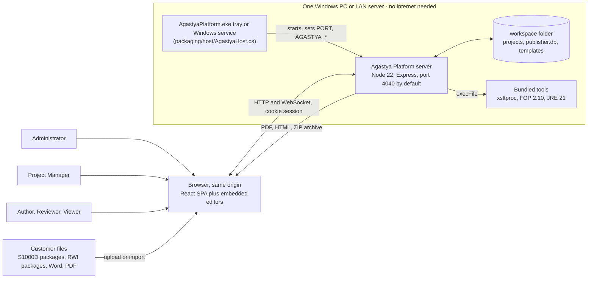
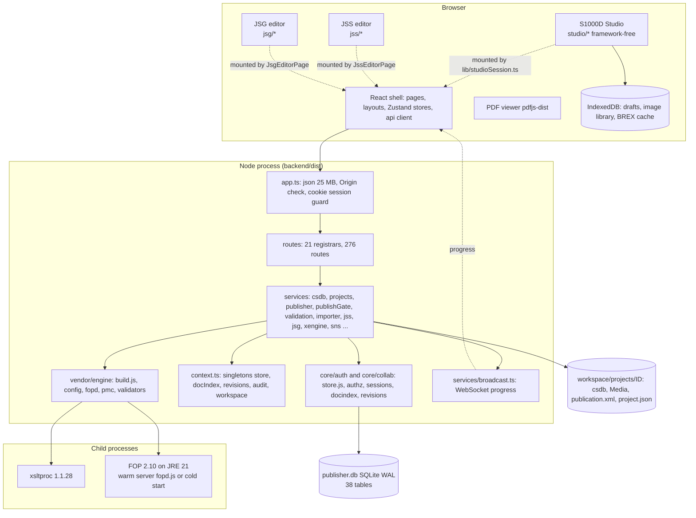
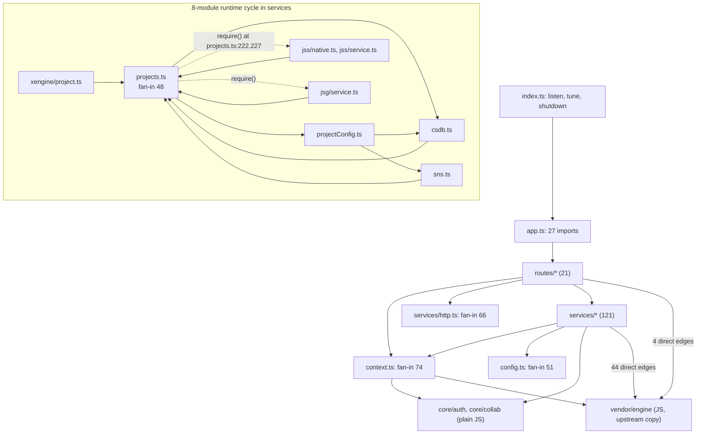
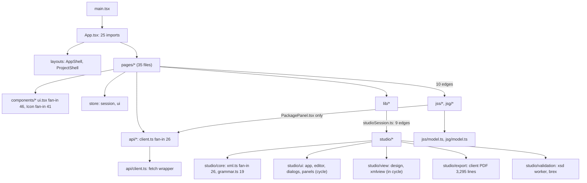
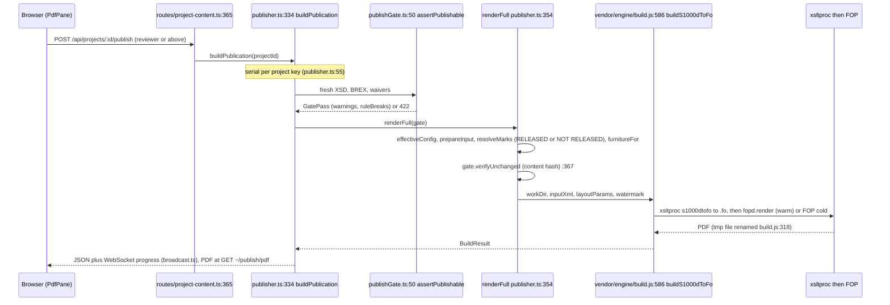
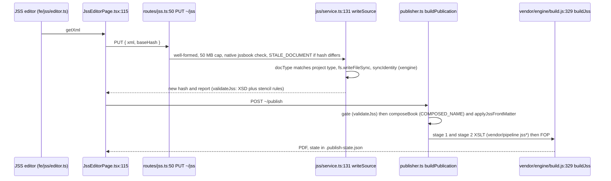
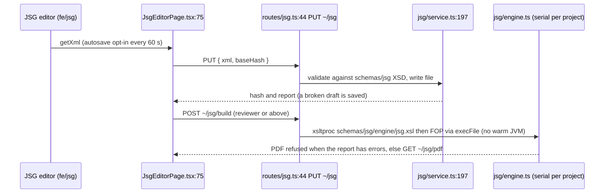

## 6. Module relationships

All diagrams are drawn from code I read (labels on the arrows name the file); edge counts come from `graph.mjs` (regular-expression import scanner, `import type` edges counted separately) and `layers.mjs`. They are simplifications: only edges that matter for understanding are drawn.

### 6.1 System context

### 6.2 Container view

### 6.3 Backend module dependency (src)

Edge counts: 861 internal edges among 187 files (backend `src` and `vendor/engine`); routes never import routes (0), services never import routes (0), core never imports services (0), vendor never imports src (0) (all VERIFIED by `layers.mjs`). 58 service files import `context.ts` (fan-in 74). Services reach into `vendor/engine` directly with 44 edges, routes with 4 (`routes/brand.ts:16`, `project-content.ts:40, 220, 237`).

### 6.4 Frontend module dependency (src)

661 internal edges among 183 files. Zero edges between `jss` and `jsg`, from `jss` or `jsg` to `studio`, from `studio` to the React shell, and from `pages` or `components` to the Studio internals (all VERIFIED by `layers.mjs`). The shell reaches the Studio only through `lib/studioSession.ts` (9 edges). One import cycle exists, inside `studio/ui` and `studio/view` (8 modules).

### 6.5 S1000D to PDF flow

### 6.6 JSS to PDF flow

### 6.7 JSG flow

