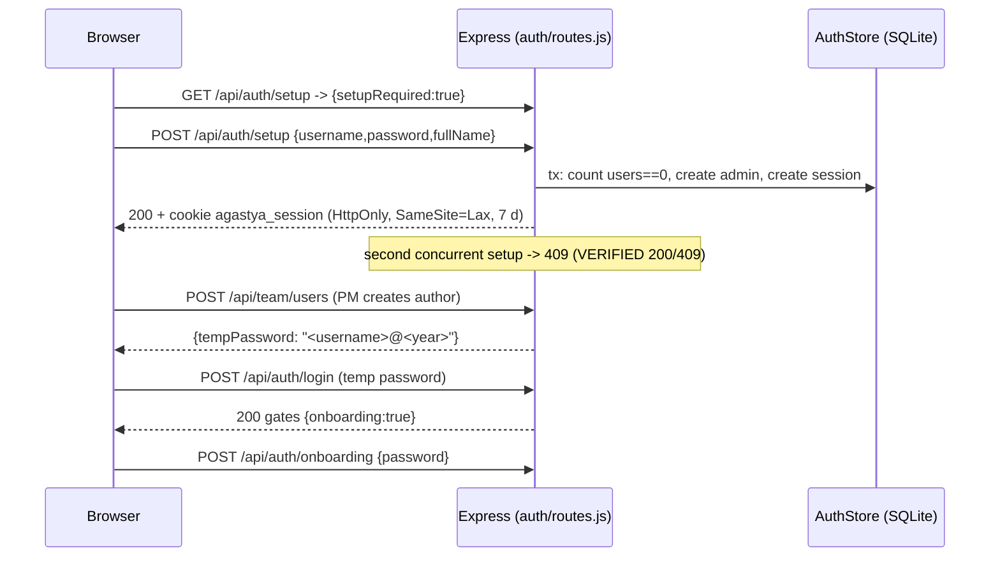
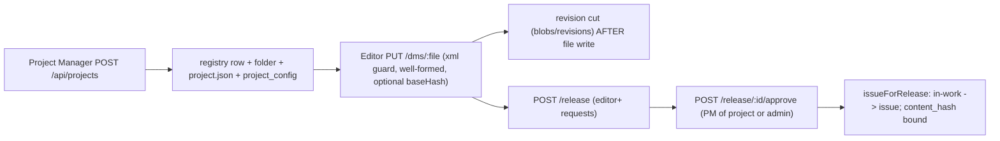

# 02.A - Platform functional audit (auth, governance, workspace, platform services)

**Author:** audit agent A (finding prefix PLT) · **Date:** 2026-11-26 · **Status:** audit only; no repository file was changed.

**Scope and method.** Feature-by-feature audit of the platform core of the Agastya backend (`backend/src` routes and services listed in section 0, `core/auth/*`, `core/collab/*`) and the places where the frontend consumes it (`frontend/src/pages/*`, `api/index.ts`). Evidence comes from reading the code, from the schema probe described in `10-DATABASE-AND-DATA-STRATEGY.md`, and from ten small probes (scripts `p1`-`p10` in the audit scratch folder, two of them in-process unit probes; ports 4051 and 4052 only; scratch workspace; never the real `workspace\`; 4040/4041 untouched). The probes ran against `backend/dist` (built 11/26 22:16, newer than `src`). Test files were read by name and assertion, not re-run; passing tests are not treated as proof. Labels: VERIFIED (observed running), OBSERVED (read in code), SUSPECTED, RECOMMENDATION, NOT VERIFIED. Priorities P0-P3; complexity S/M/L/XL as in the brief. Data-layer findings PLT-001 to PLT-013 are in `10-DATABASE-AND-DATA-STRATEGY.md`; this file holds PLT-014 to PLT-026; architecture findings (PLT-027 onward) are in `03.A-platform-architecture.md`.

**Status classes used:** Fully implemented and verified (FIV) · Implemented but needs improvement (INI) · Partially implemented (PI) · Frontend only (FO) · Backend only (BO) · Present but unreliable (PU) · Present but inefficient (PINE) · Missing (M) · Requires further investigation (RFI).

## 0. Coverage

| Area / path | Inspected | Verification | Limits |
|---|---|---|---|
| `core/auth/{routes,store,policy,authz,grants,sessions,crypto,rateLimit,bootstrap,xmlGuard}.js` | Inspected | runtime probes 1, 2, 6, 7, 8 | argon2 native path not exercised (scrypt fallback assumed in scratch env: NOT VERIFIED which one ran) |
| `core/collab/{docindex,revisions}.js` | Inspected | probe 2 (history) | - |
| `routes/{admin,team,workspace,packages,extensions,graphics,cir,brand,identity,waivers,lifecycle}.ts` | Inspected | route list extracted; probes on workspace, team, release | graphics/waivers/identity route bodies read, not exercised |
| `services/{activity,adminConfig,access-notify,backup,broadcast,enterprises,notifications,oversight,uploads,platform,http,graphics,cir,extensions,packageSettings,projects}.ts` | Inspected | probes 3-6, 9 | `assets.ts`, `registry.ts`, `zipio.ts` skimmed |
| `services/packages.ts`, `projectArchive.ts` (platform side) | Partially | code + test names | package content correctness belongs to other agents |
| Frontend pages `AuthScreens`, `Settings`, `Administrator`, `BackupPage`, `store/session.ts` | Inspected | code | not rendered in a browser by me |
| Frontend `Workspace`, `Overview`, `Activity`, `Notifications`, `Cir`, `Graphics`, `Oversight`, `ProjectSettingsPage` | Partially | route/API mapping only | UI audit belongs to agents D/E |
| Real `workspace\` | Not inspected | by brief | - |

## 1. End-to-end flows (traced)

### 1.1 First run, sign-in, onboarding

VERIFIED (probe 1): two simultaneous setup posts gave `200` and `409` (setup is in one `BEGIN IMMEDIATE` transaction, `routes.js:140`); cookie flags `HttpOnly; SameSite=Lax; Max-Age=604800`, no `Secure` unless `AGASTYA_SECURE_COOKIES=1`; a second login of the same user ends the first session (first `/me` 200 -> 401 after the second login). VERIFIED the temporary password is `priya@2026` and that an unauthenticated caller who guesses it can sign in, pass onboarding and lock the real user out (PLT-014).

### 1.2 Create project, work, release

VERIFIED: a Project Manager who is `owner`/`manager` of the project passed `canSubmit` and `canApprove` for the same release and approved their own request (`200`, probe 2; code `routes/project-content.ts:271-278`). Admins likewise (OBSERVED). PLT-015.

### 1.3 Delete and re-create a project

VERIFIED (probe 2): `DELETE /api/projects/:id?confirm=<name>` -> 200; a different Project Manager creating a project of the same name receives the same id and sees the old revisions (`4:create, 3:save, 2:save, 1:create`) and the old document lock. Filed as PLT-004 in the data report.

### 1.4 Backup, notification, live updates

`GET /api/backup` (any signed-in user: own projects; admin: whole platform JSON additionally) -> synchronous ZIP (PLT-001, PLT-005). `notify()` writes `notifications` rows; the UI polls counts; `broadcast.ts` pushes WebSocket events to cookie-authenticated sockets; VERIFIED sockets stay open after the session is revoked or the account disabled (PLT-017).

## 2. Feature audit

Each block: **Purpose / Frontend / Backend / Routes / Tables / Status / Validation / Errors / Tests / Limits and improvements.** "Tests" lists file names under `backend/test/`; "none" means no test found by name or by grep for the route (a search of test names, not proof of absence of indirect coverage).

### F01 First-run setup, auth and onboarding
* **Purpose:** create the first administrator; sign in/out; forced password change on temporary passwords; forgot-password request. **Frontend:** `pages/AuthScreens.tsx`, `store/session.ts`. **Backend:** `core/auth/routes.js`, `policy.js`, `crypto.js`, `bootstrap.js` (INITIAL_ADMIN_* env path), `masterPassword.js` (inert stub).
* **Routes:** `GET/POST /api/auth/setup`, `POST /api/auth/login|logout|onboarding|change-password|forgot`, `GET /api/auth/me`. **Tables:** `users`, `sessions`, `password_reset_requests`, `audit_log`.
* **Status:** **INI** (works; PLT-014 is a takeover; stale docs). **Validation:** password 8-128 chars plus a small common-password list, username 3-32 with reserved names (`policy.js`); input type checks. **Errors:** neutral `401 Sign-in failed`, `409` on second setup, `429` on limiter (VERIFIED).
* **Tests:** `api.test.js` (first run, master-password backdoor gone, 401 + HttpOnly), `phase17-security.test.js`, `rbac.test.js`; none for onboarding screen logic, forgot flow races, bootstrap env path.
* **Limits/improvements:** temp password scheme (PLT-014); no password expiry/history, no 2FA/SSO (PLT-027 in architecture); `policy.js` comment describes a random temporary password that is not implemented and `docs/PROJECT_ARCHITECTURE_AND_TECH_STACK.md:151` repeats it (PLT-025).

### F02 Users, roles, teams, enterprises
* **Purpose:** account lifecycle; three global roles (admin, project_manager, author); an administrator creates PMs, a PM creates authors; enterprise (CAGE) code lists. **Frontend:** `Settings.tsx` (Users, Authors tabs), `Administrator.tsx`. **Backend:** `auth/routes.js` admin routes, `routes/team.ts`, `services/enterprises.ts`.
* **Routes:** `POST /api/admin/users`, CSV import, disable/enable, reassign/ownerless/adopt, `POST /api/team/users`, `GET /api/team/users`, `GET /api/team/username-suggestion`, `GET /api/users/search`. **Tables:** `users`, `project_members`, `folder_owners`, `config_items`.
* **Status:** **INI**. **Validation:** username normalisation (NOCASE unique), role whitelist, CSV row checks; enterprise check refuses an import when code/name are not registered or mismatch (`enterprises.ts`; inactive when a list is empty). **Errors:** typed `HttpError`.
* **Tests:** `rbac.test.js` ("who can create which accounts"), `notifications.test.js` (username suggestion), `phase13.test.js` (enterprise check), `import-enterprise-refusal.test.js`. None for CSV import edge cases.
* **Limits:** no teams as a first-class object (a "team" is a Project Manager's authors); no groups, no delegated admin, no account expiry; "enterprise" means CAGE code lists, not tenants (single-tenant platform).

### F03 Sessions
* **Purpose:** cookie sessions, single active session per user, admin revoke. **Frontend:** `Settings.tsx` Sessions tab. **Backend:** `core/auth/sessions.js`, `store.js` sessions API, `rateLimit.js`.
* **Routes:** `GET /api/admin/sessions`, `POST /api/admin/sessions/:id/revoke`. **Tables:** `sessions` (`token_hash` SHA-256, `revoked_at`, `revoke_reason`).
* **Status:** **INI**. VERIFIED: displacement on second login; revoke ends HTTP session immediately; limiter returns 429 after 9 failures in a window and keeps refusing even the correct password (probe 1); `/forgot` shares the limiter (429). **Validation:** token hash only stored; 7-day absolute TTL. **Errors:** 401.
* **Tests:** none for expiry, displacement or the limiter by name. **Limits:** no idle timeout, no session list for the user themselves, in-memory limiter resets on restart and is per `username|ip` (PLT-022, PLT-023); WebSocket not tied to the session (PLT-017).

### F04 Admin configuration, policy and grants
* **Purpose:** 11 reference collections (info codes, DM types, CAGE codes, SNS...), app settings, asset policy, maintenance, folder grants. **Frontend:** `Administrator.tsx`, `AdminS1000d.tsx`. **Backend:** `routes/admin.ts`, `services/adminConfig.ts`, `platform.ts`, `core/auth/grants.js`, `routes/workspace.ts` (folder access).
* **Routes:** `/api/admin/config[/:collection[/:id]]`, `/api/reference`, `/api/app-settings`, `/api/admin/app-settings`, `/api/admin/asset-policy`, `/api/admin/maintenance/{reindex,check-schemas,clear-previews,rebuild-pdfs,audit.csv}`, `GET|PUT /api/folders/:key/access`. **Tables:** `config_items`, `folder_grants`, `folder_owners`.
* **Status:** **INI**. **Validation:** per-collection field checks; settings type-checked ("bad values are refused", `phase13.test.js`). **Errors:** typed. **Tests:** `phase13.test.js`, `phase17-security.test.js` (asset policy). 
* **Limits:** seeded once; no change history per item beyond the audit log; "policy" is a handful of settings, not a policy engine; `GET /api/admin/roles` is a descriptive list (`routes/admin.ts:63`), the `cap` labels are not enforced (PLT-016).

### F05 Workspace and project lifecycle
* **Purpose:** folders, project create/open/copy/rename/delete, sample projects, format catalogue. **Frontend:** `Workspace.tsx`, `Projects.tsx`, `Overview.tsx`, `ProjectSettingsPage.tsx`. **Backend:** `routes/workspace.ts`, `services/projects.ts`, `registry.ts`, `vendor/engine/workspace.js`.
* **Routes:** `/api/workspace`, `/api/overview`, `/api/folders*`, `/api/projects*` (list, create, sample, open, patch, delete, copy, summary), `/api/formats`, `/api/document-types`. **Tables:** `projects`, `project_members`, `project_config`, `documents`, `folder_*`.
* **Status:** **PINE** for lists (VERIFIED 1.0-1.4 s at 60 projects for an author, PLT-008), **PU** for delete/recreate (PLT-004) and boot reconcile (PLT-003). **Validation:** name required; confirm-by-name on delete; role checks. **Errors:** 500 with `details` leak (PLT-019); create is not atomic (PLT-009 in data report).
* **Tests:** `api.test.js`, `project-formats.test.js`, `project-delete-after-build.test.js`, `rbac.test.js`. None for same-name recreation or folder-missing boot.
* **Limits:** project id = slug of name; hard delete; no archive/restore of a deleted project; copy is a file copy.

### F06 Backup and restore
* **Purpose:** download a ZIP; there is no restore. **Frontend:** `BackupPage.tsx`, Administrator "Database backup" card. **Backend:** `services/backup.ts`, `zip.ts`, `routes/team.ts:132`. **Routes:** `GET /api/backup`. **Tables:** reads `users`, `project_members`, `audit_log`.
* **Status:** **PU** (labelled database backup, is not; blocks server) and **M** (restore). Details and numbers: PLT-001, PLT-005. **Tests:** `notifications.test.js` (scope, no hashes); `db-snapshot.test.js`, `s1000d-migration.test.js` for the pre-migration copy; no restore or large-workspace test.

### F07 Activity log and audit
* **Purpose:** who did what; admin sees all, PM their projects, authors none. **Frontend:** `Activity.tsx`, `components/ActivityView.tsx`, `Settings.tsx` Audit tab. **Backend:** `services/activity.ts`, `context.ts audit()`, `store.js` audit API. **Routes:** `GET /api/activity`, `GET /api/projects/:id/activity`, `GET /api/admin/audit`, `audit.csv`. **Tables:** `audit_log`.
* **Status:** **INI**. `audit()` never throws and strips keys matching `/password|hash|token|secret|cookie|credential/i`. **Limits:** no `project_id` index, no retention, CSV capped at 5000 rows (PLT-007); append-only is by convention (no hash chain, rows deletable by anyone with DB access); which events are audited was not enumerated (failed logins: NOT VERIFIED). **Tests:** `rbac.test.js` ("activity: admin sees everything, manager only managed, author nothing").

### F08 Notifications and access notifications
* **Purpose:** in-app notices for account creation, release request/decision, sharing and removal; read state per user. **Frontend:** `Notifications.tsx`, AppShell badges. **Backend:** `services/notifications.ts`, `access-notify.ts`. **Routes:** `GET /api/notifications`, `/unread-count`, `POST /api/notifications/read`. **Tables:** `notifications`.
* **Status:** **INI** (in-app only; no email/webhook; pull-based polling every 30 s). **Validation:** user-scoped queries. **Tests:** `notifications.test.js` (four scenarios). **Limits:** no digest, no retention (PLT-007).

### F09 WebSocket broadcast
* **Purpose:** push change events to open project views. **Frontend:** client socket in `store`/hooks (NOT inspected). **Backend:** `services/broadcast.ts` (`ws`, cookie-authenticated upgrade via `authz.authForUpgrade`, per-event `evaluate` against a `c.user` captured at connect).
* **Status:** **PU** for revocation. VERIFIED (probe 6): no cookie -> 401; upgrade accepted with `Origin: http://evil.example`; after admin session revoke and after account disable the socket stayed OPEN. **Tests:** none by name. PLT-017.

### F10 Uploads
* **Purpose:** large file intake. **Backend:** `services/uploads.ts` (multer disk storage in `os.tmpdir()/agastya-uploads`, 2 GB limit, 3 h request timeout, hourly sweep of stale `.upload` files; 507 on disk full), `routes/cir.ts` uses `memoryStorage` 16 MB x up to 100 files.
* **Status:** **INI**. **Tests:** `uploads-config.test.js` (timeouts, sweep, env fallback, 507). **Limits:** CIR memory path (PLT-021); no virus/size policy per role; pending package-import tokens held in an in-process `Map` (`routes/packages.ts:59`), lost on restart (PLT-031).

### F11 Graphics library
* **Purpose:** per-project ICN artwork and symbols with usage ("used by"), delete protection. **Frontend:** `Graphics.tsx`, `components/GraphicsView.tsx`, `project/GraphicsPage.tsx`. **Backend:** `routes/graphics.ts`, `services/graphics.ts`, `assets.ts` (SHA-256 cache by size+mtime). **Routes:** `GET /api/graphics`, project-level list/upload/delete. **Tables:** none (files).
* **Status:** **INI**. **Validation:** asset policy (active content refused, SVG with script refused). **Tests:** `phase13.test.js` ("graphics"), `phase17-security.test.js` (asset policy). 

### F12 CIR (common information repository)
* **Purpose:** shared module repository; copy into a project as a linked copy; update tracking. **Frontend:** `Cir.tsx`, `components/CirPicker.tsx`. **Backend:** `routes/cir.ts`, `services/cir.ts`. **Routes:** `/api/cir*`, `/api/projects/:id/cir-links*`. **Tables:** `cir_modules`, `cir_links` (a system project holds the files).
* **Status:** **INI**. **Validation:** enterprise check applies; linked copy read-only until detached. **Tests:** `phase13.test.js`, `cir-links.test.js`. **Limits:** every signed-in user may add or replace modules (`cir.ts:110, 192` call `csdb.writeDm(..., undefined, ...)` with no `baseHash`), delete is restricted to PM/admin; memory upload (PLT-021).

### F13 Brand packs
* **Purpose:** read-only company branding (logo, name) selected in Settings. **Frontend:** `Settings.tsx` picker. **Backend:** `routes/brand.ts` + `vendor/engine/brand` (id validated before touching a path). **Routes:** `GET /api/brand-packs`, `GET /api/brand-packs/:id/logo`. **Tables:** none (`templates/brand/<id>`).
* **Status:** **FIV** for what it claims (read-only). **Tests:** `brand-packs-route.test.js` (list, logo as image, 404 for unknown/traversal). **Limits:** no upload/management UI (by design: packs are installed on disk).

### F14 Extensions
* **Purpose:** admin-registered XSD profiles per project (enable per project). **Frontend:** `AdminS1000d.tsx`, `S1000dConfig.tsx`. **Backend:** `routes/extensions.ts`, `services/extensions.ts` (profiles under `workspace/extensions`). **Routes:** `/api/admin/extensions`, project `PUT .../extensions/:profileId`. **Tables:** `ext_profiles`, `project_ext`.
* **Status:** **INI**. **Tests:** `extensions.test.js` (five cases). **Limits:** 403 thrown as a plain `Error` with a `status` property (`extensions.ts:24`), so `wrap` can answer 500 instead of 403 (OBSERVED, not run; PLT-024).

### F15 Packages and package settings
* **Purpose:** S1000D project package and delivery package export/import, HTML publish, project archives for all formats. **Frontend:** `Projects.tsx` import wizard, `importSource.ts`. **Backend:** `routes/packages.ts`, `services/packages.ts`, `projectArchive.ts`, `packageSettings.ts`, `zipio.ts`. **Routes:** `/api/projects/import/detect|import`, `${base}/packages/{project,delivery,import,import-reports}`, `${base}/publish/html*`. **Tables:** `project_config`, `project_codes`, `project_sns`, `project_dm_types`.
* **Status:** **INI** (round trips tested; not exercised by me). **Validation:** archive refused when not an archive, newer version, unsafe path or XML. **Tests:** `package-settings.test.js`, `project-archive.test.js`, `packages.test.js`, `zipio.test.js`. **Limits:** pending-import map in memory; filename uses `req.project.name` which the guard object does not carry (`packages.ts:143, 152`), so downloads are named `project-project.zip` (PLT-024); S1000D settings exist only in the manifest, not as a separate export.

### F16 Waivers
* **Purpose:** record why a draft build may pass a missing BREX; never allows a release. **Backend:** `routes/waivers.ts`, `services/publishWaivers.ts` (atomic tmp+rename). **Frontend:** `project/PublishWaivers.tsx`. **Routes:** `GET|POST /api/projects/:id/publish-waivers`, `DELETE .../:wid`. **Tables:** none (project file).
* **Status:** **INI**. **Tests:** `publish-waivers.test.js`. **Limits:** an editor can create and delete waivers (no approver, no expiry); stored in a file; the route imports `audit` but which waiver actions it logs was not enumerated.

### F17 Identity
* **Purpose:** JSS/JSG S1000D identity (codes, publication code, visibility flags). **Backend:** `routes/identity.ts` -> `services/xengine/project`. **Routes:** `GET|PUT /api/projects/:id/identity`, `PUT .../identity/visibility`. **Status:** **RFI** (owned by the cross-engine area; only the route layer read). **Tests:** `xengine-identity.test.js`.

### F18 Oversight
* **Purpose:** administrator/PM dashboard of projects, release status, people in scope. **Frontend:** `components/Oversight.tsx`. **Backend:** `services/oversight.ts`, `activity.ts`, `release.ts`. **Routes:** `GET /api/oversight`, `GET /api/approvals`. **Tables:** `projects`, `project_members`, `releases`, `audit_log`.
* **Status:** **INI** (reads `project.json` per project: same linear cost as F05). **Tests:** none located. 

### F19 Project archive routes (platform side) and lifecycle
* Archive export/import and `routes/lifecycle.ts` (`/lifecycle`, `/lifecycle/events`, `working-revision`, `issue`, `obsolete`, `reinstate`, `supersede`, `change-marks`) are documented under F15 and by the S1000D agents. **Tests:** `lifecycle.test.js`, `lifecycle-reinstate.test.js`, `release-issue.test.js`, `project-archive.test.js` (`only someone who can read the project may export it`). **Status:** **INI**.

## 3. RBAC model against enterprise needs

**What exists (VERIFIED in `authz.js`, `store.js`).** Global roles `admin`, `project_manager`, `author`; project roles `viewer < reviewer < editor < manager < owner`; membership rows plus **folder grants** (`access_role`) combined by taking the stronger; admin is owner-equivalent everywhere; the CIR project is open to every signed-in user; single `evaluate()` for project capabilities; account gates (must change password/onboarding) enforced centrally; `routes-guarded.test.js` fails if a route is neither guarded nor declared public. `cap` strings (`'release.decide'`, `'project.read'`) are **labels in the audit trail only**, not inputs to a permission matrix.

| Enterprise need | Today | Gap |
|---|---|---|
| Fine-grained permissions (export, delete, waive, manage members as separate rights) | five ordered roles; checks are `minRole` comparisons | cannot grant "may export but not edit" or "may waive"; custom roles impossible (PLT-016) |
| Per-project ACLs | membership per project (VERIFIED) and per folder | no per-document or per-module ACL, no deny rules, no time-limited access |
| Separation of duties: author -> review -> approve -> release | a reviewer role exists; release = request (editor+) -> decision (PM of project or admin) | requester may approve own request (VERIFIED); no "different person" rule; no two-step approval; admin can do everything (PLT-015) |
| Delegation / groups | none | access by named person only; no groups or teams to grant |
| Admin separation (security admin vs content admin) | one `admin` | an admin who can read all content also manages users and sessions; cannot create projects (by design, `notifications.test.js`) |
| Audit of permission changes | member add/remove/role change audited (`access-notify`, audit rows) | no periodic access review report |
| Identity integration | local accounts only | no SSO/LDAP/SCIM (architecture report) |

**RECOMMENDATION (mandatory vs optional).** Mandatory: enforce `requested_by != decided_by` for releases (configurable "four-eyes" setting, default on for released/approved content) and log the override reason when an administrator waives it (PLT-015). Optional, only when the owner sets the enterprise requirement: introduce a permission table (`permissions`, `role_permissions`) and make `cap` strings real; per-folder/group grants; SSO via an auth-provider interface (architecture report).

## 4. Findings

### PLT-014 · P1 · VERIFIED · S · Temporary password is `username@year`: an unauthenticated person can take over a new or reset account before its owner signs in

**Category:** security (authentication).
**Problem:** Accounts created by an administrator or Project Manager, and accounts reset by an administrator, get the password `<username>@<current year>`. Anyone who knows the username can sign in first, complete onboarding with their own password, and lock the real user out. Usernames follow a predictable pattern (the creation screen suggests first name, then `firstname.lastinitial`, `team.ts` `username-suggestion`), and a signed-in user can search them (`/api/users/search`).
**Evidence:** `backend/src/core/auth/policy.js:116` (`tempPasswordFor`); used at `routes.js:533, 571, 712`; probe 1: admin created `priya`, response `tempPassword: "priya@2026"`; an anonymous client logged in with it (`200`, `gates.onboarding:true`), set `Attacker-Pass-77!` via `POST /api/auth/onboarding` (`200`), after which the real user's login with the issued temporary password returned `401`. Tests assert the scheme (`api.test.js:191`, `notifications.test.js:13`), so it is deliberate. The comment above `TEMP_ALPHABET` in `policy.js` and `docs/PROJECT_ARCHITECTURE_AND_TECH_STACK.md:151` describe "random temporary passwords", which is not what runs.
**Current implementation:** Deterministic temp password, valid until first onboarding, no expiry; limiter allows 9 guesses per window per `username|ip` but the first guess already succeeds.
**Recommendation:** Generate a random one-time password (>= 12 characters from `TEMP_ALPHABET`, which already exists in `policy.js`) shown once to the creator; store a `temp_password_expires_at` (for example 72 h) and refuse the sign-in afterwards; or issue a one-time invitation link. Update the two tests that assert the old scheme and the documentation.
**Expected outcome:** A new account cannot be guessed; an unused temporary password expires.
**Dependencies:** UI that displays the temp password once (already shows it).
**Risks:** Creators who rely on the predictable value to tell users by phone; mitigated by copy-to-clipboard and a "reissue" action.
**Acceptance criteria:** the temporary password is unpredictable, is shown once, and fails after expiry; the attacker flow of probe 1 returns 401.
**Test cases:** create user then guess `username@year` (401); use issued temp password within and after the expiry window; reset flow; onboarding replay with an old temp password.

### PLT-015 · P1 · VERIFIED · S · No separation of duties on release: the person who requests a release can approve it

**Category:** governance / compliance.
**Problem:** `canSubmit` allows roles editor, manager, owner; `canApprove` allows any administrator and any Project Manager who is `manager` or `owner` of the project. The same human satisfies both. For S1000D/defence-style review-approve-release controls that is a four-eyes failure.
**Evidence:** `backend/src/routes/project-content.ts:271-278`; decision route `:306-322` has no comparison between `requested_by` and the deciding user (it reads the requester only to notify); probe 2: Project Manager `rohit` (creator and owner of the project in that flow) sent `POST /release` (200) and then `POST /release/:id/approve` (200) on his own request.
**Current implementation:** the only rule is "an Author never approves their own work".
**Recommendation:** add a project or platform setting `requireDifferentApprover` (default on); refuse in `decide()` when `requested_by === user.id` unless an administrator supplies a reason that is audited; optionally require a reviewer sign-off before a request is approvable (review state already exists in `review.ts`). Waiver creation (F16) deserves the same rule for released content.
**Expected outcome:** every release has two distinct people on record.
**Dependencies:** a second approver must exist in small teams (admin can step in).
**Risks:** one-person companies; provide an explicit "solo mode" switch recorded in the audit log.
**Acceptance criteria:** self-approval returns 403 `SELF_APPROVAL`; an administrator override is audited with reason.
**Test cases:** PM requests and approves (403); admin approves PM's request (200); admin self-override with reason; withdrawn and re-requested release.

### PLT-016 · P1 · OBSERVED · L · RBAC is five ordered roles; `cap` strings are labels; no fine-grained, group or per-document permissions

**Category:** enterprise readiness (authorisation).
**Problem:** Authorisation is "role rank >= minimum" plus a few special cases (admin, CIR open, owner reading own project). Enterprise requirements such as export-only, waiver-only, auditor read-all, group grants, deny rules, delegated administration or access reviews cannot be expressed.
**Evidence:** `core/auth/authz.js:66-131` (`evaluate`, `minRole`, `cap` only passed through), `ROLE_RANK`; `routes/admin.ts:63` roles description; frontend `canMonitor(user)` role checks in `App.tsx:61`.
**Current implementation:** hard-coded roles in code; membership and folder grants in the DB.
**Recommendation:** only if the owner confirms the enterprise requirement: add a permission catalogue and role-to-permission table seeded with today's matrix (no behaviour change), switch `evaluate` to check permissions, then allow custom roles and groups; add an "Auditor" read-only global role first (cheapest win). Keep today's matrix as the default.
**Expected outcome:** administrators can tailor access without code changes.
**Dependencies:** PLT-015, architecture report (auth provider seam).
**Risks:** large test surface (`routes-guarded.test.js` and `rbac.test.js` are the safety net and must be extended first).
**Acceptance criteria:** the seeded matrix reproduces every existing role test; a custom role limited to "export" can export and nothing else.
**Test cases:** matrix test per route and role; deny precedence; group membership change takes effect without re-login.

### PLT-017 · P2 · VERIFIED · S · WebSocket stays authorised after session revocation or account disable, and ignores Origin

**Problem:** A revoked or disabled user's open socket keeps receiving project events; the upgrade accepts any `Origin`.
**Evidence:** probe 6: `crossOriginUpgradeAccepted: true`, `socketStateAfterRevoke: OPEN`, `socketStateAfterDisable: OPEN` while HTTP `/me` returned 401; `broadcast.ts:24` (`authForUpgrade` once), `:48` (`evaluate(c.user, ...)` with the user captured at connect). SameSite=Lax limits browser cross-site use; same-site different-origin (another port on the same host) is **SUSPECTED**, not tested with a real browser.
**Recommendation:** store `sessionId` on the socket and close it on revoke/disable/role change (hook in `store` revoke paths); re-resolve the user on each event or on a short timer; reject upgrades whose `Origin` is not the host (reuse the app.ts rule).
**Acceptance:** revoke closes the socket within a second; foreign Origin gets 403.

### PLT-018 · P2 · VERIFIED · S · `checkXmlSafety` is bypassed by a decoy DOCTYPE inside a comment or processing instruction

**Problem:** The guard scans from the first literal `<!DOCTYPE`, even one inside `<!-- -->` or `<? ?>`, then stops. A real DOCTYPE declaring a parsed external entity placed after the decoy is not inspected.
**Evidence:** `core/auth/xmlGuard.js` (`text.search(/<!DOCTYPE/i)`); unit probe 7: plain XXE refused; comment decoy `{"ok":true}`; PI decoy `{"ok":true}`; nested internal-entity expansion (`&c;` x10 chains) `{"ok":true}` (the declaration limit is 500 declarations, not expansion size). End to end through `PUT /api/projects/:id/dms/:file` (probe 8): the decoy passed the guard but was refused by the second parser (`entity not found:&x;`), so a **referenced** entity cannot be stored via the editor route; an **unreferenced** declaration can. Other entry points (package import, batch upload, CIR upload) were **NOT VERIFIED**.
**Recommendation:** replace the regex scan with a tokenising prolog scanner (skip comments/PIs/CDATA) or reject any document whose prolog contains more than one `<!DOCTYPE`; cap entity expansion depth/size; add the bypass strings to tests. Hand-off to the security agent for the import paths.
**Acceptance:** all three probe strings refused on every XML entry route.

### PLT-019 · P2 · VERIFIED · S · 500 responses return `details: <raw error message>`

**Problem:** `wrap` answers unexpected errors with `{ error: 'Internal error', details: e.message }`; messages can reveal SQL/table names, paths, library internals.
**Evidence:** `backend/src/services/http.ts:33`; probe 5 body `{"error":"Internal error","details":"database is locked"}`.
**Recommendation:** log the message with a correlation id, return `{error, id}` only; keep details in development (env flag).
**Acceptance:** no `details` in production responses; id appears in the log.

### PLT-020 · P2 · VERIFIED · S · Saves without `baseHash` overwrite silently (lost update)

**Problem:** `writeDm` checks the content hash only when the client sends `baseHash`; two saves without it both succeed and the second replaces the first.
**Evidence:** `services/csdb.ts:190-207`; probe 2: `[200, 200]` for two `PUT` without `baseHash`; with a stale hash `409`. Whether the shipped editor always sends `baseHash` was **not verified** (frontend agents). Locks exist (`/lock` returned 200) but were not tested against a non-holder write.
**Recommendation:** require `baseHash` (or `If-Match`) on every content write from the UI and API; return 428 when missing; keep an explicit `force` flag with audit for scripted imports.
**Acceptance:** PUT without hash refused; stale hash 409; editor shows merge/overwrite prompt.

### PLT-021 · P2 · OBSERVED · S · CIR upload uses memory storage (16 MB x up to 100 files per request) and replaces modules without a version check

**Problem:** A signed-in user can hold up to 1.6 GB of request data in memory per call and overwrite repository modules unconditionally.
**Evidence:** `routes/cir.ts:14` (`memoryStorage`, `fileSize 16 MB`), `services/cir.ts:110, 192` (`writeDm(..., undefined, ...)`); `app.ts:45` JSON limit 25 MB. Not run.
**Recommendation:** disk storage as in `uploads.ts`, lower `files` count, `baseHash` or "replace?" confirmation for existing ids.
**Acceptance:** 100 x 16 MB request does not raise RSS above a set bound; overwrite requires confirmation.

### PLT-022 · P2 · OBSERVED · S · Session policy gaps: single session, no idle timeout, plain HTTP, `Secure` cookie opt-in

**Problem:** One 7-day absolute session per user (a second sign-in kicks the first, VERIFIED), no idle timeout, no user-visible session list, HTTP-only server; `Secure` only with `AGASTYA_SECURE_COOKIES=1`; password change does not necessarily end other sessions (not verified).
**Evidence:** probe 1 `singleSession`; cookie header; `config.ts` `secureCookies`; `docs/OPERATIONS.md:80`.
**Recommendation:** idle timeout setting (default 8-12 h), TLS termination guidance enforced by a startup warning when bound to a non-loopback address without `SecureCookies`, revoke other sessions on password change; keep the single-session rule configurable (shared machines vs two devices).
**Acceptance:** idle expiry works; LAN bind without TLS logs a warning.

### PLT-023 · P2 · VERIFIED · S · Login rate limiter is in-memory, shared with forgot-password, and keyed on the socket address (the proxy address behind a reverse proxy)

**Problem:** State is lost on restart; keys are `username|ip` so many IPs can guess one user; `/forgot` returned 429 after login failures. The IP is `req.socket.remoteAddress` (`context.ts:107`, `routes.js:58`), not Express's `req.ip`, although `app.set('trust proxy', 1)` is configured and `docs/OPERATIONS.md:80` recommends a TLS reverse proxy. Behind such a proxy every client shares the proxy's address: audit-log IPs are all the proxy, and one person's ten failed attempts (or an attacker's) lock that username out for everyone (SUSPECTED from code; not run through a proxy).
**Evidence:** probe 1 (`forgot: 429`, `rateLimitStatuses` nine 401 then 429); probe 10: 40 attempts with a different `X-Forwarded-For` each were all 429, confirming the header is ignored (so spoofing does not bypass the limiter, which is the good half); `core/auth/rateLimit.js`.
**Recommendation:** derive the client address through `req.ip` only when a trusted-proxy setting is configured (an explicit `AGASTYA_TRUST_PROXY` value instead of the hard-coded `1`); persist counters; add a per-account ceiling with exponential delay rather than lock-out; separate buckets for forgot and login.
**Acceptance:** behind a test proxy two clients have separate buckets and audit rows show real addresses; counters survive restart.

### PLT-024 · P3 · OBSERVED · S · Small defects: extension 403 may become 500; package downloads named `project-project.zip`

**Evidence:** `routes/extensions.ts:24` (`Object.assign(new Error(...), {status:403})` vs `wrap` handling `HttpError`); `routes/packages.ts:143, 152` (`req.project.name`). **Recommendation:** use `forbidden()` from `services/http`; read the name from `readProjectJson`. **Acceptance:** 403 returned; file named after the project.

### PLT-025 · P3 · VERIFIED · S · Documentation contradicts the code in places

**Evidence:** `docs/PROJECT_ARCHITECTURE_AND_TECH_STACK.md:151` (random temporary passwords) vs `policy.js:116`; `vendor/engine/license.js` (Ed25519 licence, clock-tamper detection) is referenced nowhere while the UI states "this build does not enforce a licence"; a stale `Surname@Year` comment in `routes.js`. **Recommendation:** fix docs; remove or wire `license.js` by owner decision. **Acceptance:** docs match behaviour.

### PLT-026 · P2 · OBSERVED · M · Test gaps in the platform core

**Problem:** no test found by name or grep for: WebSocket, session expiry/displacement, rate limiter, `reconcileRegistry`, same-name project recreation, large-workspace backup, restore (none exists), CIR overwrite, oversight, CSV user import edge cases, concurrent writers/busy handling, `reset-admin`.
**Evidence:** `backend/test` listing (87 files) and greps (`WebSocket|broadcast` and `rateLimit|429` matched no platform tests).
**Recommendation:** add the probe scripts of this audit as regression tests (they already encode the expectations): probes 1, 2, 5, 6, 9 are 20-60 lines each.
**Acceptance:** tests fail on the current code and pass after PLT-002/003/004/014/015/017.

## 5. Strengths (not findings)

* Central `evaluate()` plus `routes-guarded.test.js` makes "forgot to guard a route" a failing test.
* Passwords hashed with Argon2id (scrypt fallback), tokens stored only as SHA-256, cookies HttpOnly + SameSite=Lax, cross-origin writes refused by Origin check, first-run setup race-safe (VERIFIED `200/409`).
* Release approval is bound to a content fingerprint and issues revisions inside one transaction; one pending release per project is enforced by a partial unique index.
* Revisions are content-addressed and re-verified; uploads sweep and 507 handling exist; waivers use atomic writes.
* Master-password backdoor from the older product is neutralised and tested.
* Audit helper never throws and redacts sensitive keys.

## 6. Unknowns and limitations

* The real workspace and its data were not opened; all runtime evidence is from scratch workspaces and synthetic projects, one client, Windows Server 2025, Node v22.23.2.
* Whether Argon2id or the scrypt fallback was active in the scratch runs is NOT VERIFIED.
* The shipped editor's use of `baseHash`, WebSocket client behaviour and the 30 s polling were not inspected (frontend agents).
* Administrator password-reset approval flow, CSV import, folder grants UI and ownerless/adopt flows were read but not exercised.
* Identity (F17) and lifecycle (F19) behaviour is owned by other agents; only the route layer is covered here.
* Email notification, SSO and HA do not exist in the code and were therefore not tested; statements about them are RECOMMENDATION only.
