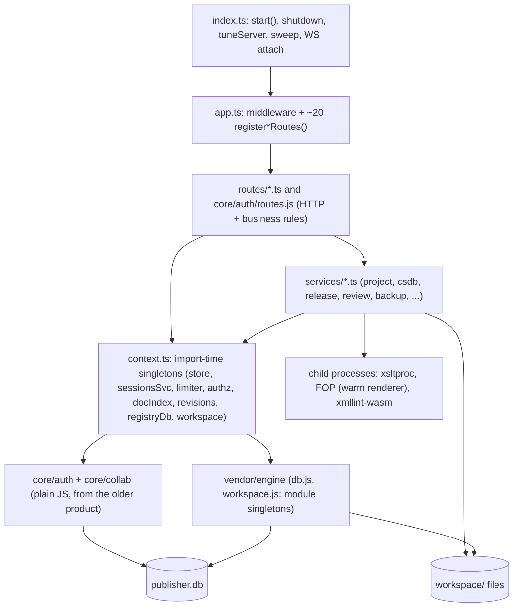
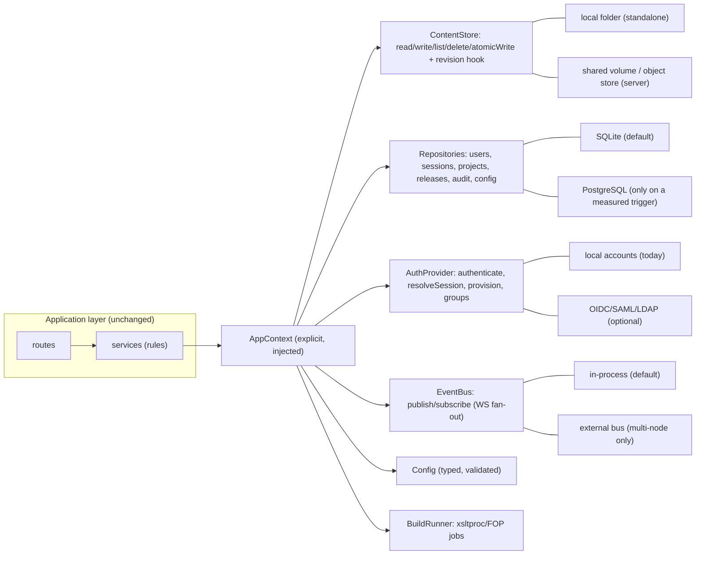

# 03.A - Platform architecture audit (layering, wiring, seams for standalone and server)

**Author:** audit agent A (finding prefix PLT) · **Date:** 2026-11-26 · **Status:** audit only; no repository file was changed.

**Scope and method.** Structure of the Agastya backend platform core: `backend/src/{index,app,config,context}.ts`, `types.d.ts`, `core/auth/*`, `core/collab/*`, the routes and services listed in the brief, `vendor/engine/{db,workspace,license}.js`, and how the test harness boots the application. Evidence: reading the code, counting imports and call sites with grep, the schema probe and the scratch-server probes described in `10-DATABASE-AND-DATA-STRATEGY.md` and `02.A-platform-functional.md` (ports 4051/4052, scratch workspace, never the real `workspace\`, never 4040/4041). Labels: VERIFIED (run or counted), OBSERVED (read in code), SUSPECTED, RECOMMENDATION, NOT VERIFIED. Priorities P0-P3; complexity S/M/L/XL. Findings in this file are PLT-027 to PLT-032. Recommendations are **minimum seams**, not a rewrite; each is marked mandatory (needed for a safe server mode) or optional.

## 0. Coverage

| Area / path | Inspected | Verification | Limits |
|---|---|---|---|
| `index.ts`, `app.ts`, `config.ts`, `context.ts`, `types.d.ts` | Inspected | runtime (boot, probes) + grep counts | - |
| `core/auth/*.js` (11 files), `core/collab/*.js` (2 files), 3,746 lines of plain JS | Inspected | runtime probes | argon2 path not distinguished |
| Platform routes and services in the brief | Inspected | grep counts for coupling; probes | `assets/registry/zipio` skimmed |
| `vendor/engine/{db,workspace,license}.js` | Inspected | code; `db.js` singleton confirmed | licence module has no caller |
| `test/helpers.js` boot pattern | Inspected | code | tests not re-run |
| Build/packaging wiring (`start.mjs`, host service) | Not inspected here | - | agent F |
| Other engines (S1000D/JSS/JSG internals) | Not inspected | - | agents B, C |

## 1. Layering as it is

Facts (VERIFIED by count unless stated): **74** source files import `context` (71 via `'../context'`), 27 call sites of `store.stmt(` / `store.db.prepare(` / `store.db.exec(` sit directly in `routes/` and `services/` (7 files: `routes/extensions.ts`, `routes/project-content.ts`, `services/{activity,bootReference,cir,extensions,lifecycle}.ts`). `context.ts:68-84` exports `store`, `sessionsSvc`, `limiter`, `authz`, `docIndex`, `revisions`, `registryDb`, `workspace` all typed `any`; `types.d.ts` types `req.auth` and `req.project` as `any`. `AuthStore` has about 109 methods in one 1,571-line class (counted by method-signature grep; approximate) covering users, sessions, notifications, audit, releases, locks, invitations, folders, change requests, review comments, config items, CIR.

## 2. Plain-JS core versus TypeScript

* The TypeScript layer (routes, services) is compiled and type-checked, but everything it calls in `core/*` and `vendor/*` is untyped JS reached through `any`. A wrong argument name or a renamed store method fails at run time. `config.ts` documents `vendor()` as "engine code that is deliberately not type-checked".
* `core/auth/routes.js` is a **route module inside the core**: it mixes HTTP, authentication, user administration, project membership, invitations, ownerless/adopt/reassign and admin approval queues (700+ lines). Project-governance routes (`/api/projects/:id/members`, adopt, make-ownerless) live there while `routes/team.ts` has a second membership entry point (`POST /api/projects/:id/assign`). `access-notify.ts` states that both call it. Two doors to the same mutation (PLT-029).
* Positive: the core was written with injection in mind in places (`createAuthz({ store, sessions, workspaceDir, projectDirFor })`, `ensureBootstrapAdmin({ store, audit, env, log, now })`, `new AuthStore(sqlite)`), so the pattern for a factory already exists; `context.ts` simply instantiates it once at import.
* **RECOMMENDATION (optional, M):** add JSDoc or `.d.ts` interfaces for `AuthStore`, `SessionService`, `Authz` and replace `any` in `context.ts`; do it per aggregate, starting with the methods used by routes. No rewrite needed.

## 3. Singleton coupling in `context.ts`

**VERIFIED (code + test harness).** Importing `context` performs work: `ensureWorkspace`, template seeding (`seedTemplates()`, revision-based replace with `.revN.bak`), `registry.open` (the engine `db` is a module singleton; `db.js` returns the existing handle when `db` is set), `new AuthStore`, the pre-migration snapshot, `store.migrate()`, then constructs sessions, limiter, authz, doc index and revisions. `config.ts` reads `AGASTYA_WORKSPACE_DIR` once, at first load.

Consequences:

1. **The wrong-workspace hazard is real and already documented by the test harness:** `test/helpers.js` refuses to run if `dist/config` was loaded before `boot()` set the environment, because otherwise "the app would then open, seed and write to THAT" - the developer's real workspace. Any script or future tool that requires `dist/services/*` first has the same risk (this audit's own probes had to set the environment before the first `require`).
2. **One instance per process.** Two workspaces, or an in-process restore into a fresh directory, are impossible without a new process. A restore command (PLT-001) and a "verify backup" job (data report 9.7) must run as separate processes.
3. **No way to substitute parts** for server mode (shared auth, different storage) or for tests (clock, ids, disk). 74 files import the singleton; replacing it later is a mechanical but large change.
4. **Side effects at import** hide failures (OBSERVED, not run): a migration error is thrown while `index.ts` is still importing `context`, so `start()`'s own error handling (`index.ts:55`, "Failed to start") is never reached; Node prints the stack and exits.

**RECOMMENDATION (mandatory for server mode, L):** introduce `createAppContext(config): AppContext` returning the same objects, keep `context.ts` as a facade (`export const { store, ... } = defaultContext()`) so 74 files do not change on day one, and migrate modules to receive `ctx` (or `req.ctx`) incrementally, starting with new code and with the places that need substitution (backup/restore, auth, content store). Remove import-time `migrate()` in favour of an explicit `ctx.start()` step so the process can report migration errors cleanly (see PLT-028).

## 4. Route and service boundaries

| Observation | Evidence | Impact |
|---|---|---|
| Business rules live in routes | `routes/project-content.ts:271-338`: `canSubmit/canApprove`, issuing, fingerprint update via `store.stmt('UPDATE releases SET content_hash...')`, notifications and audit in the handler | rules cannot be reused by CLI/API/batch, and unit-testing needs HTTP; self-approval gap (PLT-015) sits here |
| Raw SQL outside the store | 27 sites in 7 files (section 1) | schema changes need grep; no single place to add tenancy filters or soft delete |
| Services depend on HTTP-free helpers (good) | `services/http.ts` `HttpError`, `wrap`, `forbidden` | consistent error shape; but `extensions.ts:24` throws a plain `Error` with `status` (PLT-024) |
| Cross-service reach into engine internals | `services/projects.ts` calls `workspace.*`, `registryDb.*`, `store.*`, `docIndex.*`, `PC.*` in one function (`createProject`, `deleteProject`) | multi-step orchestration without a transaction or unit of work (data report PLT-009, PLT-004) |
| Two sources of truth for "project" | engine `projects` row, `project.json` on disk, `documents` rows, `project_config`, folder mirror `store.setProjectFolder`; reconciled at boot by `reconcileRegistry` | drift is corrected by deleting rows (PLT-003); list routes read `project.json` per project (PLT-008) |

**RECOMMENDATION (optional, M):** move release/review rules into `services/release.ts` (it already holds `releaseStateOf`, `decideRelease`) with a pure function `assertCanDecide(user, project, release)` used by the route and tests; forbid new `store.stmt` outside `core/` by a lint rule.

## 5. Duplicated implementations

* **Two ZIP writers.** `services/zip.ts` `ZipWriter` (in memory, no ZIP64, truncating `u16/u32`) is used only by `services/backup.ts`; `services/zipio.ts` has `ZipFileReader` with extraction limits and `ZipStreamWriter` (streaming, back-pressure, ZIP64) used by `packages.ts`, `htmlPublish.ts`, `routes/jss-rwi.ts` (VERIFIED by grep). The weaker one guards the most important output (backup).
* **Two project registries** (engine `projects`/`files` tables in `db.js` and `documents`/`project_config` in the auth store) plus `project.json`; the engine `files` table is unused.
* **Two reference stores for SNS and information codes:** legacy flat `config_items` collections (`sns`, `info-codes`) and the `ref_*`/`sns_presets` tables; `bootReference.ts` carries authored legacy rows over once and leaves the old collections in place.
* **Two membership mutation paths** (`core/auth/routes.js` member routes and `routes/team.ts` assign), each calling `notifyAccess`.
* **Name collision:** `services/registry.ts` is the document-type registry; `registryDb` in `context.ts` is the engine project registry.
* Dead code: `vendor/engine/license.js` (no caller), tables listed in the data report (PLT-010).

## 6. What must be abstracted so one code base serves standalone and client-server

| Seam | Mandatory for server mode? | Minimal shape | Why |
|---|---|---|---|
| **Config** | yes (S) | one typed `Config` built and validated at start (`port`, `host`, `workspaceDir`, `trustProxy`, `secureCookies`, `uploadTmp`, limits); all env reads in `config.ts` | today env is also read in `app.ts:54` (`AGASTYA_DEV_ORIGINS`), `index.ts:61` (`AGASTYA_SHUTDOWN_ON_STDIN_CLOSE`), `uploads.ts:12` (timeouts), `services/importer/recover/pdfjs.ts:22`; `app.set('trust proxy', 1)` is hard-coded (PLT-023) |
| **Storage (content)** | yes (M-L) | `ContentStore` interface covering the ~dozen operations `csdb.ts`, `projects.ts`, `backup.ts`, `packages.ts` perform (read, atomic write, list, delete, stat, stream); default `LocalFolderStore`; revision cut is part of `write` so it cannot be skipped (data report PLT-009) | gives atomic writes in one place, a seam for locking and for a shared volume, and makes backup/restore implementable; engines (xsltproc/FOP) still need a local path, so the store must be able to materialise a working directory |
| **Storage (metadata)** | no, until PostgreSQL is adopted | keep `AuthStore`; split it by aggregate behind interfaces only when a second engine is real | an interface with 109 methods written for a database that is not adopted is waste |
| **Auth provider** | only if the owner needs SSO | `AuthProvider { authenticate(req): Principal; resolveSession(token); provisionUser(external) }` with today's local accounts as the default implementation; keep roles in the platform, take identity from the provider | server customers will ask for directory sign-on; adding it later inside `routes.js` is harder than a seam now |
| **Session/limiter stores** | yes for more than one node (S) | interface with in-memory default and a table-backed implementation | limiter and sessions must survive restart (PLT-023) |
| **Event bus** | only for more than one node | `publish(event)` / `subscribe`; default `EventEmitter`; WS layer subscribes | `broadcast.ts` keeps client sockets in process memory (PLT-031) |
| **Clock/ID/logger** | optional (S) | injected `now`, `newId`, `log` | deterministic tests; correlation ids for PLT-019 |

**Mode matrix (RECOMMENDATION).**

| Concern | Standalone | Server |
|---|---|---|
| Bind / TLS | loopback, HTTP | LAN/proxy; TLS at proxy; `trustProxy` explicit; refuse non-loopback bind without TLS setting or print a warning |
| Auth | local accounts | local or provider; stronger password policy; idle timeout (PLT-022) |
| Data | local folder + SQLite | same on a dedicated disk, optional second engine on trigger |
| Backup | in-product scheduled backup | backup to separate volume + off-box copy; restore command |
| Jobs | in-process child processes | same; queue limit per server |
| Config source | `agastya.ini` via the host | same plus environment overrides |

The data strategy that matches these seams is in `10-DATABASE-AND-DATA-STRATEGY.md` section 9.

## 7. How services are wired: weaknesses

* **Startup sequence.** `index.ts` `start()`: reconcile registry -> bootstrap admin -> `createApp()` -> start renderer -> `tuneServer` -> hourly upload sweep -> attach WebSocket -> listen. Migrations run earlier, at import. A failure in the middle leaves the warm renderer or timers running until process exit (OBSERVED). Boot work (`reconcileRegistry` reads every project; `docIndex.reconcileAll`) grows with content.
* **Shutdown.** `stop()` stops the renderer, closes the WS server and `server.close()` (keep-alive connections remain until they end); `process.exit(0)` follows after 500 ms. The SQLite connection is never closed and no `wal_checkpoint` is issued (OBSERVED; data report PLT-013). Windows stdin-close shutdown (`AGASTYA_SHUTDOWN_ON_STDIN_CLOSE`) is documented in `index.ts`.
* **Health.** `GET /api/health` returned `{"status":"ok","version":"2.0.0","time":...}` (VERIFIED) and, from the code, is a pure liveness probe (`app.ts:65`): it does not touch the database or disk. A server behind a monitor needs a readiness check (DB `SELECT 1`, free disk, workspace writable).
* **Error handling.** One `wrap` helper, one global error handler (`507` for disk full), good; leaks `details` on 500 (PLT-019); SQLite `BUSY` is not mapped (data report PLT-002).
* **Process-local mutable state** (section 8, PLT-031): rate limiter `Map`, pending package-import tokens `Map` (`routes/packages.ts:59`), WS client set, prepared-statement cache `Map` (`store.js:638`), warm FOP renderer. Fine for one process; blocks horizontal scale and loses state on restart.
* **Tests as architecture feedback.** The suite boots the real compiled app in-process on a temp workspace (`test/helpers.js`) and needs `npm run build` first; it is a strength for realism and a symptom of the singleton (tests cannot isolate a service).

## 8. Findings

### PLT-027 · P2 · OBSERVED · L · Authentication is hard-wired to local accounts; no seam for SSO, directory sign-on or two-factor

**Problem:** `routes.js` verifies passwords against `users.password_hash`; sessions, the limiter and the password policy are fixed implementations. There is no provider interface, no group concept, no external-identity linking, no TOTP/WebAuthn.
**Evidence:** `core/auth/routes.js` login handler (`:184-`), `core/auth/{crypto,policy,sessions,rateLimit}.js`, `users` columns (no external id); `vendor/engine/license.js` (unused) shows no identity hooks either.
**Recommendation:** only when the owner states the requirement: extract `AuthProvider` (section 6), implement OIDC first (one standards-based protocol covers most corporate directories), map claims to the existing roles, keep local accounts as the standalone default and as the break-glass admin. Not before.
**Acceptance:** with a test OIDC provider, a user signs in, is provisioned with the default role, and revocation at the provider ends access at the next token refresh; local mode unchanged.

### PLT-028 · P1 · VERIFIED · XL · No explicit application context: import-time singletons prevent server-mode variants, in-process restore and isolated tests, and can write to the wrong workspace

**Category:** architecture / deployability.
**Problem:** `context.ts` builds the whole platform at import using module-level singletons (`vendor/engine/db.js` handle, `config`, `AuthStore`), and 74 files import it. The data directory is frozen at first load; migration and seeding run as a side effect of `require`.
**Evidence:** `backend/src/context.ts:27-84` (construction and exports, all `any`); `vendor/engine/db.js:17-19` (`if (db) return db`); `backend/src/config.ts:30` (workspace read once); `test/helpers.js:20-30` (guard against loading `dist/config` before the environment is set, with the comment that otherwise the app would write to the developer's real workspace); count of 74 importing files and 27 raw SQL sites (section 1).
**Current implementation:** one process = one workspace = one database = one auth store; configuration by environment only.
**Recommendation:** section 3: `createAppContext(config)` factory; `context.ts` becomes a facade; start-up becomes an explicit `ctx.start()` (migrate, seed, reconcile); new code (backup/restore, auth provider, content store) takes `ctx`. Do it in this order: (1) `Config` object and explicit start (S-M), (2) `ContentStore` extracted from `csdb.ts`/`projects.ts`/`backup.ts` (M-L), (3) `AuthProvider` seam (M), (4) migrate remaining modules opportunistically.
**Expected outcome:** a server build can swap storage/auth; restore and "verify backup" run in-process on a scratch context; tests isolate services.
**Dependencies:** PLT-001 (restore needs it), PLT-006 (explicit start owns the pre-migration snapshot).
**Risks:** large mechanical diff; mitigate with the facade so behaviour does not change and the existing suite stays green after each step.
**Acceptance criteria:** two `AppContext` instances with different workspaces run in one test process without interference; the existing API suite passes unchanged with the facade; a restore into a new directory works without restarting the process.
**Test cases:** two contexts, two workspaces, write in one and assert absence in the other; migration failure reported by `start()` rather than as an import exception; a context built on a read-only workspace fails fast with a clear message.

### PLT-029 · P2 · VERIFIED · S · Duplicated implementations, notably the weak ZIP writer guarding the backup

**Problem:** two ZIP writers (`zip.ts` for backup, `zipio.ts` for everything else), two project registries, two SNS/info-code stores, two membership-mutation entry points, one dead licence module, a naming collision between `registry.ts` and `registryDb`.
**Evidence:** section 5; grep `ZipWriter`/`ZipStreamWriter` usages (`backup.ts:11,30` versus `packages.ts:34`, `htmlPublish.ts:28,250`, `routes/jss-rwi.ts:16,60`).
**Recommendation:** point `backup.ts` at `ZipStreamWriter` and delete `zip.ts` (data report PLT-005); route team `assign` through the same service function as the member routes; rename `registry.ts` to `docTypes.ts`; decide on `license.js`.
**Acceptance:** one ZIP writer in the tree; one function mutates membership; no unused module in `vendor/engine`.

### PLT-030 · P2 · VERIFIED · M · Untyped core boundary and SQL outside the store

**Problem:** every platform object is `any` at the boundary; 27 raw SQL call sites in 7 routes/services files bypass the store's methods; business rules sit in route handlers.
**Evidence:** `context.ts:68-84`; `types.d.ts`; grep counts; `routes/project-content.ts:316`.
**Recommendation:** typed facades for the store methods that routes use; a lint rule against `store.stmt(`/`store.db.` outside `core/`; move the release decision rule into `services/release.ts`.
**Acceptance:** `tsc` flags a renamed store method used by a route; no raw SQL outside `core/` and `services/*Repository`.

### PLT-031 · P2 · VERIFIED · M · Process-local state, shallow health check and no graceful database shutdown

**Problem:** limiter, pending package-import tokens, WebSocket clients and statement cache live in process memory (lost on restart, impossible to share across two servers); `/api/health` is liveness only; shutdown never closes the DB or checkpoints the WAL; the unbounded `stmt()` cache would grow with any dynamic SQL.
**Evidence:** `routes/packages.ts:59`, `core/auth/rateLimit.js`, `services/broadcast.ts`, `store.js:638`, `app.ts:65`, `index.ts:53-60`; probe 1 (limiter 429 behaviour), probe 6 (sockets).
**Recommendation:** persist pending import tokens (a table or temp-file manifest with expiry), add `GET /api/ready` (DB `SELECT 1`, workspace writable, free disk threshold), close the DB and `wal_checkpoint(TRUNCATE)` on shutdown, cap the statement cache.
**Acceptance:** a pending import survives a restart within its expiry; readiness fails on a read-only workspace; clean shutdown leaves no `-wal` residue.

### PLT-032 · P3 · OBSERVED · S · Configuration is scattered and partly hard-coded

**Problem:** environment variables are read outside `config.ts` (`app.ts:54`, `index.ts:61`, `services/uploads.ts:12`, `services/importer/recover/pdfjs.ts:22`); `trust proxy` is fixed to 1; there is no startup validation or "print effective configuration" (the host's `agastya.ini` maps to env outside this repo layer).
**Recommendation:** one typed `Config` with defaults and validation, logged at start (without secrets); `AGASTYA_TRUST_PROXY` explicit.
**Acceptance:** `grep process.env` outside `config.ts` returns nothing; invalid values stop start-up with a named variable.

## 9. Strengths (not findings)

* Routes, services and core are in separate folders with a consistent `register*Routes(app)` pattern and one error type; `routes-guarded.test.js` enforces that every route declares its access.
* The core already accepts injected dependencies in several constructors; a factory is a small step.
* The engine and pipeline are isolated as child processes; the warm FOP renderer is encapsulated in `services/renderer.ts`.
* Content/metadata split (files + SQLite) is simple and fits both modes.
* The test harness runs the real compiled app, so integration coverage is genuine.

## 10. Unknowns and limitations

* Counts (74 importers, 27 SQL sites, about 109 store methods) are grep-based and approximate; they are not a complete dependency graph.
* No profile was taken of where request time goes beyond the probes in the data report; the interface sizes proposed in section 6 are estimates from reading `csdb.ts`, `projects.ts`, `backup.ts`, `packages.ts`, not measured.
* Packaging, service hosting and the Windows host program were not inspected (agent F).
* Whether the frontend assumes cookie-session semantics that an SSO provider would change was not examined (agent D).
* Behaviour with two server processes on one workspace, and behind a real reverse proxy, was not run; statements about them are SUSPECTED.
