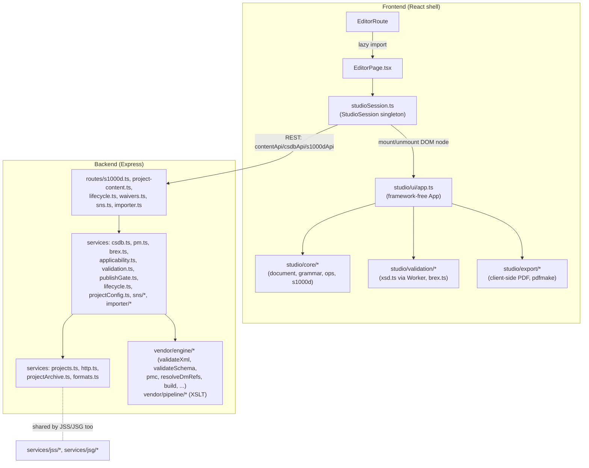

# S1000D engine architecture (Agent B)

Scope and method: same code base as the functional report (`02.B-s1000d-functional.md`); this file focuses on boundaries, coupling, dead/duplicated code, and how the Studio is embedded in the React shell. Evidence is code reading plus the same scratch-server probes already run for the functional report (not repeated here).

## Coverage table

| Area | Status | Notes |
|---|---|---|
| Service-layer boundaries (`services/*.ts`) | Inspected | Full read of the S1000D-specific services; cross-referenced against `services/jss/*`, `services/jsg/*`, `services/xengine/*` to judge what is shared vs. S1000D-only |
| Route-layer boundaries (`routes/*.ts`) | Inspected | Full read of the S1000D routes; skimmed JSS/JSG routes for comparison |
| `vendor/engine/*`, `vendor/pipeline/*` | Partially inspected | Read the files the S1000D services call into (`validateXml.js`, `validateSchema.js`, `pmc.js`'s API shape, `resolveDmRefs.js`'s API shape, `paths.js`); did not read the XSLT pipelines themselves |
| Studio embedding (`lib/studioSession.ts`, `pages/project/EditorPage.tsx`, `EditorRoute.tsx`) | Inspected | Full read |
| Studio internals (`studio/core`, `studio/ui`, `studio/view`, `studio/export`) | Partially inspected | Read enough to characterise the architecture (document model, undo, validation orchestration, PDF export entry points); did not read every file line by line |
| Cross-engine architecture doc (`docs/CROSS_ENGINE_ARCHITECTURE.md`) | Inspected | Read in full, cross-checked against `services/xengine/*` API shapes (not line-by-line) |

## High-level picture

## What is S1000D-specific vs. generic infrastructure

**Genuinely S1000D-specific** (would need to be rewritten, not reused, for another engine):
- `services/brex.ts`, `projectBrex.ts`, `applicability.ts`, `applicEval.ts` — BREX and applicability have no JSS/JSG equivalent; S1000D's rule model (`structureObjectRule`, `applic`/`assert`/`evaluate`) is specific to the standard.
- `services/csdbObjects.ts`, `objectRender.ts`, `objectTemplates.ts` — DML/DDN/COM/UPF/SMC/IMF file-naming and rendering are S1000D Chap 7.5.1 constructs.
- `services/modelCode.ts`, `s1000dRef.ts`, `sns/*` — DMC structure, the info-code/learn-code/SNS catalogues, and SNS derivation are S1000D vocabulary.
- `services/lifecycle.ts` — issue/in-work/supersede/obsolete/reinstate is S1000D's own revision model (JSS has its own, separate versioning story per the memory notes, not reviewed here).
- `frontend/src/studio/**` almost entirely — the grammar, the 21 DM-type templates, the BREX/XSD validators, the S1000D-shaped PDF export (front matter, DMC-aware headers/footers) are all S1000D-only. This is the single largest S1000D-specific surface in the product by line count (~16,500 lines under `studio/`).

**Generic infrastructure the S1000D engine happens to be the heaviest user of** (already shared, or structurally shareable):
- `services/projects.ts` — project CRUD, `project.json` read/write, `csdbRel`/`mediaRel`/`pmRel` (the path-resolution helpers at the centre of **S1K-001** in the functional report) are generic; they are consumed by `csdb.ts`, `pm.ts`, `applicability.ts`, and also by non-S1000D code paths (confirmed by `isS1000dProject()` existing specifically to let *other* formats opt out of S1000D-only checks, `projects.ts:58-63`).
- `services/projectArchive.ts` — explicitly format-agnostic (S1000D/JSS/JSG share one archive layout, branching only on `format` for the handful of S1000D-only extras: settings restoration, `adoptFromContents`).
- `services/review.ts`, `release.ts`, `publishGate.ts` (partially), the audit log, the notification system — release/review/watermark machinery is generic; `publishGate.ts`'s `assertPublishable` explicitly branches to a **separate** JSS gate (`isJssAuthored(projectId)` → `assertJssPublishable`) at its very top, meaning the "publish gate" concept itself is shared infrastructure with a format-specific implementation plugged in, not an S1000D-owned function that JSS happens to call.
- `services/zipio.ts`, the importer's ZIP reading (`importer/zipRead.ts`, `importer/package.ts`), and the whole upload/security story (`phase17-security.test.js`'s scope) are format-agnostic.
- `services/xengine/*` (outline, identity, convert) is **deliberately** the shared cross-engine layer described in `docs/CROSS_ENGINE_ARCHITECTURE.md` — it stores DMC/PMC/ICN identity in a backend-side sidecar (`doc-identity.json`) specifically so JSS/JSG documents (which carry no such codes in their own XML) can still participate in the same identity/conversion model S1000D provides natively. This is good evidence the team already recognised the "S1000D has structured identity, the others don't" boundary and built a proper abstraction for it rather than leaking S1000D concepts into JSS/JSG.

**The boundary is mostly clean, with one real leak**: `services/projects.ts`'s `csdbRel`/`mediaRel`/`pmRel` are named with S1000D vocabulary ("csdb") but are generic path-resolution plumbing used (at minimum) by every format that stores content under a configurable subdirectory — meaning the path-traversal defect found in the functional report (S1K-001) is **not an S1000D-only bug**, it is a generic-infrastructure bug that happens to be most exploitable through S1000D's richer per-file API surface (data modules, media, publication module all resolve through it). Any other engine's equivalent read/write routes that also trust `project.input.*` unchecked would have the same exposure. I did not check the JSS/JSG routes for this directly (out of my assigned area) — **flagged as a cross-cutting lead for whoever owns JSS/JSG or generic project infrastructure.**

## Coupling problems

1. **`services/projects.ts` is a hub with no internal boundary between "generic project record" and "S1000D defaults".** `isS1000dProject()` (`projects.ts:58-63`) infers format from `pj.format` with two legacy fallbacks (`pj.type === 'JSS'`, `pj.templateRef === 'uhb'`) — a small but real smell: a project's *format* is sometimes inferred from its *template*, meaning a future template reuse across formats (or a renamed template) could silently misclassify a project's engine. Low risk today (I found no code path that would hit the fallback with current data), but worth noting as technical debt.
2. **`publishGate.ts` knows about JSS by name.** `assertPublishable`'s very first line branches on `isJssAuthored`. This is defensible (one gate, one entry point, callers never need to know which engine they're building) but it does mean the "generic" gate file is not actually engine-neutral — it is an S1000D gate with a JSS escape hatch bolted on, not a shared abstraction with two implementations behind an interface. A cleaner shape would be a tiny `PublishGate` interface with an S1000D and a JSS implementation selected by the caller, so this file's line count (and its S1000D-specific imports: `runValidation`, `checkModuleBrex`) doesn't grow every time a third engine needs a gate too (JSG, per the memory notes, is on a different track).
3. **The Studio talks to the server only through `StudioSession`, which is good, but `StudioSession` itself is a 359-line class carrying both the editor-host contract (`StudioHost`) and a fair amount of S1000D domain logic** (`modelIdent()`, `identityTaken()`, `linkArtwork()` — all DMC/entity-specific). This is appropriate coupling (the Studio *is* the S1000D editor), not a defect, but it does mean `StudioSession` cannot be reused as-is for a hypothetical "framework-free editor" pattern for another format without extracting the identity/artwork logic out first. Noted for completeness, not raised as a finding.
4. **Duplicated BREX/XSD-pattern logic between server and browser** (detailed in the functional report, S1K-003) is an architecture-level coupling problem as much as a correctness one: two runtimes implementing the same domain rule independently, synchronized by comment and by a parity test suite rather than by a shared module, is the kind of coupling that *looks* like no coupling (the files don't import each other) but actually requires every change to be made twice and verified twice.

## Dead / duplicated code

- **Duplicated**: `backend/src/services/xsdRegex.ts` vs `frontend/src/studio/core/xsdRegex.ts` (near-identical, by the backend file's own admission). `backend/src/services/brex.ts` vs `frontend/src/studio/validation/brex.ts` (independent implementations of the same rule semantics, not literal duplicates, but duplicated *logic*). Both already covered as S1K-003 in the functional report; not repeated as a separate finding here.
- **Two "single BREX source" entry points coexist in `brex.ts`**: `resolveBrex()` (the original, single-model entry point) is kept explicitly "for callers and tests that already hold a single model" alongside the newer, chain-aware `resolveBrexChain()`. The file's own comment is honest about this being legacy-compatibility, not an oversight — low-risk, self-documented, did not find any production caller still using the old one-model path outside tests.
- **No outright dead code found** in the files I read in full. The codebase is unusually good about deleting rather than commenting-out (every file I opened that referenced a removed feature — e.g. applicability's removed UI — did so by explaining the removal in a comment, with the underlying logic still live and reachable by API, not by leaving orphaned code around).
- **`services/csdbObjects.ts`'s regex-based attribute reader** (`attrs()`, a hand-rolled `([\w:.-]+)\s*=\s*"([^"]*)"` scanner) duplicates a nearly identical helper that also appears in `csdb.ts` (`attrs()`), `applicability.ts` (similar inline patterns), and `lifecycle.ts` (`attrsOf()`). None of these are large (a few lines each) and all solve the same narrow problem (read XML attributes off a head-of-file string without a full parse, for speed), but four near-identical private helpers across four files is the kind of small, low-risk duplication worth consolidating into one shared `attrsOf(xmlFragment)` utility in `xmlHead.ts` (which already owns the "look at the head of the document" concern). **Recommendation, P3, S**: extract one shared helper.

## How the Studio (framework-free TS) is embedded in the React shell

**Data flow and state**: the Studio is a single long-lived class instance (`StudioSession`, a plain singleton module export, not a React component) holding a detached DOM node (`this.root`) that React only *moves* into and out of the DOM via `mount()`/`unmount()` (`EditorPage.tsx:97-113`). This is a deliberate and correct design for a framework-free, imperative editor embedded in a React tree: it means switching routes away from the editor and back does not destroy and recreate CodeMirror instances, undo history, or open-document state — `App` (the Studio's own root class) is created exactly once per browser session (`ensure()`/`create()`, guarded against concurrent initialisation from React's StrictMode double-invoke). React's only visible state about the Studio is a tiny Zustand store (`useStudio`, `{docs, ready, projectId}`) that `StudioSession.publish()` updates whenever the open-document list changes — a narrow, one-directional signal from the imperative world into React, not a full state mirror. This keeps the coupling surface small and legible: React never reaches into the Studio's internals, and the Studio never imports React.

**Save path**: `StudioHost.save(ed, text)` is the *only* way the Studio's `App.writeFile()` persists anything when embedded (`App.save()` → `writeFile()` → `this.host.save(ed, text)`, `app.ts:790-812`); when there is no host (the Studio's own standalone test harness) it falls back to the File System Access API or a browser download instead. `StudioSession.save()` (the host implementation) looks up a `WeakMap<EditorDocument, Ref>` to decide whether this document maps to an existing CSDB file (`PUT /dms/:file` with the `baseHash` the author loaded, giving optimistic concurrency) or is new (`POST /dms`, server decides the file name from the module's own identity). This is a clean inversion-of-control boundary: the Studio has no concept of "project," "CSDB," or HTTP at all — it only knows "save this text, tell me if it worked," and every S1000D/server concept (identity, project id, hash-based conflict detection) lives entirely on the host side (`studioSession.ts`), not inside the editor.

**What crosses the boundary, concretely**: `StudioHost` (the interface the Studio depends on, defined and documented at the top of `studioSession.ts`) is five methods and a getter — `save`, `isDark`/`toggleTheme`, `beforeNew` (refresh reference data before the New-document wizard opens), `reference()`/`projectRefs()` (admin catalogues + project config for the wizard), `modelIdent()`/`identityTaken()` (duplicate-identity guard), `changed()` (publish to the Zustand store), `pdfSettings()` (publication settings for quick preview). This is a small, well-named surface; I did not find any place where the Studio reaches past this interface to call a REST endpoint or React hook directly, which is the thing that would actually make this architecture fragile if it existed.

**Session lifecycle**: `setProject()` closes every open editor and clears all per-project caches (`media`, `serverDms`, `settingsCache`, `projectRefs`) when the project id changes, but **keeps the single `App` instance alive** — so switching between two S1000D projects in the same browser tab reuses one editor instance, which is efficient but also means any accumulated client-side state the Studio itself keeps outside the per-document model (settings, recent-files list, the BREX library in IndexedDB) is **shared across every project the user ever opens in that browser**, not scoped per project. The BREX library (`storage.ts`, IndexedDB store `brex`) is explicitly called out as project-independent in the compliance matrix ("The Studio's BREX library in the browser is still per browser, not per project") — this is a known, documented limitation, not something I'm raising as new, but it is architecturally relevant here: it is a direct consequence of the Studio being a single long-lived instance with project-scoped and browser-scoped state intermixed in the same persistence layer (`storage.ts` has no project-id dimension in its IndexedDB key scheme at all).

**Validation inside the embedded editor** runs entirely client-side (`ui/validator.ts`'s `ValidationService`, using the same `xsdRegex`/BREX logic discussed above) and is **independent of, and can disagree with, the server's own validation** that the publish gate runs — this is the browser half of the "duplicated validators" risk (S1K-003) made concrete at the architecture level: the editor shows the author one verdict live, and `publishGate.ts` computes a second, independent verdict at publish time using different code. They are *intended* to agree (that is the whole point of the parity test suite) but there is no runtime cross-check — an author could see "0 problems" in the editor and still have the publish gate refuse the build if the two implementations have drifted, with no code path that would surface *why* they disagree (the gate's error message describes the schema/BREX failure, not "this differs from what the browser told you").

## Recommendations (architecture-level, not repeated from the functional report)

### S1K-006 · P2 · OBSERVED · M · `publishGate.ts` hard-codes a JSS branch instead of exposing a format-neutral interface
**Problem**: `assertPublishable`'s first line is `if (isJssAuthored(projectId)) { ... }`, making the "generic" publish gate an S1000D-shaped function with a JSS escape hatch bolted on, not a shared abstraction. **Evidence**: `backend/src/services/publishGate.ts:52-56`. **Recommendation**: a small `checkPublishable(projectId, scope, opts)` interface with S1000D and JSS implementations registered by format, so the next engine (JSG) does not need a third branch added to this same function. **Acceptance**: adding a new format's publish check requires no edit to the existing branches in `publishGate.ts`.

### S1K-007 · P3 · OBSERVED · S · Four near-identical "read attributes off a string" helpers
**Problem**: `csdb.ts:attrs`, `csdbObjects.ts:attrs`, `lifecycle.ts:attrsOf`, and an inline equivalent pattern in `applicability.ts` all solve the same narrow problem (read XML attributes off a head-of-file string without a full parse) with separate, near-identical regex-based implementations. **Recommendation**: consolidate into one function in `xmlHead.ts`, which already owns the "look at the head of the document" concern. **Acceptance**: one shared helper, four call sites.

### S1K-008 · P3 · OBSERVED · S · Format inferred partly by template-name convention
**Problem**: `isS1000dProject()`'s fallback (`projects.ts:61`, `pj.templateRef === 'uhb'`) infers a project's engine from its template name when `pj.format` is absent, rather than from a stored fact. **Evidence**: `backend/src/services/projects.ts:58-63`. **Recommendation**: confirm (one query against the live database) that every project now carries an explicit `format` field — the Phase-21 database-restoration work referenced in project memory suggests this may already be true — and remove the fallback if so. **Acceptance**: `isS1000dProject()` reads only `pj.format`.

## Unknowns and limitations
- I did not read `vendor/pipeline/s1000dtofo`'s XSLT in any depth (out of scope per the brief: "only as far as the data it needs"); the architecture description above treats it as an opaque rendering backend fed by `services/publisher.ts` (not in my file list) and the vendored `build.js`/`pmc.js`/`resolveDmRefs.js` glue, whose *API shapes* I read but whose internals I did not.
- I did not independently verify the JSS/JSG side of the shared infrastructure claims (`projectArchive.ts`'s format branching, `publishGate.ts`'s `isJssAuthored` escape hatch, `xengine/*`'s identity sidecar) beyond reading their S1000D-facing code and the cross-engine architecture document; a JSS/JSG-focused agent should confirm these from their side.
- "Dead code" was assessed by reading, not by a coverage/call-graph tool; a few unused exports may exist that a static analysis pass would find and I did not.
