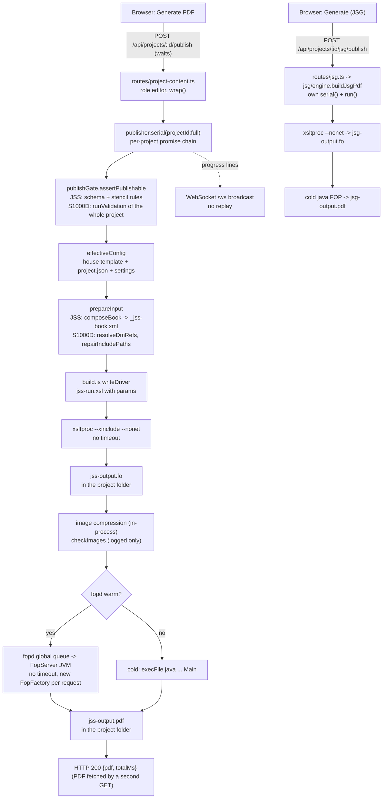
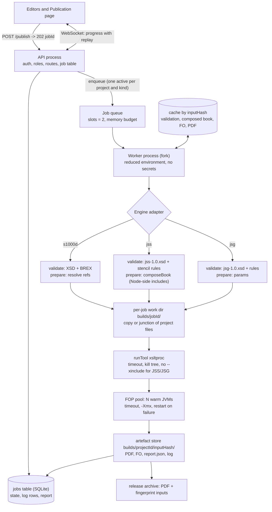

# 03.C - Engines architecture: how S1000D, JSS and JSG relate, what to share, and how to run builds

Agent C, 2026-11-26. Audit only. Prefix `PUB`; numbering continues after `02.C-jss-jsg-publication-functional.md` (PUB-001 to PUB-026). Findings of that file are referred to by ID.

**Scope and method.** Static reading of the orchestration code (`services/publisher.ts`, `services/jsg/engine.ts`, `vendor/engine/{build,fopd,paths}.js`, `fopserver/FopServer.java`, `services/xengine/*`, `routes/*`),
grep inventories of duplicated helpers over `backend/src`, and the measurements taken on the scratch server in 02.C (3 builds, 7 conversions). Nothing in this file is a prototype: the recommended design is **not implemented or tested** anywhere; where I give numbers they are the measured ones from 02.C.
Remarks on `docs/PDF21_CRASH_INVESTIGATION.md` are quoted from that document, not reproduced by me.

## Coverage table

| Area | Status | Verification | Limits |
|---|---|---|---|
| Publication orchestration (`publisher.ts`, `jsg/engine.ts`, `xengine/convert.ts`) | Inspected | code read in full; runtime behaviour measured | concurrent builds across projects not measured |
| Vendored engine runner (`vendor/engine/build.js`, `fopd.js`, `paths.js`, FopServer) | Inspected | code read | JVM memory behaviour under load not measured beyond one 570-page build |
| XSLT pipelines (`jsstofo`, `s1000dtojss`, `s1000dtofo`, `schemas/jsg/engine`) | Partially | sizes, `document()` and include usage grep, outputs read | stylesheet logic not audited |
| Job/queue/worker facilities in the platform | Inspected | grep for `worker_threads`, `fork(`, job tables: **none exist** in `backend/src` or `vendor/engine` | `xmllint-wasm` internal threading NOT VERIFIED |
| Helper duplication | Inspected | grep over `backend/src` (counts below) | semantic differences between copies only spot-checked |
| Packaging / deployment constraints (offline desktop install) | Partially | `paths.js` comments, `PACKAGING.md` headings | installer not examined (agent F's area) |

---

## 1. How the three engines relate

| | S1000D | JSS (authored) | JSG (authored) |
|---|---|---|---|
| Source of truth | data modules in `csdb/` + `publication.xml` (PM) | one `<jssbook>` file named by `input.pm` (default `publication.xml`) + ancillary front-matter pages | one `jsg-document.xml` (`<jsgdoc type="uhb\|ispl">`) |
| Validation | XSD per declared issue, BREX, rules (`validation.ts`, `publishGate.ts`) | `jss-1.0.xsd` + stencil rules (`jss/service.validateJss`) | `jsg-1.0.xsd` + rules (`jsg/service`) |
| To XSL-FO | either `s1000dtofo` (direct) or `s1000dtojss` then `jsstofo` (two stages) | `jsstofo` (stage 2 only) | `schemas/jsg/engine/jsg.xsl` (+ `jsg-uhb`, `jsg-ispl`, `jsg-common`) |
| Orchestrator | `publisher.ts` + `vendor/engine/build.js` | the same (`prepareInput` JSS branch composes `_jss-book.xml`) | **its own**: `services/jsg/engine.ts` |
| FOP | warm daemon (`fopd`), cold fallback | same | cold `java` only |
| Release / watermark / review | yes (hash + status) | yes | **none** (PUB-011) |
| Cross-engine | `xengine`: outline + identity sidecar + 6 conversions, as new projects with findings | same | same |

So there are really **two FO generators sharing one runner (`jsstofo` for S1000D-via-JSS and JSS) and one generator with its own runner (JSG)**; the "engine" name hides that the S1000D route can end in the JSS stylesheets. Consequences seen in 02.C: a JSS defect is an S1000D defect in the two-stage pipeline (vendor-exception rules protect that with `jss-cover-isolation.test.js`); a runner defect (timeouts, cancel, report) must be fixed twice (PUB-003, PUB-011).

## 2. Current publication data flow

Things the diagram shows that matter: the request is the job (no identity); the only shared state between builds is the project folder and the one FOP JVM; every engine writes its intermediate and result files into the project directory; the gate, the build and the result live in one HTTP call.

## 3. Duplicated helpers (verified by grep)

| Helper | Copies | Where | Note |
|---|---|---|---|
| XML text escape `esc` | **14** near-identical definitions (+ 2 attribute escapes) | `applicability.ts:57`, `dispatch.ts:30`, `htmlPublish.ts:34`, `jsg/docx.ts:26`, `jsg/service.ts:32`, `jss/rwi/canonical.ts:44`, `jss/service.ts:35`, `jssdm/toDms.ts:68`, `objectRender.ts:18`, `objectTemplates.ts:20`, `profiles.ts:55`, `projectBrex.ts:22`, `projects.ts:131`, `sns/pmxml.ts:47` | some also escape `"` (`dispatch`, `htmlPublish`, `objectRender`, `objectTemplates`, `projectBrex`), the others do not: the attribute vs text distinction is implicit in which copy a caller happened to import |
| SHA-256 helper `sha` | 5 named, with 3 signatures (string, Buffer, file) + 3 inline `createHash` | `csdb.ts:36`, `jss/service.ts:37`, `jsg/service.ts:34`, `jss/rwi/exporter.ts:29`, `publishGate.ts:40` | the gate and the editors compare hashes of *different representations* of the same file |
| Per-key promise chain `serial` | 2 | `publisher.ts:55`, `jsg/engine.ts:25` | identical bodies; neither coalesces, limits or times out |
| `execFile` runner `run` | 2 (+ 3 in `build.js`) | `jsg/engine.ts:34`, `build.js` `run()/execOpts` | different `maxBuffer` (20 MB vs 10 MB), neither has a timeout |
| "kind of project" predicate | 4 | PUB-026 | they disagree for imported jssbook projects |
| `bad/conflict/notFound` error builders | shared (`core/errors`) | good: not duplicated | - |
| Project-relative path join | 8+ ad-hoc `path.join(projectDir, rel)` | PUB-001 | no single `resolveInProject()` |

**Recommendation (PUB-028).** One `backend/src/lib/` module family: `xml.ts` (`escText`, `escAttr`, `escXmlName`), `hash.ts` (`sha256Text/Buffer/File`), `proc.ts` (`runTool` with timeout, kill, output cap), `paths.ts` (`resolveInProject`, `safeRelPath`), `atomic.ts` (`writeFileAtomic`), and move the `serial` chain into the job service of section 5.

## 4. What to share across the three engines, and what stays per standard

| Concern | Share | Keep per standard | Why |
|---|---|---|---|
| Validation **framework** | the runner (`validateXml`, XSD cache, finding model, severity, waiver/gate policy, report shape) | the rule sets: BREX + issue XSDs (S1000D), stencil rules (JSS), JSG rules | `publishGate.ts` already has the generic part (hash before/after, `verifyUnchanged`) but is wired to S1000D file lists |
| Project / asset / file services | one `ProjectFiles` service: safe path resolve, atomic write, history, media (`Media/`), asset metadata, archive export/import | what files a project has (CSDB, jssbook, jsg-document) | PUB-001, 007, 026 |
| Import / export | the archive (`.jsspub.zip`) code, ZIP limits, `checkXmlSafety` call on every XML, the findings model of `xengine` | the readers/writers (Word importer, S1000D package, RWI) | already partly shared in `xengine`; the XML guard is not applied to JSS/JSG (PUB-014) |
| Publication orchestration | **job service**: queue, per-job work dir, deadlines, cancel, progress with replay, build report, result store, release archive | engine adapters: how to make FO from a project | PUB-003/004/005/006/011 |
| Logging / errors | `HttpError` + one structured build log (per job id) + the audit log | engine-specific message texts | build logs today are WebSocket lines and console output |
| Versioning | project history (source snapshots, release snapshots, tool versions in the build report) | issue/standard numbering | PUB-006, 007 |
| Preview | the PDF viewer, stale marker, build report panel | HTML preview of S1000D modules (own) | |
| Branding, watermark, classification, house templates | the settings merge (`effectiveConfig`) and brand pack | the layout parameter mapping per engine (`layoutParamsFor`) | JSG ignores most of it today |
| Stylesheets | **nothing** in the XSLT is worth sharing beyond what exists (`jsstofo` is already shared by two) | `jsg*.xsl` stays isolated by design (`JSG_ENGINE.md` s.6) | the isolation is a valid decision; the runner is not part of it |

A neutral outline (`xengine/outline.ts`) and the identity record (`doc-identity.json`) are the right shared abstractions for conversion; they should not grow into a common *document model* for rendering: the JSS and JSG XSLTs render their own vocabularies and that is what the owners' stencils need.

## 5. Process isolation and background design

### 5.1 What exists
No job table, queue, worker thread or forked process in `backend/src` or `vendor/engine` (grep: none). The Node process runs the gate, XML validation (`xmllint-wasm`, in-process), image recompression (`jpeg-js`/`zlib`, in-process, PUB-016), `composeBook`, and spawns `xsltproc` and the FOP JVM. `docs/PDF21_CRASH_INVESTIGATION.md` records an **unresolved intermittent native crash (0xC0000005) of a test process** that validates with `xmllint-wasm` and renders with FOP under load, and 10-15 minute hangs; whatever its cause, it is an argument against running validation and heavy rendering inside the API process.

### 5.2 Recommended behaviour (not implemented)
* **Job record** in the existing SQLite store: `id, project, kind (build|preview|configured|release|convert), engine, state (queued|running|done|failed|cancelled|interrupted), requestedBy, createdAt, startedAt, finishedAt, inputHash, resultPath, report (JSON), log (rows)`. The API answers `202` with the job id; progress and log lines go over the existing WebSocket **with replay from the table** (PUB-004).
* **Worker**: one Node child process per slot (`child_process.fork`, default 2 slots, configurable; a slot is chosen by memory budget because one FOP build peaked near 480 MB), running validation, compose and the external tools. The API process keeps only HTTP, auth and the job table. A crash of a worker fails its job (`interrupted`) and the slot is respawned.
* **Per-job work directory** `workspace\builds\<jobId>\` containing a *copy-on-need* view of the project (source, ancillary pages, `Media/` by junction or copy fallback - PUB-021) and all generated files (`_jss-book.xml`, `jss-run.xsl`, FO, PDF, `_watermark.svg`). On success the PDF, FO, report and log are moved to `builds\<projectId>\<hash>\`; on failure they are kept for N days for diagnosis, then removed. This removes derived files from the project folder (they are never exported or backed up today by exclusion rules) and makes concurrent builds of one project safe (PUB-021 a).
* **Deadlines and cancel**: `runTool(file, args, {timeoutMs, signal})` kills the process tree (`taskkill /T` on Windows); FOP daemon requests carry an id and a timer; a stuck request restarts the JVM and fails only that job (PUB-003). `DELETE /jobs/:id` aborts the signal.
* **Retries**: none for deterministic failures; one automatic retry only for infrastructure errors (JVM exited unexpectedly, spawn failure). Idempotent by input hash: a job whose `inputHash` already has a stored result completes at once (see 5.3).
* **Backpressure**: per-project one active job per kind (a second request returns the active job), global cap = slots, queue length visible in the UI.
* **FOP pool**: N warm JVMs (N = slots), explicit `-Xmx`, a fresh `FopFactory` only when configuration changes (today a new factory per request, `FopServer.java:60-92`).

### 5.3 Incremental builds, caching, parallelism
* **Cache key** = hash of (source + ancillary + referenced Media hashes + effective config + brand/house version + stylesheet fingerprints + tool versions). The release fingerprint of `release.ts` should be extended to this key (PUB-006); the same key serves the stale marker and the cache.
* **What can be cached safely**: validation result per file hash (PUB-019), the composed book, the FO (by key), the PDF (by key), image recompression results (by file hash + settings). FOP cannot render a chapter alone reliably (page numbering, TOC, cross references), so a build stays whole-book; the saving is "no change = no work" and "preview of one module without validating the project".
* **Parallelism**: independent projects in parallel (N slots); within one project, the front matter pages could be rendered in a separate pass, but the interdependence of page numbers makes it not worth the complexity. Measured: 570 pages in 34 s; the cost is dominated by FOP (25 s of 34 s), so FOP pool size is the lever.

## 6. Modular monolith vs separate services (honest comparison)

| Criterion | A. Today: monolith, in-process orchestration | B. **Modular monolith + worker processes + job table** (recommended) | C. Separate services (publishing service, validation service, API) |
|---|---|---|---|
| Fits the product (offline Windows desktop-style install, one machine, sometimes air-gapped; `PACKAGING.md`, owner decisions "Windows-only packaging") | yes | yes | poorly: more processes to install, port, sign, start and monitor on a user's PC |
| Failure isolation | none (one hung FOP stops all) | per job (worker crash, deadline, cancel) | full |
| Operational cost | lowest | low (the same installer, same DB, a few more files) | high (service discovery, auth between services, versioned APIs, a message broker or at least HTTP between them) |
| Change cost | lowest today, grows with every copied helper | moderate once; one runner for three engines | high |
| Latency | best | +10-50 ms per job | + network hop |
| Scaling | one machine, one request at a time per heavy step | one machine, N slots | many machines (not needed by any stated requirement) |
| Test effort | existing suites | existing suites + job tests | many contract tests |
| Security | the API process holds everything (secrets, DB) and runs the parsers | workers can run with a reduced environment (no secrets, PUB-030) | strongest, at high cost |
| Reversibility | - | high (the old synchronous route can stay as a thin wrapper) | low |

**Verdict.** Option B. The audit found no requirement that justifies separate deployables; what the code lacks is a *job abstraction* and *process isolation*, both of which fit inside the monolith. Revisit C only if the product becomes a multi-tenant server with several machines (no evidence of that in the repository).

## 7. Recommended design

Adapters implement one small interface (`validate(project) -> findings`, `prepare(project, workDir) -> {inputXml, params, stylesheet}`, `postProcess(result) -> report`), so the S1000D, JSS and JSG engines keep their stylesheets and rules and share the runner, the job record, the report and the release record. The existing `serial()` per-key chain becomes the "one active per project and kind" rule of the queue; the `GateOptions` waiver policy stays as it is.

**Migration order (smallest steps first).** (1) `runTool` with timeouts and kill, and the `fopd` deadline (PUB-003); (2) build report returned and stored (PUB-005); (3) per-job work directory; (4) job table with 202 and WebSocket replay, keeping a blocking compatibility mode; (5) workers; (6) JSG onto the shared runner and warm FOP; (7) release archive and cache.

## 8. XML / XSLT / FOP security notes for the security agent

Findings that already exist in 02.C, repeated here only as pointers: PUB-001 (settings route, path escape), PUB-002 (xi:include in ancillary pages, verified file disclosure), PUB-013 (PM/DM includes, JSS `Media/../`), PUB-014 (JSS/JSG not under `checkXmlSafety`), PUB-024 (`$` replacement in `composeBook`), PUB-025 (`--stringparam` with both quote kinds). Additional observations:

* `xsltproc --xinclude --nonet` is used for every JSS/S1000D build (`build.js:497`); `--nonet` blocks network fetches but not local files. The vendored stylesheets call `document()` (`s1000dtojss.xsl:583,598`); `--nonet` does not constrain a local path. (OBSERVED by reading.)
* `external-graphic src`: JSS `validateJss` rejects only `..`, `/` and drive-letter prefixes and demands that the path exists (`jss/service.ts:296`), so `http:` fails by accident (not found) while `Media/../x.png` passes (PUB-013). JSG `JSG-GRAPHIC-PATH` rejects schemes and absolute paths but not `..` (`jsg/service.ts:251`). FOP resolves `http:`/`ftp:` URLs in `src` by default; the document checks, not the FOP configuration, are the only barrier. Whether `FopServer`/`fop.xconf` restricts the resolver is NOT VERIFIED.
* The FOP JVM and `xsltproc` run with the full server environment: `paths.childEnv()` copies `process.env` (`paths.js:184-185`), so session secrets or tokens held in environment variables are visible to every tool child. A worker with a reduced environment (section 5.2) removes that.
* No JVM flags restrict file access or memory: `fopd.js:49` and `paths.FOP_ARGS` pass only `-cp`/class name; there is no `-Xmx`, no security manager or `--sandbox`-style limit (Java 21 JRE bundled).
* Entities: JSS composes without the DOCTYPE; JSG feeds `jsg-document.xml` with its prolog to `xsltproc` (`jsg/engine.ts:88`); an entity that is *used* is refused by the editor's parser, an external DTD subset is not examined (PUB-014). No exploit found.
* XSD validation uses `xmllint-wasm` in-process; an XSD or document that is pathological for libxml2 (deep nesting, huge attribute) is a denial-of-service risk to the API process (SUSPECTED; not provoked).

---

## Findings

### PUB-027 · P1 · RECOMMENDATION · L · Introduce one publication job service (queue, worker processes, per-job work directories, build report) shared by S1000D, JSS and JSG
**Category** Architecture / reliability.
**Problem** Builds are synchronous HTTP requests that run validation, composition, image recompression and two external tools inside or beside the API process, with no job identity, deadline, cancel, concurrency limit or isolated directory (02.C PUB-003/004/005/021). JSG has its own copy of the runner and lacks the warm FOP, the report and the release path (PUB-011). One hung FOP or one native crash in the API process (see `PDF21_CRASH_INVESTIGATION.md`) takes everything down.
**Evidence** Section 2 diagram; section 5.1 (no job/queue/worker facility exists); `publisher.ts:54-62`, `jsg/engine.ts:24-42`, `fopd.js:36-112`, `build.js:333-529`.
**Current implementation** Per-project promise chain, global FOP promise queue, project directory as work area.
**Recommendation** Sections 5 and 7: SQLite job table, `202` + WebSocket replay, forked workers with a reduced environment, per-job directories, `runTool` with timeout and kill-tree, FOP pool with deadline, input-hash cache, engine adapters. Migrate in the order given in section 7.
**Expected outcome** A failing or slow document affects only its own job; builds survive reloads and restarts; the three engines share one runner and one report format.
**Dependencies** PUB-003, 004, 005, 006, 011, 021; the security agent's view on worker environment (PUB-030).
**Risks** Windows process-tree kill and junction handling need care; the blocking API contract used by editors and tests must be kept for one release; SQLite writes from workers must go through the API process (single writer).
**Acceptance criteria** (a) Two builds of two projects run in parallel up to the slot limit and a third waits; (b) a never-answering FOP is killed at its deadline and the next job succeeds; (c) restart of the server marks running jobs `interrupted`; (d) the same inputs return the cached PDF in under a second; (e) a build does not create or change files outside `builds\` except the stored artefacts.
**Test cases** Stub-tool tests (hang, crash, huge output); parallel-project test; cancel test; restart test; cache-hit test; existing `jss-authoring`, `jss-cover-isolation`, `xengine-convert` suites unchanged.

### PUB-028 · P2 · VERIFIED · S · Helpers are copied instead of shared: 14 XML escapers, 5 hash helpers, 2 job chains
See section 3 for counts and file:line. **Problem** A defect fixed in one copy stays in the others, and the attribute-vs-text escape difference is implicit (whether the copies diverge in behaviour beyond `"` was not checked). **Evidence** grep results in section 3. **Recommendation** The `lib/` family listed in section 3, added behind unit tests, then replace callers file by file (a mechanical change). **Acceptance** One definition each remains (`grep` count 1), `esc` has separate text and attribute variants, and callers that need `"` use the attribute one.

### PUB-029 · P2 · VERIFIED · S · Builds write intermediate and result files into the project folder
**Problem** `_jss-book.xml`, `jss-run.xsl`, `_watermark.svg`, `_publishers.xml`, `jss-output.fo` and `jss-output.pdf` (and the JSG equivalents) are created in the project directory and overwritten by the next build. They are not versioned, are excluded from export only by name rules, are visible to any project reader through file routes if a route lists the folder (NOT VERIFIED which routes list it), and two builds of one project (preview + full, PUB-021) share them. A failed build leaves a mixture of old and new files; the `assertPdfWritten` mtime guard exists exactly because of this.
**Evidence** `services/publisher.ts:176-180,238-262`; `vendor/engine/build.js:156-171,497-529`; scratch workspace listing after the builds (`...\ws\projects\<id>\jss-output.fo`, 4.6 MB for the large book).
**Recommendation** Per-job work directories (section 5.2).
**Acceptance** After a build the project folder differs from before only by explicit stored artefacts.

### PUB-030 · P2 · OBSERVED · S · External tools run with the server's whole environment and no resource limits
**Problem** `paths.childEnv()` copies `process.env` to xsltproc and the FOP JVM; the JVM has no `-Xmx` and the child processes have no CPU or memory limits, no job object, no low priority (a 570-page build raised FOP to 479 MB; the API process shared the machine).
**Evidence** `vendor/engine/paths.js:184-199`, `fopd.js:49-56`, `jsg/engine.ts:34-39`.
**Recommendation** Pass a minimal environment (PATH, TEMP, JAVA_HOME only), set `-Xmx` from a setting, run tools below normal priority, and put workers into a Windows job object when the worker design of PUB-027 is built.
**Acceptance** A test that sets a secret variable in the server environment shows it absent in the tool's environment.

### PUB-031 · P2 · SUSPECTED · M · Intermittent native crash and hangs reported by the owner's own investigation point at in-process validation and FOP under load
**Problem** `docs/PDF21_CRASH_INVESTIGATION.md` (2026-11-23/24) states an unresolved `0xC0000005` crash of test processes and 10-15 minute hangs when many `xmllint-wasm` + FOP workloads run together; the cause is "not identified". I did not reproduce it (3-build budget, one server). The production code has no watchdog for either symptom (PUB-003), so a hang found by the test suite is a hang a user will find.
**Evidence** the document, sections 1-3 (quoted, not re-measured); `build.js` and `fopd.js` as in PUB-003.
**Recommendation** Treat as a reliability defect of the production path, not of the test environment: put validation in the worker (not the API process), add deadlines, record the stderr and exit code of every external run into the build report, and run the 21-type suite with a per-test timeout and a crash reporter on.
**Acceptance** The suite fails fast with a captured reason instead of hanging; no API-process crash under 10 parallel builds in a stress test.

---

## Strengths (not findings)
* The vendor-exception discipline (parameters with the old behaviour as default, one mapping function, fingerprint tests, written undo) is a mature way to share one stylesheet set between standards without regressions; it should be kept as the pattern for any shared stage.
* `xengine`'s neutral outline + identity record + findings is already the right shape for cross-standard services: conversions never touch the source, create a new project, and report what was lost.
* JSG isolation at the stylesheet level is deliberate and documented; moving only the *runner* to a shared service does not undo it.
* The gate (`publishGate.ts`) already hashes before and after (`verifyUnchanged`), which is the primitive an input-hash cache and a reproducible release need.
* The WebSocket channel is authenticated and per-user filtered; adding replay is incremental.

## Unknowns and limitations
* The recommended design is a design; nothing here was prototyped, and the worker memory budget (slots x ~500 MB for a large FOP run) is an extrapolation from one measurement.
* Not measured: two heavy builds in parallel, FOP behaviour after a deadline kill, `xmllint-wasm` internal threading, the cost of the whole-project validation for a large CSDB (PUB-019 is SUSPECTED for large CSDBs).
* Packaging constraints (installer, code signing, antivirus control of `.bat`/`java`, noted in `paths.js`) may restrict the use of `child_process.fork`; `PACKAGING.md` was read by headings only. Agent F covers deployment.
* The JSG engine was not built in this audit; statements about its runner come from code.
* Customer material was not quoted; layout statements refer to the repository's own documents.
