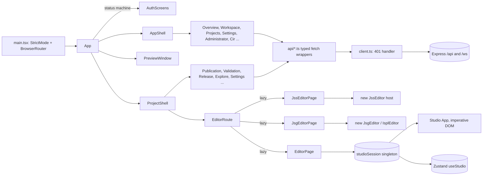

# 03.D · Frontend platform shell: architecture

**Agent D · finding prefix FE (numbering continues from 02.D, FE-020 onward).** Scope: structure of `frontend/src` outside the three embedded editors, how the editors are mounted, fed and torn down, state management, API typing, duplicated logic, code organisation, build configuration, and a recommended target architecture.

**Method.** Source reading (shell about 10.5 k lines: pages 6,066, components 2,121, lib 1,158, api 869, layouts 189, store 144), greps for coupling, listeners and typing, a production build into a scratch dir (`npx vite build --outDir <scratch>\fe-dist --emptyOutDir`, exit 0, 29.6 s, 2,285 modules), and browser runs against a scratch server on port 4055 (Edge 158 headless). The route-cycle leak check mounts and unmounts the S1000D editor 16 times and reads Chrome DevTools Performance metrics after forced GC. Raw data: `scratchpad\D\pw-perf.json`, `pw-behave.json`, `pw-logout.mjs` output, `ws-revoke.mjs` output.

## 1. Coverage

| Area | Status | Verification | Limits |
|---|---|---|---|
| Shell structure, routing, stores, API client | Inspected | Read; behaviour driven | |
| Studio/JSS/JSG mounting (`EditorPage`, `JssEditorPage`, `JsgEditorPage`, `lib/studioSession.ts`, `lib/previewBus.ts`, `pages/PreviewWindow.tsx`) | Inspected | Read in full; Studio mount/unmount cycles measured; JSS driven; JSG read only | Inside of the editors (`studio/`, `jss/`, `jsg/`) only where they touch the shell |
| Build config (`vite.config.ts`, `tsconfig.json`, `tailwind.config`, `postcss`, `index.html`, `package.json`) | Inspected | Build run and chunks measured | `postcss`/`tailwind` read briefly |
| Typing and duplication | Partially inspected | Greps (`any`, `eslint-disable`, swallowed catches) and manual review of `api/*` | Backend response shapes not diffed against the TS types one by one |
| Tests | Partially inspected | Inventory; vitest config read | No test run by me |

## 2. Structure as found

* **Layers.** `pages/` (about 6 k lines, no feature folders), `components/` (shared and some page-specific), `layouts/` (`AppShell`, `ProjectShell`), `api/` (7 modules, typed), `store/` (5 Zustand stores: `session`, `ui`, `appSettings`, `inbox`, a `navStore` adapter), `lib/` (pure helpers plus `studioSession`, `progress`, `previewBus`).
* **Router.** `BrowserRouter` with a declarative `<Routes>` (`App.tsx:55-82`). Role routes are registered conditionally. There is no data router, so no `useBlocker`, `errorElement` or route loaders.
* **Build.** Vite 5, one manual chunk (`react`), `chunkSizeWarningLimit: 1500`, worker format `es`. Tailwind 3 with `preflight: false` (layout utilities only; CSS variables shared with the Studio). Three class vocabularies are in use: `v2-*` (994 uses in TSX), `btn`/`modal*` (207) and `x-*` (31, only `PublishSettings` and `JsgAncillaryPage`, carried over from V1).
* **Tests.** vitest `include: ['src/**/*.test.ts']` (so no `.tsx` tests), no testing-library, no component, store, hook or api-client tests; 6 pure-logic test files in the shell, 23 in the editors; Playwright e2e 12 spec files.

## 3. Coupling with the embedded editors

| Aspect | Studio (S1000D) | JSS editor | JSG / ISPL editor |
|---|---|---|---|
| Host | `lib/studioSession.ts` singleton wrapping the imperative `App`; root element created once, React moves it in and out (`mount`/`unmount`) | `new JssEditor(host, {...})` in `useEffect`, `editor.destroy()` on cleanup | `new JsgEditor/IsplEditor(host, ...)` in `useEffect`, `destroy()` on cleanup |
| Lifetime | Page lifetime; documents survive route changes and **logout** (FE-024) | One document per mount | One document per mount |
| Shell state | `useStudio` (docs, ready, projectId) | local `useState` | local `useState`, opt-in autosave (localStorage) |
| Keyboard | `window` keydown **capture** that stops propagation (FE-001) | listener on its own root | `document` keydown in bubble phase |
| Dirty guard | `beforeunload` (Studio) plus `window.confirm` on a project switch | `beforeunload` only | `beforeunload` only |
| Persistence | IndexedDB drafts every 2.5 s (never restored in host mode, FE-006) | none | none (autosave off by default) |
| Global side effects | `window.studio = this` (`studio/ui/app.ts:131`), `beforeunload`, `document` dragover/drop/mousedown, `matchMedia` change, `window` `studio:modal-closed`, a `MutationObserver` that is never disconnected (`studioSession.ts:119`) | none outside root | document keydown (removed in `destroy`) |
| Data in | Shell passes `projectId`; the session fetches DMs, media, settings itself through `api/*` | shell loads the document and passes XML plus hash | same |
| Data out | `studio.notify`, `studio.onSaved` callbacks set by `EditorPage` | `host` callbacks (`onSaveRequested`, `notify`, `onDirty`) | same |
| Reverse coupling | none | `jss/PackagePanel.tsx` imports shell `api`, `components`, `store` | none |

**Verified lifecycle behaviour.** Cycling `/projects/:id/graphics` and `/projects/:id/editor` 8 and then 16 times (Edge, 500 data modules, forced GC): nodes 12,094 then 19,800 then 19,800; listeners 1,566 then 2,598 then 2,598; heap 13.9 then 15.0 then 15.1 MB. So there is a one-time step on the first cycles and then a plateau: **no per-mount leak** in the shell/Studio mount path (VERIFIED for this route pair). The Studio is a once-built singleton, so its global listeners do not accumulate; the problem is not growth, it is that they stay active and unscoped (FE-001, FE-023). JSS and JSG editors were not cycled (NOT VERIFIED).

**Preview pop-outs.** `PdfPane` and `PreviewWindow` use `BroadcastChannel('agastya.preview.<projectId>')`, close the channel in cleanup, revoke blob URLs on change and unmount, and send a `bye` on `pagehide`. No leak found by reading.

### FE-020 · P2 · VERIFIED · M · Data fetching has no cache, de-duplication or cancellation, and navigation multiplies requests
**Problem** All server state is fetched through `useAsync(fn, deps)` (`components/ui.tsx`, 57 call sites) or ad hoc `useEffect` calls. It guards against stale responses with a run counter but has no abort, no keyed cache, no dedup and no refetch policy. Effects: duplicate and redundant requests, data re-fetched on every visit, and race-prone ad hoc loaders (`ProjectShell` summary: FE-005; `PersonPicker` search per keystroke; Settings audit filter per keystroke).
**Evidence** Playwright request logs (`pw-behave.mjs` `t1`, `pw-perf.json`):
* One login produced `GET /api/auth/me` three times and `GET /api/notifications/unread-count` twice within a second (session `load()` after login, `AppShell` effect, and a second tick).
* Every in-app navigation adds `GET /api/auth/me` plus `GET /api/notifications/unread-count` (`AppShell.tsx:42` runs `load()` and `refreshCount()` on each `pathname`); navigating to `/settings` did it twice (redirect to a subroute).
* `/overview` calls `/api/overview` and `/api/invitations` on every visit, while `/auth/me` already returns `pendingInvitations`.
* One Studio save causes 7 requests (FE-029).
**Current implementation** `useAsync` plus hand-written effects; `useSession.load()` as a cheap-looking global refresh.
**Recommendation** Replace `useAsync` with a keyed query layer (stale-while-revalidate, abort on unmount, dedup, `invalidate(key)` after mutations). Two options: (a) a 150-line in-house hook on top of `AbortController` and a `Map` cache, no new dependency; (b) TanStack Query, which gives the same plus devtools and mutation helpers at the cost of a dependency and its bundle size (not measured here). Start with (a) for the three hottest paths (session, project summary, DM list) and adopt (b) only if the team wants the extra features. Drop the per-navigation `load()`; refresh the session on a timer and on focus only.
**Expected outcome** The editor save follow-up falls from 6 GETs to 1 or 2 targeted invalidations; navigation stops issuing identity requests.
**Dependencies** FE-004, FE-029.
**Risks** Cache invalidation errors show stale data; keep TTLs short and invalidate on every mutation.
**Acceptance criteria** `pw-behave.mjs t1` shows no `/auth/me` on navigation; login issues one `/auth/me`; a save issues at most 2 GETs.
**Test cases** Unit tests for the query hook (dedup, abort, invalidate); request-count e2e.

### FE-021 · P2 · OBSERVED · M · The three editors are hosted three different ways and the shell re-implements dirty, save, shortcut and recovery handling in each
**Problem** There is no common "editor host" contract. Each page re-solves dirty tracking, save, conflict banner, `beforeunload`, Ctrl+S, draft and preview wiring, which is why the same defects recur (FE-001, FE-002, FE-003, FE-006, FE-007). The Studio is also a process-wide singleton whose documents outlive their route.
**Evidence** `EditorPage.tsx`, `JssEditorPage.tsx`, `JsgEditorPage.tsx` each carry their own `beforeunload` effect and save/conflict logic; `lib/studioSession.ts` holds `projectId`, `refs`, `docs` and `window.confirm` calls.
**Recommendation** Define one interface the shell uses for all editors, for example `EditorHandle { mount(el); destroy(); isDirty(); getXml(); markSaved(hash); onDirty(cb); focus() }`, and a `useEditorHost` hook that owns: the router blocker, draft persistence per user and project, save with conflict policy, 401 re-login, shortcut routing (only for the focused or visible editor) and the beforeunload guard. Migrate JSS first (smallest), then JSG, then the Studio behind the same handle.
**Expected outcome** Each defect above is fixed once and covered by one test suite.
**Dependencies** FE-001, FE-002, FE-003, FE-006, FE-007.
**Risks** The Studio's internal save and multi-document model is richer than a single-document handle; keep a `documents()` extension for it.
**Acceptance criteria** All three editors use the hook; a shared Playwright spec runs the same dirty, conflict, 401 and navigation scenarios against each.

### FE-022 · P2 · OBSERVED · M · API typing is hand-copied and weak at the edges; swallowed errors and escape hatches are common
**Evidence** `api/*.ts` has typed wrappers, but the TS shapes are written by hand next to each call, with no link to the backend types. Greps over `frontend/src` excluding editors: 36 `: any`/`as any` (mostly `PublishSettings.tsx`, `PdfJsViewer.tsx`), 20 `eslint-disable` comments, 47 empty or swallowing `catch` blocks (for example `Workspace` `adminApi.users().catch(()=>[])`, `useInbox.refresh`). `tsconfig` has `strict: true` but `noUnusedLocals: false`; 43 api methods have no shell call site by my scan (FE-018; agent J counts 43 too: my raw scan listed 50, of which 7 `referenceApi.*` entries are regex misattributions of `platformApi` methods). I did not diff the TS types against the actual JSON the server returns, so type drift is SUSPECTED, not measured.
**Recommendation** Put the 15 to 20 core DTOs (User, Gates, ProjectSummary, Dm, Pmc, Finding, BuildResult, Session, AuditEvent…) in one `shared/` types folder imported by both `backend/src` and `frontend/src/api` (same language, same repo, no codegen needed). Validate at trust boundaries only (import/detect, settings, build report) with a small guard function. Replace blanket catches with an `onError` policy in the query layer; turn `noUnusedLocals` on.
**Acceptance** Backend response types and client types compile from one definition; zero uncalled api methods; `any` count in `PublishSettings` below 5.

### FE-023 · P2 · OBSERVED · S · The Studio installs page-wide listeners once and never scopes or removes them; `window.studio` is exposed in production
**Evidence** `studio/ui/app.ts:425-446` (`bindGlobal`: `window` keydown capture, `beforeunload`, `document` dragover, drop and mousedown, `matchMedia` change, `window` `studio:modal-closed`); `app.ts:131` (`window.studio = this`); `studioSession.ts:119` (MutationObserver on `<html>`, no `disconnect`). The `document` `drop` handler opens dropped XML/images into the Studio on any page (`e.preventDefault()`), including pages that have their own drop zones (Graphics). `window.studio` is used by e2e tests but ships in production.
**Recommendation** Install in `mount`, remove in `unmount` (or guard every handler with `root.isConnected`); set `window.studio` only when `import.meta.env.DEV` or a test flag.
**Acceptance** After `unmount`, `getEventListeners(window)` shows none from the Studio; a file dropped on `/graphics` is not swallowed by the Studio.

### FE-024 · P2 · VERIFIED · S · The Studio session, its open documents and its drafts survive logout and a different user's sign-in
**Category** Privacy on shared workstations.
**Evidence** `pw-logout.mjs` (Edge): writer1 opens a data module and types `WRITER1PRIVATE` (not saved), moves to `/overview`, signs out through the account menu, then signs in as admin in the same tab. `window.studio.editors.length` is still 1 and the open document still contains `WRITER1PRIVATE`; the IndexedDB database `s1000d-studio` (drafts) is still there. `store/session.ts` `logout()`/`clear()` resets only the inbox store; no code calls a Studio reset (`grep studio.reset|dispose` finds none; `EditorPage` calls `studio.unmount()` only).
**Impact** The next user who opens the same project's editor sees (and can save under their own name) the previous user's unsaved text; with another project, the `window.confirm` about "another project's editor" reveals that unsaved work exists. Draft XML is stored unscoped in IndexedDB.
**Recommendation** On `clear()`: destroy the Studio session (documents, refs, caches, observers) and clear drafts; scope draft keys by user and project.
**Acceptance** After logout, `window.studio` is gone or empty, and the next user finds no document or draft of the previous one.
**Dependencies** FE-006, FE-021.

### FE-025 · P2 · OBSERVED · M · Monolithic components and three CSS vocabularies slow change; the shell has no component-level tests
**Evidence** `components/project.tsx` `CreateProjectModal` (about 290 lines, 20 `useState` hooks in the file, four API calls on mount even for JSS/JSG: formats, reference, presets, catalogue; import detect uploads the file, then `xengineApi.importAs` uploads it again). `PublishSettings.tsx` 599 lines. `ProjectSettingsPage` 12 `useState`. Class systems: `v2-*`, `btn`, `x-*`. Tests: vitest picks only `*.test.ts` (`vite.config.ts`), none of the 6 shell test files exercises a component, store or hook. FE-003 and FE-004 live in `store/session.ts` and `api/client.ts`, which have no tests.
**Recommendation** Split the wizard into a state machine plus step components; fetch step data lazily; send the import file once. Retire `x-*`. Add `jsdom` plus testing-library for `session`, `client` (401), `useAsync`/query layer, `Modal`, and the wizard.
**Acceptance** Wizard opens without network for non-S1000D formats until a step needs data; session and client have unit tests covering 401, 503 and abort.

## 4. State management evaluation

| Concern | Today | Assessment |
|---|---|---|
| Session/identity | Zustand `useSession` with `status` machine and a global 401 handler | Good shape; wrong policy on errors (FE-004) and no reset hook for other singletons (FE-024) |
| UI chrome (theme, toasts) | `useUi`; `useApp` (accent, compact, default theme); both use the localStorage key `agastya.theme` | Fine; the two stores couple through `useUi.setState` inside `applySettings` |
| Server data | `useAsync` and local state | Needs a query layer (FE-020) |
| Cross-page project context | `ProjectShell` context (`useProject`) with `reload()` | Works; stale for one render on id change (FE-005) |
| Studio documents | `useStudio` Zustand store written by the singleton | Appropriate use of a store as a bridge from imperative code; add reset |
| Forms | local state per component | OK for size; the wizard is the exception (FE-025) |

Zustand is adequate for client state. The gap is server state, not the choice of store library.

## 5. Duplicated logic with the backend

| Logic | Client copy | Server rule | Risk |
|---|---|---|---|
| Project roles for write/build | `ProjectShell.tsx:20-21`, `lib/roles.ts` | `view(minRole, cap)` in `routes/*`, capabilities in `authz` | Silent drift; today consistent |
| CIR write roles | `Cir.tsx WRITE_ROLES` | CIR route guards | Same |
| Admin/monitor visibility | `canMonitor(user)`, `user.role==='admin'` in `App.tsx:61,66` | `requireAdmin` | Same; UI hides, server decides (correct direction) |
| DM file name pattern | `studioSession.ts DM_FILE` | `assertUnique`, `validateContent` in `csdb.ts` | Client regex can refuse names the server accepts |
| Password rules | hints in `AuthScreens` | server policy | Hints may lag server policy |
| Release approval | `canApprove` from the server | server | Good: server supplies the flag |

**Recommendation.** For permissions, have `/auth/me` and the project summary return a `can: { write, build, approve, manageTeam }` map computed by the server, and delete the client predicates (the release page already works this way). This is the cheapest way to remove the duplication.

## 6. Code organisation and build

### FE-026 · P3 · OBSERVED · S · Build configuration is minimal and hides size regressions
Single manual chunk, `chunkSizeWarningLimit: 1500` (raised so the warning does not fire; the build still reports chunks above it), no bundle report, no size budget in CI, Studio CSS imported globally in the entry (`main.tsx:5-6`, 58.7 KB raw of the 82.4 KB CSS), `vite.config.ts` test `globalSetup` compiles a C# launcher at test start. Details and numbers are in 04.D (FE-031, FE-032).

## 7. Recommended target architecture (incremental, no rewrite)

The code that exists is serviceable: lazy-loaded editors, clean cleanup in the shell, a typed API layer and good e2e coverage. The recommendation keeps React, Vite and Zustand and fixes the seams where the defects cluster.

| # | Change | Problem solved (evidence) | Effort | Trade-off |
|---|---|---|---|---|
| 1 | **Editor host contract and `useEditorHost` hook** (section FE-021) | FE-001, 002, 003, 006, 007, 023 | M | Studio needs an extension for multi-document |
| 2 | **Data router** (`createBrowserRouter`), `errorElement` per route group, `useBlocker` | FE-002, FE-016 | S (touches `App.tsx` and the two shells) | Router API change; `Routes` conditional registration becomes route objects |
| 3 | **Session policy fix**: only 401 signs out; heartbeat in `ProjectShell`; re-login overlay on 401 in writes; reset Studio on `clear()` | FE-003, 004, 024 | S | Needs a small overlay component |
| 4 | **Query layer** (in-house first) | FE-020, 029, 005 | M | A second place for cache bugs; mitigate with short TTLs and tests |
| 5 | **Server-computed `can` map** replacing client role predicates | FE-019 | S (server) + S (client) | Server payload grows by a few booleans |
| 6 | **Shared DTO types** between backend and frontend | FE-022 | M | Needs a shared folder both `tsconfig`s include |
| 7 | **Feature folders**: `features/{auth,workspace,projects,admin,project/*}`, each with page, components, hooks, tests; `shared/ui` for `Field`, `Modal`, table, toasts; editors under `editors/{studio,jss,jsg}` | FE-025; makes ownership clear | L, do opportunistically while touching a page | Large diff if done at once; move one feature per change |
| 8 | **Accessible primitives** (`Modal` focus trap and Escape on top only, `RowLink`) | FE-014 | S | None |
| 9 | **Static assets**: compress and cache hashed files, one copy of schemas, de-duplicate worker bundles | 04.D | S to M | See 04.D |
| 10 | **Component and store tests** (jsdom plus testing-library) | FE-025 | S per area | Adds a dev dependency (not an install in this audit) |

**Suggested order:** 3 (hours to days, removes the data-loss class), 1 and 2 together for JSS first, 8, 5, 4, 9, 6, then 7 gradually. Items 7 and 6 are optional for correctness; items 1, 2, 3 are the ones the evidence calls for.

**What I do not recommend.** A rewrite of the editors in React (they are large, tested and framework-free by design); a state library change (Zustand is fine); server-side rendering (offline LAN app, no SEO need); micro-frontends.

## 8. Strengths

* Lazy loading is real: the entry chunk (346 KB raw, 91 KB gzip) contains no CodeMirror, pdf.js or pdfmake; the Studio, JSS, JSG, ancillary pages and the PDF viewer are separate chunks.
* The shell cleans up after itself: `BroadcastChannel`, blob URLs, WebSocket ref-count, pdf.js listeners/RAF/ResizeObserver (read in `PdfPane`, `PreviewWindow`, `lib/progress.ts`, `PdfJsViewer`). No growth across 16 Studio mounts.
* A single central 401 handler and a typed `ApiError` carrying `code` and `body`.
* The project id comes from the URL (`navStore` adapter), not a second global.
* `useAsync` already ignores stale responses.

## 9. Unknowns and limitations

* JSS/JSG editor lifecycle leak behaviour was not cycled in a browser.
* TanStack Query size and behaviour in this codebase were not measured; the choice is left to the team.
* Backend response shapes were not diffed against the TS types.
* Impact of `StrictMode` double-effects on editor construction was not examined (dev only).
* Which of the `any` and swallowed-catch sites hide real bugs was not individually triaged.
