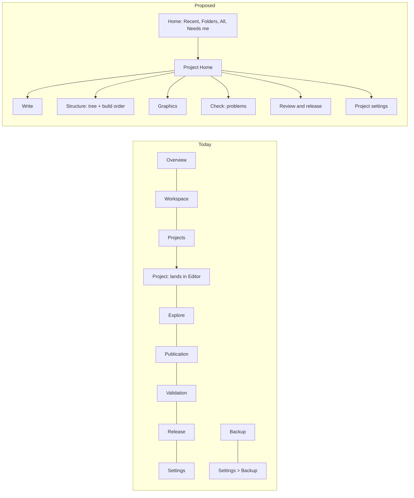
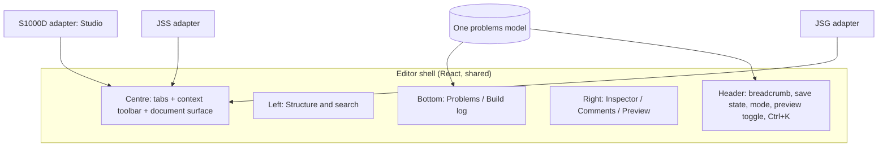

## 6. Recommended navigation architecture

### 6.1 Principles

1. **Where am I, what is next.** Every page carries the project name and a breadcrumb; every project has a home that answers "what needs me" in one screen.
2. **One place per thing.** One project list, one tree, one problems model, one Backup entry. Today each exists in two to four forms (UX-013, UX-014, UX-008).
3. **Navigation by task, not by object.** Write, Check, Review and release are tasks; "Explore" and "Publication" are two views of the same structure.
4. **Keep the keyboard first.** A quick switcher (Ctrl+K) and landmarks make the platform operable without the mouse (UX-005, UX-021).
5. **Do not widen the product.** Nothing below adds a back-end concept; it re-arranges what already exists.

### 6.2 Today and proposed



The proposed structure removes three top-level items (Workspace and Projects merge into Home; Backup moves to account settings and the project menu) and replaces Explore, Publication and the DM panel's tree with one Structure view (UX-013).

### 6.3 Global shell

```
+----------------------------------------------------------------------------------+
| Agastya  Home > Hydraulic Pump > DMC-...-040A     [ Jump to...  Ctrl+K ]  (bell) RA|
+--------+-------------------------------------------------------------------------+
| Home   |                                                                         |
| Graph. |   page content                                                          |
| CIR    |                                                                         |
| Review |   (project manager / administrator only: Review queue, Administration) |
| Admin  |                                                                         |
|--------|                                                                         |
| Help   |                                                                         |
| Offline|                                                                         |
+--------+-------------------------------------------------------------------------+
```

- The top bar stops repeating the page title; it carries the breadcrumb and the quick switcher (RECOMMENDATION; replaces the `h1` at `AppShell.tsx:75`).
- A visually hidden "Skip to content" link and a `main` landmark are added (UX-005).
- Notifications stay in the bell; the page becomes a list with deep links (UX-029).

### 6.4 Home, by role

| Role | First thing they need | Home shows |
|---|---|---|
| Author | Get back to the document they were in | "Continue" card (last file, last cursor position), "Needs you" (open review comments, problems from the last check), Recent, Folders, All projects as a table view |
| Project manager | See what waits for them | Review queue (today's "Release requests waiting for you" from Activity), projects by status, people active this week |
| Administrator | Know the platform is healthy | Users and sessions, last backup age, disk and workspace health if available (NOT VERIFIED: data source), audit shortcuts |
| Reviewer, viewer | Read and comment | Only projects they can open; entry straight into the reading view |

Sample-project buttons move to the empty state of Home and to Help; they are not a daily action (UX-014).

### 6.5 Project shell and Project Home

The rail keeps its 56 px collapsed form, gains a text label that shows on hover **and on keyboard focus**, and can be pinned open (about 168 px). The project name is shown at the top of every project page. Items: Home, Write, Structure, Graphics, Check, Review and release, Settings. JSS and JSG show the same items; Structure shows the chapter outline for those formats and "Ancillary pages" becomes part of it (UX-001, UX-007).

```
Hydraulic Pump Maintenance Manual      S1000D 4.2 · you are owner          [ Open editor ]
+--------------------+ +--------------------+ +--------------------+ +---------------+
| Continue           | | Check              | | Review             | | Last build    |
| DMC-...-040A       | | 0 errors 3 warnings| | Not submitted      | | never         |
| edited 12:04       | | run 11:50  [Run]   | | [Submit for review]| | [Build draft] |
+--------------------+ +--------------------+ +--------------------+ +---------------+
Needs attention
  - 2 open review comments  ->  Description / General
  - 1 data module is not in the publication  ->  Structure
Recent documents                         Team                          Activity
```

Acceptance for Project Home is in UX-007. It reuses data the project already exposes (`ProjectShell` summary, validation run, release status); no new back-end concept is proposed, but the exact fields available per format are NOT VERIFIED for JSS and JSG.

## 7. Workspace architecture and the editor workspace redesign

### 7.1 One workspace shell, three document adapters

Today the S1000D Studio owns its layout (`studio/ui/app.ts`), while JSS (`jss/editor.ts`) and JSG (`jsg/editor.ts`) draw their own. The redesign does not ask to rewrite the engines. It asks for one **page-level shell** in React (the part that already exists as `EditorPage`, `JssEditorPage`, `JsgEditorPage`) that owns the regions, the header, the save state, the preview pane, the problems panel and the shortcuts, with each editor supplying an adapter: its document surface, its toolbar content, its outline and its findings.



### 7.2 Layout and the editing area

Measured today (Edge, one data module open; share of the viewport taken by the editing surface, VERIFIED):

| State | 1366x768 | 1920x1080 |
|---|---|---|
| Default: Split, DM panel open | 28.9% | 35.9% |
| Editor only, DM panel open | 51.7% | 64.1% |
| Editor only, DM panel hidden | 64.1% | 74.2% |
| Editor only, DM panel hidden, Outline + Attributes + Problems panes open | 23.7% | 40.4% |

Proposal (targets, to be tested in UX-002): the default for a new session is **Write** mode with the structure panel at 220 px and the preview closed, giving at least 55% of a 1366x768 screen; a "Focus" toggle (F11-like, or `Ctrl+.`) hides everything but the surface and a slim header; the 131 px ribbon collapses to a 32 px tab strip that expands on click, with the context toolbar (7.3) providing the most used actions; the Problems panel opens as a **bottom drawer of at most 25% height** and closes with Escape. Panel widths are remembered per format, per user.

```
Write mode, 1366x768 (editing surface >= 55%)
+------------------------------------------------------------------------------+
| <  Hydraulic Pump / Description    * Saved 12:04     [Write|Review|Source]  K |
+---+----------------+---------------------------------------------------------+
|rl | Structure      | [DMC-...040A x] [DMC-...520A x] [+]                      |
|   | search...      | B I U  x2  list  insert v   (context toolbar, 32 px)     |
|   | v Description  |                                                         |
|   |   Hydraulic p. |             document surface                            |
|   | > Procedures   |                                                         |
|   | > Fault isol.  |                                                         |
+---+----------------+---------------------------------------------------------+
| Problems: 0 errors 3 warnings   Draft PDF 12:01 (stale)   289 words  S1000D 5.0 |
+------------------------------------------------------------------------------+
```

### 7.3 Modes and context-sensitive toolbars

- **Write** (default): the document surface. Toolbar contents change with the selection (text, list, table, figure, reference) instead of showing every group at once. This is how the existing ribbon groups (Text, Paragraph, Structure) can be reused with a third of the width.
- **Review**: read-only surface with comments in the margin (the existing `ReviewReader` anchoring), and a "next comment" key. Reviewers and project managers open here by default (UX-009).
- **Source** (S1000D only): the existing XML and Split views, kept as they are; JSS and JSG do not expose XML.
- **Preview** is not a mode but a toggle (right panel); full-width PDF stays available (UX-002).

### 7.4 Validation feedback

Four tiers, one model (UX-008): (1) inline marks on the element or the line, (2) a status-bar chip with counts that opens the drawer, (3) the Problems drawer with severity filter, "next problem" (F8) and "open at location", (4) the project-level Check page that lists the same items for every file. "Reviewed" and "waived" are stored per project on the server, not in the browser. Live validation, already on by default in Studio (Settings dialog), is offered to JSS and JSG as "check after pause", not only on the Check button.

### 7.5 Search and replace

One find bar for all three editors, with scopes: this document, this section, **all documents in the project**. Replace across documents shows a list of changes first and applies them as one undoable step. Studio already has scopes within a document (`studio/ui/findbar.ts`); JSG has a find bar; JSS has none (UX-017). Project-wide search needs a server or index capability that this audit did not check (NOT VERIFIED).

### 7.6 Preview

Keep the side-by-side PDF as an opt-in panel with an explicit state: "up to date", "stale since 12:04 (3 edits)", "building". A preview that is only a build button plus a placeholder (`hd-s1k-split.png`) wastes half the screen before the first build; show it only after a build exists or on request. Click-to-source between the PDF and the document depends on the build emitting positions: NOT VERIFIED.

### 7.7 Shortcuts

A single table for all editors, shown in one dialog and in the palette (`?` or Ctrl+/): Ctrl+S save, Ctrl+Z / Ctrl+Y undo and redo, Ctrl+F find, Ctrl+H replace, Ctrl+K jump to anything, Ctrl+Shift+P command palette (alias, see UX-027), Ctrl+B / I / U, F8 and Shift+F8 next and previous problem (already in Studio, `commands.ts:136-137`), Ctrl+. focus mode, Alt+1 / 2 / 3 switch panels, Esc close drawer. Today JSS handles only Ctrl+S, Ctrl+Z, Ctrl+Y (`jss/editor.ts:162`), JSG adds Ctrl+F and Ctrl+H (`jsg/editor.ts:94`), Studio has the full registry (UX-003).

### 7.8 Large documents

The JSG sample loaded and rendered a 47,447-word handbook with 244 figures and 60 tables within the 4 s wait of this audit (VERIFIED as a load, not as a timing). Typing latency, outline update cost and scroll smoothness at that size were not measured (NOT VERIFIED). Proposed behaviour: outline built lazily and collapsed beyond level 2; sections beyond the viewport rendered on demand; validation incremental per section; a visible "large document" notice when a feature is deferred. Acceptance target for a later performance agent: input latency under 100 ms at 50,000 words on the reference laptop.

### 7.9 Save state and recovery

One vocabulary in all three headers: "Saved 12:04", "Unsaved changes", "Saving…", "Save failed: retry". Autosave on by default for every format with a draft that survives a crash or tab close (S1000D already offers recovery drafts, `55-settings.png`; JSS has none, JSG autosave is off by default: UX-010). The Save button stays for those who want it, and Ctrl+S always works.
