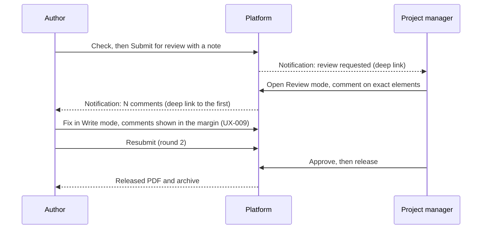

## 8. Evaluation of candidate UX features

Each feature is judged against four real jobs: **authors** (write and fix all day), **reviewers and project managers** (read, comment, approve), **publishers** (assemble, build, release) and **administrators** (people, reference data, backup). Value: H high, M medium, L low, - none. The platform is offline and on-premises with small teams, which weighs against anything that needs a network, a large admin effort or heavy maintenance.

| Feature | Today | Auth. | Rev. | Pub. | Adm. | Verdict and reasoning |
|---|---|---|---|---|---|---|
| Command palette | S1000D Studio only: File and Edit commands, Mod+Shift+P (`commands.ts:169`); not in JSS, JSG or the platform | M | L | H | M | **Do next, widen.** Cheap because the Studio registry exists. Add navigation ("Go to Validation", "Open DMC-...", "Build draft") and a platform-level Ctrl+K. Publishers jump between Structure, Check and Release; authors already have the ribbon. |
| Global search | None. DM-panel search only filters the open project (`EditorSide.tsx`); Projects and Workspace have name filters | M | M | H | L | **Do next, scoped.** First "jump to": projects and files by title, code or name. Full-text across projects needs an index: NOT VERIFIED whether the back end supports it. Not worth a large investment before the quick switcher exists (UX-021). |
| Keyboard shortcuts | Complete in Studio; Ctrl+S/Z/Y only in JSS; JSG adds Ctrl+F/H | H | M | M | L | **Do now for parity** (UX-003). Authors type for hours; a missing Ctrl+F in JSS is felt immediately. One shared table, one dialog. |
| Customizable workspace | Layout and split widths remembered in `localStorage` (`agastya.editor.*`, `studio.layout`) | M | L | L | L | **Do selectively.** Offer three presets (Write, Review, Focus) and remember the last one. Free customisation costs support and tests for a small user base. Preferences kept only in the browser do not follow a user to another PC: moving them to the user profile is worth doing if a profile store exists (NOT VERIFIED). |
| Resizable and dockable panels | Resizable: DM list and editor/PDF dividers (`role="separator"`); Studio panes toggle | M | L | L | - | **Resizable yes, docking no.** Keep fixed regions with collapse and resize. Floating or re-dockable panels are an IDE feature; technical authors do not ask for them. The editor/PDF divider must become keyboard-operable (`EditorPage.tsx:147`, UX-005). |
| Split views | Editor/PDF; Design/XML; Tags | H | M | M | - | **Keep; add one.** Two documents side by side (reference while writing, compare while reviewing) is useful for reviewers: do later (P3). |
| Tabbed documents | Studio has document tabs; JSS and JSG are one document per project | H | L | - | - | **Keep in Studio only.** JSS and JSG do not need tabs. Add "reopen closed tab" and per-project restore of open tabs if not present (NOT VERIFIED). |
| Breadcrumbs | Studio status bar shows the element path (`dmodule > content > ...`); header shows project and file | M | M | M | L | **Do now.** A platform breadcrumb (Home > project > file) answers "where am I" on pages that show no project name (UX-007). Very cheap. |
| Context-sensitive toolbars | Ribbon always shows every group; items grey out | H | - | - | - | **Do with the layout work** (UX-002). It is what lets the ribbon shrink without losing function. |
| Drag and drop | Publication chapters and modules (with button alternatives), graphics drop zone, file drops into Studio (`app.ts:434`) | M | - | H | - | **Keep; add keyboard parity** where missing. Do not add more drag-only interactions. |
| Bulk actions | None seen: Projects, DM panel, Users, Validation findings act one at a time | M | L | M | M | **Do selectively.** Multi-select in the DM panel (add to publication, delete), "mark all in this file reviewed" in Validation, multi-disable in Users. Only where the list is long. |
| Undo/redo, autosave, save-state | Undo/redo in all editors; Publication has Undo; three save vocabularies; recovery drafts only in S1000D; JSG autosave opt-in | H | L | L | - | **Do now** (UX-010, UX-003). Loss of work is the costliest failure in an authoring tool. |
| Recents and favorites | Recents: Overview, Projects sort "Recently opened", Studio "Recent files". Favorites: none | M | M | M | L | **Recents yes; favorites later.** Pinning only helps once a person has more projects than fit on one screen. |
| Quick actions | Header buttons per page | M | M | M | M | **Do with Home and Project Home** ("Continue", "Build draft", "Submit for review"). Not a separate feature. |
| Dashboards | Overview tiles and tables; Activity page | L | M | M | M | **Replace, do not add.** Counts do not tell anyone what to do. Use "needs attention" lists. An analytics dashboard has no audience in a small offline team. |
| Advanced filtering | Present in Validation, Graphics, Overview tabs; absent from audit log, Users, DM panel by status or type | M | L | M | H | **Do selectively** for the audit log (user, date, action), Users, and the DM panel (status, type). |
| Smart notifications | One list page with All/Unread; no email by design | M | H | M | L | **Do next, narrowly.** Only events that ask for action (review requested, comments added, release approved or refused, build failed) with a deep link to the place. No toast storms. What notifications exist and how they link is NOT VERIFIED (UX-029). |
| Contextual help | None found: no Help item, no inline explanations of CIR, BREX, SNS, DMC, ICN | M | M | M | M | **Do now, small.** Short inline explanations for the jargon and a Help page with the offline documentation. No chatbot, no tour. |
| Onboarding | Credentials gate only (`AuthScreens.tsx:100`); samples as buttons | M | L | L | H | **Do selectively.** An administrator first-run checklist and a guided empty state for a new author's first project. Skip tours: they are ignored and cost maintenance. |

## 9. Ideal end-to-end workflows

Where today's UI interrupts the ideal path, the finding is named.

### 9.1 Author: the daily loop

1. Sign in. Home shows **Continue: DMC-...-040A, edited yesterday 17:42** and what needs attention (UX-007).
2. One click opens the document in Write mode with at least 55% of the screen (UX-002), the structure panel shows where it sits, the breadcrumb says so.
3. Typing is validated after a short pause; the status chip counts, F8 jumps to the next problem (UX-008).
4. Saving is automatic with a visible time; a crash loses nothing (UX-010).
5. Preview opens beside the text on request and says whether it is stale (7.6).
6. Before handing over, **Check** runs the whole project; findings can be marked reviewed once, for everyone (UX-008).
7. **Submit for review** with a note, from the page the author is already on.

### 9.2 Review loop

Today the comment reader exists on the Release page only (`ReleasePage.tsx:168`), and the author does not see a comment while editing (UX-009).

### 9.3 Publisher: structure, draft, release

Structure (order chapters, see what is not placed) then Build draft, where a refusal explains itself and a waiver is offered only for what it can cover (`PublishRefusal.tsx`, a strength), then Release, where the PM approves. The ideal differs from today in three places: JSS has no working Publication page (UX-001); Explore and Publication show the same tree (UX-013); Watermark options take as much room as Submit on the Release page (section 5.4).

### 9.4 Import an existing package

Home, New project, Import. After import, a summary that links to the first failing file and offers "Open the first problem". The dialog already shows progress with a `role="status"` region (`ImportPackageDialog.tsx:168`); the result screen was not rendered in this audit (NOT VERIFIED).

### 9.5 Administrator: first run and upkeep

First-run checklist (organisation defaults, first users, first project), then users and roles with search and filters, then a regular backup with the age of the last one on Home. Restore guidance sits next to Backup (section 5.2). The audit log is filterable by user, action and date (UX-025).

## 10. Accessibility recommendations (WCAG 2.2 AA)

Probes: a Tab walk through the shell (14 stops), overflow probes, structural queries (landmarks, headings, skip link), code reading. No screen reader was run (section 13). Contrast is E2's remit and is not assessed.

| Criterion | Status | Evidence | Recommendation |
|---|---|---|---|
| 1.3.1 Info and relationships | Partial | Forms use `Field` with `htmlFor` and `aria-describedby` (`ui.tsx:46-55`): good. No `main` landmark; zero `main` elements found (VERIFIED). `role="menu"` is used for the account menu without menu behaviour | Add `main`; use `role="menu"` only with arrow-key support (UX-005) |
| 1.4.10 Reflow | Fails on JSS and JSG project pages | Page scroll width 1112 and 1121 at 390 and 820 px wide (VERIFIED, UX-020). Toolbar-heavy editor surfaces may fall under the two-dimensional layout exception; the page header controls do not | Wrap or overflow-menu the header actions below 900 px |
| 2.1.1 Keyboard | Fails | Projects table rows and the administrator Overview rows open only on click: Tab after "New project" reaches only the Copy buttons; 0 of 6 rows had a focusable target in the administrator table (VERIFIED, UX-005). Editor/PDF divider is pointer-only (`EditorPage.tsx:147`) | Make the name a link; add key handling to the divider |
| 2.4.1 Bypass blocks | Fails | No skip link, no `main` (VERIFIED) | Add both |
| 2.4.2 Page titled | Weak | `index.html:7` sets "Agastya Platform"; no code updates it per route (only the pop-out window and standalone Studio do) (VERIFIED by search) | Set the title per route: "Validation - Hydraulic Pump - Agastya" |
| 2.4.3 Focus order | Fails in dialogs | 50 of 60 Tab presses left an open dialog (VERIFIED, UX-004) | Trap focus; return it on close |
| 2.4.7 Focus visible | Passes in the shell | 2 px outline on all 14 stops probed. Studio, JSS and JSG surfaces not probed | Probe the editors |
| 2.4.11 Focus not obscured (2.2) | NOT VERIFIED | Sticky headers and the Problems drawer could cover focus | Test with the drawer open |
| 2.5.7 Dragging movements (2.2) | Mostly passes | Publication drag has up/down/remove buttons (`PublicationPage.tsx`); the editor/PDF divider has no alternative | Keyboard resize |
| 2.5.8 Target size minimum (2.2) | NOT VERIFIED | Icon-only buttons in the DM panel looked about 24 px; not measured | Measure; enlarge below 24 px |
| 3.2.6 Consistent help (2.2) | Not applicable yet | No help mechanism exists | When Help is added, keep it in the same place |
| 3.3.1 and 3.3.3 Error identification | Passes in forms | `Field` error uses `role="alert"` (`ui.tsx:51`) | Stale error across Sign in and Reset (UX-023) |
| 3.3.8 Accessible authentication (2.2) | NOT VERIFIED | Password fields present; paste handling not tested | Allow paste and password managers |
| 4.1.2 Name, role, value | Partial | Icon buttons carry `aria-label`; segmented controls use `aria-pressed`; JSS ribbon has ARIA tabs; `div role="button"` rows handle Enter only (`ValidationPage.tsx:118`, `jss/editor.ts:630`) | Handle Space; prefer real buttons |
| 4.1.3 Status messages | Mostly passes | `Alert` uses `role="alert"` for the bad tone and `role="status"` otherwise (`ui.tsx:28`); save state is `aria-live`; all toasts share one polite region (`ui.tsx:111`) | Assertive region for error toasts (UX-028) |
| Studio design surface | NOT VERIFIED | Role, name and instructions of the editable surface for a screen reader not examined | Test with NVDA before promising conformance |

A conformance claim cannot be made from this audit; the table lists what was checked.

## 11. Responsive behaviour

Probe: horizontal overflow of the page and of key controls on the author account, Edge headless, scratch data (VERIFIED unless marked).

| Width | Platform pages | Project pages | Editors |
|---|---|---|---|
| 1920x1080 | Fine; content max width leaves empty right space on Projects and Overview | Fine | Fine; S1000D Split gives 902 px editing width with DM panel open (35.9% of the screen); ribbon label "Delete elemen" still clipped |
| 1366x768 | Projects toolbar overflows: "New project" right edge at 1461 px (UX-006). Others fit | Fine | Editing surface 29% by default (UX-002). JSG header: the "PDF" segment lies beyond the right edge (UX-006); JSS and S1000D headers fit |
| 1280 | Projects as above | Fine | JSS header: "PDF" beyond the right edge; JSG header: "Split" and "PDF" beyond it; the header does not scroll (UX-006) |
| 1024 | Projects as above; Workspace "New project" right edge at 1145 px | Fine | Not measured separately |
| 820 | Overview, Admin Users fit; Projects and Workspace controls clipped | Publication fits | JSS and JSG page scroll width 1112 and 1121; Editor/PDF controls and Export clipped; S1000D ribbon groups beyond the right edge, DM panel becomes an overlay (`platform.css` 900 px rules) |
| 390 | Overview fits in width but the "Recent projects" heading overlaps the next heading (`m-overview.png`) | Publication fits | JSS and JSG: page scroll width 1112 and 1121; S1000D editor usable only with the DM panel closed |

The existing responsive spec covers only publishing settings, publication and release (`frontend/e2e/zz-responsive-layout.spec.ts`). The product is a Windows desktop tool; phones are not a target. The realistic narrow cases are a half-width snapped window (about 683 px on a 1366 px screen) and a second monitor in portrait. Recommendation: add the three editor pages, Projects and Workspace to that spec at 683, 820 and 1024 px, and make the header actions wrap or fold into a "More" menu (UX-006, UX-020).
